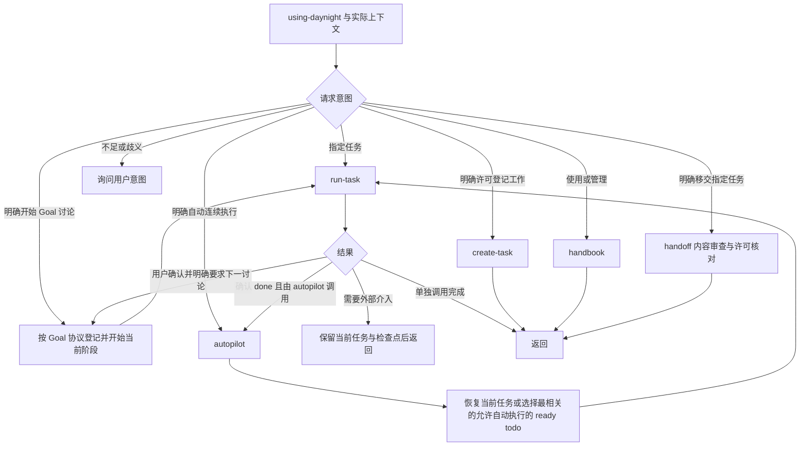

# using-daynight 项目任务 Skill 设计

[需求](../spec/daynight-agent-skill.md)拥有公开行为，
[模式决策](../../.agents/notes/implemented/architecture/2026-10-21-using-daynight-modes.md)
拥有模式职责划分与替代方案；[内容与移交决策](../../.agents/notes/implemented/process/2026-10-25-task-content-handoff.md)
拥有内容单一所有权和审查后启用许可的取舍；[原分发决策](../../.agents/notes/implemented/architecture/2026-10-21-public-agent-skill-design.md)
保留安装机制的原始理由。[Project/Task CLI](daynight-project-task.md)与
[附件设计](daynight-task-attachments.md)继续拥有服务访问、版本、依赖和文件操作。

[Goal 流程设计](daynight-goal-workflow.md)拥有需求讨论、方案讨论、确认后实际拆分、
实施和整体验收的阶段协议。普通任务与
Goal 阶段使用同一自足正文与资料所有权规则。共享输入按来源 task ID 与明确的
description 全文/适用章节、真实附件完整路径或已核验不可变仓库引用读取；阶段结果不能
成为开始其生产阶段的前提。

## 一个入口与按需加载

npm 包发布一份英文 `using-daynight` skill。`SKILL.md` 只负责发现说明、路由和共同
约束，各模式按需读取自己的引用文档。handbook 提供命令用途索引，以及项目发现、
并发更新等操作背景；参数和调用方法由已安装 CLI 的 `--help` 提供。这样普通查询只需
加载简短背景，连续调度与指定任务执行仍共用完成要求。

```text
packages/daynight/
  src/commands/skill/
    definition.ts
    command.ts
    agents.ts
    targets.ts
    install.ts
    skills/using-daynight/
      SKILL.md
      references/
        handbook.md
        autopilot.md
        run-task.md
        create-task.md
        goal.md
        task-content.md
        handoff.md
  src/platform/skill-bundle.ts
  dist/commands/skill/skills/using-daynight/
    SKILL.md
    references/
      handbook.md
      autopilot.md
      run-task.md
      create-task.md
      goal.md
      task-content.md
      handoff.md
```

`using-daynight handbook` 等表达是 Agent 的模式选择协议，不是新增 Daynight CLI。
宿主加载入口后，Agent 使用实际请求与上下文路由。裸调用可能进入任一有充分依据的
模式；上下文不足或歧义时询问意图。autopilot 额外要求用户明确请求自动连续执行，
不能由主题关键词、任务存在或单任务完成推断启动。

入口在模式路由前声明必需追踪与评审规则：skill 和 Daynight 可用时，通过 Daynight
管理有明确目标和完成条件的具体工作，包括 feature、bug 修复、架构或设计工作及
拆解出的实际工作项。Agent 自动生成的读文件、运行命令、常规检查等执行步骤留在
执行计划中；独立验收或验证有自身交付成果时仍可成为任务。方案、架构、设计评审
统一使用所属任务。Agent 在请求用户审阅前将完整当前内容写入 description 或附件，
读回确认，再提供任务和资源引用；后续修订和评审决定同步保存。简短待审方案可直接
使用 description 或其明确引用的拥有文档；确认、验收结论与交付证据在当前任务内
有明确落点，不维护竞争的完整副本。实际 CLI、服务和目标项目读取确认可用性，失败保留真实原因。

task 创建许可是所有模式共享的独立前提。用户直接要求创建，或已有指定范围的明确
创建许可时，才允许创建 task。用户或适用仓库要求通过 Daynight 追踪或评审的明确
指示，属于已确认范围内必要任务的长期创建许可；优先复用已有任务，无需重复确认。
普通实现请求、上下文路由和 autopilot 启动本身不能替代该许可。需要创建而没有许可
时先询问用户。创建许可不扩展执行或交付权限。用户明确开始 Goal 需求或方案讨论时，
用观察版本 set-status in_progress 启动指定阶段；仅登记保持 todo。已有明确执行范围可持续
覆盖 ready 后继，不增加任务审批。阶段确认仍由用户完成，不能由自动流程代替。



skill、任务和附件不授予额外交付权限。Goal 讨论按用户确认与阶段验收完成；独立仓库
交付或用户明确纳入阶段验收的 PR 仍须满足实际合并要求。保留 PR 的指令约束该交付，
不能以讨论完成代替代码或文档已经交付。

## 文档职责与任务资料

| 文档 | 所拥有的规则 |
|---|---|
| `SKILL.md` | 触发说明、必需追踪与评审、上下文路由、明确 autopilot、共同授权、单任务推进、执行与讨论的共同范围约束、统一终验收规则 |
| `handbook.md` | 命令用途索引与项目定位、查询范围、精确版本、替换和附件独立性等背景 |
| `create-task.md` | 明确创建许可、具体成果边界、已有任务匹配、资料准备与登记完整性 |
| `run-task.md` | 指定任务恢复、范围与验收边界确认、实现验证、交付与完成、阻塞返回 |
| `autopilot.md` | 当前任务恢复、相关性选择、串行循环及停止条件 |
| `goal.md` | Goal 判断、顺序讨论与用户确认、阶段开始授权、确认后实际拆分、恢复和整体验收 |
| `task-content.md` | 六项内容标准、唯一内容所有者、引用读取、阶段适用性与任务证据位置 |
| `handoff.md` | 指定移交授权、充分性审查、许可更新、只读复审、状态与并发结果核对 |

task description 明确当前任务、责任与资料入口。`task-content.md` 为创建、Goal 拆分、
移交和执行提供同一六项内容标准：目标与要求、范围与交付物、方案与设计、输入与输出
契约、验收标准与验证方法、资料。正文可以直接提供，也可以引用实际拥有内容的文档，
或混合组织；正文完整时没有强制主附件。每项内容只有一个拥有位置，当前任务的确认、
验收结论和交付证据也有明确的本任务正文或附件位置。执行必需的进一步引用实际读取，
记录资源身份避免循环读取；不足、不可读或冲突不能由链接存在掩盖。
create-task 仍拥有 Markdown 写作示例；入口链接共享标准，run-task 读取实际内容并
保留更新后的完整 Markdown 和有效引用，handbook 说明原始字符串、完整替换与路径
基准，Goal 协议保留各阶段及交付正文的附加入口条件。

Web 复用附件的 CommonMark/GFM 阅读能力；API、CLI 和 Agent 仍读写原始描述字符串，
不增加格式字段。相对描述链接及图片从当前任务附件根解析，Markdown 附件内部引用
从文件目录解析。真实大小写、任务根约束与来源身份保持有效；确认上传并读回内容后
才把资源写入正文。示例 `[方案与验收](plan.md)` 与 `[交互原型](mockui/index.html)`
只在这些文件实际属于该任务时适用，共享 Goal 资料保留在其唯一来源；阶段尚未生成的
输出不成为可用链接。Web 的链接激活、URL 策略和预览状态由
[任务阅读设计](daynight-task-inspection.md#markdown-与附件链接)及
[附件设计](daynight-task-attachments.md)拥有。

完整依赖由 dependsOn、明确外部子集由 externalDependsOn 维护；同链普通，核验过的其他同项目链前置为外部。
CLI 的普通/外部声明编译完整并集和精确外部子集，更新先读取并保留仍需关系。外部不免除阻塞，
不按状态、标题或当前投影猜测分类，也不扩大执行范围。PR URL/title 由 `properties.pullRequests` 维护；执行位置、
阻塞、等待和下一步属于既有检查点。

方案与验收按任务语言提供，等价英文标题有效；内容可以在正文或真实引用中，文件名
由实际来源决定。共享 Goal 要求
保留在需求任务，设计与拆分保留在架构任务。每个交付 description 直接列出架构任务
ID 及每个必需来源：架构在来源任务正文时标明 description 全文或其中适用章节，读取该任务
的 `task show --json`；实际附件文档列完整路径，仓库文档使用已核验不可变引用并
保留所属架构任务身份。间接后继同样保留直接入口，不为正文内容编造附件路径或
要求迁移存放位置。登记读回逐项检查这些入口，执行者在
实施前读取所列输入；资料引用不改变执行依赖。独立快照必须有实际需要，并记录
来源版本与目的；不增加 `task://`、跨任务相对链接或固定主机约定。

```text
task.description
  当前任务责任与资料入口
  六项内容可直接提供，或引用实际拥有文档
  本任务确认、验收结论与证据的拥有位置
attachments/              # 按实际需要
  plan.md                 # 可选的本任务详细内容和证据
shared inputs/
  source task ID + description/sections  # 使用既有 task show
  source task ID + attachment path        # 实际附件使用既有读取命令
```

create-task 在明确许可内区分普通单成果与多阶段 Goal，复用前核对任务、资料和目标。
Goal 首先只登记 `[Goal]<outcome>` 需求讨论 task。仅登记请求核验后返回；明确开始
讨论时按观察版本 set-status in_progress。需求讨论产出整体要求及适用的最终
样式纯前端交互原型，不作生产实现或具体架构决策。用户确认需求并要求方案讨论后，
完成需求 task 并核验 done，才创建并开始普通依赖它的方案 task。候选拆分先在方案
材料内讨论，用户确认当前方案后才实际登记 todo 交付任务及依赖。全部资料读回
核验后方案讨论才完成；实施根依赖方案 task。完整阶段规则由 Goal 设计拥有。

适用原型覆盖最终视觉、主要数据与交互状态及必要资源。它是 UI Goal 描述阶段的产出，
随后供设计和相关实施任务复用；执行者查看并操作原型，不能凭文件名认为已理解。
普通前端实施任务同样读取其已有原型。完成证据及 merge commit 写入本任务明确
指定的正文或附件位置，与对应验收项关联。

任务创建、附件和引用更新仍是独立操作。成功后部分失败保留原 ID 补全，不确定写入
先核对真实结果；使用决策时读取的精确版本更新完整字段。全部当前阶段必需资料和
共享来源可读才报告登记完整。仅登记和新交付任务为 todo，登记不开始执行。
明确讨论指令启动当前阶段；Goal 创建许可按确认顺序生效，不预建未来阶段或要求未来产出先存在。
公开skill按任务语言编写资料，接受等价英文标题；具体仓库或会话的文档语言指示继续适用。
handbook 解释数据与错误背景，具体参数由已安装 CLI help 拥有。

## 终验收与开发交付

规范源的 [SKILL.md#final-acceptance](../../packages/daynight/src/commands/skill/skills/using-daynight/SKILL.md#final-acceptance)
统一拥有终验收规则。create-task 在登记时明确整体验收对象、需求来源和结论与证据
交付；goal 在拆分与整体完成时引用同一规则；run-task 在选择验证方法前区分终验收
与开发交付，并在无需代码或 PR 的完成路径中处理终验收。autopilot 继续委派给
run-task，不维护第二套验收或完成协议。

终验收对整个已确认任务或 Goal 及其已确认变更给出需求对照结论，证据同时说明被测
来源、环境、方法、观察结果、缺陷、未验证项及重要限制。材料保存在所属任务，不要求
增加机器回执 schema 或证据平台。人工、已有检查和临时辅助脚本按实际需要组合；
临时脚本遵守项目临时目录和资源清理规则，其必要观察结果保留在任务材料中。

临时辅助脚本不进入仓库交付或形成 PR 门槛，因此辅助工具的维护和评审不能改变
终验收目的。正常实现、授权修复及明确要求的长期自动化仍保留其开发交付和测试。
发现缺陷时记录未满足项，按已有权限修复和复验；未满足或未验证的整体结果保留在
验收结论中，具体行为遵守[终验收要求](../spec/daynight-agent-skill.md#终验收任务)。

## 移交审查与许可

`handoff.md` 只接受明确指定的移交对象。先读完整 task 和 worker 信息，再按共享内容
标准读取必需资料与必要进一步引用，检查当前阶段的充分性、范围和上下游契约。它能
依据已有确认信息整理尚未启用的 todo；没有来源的要求或决定作为具体缺项返回。

资料更新和内容核验先于许可更新。最终审查所依据的 task version 传给现有
`task update --allow-agents true`；可在同一更新提交最终 description，不携带无关字段。
blocked todo 在设计和接口已清楚时可以预先移交，真实依赖继续阻止执行。已有 true 的
任务只读复审，失败保留许可并报告调度风险；不会把复审假定为暂停。撤销或停止按
另外明确的授权及现有控制流程执行。in_progress 的 false 不启用，done 按模式策略
无需移交，active/released worker 保留所有权和原 worktree/Agent 连续性。

附件和跨任务文档不受目标 task version 保护。开启前核验所依赖的可变内容，执行时
再次读取；资料变化后重新审查受影响部分。此边界只提供尽力核对，不引入审查令牌、
服务端认证、不可变快照或原子引用冻结。flag 为 true 不构成永久内容认证。

冲突使原决定失效，需重读和重新判断。未知写入通过读取协调，不自动重放；读取失败
保留未确认状态和真实错误。调度器可在许可更新后立即认领，最终读取的更高版本或
in_progress 是合法观察。结果报告实际 flag、状态、worker、依赖阻塞与审查结论，
不强制读回版本等于更新响应，也不把并发者设置相同 flag 归因于自身写入。handoff
不启动当前会话执行，完整状态处置由[需求 AS11](../spec/daynight-agent-skill.md#as11-handoff-的移交审查)拥有。

## 单任务执行与调度

run-task 的输入是明确 ID。它刷新正文、必需引用、任务证据位置、真实共享输入与必要资源，
按阶段检查授权、依赖和资料。开始分析、提问或提出方案前，明确该任务已确认的范围
与验收条件，并应用 SKILL.md 的共同范围约束；完整规则只由入口持有，run-task 保留
执行提醒。执行、分析和讨论及 subagent 工作都由当前任务的目标、范围、交付物与
验收条件界定。共享 Goal、架构、兄弟和后续任务只提供所需的输入、接口与约束，不能
因读取这些资料就纳入其他任务的交付。跨任务问题以阻塞或后续建议呈现，沿用既有
创建和执行授权规则；扩大当前任务范围须用户明确确认。Goal 级讨论或整体验收的当前
任务可以覆盖其已确认的整个 Goal 范围。

澄清和设计使用 stage brief，未来阶段输出不充当输入。ready todo 在已有明确执行
范围、前置与阶段资料齐备后，以观察版本 set-status in_progress 开始。已有 in_progress
核对工作和检查点后恢复；done 的重开须属于明确工作范围并受依赖保护。状态不提供
独占或新执行权。当前阶段按仓库规则实现、验证并完成授权交付。

Goal 讨论以用户确认与阶段验收为完成条件。没有用户确认时保持 in_progress；讨论
并不因仓库存在文档 PR 规则而自动等待 PR 合并。独立的代码、文档或原型交付，以及
用户明确纳入讨论验收的 PR 交付，必须等所有必要 PR 平台确认合并并验收后，保留属性
与证据，用观察版本 set-status done。CI、review 和交付等待继续属于当前任务；subagents
协作同一任务。Goal 的明确用户转场由共享协议开始下一指定讨论，不启动 autopilot；
其他 run-task 完成后返回，不自行选择后继。

autopilot 只在用户明确要求后运行。当前任务由已有检查点关联并刷新，`in_progress`
清单只是恢复线索，不是所有权。无当前任务时读取有界 `task ready --allow-agents true --json`，按问题、范围、方案、验收和依赖选择与已授权目标最相关的一个许可开启且属于授权范围的 ready todo，再调用 run-task。补充候选 list 同样携带 true 筛选，在服务端排序与分页前应用。
自动选择只有确认 done 后才开始下一项。用户确认门槛不能由 autopilot 代替，讨论
未获确认时保留当前任务；外部阻塞也不换做无关工作。明确讨论转场按 Goal 协议处理。
发现目标范围缺少 task 时，只有取得或确认已有的明确创建许可后才能调用 create-task；
适用的长期追踪或评审指示属于已有创建许可；自动执行已有任务的许可本身不包含创建
许可。创建产生 todo，登记不开始执行，已有明确执行范围持续覆盖就绪后继。
自动发现只选 allowAgents=true 的 ready todo；明确指定任务与确定队列沿用手工执行路径，
可接受任一许可值，创建、拆分和调度不自行开启许可。只有明确移交授权下的 handoff
审查后启用。许可不改变 ready、状态或交付权限。

ready 默认最多 10 项，必要时使用 1..100 的 `--limit`。服务按创建时间和 ID 升序排序，
顺序不表达相关性。空页和不匹配页不能证明 backlog 完成；按需查询范围相关清单和图，
区分全部交付、依赖阻塞、其他工作进行中及当前候选不足。graph 的 1,000 节点 / 5,000 边
限制不等于项目未关联，详情必须使用 show。task list 仍穷尽匹配分页，默认排除 `done`；
需要包含已完成任务的完整清单或核对历史登记时显式包含已完成任务，选项从 CLI help
查询。结果按 `in_progress`、ready、其余 `todo`、`done` 稳定分组，组内保留服务顺序，
不表示相关性。文本列表是摘要；JSON 列表仅省略 `description`，保留其余 task
字段。需要描述时读取 show，ready、详情和写入结果继续返回完整 task 资源。

在仓库内可省略 `--project`，由 CLI 按 Git origin URL 匹配服务中的项目；显式指定的
项目优先。handbook 说明项目定位规则，不展开本地绑定文件与忽略规则的内部实现。
无匹配不自动创建项目。服务 origin 缺省使用 `https://daynight.cc`；缺少本地凭据或服务 401
提示 `daynight login`，不自动启动登录。自动化通过受控配置文件提供服务 origin 与匹配的 PAT；
review 配置缺失指向 `review add-repo`。网络、非法配置与歧义错误按真实原因处理。

handbook 规定基于已读内容的修改必须携带精确 `--if-version`，包括完整 int64 十进制
精度。update 和 set-status 都绑定该决策版本；默认临时 GET 不能
替代读写关联。description、依赖和 PR 列表是完整字段
替换；冲突后重读并重新决策。未确认写入先核对结果，不自动重复提交；具体选项及
输出格式通过 CLI help 查询。set-status 是版本化状态设置，不是 assignee 锁、可续期租约
或额外执行权限。任务只使用 todo、in_progress、done，同状态 +0，实际改变 +1；不确定结果仅 GET 核对。

自动发现先观察真实执行环境 process.platform：win32→windows、darwin→macos、linux→linux，WSL的Linux运行时仍为linux。
未知或不支持时等待，不从任务要求、配置、外层宿主或服务端推断。ready与补充list都携带allowAgents=true和
--compatible-platform <actual-platform>，筛选先于分页，不本地丢弃有界页。自动选出的ID保留自动模式与实际平台上下文，
进入in_progress前重读完整任务，复核todo/ready/许可=true/平台null或匹配，以该完整读取的精确版本设置状态。
资格变化重新选择，执行环境变化重新观察平台；不能把自动选出的ID当成人工指定。用户明确指定的任务或固定队列保留
手工路径，可接受任一许可或平台值，仍受依赖、阶段资料及原执行范围约束，不自行启用许可。

## 安装命令与既有机制

`daynight-review` 仍是 review runtime 的内部审查资源，其 plugin wrapper、快照、哈希
和发现校验独立。公开 skill 由 `skill` 命令持有，只共享普通 bundle 捕获和校验。

| 机制 | 所在位置与职责 |
|---|---|
| 轻量命令登记 | [命令表](../../packages/daynight/src/cli/commands.ts)延迟加载运行时，帮助只访问元数据 |
| 交互输入 | [CliPrompt](../../packages/daynight/src/cli/prompts.ts)共享 ask/select/selectMany，选择器按需加载 |
| 取消生命周期 | [cancellation.ts](../../packages/daynight/src/cli/cancellation.ts)管理终端信号、取消与关闭 |
| 资源打包 | [copy-skills.ts](../../packages/daynight/scripts/copy-skills.ts)明确列举公开与 review 两个完整 bundle，不扫描仓库 skill |
| 物理路径 | [filesystem.ts](../../packages/daynight/src/platform/filesystem.ts)解析已有祖先和未创建部分 |
| worktree 定位 | [git.ts](../../packages/daynight/src/repository/git.ts)只定位根，安装不依赖 origin 或服务 |
| 打包验收 | [installed-cli.ts](../../packages/daynight/test/fixtures/installed-cli.ts)真实打包安装与 launcher fixture |

入口保持 `daynight skill install`，不增加非交互参数、卸载命令、注册中心或用户修改
检测。`agents.ts` 拥有 Codex/Copilot CLI/Claude Code 的命令、路径、重载说明；
`targets.ts` 规划物理目标；`install.ts` 捕获字节、发布和清理旧名称；
`platform/skill-bundle.ts` 校验资源树与入口。`CliContext.packageDirectory` 定位包内资源，
不依赖 cwd。`files: ["dist"]` 包含完整相对资源。

检测依固定顺序查找 codex、copilot、claude，通过直接依赖 `which` 的薄适配器遵守原生
PATH、POSIX 执行权限、Windows 当前目录/PATHEXT/npm `.cmd`/带引号 PATH；不运行
launcher、`--version`、认证或模型调用。
[固定源码](https://github.com/npm/node-which/blob/2009c9dce0e9b0dae024192731987df752c6b4f0/lib/index.js)
说明它只检查文件。仅展示检测到的选项，初始不勾选，Space 切换、方向键移动、Enter
提交且至少选一项；再单选 User/Project，默认 User。无可用 Agent 或终端不可用明确失败。

`@inquirer/prompts` 延迟加载 checkbox/select，review 首次引导使用 readline ask。类型化 value
不从显示文本反推标识。stdin 提供输入，stderr 负责 UI，stdout 提供结果。共享执行器
管理 AbortController、SIGINT/SIGTERM、Windows SIGBREAK 和 finally 关闭；readline
占用 stdin 时进入选择器前暂停、退出恢复。仅已知取消异常转为既有取消错误，其余保留
原因链。依据为
[信号与 readline 协作](https://github.com/SBoudrias/Inquirer.js/blob/92ef32f5b3d9633933bd20bb8ef6ff434c1316bb/packages/prompts/README.md#advanced-usage)
及[checkbox 必选约束](https://github.com/SBoudrias/Inquirer.js/blob/92ef32f5b3d9633933bd20bb8ef6ff434c1316bb/packages/checkbox/README.md#options)。

## 安装目录、所有权与迁移

| Agent | User | Project |
|---|---|---|
| Codex | `~/.agents/skills/using-daynight/` | `<worktree>/.agents/skills/using-daynight/` |
| Copilot CLI | `~/.agents/skills/using-daynight/` | `<worktree>/.agents/skills/using-daynight/` |
| Claude Code | `~/.claude/skills/using-daynight/` | `<worktree>/.claude/skills/using-daynight/` |

User 使用 Node 用户主目录发现，可在仓库外安装。Project 使用当前 Git worktree 根，
子目录、linked worktree、submodule 各定位自身根；非 Git/bare 明确失败。安装不读取
server/review 配置，不要求 origin 或项目关联。支持目录和重载说明按
[Codex](https://developers.openai.com/codex/skills/)、
[Copilot CLI](https://docs.github.com/en/copilot/how-tos/copilot-cli/customize-copilot/add-skills)、
[Claude Code](https://code.claude.com/docs/en/skills) 维护。

先解析父级 skill 根的物理位置，再拼接 using-daynight 和旧 daynight 叶节点。父级链接
保留，leaf 不 realpath 跟随；替换或清理 leaf 链接保留原指向对象。同一物理根只写一次
并保留逐 Agent 结果；涉及新名称和旧名称的拥有路径出现严格祖先/后代冲突时，在任何
目录或 stage 创建前拒绝，并列出对应目标。路径按分量比较，不能使用字符串前缀。
共享父根链接允许去重；清理不得越过所选物理根或删除另一安装目标。

选择 Agent 表达兼容目标，不承诺发现隔离。Codex 和 Copilot 共用路径；项目中的
`.claude/skills -> ../.agents/skills` 也可使三者共用一次写入。其他 scope 不被修改，
同名副本不合并，Claude personal 优先于 project。原设计的 Copilot 探针曾在特定版本
观察到独立 `.agents`/`.claude` 同名副本与共享父链接均选择 `.agents` 候选，该 receipt
随原设计 PR 保留，仅为历史观察，不是跨宿主版本的保证。

安装先捕获包内完整 bundle 一次，验证 SKILL.md UTF-8、固定 frontmatter 名称
`using-daynight`、非空 description 和仅目录/普通文件的树；其他文件保持原始字节。
构建与验收校验相对引用，运行时不引入 Markdown 解析器。所有目标使用相同捕获字节。

预检后按 Agent 顺序串行处理唯一物理目标：

1. 首次写入前检查取消；创建并记录必要父目录，创建专属 stage，写入全部资源。
2. 再检查取消；取消则删除 stage，逆序清理本次新建且仍为空的父目录。
3. 删除 using-daynight leaf 并 rename stage 发布完整目录；两步之间不主动取消。
4. 发布成功后清理同一物理 skill 根内的旧 daynight leaf，再报告此目标完整成功。
5. 处理取消或继续下一目标。已经完成的目标保留，不跨目标回滚。

发布前不删除旧 daynight，避免重命名迁移先损失原入口。旧名称清理失败时新 bundle
保留，报告部分迁移及实际失败，停止后续目标并非零退出。完整替换不比较修改、不合并、
不备份；覆盖新名称时删除后 rename 失败仍可能使目标缺失。清理 stage 的错误保留
原因链，不能静默吞掉。重跑使用当前包完整恢复，安装不自动重试。

结果逐 Agent 给出 scope、路径、包版本和重载指引，共享目标标明同一次写入。Codex
通常自动发现，必要时重启会话；Copilot 使用 `/skills reload`、
`/skills info using-daynight`；Claude 已有根通常自动发现，新建顶层根时使用
`/reload-skills`。清理旧名称成功不表示其他 scope 的旧入口也被移除。

## CLI 更新时的自动同步

`commands/skill/refresh-installed.js` 是 npm 自更新调用的内部进程入口；公开命令仍为
`update` 与交互式 `skill install`。它从自身安装目录读取清单版本和完整 bundle，使用
现有 Agent catalog、物理路径规划、bundle 校验及顺序替换器，不引入安装 registry。
自更新先验证包和新 CLI，再调用该入口；当前或领先版本也调用，以修复落后的 skill。
独立进程保证模块及资源都来自已安装包，避免旧进程模块缓存与新包混用。
该内部进程的 Git 调用继承外层更新进程拥有的进程组；独立 Git 调用仍拥有自己的组。
外层在中断、超时和内部进程退出时清理所拥有的组，避免内部 Git 逃离清理范围。
Windows 沿用进程树终止机制。强制终止不能承诺 stage 清理或原子回滚。

检测使用用户主目录和调用目录所属 Git worktree 根。先沿调用目录祖先检查 `.git`
标记，存在时通过既有有界 Git 能力解析自身根；无标记只检查 User，读取错误继续抛出。
检测目标是已有 `using-daynight` 目录或叶链接，入口丢失和悬空叶链接仍可修复；普通
文件或其他非目录节点报错，缺失位置不创建。Agent launcher 不参与判断。

跨 scope 的已安装目标统一解析物理父目录、合并共享目标并检查安装和旧名称清理的
祖先冲突，预检完成后才使用完整替换器。每个结果保留相关 Agent、scope、物理路径、
包版本和重载说明。失败停止后续目标并报告部分结果；父进程另外说明 npm 包已更新
或保留，再以非零退出。重试 `update` 能从当前已安装包重新同步。
[自动同步决策](../../.agents/notes/implemented/feature/2026-10-24-update-installed-agent-skills.md)
记录范围和失败边界。

## 调用成本

常规选择读取一次有界 ready，再 show 必要任务及读取附件；已知任务直接 show。
只在语义检查点更新，不每轮完整 list/graph。有效绑定的读取仍涉及绑定验证；首次
发现可能读取多页 project。任务数量有界不代表输出字节或 token 固定，附件也会增加
实际读取成本。需要评估时记录真实命令、字节、耗时与总调用数；字符数/4 仅为英文
粗估，不是 tokenizer 计数或性能承诺。原设计对 graph/show/完整 ready 列表的测量不能
证明当前有界命令、附件读取或模型加载成本。

## 验证与诊断

安装验收运行实际 npm pack 和本地安装 CLI，隔离 User、Project、PATH 和全部临时
资源。模拟 codex/copilot/claude launcher 启动即写 sentinel 并失败，场景结束要求
sentinel 不存在。不安装真实 Agent、不读取账号、不调用模型、不启动任务服务或数据库。
[模拟验收决策](../../.agents/notes/implemented/testing/2026-10-21-simulated-agent-installation-acceptance.md)
保留此边界。

开发依赖 `node-pty@1.1.0` 在 Linux/macOS 使用 PTY，Windows 使用 ConPTY。终端内
Node bridge 启动安装 launcher，stdin/stderr 继承终端，stdout 单独落结果文件，证明
真实 isTTY 与流分离。按键包含 Space、方向键、Enter、Ctrl+C；kill 只用于超时清理。
ConPTY 可能将尾随空白编码为光标移动，匹配稳定可见文本并保留原始终端流。pnpm 仅
允许固定 node-pty 的构建 hook，保留 SQLite 既有禁用选择；稳定包 Darwin helper 的
0755 修正使用版本限定 mode-only 补丁，测试不临时修复依赖。
[原生终端决策](../../.agents/notes/implemented/testing/2026-10-21-native-skill-terminal-acceptance.md)
拥有这些平台理由和来源。

六种 Agent/scope 组合验证完整相对路径与每个文件字节、重装清除修改和旧文件、保留
sibling 与另一 scope。迁移增加旧名称存在、leaf 链接、清理失败后新 bundle 仍可读及
准确部分结果。单元测试覆盖预检、scope 后首次写入前信号、stage 取消、新建空目录、
parent/leaf 链接、安装/清理路径嵌套、部分失败、监听清理和 completion 回归。Windows
必须有原生结果；Linux 投影不能替代 `.cmd`、ConPTY 或平台链接证据。

静态检查验证入口 frontmatter、五份模式引用、共享内容标准和 Goal 协议、全部实际本地链接、英文
指引、打包 allowlist 和关键规则。围栏代码中的任务 Markdown 示例属于写作示例，不
作为 bundle 资源链接；打包产物和安装副本保留这些内容，并与源码完整字节比较。既有
project/task/attachment 套件验证命令语义，创建、更新和 JSON 读取包含中英文、CRLF、
围栏代码、GFM 与链接的描述，确认原始字符串及精确版本完整替换。独立情境演练另外核对
裸调用、缺少创建许可、已有范围内许可、autopilot 不隐含创建许可、显式 autopilot、
具体工作项与临时执行步骤的区分、唯一初始需求任务、仅登记与明确开始讨论、用户确认
转场、确认后实际拆分、实质修订重确认、讨论与 PR 交付区分、部分登记恢复、Markdown
自足内容的正文/引用/混合组织、必需引用实际读取、资料和证据所有权、前端原型、禁止 merge、阻塞和单任务返回。
移交情境覆盖授权启用、已有 true 的只读复审、失败保留许可并报告、blocked todo、运行锁、
done 策略、worker 连续性、附件独立变化、冲突/未知写入及启用后立即被认领。指定子任务
演练还核对执行与讨论的范围、跨任务阻塞和后续建议、必需共享输入读取，以及 Goal 级
讨论和整体验收按当前任务已确认范围处理全局内容。它是指令行为审查，不冒充安装
自动测试或对模型执行的保证。review bundle 的快照、原生 Copilot 加载与配置隔离继续独立验证。

普通原生 CI 运行 typecheck、test、build、acceptance，receipt 记录源码、平台、场景
和清理结果。文件证据证明安装结果，不能证明宿主发现或模型遵循。PR 是否合并由用户
授权及平台事实决定，不由 skill 测试通过决定。

逻辑操作范围是一个 skill install 或内部自动同步进程；共享上下文传递 Agent、scope、包版本、逻辑
路径和物理根。唯一目标串行 await，无后台队列、服务或 detached promise。诊断区分
检测、选择、规划、stage、替换、旧名称清理及收尾，保留错误链及部分结果，不记录
用户输入、token、配置全文或认证环境。单进程无需额外 operation ID 或 telemetry 后端。

具体人工核查可在隔离终端选择 Codex 与 Copilot/User，确认两条结果共用物理路径并
比较完整 bundle；通过不可写父目录或旧入口探针核对阶段、scope、Agent、目标、原因
和非零退出。重新发现与 scope 优先级随宿主规则维护。自动同步的真实 npm 验收比较
更新后 bundle 与已有目标的所有字节，验证当前版本重试、缺失目标保留和失败退出。
修改保护、跨目标原子性、全局任务互斥等独立能力需要各自需求。
