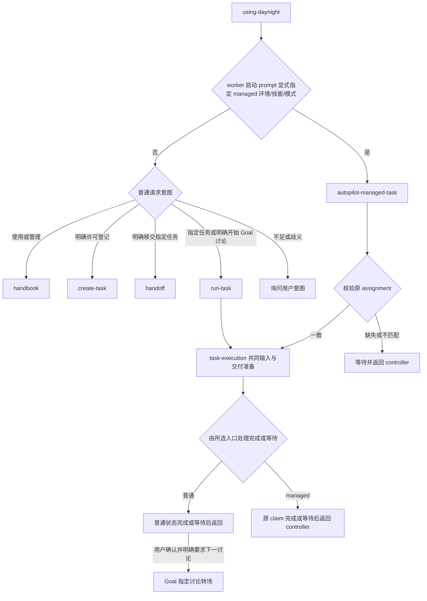

# using-daynight 项目任务 Skill 设计

[需求](../spec/daynight-agent-skill.md)拥有公开行为，
[入口隔离决策](../../.agents/notes/implemented/architecture/2026-10-26-managed-task-skill.md)
拥有普通与 managed 执行的分工；[原模式决策](../../.agents/notes/archived/architecture/2026-10-21-using-daynight-modes.md)
保留单一入口的原始理由；[内容与移交决策](../../.agents/notes/implemented/process/2026-10-25-task-content-handoff.md)
拥有内容单一所有权和审查后启用许可的取舍；[原分发决策](../../.agents/notes/archived/architecture/2026-10-21-public-agent-skill-design.md)
保留安装机制的原始理由。[Project/Task CLI](daynight-project-task.md)与
[附件设计](daynight-task-attachments.md)继续拥有服务访问、版本、依赖和文件操作。

[Goal 流程设计](daynight-goal-workflow.md)拥有需求讨论、方案讨论、确认后实际拆分、
实施和整体验收的阶段协议。普通任务与
Goal 阶段使用同一自足正文与资料所有权规则。共享输入按来源 task ID 与明确的
description 全文/适用章节、真实附件完整路径或已核验不可变仓库引用读取；阶段结果不能
成为开始其生产阶段的前提。

## 一个入口与按需加载

npm 包发布一份英文 `using-daynight` skill，包含导航入口与 14 份引用。`SKILL.md` 只提供概念、setup 导航与按目的读取的资料映射；普通管理、普通指定任务与 worker-managed 执行按需读取各自引用。handbook
提供命令用途索引与规则导航，项目发现由 project-management、并发写入由 write-safety 拥有，参数和调用方法由已安装 CLI 的 `--help`
提供。普通路径不加载 managed 的详细生命周期规则。

```text
packages/daynight/
  src/commands/skill/
    definition.ts
    command.ts
    agents.ts
    targets.ts
    install.ts
    skills/using-daynight/
      SKILL.md
      references/
        handbook.md
        run-task.md
        autopilot-managed-task.md
        task-execution.md
        create-task.md
        goal.md
        task-content.md
        handoff.md
        authorization.md
        setup.md
        project-management.md
        task-management.md
        write-safety.md
        final-acceptance.md
  src/platform/skill-bundle.ts
  dist/commands/skill/skills/using-daynight/
    SKILL.md
    references/
      handbook.md
      run-task.md
      autopilot-managed-task.md
      task-execution.md
      create-task.md
      goal.md
      task-content.md
      handoff.md
      authorization.md
      setup.md
      project-management.md
      task-management.md
      write-safety.md
      final-acceptance.md
```

`using-daynight handbook` 等表达是 Agent 的模式选择协议，不是新增 Daynight CLI。
普通裸调用依据当前请求与实际上下文选择普通模式；不足或歧义时询问意图。指定任务
使用 run-task，一次处理一个 ID。公开技能没有自动候选发现或连续选择下一任务的入口；
查询 ready/list 是管理操作，不自动开始任何任务。

Worker 的启动 prompt 必须显式指定运行环境 worker-managed、使用 using-daynight 技能
和 autopilot-managed-task 模式，并给出原 assignment。入口据此只读取 managed 引用；
不能从 properties.worker、cwd、环境变量或普通请求推断模式。显式 managed 请求缺失
或不匹配上下文时等待，不降级到普通执行。这条路由只描述应读什么；claim 核验、资源
约束和完成写入留在专属引用中，不成为普通路径的例外集合。

入口导航至 `authorization.md` 读取必需追踪与评审：skill 和 Daynight 可用时，使用 Daynight 管理有明确
目标和完成条件的 feature、bug 修复、架构或设计，以及拆解出的实际工作项。读文件、
运行命令、常规检查等临时执行步骤留在 session 执行计划，不成为 task 或任务材料；独立验收有自身成果时仍可成为任务。
方案、架构、设计评审使用所属 task；请求用户审阅前保存完整当前材料并读回，提供任务
和资源引用，当前需求、设计和决定随修订同步保存。任务定义与成果有明确所有者，
讨论、review 过程及操作授权留在 session；不维护竞争的完整副本。实际 CLI、服务和目标项目读取确认可用性，失败保留真实原因。

创建许可是各入口的独立前提。用户直接要求创建或已有指定范围许可才创建；适用仓库
明确要求 Daynight 追踪或评审，属于已确认范围内必要任务的长期创建许可，优先复用。
实现请求和上下文路由不替代创建许可。仅登记保持 todo；明确开始 Goal 需求或方案
讨论时以观察版本 set-status in_progress 启动指定阶段。已有授权范围继续有效，但普通
执行不因此自行挑选后继，阶段确认、实际交付与合并等权限保持独立。



普通 Goal 的明确需求到方案讨论转场由阶段协议拥有；managed 完成或等待始终返回
controller。Skill、task、附件和完成规则均不授予合并等额外交付权限；开放 PR 的指令
继续约束实际交付，讨论 done 不能代替代码或文档已经交付。

## 文档职责与任务资料

| 文档 | 所拥有的规则 |
|---|---|
| `SKILL.md` | 概念、setup 导航、按目的读取的资料映射与普通/显式 managed 入口选择 |
| `handbook.md` | 命令用途索引、CLI help 与规则所有者导航 |
| `authorization.md` | 必需追踪与评审、创建和执行等操作授权、任务范围与连续性 |
| `setup.md` | CLI、登录、项目和仓库指示的连接准备 |
| `project-management.md` | 项目发现、身份核验、复用与授权登记 |
| `task-management.md` | 查询范围、元数据、状态、依赖分类、去冗余、变更后图核验与删除 |
| `write-safety.md` | 精确版本、冲突、不确定写入、附件并发与多步操作 |
| `final-acceptance.md` | 整体验收结论、证据与临时辅助脚本边界 |
| `create-task.md` | 明确创建许可、具体成果边界、已有任务匹配、资料准备与登记完整性 |
| `run-task.md` | 普通指定任务的开始、恢复、重开、普通 done 与返回；普通 Goal 的明确讨论转场 |
| `autopilot-managed-task.md` | 显式 assignment 核验、原 active claim、指定工作区、按类型的必需附件和评审、单任务自主交付循环、交互信号与等待、claim-bound done 与交还 controller |
| `task-execution.md` | 两种执行入口共用的真实任务输入、阶段资料、范围、交付、成果、验收准备与 session 等待检查点；不拥有开始或最终状态写入 |
| `goal.md` | Goal 判断、顺序讨论与用户确认、阶段开始授权、确认后实际拆分、恢复和整体验收 |
| `task-content.md` | 任务定义与成果、task/session 分类、唯一内容所有者、引用读取和阶段适用性 |
| `handoff.md` | 指定移交授权、充分性审查、许可更新、只读复审、状态与并发结果核对 |

task description 明确当前任务、责任与资料入口。`task-content.md` 统一拥有 task/session
边界：task 保存必须实现和交付什么，session 保存如何执行或讨论。创建、Goal 拆分、
移交和执行通过既有引用读取同一标准，各模式拥有自身操作协议，不维护相互竞争的分类规则。
边界覆盖 description、附件和引用任务材料；改名或迁移材料不能改变内容归属。

共享标准按五类任务定义检查：目标与要求、范围与约束、输入与来源、交付物与契约、
验收标准。当前需求或设计稿、最终交付物、验收结论及重要限制随产出保存；创建时无需
预填成果。正文、实际引用和混合组织同样有效，未指定附件交付时正文完整无需主附件；managed 的按类型附件和独立 review 文件要求由其 Complete delivery standard 拥有，不能由正文替代。每项详细说明
只有一个拥有位置。执行必需的进一步引用实际读取，记录资源身份避免循环读取；不足、
不可读或冲突不能由链接存在掩盖。

独立 solution、implementation plan、验证步骤、确认记录和 evidence location 不是通用
内容前提。系统架构作为真实输入或设计交付物属于 task，session 的实现步骤和分工属于
session。用户要求的迁移方案、操作手册或测试策略可以包含方法；检查点不能被执行者
自行声明为额外交付物。已接受的成果及必要完成门槛保存在 task，操作授权、确认经过、
进度、阻塞、CI/review/merge 过程与恢复上下文留在 session。最终 revision 可用于定位
交付物，独立验收的结论保留所需对象身份、关键观察和限制，不积累工作流水。

create-task 拥有 Markdown 写作示例；入口链接共享标准，两种执行入口通过 task-execution
读取实际内容并保留更新后的完整 Markdown 和有效引用。task-content 说明原始字符串和路径基准，task-management 与 write-safety 说明完整替换及写入核验，Goal 协议保留各阶段及交付正文的附加入口条件。缺少 agent 执行
计划不构成 task 不充分；真正必需的上游设计、原型或协议缺失时仍不能实施。

Web 复用附件的 CommonMark/GFM 阅读能力；API、CLI 和 Agent 仍读写原始描述字符串，
不增加格式字段。相对描述链接及图片从当前任务附件根解析，Markdown 附件内部引用
从文件目录解析。真实大小写、任务根约束与来源身份保持有效；确认上传并读回内容后
才把资源写入正文。示例 `[需求](requirements.md)` 与 `[交互原型](mockui/index.html)`
只在这些文件实际属于该任务时适用，共享 Goal 资料保留在其唯一来源；阶段尚未生成的
输出不成为可用链接。Web 的链接激活、URL 策略和预览状态由
[任务阅读设计](daynight-task-inspection.md#markdown-与附件链接)及
[附件设计](daynight-task-attachments.md)拥有。

完整的必要直接依赖由 dependsOn、明确外部子集由 externalDependsOn 维护；同链普通，
核验过的其他同项目链前置为外部。[Task management 的 Dependency reduction](../../packages/daynight/src/commands/skill/skills/using-daynight/references/task-management.md#dependency-reduction) 拥有传递去冗余规则与 `A → B → C` 示例，创建任务、Goal 拆分和共享内容标准引用该规则。
创建及拆分登记前读取相关路径，省略已有其他保留路径覆盖的直接边，并在读回时核验
必要路径和无冗余。每次创建、替换或清空依赖后必须调用 `task graph` 核验实际关系；断边后的各连通分量及需要判断的图外路径分别读取，不能以候选页、单任务或失败的图读取报告核验通过。普通边只可由全普通路径替代，避免改变链归属及普通设计门禁；
外部边可由任一类边构成的路径替代，保留边的性质不变，独立前置继续保留。
CLI 的普通/外部声明编译完整并集和精确外部子集，更新先读取并保留仍需关系。外部不免除阻塞，
不按状态、标题或当前投影猜测分类，也不扩大执行范围。PR URL/title 由 `properties.pullRequests` 维护；执行位置、
阻塞、等待和下一步属于既有检查点。

任务定义与成果按任务语言提供，等价英文标题有效；内容可以在正文或真实引用中，文件名
由实际来源决定。共享 Goal 要求
保留在需求任务，设计与拆分保留在架构任务。每个交付 description 直接列出架构任务
ID 及每个必需来源：架构在来源任务正文时标明 description 全文或其中适用章节，读取该任务
的 `task show --json`；实际附件文档列完整路径，仓库文档使用已核验不可变引用并
保留所属架构任务身份。间接后继同样保留直接入口，不为正文内容编造附件路径或
要求迁移存放位置。登记读回逐项检查这些入口，执行者在
实施前读取所列输入；资料引用不改变执行依赖。独立快照必须有实际需要，并记录
来源版本与目的；不增加 `task://`、跨任务相对链接或固定主机约定。

```text
task.description
  当前任务责任与资料入口
  五类任务定义直接提供，或引用实际拥有文档
  当前及最终成果随产出保存
attachments/              # 按实际需要
  requirements.md         # 实际拥有的任务要求
  design.md               # 实际需要的设计输入或设计成果
shared inputs/
  source task ID + description/sections  # 使用既有 task show
  source task ID + attachment path        # 实际附件使用既有读取命令
```

create-task 在明确许可内区分普通单成果与多阶段 Goal，复用前核对任务、资料和目标。
Goal 首先只登记 `[Goal]<outcome>` 需求讨论 task。仅登记请求核验后返回；明确开始
讨论时按观察版本 set-status in_progress。需求讨论产出整体要求及适用的最终
样式纯前端交互原型，不作生产实现或具体架构决策。用户确认需求并要求方案讨论后，
完成需求 task 并核验 done，才创建并开始普通依赖它的方案 task。候选拆分先在方案
材料内讨论，用户确认当前方案后才实际登记 todo 交付任务及依赖。全部资料读回
核验后方案讨论才完成；实施根依赖方案 task。完整阶段规则由 Goal 设计拥有。

适用原型覆盖最终视觉、主要数据与交互状态及必要资源。数据和交互状态只保存在当前页面内存；不得使用 `localStorage`、`sessionStorage`、Cookie、IndexedDB 或其他本地持久化，依赖库也不得间接执行，刷新或重新打开恢复初始状态。完整规则由 create-task 拥有。它是 UI Goal 描述阶段的产出，
随后供设计和相关实施任务复用；执行者查看并操作原型，不能凭文件名认为已理解。
普通前端实施任务同样读取其已有原型。任务成果保留实际位置及必要版本，session
保留验证、评审、合并过程和授权；managed 必需的报告、设计、独立 review 文件及验收证据附件不因此免除。

任务创建、附件和引用更新仍是独立操作。成功后部分失败保留原 ID 补全，不确定写入
先核对真实结果；使用决策时读取的精确版本更新完整字段。全部当前阶段必需资料和
共享来源可读才报告登记完整。仅登记和新交付任务为 todo，登记不开始执行。
明确讨论指令启动当前阶段；Goal 创建许可按确认顺序生效，不预建未来阶段或要求未来产出先存在。
公开skill按任务语言编写资料，接受等价英文标题；具体仓库或会话的文档语言指示继续适用。
task-management、project-management 与 write-safety 分别解释任务、项目和写入背景，handbook 仅提供命令与规则导航，具体参数由已安装 CLI help 拥有。

## 终验收与开发交付

规范源的 [Final acceptance](../../packages/daynight/src/commands/skill/skills/using-daynight/references/final-acceptance.md)
统一拥有终验收规则。create-task 在登记时明确整体验收对象、需求来源和结论与证据
交付；goal 在拆分与整体完成时引用同一规则；task-execution 在选择验证方法前区分
终验收与开发交付，并判断无需代码或 PR 的完成准备。普通和 managed 入口分别执行
自身最终状态写入，共用验收准备条件，不维护第二套验收协议。

终验收对整个已确认任务或 Goal 及其已确认变更给出需求对照结论，成果包含缺陷、
未验证项、必要对象版本、支持结论所需的关键观察及重要限制。材料保存在所属任务，
不要求增加机器回执 schema 或证据平台，managed 验收仍须上传证据附件。验证方法、执行命令历史和排障过程留在 session；
用户明确要求交付的验证方案按其成果职责保存。人工、已有检查和临时辅助脚本按实际
需要组合，临时脚本遵守项目临时目录和资源清理规则。

临时辅助脚本不进入仓库交付或形成 PR 门槛，因此辅助工具的维护和评审不能改变
终验收目的。正常实现、授权修复及明确要求的长期自动化仍保留其开发交付和测试。
发现缺陷时记录未满足项，按已有权限修复和复验；未满足或未验证的整体结果保留在
验收结论中，具体行为遵守[终验收要求](../spec/daynight-agent-skill.md#终验收任务)。

## 移交审查与许可

`handoff.md` 只接受明确指定的移交对象。先读完整 task 和 worker 信息，再按共享内容
标准读取必需资料与必要进一步引用，检查当前阶段的充分性、范围和上下游契约。它能
依据已有确认信息整理尚未启用的 todo；没有来源的要求或决定作为具体缺项返回。

资料更新和内容核验先于许可更新。最终审查所依据的 task version 传给现有
`task update --allow-agents true`；可在同一更新提交最终 description，不携带无关字段。
blocked todo 在设计和接口已清楚时可以预先移交，真实依赖继续阻止执行。已有 true 的
任务只读复审，失败保留许可并报告调度风险；不会把复审假定为暂停。撤销或停止按
另外明确的授权及现有控制流程执行。in_progress 的 false 不启用，done 按模式策略
无需移交。Active worker 保留所有权和原资源；released 保留历史，由有权管理者显式 resume 开始新的 claim/worktree/native session，启用许可不代替该操作。

附件和跨任务文档不受目标 task version 保护。开启前核验所依赖的可变内容，执行时
再次读取；资料变化后重新审查受影响部分。此边界只提供尽力核对，不引入审查令牌、
服务端认证、不可变快照或原子引用冻结。flag 为 true 不构成永久内容认证。

冲突使原决定失效，需重读和重新判断。未知写入通过读取协调，不自动重放；读取失败
保留未确认状态和真实错误。调度器可在许可更新后立即认领，最终读取的更高版本或
in_progress 是合法观察。结果报告实际 flag、状态、worker、依赖阻塞与审查结论，
不强制读回版本等于更新响应，也不把并发者设置相同 flag 归因于自身写入。handoff
不启动当前会话执行，完整状态处置由[需求 AS11](../spec/daynight-agent-skill.md#as11-handoff-的移交审查)拥有。

## 指定执行与共同交付准备

`task-execution.md` 是中性的执行资料。它读取 task 正文、必需引用、已产生成果和真实共享
输入，按阶段核对前置与资料；适用原型已是输入时查看并操作。开始分析、提问或提案前
明确当前任务已确认的范围和验收，subagents 遵守同一边界。上层 Goal、共享架构及
兄弟任务只提供本任务必需输入、接口和约束；跨任务问题作为阻塞或后续建议，不扩大
当前交付。Goal 级讨论或整体验收按当前任务已确认范围覆盖整个 Goal。

共同资料拥有实现、验证、PR 属性、成果和完成准备，不发起普通开始/重开/done，也不
选择候选或后继。澄清与设计使用阶段 brief，当前阶段待产出的要求、UI 或架构不成为
其启动前提。缺关键输入、不可读引用或前置未完成时保持具体问题，不凭标题补造方案。

普通 run-task 以一个明确 ID 建立身份并读取共同资料。ready todo 在授权、前置与阶段
输入齐备后，以观察版本 set-status in_progress 并核验后开始。已有 in_progress 根据
实际工作与检查点恢复，清单不提供所有权。done 仅在明确重开范围内按依赖保护重开。
指定任务不要求 allowAgents=true 或自动平台匹配；已有固定队列授权可作为当前指定
任务的范围来源，skill 不以此恢复连续调度或自动选择。

Worker-managed 入口先核对 worker 启动 prompt 的显式环境、技能、模式，以及
projectId/taskId/claimId/worktreeId、worktree 路径/branch 和本次启动或恢复配置。它使用给定项目
读取最新任务，先检查 allowAgents，为 false 立即停止且不自行启用，再核对 in_progress、active claim 和实际工作区。缺失或不匹配则等待，
不能从任务属性或环境猜模式，也不降级普通开始。原 claim 已 completed 且 task done
则报告已有结果，不重新执行；恢复和任务写入前继续刷新原 claim，归属改变立即停止
业务写入，不以后来读取的 claim 替换原身份。已由 controller 开始的任务不再次 claim、
set-status in_progress 或重跑候选资格。

managed 入口通过共同资料读取阶段要求、前置、交付与验收准备；它不读取普通执行
生命周期再跳过步骤。给定 branch/worktree/workspace 的创建、切换、删除和收尾由
controller 管理，agent 在原工作区完成授权工作，避免会切换或删分支的合并选项。
明确清理请求只处理可归属的 worktree 外临时资源。Worker 启动及同 claim 重新启动
prompt 的实际组装、Herdr 递交与原生恢复由独立运行时负责；文档路由不证明原生注入
已实现。仅重连存活 agent 不重新发送启动输入，受理未知先观察原资源。

`autopilot-managed-task` 的 [Complete delivery standard](../../packages/daynight/src/commands/skill/skills/using-daynight/references/autopilot-managed-task.md#complete-delivery-standard) 按任务类型约束成果：调研提供完整报告附件；设计或架构经多方独立评审且无 Critical/Major 后提供完整方案附件，剩余非阻塞问题另附 review 文件；开发满足全部必需 PR 实际合并和任务验收；验收上传证据附件。正文完整不能免除这些附件，Goal 用户确认门槛保留。

`autopilot-managed-task` 的有效原 assignment 已有充分的单任务交付授权：实现与
验证、提交和分支推送、聚焦 PR、CI 与 review 修复、合并和关闭。普通 pending
CI/review 持续使用有界 watch 或轮询，超时只结束一次观察。失败先诊断，原样重跑限于
已确认的临时基础设施原因。评审保留修复、延后、不成立三种处置，只在当前范围处理
Critical/Major 和影响约定交付正确性的缺陷，逐线程回应并处理阻塞；最终一轮无新增
Critical/Major 且远端评审满足才推进。合并前按当前远端 head 核对必需检查、实际
approval、线程和可合并状态，保留保护规则及线性历史；平台确认 merged 并取得结果
commit 后继续关闭，默认不增加合并后主线 CI 等待。该循环由随包引用完整提供，
运行时无需系统安装另一份 autopilot skill。

恢复检查点保存原 assignment、授权与范围、配置、工作区、PR/head、验证、评审、
资源和下一动作，不保存凭据；恢复写入前刷新任务及远端状态。后台执行在已有范围内
自行决定；缺少完成所需的目标、架构、执行方案、验收条件，遇到设计未覆盖的问题或其他阻塞时，按 [Request user interaction](../../packages/daynight/src/commands/skill/skills/using-daynight/references/autopilot-managed-task.md#request-user-interaction) 用 `set-property <task-id> worker.signaling "<reason>"` 记录问题，同时输出终端、保存等待上下文并退出循环等待用户，保持 in_progress 且不选其他任务。反馈后核验原 assignment 和问题已解决，再用 `remove-property <task-id> worker.signaling` 清除并确认移除后恢复；未解决则保留信号等待。信号写入遵守 write-safety，明确暂停、限制与撤回授权继续有效。合并已有充分授权，检查与评审条件满足后
直接执行，不再请求确认；用户明确的暂停和限制继续生效，授权范围始终是原 assignment。

Goal 讨论以用户确认和自身阶段验收作为共同完成准备。独立代码、文档、原型交付以及
用户明确纳入讨论验收的 PR，仍须所有必要 PR 平台确认合并并满足验收。没有合并权限、
PR 未合并或人工/验收门槛未满足时保持未完成；CI、review 和合并等待留在当前任务。
PR URL/title 由 properties.pullRequests 拥有，任务材料保存真实成果及必要版本；
操作确认、CI/review/merge 经过留在 session。用户请求保留 PR 时
交付可审查结果并等待，完成规则不授予合并或 auto-merge 权限。

准备齐备后，普通入口重读任务，以观察版本执行普通 done 并核验服务结果；其未知写入
按版本和状态只读核对。Managed 入口重读完整任务并核对原 active claim，最后携显式
原 claimId 和观察版本 done，确认 task done、worker completed 与原 claimId；拒绝或
未知结果不重放，不改走普通 done，读取失败保持未确认。两条入口分别拥有最终写入，
共同资料不向普通任务添加 claim 要求。

普通完成或需要外部介入后返回；只有普通 Goal 中用户明确确认需求并要求指定方案
讨论时，才按阶段协议进行指定转场。Managed 完成或需要外部介入时交还 controller，不推进
Goal 阶段或选择后继。系统调度持续处理 ready task 的能力归 worker，公开 skill 没有
候选选择循环。

## 查询与状态背景

ready 默认最多 10 项，必要时使用 1..100 的 --limit。服务按创建时间和 ID 升序排序，
顺序不表达相关性；空页不证明 backlog 已完成。管理查询按实际范围读取清单、图与详情，
区分范围完成、依赖阻塞、其他工作进行中及候选不足，不据此启动任务。Graph 读取目标的完整双向普通依赖连通分量及其中任务的一层外部前置，包含全部状态，不递归展开外部任务；完整依赖引用可能指向图外。达到
1,000 节点 / 5,000 边限制时命令失败而不返回截断图，不等于项目未关联；详情使用 show，但不能替代完整关系核验。task list 穷尽匹配分页，
默认排除 done，核对完整历史时显式包含已完成任务。状态/readiness 分组保留组内服务
顺序，不表示相关性；文本为摘要，JSON 列表仅省略 description，详情和写入保留完整资源。

在仓库内可省略 --project，由 CLI 按 Git origin URL 匹配；显式项目优先。project-management
解释项目定位，不展开本地绑定内部实现。无匹配不自动创建项目。服务 origin 缺省为
https://daynight.cc，缺凭据或服务 401 提示 daynight login，不自动登录；受控自动化配置
提供 origin 与匹配 PAT。网络、配置和歧义错误保留真实原因。

所有基于已读内容的修改绑定精确 --if-version，保持完整 int64 十进制。默认临提交读取
不保护较早决定；description、依赖与 PR 列表完整替换，冲突后重读并重新判断，不仅
更换版本。附件独立核验，不受 task version 原子保护。update 不改状态；set-status
是版本化状态设置，不提供独占锁、租约或新执行权。todo、in_progress、done 的同状态
请求 +0，实际改变 +1；未知结果先读实际事实，不自动提交重试。公开 --claim-id API
继续由既有 CLI 与服务契约保护，普通调用背景不加载 managed 执行规则。

allowAgents 和 requiredPlatform 仍由服务端、CLI、Web 与 worker 消费。自动候选在
分页前同时满足许可、ready 和真实平台，领取事务重验资格；worker 自身识别真实平台，
WSL Linux 仍为 Linux。普通指定任务保留人工路径，但不借此把自动选出的任务伪装为
人工指定。创建、拆分和执行不自行开启许可，只有明确授权的 handoff 审查后启用。
公开 skill 的查询背景不提供自动选择或 worker 调度实现。

## 安装命令与既有机制

`daynight-review` 仍是 review runtime 的内部审查资源，其 plugin wrapper、快照、哈希
和发现校验独立。公开 skill 由 `skill` 命令持有，只共享普通 bundle 捕获和校验。

| 机制 | 所在位置与职责 |
|---|---|
| 轻量命令登记 | [命令表](../../packages/daynight/src/cli/commands.ts)延迟加载运行时，帮助只访问元数据 |
| 交互输入 | [CliPrompt](../../packages/daynight/src/cli/prompts.ts)共享 ask/select/selectMany，选择器按需加载 |
| 取消生命周期 | [cancellation.ts](../../packages/daynight/src/cli/cancellation.ts)管理终端信号、取消与关闭 |
| 资源打包 | [copy-skills.ts](../../packages/daynight/scripts/copy-skills.ts)明确列举公开与 review 两个完整 bundle，不扫描仓库 skill |
| 物理路径 | [filesystem.ts](../../packages/daynight/src/platform/filesystem.ts)解析已有祖先和未创建部分 |
| worktree 定位 | [git.ts](../../packages/daynight/src/repository/git.ts)只定位根，安装不依赖 origin 或服务 |
| 打包验收 | [installed-cli.ts](../../packages/daynight/test/fixtures/installed-cli.ts)真实打包安装与 launcher fixture |

入口保持 `daynight skill install`，不增加非交互参数、卸载命令、注册中心或用户修改
检测。`agents.ts` 拥有 Codex/Copilot CLI/Claude Code 的命令、路径、重载说明；
`targets.ts` 规划物理目标；`install.ts` 捕获字节、发布和清理旧名称；
`platform/skill-bundle.ts` 校验资源树与入口。`CliContext.packageDirectory` 定位包内资源，
不依赖 cwd。`files: ["dist"]` 包含完整相对资源。

检测依固定顺序查找 codex、copilot、claude，通过直接依赖 `which` 的薄适配器遵守原生
PATH、POSIX 执行权限、Windows 当前目录/PATHEXT/npm `.cmd`/带引号 PATH；不运行
launcher、`--version`、认证或模型调用。
[固定源码](https://github.com/npm/node-which/blob/2009c9dce0e9b0dae024192731987df752c6b4f0/lib/index.js)
说明它只检查文件。仅展示检测到的选项，初始不勾选，Space 切换、方向键移动、Enter
提交且至少选一项；再单选 User/Project，默认 User。无可用 Agent 或终端不可用明确失败。

`@inquirer/prompts` 延迟加载 checkbox/select，review 首次引导使用 readline ask。类型化 value
不从显示文本反推标识。stdin 提供输入，stderr 负责 UI，stdout 提供结果。共享执行器
管理 AbortController、SIGINT/SIGTERM、Windows SIGBREAK 和 finally 关闭；readline
占用 stdin 时进入选择器前暂停、退出恢复。仅已知取消异常转为既有取消错误，其余保留
原因链。依据为
[信号与 readline 协作](https://github.com/SBoudrias/Inquirer.js/blob/92ef32f5b3d9633933bd20bb8ef6ff434c1316bb/packages/prompts/README.md#advanced-usage)
及[checkbox 必选约束](https://github.com/SBoudrias/Inquirer.js/blob/92ef32f5b3d9633933bd20bb8ef6ff434c1316bb/packages/checkbox/README.md#options)。

## 安装目录、所有权与迁移

| Agent | User | Project |
|---|---|---|
| Codex | `~/.agents/skills/using-daynight/` | `<worktree>/.agents/skills/using-daynight/` |
| Copilot CLI | `~/.agents/skills/using-daynight/` | `<worktree>/.agents/skills/using-daynight/` |
| Claude Code | `~/.claude/skills/using-daynight/` | `<worktree>/.claude/skills/using-daynight/` |

User 使用 Node 用户主目录发现，可在仓库外安装。Project 使用当前 Git worktree 根，
子目录、linked worktree、submodule 各定位自身根；非 Git/bare 明确失败。安装不读取
server/review 配置，不要求 origin 或项目关联。支持目录和重载说明按
[Codex](https://developers.openai.com/codex/skills/)、
[Copilot CLI](https://docs.github.com/en/copilot/how-tos/copilot-cli/customize-copilot/add-skills)、
[Claude Code](https://code.claude.com/docs/en/skills) 维护。

先解析父级 skill 根的物理位置，再拼接 using-daynight 和旧 daynight 叶节点。父级链接
保留，leaf 不 realpath 跟随；替换或清理 leaf 链接保留原指向对象。同一物理根只写一次
并保留逐 Agent 结果；涉及新名称和旧名称的拥有路径出现严格祖先/后代冲突时，在任何
目录或 stage 创建前拒绝，并列出对应目标。路径按分量比较，不能使用字符串前缀。
共享父根链接允许去重；清理不得越过所选物理根或删除另一安装目标。

选择 Agent 表达兼容目标，不承诺发现隔离。Codex 和 Copilot 共用路径；项目中的
`.claude/skills -> ../.agents/skills` 也可使三者共用一次写入。其他 scope 不被修改，
同名副本不合并，Claude personal 优先于 project。原设计的 Copilot 探针曾在特定版本
观察到独立 `.agents`/`.claude` 同名副本与共享父链接均选择 `.agents` 候选，该 receipt
随原设计 PR 保留，仅为历史观察，不是跨宿主版本的保证。

安装先捕获包内完整 bundle 一次，验证 SKILL.md UTF-8、固定 frontmatter 名称
`using-daynight`、非空 description 和仅目录/普通文件的树；其他文件保持原始字节。
构建与验收校验相对引用，运行时不引入 Markdown 解析器。所有目标使用相同捕获字节。

预检后按 Agent 顺序串行处理唯一物理目标：

1. 首次写入前检查取消；创建并记录必要父目录，创建专属 stage，写入全部资源。
2. 再检查取消；取消则删除 stage，逆序清理本次新建且仍为空的父目录。
3. 删除 using-daynight leaf 并 rename stage 发布完整目录；两步之间不主动取消。
4. 发布成功后清理同一物理 skill 根内的旧 daynight leaf，再报告此目标完整成功。
5. 处理取消或继续下一目标。已经完成的目标保留，不跨目标回滚。

发布前不删除旧 daynight，避免重命名迁移先损失原入口。旧名称清理失败时新 bundle
保留，报告部分迁移及实际失败，停止后续目标并非零退出。完整替换不比较修改、不合并、
不备份；覆盖新名称时删除后 rename 失败仍可能使目标缺失。清理 stage 的错误保留
原因链，不能静默吞掉。重跑使用当前包完整恢复，安装不自动重试。

结果逐 Agent 给出 scope、路径、包版本和重载指引，共享目标标明同一次写入。Codex
通常自动发现，必要时重启会话；Copilot 使用 `/skills reload`、
`/skills info using-daynight`；Claude 已有根通常自动发现，新建顶层根时使用
`/reload-skills`。清理旧名称成功不表示其他 scope 的旧入口也被移除。

## CLI 更新时的自动同步

`commands/skill/refresh-installed.js` 是 npm 自更新调用的内部进程入口；公开命令仍为
`update` 与交互式 `skill install`。它从自身安装目录读取清单版本和完整 bundle，使用
现有 Agent catalog、物理路径规划、bundle 校验及顺序替换器，不引入安装 registry。
自更新先验证包和新 CLI，再调用该入口；当前或领先版本也调用，以修复落后的 skill。
独立进程保证模块及资源都来自已安装包，避免旧进程模块缓存与新包混用。
该内部进程的 Git 调用继承外层更新进程拥有的进程组；独立 Git 调用仍拥有自己的组。
外层在中断、超时和内部进程退出时清理所拥有的组，避免内部 Git 逃离清理范围。
Windows 沿用进程树终止机制。强制终止不能承诺 stage 清理或原子回滚。

检测使用用户主目录和调用目录所属 Git worktree 根。先沿调用目录祖先检查 `.git`
标记，存在时通过既有有界 Git 能力解析自身根；无标记只检查 User，读取错误继续抛出。
检测目标是已有 `using-daynight` 目录或叶链接，入口丢失和悬空叶链接仍可修复；普通
文件或其他非目录节点报错，缺失位置不创建。Agent launcher 不参与判断。

跨 scope 的已安装目标统一解析物理父目录、合并共享目标并检查安装和旧名称清理的
祖先冲突，预检完成后才使用完整替换器。每个结果保留相关 Agent、scope、物理路径、
包版本和重载说明。失败停止后续目标并报告部分结果；父进程另外说明 npm 包已更新
或保留，再以非零退出。重试 `update` 能从当前已安装包重新同步。
[自动同步决策](../../.agents/notes/implemented/feature/2026-10-24-update-installed-agent-skills.md)
记录范围和失败边界。

## 调用成本

常规选择读取一次有界 ready，再 show 必要任务及读取附件；已知任务直接 show。
只在语义检查点更新，不每轮完整 list/graph。有效绑定的读取仍涉及绑定验证；首次
发现可能读取多页 project。任务数量有界不代表输出字节或 token 固定，附件也会增加
实际读取成本。需要评估时记录真实命令、字节、耗时与总调用数；字符数/4 仅为英文
粗估，不是 tokenizer 计数或性能承诺。原设计对 graph/show/完整 ready 列表的测量不能
证明当前有界命令、附件读取或模型加载成本。

## 验证与诊断

安装验收运行实际 npm pack 和本地安装 CLI，隔离 User、Project、PATH 和全部临时
资源。模拟 codex/copilot/claude launcher 启动即写 sentinel 并失败，场景结束要求
sentinel 不存在。不安装真实 Agent、不读取账号、不调用模型、不启动任务服务或数据库。
[模拟验收决策](../../.agents/notes/archived/testing/2026-10-21-simulated-agent-installation-acceptance.md)
保留此边界。

开发依赖 `node-pty@1.1.0` 在 Linux/macOS 使用 PTY，Windows 使用 ConPTY。终端内
Node bridge 启动安装 launcher，stdin/stderr 继承终端，stdout 单独落结果文件，证明
真实 isTTY 与流分离。按键包含 Space、方向键、Enter、Ctrl+C；kill 只用于超时清理。
ConPTY 可能将尾随空白编码为光标移动，匹配稳定可见文本并保留原始终端流。pnpm 仅
允许固定 node-pty 的构建 hook，保留 SQLite 既有禁用选择；稳定包 Darwin helper 的
0755 修正使用版本限定 mode-only 补丁，测试不临时修复依赖。
[原生终端决策](../../.agents/notes/archived/testing/2026-10-21-native-skill-terminal-acceptance.md)
拥有这些平台理由和来源。

六种 Agent/scope 组合验证完整相对路径与每个文件字节、重装清除修改和旧文件、保留
sibling 与另一 scope。迁移增加旧名称存在、leaf 链接、清理失败后新 bundle 仍可读及
准确部分结果。单元测试覆盖预检、scope 后首次写入前信号、stage 取消、新建空目录、
parent/leaf 链接、安装/清理路径嵌套、部分失败、监听清理和 completion 回归。Windows
必须有原生结果；Linux 投影不能替代 `.cmd`、ConPTY 或平台链接证据。

静态打包检查验证入口 frontmatter、资源清单、打包 allowlist，以及全部实际本地链接的存在和 bundle 内归属，不对指令规则、章节或措辞作断言。验证边界见 [skill 打包验证决策](../../.agents/notes/implemented/testing/2026-10-30-skill-packaging-validation.md)。围栏代码中的任务 Markdown 示例属于写作示例，不
作为 bundle 资源链接；打包产物和安装副本保留这些内容，并与源码完整字节比较。既有
project/task/attachment 套件验证命令语义，创建、更新和 JSON 读取包含中英文、CRLF、
围栏代码、GFM 与链接的描述，确认原始字符串及精确版本完整替换。独立情境演练另外核对
裸调用、缺少创建许可、已有范围内许可、普通指定执行与显式 managed 路由、
具体工作项与临时执行步骤的区分、唯一初始需求任务、仅登记与明确开始讨论、用户确认
转场、确认后实际拆分、实质修订重确认、讨论与 PR 交付区分、部分登记恢复、Markdown
自足内容的正文/引用/混合组织、必需引用实际读取、任务定义与成果所有权、前端原型、禁止 merge、阻塞和单任务返回。
移交情境覆盖授权启用、已有 true 的只读复审、失败保留许可并报告、blocked todo、运行锁、
done 策略、worker 连续性、附件独立变化、冲突/未知写入及启用后立即被认领。指定子任务
演练还核对执行与讨论的范围、跨任务阻塞和后续建议、必需共享输入读取，以及 Goal 级
讨论和整体验收按当前任务已确认范围处理全局内容；managed 情境覆盖显式环境/技能/模式、普通不读取 managed 规则、上下文缺失/不匹配、原 claim 恢复及最终完成和系统工作区边界。任务/session 分类另覆盖混合请求、无执行计划、真实设计输入和成果、操作授权、结果身份、
恢复、用户要求的操作手册以及正文/附件/引用的一致边界。每例保留输入、应保留/排除项、
允许/禁止操作、实际观察和结论，标明语义审查或 agent 演练及未验证行为；这些记录留在
实施 session。保留正确规则再追加矛盾指令须由独立语义情境判断。自动化打包检查不包含指令文本变异测试，也不验证指令语义。这些情境是独立指令语义审查，不是自动化文本契约或对模型理解与执行的保证。review bundle 的快照、原生 Copilot 加载与配置隔离继续独立验证。

普通原生 CI 运行 typecheck、test、build、acceptance，receipt 记录源码、平台、场景
和清理结果。文件证据证明安装结果，不能证明宿主发现或模型遵循。PR 是否合并由用户
授权及平台事实决定，不由 skill 测试通过决定。

逻辑操作范围是一个 skill install 或内部自动同步进程；共享上下文传递 Agent、scope、包版本、逻辑
路径和物理根。唯一目标串行 await，无后台队列、服务或 detached promise。诊断区分
检测、选择、规划、stage、替换、旧名称清理及收尾，保留错误链及部分结果，不记录
用户输入、token、配置全文或认证环境。单进程无需额外 operation ID 或 telemetry 后端。

具体人工核查可在隔离终端选择 Codex 与 Copilot/User，确认两条结果共用物理路径并
比较完整 bundle；通过不可写父目录或旧入口探针核对阶段、scope、Agent、目标、原因
和非零退出。重新发现与 scope 优先级随宿主规则维护。自动同步的真实 npm 验收比较
更新后 bundle 与已有目标的所有字节，验证当前版本重试、缺失目标保留和失败退出。
修改保护、跨目标原子性、全局任务互斥等独立能力需要各自需求。
