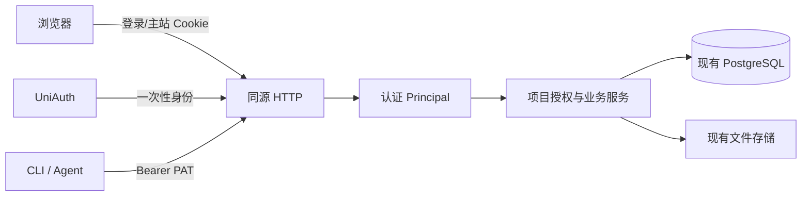

# UniAuth 登录与项目授权架构

状态：身份、会话/PAT、项目成员、CLI 和双语 Web 已在正式 composition 统一启用。
服务配置校验失败会拒绝启动，所有业务请求强制认证。源码绑定的验证结果与真实上游
人工登录以相应回执为准，本文不把接线完成等同于完整验收通过。
[需求](../spec/daynight-auth.md)拥有行为；
[原始鉴权决策](../../.agents/notes/implemented/architecture/2026-10-22-auth-architecture.md)
保留架构取舍，[统一启用决策](../../.agents/notes/implemented/architecture/2026-10-22-authentication-activation.md)
拥有当前配置、组合与验收隐私规则，[交互原型](mockups/auth/index.html)拥有视觉。

## 已采纳的架构边界

附件维持现有可信同源执行。HTML 拥有浏览者当前主站权限，资源请求复用主站会话与
项目成员检查。普通 iframe、相对资源、同源文档键盘桥和单 origin 部署继续使用。
[附件架构决策](../../.agents/notes/implemented/architecture/2026-10-21-task-attachment-storage-design.md)
明确独立预览域名/origin、预览凭据、bootstrap 交换及其配套设施不属于本方案；
鉴权实现必须遵守，不能从项目成员权限推导出预览隔离工程。

## 现状与可复用机制

`server.New(Dependencies, Config, logger)` 先校验必需配置并构造真实 UniAuth SDK，
再注册身份、成员、project/task/graph/property/attachment、健康检查和 UI；失败返回
error，运行时关闭已获得的 listener、数据库和文件根句柄。业务服务显式接受
core.Principal，原 CreatePrivate/ListAccessible 暂存别名已移除，普通 Create/List
直接实现私有创建和按成员过滤。正式 main.tsx 在常驻 LocaleProvider 下挂载
AuthenticatedApp，保留当前任务/附件页签和渐进图。

[身份基础](../../.agents/notes/implemented/architecture/2026-10-22-identity-credentials.md)
与[成员基础](../../.agents/notes/implemented/architecture/2026-10-22-project-membership.md)
先独立交付的原因仍成立；当前统一组合由启用决策拥有。以下固定源码是最初设计
采用机制时的基线 `38b827fe644139f4e20989cd8e7740350566fb56`，不表示当前入口仍未鉴权：

| 机制 | 固定源码 | 使用方式 |
|---|---|---|
| HTTP composition 与 loopback | [server.go](https://github.com/codetreker/daynight/blob/38b827fe644139f4e20989cd8e7740350566fb56/packages/daynight-server/internal/server/server.go#L10-L19)、[config.go](https://github.com/codetreker/daynight/blob/38b827fe644139f4e20989cd8e7740350566fb56/packages/daynight-server/internal/server/config.go#L71-L77) | 一个入口认证，继续原有监听/部署边界。 |
| 项目写锁 | [project_tx.go](https://github.com/codetreker/daynight/blob/38b827fe644139f4e20989cd8e7740350566fb56/packages/daynight-server/internal/core/store/project_tx.go#L29-L39) | 在项目锁内检查权限并执行写入。 |
| 读取快照/列表 | [snapshot.go](https://github.com/codetreker/daynight/blob/38b827fe644139f4e20989cd8e7740350566fb56/packages/daynight-server/internal/core/store/snapshot.go#L14-L38) | 快照内验证成员；列表 SQL 先筛选再分页。 |
| 文件 IO 准入 | [attachment.go](https://github.com/codetreker/daynight/blob/38b827fe644139f4e20989cd8e7740350566fb56/packages/daynight-server/internal/service/attachment.go#L83-L114) | IO 前授权，慢传输不持有事务，保留 K1。 |
| 直接浏览器资源/键盘 | [AttachmentPreview.tsx](https://github.com/codetreker/daynight/blob/38b827fe644139f4e20989cd8e7740350566fb56/packages/daynight-web/src/features/task-detail/attachments/AttachmentPreview.tsx#L35-L72) | iframe/img/下载自然使用主站 Cookie，保留同源键盘桥。 |

当前 Go SDK 固定为
`github.com/codetreker/uniauth/sdk/go v0.0.0-20261022095215-0978963813fc`，对应
[上游源码](https://github.com/codetreker/uniauth/tree/0978963813fcefd9d553f6cb9bcc319084c764b3/sdk/go)。
它提供一次性身份和 App-aware provider discovery；Daynight 继续拥有用户、会话及
成员。初始身份模块使用 c82c55c7 的历史经过由身份决策与 Web 决策保留；当前模块
和真实 UniAuth fixture 都使用 0978963，不使用工作站 replace。

## 职责与数据流



core 保存用户/成员/凭据结构，现有 core/store 拥有迁移和事务；service 增加身份、
成员与邀请模块，现有业务服务显式接收调用者；server 拥有 HTTP/Cookie/错误映射。
复用一个 store 和既有文件存储，不复制业务实现或增加通用权限引擎。

Principal 形状为 `{UserID, CredentialID, Kind}`，Kind 只有 session/PAT。认证代码
产生可信身份，handler 传给 service；请求 JSON 不能指定调用者或角色。service 在
业务边界授权，不提供可信用户捷径。PAT 不能管理个人令牌，会话可以管理自己的 PAT。

读取在原 repeatable-read 快照中检查成员再读取资源；写入取得现有项目行锁后重查
成员/角色/观察版本与领域约束。列表以 membership JOIN 在原 SQL cursor/LIMIT 前
筛选。Tasks.SetStatus(ctx, principal, projectID, taskID, input)
沿用同一项目锁，并在取锁后检查当前成员，再校验观察版本、目标状态与依赖。admin 和
member 都可执行这些资源操作；管理员角色额外管理成员、邀请与项目提醒设置。创建默认
todo，通用元数据更新不接收 status，没有旧状态写入旁路。任务版本、int64、
图容量和现有分页合同保持。

## 认证响应归属

`Authentication.Require` 在 AuthenticateRequest 成功之后、调用业务 handler 之前，
从准入 principal 写入 `Daynight-User-ID`。因此 GET、空写结果及下游资源错误共用
一个归属边界，认证失败不泄露未准入身份，也不回显调用方提供的值。会话/PAT 选择、
Origin 检查、角色和业务授权仍由原入口执行；该头只是响应证明。跨窗口 Cookie
可能变化时，后续持久任务缓存据此核对实际响应与自身身份域，不能只凭先前 `/me`
结果命名。[任务同步设计](daynight-task-sync.md)拥有缓存接入规则。

## 登录方式发现

公开 GET /api/v1/auth/providers 通过 SDK Providers(ctx, callbackURL) 读取
当前 App allowlist 与已启用 registry 的权威交集，投影为 `{providers:[ids]}`；空数组
是成功结果。服务使用已配置的精确 callback，SDK 执行有界单次请求，不建立登录
事务或 provider 会话。客户端明确区分加载、失败、重试和零 provider。

[上游协议](https://github.com/codetreker/uniauth/blob/0978963813fcefd9d553f6cb9bcc319084c764b3/docs/reference/api.md#L28-L73)
使用 App Basic 凭据和精确 redirect_uri；
[SDK 实现](https://github.com/codetreker/uniauth/blob/0978963813fcefd9d553f6cb9bcc319084c764b3/sdk/go/providers.go#L14-L37)
保留无重定向、无重放和有界响应。App 配置/凭据失效映射为
503 identity_configuration，网络或协议失败为 502 identity_unavailable，超时为
504 identity_timeout；它们不返回用户会话 401，避免错误清除当前账户。
[Web 决策](../../.agents/notes/implemented/feature/2026-10-22-web-auth-workspace.md)
保留初始旧 SDK 缺少 discovery 的证据，生产组合已使用新能力。

## 登录和凭据

### UniAuth 一次性交接

login_transactions 保存随机 state 摘要、浏览器绑定摘要、provider、主站内返回路径
和十分钟到期时间。每次登录使用独立的绑定 Cookie，支持同时打开多个登录页。
callback 在同一事务验证绑定/state/provider/期限并消费 pending；提交后才通过 SDK
执行一次 Retrieve，继承请求 context 和有界 deadline。

合法 provider error 结束 pending；错误绑定不领取。网络断连、取消、协议错误或
领取响应丢失都重新登录，不能重试可能已消费的 code。用户以完整 UniAuth id 唯一
upsert，本地 UUID 不变；资料保留 null/false，不按邮箱合并。用户与 session 同事务
提交。返回路径拒绝外站、协议相对 URL 和 auth 循环路径，默认项目列表。

### 主站 session 与 PAT

秘密至少 32 随机字节，仅持久化 SHA-256 摘要。生产会话 Cookie 为
__Host-daynight_session、Path=/、Secure、HttpOnly、SameSite=Lax、无 Domain。
会话绝对有效期七天，不后台续期；注销删除当前会话。PAT 由 Web 会话创建，名称
1–100 字符，有效期 1–365 天、默认 30 天；明文只显示一次，列表仅返回 ID、名称和
创建/到期时间。撤销自己的 PAT 幂等，不影响其他凭据。

明确的 Authorization 优先；重复、格式错误或无效 Bearer 返回 401，不回退 Cookie。
PublicOrigin 使用规范的小写主机、有效端口并省略 scheme 默认端口，使配置值与浏览器
Origin 序列化一致；不规范配置明确拒绝。Cookie 写请求要求精确主站 Origin，PAT 写
请求按其 header 凭据验证。数据 API 401
始终 JSON，Web 发起登录导航。已验证并消费的 callback 若失败，清除绑定 Cookie、
记录清洗后的错误并 303 到固定主站 `/?authError=login_failed`；错误/未绑定 callback
保留 JSON 拒绝。登录壳读取并清除该通用标记，显示重试入口，不带回原始 code/错误。
主站默认 HTTPS，使用 __Host- 会话/绑定 Cookie；显式 HTTP 主站测试配置使用不带
该前缀和 Secure 的测试名称，仍为 host-only、HttpOnly、Lax。SDK gateway 的
literal-loopback HTTP 开关只决定 SDK 传输，不决定主站 Cookie。
同源预览使用同一 Cookie 和授权规则，没有第二种浏览器凭据。

## 数据与并发

| 表 | 关键字段与约束 |
|---|---|
| users | 本地 UUID；唯一 uniauth_id；可空 email/email_verified/name/avatar_url；时间。 |
| login_transactions | 事务 ID、state_hash、browser_binding_hash、provider、return_path、expires_at。 |
| sessions | ID、唯一 token_hash、user_id、expires_at；注销删除。 |
| personal_access_tokens | ID、唯一 token_hash、user_id、name、created_at、expires_at；撤销删除。 |
| project_members | `(project_id,user_id)` 唯一；role 为 admin/member；bigint version 来自独立 sequence。 |
| project_invitations | ID、project_id、唯一 token_hash、created_by、expires_at、consumed_by/at、revoked_at。 |

使用既有迁移机制、唯一索引和角色 CHECK，不要求新增 foreign key；关联由业务事务
验证。旧项目内容保持，不自动分配成员，空成员项目自然不可见，后续手工补齐。

创建项目和首位 admin 原子提交。成员管理提交观察版本，锁项目后重查 admin/版本，
真实角色变更与新加入从 project_member_versions sequence 取得新版本，观察值不要求
连续或每次恰好加一；无变化保持版本。移除后重加入不复用旧版本，过期返回
version_conflict。删除/降级最后 admin 返回 409 last_admin。
两个 admin 并发不能都离任；成员变更不改 task.version。

邀请七天有效、只授予 member、可撤销。邀请属于项目，创建者离任不自动作废。
接受按项目→邀请顺序加锁，验证状态、插入成员后消费。已有成员返回当前成员状态而
不消费，两个非成员并发仅一个成功，另一个 410 invitation_unavailable。inspect 只
返回名称等最小摘要。到期查询即时拒绝，不依赖后台任务；写入时有界清理到期记录，
不新增调度器。过期索引支持每次最多清理 100 条记录。

HTTP 认证逐请求读取当前会话/PAT 并产生 Principal。资源服务在自身 Snapshot 或
项目写锁内检查成员；凭据认证与业务事务是各自的准入时点，不额外把凭据撤销和业务
提交串行化。附件在短快照完成项目/task/路径与成员检查后准入文件 IO，不持锁慢传输。
已准入操作允许完成；不能在文件写入后仅因成员刚移除而拒绝元数据写入。真实存储/
数据库错误按原链传播，保留 K1。撤销后新准入请求拒绝，已发字节不承诺撤回。

## HTTP、Web 与 CLI

新增主站 API 保持 /api/v1，复用现有 Vite /api 代理：

| 路由 | 行为 |
|---|---|
| GET /healthz、GET /readyz | 无业务数据的存活/就绪；就绪保留 store 可用性。 |
| GET /api/v1/auth/providers | 公开 App 范围 provider 发现；真实 SDK 投影当前权威交集。 |
| GET /api/v1/auth/login?provider=... | 创建 pending 并跳转 UniAuth。 |
| GET {配置 callback 路径} | 校验/消费 pending、领取身份、建立 session；只注册配置路径。 |
| GET /api/v1/me | 当前用户最小资料。 |
| POST /api/v1/auth/logout | 主站会话注销，验证 Origin。 |
| GET/POST /api/v1/me/tokens、DELETE .../{tokenId} | 主站会话管理自己的 PAT。 |
| 现有 project/task/graph/property/attachment API | session 或 PAT；业务 service 检查当前项目成员。 |
| PUT .../tasks/{taskId}/status | session/PAT；成员写权限，正 int64 version 与三状态目标；PUT 和 405 路径均经过 Require、Cookie Origin 规则及 no-store。 |
| GET .../projects/{id}/members | 任一成员读取最小资料和角色/version。 |
| PATCH .../projects/{id}/settings | admin，锁后复核角色与精确设置 version，返回完整 Project。 |
| PATCH/DELETE .../members/{userId} | admin，携带观察到的成员 version。 |
| GET/POST .../projects/{id}/invitations、DELETE .../{inviteId} | admin，创建一次显示链接，删除撤销。 |
| POST /api/v1/invitations/inspect、POST .../accept | 已登录用户，body 携带秘密；明确 accept 才入会。 |

新增 unauthenticated/forbidden/last_admin/invitation_unavailable 错误，保留原 envelope/
requestId。非成员与不存在项目均 not_found；错误类别不能落入 internal_error。

正式 main.tsx 在常驻 LocaleProvider 下挂载 AuthenticatedApp；语言机制和现有图、
任务/附件页签及完整详情的弹窗/独立展示保持同一实例与状态规则。独立详情导航同时
包含 pathname 与 search；登录返回路径保留任务、页签和附件的相关查询参数，构造
登录入口时移除临时 `authError`，避免一次旧登录失败随成功返回再次呈现。
TaskDetailSessionProvider 位于当前 user/generation 的身份域内，跨详情关闭/重开
保持 project/task 的状态操作身份与结果，401 或身份变化时丢弃旧用户状态；同一
用户核验与语言切换不重建 Provider。状态设置依赖当前完整详情的精确版本，冲突与未知
结果遵守[三状态设计](daynight-task-status.md)。
它通过 /me 取得身份，401 显示 UniAuth 入口；资源 404 不退出全局会话。
项目列表增加名称/仓库地址创建表单，复用原 API，成功进入空项目且创建者为 admin。
账户页管理 PAT，项目管理导航连接成员与 `/projects/:id/settings`。设置页成员可读，角色确认是 admin 后可编辑；
服务端在项目锁后独立复核角色与设置版本。设置按 user/project 键隔离，草稿不写入权威 Project；
不确定 PATCH 先重读 Project/成员，核对失败阻止新写入并允许读重试，不把取消或导航视为远端回滚。
具体数据和读取机制由[计时架构](daynight-task-timing.md)拥有。成员冲突
重取权威数据。401/换账号使共享请求 generation 失效并卸载旧项目和附件内容，
失败不伪装成空列表。成员 version 以 bigint 解码及序列化，保留完整正 int64。
顶层曾离开后重新可见且聚焦时，在后台重新读取 /me。正常等待状态与失败后的
阻塞恢复状态分别管理：正常等待保留工作空间、详情和管理弹窗的可见性与交互，
不添加隐藏样式、inert 或 aria-hidden，不打开模态层，因此焦点、输入和 frame
生命周期不会被核验打断。同一用户成功沿用 session generation 与组件实例；确认
身份变化时使共享请求失效并重建身份域，401 则清除会话。核验结果返回前继续展示
已加载的内容。鉴权层在 layout effect 中注册顶层焦点与可见性生命周期；首次
鉴权挂载若已隐藏或外部失焦，在子组件 passive 请求 effect 前暂停。后续顶层
隐藏或外部失焦时立即取消并使旧核验失效，暂停共用 request 边界的普通 API
请求，因此子组件恢复可见性时的图刷新无法先于暂停发出。重复的 blur 与隐藏
事件合并，返回可见且聚焦后才启动最新 /me；焦点先到或可见性先到均保持等待。
请求记录调用时的身份 generation；等待可取消。同用户成功释放等待，换号或会话失效先使旧身份
的 generation 失效再释放，因此旧界面排队的读写不能携带新账户 Cookie 发出。
/me 和退出请求绕过等待，失败及恢复重试持续保留等待。最新的有效返回总是
立即中止旧核验、推进核验请求 generation 并发起新核验，较早响应不能覆盖最新
结果。核验失败保留组件状态并显示阻塞错误层；
重试及失败后的前台返回保持遮蔽，成功后才恢复原页面或切换身份。
[前台身份核验决策](../../.agents/notes/implemented/bug-fix/2026-10-23-silent-foreground-identity-checks.md)
记录这一呈现策略及其取舍。同源 iframe 内外切换仍保持顶层 focus，不重复发起
这类核验。
现有图、项目浏览偏好和居中 TaskDetailDialog 继续复用，不增加任务字段编辑。
`messages.auth` 的英语与简体中文契约覆盖所有新界面、标题、校验、无障碍名称、
错误和异步通知；通知存语义，渲染时取当前语言，日期/计数使用原生格式化器。
登录、工作空间、邀请及管理模态均提供共用 LanguageSelector。切换不以 locale
重建组件或进入请求依赖，保持输入、一次性秘密、成员版本、当前身份和 pending
操作。[语言设计](daynight-web-i18n.md)拥有公共机制，鉴权组件遵守相同状态规则。

邀请入口 /invitations#<secret> 读取后立即清除 fragment，以 tab 的临时 sessionStorage
跨登录保存，确认/取消/失效后删除；秘密不进请求路径/Referer/日志。一次性 token/
邀请复制失败可恢复，关闭前清楚提示无法再次读取。桌面/窄屏/长内容/加载/空/错误/
失效/禁用和键盘焦点由原型拥有。

附件 HEAD、GET、图片/PDF/iframe 和相对资源共用主站会话，保留既有同源文档键盘
处理；401 显示明确错误并引导重新登录，不返回登录 HTML。HTML 继续可信执行，
主站 API 始终按当前浏览者实际身份授权，不宣称隔离上传代码。

CLI server 投影已实现可选 `serverToken`，为非空 opaque visible ASCII；仅 HTTPS
或 host 为字面量 `localhost`、`127.0.0.0/8` 内的数值 IPv4、`::1` 的 HTTP 可配置。setup 隐藏
输入，空回答保留同 origin 令牌或跳过新 origin 的令牌；布尔 `--server-token-stdin`
读取不超过 1 MiB 的单行非空值，允许单个 LF/CRLF，拒绝空输入、多行和控制字符。
显式 URL 配置保持不询问；stdin 可复用已有 URL，无 URL 时须显式提供。

既有配置锁内共同比较 serverUrl/serverToken，正规化 origin 变化原子清除旧 token，
同 origin 保留；其他 review 字段的并发完成修改保持。含令牌的文档由共享写入者
统一保存为 POSIX `0600`，无令牌文档保持既有权限行为，普通文件/符号链接/锁和
原子替换协议不变。YAML 错误只保留安全类别、代码和位置，不复制标量及原始
parser cause；通用错误格式化器和其他错误链不承担凭据清洗。

共享 API 边界向已有项目、任务和文件请求附加 Bearer，保留 manual redirect、
不转发令牌、二进制 stdout、精确 int64、分页和预算。401 给出 setup 指导，不自动
匿名回退、登录预检或写入重试；403/404/409 保持。仓库绑定仍只有
serverUrl/repoIdentity/projectId。review/update/help/version 保留依赖边界；setup
不访问网络。机制与备选由[CLI 凭据决策](../../.agents/notes/implemented/architecture/2026-10-22-cli-server-credentials.md)
拥有；Web 令牌管理已在显式挂载的组件中实现，生产启用继续由其任务交付。

## 配置、部署与正式组合

五项必需配置为 DAYNIGHT_PUBLIC_ORIGIN、DAYNIGHT_UNIAUTH_URL、
DAYNIGHT_UNIAUTH_APP_ID、DAYNIGHT_UNIAUTH_APP_SECRET、DAYNIGHT_UNIAUTH_CALLBACK_URL。
启动校验和 handler 工厂都拒绝无效配置。App Secret 只进入服务端 SDK，不下发前端。
Public origin 是无路径/凭据/query/fragment 的 canonical origin，host 小写、默认端口
省略，不从请求或 listener 推导。Go listener 仍要求数值 loopback。

Callback 与 public origin 精确同源，完整 URL 无凭据、query 或 fragment；路径为
canonical 非根路径，不接受编码别名、dot-segment、路由通配符或与 API/页面/资源/
健康入口冲突。配置可使用 `/auth/callback`，与 UniAuth App 精确登记值一致；只注册
这一条路径，不增加旧别名。StartLogin 在持久化 pending 前拒绝 auth 入口和实际
callback 的 returnPath，防止回调循环。

两个独立的 0/1 开关在未设置或为 0 时关闭，其他值拒绝：

| 配置 | 控制对象 |
|---|---|
| DAYNIGHT_ALLOW_HTTP_TEST_ORIGIN=1 | 明确允许 HTTP 主站测试 origin，并按实际 scheme 选择 Cookie；命名域名不伪装为回环。 |
| DAYNIGHT_ALLOW_LOOPBACK_HTTP=1 | 仅允许 SDK gateway 为 literal localhost/numeric-loopback HTTP，其他 gateway 仍需 HTTPS。 |

HTTPS 主站和回环 HTTP gateway 可以独立组合。普通运行不存在 auth-disable 分支。
/healthz 返回无业务数据的存活状态；/readyz 只验证数据库就绪，不查询项目、登录
上游或 provider 健康。两套 Compose 均使用 readyz。

[localhost 部署](../../deployment/localhost/README.md)要求从 .env.example 创建私有
.env 并配置上述值。网关/Go/PG、非 root UID 10001、loopback 发布、PG/附件两卷及
配套备份保持原义。受控测试 UniAuth 不是第三个 Daynight 备份卷。

Vite 保留原 /api Go 代理；设置同一 DAYNIGHT_UNIAUTH_CALLBACK_URL 后，只增加该
精确 callback 路径的代理，沿用同一 Go target 并原样保留 query。不设置时前端
mockup 继续独立工作，不从请求猜测 callback 或代理所有页面。

## 真实协议 fixture 与验证隐私

Go、安装 CLI、Web native/container 和 Docker 附件/恢复调用方通过正常 UniAuth
协议取得 session/PAT。共用固定 0978963 的 fixture 可执行文件与 bootstrap 协议，
每个目标独立拥有 App、SQLite、端口、用户会话和清理。只控制外部 provider 响应，
不直接插入 Daynight 用户、会话、PAT 或成员作为验收捷径。预算服务验证 Bearer，
同时保留其合成 transport 场景与真实授权证明的区别。

preparer 使用静态 CGO_ENABLED=0 产物，原生与 linux/amd64、linux/arm64 目标分开
记录缓存。准备锁使用 Node.js 24 内置 SQLite 的 BEGIN IMMEDIATE 事务，跨进程串行
保护 checkout/source/build；凭据 handoff 另由独立私有元数据拥有。凭据、CLI home、App SQLite 和私有
.env/descriptor 位于上传回执根之外，0600 元数据不输出秘密。回执仅记录源码、
产物/进程身份、公开 origin、阶段结果及清理状态。

dev-ci 先启动 gateway/PG 并发现主站端口，再在共享 gateway namespace 中启动真实
UniAuth，发布同一回环 U 端口供浏览器与 SDK 共用；随后写私有 auth.env、启动 Go 并
等待 readyz。重建或恢复后按重新发现的主站 origin 更新精确 callback，再启动服务。
reconfigure --bootstrap 允许先恢复配对 SQL/附件，私有 UniAuth 目录沿 run 生命周期
保留，既有 target 清理结束后删除。详情由[dev-ci 指南](../../deployment/dev-ci/README.md)拥有。

Playwright action/network trace 在固定版本会保留凭据 header 与响应体，因此普通
trace 和 capacity override 均关闭；PNG 只在秘密关闭或遮蔽后捕获。自定义 CDP
性能 trace、全部断言、原始报告校验、截图 oracle、请求/容量/时间预算保持。
[启用决策](../../.agents/notes/implemented/architecture/2026-10-22-authentication-activation.md)
保存包版本、源码位置、隐私证据与诊断能力取舍。各适用 gate 和真实上游人工登录
仍须提供源码绑定结果；受控组件或协议成功不冒充第三方人工登录。

## 可观测性与验证

入口保留 requestId；登录增加非秘密 login transaction ID，身份后关联 userId/
credentialId，业务关联 projectId，领取关联 UniAuth 返回的 requestId。SDK HTTP、
数据库和文件准入继承 request context/deadline；重定向后的请求以事务或会话记录
关联。没有新增 detached 执行；监听/资源归属现有运行时，原型请求与监听随组件卸载。

JSON slog 保留 component/phase/cause/error_code/request_id 和已知 user_id/project_id/
login_id。网络、协议、数据库、取消、过期和权限错误分别分类；清洗错误说明，不输出
URL query、body、Cookie、Authorization、code、App Secret 或身份 origin payload。
部署采集保留字段。可按已观察请求 ID 查询：

```bash
docker compose logs --no-log-prefix server | jq -R 'fromjson? | select(.request_id == "REQUEST_ID") | {request_id,user_id,project_id,component,phase,error_code,cause}'
```

验证按 AU-V1–AU-V10 映射，保留真实 PG 并发、实际 SDK/受控 UniAuth、安装 CLI、
生产浏览器、原生/容器和现有资源/容量预算。[组合验收决策](../../.agents/notes/implemented/testing/2026-10-23-authentication-combined-acceptance.md)
拥有实际领取结果后 TCP 断连，以及原生/容器各自的浏览器和安装 CLI 同数据、原凭据
重启、撤销、已准入上传和 socket 中断证明。两目标各有一份额外必需回执，当前
26+26+5 共 57 项 Playwright inventory 与容量门槛保持；项目设置旅程单独拥有阈值读写与未知结果核对。

统一启用的源码绑定结果保留其原始范围，不作为新增代码的完整门禁证明。每次组合
结果核对当前源码、安装包、进程/镜像与清理；真实上游人工联调单独留证，缺少时
不宣称全部完成。模型工具预算不适用：不新增 MCP；CLI 不增加认证预检往返，沿用
既有 request/operation/response/累计预算和 stdout 合同。

## 交付边界

已有项目后续手工添加成员，成本是普通成员记录维护，无兼容分支。可信同源 HTML
保持原权限模型，不引入预览安全系统。K1 和已准入传输语义保持。
