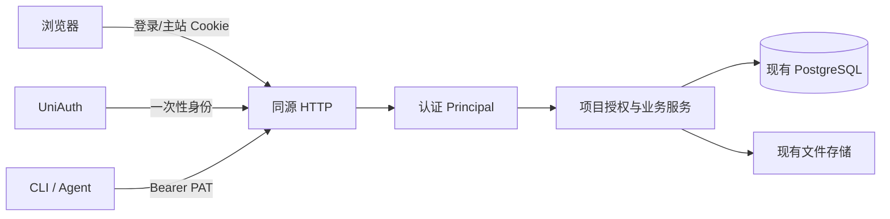
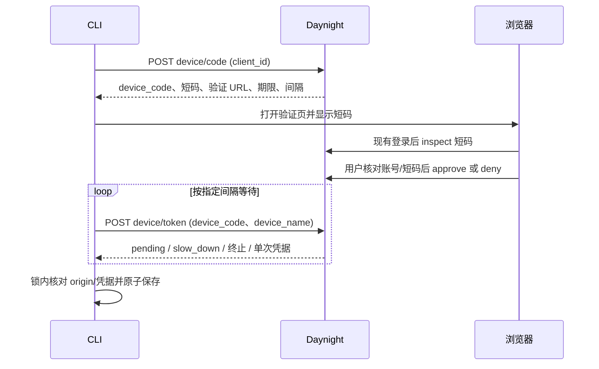

# UniAuth 登录、Team 与项目授权架构

状态：身份、会话/PAT、Team 生命周期 API、项目成员、CLI 和双语 Web 已在正式 composition 统一启用。
服务配置校验失败会拒绝启动，所有业务请求强制认证。源码绑定的验证结果与真实上游
人工登录以相应回执为准，本文不把接线完成等同于完整验收通过。
[需求](../spec/daynight-auth.md)拥有行为；
[原始鉴权决策](../../.agents/notes/archived/architecture/2026-10-22-auth-architecture.md)
保留架构取舍，[统一启用决策](../../.agents/notes/archived/architecture/2026-10-22-authentication-activation.md)记录了当前配置、组合与验收隐私规则的历史取舍。

## 已采纳的架构边界

附件维持现有可信同源执行。HTML 拥有浏览者当前主站权限，资源请求复用主站会话与
项目成员检查。普通 iframe、相对资源、同源文档键盘桥和单 origin 部署继续使用。
独立预览域名/origin、预览凭据、bootstrap 交换及其配套设施不属于本方案；
鉴权实现必须遵守，不能从项目成员权限推导出预览隔离工程。此约束的选择依据记录在
[附件架构决策](../../.agents/notes/archived/architecture/2026-10-21-task-attachment-storage-design.md)。

## 现状与可复用机制

`internal/config` 先校验必需配置，`service.App` 在打开文件和数据库之前构造真实 UniAuth SDK；`server.New` 使用组装好的应用注册身份、Team、成员、project/task/graph/property/attachment、健康检查和 UI。启动失败返回 error 并按依赖顺序释放已获得的资源。业务服务显式接受
model.Principal，原 CreatePrivate/ListAccessible 暂存别名已移除，普通 Create/List
直接实现私有创建和按成员过滤。正式 Application 在常驻 LocaleProvider 下选择公开首页、
公开指南或 AuthenticatedApp；后者拥有登录和私有页面，保留当前任务/附件页签和渐进图。
[公开入口设计](daynight-landing.md)拥有路由组合与公开身份提示，后者不参与私有资源准入。

[身份基础](../../.agents/notes/archived/architecture/2026-10-22-identity-credentials.md)
与[成员基础](../../.agents/notes/archived/architecture/2026-10-22-project-membership.md)
先独立交付的原因仍成立；当前统一组合由本文说明，启用决策保留采用该组合的历史理由。以下固定源码是最初设计
采用机制时的基线 `38b827fe644139f4e20989cd8e7740350566fb56`，不表示当前入口仍未鉴权：

| 机制 | 固定源码 | 使用方式 |
|---|---|---|
| HTTP composition 与 loopback | [server.go](https://github.com/codetreker/daynight/blob/38b827fe644139f4e20989cd8e7740350566fb56/packages/daynight-server/internal/server/server.go#L10-L19)、[config.go](https://github.com/codetreker/daynight/blob/38b827fe644139f4e20989cd8e7740350566fb56/packages/daynight-server/internal/server/config.go#L71-L77) | 一个入口认证，继续原有监听/部署边界。 |
| 项目写锁 | [project_tx.go](https://github.com/codetreker/daynight/blob/38b827fe644139f4e20989cd8e7740350566fb56/packages/daynight-server/internal/core/store/project_tx.go#L29-L39) | 在项目锁内检查权限并执行写入。 |
| 读取快照/列表 | [snapshot.go](https://github.com/codetreker/daynight/blob/38b827fe644139f4e20989cd8e7740350566fb56/packages/daynight-server/internal/core/store/snapshot.go#L14-L38) | 快照内验证成员；列表 SQL 先筛选再分页。 |
| 文件 IO 准入 | [attachment.go](https://github.com/codetreker/daynight/blob/38b827fe644139f4e20989cd8e7740350566fb56/packages/daynight-server/internal/service/attachment.go#L83-L114) | IO 前授权；读取使用短快照，变更持 Task SHARE 锁至事务完成，保留 K1。 |
| 直接浏览器资源/键盘 | [AttachmentPreview.tsx](https://github.com/codetreker/daynight/blob/38b827fe644139f4e20989cd8e7740350566fb56/packages/daynight-web/src/features/task-detail/attachments/AttachmentPreview.tsx#L35-L72) | iframe/img/下载自然使用主站 Cookie，保留同源键盘桥。 |

当前 Go SDK 固定为
`github.com/codetreker/uniauth/sdk/go v0.0.0-20261022095215-0978963813fc`，对应
[上游源码](https://github.com/codetreker/uniauth/tree/0978963813fcefd9d553f6cb9bcc319084c764b3/sdk/go)。
它提供一次性身份和 App-aware provider discovery；Daynight 继续拥有用户、会话及
成员。初始身份模块使用 c82c55c7 的历史经过由身份决策与 Web 决策保留；当前模块
和真实 UniAuth fixture 都使用 0978963，不使用工作站 replace。

## 职责与数据流



core 分别表达用户、凭据、独立项目授权和当前项目准入；core/store 定义数据访问及
事务合同，PostgreSQL 后端实现迁移和查询，service 在业务事务内作授权决定，server 拥有 HTTP/Cookie/错误映射。
复用一个 store 和既有文件存储，不复制业务实现或增加通用权限引擎。

Principal 形状为 `{UserID, CredentialID, Kind}`，Kind 为 session/PAT/OAuth。认证代码
产生可信身份，handler 传给 service；请求 JSON 不能指定调用者或角色。service 在
业务边界授权，不提供可信用户捷径。PAT 不能管理个人令牌，会话可以管理自己的 PAT；
CLI 退出接口仅允许当前 PAT 撤销自身，不提供其他令牌管理能力。

### 项目准入与独立授权

`ProjectGrant` 表达实际存储的 project/user ID、角色、真实版本和加入/更新时间。
`ProjectParticipant` 是当前名册投影：`{userId,profile,effectiveRole,inheritedFrom,directGrant}`，
profile 是必填对象，name/email/avatarUrl 均必填且可为 null；不存在的 grant 明确为 null。
当前查询将 owner Team 成员与 Project grant 的原始 user ID 合并去重，复用 canonical
access relation 的有效角色，再 LEFT JOIN users；缺少或不匹配的规范用户行使整个读取
成为完整性错误，不能用 INNER JOIN 隐藏来源。只有继承权限的人返回真实 participant
与 `directGrant:null`，不构造可写 grant 或合成版本。继承来源以
`inheritedFrom:{team:TeamRef,role}` 表达，无继承来源时明确为 null。`TeamRef` 是
`{id,kind,name}`：kind 为 personal/ordinary，Personal name 为 null，普通 Team 保留原始名称。

`ProjectMember` 仍是 grant 与 nullable 资料的内部直接关系投影，供现有授权目标检查、
邀请及其他运行时调用使用；邀请 HTTP 结果分别返回真实 grant 与有效 access。
既有成员角色 PATCH 成功直接返回 ProjectGrant，删除保留 204；它们不返回 participant 或有效角色。
新的 grants 路径通过 `version:null` 表示必须不存在，通过正版本比较真实 grant；新建目标须已有
有效项目准入。PUT 成功返回指定 grant 与 actorAccess，DELETE 返回项目和目标 ID、deleted 与
actorAccess；actorAccess 是事务中变更后的完整访问投影，可以为 null。邀请 no-op 读取实际直接关系，
不以计算的准入结果代替。
[participant 决策](../../.agents/notes/archived/architecture/2026-11-04-project-participant-projection.md)
拥有资料、有效角色与可写记录分离的原因及范围。

`ProjectAccess` 的内部模型保存当前主体的 project/user ID、真实归属、owner Team、
可空 Team role、有效准入角色和可空 `DirectGrant`。
它没有独立的可写版本或存储时间；嵌入的 grant 保留自己实际的角色、版本与时间。
`RequireProjectRead`、`RequireProjectWrite` 及 Worker 的非 claim owner 管理员检查
消费该投影。Session relay 的共同项目准入也在原 raw transaction 中调用
`store.ReadProjectAccess`；Session 的归属和持续重验由
[Session 设计](task-session-protocol.md#relay-与恢复)拥有。
当前准入与可见项目列表共用 Store 的双来源关系，以 `none < member < admin` 计算
当前 owner Team role 与 direct grant role 的最大值，列表在 SQL cursor/LIMIT 前筛选。
单主体查询在同一语句取得归属、有效角色与实际 grant，不额外读取资料。
Team 成员变化只改变继承来源，Project grant 保持独立；两种角色不互相覆盖。

Thread 写入通过同一存储所有者的 `store.LockProjectAuthorization` 取得强准入。
调用方先持 Task 与 credential share 锁，再依次锁真实 ownership、当前 owner Team member
和 direct grant；只锁实际存在的来源行，并保持到事务结束。合并各来源实际锁定后的当前值，
至少一个锁定来源须继续提供访问，不取得 Project 行锁。缺失 ownership 是完整性错误。该入口不读取人员资料，
也不把长期 share 锁扩散到普通资源或 Session 准入。[Thread 设计](daynight-task-thread.md#专用写事务)
拥有完整锁序、存在性分类和提交前凭据重验。

`GET /api/v1/projects/{projectId}/access` 返回当前主体的
`{projectId,ownerTeam,ownership,effectiveRole,teamRole,directGrant,canTransfer}`，全部键必填。
`ownership:{teamId,version}` 对应真实归属，ownerTeam 是同一 Team 的 TeamRef。
teamRole 为 null/member/admin，directGrant 为 null 或完整的
`{projectId,userId,role,version,createdAt,updatedAt}`；effectiveRole 是两种实际来源的最大值，
canTransfer 仅当 teamRole 为 admin 时为 true。无准入按原规则拒绝，不生成空角色。
版本是正 int64 JSON number，时间为 UTC。此读取不返回完整名册或个人资料。
客户端核对响应 principal、projectId、owner/ownership 一致性及存在的 grant 归属。

Project 创建、详情、列表、图与 task-sync 的内在 Project 均必填 ownership，不能回退旧格式。
GET Project 另带同一快照的新鲜 access；列表、图与持久缓存只保存内在字段。
TaskSync 顶层 actorAccess 使用同一 DTO 和读取快照，空 delta 也包含它。
members 返回 `{items,actorAccess}`，成员资料与本人 access 属于同一读取快照；Web 经既有
身份、project、generation 和请求观察次序屏障发布 actorAccess，不能用独立读取的旧角色
授权新名册。CLI 的 roster facade 校验完整 envelope 后保留其 participant 数组返回值。
[当前准入投影决策](../../.agents/notes/archived/architecture/2026-11-03-project-access-projection.md)
记录内存所有权、刷新与资料读取分离的原因。

读取在原 repeatable-read 快照中计算准入再读取资源；写入取得现有项目行锁后重算
准入，再校验授权目标的真实版本与领域约束。Tasks.SetStatus(ctx, principal,
projectID, taskID, input) 沿用同一项目锁，在取锁后检查当前准入，再校验任务观察
版本、目标状态与依赖。admin 和 member 都可执行这些资源操作；管理员角色额外
管理成员、邀请与项目提醒设置。Worker 的 claim owner 操作路径和领取时的任务
负责人要求保持各自原有规则。创建默认 proposed，可显式选择 proposed/todo，通用元数据更新不接收 status，没有
旧状态写入旁路。任务版本、int64、完整图范围和现有按条数分页合同保持。

### Team 元数据与生命周期事务

`TeamRef` 保持 `{id,kind,name}` 的最小嵌入投影。完整 Team API 另返回元数据 version、
创建/更新时间，以及当前主体的 `membership:{teamId,userId,role,version,createdAt,updatedAt}`。
Team 元数据 version 与真实成员 version 各自归属原始记录，不用计算角色或 Project 版本替代。
server 统一映射创建、分页、详情和改名的 Team DTO；有限删除回执只包含 teamId 和 deleted。

`core/team` 接受显式 Principal 并拥有 Team 业务规则；`service/team` 选择事务或快照并处理
完成结果，`server/team` 负责 HTTP 适配。管理输入先严格核对 expectedUserId，再进入任何领域查询或
事务；JSON 字符串先验证原始 Unicode 转义，core 验证合法 Unicode、无 NUL 和非全
Unicode `White_Space`，并对名称同时执行 256 code points 和 1024 UTF-8 bytes 的准入。
名称按原文存储，重复名称合法；容量拒绝不修改 Team 或成员关系。资源 ID 和 expectedUserId 使用规范
小写 UUID，正 int64 元数据版本在 no-op 比较之前校验。

创建作用域先锁定创建者 user，再在单一事务写入普通 Team 与创建者 admin 行；不预锁不存在的
Team。读取和列表使用同一只读 Repeatable Read 快照取得 Team 与当前主体真实成员关系，列表 SQL 在 `(created_at,id)` 排序、游标和 LIMIT 之前
过滤当前成员资格。HTTP Team cursor 使用 kind `teams`、version 1，绑定认证 userId 与页位置；
不按名称解析身份，不返回全量 count。缺失或不可见 Team 同为 not_found，外部 Project grant
不会授予 Team 元数据访问权。列表一次取得请求条数加一项 lookahead，读取直接消费写入入口生成的规范存储字段；不重复结构、字段或容量检查，不引入读取 measurement callback 或字节裁页。REST 成员和邀请目录保持完整，MCP 页使用相应普通批量入口。[普通读取决策](../../.agents/notes/implemented/simplification/2026-11-09-canonical-resource-pages.md)记录职责取舍。

已有 Team 写作用域开启 Read Committed 事务并取得目标 Team `FOR UPDATE`，通过事务绑定的
Team DAO 向 core 提供能力。取锁后读取当前真实成员并重验 admin，Personal 禁用操作先于变更；比较元数据
version 后才接受相同原文，即使存量名称超出新额度；真实改名前检查名称额度。真实改名只更新 Team 名称、元数据 version 和 updatedAt，不触碰
成员版本、Project ownership 或 grant；同值 no-op 不采样变更时钟或执行 UPDATE。

成员目录与主体资格在同一个只读快照中读取；成员行关联规范用户资料，缺少用户行是完整性
错误而不是静默丢弃。成员管理沿用 Team 排他锁，锁内重新读取操作者和目标的真实关系，先
比较目标 version，再决定是否同角色 no-op。降低或移除 admin 时在同一锁内计数，保证并发
自行降级或退出后仍有 admin。角色变化从 `team_member_versions` sequence 取得新版本，删除
重加同样产生新版本；删除和变更均不访问 Project grant。提交确认后回执携带操作者剩余角色，
不确定提交遵守相同的 unknown 合同。详细取舍见
[成员管理决策](../../.agents/notes/archived/architecture/2026-11-04-team-membership-management.md)。

删除在取得 Team 锁后，另发一条不加行锁的活跃 Project 与 ownership `EXISTS` 查询。Read Committed 的新语句
快照能看见取锁等待期间已提交的 ownership 和 Project 删除标记；把检查合并进最初的锁定查询会使用等待前的快照。
检查使用既有 `project_ownership(team_id,project_id)` 索引并排除已删除 Project。非空返回 team_not_empty，空集才在
同一事务删除成员和 Team；已删除 Project 的历史 ownership 保留。事务不取得已有 Project、Task 或 Thread head 锁，避免把 Team-only
操作引入那些资源的锁序。创建 Project 先锁目标 Team；任何建立目标
ownership 的写入必须先锁定并重读该 Team，和删除共享其存在性锁，不能在 Team 删除后插入孤立归属。

生命周期调用复用既有 `TransactionError` 的 callback、rollback、commit 和 completion 事实，
仅在外层确认提交后返回捕获的资源或删除回执。已确认回滚的领域拒绝保留其业务分类；真实 SQL、
取消及清理错误优先，保留原因链。无法确认 COMMIT 时，Team 路由输出 503 write_outcome_unknown；
失败的 rollback/连接清理仍输出 500 internal_error，不伪装为已拒绝或成功。响应写失败保持传输错误，
调用者不能把缺失回执当作回滚证据。此信息只属于本次调用，不增加持久提交账本。

[Team 生命周期决策](../../.agents/notes/archived/architecture/2026-11-04-team-lifecycle.md)
记录存在性锁、独立版本和有限回执的取舍；公开字段、拒绝及验收由[鉴权需求](../spec/daynight-auth.md#team-生命周期)拥有。

## 认证响应归属

`RequestAuthentication` 拥有请求凭据的 HTTP 适配：Bearer 解析、会话 Cookie 选择、Cookie 写入的精确 Origin 校验、`AuthenticateRequest` 和 `Require`。它接收 `AuthenticateCredential` 操作，调用时传递原 request context、凭据种类和 secret，并保留 principal 或原错误。`ValidatePublicOrigin` 校验该 middleware 的公开 Origin 与 HTTP 测试配置。

完整 `Authentication` 组合这个 middleware，通过私有 consumer 接口使用 Identity 的 18 个直接操作，并保留登录、账户、PAT 和 device 路由；其构造使用同一 Identity 对象校验完整认证配置和 callback，并绑定请求认证操作。Task 路由只依赖 `Require` 合同，因此 HTTP 测试可以实例化真实 credential middleware 并控制身份结果，无需构造无关的账户服务。业务权限判断仍由 service/core 执行。

`RequestAuthentication.Require` 在 AuthenticateRequest 成功之后、调用业务 handler 之前，
从准入 principal 写入 `Daynight-User-ID`。因此 GET、空写结果及下游资源错误共用
一个归属边界，认证失败不泄露未准入身份，也不回显调用方提供的值。会话/PAT 选择、
Origin 检查、角色和业务授权仍由原入口执行；该头只是响应证明。跨窗口 Cookie
可能变化时，后续持久任务缓存据此核对实际响应与自身身份域，不能只凭先前 `/me`
结果命名。[任务同步设计](daynight-task-sync.md)拥有缓存接入规则。

## 用户 REST 的精确 CORS

`s2s.allowed_origin` / `DAYNIGHT_S2S_ALLOWED_ORIGIN` 配置一个应用浏览器的精确
canonical HTTPS origin；host 小写、默认端口省略，无 userinfo、路径、query、fragment
或通配符。隔离测试须启用 `DAYNIGHT_ALLOW_HTTP_TEST_ORIGIN=1`，且 HTTP 应用 origin 的 host 仅限
literal localhost 或数值 loopback IP。空值关闭应用浏览器的 CORS，保留无
Origin 的 REST 认证、受信签发和 public refresh。配置在启动时加载并校验，修改后重启。

HTTP 外层 CORS adapter 位于普通认证与 PathGuard 外，合法 Origin 的成功、401、403、
409、路径拒绝、404 和 405 都带相同的浏览器可读头。它精确回显配置 Origin，合并
`Vary: Origin`，不发送 `Access-Control-Allow-Credentials`。CORS 只允许浏览器读取响应；
实际凭据、账号根操作、生产者资格和资源权限继续由原入口与 service/core 判断。
Cookie 写请求仍只接受主站 Origin。

预检通过实际 HTTP mux pattern 判断用户方法，不运行 handler；methodless Bot/Webhook
dispatcher 及 Task search/Session HEAD 的明确拒绝使用窄 adapter 规则。合法 Origin、
方法和请求头的 OPTIONS 无需凭据，
返回 204，不认证、初始化用户或执行业务；额外合并 `Vary: Access-Control-Request-Method,
Access-Control-Request-Headers`。GET、HEAD、POST、PUT、PATCH、DELETE 保留原路由能力，
明确不支持 HEAD 的资源仍拒绝 HEAD。

生产者边界按实际方法和路由区分。归档 POST/PUT 写入、上传准备以及生产者上传回执读取
不属于用户 CORS；准备和上传状态即使使用 GET，仍沿原 upload admission 核验 PAT owner。
这些生产者方法的 OPTIONS 无凭据返回 403，不发送 CORS 头，不认证或建立上传预留。
归档根的用户状态读取、content 与文件字节读取，以及用户图片上传继续使用用户 CORS；
原读取、写入和生产者凭据规则保持。Controller 和 Worker 生产通道不转换为用户能力。

请求头名称按 HTTP 大小写规则匹配，业务头的值、多值拒绝、协商和容量规则仍由原 parser
拥有。完整允许请求头为：

```text
Authorization, Content-Type, Accept, If-None-Match, X-Request-ID,
Daynight-Worker-Protocol, Daynight-Worker-Configuration,
Daynight-Worker-Control-Mode, Daynight-Worker-Tool-Paths,
Daynight-Worker-Prompts, Daynight-Session-Protocol,
X-Daynight-Startup-Version, Daynight-Browser-Client,
Daynight-Session-Content-Revision, Daynight-Chunk-SHA256
```

完整暴露响应头为：

```text
Daynight-User-ID, Daynight-Task-Epoch, X-Request-ID, Location, ETag,
Content-Disposition, Retry-After, Allow, WWW-Authenticate,
Daynight-Worker-Control-Mode, Daynight-Worker-Tool-Paths,
Daynight-Worker-Configuration
```

Content-Type、Content-Length、Cache-Control 本为 CORS safelisted response headers；
分页和业务 version 仍使用原 JSON。S2S issuer 路径 `/api/v1/oauth/s2s/token` 不提供浏览器
CORS；该路径的公开签发与 API token REST 准入并非本 CORS adapter 的能力。
Public OAuth 与 MCP 保留各自原 CORS，静态资源与健康检查不受用户 REST CORS 影响。
[决策记录](../../.agents/notes/implemented/architecture/2026-11-12-api-cors.md)拥有外层接入与
真实路由复用的取舍。

## 登录方式发现

公开 GET /api/v1/auth/providers 通过 SDK Providers(ctx, callbackURL) 读取
当前 App allowlist 与已启用 registry 的权威交集，投影为 `{providers:[ids]}`；空数组
是成功结果。服务使用已配置的精确 callback，SDK 执行有界单次请求，不建立登录
事务或 provider 会话。客户端明确区分加载、失败、重试和零 provider。

[上游协议](https://github.com/codetreker/uniauth/blob/0978963813fcefd9d553f6cb9bcc319084c764b3/docs/reference/api.md#L28-L73)
使用 App Basic 凭据和精确 redirect_uri；
[SDK 实现](https://github.com/codetreker/uniauth/blob/0978963813fcefd9d553f6cb9bcc319084c764b3/sdk/go/providers.go#L14-L37)
保留无重定向、无重放和有界响应。App 配置/凭据失效映射为
503 identity_configuration，网络或协议失败为 502 identity_unavailable，超时为
504 identity_timeout；它们不返回用户会话 401，避免错误清除当前账户。
[Web 决策](../../.agents/notes/archived/feature/2026-10-22-web-auth-workspace.md)
保留初始旧 SDK 缺少 discovery 的证据，生产组合已使用新能力。

## 登录和凭据

### UniAuth 一次性交接

login_transactions 保存随机 state、每笔浏览器绑定及独立浏览器 scope 的摘要、provider、主站内返回路径和十分钟到期时间。先验证 provider 和最多 4096 bytes 的 returnPath；有效 scope Cookie 缺失时只设置 32-byte 随机 scope 并以 303 返回原登录 URL，不创建 pending。首次并发请求或清除 Cookie 后的请求不能关联为同一物理浏览器。每次准入成功刷新 scope Cookie，使其覆盖新交易的期限；每笔登录仍使用独立绑定 Cookie，支持同时打开多个登录页。

短数据库事务取得全服务容量锁后读取数据库当前时间，排除过期记录并检查全服务 10000 条及同 scope 5 条上限。仅准入成功后才执行有限清理并插入；拒绝不清理、不插入、不撤销其他交易。锁后时间决定交易期限，避免等待锁使有效期缩短；callback 在取得交易行锁后按数据库时间判断到期，其他凭据仍按服务时钟判断自身期限。scope Cookie 与绑定 Cookie 都使用 host-only、HttpOnly、SameSite=Lax，HTTPS 时带 Secure 和 `__Host-` 前缀。

升级时必须停止旧版本创建登录交易，允许旧 callback 完成或等待十分钟到期。迁移对仍有效的旧 pending 明确失败并保留记录；旧记录全部消费或到期后，迁移清理过期记录并建立非空 scope 摘要合同，不伪造 scope。
callback 在同一事务验证绑定/state/provider/期限并消费 pending；提交后才通过 SDK
执行一次 Retrieve，继承请求 context 和 15 秒期限。专用 HTTP client 禁止重定向，
在底层 transport 解压之后限制 response body 的实际读取量为 2097152 bytes；读取到
上限后再探测一个 byte，超限即返回错误并停止读取，不依赖 Content-Length。读取、取消和
关闭仍遵循响应 body 的生命周期，错误原因保留在服务内部，日志不记录 code、token 或资料正文。

领取成功且 provider 匹配后，identity 领域校验外部 ID、姓名和邮箱各最多 1024 UTF-8 bytes，
头像 URL 最多 524288 UTF-8 bytes；纯 profile codec 按实际规范化 JSON 编码计量完整对象，
上限 1048576 bytes。转义可能使字段分别合规但整体超限。原始上游资料在本地用户、Personal Team
和 session 的写事务之前准入；拒绝映射为 502 `identity_unavailable`，保留已经提交的 pending
消费事实，旧资料不变。SDK 将 null 映射为 nil，非 null 字符串及 false 保持原值；身份响应省略必需字段
仍是协议错误，头像 data URL 原样保存，不添加空白归一化或头像 scheme 限制。

通过原始资料的字段与编码容量校验后，service 使用 identity 领域的 `CanonicalUniAuthID`
统一外部身份键：`microsoft:<tid>:<oid>` 转换为 `msft:<oid>@<tid>`，标准格式保持原值，
其他身份键继续作为不透明字符串保存。两种 Microsoft 格式中的 `oid`、`tid` 必须非空，
且均不含 `:` 或 `@`，从而避免不同组件组合转换成同一身份键。格式错误映射为
502 `identity_unavailable`，发生在创建本地用户、Personal Team 和 session 的事务之前。

迁移 `064_microsoft_identity.sql` 先验证已有 Microsoft 身份键，再原子更新旧格式的
`users.uniauth_id`；`users.id`、资料时间及业务关联保持原值。已有目标键冲突通过唯一约束
使整个迁移失败，不合并或删除账号；格式错误使用 SQLSTATE `P1064` 明确拒绝迁移。
升级时先停止旧 Daynight 实例，再迁移并启动支持双格式的新实例，随后切换 UniAuth 输出。
新 Daynight 实例继续接收原 UniAuth 输出，避免要求两个服务同时升级。
[Microsoft 身份键决策](../../.agents/notes/implemented/architecture/2026-11-11-canonical-microsoft-identity.md)
记录规范化与持久迁移的取舍。

合法 provider error 结束 pending；错误绑定不领取。网络断连、取消、协议错误或
领取响应丢失都重新登录，不能重试可能已消费的 code。用户以规范化后的完整外部身份键唯一
upsert，本地 UUID、createdAt 和关联不变，不按邮箱合并。首次插入保存原始 nullable 资料；冲突时
单条 `INSERT ... ON CONFLICT DO UPDATE ... RETURNING` 在用户行锁下合并，返回实际结果：name 和
avatarUrl 只在本次非 null 时更新；email 为 null 时保留原 email 和 emailVerified，email 相同则仅在
本次标记非 null 时更新标记，email 不同时保存新 email 和本次 nullable 标记。由当前冲突行计算避免
预读快照覆盖并发 PATCH 的结果，也防止旧地址的验证状态转用于新地址。

写事务对实际合并结果重新校验字段和规范化 profile JSON 容量；即使旧资料与上游资料分别合规，
合并结果仍可能超限。`initializePersonalTeam` 在同一事务建立唯一 Personal Team 与真实 owner admin
成员行，再校验实际用户公开表示的容量，随后写 session。严格事务完成机制使任一最终准入失败回滚
用户和 Personal Team 的本次写入并停止创建 session，容量拒绝映射为 502 `identity_unavailable`，
保留错误链；数据库、取消和未知提交结果沿用事务完成合同。pending 消费已独立提交，失败后仍须
重新登录。重复及并发首次登录复用该 Team；已有 Personal 缺少 owner admin 属于
完整性错误，不在 Authenticate 中补数据。返回路径拒绝外站、协议相对 URL 和 auth 循环路径，包括独立 `/login`、`/auth/complete` 及实际 callback；
无目标默认 `/projects`，不把已提供的非法目标替换成默认值。
[登录资料合并决策](../../.agents/notes/implemented/bug-fix/2026-11-13-uniauth-login-profile-merge.md)记录合并与最终准入的取舍。

### 完整用户初始化与本人资料更新

`service/identity.EnsureUser` 为后端调用者提供完整账号初始化。输入只接受非空 UTF-8 外部身份键与可空
name/avatarUrl；外部键禁止 control 字符、最多 1024 bytes，并复用 `CanonicalUniAuthID`。
姓名原样保存、禁止 NUL、最多 1024 UTF-8 bytes；头像同样禁止 NUL、最多 524288 UTF-8 bytes。
共享 `ExternalUserInput` 的 profile 可省略，提供时只能包含 name/avatarUrl；未知、重复字段及错误类型、
非法 Unicode 均拒绝。新账号的省略或 null 资料保持 null，email/emailVerified 由原生身份交接拥有。

初始化使用严格的 read-committed identity 事务。IdentityDAO 先执行按 `users.uniauth_id` 唯一键的
`INSERT ... ON CONFLICT DO NOTHING RETURNING`；冲突时在下一条 statement 按该键读取真实用户，
使等待并发创建后能够观察提交结果。返回的 inserted 只表示当前事务插入候选，不证明提交。
新 user、Personal Team 与唯一 owner admin 成员在同一事务建立，已有用户资料保持不变。
完整资料编码与 Personal Team 完整性校验成功且提交已确认后，service 才交付账号；初始化异常、
领域拒绝或容量失败整体回滚，未知提交结果不继续后继写入。该路径不使用允许提交 device 轮询拒绝的 runner。

`PATCH /api/v1/me` 仅接受非空的 `{name:string|null,avatarUrl:string|null}` subset，无 query、version、
目标 ID 或其他资料字段。缺省保留、null 清除、string 原样保存；身份、email、emailVerified 与
Personal Team 保持不变。Cookie 写请求仍校验精确主站 Origin，Session/PAT/API OAuth 仅能修改本人。
HTTP body 读取使用原 1 MiB、15 秒预算，decode 完成后另设继承父取消的 15 秒 operation deadline。
body 超限返回 413；解码字段和完整候选资料的容量拒绝返回 400 invalid_input，并保留原容量错误链。

PATCH 在同一严格 identity 事务内复核实际凭据，再由 DAO 仅更新提交字段与 `updated_at`。
UPDATE 的自然 user 行锁串行化并发写入；不预读全量资料回写，不使用 CAS。
`IdentityScope.CredentialFamilyDAO()` 由根 PostgreSQL 装配注入同事务实例；
`identity.NewScope(tx,family)` 保持 oauth→identity 依赖方向，OAuth owner-session 检查传入其自身 DAO。
API principal 使用固定 API resource/scope/client tuple 执行原 `LockAccess`。resource 取自启动配置的
可信 callback URL 的 scheme/host，加 `/api/v1`；scope/client 使用既有固定 API profile，拒绝无效配置。
原生凭据使用 `IdentityDAO.LockProfileCredential`，对 Session/PAT 取得与其他凭据读者兼容的 `FOR SHARE` 锁，
排除撤销和到期时间写入，并在取锁后按新鲜数据库时间与调用时钟复核有限期限。资料更新可能等待 user 行；
共享凭据锁允许已持 user 锁的 TestSession 重试继续读取原始 PAT，避免两个同账号 PAT 构成 user/PAT 锁环。
PAT 管理的 `LockActivePAT` 和既有 Session 管理检查保持各自原锁语义。读取实际完整用户、校验 Personal Team 与 profile 1 MiB/本人 response 2 MiB 编码容量后，
以新鲜时间再次复核凭据，覆盖 user 行等待期间的到期；任何失败均回滚资料更新。

成功仅在确认提交后返回 `200` 与原 `api.User`，保留所有 nullable 字段、完整 personalTeam、
`Daynight-User-ID` 和 no-store。实际 COMMIT 结果未知返回 `503 write_outcome_unknown`；
SQL 与清理失败保留原错误优先级。确认提交后的响应取消或写入失败记录 response unknown，
不重做资料写入，也不在部分响应后补写错误正文。
GET/HEAD `/api/v1/me` 继续使用原 read-committed 读取、完整 DTO 和 ETag；普通认证读取不改资料，
后续原生 UniAuth 登录仍可用非 null 上游姓名与头像覆盖本地两字段；API OAuth 使用同一本人更新用例。
[用户初始化与资料更新决策](../../.agents/notes/implemented/feature/2026-11-12-user-profile-patch.md)记录事务与稀疏更新的取舍。

### 主站 session 与 PAT

秘密至少 32 随机字节，仅持久化 SHA-256 摘要。生产会话 Cookie 为
__Host-daynight_session、Path=/、Secure、HttpOnly、SameSite=Lax、无 Domain。
会话绝对有效期七天，不后台续期；注销删除当前会话。Session 的有限到期和 PersonalAccessToken
的可空到期由独立领域记录表达，OAuth family 使用自己的有效期限。PAT 默认永不过期，
`expiresAt:null` 表示持续有效至撤销；有限值表示对应 UTC 时刻后拒绝新请求。Web 会话可创建名称
1–100 字符的 PAT，设备授权在明确批准后通过领取事务创建同类型的永不过期 `Daynight CLI (<hostname>)` 凭据。
明文只交付一次。列表、创建与期限修改的元数据均返回 ID、名称、创建时间及必填的可空
`expiresAt`、`lastUsedAt`；创建时 `lastUsedAt` 为 null。设备领取仍只返回
`{access_token,token_type}`，通过账户列表读取其 PAT 元数据。
会话可修改或撤销自己的有效 PAT，CLI 可撤销当前 Bearer 自身，均不影响其他凭据。

POST `/api/v1/me/tokens` 严格接受 `{name,expiresAt:null|UTCtimestamp}`，expiresAt 必填，
有限值必须在未来，不接受 days。创建与修改的时间输入采用以 Z 结尾的 RFC3339Nano；
目标值按数据库微秒精度保存，正规化到该精度后仍须在未来。PATCH `/api/v1/me/tokens/{tokenId}` 接受必填
`{expiresAt,expectedExpiresAt,expectedUserId}`，成功返回完整令牌元数据。目标值与观察值均显式为
null 或 UTC 时间；服务先核对展示账号与当前 Cookie principal，再在事务内复核有效会话和令牌，
以观察到的 expiresAt 做条件修改。账号不符返回 403，旧到期值返回 409 version_conflict，
不存在、已过期或已撤销返回 404。观察值按实际时刻精确比较，不通过截断掩盖差异；
同值且观察匹配返回 200 原元数据，不更新数据库。修改只改变 expires_at，令牌 ID、秘密散列和创建时间保持，
现有 CLI 配置继续使用同一凭据。不能通过更新恢复已到期或撤销的凭据。

账户管理器默认选择“永不过期 / Never expires”，选择指定到期后显示本地日期时间输入，按设备时区
转换为 UTC 提交。编辑显示当前到期，未修改时禁用保存，保留原有秒和微秒精度。
用户可设置未来到期或恢复永不过期；待提交与未知结果阻止新写入，
不确定 PATCH 只通过 GET 令牌列表核对，失败时只提供读取重试；读回值供新的明确决定使用，不自动
重放原写入。身份切换使旧账号请求和编辑状态失效，语言切换保留输入与请求。

OAuth v1 的 `GET /api/v1/oauth/grants` 返回当前会话账户的无秘密授权元数据。响应包含 `userId` 和
`grants`，每项包含 `id`、`clientName`、`clientId`、`resource`、`scope`、`createdAt`、`expiresAt`、
可空 `revokedAt` 和 `status`（`active`、`expired` 或 `revoked`）；撤销状态优先于过期状态。
`GET /api/v2/oauth/grants` 使用相同 envelope 和这九个字段，并增加必须存在的可空 `lastUsedAt`。
两版复用 `ListSessionGrants`、客户端快照解析和状态判断，再分别显式投影；v1 保持精确原表示。
两版均只接受主站 Session，响应带 `Cache-Control: no-store` 和 `Daynight-User-ID`，拒绝 query、
HEAD 和其他方法。认证 callback 配置保留 `/api/v2/oauth` 及其后代路径。
`POST /api/v1/oauth/grants/{id}/revoke` 接受 `expectedUserId`，成功返回 `{changed:boolean}`，
重复撤销不改变 family。列表和撤销端点只接受浏览器 Session；写入还要求精确主站 Origin 和显示账户匹配，
不可见授权返回 404。服务复用 OAuth 生命周期用例撤销该 grant 的 access/refresh family。
服务在同一事务中复核 Session，撤销按 grant、Session、access 锁序执行并在等待后重新检查到期。
网页核对响应主体并独立维护授权列表与 PAT 状态。提交前按账户在 `sessionStorage` 保存无秘密的 grant ID；
存储不可用时不派发撤销。撤销结果未知时保留目标并等待显式读取，即使离开页面或刷新也不自动重放。
读取只说明当前状态，不推断原响应；账户变化等待刷新时保留旧账户界面状态。撤销操作持有自己的取消信号并记录实际派发，准入等待被暂停时取消尚未派发的操作；已派发但未确认的结果仍需显式核对。可信回执和本地 pending 先独立结算，不等待身份准入或列表读取。已确认结果的后续读取由原面板持有可取消的工作，在准入恢复后才能开始；暂停会取消进行中的核对读取，面板销毁或新工作替代时取消旧发布。普通列表读取的结果仍等待准入后安装。关闭对话框还需匹配原实例和可见上下文，避免旧结果覆盖后续交互。

账户页采用 OAuth v2 并严格解析 PAT 与 grant 的必填可空 `lastUsedAt`；缺失或非法时间是协议错误。
共享凭据时间组件在 null 时显示无记录；否则显示近似相对时间，并以 details/summary 和 title 提供
本地完整记录时间。未来时间按刚刚显示，不改变原值。凭据 tab 可见时共用一个分钟显示时钟，恢复可见
立即重算，隐藏或卸载时清理；时钟不请求网络。列表与期限修改回执按同一对象 ID 合并非空最大使用时间，
不改变列表顺序、原到期观察值或管理状态，新 ID 不继承旧记录。稳定的行和 details 保留交互状态。

明确的 Authorization 优先；重复、格式错误或无效 Bearer 返回 401，不回退 Cookie。
PublicOrigin 使用规范的小写主机、有效端口并省略 scheme 默认端口，使配置值与浏览器
Origin 序列化一致；不规范配置明确拒绝。Cookie 写请求要求精确主站 Origin，PAT 写
请求按其 header 凭据验证。数据 API 401
始终 JSON，Web 发起登录导航。已验证并消费的 callback 若失败，清除绑定 Cookie 并
记录清洗后的错误；上游响应协议错误及 profile 准入失败返回 502 `identity_unavailable`，
其他失败 303 到固定主站 `/login?authError=login_failed`，带回经过验证的 `returnPath`，
包括身份领取后本地 session 创建失败。错误/未绑定 callback
保留 JSON 拒绝。登录壳读取并清除通用标记，保留目标与重试入口，不带回原始 code/错误。
主站默认 HTTPS，使用 __Host- 会话/绑定 Cookie；显式 HTTP 主站测试配置使用不带
该前缀和 Secure 的测试名称，仍为 host-only、HttpOnly、Lax。SDK gateway 的
literal-loopback HTTP 开关只决定 SDK 传输，不决定主站 Cookie。
同源预览使用同一 Cookie 和授权规则，没有第二种浏览器凭据。

### OAuth family 的固定 profile 与 API 授权

`core/oauth` 集中 MCP 与 API 的固定 profile。MCP resource 为 `PublicOrigin + "/mcp"`，
scope 为 `daynight:mcp`，保留实际客户端、`dnmcp_` / `dnmcr_` 前缀及原授权码、S256 PKCE
与客户端元数据。API resource 为 `PublicOrigin + "/api/v1"`，scope 为 `daynight:api`，
固定 client ID / name 为 `societas-bot` / `Societas Bot`，access / refresh 前缀为
`dnapi_` / `dnapr_`。API snapshot 只保存真实的
`{"clientId":"societas-bot","clientName":"Societas Bot"}`，不建立 DCR、redirect 或 PKCE 事实。
两种秘密都是前缀加 32-byte cryptographic random 值的 canonical raw base64url，数据库只保存
32-byte SHA-256 hash。Principal 保持真实 user UUID、access UUID 和 `OAuthCredential`；
稳定 family 标识仍是 grant UUID。

`IssueAPIFamily` 是固定 API profile 的事务内发行操作，`service/oauth.NewAPIIssuer` 以配置的
PublicOrigin 构造资源并拥有发行事务，只有确认提交才返回秘密。HTTP S2S adapter 在任何用户初始化前
校验唯一 S2S Authorization 和严格 JSON；service 先调用完整用户初始化，再调用独立 family issuer。
账号初始化与 family 提交分属事务，后者失败可以保留完整账号；unknown 不能返回秘密或重复调用。
`internal/config.S2SConfig` 组合既有 CORS origin 与独立 shared_key 设置；YAML、local YAML 与显式环境变量
依序覆盖，空 key 只关闭发行。key 非空时验证 32–256 visible ASCII bytes，启动校验不记录秘密；HTTP 准入
恒定时间比较，变更配置后重启，旧 family 不因换钥撤销。

REST 认证对 `dnapi_` 分派到固定 API verifier；明确 Authorization 优先、重复/畸形/失败不回退 Cookie，
PAT 与主站 Cookie 保持原路径。API verifier 返回真实 Principal、grant UUID 与 effective expiry，同一应用
OAuth 实例同时提供 REST、用户 WebSocket 与 readonly 回查。公开 refresh/revoke adapter 识别 API profile，
refresh 固定 client/resource/scope 并沿用 public-none；authorization_code 仍仅 MCP。
S2S issuer 与 API refresh 使用共同精确 token DTO，MCP 保留原五字段 DTO；字段和输入由
[应用授权 API 需求](../spec/daynight-auth.md#用户应用授权-api)拥有。issuer/refresh 在 body decode 后建立 15 秒
operation context，并继承请求/停机取消；JSON 为 1 MiB/15 秒读，OAuth form 为 64 KiB/15 秒读。
成功仅在确认提交后编码秘密并设置 no-store/no-cache；unknown 保留实际 completion 和错误链，不重做操作。

API 不授予账号根、Worker 或 Controller 生产者权限。授权列表沿用原 owner 权限和 DTO，
从实际 snapshot 投影 client ID / name，展示真实 grant 截止与状态；主站会话撤销和 public self-revoke
复用原 family 用例。明确新申请建立独立 grant，撤销不级联删除用户资源或取消已派发业务。
[公开应用授权决策](../../.agents/notes/implemented/architecture/2026-11-13-public-api-authorization.md)
记录入口及复用边界。

`store.OAuthBinding` 表达精确 resource、scope 和可选固定 client ID；MCP 的空 client ID 表示
不额外限制已记录的客户端。`AuthenticateAccess` 验证实际 access、grant 与 user 关联、binding、
撤销和两项期限，返回非空的 effective expiry，即 `LEAST(access.expires_at, grant.expires_at)`。
`ReadAccess` 采用无行锁读取；`LockAccess` 保持 grant `FOR SHARE` → access `FOR SHARE`，
等待后以新鲜数据库时间复核。原 `CredentialReader` / `ThreadCredential` 签名、scope 和调用位置
保持，OAuth helper 关联实际 family / user 并投影同一 effective expiry。原 snapshot 不加行锁，
原共享锁读取仍只 `FOR SHARE OF access`，业务等待后的期限检查保持；该 helper 不扩展为持有 grant
锁的通用事务前置检查，也不把 credential 锁跨网络 body IO 保留。

Session 用户用途在原 Core gate 构造固定 binding：一般用户状态、内容、命令、控制、回执、图片与
独立可读归档仅允许 API；原 Task message/receipt/已支持读取允许 API 和 MCP，MCP 归档仍仅原
Task ArchiveV1Read。SessionDAO 的 LockOAuthCredential / ReadOAuthCredential 委托同一事务
family DAO；可读归档预检保留原 WriteSession 的 READ COMMITTED 事务，其中凭据查询无行锁，实际 IO 沿原 scope 重新检查。Task/独立/Bot 的 owner、
项目权限、claim、fence/generation/epoch、容量、revision、当前绑定与 parent PAT 条件保持。
生产注册、grant、channel、归档上传及完成保留原凭据条件。持久 operation Actor 仍只有真实
UserID、CredentialID 和 Kind；派发从实际操作重建用途并复核原 access 与当前用户权限，不能继承
外层 Controller 身份。新 access 可按原用户/意图规则查询 receipt，不能替换旧 Actor 或重放命令。
Session-first 原 Actor 的 nested SHARE 与 Task 准入锁位置保持，兼容锁协议由
[Session 锁决策](../../.agents/notes/implemented/bug-fix/2026-11-10-task-oauth-family-locks.md)所有。

Worker readonly 用户请求由原 Broker 保存请求者 Principal，在派发、生产者交付和用户返回前分别
调用同一应用 OAuth 实例的 `RecheckAPIAccess`。该操作独立于 native `WriteIdentity` callback，
在既有 family 事务中以固定 API binding 执行 `LockAccess` 并确认 completion；它不签发凭据或
重复记录 usage。Worker channel 继续要求 PAT；生产者 PAT 不替换保存的 OAuth requester，
单用户回查失败只结束该请求。owner、online、Provider、能力与连接代次、期限和取消仍由
[Worker readonly 通道](worker-readonly.md)的原机制检查。

首次 grant / refresh 截止为发行时间加 30 天，access 为 60 分钟。续期沿用 grant `FOR UPDATE`
→ refresh `FOR UPDATE` 锁序；取得锁后读取数据库 UTC 微秒 `renewedAt`，复核实际 binding、撤销、
消费状态及原 grant / refresh 截止。尚有效的 API refresh 原子消费旧行，把 grant 和新 refresh 截止
写为 `renewedAt + 30 天`，新 access 为 `renewedAt + 60 分钟`，grant.created_at 保持原值。
`OAuthRotation.GrantExpiresAt` 是该次事务实际写入 grant 与新 refresh 的期限。MCP grant 截止
保持原绝对期限，新 access 截止仍为签发后 60 分钟与该绝对期限的较早值。

旧 access 与 consumed refresh 各自原截止保持。旧 refresh 原有效窗内的正确绑定重放会提交 family
撤销再返回 `invalid_grant`；超过该旧截止的重放只拒绝，不撤销已续期 family。同一旧 refresh 不会
双成功，后到的有效重放可能撤销先到请求已续期的 family。普通访问、失败和 last_used_at 都不延期。
仅确认提交后交付新秘密；回滚、commit unknown 和提交后响应丢失不触发自动重放或明文恢复。
现有有界 cleanup 继续按每行自己的期限工作。

数据库 lifetime CHECK 仅允许 `scope=daynight:api` 且 `client_id=societas-bot` 的 grant 越过
created_at 加 720 hours，其余 grant 保持原上界。迁移不重分类历史 grant，不更改已有 ID、期限、
metadata、last_used_at、Actor 或 nullability，不增加外键。
[固定 API family 决策](../../.agents/notes/implemented/architecture/2026-11-12-api-oauth-family.md)
记录 profile 隔离与滚动期限的选择。

### 应用用户 WebSocket

仅 `GET /api/v1/projects/{projectId}/tasks/{taskId}/sessions/{sessionId}/channel` 的 v1/v2
和 `GET /api/v1/test-sessions/{sessionId}/channel` 的 v1 接受应用浏览器载体。调用者提供一个
实际支持的 Session subprotocol 和一个唯一授权 marker：

```javascript
new WebSocket(url, ["daynight.session.v2", `daynight.authorization.${accessToken}`]);
```

adapter 在 Session 版本选择和 `websocket.Accept` 前解析并剥离 marker，只向协议协商提供实际
Session subprotocol，响应只回显该协议。重复或竞争 marker、畸形输入、缺少实际支持协议，或同时
存在明确 `Authorization`，均返回 `400 invalid_input`。无效、过期、撤销或错误 profile 的 token
返回 `401 unauthenticated`；应用 Origin 缺少、错误、多值或配置为空返回 `403 forbidden`。
Origin 必须精确等于已验证的 `s2s.allowed_origin`，不从 Host 或请求头推导允许值。
marker 明确选择 API OAuth 认证，浏览器 Cookie 不参与此分支；错误 marker 不回退 Cookie。
秘密只属于入站认证载体，不进入 URL、frame、协商回显、日志、错误、trace 或转发 header。
Controller 和 Worker 生产者 channel 沿用原入口，不解析应用 marker。原生 Cookie/PAT 的优先级、
主站 Origin 条件及未提供 subprotocol 的 v1 行为保持。

握手的窄认证操作按配置的 API resource、固定 scope/client 读取真实 access、grant 和 user，
返回真实 Principal、grant UUID 和 access/grant 的较早截止。原 Session 用户用途检查继续核验
当前资源、owner、项目权限、parent PAT、claim、fence、generation 与 epoch；握手认证不替代它们。

API 连接在原 `accept` 的 cancel、`CloseRead`、poll 和 cleanup 责任内安装本次认证 effective expiry
的 context deadline。到期取消正在进行的受保护 IO，并阻止新的结果发布；旧连接的期限不随
refresh 延长，持久 Actor 也不换绑。使用新 token 重连仍遵守原 fence、lease、resume 和原用户意图，
不迁移命令或控制租约。原 250ms poll 通过原 Session 用户用途重新检查完整 family 和当前权限；
观察到撤销或失权后停止新准入。此观察周期不承诺撤销瞬间回收此前已准入的工作，已经传送的 bytes
不可撤回，已准入 transfer 保留其原有界传输和取消语义。

API 用户连接的认证或权限失效选择 `1008`，原因固定为 `unauthenticated` 或 `forbidden`；
基础设施失败选择 `1011`，Routes 已进入关闭状态时选择 `1001`。预期的 `reset_required` 沿原路径
发送控制帧后清理，不分类为基础设施失败。所有关闭帧均在传输仍健康时尽力发送；`CloseRead` 的取消、
原停机取消后强关或 IO 失败可能已经关闭底层连接，因此不保证对端收到关闭帧。原生用户与生产者的
关闭所有权和生命周期保持。连接升级失败释放原 reservation，cleanup 仍负责 cancel、连接、
viewer lease 和 handler 收拢，不建立第二个 transport owner。coder/websocket 的关闭分别有 5 秒
写入、5 秒对端等待及可能 15 秒 goroutine drain；这些是各阶段界限，不是总 5 秒关闭保证。

[应用用户 WebSocket 决策](../../.agents/notes/implemented/architecture/2026-11-12-api-user-websocket.md)
记录载体与关闭所有权的选择。HTTP/raw WS 测试拥有解析、协商、认证分支、deadline、poll、发布和清理
证据；OAuth service/family 测试拥有真实 tuple、expiry 与事务事实；正常完整应用协作由原集成入口验证。

### 凭据使用时间的持久化

PAT 和 OAuth grant 各自持有可空 `last_used_at timestamptz`，表示已记录的真实合格事件时间。
新建和升级数据均初始为 NULL，不设置默认值或回填历史。领域元数据的 `LastUsedAt` 对应此列；
PAT 元数据和 OAuth v2 列表显式投影该字段，OAuth v1 列表保留原表示。存储能力不自行推断事件。

共享事件以 kind、user ID、PAT ID 或 grant ID 和真实 UTC 微秒时间标识；OAuth 使用 grant ID，
不使用 access token 或 client ID。窄 writer 接受非空、最多 128 个、按 kind/user ID/subject ID
排序且 key 唯一的事件，在独立 READ COMMITTED 事务中先以相同顺序对存在且属于指定用户的行执行
`SELECT ... FOR UPDATE NOWAIT`，排空锁阶段后再对实际锁到的行批量条件更新。只有当前值为 NULL
或小于事件时间才修改；缺失对象或不匹配的 owner 跳过，不插入或恢复对象。即使 grant 已撤销或
到期，仍存在的行也可接纳此前发生的事件。使用时间不参与期限 CAS 或列表排序。

`NOWAIT` 在行锁竞争时以 `55P03` 结束并回滚整个元数据批，保留原错误链；不能改为先执行等待的
UPDATE，因为前台可能按相反顺序持有凭据共享锁。独立事务避免元数据失败改变认证或续期事务结果；
普通池获取、网络及提交仍可能等待或失败。事务沿用现有 Completion 分类和独立五秒 rollback cleanup；
writer 返回不证明 pgx 内部异步连接销毁结束，`persistence.Close` 负责等待连接池关闭。
[持久化决策](../../.agents/notes/implemented/architecture/2026-11-12-credential-usage-persistence.md)
记录取舍和范围。

### 协议发布与恢复

先部署包含迁移、记录 producer 和 PAT 必填字段及 OAuth v2 列表的 backend，再将采用这些字段的
Web 投入流量。Web 随 server 从同一源码构建并嵌入；新 Web 投入流量前退出旧 backend，避免新
bundle 请求不支持 v2 的实例。旧页面仍可通过 v1 读取新 backend。新客户端上线后，应用回滚的
最低恢复 artifact 必须保留 PAT 必填字段、OAuth v2 列表及正确读回能力，或使用前向修复；仅保留
数据库新增列不足以使旧 binary 安全。若退出新协议，须先真实退役采用它的客户端；当前没有自动
退役保证。数据库回滚保留新增可空列及已记录值，不做破坏性降级。
[协议决策](../../.agents/notes/implemented/architecture/2026-11-12-credential-usage-http.md)记录版本取舍。

### 真实凭据使用事件

HTTP 的 PAT 或固定 API OAuth 认证成功后立即以服务端 UTC 微秒时间记录一次；PAT 使用实际 PAT ID，
API 使用实际 grant ID 和 `http_oauth` 来源，用户 WebSocket 的成功 marker 认证也经过这一边界。直接调用
`AuthenticateRequest` 同样记录，poll 和内部 family/权限复核不重复记录。MCP 在 PAT 或 OAuth 凭据、resource 和 scope
验证成功后、解析正文和业务处理前记录一次；OAuth 事件归属 grant ID。后续业务拒绝、
响应失败或客户端断开不撤回已发生的事件。浏览器 Session、内部父凭据重验和纯心跳不产生事件。

刷新轮换只在最终事务的 `RotateRefresh` 成功后建立 grant/user/数据库时间候选；writer 返回后、
原完成结果映射前观察该候选。确认提交（包括附带 cleanup 错误）接纳事件；未提交不接纳；
提交结果未知只发布关联 grant 和请求的安全故障，不能推断提交或回滚。确认提交后的响应丢失
仍是成功使用。初次颁发、重放撤销和失败轮换不生成事件。两个生产 GrantLifecycle 实例显式
使用同一个 recorder，token endpoint 在原响应或错误处理前发布故障。记录与日志故障不改变
原认证、授权、续期或业务结果，也不重放刷新。受控直接调用须提供 request ID 和 collector。
[事件边界决策](../../.agents/notes/implemented/architecture/2026-11-12-credential-usage-events.md)
记录事件选择及提交结果的取舍。

### 凭据使用事件采样规则

`core/credentialusage` 提供独立于数据库和后台循环的有界状态规则。每个实例最多保留
1024 个凭据 key，每批最多取出 128 个不同 key；待处理、写入中、冷却中以及带未确认故障的
key 均占用容量。耗尽重试的 key 保留标记，直到较新事件成功完成，避免淘汰后重放旧事件获得
新预算；该标记也占用容量。只有没有待处理事件、写入快照、耗尽标记和未确认故障的 key 可以
为新 key 淘汰；
满载时显式拒绝新 key。事件按真实 UTC 微秒时间合并，较旧或相同的事件不会使时间回退，
关联字段随选中的事件一起保留。

首次事件立即可调度，成功批次的 dispatch 起同一 key 冷却 20 秒。调度使用单调时间，按
due 和首次待处理时间选取，合并不会推迟已有 due；写入中到达的新事件不会被该快照的完成
清除。失败快照最多再尝试两次，重试间隔至少一秒；预算耗尽后只有新的真实事件可建立新候选。
Seal 拒绝新事件并使待处理事件可强制 flush。固定阶段和错误类别的故障摘要保留安全关联与
revision，确认旧 revision 不会抹掉期间新增的故障。采样器不保存请求 context 或记录日志。

在调度检查不超过一秒、每个成功批次不超过两秒的条件下，满载首次事件和冷却后事件的调度
预算分别为 17 秒和 37 秒；这是规则上界，不是生产时延测量。认证入口与应用生命周期接线由各自的组件负责。
[采样决策](../../.agents/notes/implemented/architecture/2026-11-12-credential-usage-sampling.md)
记录其取舍。

### 凭据使用记录器

`service/credentialusage` 显式启动后台记录器：一个数据库 worker 从采样器取出到期批次，
每次写入使用独立工作 context 和两秒 deadline，完成后立即继续处理合格批次，空闲时至多一秒
检查到期状态。事件的原始时间用于幂等重试；认证与续期操作本身不会重放。Record 仅复制安全的
事件、来源和不超过 64 字节的请求标识，不持有请求 context，也不等待数据库或日志。同步拒绝
写入调用者提供的固定容量 request-local collector，由协议边界发布，不在记录器中写协议日志。

独立诊断 consumer 公平遍历 resident 故障摘要，复制 revision 后写结构化日志，再确认该版本；
日志阻塞不会持有采样锁或阻塞 Record 和数据库 worker。未确认摘要占用采样容量，故障和过载
可导致样本丢失。正常 drain 封闭接纳并强制待处理事件到期，等待 worker 和 consumer 退出；
已退出但存在未落库样本时保留原因和数量并报告完成事实。超时不另起工作，后续调用继续等待
同一工作。writer 返回不证明 pgx 内部异步资源已释放，连接池关闭由 persistence 负责。

生产 App 从同一个 `Persistence.Transactions` 显式构造唯一 recorder，保存在
`Application.CredentialUsage`，由 `App.Start` 启动。记录器的工作 context 不随 root 取消，
已准入请求在 HTTP grace 期间仍可接纳事件；强制取消通过 `App.CancelWork` 传递。
HTTP 与 relay 完成后，`App.Drain` 先确认现有 producer 停止，再 seal 并等待 recorder。
外层错误的 `Drained()` 只表达整个应用的完成事实，不能由 joined 子错误推导。
记录失败但整体已退出时，`App.Close` 继续释放依赖并保留原 cause；只有实际全部关闭后，
返回错误才声明 `Closed()`。Runtime 保存历史错误，依据整体完成事实继续关闭，后续调用不重启
已完成的工作。原 `persistenceClosed` channel 等待同一次 pool 关闭，超时重试不会另起关闭。

HTTP `RequestLogging` 在 request ID 后建立固定 collector。协议入口可调用
`httpx.PublishCredentialUsageFaults`，在返回成功身份或进入长处理前发布安全故障；无故障时
不输出额外日志。发布复制 revision，在 logger 确认成功后才 acknowledge；发布期间新增故障
仍待确认，日志失败也保留原版本。故障字段位于请求日志的 `credential_usage` 子对象，保留
subject/user、phase/error_code、source、原始 request/event 时间、固定类别计数及 revision，
不输出原始错误、请求正文、URL 或秘密。normal、panic 和 abort 出口补发尚未确认版本；
panic/abort 保持原中止语义，abort 另有安全请求日志。
[记录器决策](../../.agents/notes/implemented/architecture/2026-11-12-credential-usage-recorder.md)
记录其取舍。

## 数据与并发

| 表 | 关键字段与约束 |
|---|---|
| users | 本地 UUID；唯一 uniauth_id，Microsoft 使用 `msft:<oid>@<tid>`，其他身份键保持原值；可空 email/email_verified/name/avatar_url；时间。 |
| login_transactions | 事务 ID、state_hash、browser_binding_hash、provider、return_path、expires_at。 |
| sessions | ID、唯一 token_hash、user_id、必填 expires_at；七天到期，注销删除。 |
| personal_access_tokens | ID、唯一 token_hash、user_id、name、created_at、nullable expires_at 与 last_used_at；expires_at 为 null 表示永不过期，last_used_at 为 null 表示无已记录使用，撤销删除。 |
| device_authorizations | ID、设备秘密摘要、唯一短码、状态、到期、轮询时钟/间隔和批准账号；状态转换与领取以行锁保护。 |
| device_authorization_limits | bucket_hash、attempts、expires_at；创建与短码查询在不同副本共享限制，到期窗口可清理。 |
| teams | UUID；唯一 nullable personal_user_id；Personal 的 name 为 null，普通 Team 的 name 非 null；正 version 与时间。 |
| team_members | `(team_id,user_id)` 唯一；admin/member；正 bigint version 来自独立 sequence；加入与更新时间；`(team_id,created_at)` B-tree 支持成员分页。 |
| project_ownership | project_id 唯一；真实 team_id、正 version 与 updated_at；每个 Project 恰一行。 |
| project_grants | `(project_id,user_id)` 唯一；role 为 admin/member；bigint version 来自独立 sequence。 |
| project_invitations | ID、project_id、唯一 token_hash、created_by、expires_at、consumed_by/at、revoked_at。 |
| team_invitations | ID、team_id、唯一 token_hash、created_by、expires_at、consumed_by/at、revoked_at。 |

使用既有迁移机制、唯一索引和角色 CHECK，不要求新增 foreign key；关联由业务事务验证。
成员分页仍以 `created_at,user_id` 排序并使用复合游标；两列索引不替代同时间成员的完整排序。
索引取舍见[成员与终端读取索引决策](../../.agents/notes/implemented/architecture/2026-11-09-member-terminal-read-indexes.md)。
迁移 `018_device_authorization.sql` 建立设备授权和共享限流表，
`019_optional_token_expiry.sql` 仅让 personal_access_tokens.expires_at 可空，保留既有令牌的
ID、散列、创建时间和全部有限到期值，不延长旧凭据；sessions.expires_at 保持必填。
`035_team_invitations.sql` 随真实邀请入口建立独立邀请表、唯一散列及 Team/到期索引；
删除 Team 的事务负责清除子记录，不引入 foreign key。

`032_personal_project_ownership.sql` 在一份编号迁移中建立真实归属并切换授权来源。
迁移先验证既有用户、项目、grant 与邀请引用；任何 Project 没有现任 admin 或存在坏引用
都使整份迁移失败并回滚。全部既有用户，包括仅持旧 PAT 的用户，获得唯一 Personal Team
及真实 owner admin 行。每个 Project 归入最早加入的现任 admin 的 Personal Team，按
`created_at,user_id` 稳定排序，不推断历史创建者或使用角色提升时间。

迁移原地重命名 `project_members`、对应 sequence、约束及索引为 `project_grants`，保留
全部行、时间、版本及 sequence 的实际 `last_value/is_called`。不按存活行的 `MAX(version)`
重置 sequence；已经删除的高版本仍保护删除后重加的 ABA。SQL、必要 transform 与 ledger
在原迁移事务内提交，任一失败均回滚；历史 migration checksum 保持。

项目创建在任何领域 SQL 前核对 `expectedUserId` 与 principal。指定 Team 时锁定目标行并在
锁后读取当前成员资格；省略时锁定并验证调用者真实 Personal Team。随后在同一事务插入
Project、ownership 与 creator direct admin grant。创建和删除共享 Team 存在性锁，删除的
独立 Read Committed 查询能看到锁等待前提交的 ownership。未确认 COMMIT 与清理失败沿用
Team 事务的结果分类，不自动重放。`model.Project.Ownership` 是真实内部聚合，
Project 点读通过 LEFT JOIN 投影并校验必需归属；缺行是完整性错误，没有运行时旧数据回退。
创建在同一事务投影当前 access，提交确认后与 Project 一并返回；公开归属与权限来源使用真实记录。

项目转移预览使用 Repeatable Read 快照，先验证当前 owner Team admin，再按目标 UUID
读取最小 Team 引用与元数据版本，并结合目标成员角色和现存 direct grant 计算预期角色。
转移使用 Read Committed，先锁 Project，再锁 ownership，最后按 UUID 升序锁 source/target
Team（相同时只锁一次）；锁后重新检查主体、归属及版本。Team 删除持有同一 Team 锁，
随后以新语句检查 ownership，因此转入和删除不会留下悬空归属。转移不取得 Task、credential
或 Thread head 锁，不修改 grant 或邀请；回执中的当前 access 在事务内计算，提交确认后发送。
Thread 强准入在 ownership share 锁返回后，以新语句读取稳定 team_id 对应的 Team，再锁
实际成员及 grant；等待期间提交的新目标不会被旧语句快照中的连接行误判为完整性错误。

独立授权管理在验证 expectedUserId 后锁项目，重查有效 admin 与目标真实 grant；新增还检查
目标已有有效项目准入。null 版本仅在 grant 不存在时允许新增，正版本仅在真实版本匹配时允许
替换或移除；存在性与版本不匹配均返回 version_conflict。项目锁串行化授权和邀请写入。
真实角色变更与新加入从 `project_grant_versions` sequence 取得新版本，观察值不要求连续或
每次恰好加一；版本匹配的无变化保持版本。移除后重加入不复用旧版本。有效 admin 可以删除或
降级本人及他人的最后一条 direct admin grant；owner Team 的继承权限独立计算。变更后在同一
事务重新计算 actor access，确认 COMMIT 后才发送有限回执；失权时返回 null，不依赖后续有权限
的 GET。无法确认 COMMIT 则报告 write_outcome_unknown，不能重放。Team 成员变化不重写 Project
grant，grant 变更不改 task.version。[grant 管理决策](../../.agents/notes/archived/architecture/2026-11-04-project-grant-management.md)
拥有存在性条件、有限回执与外部加入范围的取舍。

邀请七天有效、只授予 member、可撤销。邀请属于项目，创建者离任不自动作废。
接受按项目→邀请顺序加锁，验证状态后检查真实 direct grant。已有 grant 保持原角色且
不消费；只有继承权限时插入 direct member 并消费。新 grant 与消费原子提交，两个
无 direct grant 的接收者并发仅一个成功。inspect 返回项目 ID、名称及当前主体的可空
directGrant/access；accept 返回 projectId、真实 directGrant、提交后 access、joined 和
consumed。无效、到期、消费、撤销和目标删除统一为 404 invitation_unavailable。到期
查询即时拒绝，不依赖后台任务；写入时有界清理到期记录，过期索引支持每次最多清理 100 条。

### 管理员直接添加 Team 成员

`POST /api/v1/teams/{teamId}/members` 由 `server/team` 解码共享 `ExternalUserInput` 和显式角色，
`service/team.DirectMembers` 协调三个独立阶段，`core/team` 决定普通 Team/admin 准入及成员收敛。
expectedUserId 和规范 Team ID 校验先于领域 SQL，目标外部身份只标识加入者。

第一阶段使用原 `TeamWriter.WriteTeam` 短事务，在 Team 原预锁后检查实际凭据、普通 Team 和当前 admin。
确认该只读核验事务完成后，第二阶段调用独立 `Identity.EnsureUser`，仅使用其确认提交的完整目标账号。
第三阶段重新进入原 Team 写事务，再检查凭据与当前 Team/admin，锁定目标成员并添加或读取关系，
刷新同事务 eligibility，最后用新鲜时间再次检查凭据。初始无权不产生用户，后阶段失败回滚成员和 eligibility，
可以保留第二阶段已完整建立的用户和 Personal Team。HTTP 的直接成员错误适配先保留事务完成和清理失败，
再保留明确的 unauthenticated 凭据拒绝；其 missing-row 原因不被 Team 缺失回退覆盖。
实际 Team 缺失仍使用 not_found；网络或数据库故障不被领域拒绝掩盖。

`TeamWriteScope.IdentityDAO()` 与 `CredentialFamilyDAO()` 由 PostgreSQL 根装配绑定到同一事务。
API principal 复用 Identity 的固定 resource/scope/client `LockAccess`；原生 Session/PAT 复用
`IdentityDAO.LockProfileCredential` 的 reader-compatible SHARE 检查，排除撤销与到期写入，并保留管理操作的原锁模式。
Team 预锁位置保持不变；成员行或其他下层等待不沿用第一次凭据核验的时间。

成员 DAO 的 `AddMember(ctx,userID,role)` 使用显式角色，邀请接受明确传 member，仍保留实际接收主体、
邀请状态与消费事务。直接添加前锁读真实目标关系：不存在时插入并返回 added=true；同角色返回原成员和
added=false；异角色返回 resource_conflict 并整体回滚，角色修改仍由观察版本的 PATCH 拥有。
成功仅在确认提交后返回实际 membership、added 与 actorRole=admin。未知 COMMIT 返回
write_outcome_unknown，确认提交后的响应丢失不重复执行操作。Personal、最后 admin、Team 元数据版本和
独立 Project grant 均保持原规则。[直接成员决策](../../.agents/notes/implemented/feature/2026-11-13-direct-team-members.md)
拥有三阶段边界与明确角色收敛的取舍。

### 按外部身份解析 Team 成员

`POST /api/v1/teams/{teamId}/members/resolve` 复用直接成员的主体和外部身份校验，
但仅接受外部身份键。`DirectMembers` 在一个原 Team 作用域内检查真实凭据，
由 `core/team` 检查当前普通 Team admin，再通过同事务 DAO 将既有身份与该 Team 的成员关系关联。
身份或成员不存在均返回 null；其他错误保持拒绝。读取完成后以新鲜时间重验凭据，
事务确认完成才输出结果。该路径不调用用户初始化或成员写入，也不把读取结果作为未来写操作的授权。
[解析决策](../../.agents/notes/implemented/feature/2026-11-14-team-member-resolution.md)记录接口取舍。

### Team 邀请

Team 邀请使用独立 `dnteam_` 秘密及 `team_invitations`，仅存散列。接受按 Team →
邀请 → 当前成员顺序锁定，先重验邀请有效，再检查真实成员；已有成员保留角色且不消费，
新 member 与消费同事务提交。撤销与接受共享 Team 和邀请锁；删除 Team 同事务清除邀请。
Personal 不可创建邀请。inspect 仅返回 Team 引用和当前主体关系，accept 返回真实成员及
joined/consumed。两种邀请都通过 POST body 传秘密，响应 no-store，失效原因统一为
invitation_unavailable；[Team 邀请决策](../../.agents/notes/archived/architecture/2026-11-04-team-invitations.md)记录了接收入口及交付边界的历史取舍。

HTTP 认证逐请求读取当前会话/PAT 或固定 API OAuth family 并产生 Principal。资源服务在自身 Snapshot 或
项目写锁内检查成员。直接成员与本人资料更新在自己的写事务内额外复核凭据，并在可能的行锁等待后
再次检查新鲜期限；其他资源操作保留凭据认证与业务事务各自的准入时点。附件读取在短快照完成项目与 task 成员检查后准入文件 IO；变更取得 Task SHARE 锁后，
通过 `pg.ReadProjectAccess` 在单条语句中重新读取当前 ownership、owner Team member 和 direct grant
形成准入结果，不锁定授权来源行。Task 锁继续覆盖删除状态检查、文件 IO、事务绑定元数据写入及事务完成，
与 Task 删除排序。准入后的 grant 或 Team 成员撤权无需等待文件 IO；已准入操作允许完成，
不能在文件写入后仅因成员刚移除而拒绝元数据写入。撤权后没有其他有效来源的新准入请求拒绝；
附件 HTTP 凭据仍只在入口验证，Thread 的强准入与凭据重验规则由其专用事务拥有。
真实存储/数据库错误按原链传播，保留 K1，已发字节不承诺撤回。
[附件准入锁决策](../../.agents/notes/implemented/bug-fix/2026-11-06-attachment-admission-locks.md)记录锁范围与撤权完成的取舍。

## HTTP、Web 与 CLI

新增主站 API 保持 /api/v1，复用现有 Vite /api 代理：

| 路由 | 行为 |
|---|---|
| GET /healthz、GET /readyz | 无业务数据的存活/就绪；就绪保留 store 可用性。 |
| GET /api/v1/auth/providers | 公开 App 范围 provider 发现；真实 SDK 投影当前权威交集。 |
| GET /api/v1/auth/login?provider=... | 校验输入；无有效 scope 时初始化并返回同一 URL，否则按容量创建 pending 并跳转 UniAuth。 |
| GET {配置 callback 路径} | 校验/消费 pending、领取身份、建立 session；只注册配置路径。 |
| GET/HEAD /api/v1/me | 当前用户最小资料及必填 personalTeam:TeamRef；读取真实 Personal 关系并校验 owner admin，认证及完整资料读取后以强 ETag 重验，成功 200/304 使用 private, no-cache。 |
| PATCH /api/v1/me | 当前 Session/PAT/API OAuth 本人，仅提交 name/avatarUrl 的非空 subset；缺省保持、null 清除，确认提交后返回原完整 api.User 与 no-store。 |
| GET/POST /api/v1/teams | 本人成员资格过滤的 Team 分页；原子创建普通 Team 和创建者 admin。 |
| GET/PATCH/DELETE /api/v1/teams/{teamId} | 详情含本人真实 membership；当前 admin 按元数据 version 改名或删除空普通 Team，删除另匹配名称原文。 |
| GET / | 交付同一内嵌页面，显示公开推广页；可取消身份提示只改变导航，不授予私有访问。 |
| GET /login | 交付同一内嵌页面，显示独立登录或将已有会话替换到有效目标。 |
| GET /projects | 交付同一内嵌页面，认证后显示项目列表。 |
| GET /workers、GET /workers/{workerId} | 交付同一内嵌页面，认证后显示当前账号的 Worker 观测；数据由账号级快照 API 准入，任务行按当前项目权限过滤。 |
| GET /setup | 交付同一内嵌页面，显示公开静态使用引导；文档根执行一次身份初始化，指南不发起业务 API 请求。 |
| POST /api/v1/auth/logout | 主站会话注销，验证 Origin。 |
| GET/POST /api/v1/me/tokens、PATCH/DELETE .../{tokenId} | 主站会话列出/创建、按账号与到期观察值修改、撤销自己的有效 PAT；Cookie 写校验精确 Origin。 |
| POST /api/v1/auth/device/code、POST .../token | 公开客户端 form 设备授权与轮询领取；RFC 错误 JSON。 |
| POST /api/v1/auth/device/inspect、POST .../decision | 仅主站会话及精确 Origin 检查、明确批准或拒绝；Daynight envelope。 |
| POST /api/v1/auth/device/logout | 当前 Bearer PAT 撤销自身，浏览器会话不能调用。 |
| 现有 project/task/graph/property/attachment API | session、PAT 或固定 API OAuth；业务 service 检查当前项目成员。 |
| PUT .../tasks/{taskId}/status | session/PAT/API OAuth；成员写权限，正 int64 version 与五状态目标；PUT 和 405 路径均经过 Require、Cookie Origin 规则及 no-store。 |
| POST .../projects/{id}/transfer-preview、POST .../transfer | owner Team admin；最小目标预览及按 ownership/目标版本确认转移。 |
| GET .../projects/{id}/access | 当前主体的真实归属、owner Team、双来源有效角色与 canTransfer；要求当前项目准入。 |
| GET .../projects/{id}/members | 任一有效成员读取 items participant 和同快照 actorAccess；资料与继承来源不授予 Team 目录访问权。 |
| PATCH .../projects/{id}/settings | admin，锁后复核角色与精确设置 version，返回完整 Project。 |
| PUT/DELETE .../projects/{id}/grants/{userId} | 有效 admin；PUT 的 version 为 null 或正版本，DELETE 为正版本，均携带 expectedUserId；新建目标须已有项目准入。成功返回有限回执与可空 actorAccess。 |
| PATCH/DELETE .../members/{userId} | admin；携带真实 grant version 与必填 expectedUserId，PATCH 另含存储 role；成功分别返回 ProjectGrant / 204。 |
| GET/POST .../projects/{id}/invitations、DELETE .../{inviteId} | admin；创建和撤销携带 expectedUserId，创建一次显示链接。 |
| POST /api/v1/invitations/inspect、POST .../accept | 已登录用户，body 携带秘密；accept 另携带 expectedUserId，由本人明确提交。 |
| GET/POST /api/v1/teams/{id}/invitations、DELETE .../{inviteId} | 当前 Team admin；写入携带 expectedUserId，创建一次返回链接。 |
| POST /api/v1/team-invitations/inspect、POST .../accept | 已登录用户，body 携带秘密；accept 另携带 expectedUserId。 |

unauthenticated/forbidden/invitation_unavailable 保留原 envelope/requestId。
Team 管理的 expectedUserId guard 在 Teams 领域查询或事务之前执行；项目转移、授权新增/修改/移除及
邀请创建、撤销、接受的 guard 在领域事务及相应 Team 或 Project 行锁之前执行。错主体返回 409 identity_mismatch；
认证与独立请求日志不属于领域 SQL。
该 fault 同时进入 HTTP 409 映射和日志已知类型集合，避免误变为 internal_error。
非成员与不存在的 Team/项目均 not_found。Team 生命周期的 personal_team_immutable、
team_not_empty、version_exhausted 与 version_conflict 同时进入 HTTP 409 映射和日志已知类型集合；
未知提交使用独立的事务结果分类，避免嵌套数据库原因把 write_outcome_unknown 降为普通内部错误。

`/me` 的 HTTP 表示由浏览器管理条件缓存。handler 在 Authentication.Require 后读取当前用户并校验真实 Personal Team，按实际输出 JSON 的完整字节计算带引号的 SHA-256 强 ETag，包含实际用户 ID、personalTeam 和全部公开 nullable 资料。成功 200/304 均使用 private, no-cache，匹配 If-None-Match 时不传正文；200 HEAD 保留表示长度而不写正文，304 不写 Content-Length。读取或认证失败沿既有 no-store 错误路径，不因验证器相同跳过授权或用户读取。

Web 的 me 入口单独向共用 request 传入 cache:no-cache，其他端点保持现有 no-store。浏览器按当前 Cookie/Bearer 重验后将未变化的 304 与其缓存表示合并，既有 parseUser 和文档账户 owner 继续处理验证后的资料；应用不维护第二份 /me IndexedDB。当前用户 ID 已包含在表示验证器中，因此换账号不能因相同姓名或头像复用另一用户的资料。缓存缺失或淘汰走完整 200，存储资料不是认证证据。

正式 Application 在常驻 LocaleProvider 下组合公开页与 AuthenticatedApp；语言机制和
认证分支内现有图、任务/附件页签及完整详情的弹窗/独立展示保持同一实例与状态规则。
`/projects` 拥有项目索引。客户端路由将普通匿名业务目标替换到 `/login?returnPath=...`，
对目标复用实际路由解析并明确呈现非法目标；无目标默认 `/projects`。已有身份访问
登录页替换到有效目标，成功认证不在历史中留下循环的中间登录入口。独立详情导航同时
包含 pathname 与 search；登录返回路径保留任务、页签和附件的相关查询参数，构造
登录入口时移除临时 `authError`，避免一次旧登录失败随成功返回再次呈现。
TaskDetailSessionProvider 位于当前 user/generation 的身份域内，跨详情关闭/重开
保持 project/task 的状态操作身份与结果，401 或身份变化时丢弃旧用户状态；同一
用户核验与语言切换不重建 Provider。状态设置依赖当前完整详情的精确版本，冲突与未知
结果遵守[状态设计](daynight-task-status.md)。
它通过 /me 取得身份，401 进入带有效目标的独立登录流程；资源 404 不退出全局会话。
登录地址的有效目标仍是相应项目或 Team 邀请路径时保留现有 tab 内凭据。AuthenticatedApp 在 layout effect
中捕获首次或新进入的已准入邀请，并在 API effect 前通过 BrowserNavigation 清除 fragment；
导航所有者同步更新地址、当前条目的内存 URL 与已准入 location，不写入新的历史条目。
清理后的快照不重新捕获邀请，因此 sessionStorage 受限时仍保留本次捕获的内存值。
离开到公开页会卸载认证分支，因此 Application 同时负责离开邀请时的清理与失败可见性。设备授权保留原始 user_code；普通退出成功回公开首页，账号切换保留
邀请/设备目标，退出失败保持当前错误与重试。
项目列表提供名称/仓库地址创建表单，复用原 API，成功进入空项目且创建者为 admin。
创建操作记录原用户、实际派发与可信回执，准备及准入等待使用该操作的取消信号；
已派发而未确认的结果保持 unknown，已知拒绝与未派发取消保留原分类。操作的本地结果与 busy
收尾不等待展示准入，取消网络不代表服务端回滚。未知结果阻止重复写入；确认后同一草稿不能重复提交，
编辑新草稿仍可进行。确认结果和错误的展示仍等待原身份准入；原对话框 owner 持有可取消的延迟发布并接收错误，
新提交、身份或准入 owner 变化及卸载时取消它。临时暂停解除后发布同一确认结果并刷新项目列表；
发布失败与创建失败分开呈现。发布时还检查原对话框实例、内存草稿修订、提交时的导航快照及待决导航，
草稿或导航变化、提交时已有待决导航或提交后出现过待决导航时保留对话框并提供已创建项目链接，
不自动关闭或导航。暂停中不自动读取或重放创建。
[创建结果决策](../../.agents/notes/implemented/bug-fix/2026-11-11-project-creation-result-ownership.md)记录取舍。
账户页管理 PAT，项目管理导航连接成员与 `/projects/:id/settings`。设置页成员可读，角色确认是 admin 后可编辑；
服务端在项目锁后独立复核角色与设置版本。设置按 user/project 键隔离，草稿不写入权威 Project；
设置保存按实际派发与可信回执记录结果，本地 pending 不等待展示准入；确认、未知和已知拒绝保留各自分类。原 user/project owner 持有可取消的延迟发布，准入恢复后才安装结果或读取；较新的草稿不被旧回执重置。
不确定 PATCH 先重读 Project 和当前 access，核对失败阻止新写入并允许读重试，不把取消或导航视为远端回滚。
仅权限核验失败的重试保留有效资源和设置草稿；完整资源核对仍用于资源错误、缺失及写结果不确定。
具体数据和读取机制由[计时架构](daynight-task-timing.md)与[Web 架构](daynight-web.md#项目执行提醒设置)拥有。
项目设置的成员与邀请分组分别展示有效、Team 继承和单独授权，按 participant 的真实 grant 存在性与版本操作；确认回执提供提交后本人 access，失权时清除项目缓存并保留合法成功结果。成员冲突重取权威数据；邀请创建确认后保留一次性链接，再读取完整目录，旧读取不能覆盖已确认邀请。成员 controller、秘密和非秘密结果的工作空间生命周期由[项目设置设计](project-settings.md)拥有。
成员页副标题的名称由各自面板按 projectId 读取现有 Project 资源，不依赖导航按钮传入或分页项目列表。读取受当前账号、ProjectAccess 和项目缓存代际约束；名称读取失败单独展示错误并重试，不阻断成员目录。首次读取使用副标题占位，确认失权或更换账号后清除旧名称，迟到响应不能恢复它；很长的名称完整换行并为邀请按钮保留空间。机制与取舍见[成员页名称决策](../../.agents/notes/implemented/bug-fix/2026-11-06-member-project-name.md)。
成员表格在所有视口宽度使用局部 overflow-x:auto，按自身容器宽度决定是否滚动。表头与成员行共享身份、有效角色、Team 继承、单独授权和操作五列；五列的最小宽度和既有 ≤700px 布局保留。侧栏展开压缩内容区时，操作列仍可完整滚入表格，不把溢出转交给页面。账户 OAuth 授权列表的响应式列布局限定于 `.owner-grant-row`，不覆盖项目成员行；其宽屏三列、≤800px 两列及 ≤400px 单列保持独立。
普通 Team 设置的成员与邀请分区、Project 成员页分别管理本范围的邀请；列表只显示元数据，创建回执中的链接只保存在一次结果对话框中。邀请的读取和写入响应核对主体；Project 接受页按 directGrant 展示真实关系，确认后消费回执并进入原项目。Team 接受页展示真实 Team 和本人关系，确认后的回执显示名称、ID、加入结果并提供真实 Team 路由；该路由通过现有 Team 选择机制验证并保存当前上下文。
Team 邀请提交捕获确认框实例与路由或分区可见性变化序号；成功回执与展示状态分开保存在原 owner 中。只有实例与路由序号仍匹配时才关闭确认框，其他情况下保留当前确认框；原确认框可暂停并直接展示其链接，新确认框关闭后依次展示保留的链接；已成功的确认不能重复提交。当前邀请确认没有可编辑草稿，也不执行成功导航。未确认的写入不自动重放，创建结果未知时一次性秘密无法恢复；重读只能观察当前列表，不能证明原操作结果。Team 邀请按邀请 ID 保留结果未知的撤销集合；集合非空时保留该 Team 设置 owner，即使核对已清除当前操作状态、最近错误提示被另一次成功操作替换，或用户离开设置再返回。该集合只阻止对应邀请的重复撤销，不作为其他操作的全局写入锁；身份 scope 失效仍执行既有清理。权限降级或失去访问后仍显示当前主体已确认的一次性创建结果，或未知结果及无法读取的原因；Team 普通成员可以退出，重新取得管理权限后须明确读取列表才能继续管理。
当前有效 401 使共享请求 generation 失效并卸载旧项目和附件内容；账户变化等待刷新保留旧展示，
失败不伪装成空列表。ownership.version、settings.version 与 nested directGrant.version 只在声明的资源路径无损解码，
新增授权提交 null，角色修改/移除以 bigint 提交真实 grant 观察值。grants 回执核对当前请求绑定的 principal、目标和结果；
可信身份错配进入非破坏性暂停并拒绝响应。已发送而未确认的授权写入关闭旧确认，保留 unknown 和读取当前状态入口；
读取失败继续阻止写入，成功读取可建立新观察供重新审阅，不能据此声称找回原提交回执。
账户 owner 跨公开与私有路由保持同一文档生命周期。健康文档启动时执行一次 `/me`；普通路由、隐藏、焦点和可见性变化不重新核验，也不暂停普通准入。可信账户变化、响应主体不匹配和 userFence 变化汇入同步、幂等的等待刷新动作：先设置 sticky 状态、取消根初始化及退出并退休本地初始化 generation，再暂停普通准入，最后取消普通网络。原账户、scope、全局认证 generation、已呈现内容、草稿、焦点与图片 lease 均保留；旧结果不发布，账户再次变回原值也不自动恢复。

退出前与当前 generation 的 401 清理前重读共享记录并检查来源；已知新账户或已等待刷新时，不清页、不覆盖记录。确认退出和有效 401 的 null 发布也经过同一来源检查。资源真正撤权继续原作用域清理。当前活动 header 的小黄条提供 `window.location.reload()`，保留完整 URL；原生模态及全屏中的活动 header 自己提供入口并保持焦点隔离。账户信号不能保证未观察变化前已发写入的原子性，网络取消不能证明服务端回滚。[账户同步决策](../../.agents/notes/implemented/architecture/2026-11-11-document-account-sync.md)记录取舍。

普通 API 请求另有独立的内存网络 lifetime。通过身份等待后，派发时组合调用方信号与当前
网络信号；响应正文读取及返回检查使用同一组合信号并保留取消原因。显式调用
`cancelAuthNetworkRequests()` 先轮换 lifetime，再取消旧 lifetime 中的在途请求和正文读取，
因此同步取消回调中发出的新请求使用新 lifetime。该能力不改变身份 generation 或等待状态，
也不由隐藏或失焦触发；`/me` 和退出继续使用各自的调用方 controller。取消已派发请求不能
证明服务端写入回滚。决策及取舍见[普通请求网络取消](../../.agents/notes/implemented/architecture/2026-11-11-auth-network-cancellation.md)。

`app/account-signal.ts` 提供同源账户变化提示能力，由文档账户 owner 使用。它在 `daynight.activeUser` 保存 JSON 编码的规范小写 UUID 或明确的 `null`；缺失是未知，非法记录和存储失败保留错误，不作为认证证据。成功写入后通过 `daynight-identity` 频道发送固定的 `identity-changed` 提示；接收事件、storage clear 和前台恢复只通知订阅者读取当前记录。相同值不重复写入或发送。写入成功但通知失败时，补发先检查记录仍为预期值，仅发送通知；其他已知值表示被取代。释放 owner 会移除监听并关闭频道。完成结果只证明本地步骤，不保证其他标签页已处理；模块不调用 `/me` 或授予业务权限。[账户信号决策](../../.agents/notes/implemented/architecture/2026-11-11-account-change-signal.md)记录格式、分阶段失败及其取舍。

`app/AccountSessionProvider.tsx` 是公开和私有路由共同使用的文档账户 owner。它先订阅上述信号，再以可取消的 generation 发起 `/me`；只有有效服务端结果建立 authenticated 或 anonymous，其他身份读取失败保留错误并由 `retryInitialization()` 显式重试。初始化捕获共享记录基线并在接纳前重读：初始陈旧记录可以被真实结果更新，但请求期间出现不同已知记录且最新值与结果不符时，拒绝结果并要求刷新。已确认身份观察到不同已知值后，`requiresRefresh` 持续为真，后续相同值或恢复原值不能解除；事件不发起 `/me`。

接纳真实身份后才受保护地发布共享值。非法或不可读的记录、写入和通知失败以原 cause 与阶段暴露，保留已确认身份。`retryPublication()` 只重试本地发布阶段：写入尚未成功时重新检查来源后发布，写入成功但通知失败时仅调用通知补发；新已知值取代待补发值时要求刷新，不覆盖它。完成后的观察读取失败仅重新读取，不重新发布。missing 是未知而非退出。释放 owner 取消请求并释放信号；业务根、作用域和退出路径使用同一账户生命周期。[账户初始化决策](../../.agents/notes/implemented/architecture/2026-11-12-account-session-initialization.md)记录原因和边界。

服务端 callback 保持一次性交换与会话 Cookie，成功后以 303 导向 `/auth/complete`，通过 `url.Values` 分别编码完整原目标 `returnPath` 与实际 callback 请求的转义路径 `callbackPath`，不附加账户标识或凭据。公开、私有和其他允许的本地资源目标均先经过该入口。Go 的 GET/HEAD 路由复用现有 Web shell，其他方法返回 405；完成页及其后代不允许作为 returnPath 或自定义 callback。

前端 `/auth/complete` 使用该文档的根 `AccountSessionProvider`。页面要求恰好一个 `returnPath` 和一个 `callbackPath`，不接受额外参数或自身 fragment；`callbackPath` 必须是安全的同源本地绝对路径，可包含有效的路径编码。目标最多 4096 UTF-8 bytes，拒绝外部或协议相对地址、反斜杠、CR/LF/NUL、解码后路径注入和完成页循环。目标原值及其 query、fragment 保留；对原系统允许的编码前导斜线等相对引用，以 callback 路径为基址恢复原回跳位置，避免完成页位置改变实际落点。有效 authenticated 身份及本地发布均完成后才以 `location.replace` 返回目标；不向目标附加身份或凭据。身份读取失败只重试 `/me`，同步失败只重试当前本地发布阶段；匿名显示登录失效与重新登录入口。若 owner 要求刷新，完成页 header 显示小黄条并执行真实 reload，不自动核验或跳转。

`features/auth/AccountChangeBanner` 提供受控的 header 提示：调用者以 `active` 选择当前可操作的 header，并提供刷新动作；非活动实例只保留空播报区域，不呈现提示或播报。提示先建立空播报区域，再以 polite status 呈现本地化文案和键盘可达的刷新按钮，不接管焦点、选区或容器状态。窄屏换行由所在 header 布局安排，提示本身允许文字换行并保留操作。组件不发现身份；各业务 header 使用实际 owner 状态，调用者在原生模态或全屏中选择实际活动的 header，并提供真实刷新动作。

Team 设置由同一 Team 的稳定 owner 保留已访问的基本信息、成员与邀请分区，切换时保留草稿、确认、待定和未知结果及一次性回执；失活分区通过 hidden/inert 暂停，活动分区仍受身份准入控制。离开该 Team 设置后，受保护的操作所有者继续存在以接纳原回执；真实身份失效执行旧 scope 清理。设置各分区及邀请将首次读取、后台重读和显式核对区分，并将已加载展示与写入新鲜度分开：账户变化等待刷新保留当前展示并暂停远程准入，保留已显示资源、邀请区域、打开的确认和草稿；请求与发布都等待 scope 准入。健康文档从隐藏或外部失焦恢复时先由账户信号重读当前 storage，再由 Team 所有者后台重读当前选择、目录和活动设置分区；sticky 等待刷新不派发任何此类读取，不重复 `/me`。成员权限确认成功且仍具管理资格后重读邀请，读取和写入各自重新取得新鲜准入。后台读取不插入加载行或禁止本地编辑。成员重读比对待确认对象的身份、角色与版本，变化使确认失效。成员提交捕获不可变确认对象和浏览器准入导航快照；回执仍按身份、Team 和成员版本接纳，关闭确认与退出时的选择重置、导航仅在原确认及快照均未改变时执行。导航变化后保留的原确认标记失效，确认退出撤销原 Team 各分区的写入新鲜度和权限展示，避免重发；退出结果和目录刷新仍按原 Team 处理。较新的已确认成员关系不被旧退出回执撤销；保留的失权状态仅由受准入的更高成员版本读取解除，读取失败时可重试。邀请区域依据已确认角色展示，邀请写入还要求成员权限和邀请读取都已就绪。显式核对保留原操作的版本和结果归属，读取不能恢复丢失的回执或重放写入。真实读取失败沿用错误和失权处理，首次读取仍显示加载状态。
Team 创建、改名和删除在提交时捕获表单实例、内存草稿修订及导航 owner 的已准入快照。成功仍更新 Team 事实或处理删除回执；仅三者未变时执行原表单的清理、关闭或自动导航。导航快照变化包含离开后返回同一地址，账户变化提示本身不改变该快照。保留的创建表单记录确认回执及对应修订，阻止同一草稿重复提交；删除确认后保留的表单显示结果并阻止重复删除。Team 管理、成员与邀请，以及 Project 转移共用的 `useOperation` 区分实际 dispatch 与可信回执；准备及准入等待使用原操作的取消信号。结果分类完成即结束本地 pending 和调用 promise，不等待展示准入。已派发未确认沿用 unknown，可信确认、已知拒绝与未派发取消保留各自分类；取消网络不证明回滚。本地只展示不含远端详情的结果分类；资源安装、完整错误及后续读取仍通过原身份、资源与操作的准入。原 owner 持有可取消的延迟发布，新操作或卸载取消旧发布并接收错误。发布失败可见且不改变可信确认；回调开始前失败可以明确重试发布，回调开始后的失败不自动重做可能已发生的效果。临时暂停解除可发布同一结果，暂停期间不自动读取或重放。发布等待与本地 pending 分开，Team owner 在待发布或发布失败期间保留；已确认的邀请待发布时阻止新邀请提交，避免取代一次性结果。准入等待记录 pause revision，区分等待期间瞬时暂停并恢复与真正的生命周期失败。旧结果不得释放新操作的锁或覆盖较新草稿。[共用操作收尾决策](../../.agents/notes/implemented/bug-fix/2026-11-12-team-operation-local-settlement.md)记录其取舍。
Project 设置、成员和转移的在途读取与写入保留原 scope 和资源归属，发布受权限约束的结果前
等待 scope.ready 并核对失效状态，必要时重新检查当前 ProjectAccess。成员授权与邀请操作独立记录实际派发与可信回执，本地 pending 和结果分类不等待展示准入。可信成员回执显示当前主体失去访问时，原 scope 准入恢复后撤销共享项目准入并重新检查访问，即使成员页面已离开；回执展示仍受页面和对话框归属约束。成员面板持有可取消的延迟发布，按原操作和对话框、导航上下文检查破坏性展示效果；取消或销毁不会自动重放写入。准备等待可由操作取消，派发后取消不表示服务端回滚。
已确认设置写入若访问尚未就绪，等待准入后重新读取，不重发写入。转移和成员回执的访问变化
按当前准入重新核验。已确认的一次性邀请回执绑定原主体，经身份准入后展示并保留至关闭；
权限降级或失权不撤销该回执，目录和新的管理操作仍受当前权限约束。可信失权仍沿原路径撤回资源。

Project 转移提交时捕获导航位置、编辑器实例及内存草稿版本，并保留原操作与资源身份。
可信回执与资源事实继续遵守身份、资源和访问准入；关闭对话框、重置草稿及自动导航只作用于
仍匹配提交时实例和草稿版本且导航上下文未改变的页面。位置或编辑归属已变时保留新页面状态，
仍展示已确认结果；本地收尾和延迟发布遵守上述共用操作规则。转移在准备期间以原操作 signal 等待 scope、缓存同步和当前 access；暂停或 owner 销毁可结束该等待，未派发的写入不提交。待发布时重新预览不释放原转移 owner。可信回执后的缓存撤权和 access 核验由原转移 owner 持有独立可取消的 cleanup；对话框关闭或失权后清理失败仍可见并可重试，重复点击不会并发执行清理，也不重发转移；owner 销毁取消 cleanup。

Project 删除的原操作 owner 单独记录实际派发与可信回执，本地 pending 和结果分类不等待 `scope.ready`；发布、资源清理和导航仍受原身份与资源准入约束。暂停期间保留当前展示，不自动读取或重放。延迟发布由原 owner 持有并在替代或销毁时取消；提交时的弹窗实例、输入 revision 与导航上下文不再匹配时，不再开始资源撤回，也不关闭或自动导航；已开始撤回的持久清理失败后可按原用户、项目、userFence 和 cacheGeneration 重试，不要求撤权记录与原 ticket 是同一对象，不重复撤回通知。删除流程及其失败处理由[Web 设计](daynight-web.md#项目删除)拥有。

任务缓存的 TaskCacheProvider 在认证分支内、TaskDetailSessionProvider 外提供用户/会话 scope，覆盖项目、独立任务及附件路径页。身份核验后，项目可先发布通过完整性与生命周期校验的本地摘要并后台同步；详情正文与写操作继续等待本挂载成功的实际用户匹配同步，摘要展示不增加 scope 的在线授权集合。账户变化等待刷新时持久读取与正向内容发布和普通 API 一样受准入阻止。可信资源 not_found 的负向撤权及匹配 userFence/generation 提示立即处理，不等待暂停结束；其 scope 所有的 CAS 持久清理仍等待 gate。同步、详情 GET 与全部任务写响应先核对 `Daynight-User-ID`；缺失或畸形头作为协议错误保留原缓存，可信不同用户同步暂停远程准入并保留旧 scope 和已呈现内容，直到真实刷新。项目同步，以及启动时已知任务的详情 GET 或任务写入返回同用户可信 `404 not_found`，先检查捕获 ticket 是否仍属于当前 userFence/cacheGeneration，再同步清正文和项目准入，随后只清理匹配的持久 generation。未知任务地址 404 局部处理，可信 `410 task_deleted` 只清对应任务正文并请求项目同步，不撤回项目访问，旧 E1 响应不得清 E2；清理失败仍拒绝复用，新的在线项目同步成功后才重新显示。真实退出或当前有效 401 同步释放内存与旧请求，再轮换持久 userFence 并清理该用户任务及人员记录；账户变化等待刷新保留 scope，页面卸载仅关闭连接而保留可重建缓存。详情/写接口的 `TaskResponseAdmission` 明确当前 userId 和 mismatch 回调，正文与资源错误处理都在 principal 核对之后。已确认写响应与正文安装、缓存保存分开，后两者失败不重发远端操作。[缓存架构](daynight-task-sync.md)拥有完整事务、新鲜度和失效规则。

现有图、项目浏览偏好和居中 TaskDetailDialog 继续复用，不增加任务字段编辑。
`messages.auth` 的英语与简体中文契约覆盖所有新界面、标题、校验、无障碍名称、
错误和异步通知；通知存语义，渲染时取当前语言，日期/计数使用原生格式化器。
登录、工作空间和邀请等页面提供共用 LanguageSelector；共享 ManagementDialog 和 CreateProjectDialog
不提供自己的语言入口或偏好提示，内容继承应用当前语言。切换不以 locale
重建组件或进入请求依赖，保持输入、一次性秘密、成员版本、当前身份和 pending
操作。[语言设计](daynight-web-i18n.md)拥有公共机制，鉴权组件遵守相同状态规则。

邀请入口 /invitations#<secret> 和 /team-invitations#<secret> 读取后立即清除 fragment，分别使用
项目与 Team 的 tab 临时 sessionStorage key 跨登录保存，捕获时清理另一 scope 的临时值；
已认证界面仅在内存中保留邀请，进入登录或会话失效时恢复对应临时副本，确认/取消/失效、
主动离开或确认身份改变后删除。同标签再次打开邀请或切换邀请 scope 时重新捕获；清理产生的
同路径快照及同流程登录返回不重新读取，以保留临时存储受限时的内存值。
秘密不进请求路径/Referer/日志或序列化导航 marker。marker 仅保存 segment 与 index，
清理同步通知已准入 location；未编号原生条目保留未编号状态，移除复制的 marker 并保留其他 state。
完整 URL 的匹配与原生条目边界由[导航设计](daynight-task-steps.md#web-呈现导航与大集合)拥有。一次性 token/
邀请复制失败可恢复，关闭前清楚提示无法再次读取。界面验证覆盖桌面、窄屏、长内容、加载、空、错误、
失效、禁用和键盘焦点。

附件 HEAD、GET、图片/PDF/iframe 和相对资源共用主站会话，保留既有同源文档键盘
处理；401 显示明确错误并引导重新登录，不返回登录 HTML。HTML 继续可信执行，
主站 API 始终按当前浏览者实际身份授权，不宣称隔离上传代码。

## CLI 设备授权

CLI server 投影在文件或 `serverUrl` 缺省时使用 `https://daynight.cc`；显式地址仅为测试服务覆盖。
`serverToken` 延续可选 opaque visible ASCII 字段；测试服务和自动化通过受控配置文件提供
`serverUrl` 和匹配的 `serverToken`，不提供顶层 setup。origin 可以是配置值或生产默认值，
仅 HTTPS 或字面量 localhost/numeric loopback HTTP 允许使用凭据。准备者切换服务时必须移除或替换
旧令牌，外部写入不执行 CLI 凭据清理或锁协议。
本地缺少凭据时业务请求层直接提示 `daynight login`；服务 401 同样提示，业务不自动开始登录。

`login` 是独立的公开客户端 `daynight-cli`，不接触 UniAuth App Secret。
[设备登录决策](../../.agents/notes/archived/architecture/2026-10-25-cli-device-login.md)
记录采用现有 PAT 存储与显式登录的理由；协议采用
[RFC 8628](https://www.rfc-editor.org/rfc/rfc8628)。设备授权与业务操作各自拥有取消和期限，
登录至多十分钟，正常请求预算仍有界；CLI 不启动常驻监听器或本地 callback 服务。



公开 `POST /api/v1/auth/device/code` 接收 `application/x-www-form-urlencoded`
`client_id=daynight-cli`，返回 `device_code`、`user_code`、`verification_uri`、
`verification_uri_complete`、`expires_in:600` 与 `interval:5`。设备秘密至少 32 随机字节，
仅保存摘要；人类短码为十个辅音字母，展示为 `XXXXX-XXXXX`，唯一约束避免有效码碰撞。
验证 URL 固定使用已配置主站 origin 与 `/device`，不信任请求 Host 或转发 header。
CLI 只接受目标服务同源的验证页，设备秘密和访问凭据不放入浏览器 URL。

`POST /api/v1/auth/device/token` 接收相同 form 编码的 `client_id`、`device_code`、必填 `device_name` 和
`grant_type=urn:ietf:params:oauth:grant-type:device_code`。CLI 在登录开始时通过 `node:os.hostname()`
读取一次发起机器名，全部轮询使用同一值，浏览器所在机器不影响该名称。服务端要求有效 UTF-8、
1–255 个 Unicode 字符、非空白且不含控制字符；非法值以 `invalid_request` 拒绝，授权不被消费。
机器名获取失败直接传播，不替换为通用名称。成功返回 `access_token`、
`token_type:Bearer`；默认永不过期，省略 `expires_in`，CLI 接受缺省或明确的正整数秒数。
设备授权的 `expires_in:600` 仍表示十分钟领取窗口，不是凭据寿命。协议错误返回 `{error:...}`；
`authorization_pending` 按当前间隔继续，过快请求返回 `slow_down` 并把后续间隔增加五秒，
拒绝、到期和非法/已消费授权分别终止。连接超时降低轮询频率；其他错误不触发无限重试。
公开端点限制 form 正文和字段，创建、短码查询及轮询限制由持久状态跨副本执行。
创建每分钟全局至多 120 次、直连来源至多 30 次；来源只取 RemoteAddr，不信任转发 header。
浏览器 inspect/decision 共用每分钟全局 120 次、每账号 12 次额度。速率窗口从首个尝试固定开始，
后续请求不延长。每次最多清理 100 个到期窗口；创建时最多清理 100 条已过期至少一小时的授权，
保留决定结果供不确定写入核对。设备秘密、短码与凭据不写日志，所有响应与方法拒绝 `no-store`。

浏览器 POST `inspect {userCode}` 返回 `{userCode,expiresAt,status}`，status 为 pending、
approved、denied、expired 或 consumed。POST
`decision {userCode,decision:approve|deny,expectedUserId}` 成功返回 204，非 pending 状态返回 409。
expectedUserId 为页面展示账号的 UUID；服务端在修改前与当前 Cookie principal 比较，不匹配返回
403 且授权保持 pending，防止核对账号 A 后以已切换的账号 B 批准。两个接口都要求当前有效浏览器
session 和精确 Origin；PAT、过期会话与跨源请求不能决定授权。未知码返回 404，速率限制返回 429。
检查不改变状态，已决定授权只允许决定账号读取，其他账号返回 404。决定通过条件更新和行锁只允许一次，
批准绑定已复核有效会话的用户，拒绝后不可领取。

领取在单个事务锁定授权，复核有效期与批准状态，原子创建现有 PAT 并标记已消费。
服务层将机器名前 85 个 Unicode 字符格式化为 `Daynight CLI (<hostname>)`，满足现有 PAT
名称最多 100 字符的存储约束。该字段只用于凭据展示，既不认证机器，也不参与批准账号或权限判断；
无需在设备授权记录中持久化。已有凭据名称保持原值。expiresAt 为 null，默认永不过期；账户令牌管理器可修改到期时间
或撤销，修改保持原秘密。授权确认页说明持续访问，不提供期限选择。不增加 credential kind 或 refresh token。并发领取只有一次成功；明文不持久化，领取成功响应丢失
不能重新取回，用户重新发起登录，遗留凭据可在账户页撤销。现有 PAT 创建接口仍只允许有效浏览器会话。

`/device` 复用 AuthenticatedApp 的登录 returnPath、LocaleProvider 与当前用户请求 gate。
匿名入口和切换账号保留包含原始 user_code 的目标，完成登录后继续同一授权请求。
用户输入或预填短码后核对当前账号、短码、授权范围及到期；GET、自动打开或登录成功不批准。
批准/拒绝待提交时阻止重复写；未知结果先 inspect 核对，读取失败继续阻止决定，只提供检查重试。
同用户前台核验保留输入，换号/失效清除旧状态与迟到请求。

凭据保存复用现有 YAML 锁与原子替换。在锁内重查开始时观察的有效 origin/token，保留无关 review
修改，拒绝覆盖另一登录或服务切换。origin 修改同次清除旧凭据，等价 origin 保留。
含凭据文档统一为 POSIX `0600`，无令牌文档保持既有权限；普通文件、符号链接、锁和错误清洗规则保持。

`POST /api/v1/auth/device/logout` 通过当前 Bearer PAT 验证，原子删除该凭据后返回 204；
浏览器会话返回 403，已撤销/到期返回 401。CLI 仅在确认 204 或 401 后持锁核对并移除观察到的
本地凭据，不能删除期间保存的新值。网络或不确定远端结果明确报错，不静默声明远端注销成功。
浏览器会话与其他凭据保持原生命周期。

共享 API 请求继续附加 Bearer，保持 manual redirect、二进制 stdout、精确 int64、分页与预算。
401 提示登录，不自动匿名回退、登录预检或重放业务写入。仓库绑定仍只保存
serverUrl/repoIdentity/projectId，review/update/help/version 不加载登录依赖，review 配置引导不联网。

## 配置、部署与正式组合

五项必需配置为 `server.public_origin`、`uniauth.url`、`uniauth.app_id`、
`uniauth.app_secret` 和 `uniauth.callback_url`。它们可由 YAML 提供，也可分别由
`DAYNIGHT_PUBLIC_ORIGIN`、`DAYNIGHT_UNIAUTH_URL`、`DAYNIGHT_UNIAUTH_APP_ID`、
`DAYNIGHT_UNIAUTH_APP_SECRET` 和 `DAYNIGHT_UNIAUTH_CALLBACK_URL` 显式覆盖。
启动校验和 handler 工厂都拒绝无效配置。App Secret 只进入服务端 SDK，不下发前端。
Public origin 是无路径/凭据/query/fragment 的 canonical origin，host 小写、默认端口
省略，不从请求或 listener 推导。Go listener 仍要求数值 loopback。

Callback 与 public origin 精确同源，完整 URL 无凭据、query 或 fragment；路径为
canonical 非根路径，不接受编码别名、dot-segment、路由通配符或与 API/页面/资源/
健康入口冲突。页面命名空间包含 `/login`、`/auth/complete`、`/setup`、`/teams` 根及其后代，Team API
命名空间包含 `/api/v1/teams`；`validateAuthSettings` 在配置和
启动阶段、创建路由前拒绝冲突。原 callback 占用该命名空间时须改到其他路径并同步
UniAuth 的完整登记值。配置可使用 `/auth/callback`，与 UniAuth App 精确登记值一致；只注册
这一条路径，不增加旧别名。StartLogin 在持久化 pending 前拒绝 auth 入口、完成页和实际
callback 的 returnPath，防止回调循环。

两个独立开关默认关闭；YAML 使用布尔值，环境变量使用 0/1，其他值拒绝：

| 配置 | 控制对象 |
|---|---|
| DAYNIGHT_ALLOW_HTTP_TEST_ORIGIN=1 | 明确允许 HTTP 主站测试 origin，并按实际 scheme 选择 Cookie；同时允许 literal localhost/numeric-loopback 的 HTTP 应用 CORS origin。 |
| DAYNIGHT_ALLOW_LOOPBACK_HTTP=1 | 仅允许 SDK gateway 为 literal localhost/numeric-loopback HTTP，其他 gateway 仍需 HTTPS。 |

HTTPS 主站和回环 HTTP gateway 可以独立组合。普通运行不存在 auth-disable 分支。
/healthz 返回无业务数据的存活状态；/readyz 验证数据库与 Webhook 后台工作，不查询项目、登录
上游或 provider 健康。两套 Compose 均使用 readyz。

[localhost 部署](../../deployment/localhost/README.md)要求从 .env.example 创建私有
.env 并配置上述值。网关/Go/PG、非 root UID 10001、loopback 发布、PG/附件两卷及
配套备份保持原义。受控测试 UniAuth 不是第三个 Daynight 备份卷。

Vite 保留原 /api Go 代理；设置同一 DAYNIGHT_UNIAUTH_CALLBACK_URL 后，只增加该
精确 callback 路径的代理，沿用同一 Go target 并原样保留 query。不设置时不增加 callback
代理，不从请求猜测 callback 或代理所有页面。

## 真实协议 fixture 与验证隐私

Go 服务测试和 dev-ci 附件/恢复验证通过正常 UniAuth 协议取得 session/PAT。
它们使用固定 0978963 的 fixture 可执行文件与 bootstrap 协议，
每个目标独立拥有 App、SQLite、端口、用户会话和清理。只控制外部 provider 响应，
不直接插入 Daynight 用户、会话、PAT 或成员作为验收捷径。预算服务验证 Bearer，
同时保留其合成 transport 场景与真实授权证明的区别。

preparer 使用静态 CGO_ENABLED=0 产物，原生与 linux/amd64、linux/arm64 目标分开
记录缓存。准备锁使用 Node.js 24 内置 SQLite 的 BEGIN IMMEDIATE 事务，跨进程串行
保护 checkout/source/build；凭据 handoff 另由独立私有元数据拥有。凭据、CLI home、App SQLite 和私有
.env/descriptor 位于上传回执根之外，0600 元数据不输出秘密。回执仅记录源码、
产物/进程身份、公开 origin、阶段结果及清理状态。

dev-ci 先启动 gateway/PG 并发现主站端口，再在共享 gateway namespace 中启动真实
UniAuth，发布同一回环 U 端口供浏览器与 SDK 共用；随后写私有 auth.env、启动 Go 并
等待 readyz。重建或恢复后按重新发现的主站 origin 更新精确 callback，再启动服务。
reconfigure --bootstrap 允许先恢复配对 SQL/附件，私有 UniAuth 目录沿 run 生命周期
保留，既有 target 清理结束后删除。详情由[dev-ci 指南](../../deployment/dev-ci/README.md)拥有。

浏览器 trace 可能包含凭据 header 或响应体；使用真实身份验证时，采集、截图及产物
必须避免泄露秘密。Web 模块浏览器 fixture 使用受控响应，具体入口及产物规则见
[Web 验证说明](../../packages/daynight-web/README.md#validation-and-build)。
[登录诊断决策](../../.agents/notes/implemented/testing/2026-11-05-auth-login-failure-diagnostics.md)
记录旧登录验收的诊断和错误传播取舍；历史产物或操作栈缺失时，后续成功不能证明原超时原因。
[启用决策](../../.agents/notes/archived/architecture/2026-10-22-authentication-activation.md)
保存包版本、源码位置、隐私证据与诊断能力取舍。各适用 gate 和真实上游人工登录
仍须提供源码绑定结果；受控组件或协议成功不冒充第三方人工登录。

## 可观测性与验证

成员表格的局部滚动不新增生产事件、指标或日志，也不发送视口或滚动位置。project-grants 浏览器 fixture 检查表头与成员行的列几何、容器边界、控件操作、删除确认与单次 DELETE；账户授权 fixture 检查响应式布局与操作。裁切、页面横向溢出或请求不符均使测试失败。截图和数值只进入源码绑定的测试产物。

入口保留 requestId；网页登录增加非秘密 login transaction ID，设备授权关联非秘密授权记录 ID，
身份后关联 userId/credentialId，业务关联已知 teamId/projectId，身份领取关联 UniAuth 返回的 requestId。SDK HTTP、
数据库和文件准入继承 request context/deadline；重定向后的请求以事务或会话记录
关联。没有新增 detached 执行；监听与资源归属现有运行时，请求与监听随组件卸载释放。

JSON slog 保留 component/phase/cause/error_code/request_id 和已知 user_id/team_id/project_id/
login_id。网络、协议、数据库、取消、过期和权限错误分别分类；清洗错误说明，不输出
URL query、body、Cookie、Authorization、code、App Secret 或身份 origin payload。
部署采集保留字段。可按已观察请求 ID 查询：

```bash
docker compose logs --no-log-prefix server | jq -R 'fromjson? | select(.request_id == "REQUEST_ID") | {request_id,user_id,team_id,project_id,component,phase,error_code,cause}'
```

验证按 AU-V1–AU-V12 映射：服务模块验证真实 PostgreSQL 并发、SDK 与受控 UniAuth，
CLI 和 Web 分别验证客户端协议、错误、状态隔离及恢复。Web 模块浏览器入口使用受控
响应，不能代替真实服务或安装 CLI 的授权证据。Go 服务的 `TestAttachmentGrantRevocationWithFreshProcess`
由独立 startup/shutdown 入口以 `startupshutdown` tag 执行，在
`cmd/daynight-server` 中新构建并运行服务，使用真实认证 HTTP 与隔离 PostgreSQL，验证 1 MiB
上传正文未完成时成员撤销先返回 204、新访问返回 404，已准入上传再以 201 完成，并核对
字节与清理。[附件准入验收归属决策](../../.agents/notes/implemented/testing/2026-11-06-attachment-admission-acceptance-ownership.md)
记录服务与 Web 的验证边界。真实服务与客户端的正常连接须由独立产品组合验证证明；
[组合验收历史](../../.agents/notes/archived/testing/2026-10-23-authentication-combined-acceptance.md)
记录原有断连、撤销及同数据验证的取舍，历史结果不能证明当前源码。

结果绑定实际源码、产物和环境，真实上游人工联调单独留证；缺少证据时不宣称完成。
CLI 不增加认证预检往返，保持既有 request/operation/response/累计预算和 stdout 合同。

## 交付边界

真实 Personal 归属、存量迁移、登录与项目 writer、双来源准入及 Thread 强 fence 共同成立。
普通 Team 生命周期提供创建、本人列表/详情、改名和空集删除；admin 可通过直接成员 API 添加完整外部身份并读回实际关系。项目转移提供服务端预览和提交，CLI 与 Web 使用该预览及回执；Web 项目设置负责确认、缓存撤权和结果导航。Team 邀请的公开接收入口可登录、确认并加入；Team 设置的成员与邀请分区、Project 成员页管理各自邀请，Team 接收回执可进入真实 Team 上下文。当前 Project、access 与 participant
公开真实 ownership 和完整权限来源，无占位来源或旧格式回退。
可信同源 HTML 保持原权限模型，不引入预览安全系统。K1 和已准入传输语义保持。
