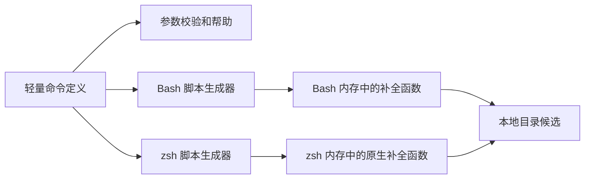

# Daynight Shell 补全设计

状态：共享命令语法、Bash/zsh 生成器及启动配置安装已实现，包含 `review`、`update`、
`login`、`logout`、`setup`、`completion`、`project` 和 `task`。
脚本行为由[客户端 C5](../spec/daynight.md#c5-bash-与-zsh-补全)拥有，启动配置安装由
[客户端 C7](../spec/daynight.md#c7-补全启动配置安装)拥有，project 行为由
[Project 与 Task 客户端需求](../spec/daynight-project-task.md)拥有。本文负责命令描述、
脚本生成、加载和真实 shell 验证的机制；[客户端架构](daynight.md)负责命令生命周期，
[补全决策](../../.agents/notes/implemented/feature/2026-10-20-shell-completion.md)记录兼容范围，
[setup 决策](../../.agents/notes/implemented/feature/2026-10-21-completion-setup.md)记录启动配置的所有权和替代方案。

## 目标与范围

客户端为 `daynight` 和 `dn` 在 Bash ≥4.2 和 zsh 中提供同一套原生补全，覆盖登记的命令、子命令、别名、选项、
`completion` 的 shell 参数、`review add-repo --path` 和 `setup --review-path` 的目录参数。zsh 使用原生描述
展示能力。目录候选不限制运行时合法值；`--path` 继续接受尚未创建的目标目录。

公开入口为：

```text
daynight completion
daynight completion --help
daynight completion bash
daynight completion zsh
daynight completion setup [--shell bash|zsh] [--rc-file <path>]
```

裸 `completion`、各操作的唯一帮助选项显示帮助并退出 0。`bash` 和 `zsh` 操作
向 stdout 只写完整脚本，不包含状态消息或日志；`setup` 输出安装结果和当前会话
的加载命令。未知操作、多余参数、未知选项退出 2，并提示对应帮助入口。
两种生成操作不读取用户主目录、工作目录、配置、SQLite、实例锁或审查状态，不执行
Git、GitHub CLI、Copilot、npm 或网络请求，不修改 shell 启动文件。

`project create <name> [--repo <repo>]`、`project list [--json]` 和
`project show <project-id> [--json]` 已登记在共享命令树中。名称、repo 地址和 project ID
是自由输入，不提供文件或远端候选。Tab 不加载 server 配置，不查询 project 列表；
执行 project 命令时的服务访问仍由其业务模块负责。`setup` 的服务 URL 和仓库地址
同样是自由文本，`--review-path` 只补全本地目录；`login` 的 `--no-browser` 为静态开关，
`logout` 没有业务值候选。生成与 Tab 不读取凭据、不打开浏览器、不发起登录或配置引导。

## 共享命令描述

[`cli/schema.ts`](../../packages/daynight/src/cli/schema.ts) 拥有不依赖业务实现的
`CommandDefinition`、`CommandOption`、参数校验和帮助生成。每个命令拥有自己的
定义，根 [`cli/commands.ts`](../../packages/daynight/src/cli/commands.ts) 登记异步执行
入口，并从登记项移除加载函数后派生命令树。补全不维护另一份顶层命令清单，定义
不导入配置、文件系统探测、原生数据库模块或业务适配器。

| 描述信息 | 消费者与语义 |
|---|---|
| 名称、说明、子命令、别名 | 分发、帮助、Bash 和 zsh 生成器 |
| 选项名称、说明、动作 | 参数校验、帮助与补全；同组选项名使用同一身份 |
| 选项的 `value.name` 与 `value.kind` | `directory` 枚举本地目录，`text` 接收文本值；自由文本没有文件候选 |
| 选项的 `value.allowEmpty` | 仅声明的描述选项可接收空字符串，省略与空值保持区别 |
| 选项的 `value.choices` | 参数校验、分离及内联值补全共享固定允许值；帮助显示选项说明 |
| 选项的 `repeatable` | 从第一次出现起生成有序数组，保留重复值；使用后仍可继续补全 |
| 选项的 `required` | 解析完参数后检查是否提供；帮助中的必填选项不加方括号 |
| 位置参数名称、说明与固定候选 | 所有声明的位置参数均必填；只有声明的 choices 提供固定候选 |
| 命令的 `allowOptionsTerminator` | 显式允许 `--` 结束选项解析；只有 `project create` 声明，后续词按位置参数处理 |
| 命令补充说明及选项 `description` | 帮助；不会自动枚举 `value.choices` |

解析结果使用按首个选项名索引的只读 Map：开关为 `true`，标量值为字符串，
repeatable 选项为只读字符串数组。未声明 repeatable 的选项只能指定一次；依赖
值按出现顺序追加，不去重、不拆分 CSV。Task 的 `--description` 声明 `allowEmpty`，
list 的 `--status` 与 set-status 的目标位置参数声明 `todo`、`in_progress`、`done` 三个 choices，
update 不声明状态选项；set-status 声明 task ID、目标状态、project 和 if-version。update、list 和 ready 的 `--allow-agents` 声明 true/false choices，既有 Bash/zsh 生成器从该枚举产生静态候选；create 不声明此字段。
`--depends-on` 声明
repeatable。`project create` 的名称是一个必填位置参数，`--repo` 是可选 text 选项，
查询 `--json` 为开关。位置参数在语法层拒绝缺失和空字符串，业务文本规则由命令
在 I/O 前校验；名称原值不会被 JavaScript `trim()` 提前裁决。
省略 repo 时的 Git 发现和服务 project 列表预检属于执行行为，补全仍只提供静态语法。

text 值接受分离及内联赋值。`--option=value` 按第一个 `=` 分割，保留值的前导
`-` 与其他 `=`；例如 `--title=-value`、`--description=a=b`。分离形式的前导
`-` 被判为缺少值。空值仅在 `allowEmpty` 为 true 时有效，包括 `--description ""` 和 `--description=`。目录、开关及帮助不接受内联值。缺失值、无效 choices、
重复标量及不允许的空值均在业务 I/O 前拒绝。合法文本原样保留，不裁剪空白或 FEFF；
名称、标题等字段的业务验证继续由命令拥有。

帮助只能在该层唯一参数为 `-h` 或 `--help` 时触发，并先于必填检查及业务加载。
顶层版本选项不继承到子命令；`--path` 可以位于 remote 前后，只能指定一次；
`review add-repo` 不接受 `--path=value` 或 `--` 语法。`project create` 的独立
`--` 结束选项解析，例如 `project create --repo <repo> -- -name`；此后的 `--help`
同样只是名称文本，补全不再提供选项候选。`ls` 分发到 `list` 的同一操作。

解析、帮助和补全共同消费定义中的语法事实。业务模块把已校验参数转换为自身输入，
只在实际执行操作时加载其实现。根帮助、命令帮助、版本和脚本生成的依赖隔离必须由
编译后入口测试验证，不能只由源码类型或模块命名推断。

## 脚本生成与执行



生成器将完整命令树及语法规则写入 shell 函数。每次按 Tab 仅执行 shell 自身的
补全函数和目录枚举，不启动 Node 或其他 daynight 进程。候选使用数组保留边界，
不通过空白分割重建参数，不把输入作为 shell 代码执行。

所有写入脚本的数据都需要正确引用；说明中的引号、冒号、美元符号和反引号不能
成为可执行语法。用户输入的目录、名称、repo 地址和 project ID 也只能作为数据处理。

### Bash

[`completion/bash.ts`](../../packages/daynight/src/commands/completion/bash.ts) 在检查
版本下限后，通过 `complete -F` 为根命令名称及其 `aliases` 注册同一函数。函数维护 `COMPREPLY` 数组，利用 Bash
≥4.2 的 `compopt` 按当前语义启用文件名处理、目录后缀和引号。命令候选不沿用
目录补全选项，避免同名本地目录改变命令补全的结果。

`COMP_WORDS` 的边界受 `COMP_WORDBREAKS` 影响，与 CLI 最终收到的 argv 不同。
状态机从光标前的有效输入还原参数，处理 repo 地址中的 `:`；光标位于行中时，
后面的参数不改变当前补全位置。值识别不依赖写死的单词下标，不修改用户全局的
`COMP_WORDBREAKS`。

待输入值时保留具体选项身份，以便读取 `allowEmpty`、`choices` 和 `repeatable`。
directory 使用目录枚举；text 声明 choices 时只给出固定候选，自由 text 返回空
候选。分离和内联状态值均可补全；内联补全只替换当前值片段，不重复插入选项前缀，
也不修改全局 `COMP_WORDBREAKS`。合法空描述及内联值消费后恢复后续选项状态。
已使用的标量选项不再出现，repeatable 依赖仍可出现；消耗过的位置参数不重复
提供候选。remote、project/task ID 和依赖 ID 不提供远端或文件候选。

目录补全保留空格、中文、引号和特殊字符，支持相对路径、绝对路径及常见的主目录
写法。目录无匹配项返回空候选，不把不存在的目录判为 CLI 输入错误。

### zsh

[`completion/zsh.ts`](../../packages/daynight/src/commands/completion/zsh.ts) 使用原生
`_arguments`、`_describe` 和 `_files -/` 表达语法、候选说明和目录。自由 text 选项使用
明确的值状态，通过 `_message` 显示值说明并成功返回，不产生候选；choices 值使用
声明的静态候选。repeatable 选项使用允许重复的原生声明，不加入自身排除项。
前缀校验同时理解空描述、重复依赖和 text 内联赋值，directory 继续使用 `_files -/`。脚本显式
调用 `compdef` 将根命令名称及其 `aliases`（`daynight` 和 `dn`）关联到同一函数；仅输出 `#compdef daynight` 注释不足以支持直接 source。

自由文本位置参数尚未开始且当前词为空时，生成器暂不向 `_arguments` 提供该位置的
动作状态，让原生助手展示尚未使用的选项。否则默认 `prefix-needed` 规则会抑制空词
处的选项候选。已消费的位置参数、固定候选及待填选项值保留对应规格；`--` 后仍由
原生 `-S` 语义停止选项候选。这使 `project create ` 提示 `--repo`，同时保持名称
没有文件候选、已用标量隐藏及调用者 completion style 的含义。

加载要求 zsh 已初始化 `compinit`。缺少初始化时给出明确诊断并失败，不注册未生效
的定义。脚本不改变调用者的 completion style，不引入 `bashcompinit`，不重复初始化
用户环境。

原生参数助手对无效选项和多余参数较宽松，因此每层函数先用命令定义生成的规则
验证光标前的参数。分派与校验使用相同的去引用形式，使引号包裹的命令名仍指向
同一操作。目录的引号闭合和可自动移除的斜杠保持 zsh 自身的编辑语义。

## 启动配置安装

[`completion/setup.ts`](../../packages/daynight/src/commands/completion/setup.ts) 独立拥有
shell 检测、启动文件选择、安装状态识别及文件写入，与根 `setup` 的业务配置引导
分别归属各自的命令模块。`command.ts` 先用共享定义
完成帮助和参数校验，只在 `completion setup` 真正执行时加载它。脚本生成器不导入安装模块，
因此生成、帮助及无效参数仍保持原有的主目录、工作目录和业务依赖隔离。


显式 `--shell bash|zsh` 优先。自动检测对直接父进程做有时间上限的 `ps` 查询，
只接受 Bash 或 zsh 的进程名，包括登录 shell 的前导 `-`；不将 `SHELL` 当作
正在运行的 shell。父进程是包装程序或结果不可靠时，命令失败并提示显式选择。
不能在进程名中找到类似子串就猜测 shell。

### 启动文件选择

`--rc-file <path>` 将安装限定到指定的单个文件。默认 Bash 选择主目录下的
`.bashrc`，同时按 `.bash_profile`、`.bash_login`、`.profile` 顺序选择首个可读的
已有登录文件；三者均不存在时才创建 `.bash_profile`。已有文件均不可读时明确
失败，不能创建更高优先级文件屏蔽它们。登录文件中只加入补全自身的加载块，不
自动 source `.bashrc`；这避免让补全安装顺带改变用户其他登录配置的执行方式。

Bash 管理块使用 POSIX 可解析的外层条件，仅在 `BASH_VERSION` 存在且 shell 为
交互式时进入 Bash 代码；过程替换置于仅由 Bash 执行的文本中。共享 `.profile`
由其他 POSIX shell 读取时不解析 Bash 专用语法。块内同时确认补全函数可调用和
`complete -p daynight` 仍注册该函数，注册缺失时才加载脚本；仅检查函数名不足以
发现已被清除的注册。

默认 zsh 路径按 `${ZDOTDIR}/.zshrc` 拼接，未设置时才使用主目录。导出空值
得到 `/.zshrc`，安装器按 setup 当前工作目录解析相对值；不能先将空字符串解析
为当前目录。zsh 按自身启动工作目录解析相对值，从其他目录启动会选择另一文件。
shell 内未导出的自定义值无法从子进程获得，显式 `--rc-file` 为该配置提供准确路径。
zsh 管理块只在交互式 zsh 中工作，检查
`_comps[daynight]` 和 `_daynight` 函数，确认实际注册存在后跳过加载。缺少
`compdef` 时运行 `autoload -Uz compinit` 和正常的 `compinit`，保留不安全目录
检查；初始化失败时不继续注册。已初始化的系统直接复用，不重复执行 `compinit`。
两种加载块均保留生成、执行和初始化的非零失败状态，不能用过程替换吞掉生成错误。

### 文件识别与写入

管理块由 `# >>> daynight completion >>>` 和
`# <<< daynight completion <<<` 标记。安装器验证标记数目、配对和内部内容，
完整有效的块被识别为已安装；损坏、重复或被修改的管理块明确失败。文档中的独立
标准语句 `source <(daynight completion bash)` 或 zsh 对应形式，也被识别为已有
配置并保持不变。管理块彼此相互加载时仍检查实际注册，已有注册不会重复生成。
保留的手写语句不受管理块控制：例如 `.bash_profile` 先 source 含管理块的
`.bashrc`，之后无条件执行标准手写语句，后者仍会再次生成和加载。安装器不改写
该语句，静态识别不分析任意函数、别名、条件和其他等价 shell 程序。

缺少配置时，在文件原字节后追加使用 LF 换行的完整块；无末尾换行时先追加 LF
分隔。原有 CRLF 内容的字节保持不变，新块不能沿用 CRLF，因为 shell 将 CR 作为
语法 token 的一部分，可能破坏条件、命令或块结束符。写入解析后的实际文件，保留
原文件 inode、权限及指向它的符号链接身份，不把符号链接替换为普通文件。目标必须是普通文件，悬空链接和不合法路径明确失败。
安装使用目标旁的独占锁防止并发 setup 交错，并在写入前复核文件身份、修改时间
和大小；已被其他程序改变的文件以错误结束，避免用过期检查结果继续写入。
已识别为安装完成的文件不写入，重复执行保持其全部字节。

setup 只检查和写入文件，不执行用户启动配置。任意提前 `return`、条件分支或
后续清除补全的代码仍可能阻止配置生效；静态检查不能将“加载语句存在”证明为
“下一次启动必然加载”。文件结果描述配置是否安装，不能声称已经探测父 shell
中的函数注册。

## 当前会话与升级

setup 成功后输出当前会话的既有启用命令。Bash 使用：

```bash
source <(daynight completion bash)
```

zsh 在尚未初始化补全系统时先执行初始化，再加载：

```zsh
autoload -Uz compinit
compinit
source <(daynight completion zsh)
```

子进程不能直接改变父 shell 内存；setup 不添加另一种激活协议。手动配置仍可直接
使用上述语句。直接加载 zsh 脚本继续要求已有 `compinit`，安装块拥有按需初始化。
每个新 shell 由当前安装的 daynight 生成脚本；更新包后，已有 shell 重新 source
刷新。保存生成结果后 source 也有效，更新后需要重新生成文件。

脚本是可 source 的定义及注册代码，不承诺将同一输出直接作为 `fpath` 自动加载文件。
该安装方式需要不同的函数装载形态。

## 失败与边界

参数错误保留客户端现有退出码约定。生成器不引入后台任务、调度、远程事件或
遥测管线；不创建审查、请求或会话关联标识。shell 加载错误显示在调用者 stderr，
失败不注册声称已经可用的新定义。setup 的检测、权限、文件类型、管理块及并发
变化错误以非零状态保留具体原因，不宣告安装成功。运行中的补全状态只属于当前
shell；持久启动配置由 setup 管理，不写入 review 配置或审查状态。

独立服务、浏览器应用、project 数据、review 数据格式、全局安装归属和自更新流程
均保持各自的所有者。补全不增加数据库迁移、服务请求或审查配置字段。

## 验证

共享语法测试校验必填命名值、原值保留、重复和缺失值、帮助以及既有命令回归。
生成器测试覆盖 shell 数据引用、目录与 text 类型分派；编译后入口测试验证帮助、
参数错误和生成脚本不进入业务 I/O。安装测试验证显式选择、父进程检测失败、
文件优先级、手写加载语句、管理块完整性、重复安装、原字节与权限保留、符号链接、
无效文件及写入失败。Task 扩展还需验证空描述、输入顺序及重复
依赖、完整状态值、首个 `=` 分隔、内联前导连字符，以及目录/开关内联拒绝。

[`shell-completion.py`](../../packages/daynight/test/acceptance/shell-completion.py) 通过
PTY 驱动真实 Tab，检查编辑缓冲区、光标位置和实际解析后的 argv。直接调用函数可
辅助定位，不能代替 Readline 或 zsh 对引号、后缀和候选的处理。zsh 接受目录输入时
可以按原生规则移除自动添加的末尾斜杠；验收同时检查插入时后缀及最终路径语义。
脚本加载后设置执行哨兵，要求每次 Tab 都不调用 Node 或 daynight。

驱动分别确认主提示符切换和编辑器内重置。初始化及实际执行命令后，先等待新一代
主提示符标记，再请求实际 Readline/ZLE widget 回执。丢弃测试输入使用排队执行的
editor reset widget，在同一 generation 内确认空状态。每个场景发送输入前再次
核对当前 generation、空编辑缓冲区和光标 0；输出静默与 capture 标记均不能证明
编辑器已经完成上一项操作。

每个真实 shell 都执行两种管道阻塞证明：首个提示符在编辑器进入前被阻塞，证明
30 ms 输出静默可以与未就绪状态同时存在；capture widget 在输出标记后被阻塞，
证明排队的 reset 请求等待其退出后才执行。两种证明均须取得实际编辑器的空状态
回执，并保留候选、argv、光标、执行哨兵和既有超时要求。同步依据及失败情形见
[就绪验证决策](../../.agents/notes/implemented/testing/2026-10-20-observable-acceptance-readiness.md)。

场景包括根命令、嵌套命令、别名、帮助与版本选项、shell 参数、空前缀、已用选项、
光标位于行中、remote 的 `:`，以及空格、中文、单引号、双引号和美元符号目录。
`--path` 在 remote 前后及目录完成后的下一参数均需覆盖；目录名与 `review` 或
`project` 同名时，命令补全仍插入命令并保留正确分隔符。

project 场景覆盖 create/list/show、必填位置名称、可选 `--repo`、`--json`、已使用选项隐藏，
以及名称、repo 地址和 project ID 的文件回退抑制。名称待输入时不生成文件候选，
仍可补全未使用的选项；`--` 后只允许名称文本，选项和文件候选均被抑制。repo 值
待输入时，包括引号输入及以选项前缀开始的当前词，保持输入且不生成文件或选项候选。
Task 场景
覆盖重复依赖仍可输入、标量已用后隐藏、分离及内联状态候选、空描述后的选项恢复、
内联值片段替换及自由标题、描述、ID 不回落文件候选。

Bash 4.2 是明确下限，需要真实 4.2 执行验证；现代 Bash 和 zsh 也必须有真实证据。
Linux 准备脚本在仓库 `.tmp/` 中校验固定 SHA-256 的 GNU Bash 4.2 源码并构建所需
程序；zsh 使用现有程序或仅下载、解包发行版软件包。该脚本不做系统安装，输出环境
文件供本地和独立 CI 作业使用同一验收入口。

解包的 zsh 在首次 ZLE 初始化前定位自身原生模块和补全函数。直接加载脚本的
PTY 验收使用任务专属的 `ZDOTDIR/.zshenv`，通过 `zsh -d -i` 启动；该文件设置解包工具链的准确 `module_path`
和补全函数目录，不拼接宿主 `fpath`。准备完成后关闭 `RCS` 与 `GLOBAL_RCS`，避免
操作者启动配置影响验收。交互设置先执行 `compaudit`，失败立即退出；通过后执行
`compinit -D`。工具链路径和权限必须满足安全审查，不得进入人工信任提示。进程
环境或启动后的交互命令不能替代首次模块定位所需的 zsh 启动文件。

setup 验收使用独立主目录与启动文件，在真实 Bash 4.2、现代 Bash 和 zsh 中验证
登录与非登录启动后的注册和 Tab。覆盖 Bash 登录文件优先级、共享 `.profile` 的
POSIX 可解析性、zsh 未设置、绝对与相对目录规则、已有初始化及管理块重复加载，
并验证既有 CRLF 自定义文件追加后的真实加载与 Tab，保留生成操作的无 I/O 回归。
空 `ZDOTDIR` 的根目录映射通过隔离的模拟文件 I/O 单元测试验证，不在宿主根目录
创建启动文件。安装后从启动文件实际加载的路径与直接 source 验收分别检查，不能
只以管理块文本存在代替 shell 行为。

测试不修改开发者启动文件，不依赖其配置、认证或全局安装；临时 shell、终端、探针
和 fixture 均在任务 `.tmp/` 中，由创建者清理。完整验证命令由
[README](../../README.md#cli-development)拥有。托管结果由对应源码版本的 CI 作业与
补全 artifact 记录；本地通过记录不代替该版本的托管验收。

## 依据

- [GNU Bash startup files](https://www.gnu.org/software/bash/manual/html_node/Bash-Startup-Files.html)
  定义交互式登录与非登录 shell 的文件选择及登录文件优先级。
- [zsh startup files](https://zsh.sourceforge.io/Doc/Release/Files.html)
  定义 `ZDOTDIR` 和交互式 `.zshrc` 的选择。
- [zsh 启动文件路径构造](https://github.com/zsh-users/zsh/blob/fc3cff4f8e28a0dcac7b6dfb7f21d45fd3a06250/Src/init.c#L1715-L1734)
  在已设置的 `ZDOTDIR` 后追加 `/` 和文件名，因此空值指向文件系统根目录。
- [GNU Bash programmable completion](https://www.gnu.org/software/bash/manual/html_node/Programmable-Completion.html)
  定义函数补全、`COMPREPLY` 和候选处理。
- [GNU Bash variables](https://www.gnu.org/software/bash/manual/html_node/Bash-Variables.html)
  定义补全上下文与分词边界。
- [zsh completion system](https://zsh.sourceforge.io/Doc/Release/Completion-System.html)
  定义 `compinit`、`compdef`、原生参数与目录补全。
