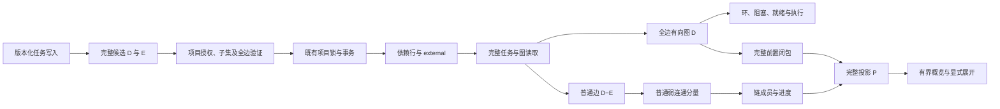

# 任务外部依赖与任务链边界架构

本设计落实[外部依赖需求 ED-R1–ED-R8](../spec/daynight-external-dependencies.md)。
[原型](mockups/external-dependencies/index.html)展示目标视觉和交互，
[决策记录](../../.agents/notes/implemented/architecture/2026-10-23-external-dependency-design.md)保存方案取舍。
依赖性质存储、完整读取和 Web 普通分量消费已实现。图的虚线箭头来自显式外部性质，
链外卡片由上下文角色决定；详情按关系方向显示性质。公开 API 接受显式分类创建及部分 PATCH，CLI 声明普通/外部完整集合；
Web 读取和呈现这些性质，不提供依赖编辑器。

## 设计基线与依据

以下源码证据记录 `2d7fdd1e4e178db17e46da5d3b6c0e4050edf730` 的设计前基线，
说明为何需要保存关系性质并替换根可达性归组。本页后续章节定义当前分类读写与呈现机制。

| 已有机制与内容 | 对本设计的含义 |
|---|---|
| [关系表](https://github.com/codetreker/daynight/blob/2d7fdd1e4e178db17e46da5d3b6c0e4050edf730/packages/daynight-server/internal/core/store/migrations/002_tasks.sql#L15-L23)以 `PRIMARY KEY (project_id, task_id, depends_on_task_id)` 唯一标识每条边。 | 性质直接附于现有关系，无需新组表、边 ID 或位置字段。 |
| [正规化](https://github.com/codetreker/daynight/blob/2d7fdd1e4e178db17e46da5d3b6c0e4050edf730/packages/daynight-server/internal/service/task.go#L206-L224)执行 `slices.Sort(canonical)`；[读取](https://github.com/codetreker/daynight/blob/2d7fdd1e4e178db17e46da5d3b6c0e4050edf730/packages/daynight-server/internal/core/store/query.go#L63-L74)执行 `ORDER BY d.depends_on_task_id`。 | 依赖是无序集合，添加顺序不能决定任务链。 |
| [写事务](https://github.com/codetreker/daynight/blob/2d7fdd1e4e178db17e46da5d3b6c0e4050edf730/packages/daynight-server/internal/core/store/project_tx.go#L29-L44)锁定项目行；[任务更新](https://github.com/codetreker/daynight/blob/2d7fdd1e4e178db17e46da5d3b6c0e4050edf730/packages/daynight-server/internal/core/store/project_tx.go#L97-L129)删除并重建完整依赖。 | 性质必须进入完整候选及重建路径，普通编辑也不能丢失它。 |
| [生命周期](https://github.com/codetreker/daynight/blob/2d7fdd1e4e178db17e46da5d3b6c0e4050edf730/packages/daynight-server/internal/service/task_lifecycle.go#L38-L56)从当前任务重建 `TaskWrite`；[验证](https://github.com/codetreker/daynight/blob/2d7fdd1e4e178db17e46da5d3b6c0e4050edf730/packages/daynight-server/internal/service/task_policy.go#L11-L54)检查全部引用、可达性和未完成前置。 | 新字段必须随生命周期候选保留，执行检查继续使用全边图。 |
| [Web 模型](https://github.com/codetreker/daynight/blob/2d7fdd1e4e178db17e46da5d3b6c0e4050edf730/packages/daynight-web/src/features/task-graph/model.ts#L115-L159)用 `reachable(successors, root)` 得到主集合，并按 `!mainIds.has(source)` 推导边的 `external`。 | 当前“外部”是投影角色，不是关系性质；成员算法和边性质需要分别重构。 |
| [概览](https://github.com/codetreker/daynight/blob/2d7fdd1e4e178db17e46da5d3b6c0e4050edf730/packages/daynight-web/src/features/task-graph/visibility.ts#L3-L48)具有 50/100 初始预算和 20 邻居批次。 | 普通分量及祖先闭包连通，可复用现有方向展开，不增加组成员展开机制。 |

此前按根可达性计算，同一后续任务可属于多个根投影。
2026-10-23 的历史 worker 样本含六个重复成员，来源是处理角色任务同时依赖 worker 架构、认证和审批成果。
后续只读复核发现，这两条跨链边已被其他操作移除；当前例子是回归输入，不是待恢复的线上关系。
复核中的另一项目仍有 31 个任务、61 条依赖：四条旧根投影共享 15 个任务，
普通弱连通分量则得到一个 23 成员分量及八个单成员分量。
这说明新算法有明确的多起点合并行为，迁移默认值不能被解释为所有旧入口外观不变。

## 目标结构与数据流



`D(t)` 是任务的全部依赖 ID，`E(t)` 是显式外部子集，满足 `E(t) ⊆ D(t)`。
`D(t) − E(t)` 是普通关系。数据库仅保存一条带性质的关系；
资源的两个数组是同一关系集合的投影，不是两份可独立漂移的持久数据。

## 存储、迁移与候选写入

`012_external_dependencies.sql` 为 `task_dependencies` 增加：

```sql
ALTER TABLE task_dependencies
    ADD COLUMN external boolean NOT NULL DEFAULT false;
```

该迁移位于 `009_task_timing.sql`、`010_project_settings.sql` 和
`011_task_agent_permission.sql` 之后，既有内容和校验和保持。
继续使用现有迁移事务和 `schema_migrations`，不增加另一份迁移账本、外键或临时业务表。

旧行在迁移中取得 `false`，其端点及任务字段保持原样。
这个默认值表达旧关系没有外部分类，不推断它们真实属于哪条业务链。
明确的历史分类由后续审计报告提供依据，获授权后通过正常版本化 API 修改。
没有当前依赖的两个任务不会因历史快照或标题相似而自动新增连线。

core、`TaskWrite`、完整任务与图任务增加 `ExternalDependsOn`。
完整投影和图查询以相同关系过滤 `external` 生成排序子集；`blockedBy`、`ready`、
可达性和图尺寸查询继续读取全部关系，不添加 `external = false` 条件。
不新增索引：现有以项目、任务定位的复合主键及前置索引继续服务读取；
图上限内的性质投影与组件计算按实际边数工作。

更新顺序继续为项目锁、锁后写权限、当前任务读取、精确版本、候选合成、验证、无变化判定和持久化。
候选从当前 `D/E` 构造，字段组合规则见下一节。
`UpdateTask` 删除旧行后，同时从完整候选重建端点和性质。
`taskCandidate`、普通编辑及 `task_lifecycle.go` 的 `TaskWrite` 重建都必须携带 `E`，
包括 set-status 的全部生命周期写入。
分类变化参与语义比较；仅排序变化不增加版本，过期同值仍先冲突。
状态不变时沿现有 SQL 保持 `startedAt`、`completedAt`；分类写入不成为新的执行起点。

## API 契约

### 读取契约

完整任务、列表项、ready 项、变更响应和图节点都保留原 `dependsOn: string[]`，
并返回必填 `externalDependsOn: string[]`。示例中的字母代表实际 UUID：

```json
{
  "dependsOn": ["A", "B"],
  "externalDependsOn": ["B"],
  "blockedBy": ["B"],
  "ready": false
}
```

两个数组正规化为无重复、UUID 排序集合，外部集合必须属于完整集合。
客户端严格读取两个数组并校验子集；没有“缺字段即旧版本”的运行时分支。
原始精确版本、Markdown、PR 属性、时间戳与图顶层 `observedAt` 的契约不变。

创建和 PATCH 接受 externalDependsOn，独立于完整依赖字段合成最终候选；
具体组合见下表。移除关系同时移除其性质。
标题、描述、PR、allowAgents、requiredPlatform 修改及 set-status 继续携带已存储的外部子集。

### 分类写入

创建时省略任一数组分别表示空集合；外部非空而完整依赖为空是无效输入。
更新字段独立可选，且与其他任务字段共同提交：

| PATCH 输入 | 最终 `D` | 最终 `E` |
|---|---|---|
| 都省略 | 原 `D` | 原 `E` |
| 只给 `dependsOn = D′` | `D′` | `E ∩ D′`，新边为普通 |
| 只给 `externalDependsOn = E′` | 原 `D` | `E′`，必须为原 `D` 子集 |
| 两者都给 | `D′` | `E′`，必须为 `D′` 子集 |

例如从 `D={A,B}, E={B}` 开始，单独替换 `D={B,C}` 得到 `E={B}`；
单独替换 `E={A}` 保持原 D；提交 `D={A}, E={B}` 整体拒绝。
删除关系同时删除其性质，是关系生命周期的一部分，不是对外部数组的独立默认修补。

HTTP 严格对象解析在创建和 PATCH 白名单中接受 externalDependsOn，并校验数组类型及内容。
未知或重复字段、显式 `null`、非法或重复 ID、自引用、外部子集越界、缺失或跨项目前置返回 `invalid_input` / 400。
任意普通、外部或混合环返回 `dependency_cycle` / 409；未完成真实前置返回 `dependency_unsatisfied` / 409；
过期版本返回 `version_conflict` / 409。现有身份、成员隐藏与权限结果保持原样。
数据库、取消和响应失败沿现有错误链处理，不变成空分类或成功结果。

## CLI 与工作流

当前 CLI 读取和 JSON 已保留必填外部子集，任务与图的人类依赖区输出
`External dependencies (N): <ID 列表或 none>`，列表、ready 和操作结果复用同一表达。
读取器拒绝缺失、非法或不属于完整依赖集的外部 ID，不在旧服务响应中补空数组。
命令以两种声明选项编译完整关系及精确外部子集；任一依赖选项出现就同时提交 D/E：

```sh
daynight task create --title "worker 阶段" \
  --depends-on <worker-design-id> \
  --external-depends-on <authentication-task-id> \
  --external-depends-on <approval-task-id>
```

`--depends-on` 收集普通集合 N，`--external-depends-on` 收集外部集合 E。
任一依赖选项出现时，CLI 提交 `dependsOn = N ∪ E` 和 `externalDependsOn = E`，
两者都是完整替换值。只给外部选项表示只保留这些外部关系，不能解释为追加或分类 PATCH。
同一 ID 在任一列表重复或同时属于 N/E 时为用法错误，不发送请求。
都省略时不提交依赖字段；`--clear-dependencies` 与任一列表互斥，提交两个空数组。
依赖更新仍应使用决策时读取的 `--if-version`，冲突不自动重试。

CLI 的完整 JSON、图 JSON 及仅省略 description 的列表 JSON 保留新字段。
人类任务/图输出区分全部前置与外部前置；终端转义、精确版本和字节预算保持。
help 与 Bash/zsh completion 由现有命令定义生成，安装产物验证新选项与真实服务行为。
涉及发布输入的变更按届时主线版本增加 SemVer。

随包 `using-daynight` 的共享规则和适用模式同步普通与外部关系、完整替换和恢复语义。
Goal 的问题定义、架构、内部交付阶段之间为普通前置；
其他任务链提供的真实先决成果在内容核对后显式标为外部。
顶层任务可以有外部前置，顶层只说明没有普通前置。
不能按状态、标题、根节点或共享主题猜测性质，也不能为显示同组而虚构依赖。

## Web 索引与分量

GraphTask 和完整详情保留必填 `externalDependsOn`，共享 API 解码器校验 UUID、去重和子集。
详情新鲜度与描述符纳入该集合；图内容等价比较保留它，性质单独变化也会替换对应图内容和索引，
随后仅时钟样本变化仍复用身份。完整依赖用于验证与上下文，普通子集决定成员分量。

先验证完整资源的唯一任务、全部引用、外部子集、状态、阻塞、就绪、全边无环和图上限。
构造全边有向邻接供执行一致性、前置检查和方向展开使用；
另对普通边建立无向邻接，以线性遍历计算弱连通分量。
每个任务恰好进入一个分量，不再存储可重叠的根成员集合或共享成员标记。

```text
A ─普通→ C ←普通─ B      一个分量 {A,B,C}
X ─外部→ C             X 不加入该分量
```

分量代表为普通入度为零、且在服务端精确任务顺序中最早的成员。
全边 DAG 的子图也无环，所以非空分量一定存在这种起点。
代表供应标题、创建排序与初始概览锚点；多个普通起点仍对应一个入口。
布局保留各真实起点。
代表 ID 仅是当前计算定位值，不是持久 `groupId`。

保留两个项目内页签：成员数大于一进入任务链，普通度数为零的单成员进入独立任务。
独立任务仍可能有外部前置并被阻塞，说明文案明确其独立于普通链的含义。
独立任务行复用现有 `graph-blocked-badge` 显示“被阻塞” / “Blocked”，
避免只有状态和 ready 标签时无法看出外部前置正在阻塞它。详情继续提供具体阻塞关系。
分量状态沿当前全成员聚合规则计算，统计成员一次；
外部上下文不改变该链的完成数、状态或筛选，项目统计继续按完整任务集合计数。

## 投影、样式与局部交互

对分量 C，主集合 `M=C`，完整数据投影 `P=M ∪ ancestors_all(M)`，上下文为 `P−M`。
从每个成员沿全部依赖迭代加入祖先，保留终点在 P 的全部真实关系。
闭包保证其前置也属于 P，无关外部后续不会进入。
一条标为外部的边可以通过另一条普通路径使两端处于同一分量；分类仍保留，不能因当前成员关系改写。

节点角色和边性质是不同输入。卡片为上下文时使用虚线边框及“外部前置”；
箭头仅在持久外部性质为真时使用虚线。上下文中的普通边仍为实线。
`ProjectionEdge.external` 来自终点任务 E 的真实分类，
上下文角色由节点集合表达；需要灰化路线时可从端点角色计算，不混用字段。
图例为：“实线：普通依赖；虚线：外部依赖。虚线卡片：链外前置。所有依赖均影响执行顺序。”

详情前置、阻塞者和后续逐条显示“普通依赖”或“外部依赖”；标识属于边，不属于所链接任务。
后续关系的性质从后续任务的 E 得到，不能反向使用当前任务的 E。
详情新鲜度描述与图等价比较纳入外部子集，性质单独变化能刷新标签和路线。
Details 继续与检查主体分离，导航只改变所读资源；本范围没有 Web 依赖编辑器。

普通分量通过普通边连通，所有补入祖先通过某条前置路径连接到成员，所以 P 连通。
复用现有稳定、后续优先的无向 BFS 概览、50 任务/100 诱导边限制和 20 直接邻居展开即可访问全部 P。
不引入无连线组成员或第二种展开入口。诱导边必须包含所有可见真实关系，不能仅画遍历树。
选择只改高亮，不重排、不移动视口；展开、reset、全屏、模态、附件和焦点继续使用现有生命周期。
保留当前卡片 220×96/136 几何、双语和任务计时字段，不新增计时 UI。

## 刷新、合并拆分与偏好

继续保存 `{expandedRootId: string | null}`，其字符串作为成员定位依据。
重建索引后先查该任务所属分量，再选择该分量当前代表；不用要求保存任务仍是代表。
当定位任务仍有效时，不能仅因显示代表改变就用新代表覆盖其存储值。
因此普通边合并或拆分后，仍存在的定位任务可保留所关注的那部分。
明确 `null` 保持折叠；不存在或已被完成筛选隐藏的分量使用当前最新可见入口回退。

只有状态或同一拓扑内容刷新时继续保留可见集合、视口和检查。
`VisibleTaskGraph` 只按代表 rootId 保持呈现生命周期，`GraphVisibility.topologyKey` 则记录有序主成员集合。
代表不变而 M 变化时，只重置 S、局部检查及旧动作，并通过按 topologyKey 重建的 InitialViewport 重新 framing。
TaskCanvas、ReactFlow 和 useGraphFullscreen 保持挂载，因此全屏、活动详情及各自的 inert/滚动锁不被退出。
代表变化仍是真正的链切换，替换对应 ChainRow 和图，由稳定列表层处理已脱离控件的焦点。
派生身份不保证合并拆分前后保留相同的 S 或视口，但同代表的拓扑重置不重建呈现所有者。
ChainList 在按代表 ID 重建的行之外持有焦点记录。索引或代表变化后，只有记录控件已脱离 DOM
且 document.activeElement 为 BODY 时，才依次恢复到已展开代表入口、首个可见入口、现有筛选控件，最后回退到带可访问名称且 tabIndex=-1 的列表区域。
同一行内 TaskGraph 的焦点恢复先行；已有详情或链列表之外的有效焦点不被抢走。
打开的详情由 task ID 持有；原触发节点消失时，关闭详情的焦点落到存活链入口或页面回退点。
顶层 `observedAt` 的独立采样与现有时钟身份分离仍保留。

## 迁移、发布一致性与数据审计

公开外部写入出现时，所有受支持的读端必须已经正确消费分类，包括 CLI 读取契约、
Web 普通分量投影、关系标签和显式虚线语义。尚未具备这些消费者的可部署状态只建立普通边，
不能提前接受会被读取端误解的外部性质。不添加功能开关或缺字段兼容分支。
Go 服务与嵌入 Web 一起部署；
要求新字段的 CLI 安装应安排在对应服务部署后，旧服务响应缺字段会明确失败。

新增布尔列不会重写其他任务元数据，旧边保持普通性质。
普通分量算法可能把旧多根投影合为一链，不能以“旧边未改”承诺旧展示完全相同。
当前无连线 UX 记录仍为独立任务；独立成员管理属于以后可增加的能力，
其前提是本次不把计算入口冒充持久组身份，也不为视觉归组添加假前置。

既有边审计从当前完整资源核查需要分类的关系，并记录原始关系、当前版本和分类依据。
历史 worker 跨链两边已不存在，不自动重建；如需恢复它们，那是增加执行前置的独立决定。
当前审计只读。线上分类、部署或其他写入须另有明确授权，执行时重读精确版本并读回核验。

## 资源与模型工具开销

本设计不增加远程请求轮次或公开命令组，只增加一个关系子集字段及声明选项。
图仍一次读取完整的 1,000/5,000 有界快照；任务列表继续当前完整分页。
分类不增加任务或真实边，普通分量索引为 O(V+E)，单链祖先闭包仍为 O(V+E)。

以本次已捕获的真实图 JSON 紧凑序列化测量字段开销，不重新请求服务：

| 样本 | 原字节数 | 增加全空外部数组 | 把所有已有边列为外部的模拟上界 |
|---|---:|---:|---:|
| 76 任务 / 48 边 | 23,715 | 25,463 | 27,294 |
| 31 任务 / 61 边 | 12,706 | 13,419 | 15,779 |

“所有边外部”只测量传输开销，不是分类建议。
另一个有效 1,000 任务/5,000 边探针使用 160 个需 Go JSON 转义的标题字符、纳秒时间和全阻塞列表：
原始 1,621,266 字节，增加完整外部子集后 1,839,166 字节，编码换行后 1,839,167 字节，
增加 217,900 字节。它约占既有 128 MiB 单响应解码预算的 1.37%。
[当前预算](https://github.com/codetreker/daynight/blob/2d7fdd1e4e178db17e46da5d3b6c0e4050edf730/packages/daynight/src/api/operation.ts#L10-L15)
明确为 `responseBytes: 128 * 1_048_576`、`totalBytes: 256 * 1_048_576`。
本设计不提高预算；实施仍须用实际服务与安装产物验证容量和解码路径，探针不代替该验收。

## 可观测性与执行边界

分类更新仍是一个同步 HTTP 任务操作，没有新增后台、脱离请求的异步任务或调度边界。
沿用请求上下文、request ID、认证主体、项目与任务 logger 范围，向服务及 store 传递原 context。
既有项目锁决定事务所有权，取消和失败沿同一调用链返回；不另建锁或重试循环。

成功读写使用现有 `type=resource`、`component=task`、`phase=get/create/update` 和 request ID。
全图读取保持 `component=task_graph` 及任务、边数；计数继续包括外部边。
新校验失败使用现有 Fault 代码和安全消息，数据库与取消保留可解包原因。
[错误管线](https://github.com/codetreker/daynight/blob/2d7fdd1e4e178db17e46da5d3b6c0e4050edf730/packages/daynight-server/internal/server/logging.go#L86-L116)
通过 `type=operation_error` 记录 `component`、`phase`、`cause`、`error_code`、安全 `diagnostic` 和 `request_id`；
HTTP 错误响应携带同一 request ID。分类没有新的秘密输入，不记录 token、描述、附件内容、SQL 文本或整份请求。

数据库迁移发生于 HTTP 就绪前，属于启动范围；使用现有迁移版本、校验和和启动阶段错误定位，
没有可继承的 HTTP request ID。迁移失败保留既有错误链并阻止就绪，不伪造请求关联或空分类。

部署后验证：使用已授权测试任务发送一个外部子集越界请求，确认 400 且任务未变，
保存响应 request ID，再对实际 JSON 日志执行以下过滤。调用方提供自己的日志输入和 ID：

```sh
jq -c --arg rid "$REQUEST_ID" \
  'select(.request_id == $rid) | {type, component, phase, cause, error_code, diagnostic, request_id}' \
  server.jsonl
```

应能关联任务操作错误与 HTTP 完成记录，分类为 `invalid_input`，阶段为实际任务写入阶段。
该验收步骤使用获授权的测试资源，并同时核对拒绝前后的版本、关系与错误身份。

## 验证与验收责任

### 固定验收基线

下表的容量、几何和性能规则固定于源码 `2d7fdd1e4e178db17e46da5d3b6c0e4050edf730`；
功能场景清单采用包含撤销批准、项目设置、执行耗时和自动执行许可场景的源码
`d02994b22b744ae23eb67965679fb5d9edc84525`。Web 实现和独立整体验收共同引用这些基线。当前[看板验收](daynight-web.md#生产浏览器验收工具)另包含两个目标各自的 task-platform 与 task-detail-page 功能场景；下表保留固定源码的 59 场景基线，当前完整 inventory 为 63 场景，不减少原有检查。
实现需要按新普通分量和显式性质更新预期值，
但不能通过减少场景、样本、输入规模、可见边断言或放宽阈值完成本目标。

| 基线 | 必须满足的具体条件与固定来源 |
|---|---|
| 浏览器场景清单 | 保留 27 个 native 功能场景加 5 个 native 容量/超限场景，共 32 个 native；另有同一组 27 个 container 功能场景，总计 59 个。功能清单包含 `task-unapproval`、`project-settings`、`task-execution-time` 和 `task-agent-permission`。场景名由 [`functionalScenarios` / `capacityScenarios`](https://github.com/codetreker/daynight/blob/d02994b22b744ae23eb67965679fb5d9edc84525/packages/daynight-web/scripts/acceptance/runner.mts#L27-L33)拥有；[报告验证器](https://github.com/codetreker/daynight/blob/d02994b22b744ae23eb67965679fb5d9edc84525/packages/daynight-web/scripts/acceptance/report.mts#L13-L64)拒绝缺失、额外、重复、skipped、flaky 或重试结果，每个场景需要真实截图。 |
| 独立认证组合回执 | 在 59 个场景之外，native 和 container 各有一个 `auth-combined` 回执；每份包含[既有 11 个检查](https://github.com/codetreker/daynight/blob/2d7fdd1e4e178db17e46da5d3b6c0e4050edf730/packages/daynight-web/scripts/acceptance/auth-combined.mts#L36-L38)，并通过[源码、目标、浏览器、安装 CLI、重启及清理身份验证](https://github.com/codetreker/daynight/blob/2d7fdd1e4e178db17e46da5d3b6c0e4050edf730/packages/daynight-web/scripts/acceptance/auth-combined.mts#L133-L146)。[聚合器](https://github.com/codetreker/daynight/blob/2d7fdd1e4e178db17e46da5d3b6c0e4050edf730/packages/daynight-web/scripts/acceptance/runner.mts#L925-L936)要求两个目标均通过，不能以其中一个替代另一份。 |
| 固定完整输入 | [`validatePerformance`](https://github.com/codetreker/daynight/blob/2d7fdd1e4e178db17e46da5d3b6c0e4050edf730/packages/daynight-web/scripts/acceptance/performance.mts#L37-L72)要求四个图各有 1,000 个任务：`capacity-chain` 为 999 条边，`capacity-merge`、`capacity-shared`、`capacity-external` 各为 5,000 条边。`capacity-limits` 另验证 1,001 节点/0 边和 1,000 节点/5,001 边均返回 409，回执准确报告 1,000/5,000 上限。性质不增加或减免真实边数。 |
| 五次容量样本与可见集合 | 每个固定图恰好 5 次时间测量和 5 条[可见性记录](https://github.com/codetreker/daynight/blob/2d7fdd1e4e178db17e46da5d3b6c0e4050edf730/packages/daynight-web/scripts/acceptance/performance.mts#L19-L34)。每条含非空 `selectedId`、准确 `hiddenUpstream`、`1..50` 个概览节点、至多 100 条概览边、`1..20` 个新增直接邻居及至少一条新增边；展开节点/边数必须等于概览加实际增量，reset 节点/边数必须完全恢复概览。不能只保留时间值而省略这些记录。 |
| 局部反馈时延 | 每个样本的 `openMs ≤ 3000`，`selectMs`、`detailMs`、`zoomMs`、`panMs` 各 `≤ 300`；[执行断言](https://github.com/codetreker/daynight/blob/2d7fdd1e4e178db17e46da5d3b6c0e4050edf730/packages/daynight-web/tests/e2e/capacity.spec.ts#L494-L503)和[回执校验](https://github.com/codetreker/daynight/blob/2d7fdd1e4e178db17e46da5d3b6c0e4050edf730/packages/daynight-web/scripts/acceptance/performance.mts#L53-L63)均须满足。保留普通与高亮状态中的较差值，分别记录网络、布局、渲染时间；[Details 关闭后立即缩放和平移，再选择检查](https://github.com/codetreker/daynight/blob/2d7fdd1e4e178db17e46da5d3b6c0e4050edf730/packages/daynight-web/README.md#L847-L857)不能插入 reset、fit 或额外等待来改变测量。 |
| 独立拓扑与几何 | 依据完整 API 数据独立求新 M/P/S，保留[概览、真实诱导边、96/136 高度和 20 邻居批次的独立预期](https://github.com/codetreker/daynight/blob/2d7fdd1e4e178db17e46da5d3b6c0e4050edf730/packages/daynight-web/tests/e2e/visible-topology.ts#L4-L37)。对每条实际可见边保留节点/边精确覆盖、固定左右端口、水平切向、避开卡片、原生箭头、显式外部 `5/4` 虚线及真实弧长相位检查；[当前贝塞尔路线设计](daynight-task-inspection.md)使用限制在列间空隙的完整三次曲线及水平自由通道，独立检查实际曲线和精确子曲线的完整覆盖。[检查、展开及 reset](https://github.com/codetreker/daynight/blob/2d7fdd1e4e178db17e46da5d3b6c0e4050edf730/packages/daynight-web/tests/e2e/capacity.spec.ts#L430-L488)继续证明选择不改几何/视口、展开绘制全部新增诱导边、reset 恢复确定概览及焦点。 |
| CLI 有界操作 | [操作预算](https://github.com/codetreker/daynight/blob/2d7fdd1e4e178db17e46da5d3b6c0e4050edf730/packages/daynight/src/api/operation.ts#L10-L15)保持命令总时限 300,000ms、单请求 30,000ms、单响应解码 128MiB、累计 256MiB。新增数组须经过实际安装 CLI 的容量、超限和超时验收，不提高预算来容纳该字段。 |
| 服务检查与覆盖率 | 运行[现有服务 gate](https://github.com/codetreker/daynight/blob/2d7fdd1e4e178db17e46da5d3b6c0e4050edf730/packages/daynight-server/scripts/check.sh#L1-L27)，包括构建、vet、真实数据库及安装 CLI 验收。保留 [go-cov 配置](https://github.com/codetreker/daynight/blob/2d7fdd1e4e178db17e46da5d3b6c0e4050edf730/packages/daynight-server/.go-cov.toml)的 race、package 85%、function 80%、critical blocks 阻断和 10 分钟测试时限；[最终精确比较](https://github.com/codetreker/daynight/blob/2d7fdd1e4e178db17e46da5d3b6c0e4050edf730/packages/daynight-server/scripts/coverage.mts#L53-L57)要求未舍入总语句覆盖率严格 `>90%`。 |
| 执行和证据身份 | [Playwright 配置](https://github.com/codetreker/daynight/blob/2d7fdd1e4e178db17e46da5d3b6c0e4050edf730/packages/daynight-web/playwright.config.ts#L11-L30)保留单 worker、零重试、单场景 180,000ms、总 900,000ms、断言 10,000ms、动作 15,000ms、导航 30,000ms；[回执约定](https://github.com/codetreker/daynight/blob/2d7fdd1e4e178db17e46da5d3b6c0e4050edf730/packages/daynight-web/README.md#L899-L934)要求准确源码/tree、浏览器、安装产物、进程/容器身份和所有目标清理通过。局部或原型结果不替代这些回执。 |

上述来源拥有完整的数值容差、数据集身份和字段校验。本设计保留其强度，
只把与普通根可达性、上下文推断的旧预期替换为本文的普通分量和显式边性质预期。
新增外部行为应扩充既有命名场景的步骤与数据断言，不能用较小的展示样本替代固定完整输入。

### 验收责任

| 范围 | 必须证明的可观察结果 |
|---|---|
| 迁移与 store | 旧边全普通、字段与端点保持、幂等账本、读子集正确、更新及生命周期不丢性质、事务取消与错误链。新 store 逻辑有直接包内测试。 |
| 服务与 HTTP | 部分 PATCH 表、性质单独更新、无变化、过期版本、并发与锁后权限、外部/混合环、外部阻塞、严格字段及错误身份。 |
| CLI 与安装产物 | 两类依赖编译为完整替换、外部单独选项语义、清空互斥、重复拒绝、所有读取保留性质、精确版本、预算、help/completion 和六份 skill。 |
| Web 模型与交互 | 多普通根一链、外部边分隔、链内外部捷径仍虚线、完整前置闭包、进度、独立任务行的外部阻塞徽标、合并拆分定位、性质刷新、Details 各方向标签及现有局部交互。 |
| 独立整体验收 | 真实 PostgreSQL、构建进程、打包安装 CLI、生产嵌入 Web、重启、故障与并发、native/container/capacity 以及当前既有边的只读审计。 |

原型覆盖混合图、多普通起点、显式链内外部边、外部阻塞的独立任务、完成链、加载、空、错误、禁用、长内容和 320px 视口。
它用于审阅目标行为，不替代生产浏览器证据。
实施任务及独立验收共同遵守上述固定验收基线。
每份运行结果绑定真实源码、构建产物与运行目标；当前文件不声称运行时功能已通过这些未来验收。
