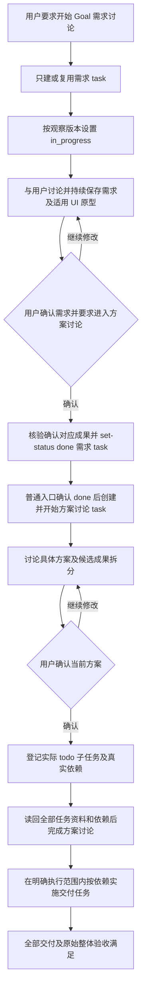

# using-daynight Goal 工作流设计

公开 skill 使用用户确认推进的需求讨论、方案讨论和实际交付协议，区分普通指定任务与
worker-managed 执行，保留服务生命周期与安装机制。[Goal 需求](../spec/daynight-goal-workflow.md)拥有 GW1–GW13，
[用户确认讨论决策](../../.agents/notes/implemented/process/2026-10-24-user-confirmed-goal-discussions.md)
拥有当前阶段门槛；[原阶段设计决策](../../.agents/notes/implemented/process/2026-10-22-goal-workflow-design.md)
保留阶段资料和共享来源的历史理由。当前发布结构由
[Agent skill 设计](daynight-agent-skill.md)拥有。

## 结构与职责

Goal 使用既有 task 串联工作。`[Goal]<outcome>` 任务拥有需求讨论；需求确认后才产生
方案或架构讨论任务；方案确认后才产生实际交付子任务。Agent 临时生成的命令、文件
读取和常规检查保留在 session 执行计划，不成为 task 或任务材料。独立验收或验证有自己的成果时仍可成为任务。
不增加 Goal 专用资源、状态、CLI 命令或新 skill 模式。

```text
packages/daynight/src/commands/skill/skills/using-daynight/
  SKILL.md
  references/
    handbook.md
    create-task.md
    run-task.md
    autopilot-managed-task.md
    task-execution.md
    goal.md
    task-content.md
    handoff.md
```

| 文件 | 职责 |
|---|---|
| `SKILL.md` | 共同任务边界、材料、授权与统一终验收规则，按普通请求或 worker prompt 的显式模式路由。 |
| `references/goal.md` | 阶段产生时机、用户确认、讨论开始授权、确认后拆分、依赖、恢复与整体验收。 |
| `references/task-content.md` | 所有阶段共用的任务定义与成果标准、task/session 边界、引用读取和内容唯一所有者。 |
| `references/handoff.md` | 明确指定的移交审查与许可更新；不替代 Goal 确认和执行门槛。 |
| `references/create-task.md` | 在授权范围内复用或登记具体工作；核验后报告身份与状态，按共同规则询问开始并等待明确答复，已有授权按范围生效；讨论保留阶段门槛。 |
| `references/run-task.md` | 普通指定任务的开始、恢复、普通完成和返回；拥有用户明确要求的普通 Goal 讨论转场。 |
| `references/autopilot-managed-task.md` | Worker prompt 显式激活后核对原 assignment，使用当前任务已有的充分交付与合并授权，满足条件后直接合并，最终 claim-bound done；完成或真实外部阻塞时交还 controller。 |
| `references/task-execution.md` | 两种入口共同读取的任务/阶段输入、范围、交付、成果和完成准备；不包含普通或 managed 状态转换。 |
| `references/handbook.md` | CLI 命令用途、项目发现、版本与完整替换、附件独立性及不确定写入背景。 |

阶段规则只由共享 Goal 协议拥有，各模式按需要读取输入与验收条件，避免通用执行或
PR 规则覆盖讨论的确认门槛。普通入口执行用户明确要求的讨论转场；managed 入口只
完成当前已指派阶段并返回 controller，不执行后续阶段创建或开始。Goal 拆分和整体完成引用 [SKILL.md#final-acceptance](../../packages/daynight/src/commands/skill/skills/using-daynight/SKILL.md#final-acceptance)
的共同终验收规则，不另建验收协议。发布资源仍是完整 allowlist bundle；两种执行文件与共享资料一起复制，安装覆盖清除已移除的调度文件，没有新的安装分支或运行时 Markdown 解析。协议只依赖随包资料与已安装 CLI help，不依赖仓库内部 skill 或本机草稿。

## 用户可观察的流程



用户只要求登记时，流程停在唯一需求任务的 todo 状态。核验资料后报告任务身份与
状态，按 SKILL.md 的共同授权规则主动询问是否开始当前讨论，并等待明确肯定答复；
已有明确覆盖当前讨论的执行授权无需重复询问。用户明确要求开始某个讨论阶段，
才授权该讨论任务通过 set-status in_progress 开始。
创建时不预建架构占位任务，也不预建交付任务。直接跳过需求确认或把讨论中的候选
拆分登记为 task，都会使未确认内容变成持久执行范围。

例如“可以了，进行架构讨论”同时表达了对当前需求的确认和下一阶段的开始指令。
执行者核对当前成果与 session 中的确认，核验阶段验收，完成需求 task，并确认服务返回 done；随后
才创建或复用依赖它的架构/方案 task，并以 set-status 启动当前讨论。该转场由用户的
明确指令驱动，保持下一讨论的指定身份；普通技能不自动选择交付后继。Managed 指派完成
或等待始终返回 controller，不执行这条普通讨论转场。

方案讨论的当前成果包含职责、边界、接口、失败行为、所需验证能力与候选工作项；
形成这些成果的调研、评审、工具和步骤留在 session。只有用户明确
确认当前方案后才登记实际交付子任务。登记总和覆盖完整目标，每个任务是可理解、可
验收的成果。全部 task、附件与依赖读回核验后，方案 task 才满足完成条件；登记部分
失败时保持当前阶段和原 ID，恢复余下操作。

## 任务身份与资料所有权

需求标题采用 `[Goal]<outcome>`，标记后直接写目标。方案任务标题说明实际讨论目的，
例如 `Architecture design: <outcome>`，不要求固定词组。标题不建立稳定身份；复用须
核对已确认 ID、完整问题与范围、阶段资料、验收和上下文。

| 资料 | 所有者与生命周期 |
|---|---|
| task description | 当前任务身份、责任与资料入口；五类任务定义可直接提供，或由真实引用的文档提供。 |
| 任务定义与成果 | description 或实际拥有文档保存目标与要求、范围与约束、输入与来源、交付物与契约、验收标准；当前和最终成果随产出保存，创建时不预填结果。 |
| Goal 需求与原型 | 需求讨论 task 拥有当前及被接受的完整要求、适用原型和必要完成门槛。 |
| 架构、方案与拆分 | 方案讨论 task；先拥有当前设计和候选拆分，用户确认后登记真实交付任务并维护确定的拆分结果。 |
| 交付任务材料 | 各交付 task 拥有自身定义、必要资源和实际成果；description 直接列出架构任务 ID，以及来源 description 全文或适用章节、真实附件完整路径或不可变仓库引用；共享输入仍归来源任务。 |
| PR 资料 | 实际需要交付的任务使用完整 properties.pullRequests 保存真实 URL 与 title。 |
| session 与本地检查点 | 执行或讨论计划、步骤、工具、协作、操作授权、确认经过、当前 ID、工作位置、阻塞、等待和恢复上下文；不写入任务描述、附件或任务管理专用仓库文件。 |

description 让读者明确当前任务及责任，并定位真实可读的内容来源。内容标准由正文
与引用的实际内容共同满足，正文完整时无需主附件，详细材料保留唯一拥有位置。
当前阶段定义待解决的问题、输入、预期成果及完成条件，不以尚待产出的最终要求或
架构已经存在为前提，也不要求 agent 的执行计划、独立 solution 或通用证据位置。

每次用户 review 前保存并读回当前成果，随后提供 task 和资源引用。session 核对确认
所对应的可读材料；任务保存被接受的成果和有效状态，确认经过与操作授权留在 session。
附件更新不改变 task 版本，因此不能仅凭 task version 假定确认仍覆盖所有材料。确认后
出现实质修订，推进或登记前须重新确认当前内容。Agent 判断、独立审查或 CI 成功都
不能替代用户确认，保存成果也不授予操作权限。

共享输入保留真实来源 task ID 和明确的读取入口。来源正文使用 description 全文或其中
适用章节，通过 `task show <source-task-id> --json` 读取；真实附件使用完整附件路径，
仓库文档使用已核验不可变引用并保留所属架构任务身份。每个交付 description 直接
列出所属架构/方案任务及本任务需要的各个来源；来源内容在正文时无需编造附件路径
或迁移成文件。后继在实施前通过已安装 CLI 读取真实内容。引用对应实际已保存并
读回的内容，附件引用对应已上传的资源；不假设跨任务相对链接、`task://` 或固定服务主机。独立快照
只在确有需要时创建，并记录来源、版本和复制目的；不默认重复上传整套共同资料。

对于“架构任务 → A → B”，B 只直接依赖 A，沿链继承架构前置，其 description 仍直接写明
架构任务 ID 和各必需来源的正文全文或适用章节、实际附件完整路径或不可变仓库引用。创建者逐项核验所有交付正文，包括这种
间接后继；执行者从正文定位并读取所列资料后才实施，必要输入缺失或不可读时沿用
既有未就绪处理。正文中的资料入口与 dependsOn 分别承担上下文定位和执行排序，
无需为了读取架构而增加依赖边。

## 阶段输入与完成

| 阶段 | 启动输入 | 产出与完成条件 |
|---|---|---|
| 仅登记 Goal | 已授权范围和当前需求 brief。 | 唯一需求 task 与当前资料可读，报告身份与状态并询问是否开始当前讨论；明确执行授权前保持 todo。 |
| 需求讨论 | 明确开始讨论的指令、已知问题和范围、阶段 brief。 | 完整要求及适用的最终样式纯前端交互原型；用户确认当前需求并要求进入方案讨论；当前成果已保存并核验、session 中的确认与阶段验收满足后 set-status done。 |
| 方案讨论 | 服务确认已完成的需求 task、其已接受成果和适用原型、session 中的明确转场指令。 | 用户确认当前具体方案；确认后实际登记全部交付子任务；task、必需引用、实际成果和依赖读回核验后 set-status done。 |
| 实际交付 | 已完成的方案依赖，自身完整任务定义、所需设计输入、验收标准、共享来源和 session 的明确执行授权。 | 自身可观察成果、验证、独立审查及必要 PR 的授权合并，按普通交付任务完成。 |
| 整个 Goal | 完整实际交付范围、原始需求与已确认变更后的整体验收。 | 所有交付任务完成，必要实现 PR 合并；需求对照结论与证据确认完整目标满足，缺陷和未验证项如实记录。 |

需求讨论关注为什么需要、结果和行为、范围与约束、排除项及整体验收，不决定具体
实现路径。涉及 UI 时讨论最终布局、视觉、交互和代表性数据状态，形成最终样式、
可纯前端运行的交互原型并查看操作；原型是需求表达的产物，供方案和交付任务复用。

方案讨论产出系统如何工作的具体设计：职责与边界、数据和控制流、接口、错误与恢复、
关键决策及所需验证能力；session 如何形成方案的计划和过程不成为任务成果。子任务体现实际成果而非命令列表；独立验收有不同结果时可单独拆分。
确认前，候选拆分只在方案材料中演进；确认后完整登记不能用将来登记的清单代替。

独立终验收任务的 description 明确整个 Goal、需求来源与结论和证据交付；其指定的
任务正文或附件拥有原始要求及已确认变更后的完整对照、必要对象版本、关键观察、
缺陷、未验证项及重要限制；验证步骤、命令历史和排障过程留在 session。
验证方法与临时辅助脚本遵守[共同终验收机制](daynight-agent-skill.md#终验收与开发交付)，
不产生辅助脚本 PR 门槛。整个 Goal 的判断核对组合交付，不能从单项检查或工具通过推导。

讨论阶段按用户确认与自身验收完成，不因仓库存在文档 PR 规则就自动等待设计 PR 合并。
独立仓库代码、文档或原型交付仍遵守其 PR 规则；若用户明确把某个 PR 交付列为当前
讨论的验收，则该要求也必须满足。开放 PR 和 no-merge 指令继续约束该实际交付，讨论
done 不能冒充仓库变更已交付，也不授予合并权限。

## 依赖与授权

方案讨论通过普通 dependsOn 依赖已完成的需求 task。交付根直接依赖方案 task，其他
必要直接依赖表达真实成果顺序，每条实施路径都经过方案完成。登记前按 handbook 的
Dependency reduction 规则检查相关路径，省略已有其他保留路径覆盖的直接边；后继
沿保留路径继承前置，无替代路径的独立前置保持直接关系。普通边只可由全普通路径
替代，保持链归属与设计门禁；经内容确认归其他同项目链所有的真实前置保留
externalDependsOn，外部边可由任一类边构成的路径替代，保留边分类不变。登记读回
核验必要路径与无冗余。两类关系都阻塞执行，不按标题、完成状态或图的入口猜测分类，
也不为视觉归组制造依赖。CLI 任一依赖声明编译完整并集和外部子集，更新前须保留
需要的普通与外部关系。

明确的 Goal 创建许可覆盖已确认目标内按阶段发生的登记；不让未来阶段提前存在。
开始需求讨论或确认需求并要求进入方案讨论的明确指令，只启动指定讨论，使用已有 set-status。
方案确认许可登记交付任务；新任务为 todo，登记不开始执行。登记核验后报告任务，
按共同规则在缺少执行授权时询问开始并等待明确答复；拒绝结束当前启动提议，未回复
保持等待，含糊答复先澄清。已有明确执行范围继续有效，不增设范围内指定任务的重复
审批；答复只覆盖明确指定的任务，普通 skill 不据此自行选择后继。实现、自动执行许可、
部署、发布、外部通信、合并和主线 push 遵守各自授权。

allowAgents 默认 false，只约束自动发现选择；普通明确指定的任务可采用手工路径，
创建、拆分和调度不自行启用它。明确授权的 handoff 按共享内容标准审查后启用，
可以预先移交仍被真实依赖阻塞的 todo；它不启动执行或替代阶段确认。已有 true 只读
复审失败时保持许可并报告，撤销/停止仍需明确授权。自动发现与连续调度归 worker，
继续要求 allowAgents=true、ready 和真实平台；公开 skill 不提供候选选择循环。
讨论等待确认时保持当前任务，不能换做后继。整个 Goal 仍须所有实际交付与原始验收完成。

## 写入、恢复与并发

每步创建、附件上传、元数据、set-status in_progress 和 set-status done 都是独立写入。先保存并
读回当前成果，在 session 核验用户确认与阶段验收，再执行当前任务的生命周期动作；需求 set-status done 返回不
确定时先核对，不能据此创建方案 task。方案或交付子任务创建部分成功时保留已确认
ID，只恢复余下操作。相似标题不足以认定成功，失败响应也不证明服务没有写入。

元数据与生命周期命令携带决策时读取的完整 int64 版本，冲突后重新读取并判断，不能
仅替换版本重发。description 与 PR 列表完整替换；依赖按完整两类集合编译。附件
独立于 task 版本、状态和更新时间，实际文件内容与元数据分别确认；任务版本不能
保护附件或替代用户材料确认。

状态与 readiness 不提供独占锁、租约或所有权。Session 或本地恢复检查点确定当前任务，in_progress
清单只提供线索。所有实际前置必须完成，不能删除或重分类前置来使讨论或实施 ready。
用户确认不掩盖命令错误；在 session 保留实际资源 ID、操作授权、状态、错误与下一步后
再恢复。不能从任务材料恢复缺失授权，也不把检查点上传成任务附件。

## 验证与交付

检查正文、规范、技能引用和决策所有者的一致性；核验本地链接、资料身份、当前确认
与版本操作。独立情境审查覆盖唯一初始任务、仅登记后主动询问与等待明确答复、拒绝/
未回复/含糊答复、已有覆盖授权不重复询问、答复范围、明确开始讨论、提前阶段阻断、
用户确认转场、确认前候选拆分、确认后真实 todo 子任务、实质修订重确认、适用
UI 原型、讨论与 PR 交付区分、交付授权、部分登记、不确定状态写入和整体验收。
内容情境双向检查 session 计划、操作授权及过程的排除，以及真实输入、当前设计稿、
验收结论和用户要求的方法型成果的保留；正文、附件和引用采用同一分类。
架构资料情境另覆盖“架构任务 → A → B”的 B 正文入口、实施前读取与输入不可读时的
未就绪处理。独立 agent 审阅从最少任务上下文核验资料定位和读取；自动化指令情境
使用静态断言证明相应规则随包存在，不创建额外真实任务或把静态检查当作真实模型行为。
普通与 managed 情境分别核对加载路径、完整任务资料和交付门槛；managed 还核对显式
环境/技能/模式、原 assignment、缺失或不匹配等待、原 claim 完成和交还 controller。

既有 copy-skills 测试、frontmatter 和本地链接检查验证完整 bundle，实际 build 与
npm pack 证明协议进入发布产物。隔离安装及模拟 launcher 的三个 Agent × 两个 scope
验收继续验证完整字节、覆盖、迁移和资源保留；不运行真实 Agent 或模型、不读取账号、
不发布 npm 或部署。按实际影响运行 CLI typecheck、test、build 与必要 CI。

记录准确源码 commit、包版本、打包产物及 hash、平台和命令结果。文件证据证明资源
完整，独立情境审查证明指令一致，平台事实证明 PR 交付；三者不能相互替代。协议
没有新增后台组件、数据库格式或运行时调度，已有 CLI 和服务命令继续由既有套件验证。
