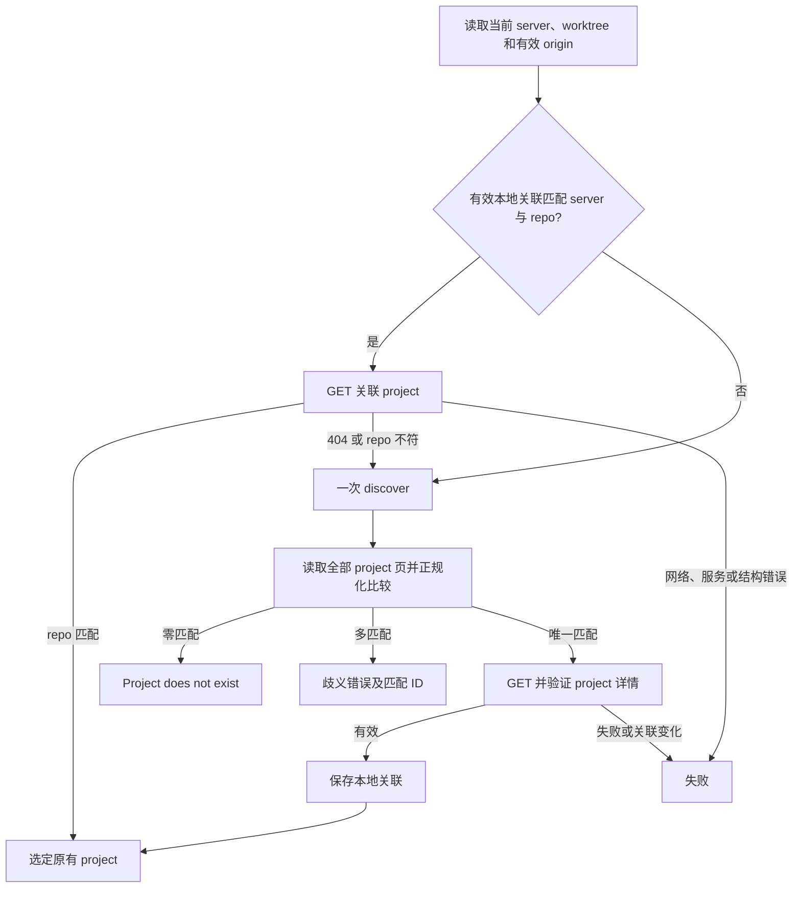

# Project 与 Task 客户端设计

状态：共享配置、HTTP、仓库关联基础及 `project create/list/show` 已实现；
Task 命令与安装产物已实现。[PR #55](https://github.com/codetreker/daynight/pull/55)
记录历史真实服务及三原生平台验证；当前入口及被测源码的验证结果应分别核对。
本文描述采用的结构和交付机制，当前可用命令见
[仓库 README](../../README.md)。必需行为与编号验收由
[客户端需求](../spec/daynight-project-task.md)拥有，服务行为由
[服务需求](../spec/daynight-server.md)拥有。结构决策与真实备选方案见
[决策记录](../../.agents/notes/archived/architecture/2026-10-20-project-task-cli-design.md)及
[创建预检决策](../../.agents/notes/archived/bug-fix/2026-10-21-project-create-repository-discovery.md)，
有界 ready 选择的取舍见[选择决策](../../.agents/notes/archived/feature/2026-10-21-bounded-ready-task-selection.md)，
列表默认值与文本输出见[列表决策](../../.agents/notes/archived/feature/2026-10-22-task-list-defaults.md)，
JSON 列表字段见[描述省略决策](../../.agents/notes/archived/simplification/2026-10-22-task-list-json-description.md)。
任务起止字段与图时钟的读取机制由[执行计时架构](daynight-task-timing.md)扩展；
CLI同步保留`startedAt`、`completedAt`、`cancelledAt`、`observedAt`、Project.ownership 及 Project.settings，不产生本地推算时间；计时读取不新增人类可读字段。
Web 的共享时钟与卡片使用相同资源事实，展示机制归[看板设计](daynight-web.md)，不改变客户端传输或命令职责。
服务端[负责人设计](daynight-task-assignment.md)拥有原生 assignedTo、任务筛选和项目内人员读取。CLI 的 Task/graph 严格解析、普通元数据设置/清空、list 筛选及当前ID输出已实现，复用同一字段契约，不增加人名或头像请求。资源要求 type 和可空 parentId；Goal full 解析 progress 和不适用的执行观测，图只接受普通 Task 并保留不可见前置的 ID。
[Steps 资源要求](../spec/daynight-task-steps.md)扩展独立的 task step list/show 读取、Add、Update、Set-status 与 Move；它不将完整 Steps 加入普通 Task 投影。

[预定义属性设计](daynight-task-properties.md)的 server 接口、通用 CLI 属性命令与完整输出已实现。[需求](../spec/daynight-task-properties.md)拥有扩展约定。完整 TaskProperties 使用通用 JSON map，键缺失不补值，worker 的公开写入限制由服务端定义拥有。Worker 直接复用进程内 ApiClient，具体认领方法、保留 nextCursor 的 listTaskPage 和已知 taskId 核对由[归属架构](daynight-worker-claims.md)拥有；不调用 task 命令包装层。

[附件架构](daynight-task-attachments.md)中的 `task attachment put/list/read/remove`
及二进制传输通道已实现，行为见[附件需求](../spec/daynight-task-attachments.md)。
Web 文件管理亦已实现。元数据查询按操作输出 JSON；
task list 的 JSON 仅省略 `description`，task search 使用独立精简投影，其他元数据查询保留各自完整资源。
文本输出选择列表摘要或完整资源，创建和更新输出完整文本资源；原始内容逐段写入
字节通道。
[CLI 决策](../../.agents/notes/archived/feature/2026-10-21-task-attachment-cli.md)记录
流传输及输出辅助进程的选择。

CLI 默认使用 `https://daynight.cc`，显式 `login/logout` 管理通过设备授权自动取得的凭据，
共享 HTTP Bearer 传输与显式 PAT 配置继续复用；机制的历史取舍见
[设备登录决策](../../.agents/notes/archived/architecture/2026-10-25-cli-device-login.md)。
[鉴权架构](daynight-auth.md)和[需求](../spec/daynight-auth.md)拥有完整项目授权机制与行为；生产服务对全部
项目、任务、图和附件业务请求强制鉴权。设备登录复用现有 UniAuth 浏览器会话批准，
取得的凭据进入正常配置与 Bearer 请求通道。仓库关联不保存凭据、
不授予项目访问权；现有 Project 的真实 Personal 归属及其迁移由[鉴权架构](daynight-auth.md#数据与并发)拥有。专用 set-status 与现有资源读写共用 owner Team 与 direct grant 计算的当前有效权限；管理员额外管理独立授权、邀请和项目提醒设置，不另设
状态专属角色。

## 现有基础与交付边界

本文已交付的 `project` 和 `task` 命令复用已有 HTTP API，不改服务或数据库。实现入口及字段可以由
以下现有文件核对：

| 现有归属 | 可复用事实 |
|---|---|
| [`cli/commands.ts`](../../packages/daynight/src/cli/commands.ts) 与 [`cli/application.ts`](../../packages/daynight/src/cli/application.ts) | 命令登记保留异步 `load`，应用统一处理 `0/1/2` 退出结果 |
| [`config/document.ts`](../../packages/daynight/src/config/document.ts)、[`config/files.ts`](../../packages/daynight/src/config/files.ts) | 共享严格 YAML、已知值投影、独立锁、写入归属校验和原子配置保存 |
| [`commands/review/config.ts`](../../packages/daynight/src/commands/review/config.ts) | review 字段投影与 GitHub 专用 remote 身份规则 |
| [`api/index.ts`](../../packages/daynight/src/api/index.ts) | 命令级操作、服务 DTO、完整分页、有界 ready 选择、精确 JSON 与 HTTP 错误 |
| [`api/task-steps.ts`](../../packages/daynight/src/api/task-steps.ts) | 独立 Steps/Step 严格解析、Task 内短 ID、完整四状态字段及读取 scope |
| [`commands/server/runtime.ts`](../../packages/daynight/src/commands/server/runtime.ts) | 配置读取、共享操作、信号取消和完整结果输出 |
| [`commands/project/command.ts`](../../packages/daynight/src/commands/project/command.ts)、[`rendering.ts`](../../packages/daynight/src/commands/project/rendering.ts) | Project 参数、API 组合及完整资源渲染 |
| [`platform/text.ts`](../../packages/daynight/src/platform/text.ts)、[`platform/terminal.ts`](../../packages/daynight/src/platform/terminal.ts) | 与服务一致的文本验证及终端显示转义 |
| [`commands/review/paths.ts`](../../packages/daynight/src/commands/review/paths.ts) | 既有配置位置为 `~/.daynight/config.yml` |
| [`api/projects.go`](../../packages/daynight-server/api/projects.go) | project、分页及含 request ID 的结构化错误 |
| [`api/tasks.go`](../../packages/daynight-server/api/tasks.go) | task、派生字段、版本和字段可选的更新请求 |
| [`api/task_graph.go`](../../packages/daynight-server/api/task_graph.go) | 任务链图、节点预览及 summary 响应 |
| [`core/project/repository.go`](../../packages/daynight-server/internal/core/project/repository.go) | 服务接受通用 HTTPS、SSH、SCP 地址，保存原始地址 |

现有 review 的 `remoteIdentity` 面向 GitHub 且把 owner/name 转小写，不能直接成为
通用 project repo 比较规则。新正规化器单独拥有服务命令的 repo 身份，保持 review
既有行为。共享读取与命令投影已经分离：review 运行解析要求非空 repositories，
server 投影只要求有效 server 地址；review 登记可向 server-only 文档添加首个仓库。

## 模块与依赖方向

`config/`、`api/`、`repository/`、共享 server runtime、Project 命令和既有
review/update/completion 及 Task 命令已实现。职责如下：

```text
src/
  cli/                     # 帮助、分发、通用退出结果
  config/                  # 全局路径、严格 YAML 读取、归属声明与配置保存
  api/                     # 服务 DTO 验证、请求、分页、结构化错误
  repository/              # Git 定位、repo 正规化、关联解析和原子持久化
  platform/                # 通用文件、服务文本契约及终端显示原语
  commands/
    server/                # 共享配置、操作与信号生命周期
    project/               # 参数、帮助、project 操作及渲染
    team/                  # Team 命令、上下文、确认与渲染
    invitation/            # 邀请接收语法、操作与渲染
    task/                  # task、Step 读取与附件的参数、帮助、操作及渲染
    review/                # review 配置投影和既有行为
    update/                # 既有 npm 安装生命周期
    completion/            # 既有 Bash 和 zsh 原生补全
```

顶层通过业务无关的命令定义共享名称、描述、参数和补全语法，并保留惰性执行入口。
Project 的定义由 [`definition.ts`](../../packages/daynight/src/commands/project/definition.ts)
拥有，解析、帮助及 Bash/zsh 补全消费同一语法；补全机制由
[补全设计](daynight-completion.md)拥有。命令组先解析参数和帮助，校验名称及详情
UUID，再惰性加载共享 server runtime 和业务渲染。Task 的 definition、command 和
rendering 分别拥有语法、API/仓库关联组合及可读/JSON 输出，属性 dispatch 组合相同 server session 和版本化属性资源。
Step 分派先于普通 Task 分支；`step.ts` 组合 list/show 读取与 Add/Update/Set-status/Move 分派；
`step-add.ts` 编译新增参数与短 ID，`step-update.ts` 编译内容或状态修改，
`step-move.ts` 编译互斥位置与同 Task 锚点；`step-write.ts` 的 `executeStepWrite`
再组合实际版本分支、带操作名的不可变尝试和同操作事实核对，
`step-rendering.ts` 单独拥有完整 Steps/Step 资源的文本与 JSON 输出，
`step-diagnostics.ts` 拥有安全公开诊断并保留内部 cause。四状态 Step 类型
不复用 TaskStatus。帮助与本地 ID 参数校验完成后才加载配置、Git 或 HTTP。
`project create` 将名称声明为一个必填位置参数，`--repo`、`--team` 声明为可选 text
选项，`--confirm` 为无值开关。该定义声明
`allowOptionsTerminator`，使 `--` 后的词按位置参数处理，因而前导 `-` 的名称也能
原样提交。语法层按共享定义检查位置参数的最小/最大数量、allowEmpty 和固定候选；optional 参数只能组成连续的末尾后缀。properties 的 task ID 可选性由 --schema 模式决定，set-property 的 value 明确允许空字符串。名称的 Unicode 文本语义由 Project 命令在业务加载之前校验；通用属性值不套用此规则。
共享语法通过 `value.allowEmpty` 表达描述空值，通过 `value.choices` 表达状态允许值，
通过 `repeatable` 表达有序依赖数组；解析与静态补全消费这些事实，帮助使用定义中
的名称、值名、必填性与选项说明。
text 选项内联形式按首个 `=` 分隔并保留原值，目录及开关继续拒绝内联。
project/task 不导入 review runtime、SQLite 或外部审查适配器。`project list/show` 和
显式 repo 的 create 只需要配置与 HTTP；省略 repo 的 create 才加载 Git 发现，不
加载仓库关联保存。task 显式 project 分支也只需要配置与 HTTP；自动分支才加载 Git
与仓库状态。共享模块不反向导入命令模块。

配置共享层产出 YAML mapping 和文档上下文，拒绝语法、重复 key 和非 mapping；
未知字段保留在文档中，运行投影只读取已知字段。review 投影只解析 `review` 节点内的字段；server 投影在文件或 `serverUrl` 缺省时
使用 `https://daynight.cc`，校验明确提供的地址与可选 `serverToken`。共享层保留 YAML 格式，
不迁移 review 数据。服务调用不进入配置引导；缺少本地凭据时在网络前提示 `daynight login`。
已有无效服务值、共享文档错误及读取错误直接暴露。
review 配置可始终省略，其业务字段不参与服务校验。YAML 错误以安全类别、代码和
位置表达，原始标量及 parser cause 不进入错误对象。每个变更返回明确的 unchanged 或带字段归属
声明的 write 描述。共享写入者在持锁重读的原配置与候选配置之间统一比较非归属解码值，
拒绝会连带改变无关字段的 alias 写入，再执行保存。含令牌结果使用 POSIX `0600`；无令牌文件继续既有权限行为，普通文件/符号
链接检查与原子替换不变。

[`platform/text.ts`](../../packages/daynight/src/platform/text.ts) 统一名称、标题及 DTO
已知字符串的结构验证：合法 Unicode 文本、不含 NUL；非空文本还须包含 Unicode
`White_Space` 之外的字符。该规则与 Go 服务一致，U+FEFF 可以单独构成名称，
U+0085 则不能。验证保留字符串原值，不修剪空白，也不拒绝服务允许的其他控制字符。
Project 名称参数与响应 DTO 复用同一规则，避免已被服务接受的资源阻断完整列表。属性内的 PR 字符串是独立的 opaque JSON 内容，不应用此文本规则；服务端另对写入值执行字节额度。CLI/Web 的 api/task-properties.ts 保留通用 JSON map，readTaskPaused/readPullRequests/readWorkerClaim 在各自业务处返回明确的缺失状态；sameTaskProperties 比较完整属性对象，不能因当前业务仅消费部分属性就丢弃其它键。

## Task 搜索

`commands/task/search.ts` 在普通列表的项目读取和状态重排之前分派搜索；显式项目
直接使用该 ID，省略时复用仓库解析。共享 commandTree 同时提供参数校验、帮助和
补全。CLI 将表达式原样传给[搜索接口](../spec/daynight-task-search.md)，只在本地
检查空白、UUID 和筛选值，不复制解析、匹配或排序。POST 是只读 exchange，期待
200；每页显式请求 100 项，使用同一操作的五分钟总期限、30 秒单请求期限、128 MiB
单响应与 256 MiB 总读取预算，并保留取消。它校验主体、项目、响应字段、总数、
重复 ID 和 cursor，全部页面成功后才输出；`search_changed` 不自动重放。

文本与JSON来源相同精简搜索结果；JSON显式保留id/type/parentId/projectId/title/status/cancelledAt/context/match，文本保持类型、parent、状态与命中呈现，避免服务端
新增字段自动泄入输出。任务标题和实际父 Goal 标题完整保留，文本使用终端可见转义；描述
只使用服务端提供的正向命中摘要。搜索不是完整 Task 读取，也不复用普通列表的
默认状态过滤或重排。[搜索需求](../spec/daynight-project-task.md#项目任务搜索)拥有
CLI 的行为与错误，服务端机制由[搜索设计](daynight-task-search.md)拥有。

## 服务地址与 HTTP 客户端

`serverUrl` 解析为 HTTP(S) origin：协议与主机采用 URL 标准形式，默认端口省略，
末尾根斜线省略。拒绝用户信息、非根路径、query 和 fragment。API URL 从该 origin
与固定 `/api/v1/...` 构造，资源 ID 作为单一路径段编码，分页 cursor 通过 query
编码。配置值不得允许请求参数改变服务 origin。

`serverToken` 为非空 opaque visible ASCII，仅 HTTPS 或 host 为字面量 `localhost`、
`127.0.0.0/8` 数值 IPv4、`::1` 的 HTTP 允许使用。测试服务和自动化由外部受控配置文件
提供现有 `serverUrl` 与 `serverToken` 字段；省略 origin 使用生产默认值。准备者必须将凭据和目标
origin 配对，切换服务时移除或替换旧令牌；外部编辑不执行 CLI 的锁、原子替换或凭据清理协议。
CLI 登录/退出在锁内共同核对 origin/token，保留其他能力已完成的并发修改。

`login` 使用独立十分钟期限调用设备授权接口，显示短码并打开同源验证页，`--no-browser`
仅显示 URL/短码。它按服务要求轮询，批准后在配置锁内重查 origin 与凭据观察值并保存，避免覆盖
期间的另一次登录或地址变更。`logout` 通过当前 Bearer 撤销自身，确认成功或已失效后同样在锁内
清除观察到的凭据，保留并发写入的新值。完整设备授权、到期和撤销机制由
[鉴权架构](daynight-auth.md#cli-设备授权)拥有。

共享 API 请求边界为已有 project/task/graph/property/attachment 请求附加 Bearer，覆盖文件、分页
和错误路径。继续使用 manual redirect，不向重定向目标转发凭据。无本地令牌的业务调用在请求前失败，
服务 401 给出 `daynight login` 指导，不自动登录、匿名回退或重放写请求；403/404/409、精确 int64、
分页、二进制输出与既有预算保持。凭据不写仓库关联，命令定义、登录实现和业务 HTTP 分工独立。

完成参数分派后，`runServerCommand` 在首次配置读取前创建取消控制器及 `Operation`，
配置与业务共享五分钟总期限。业务预算覆盖配置读取、Git 定位、缓存验证、全部分页、本地锁、
文件准备、HTTP 和结果渲染。所有步骤共享剩余预算，不能因翻页或重新发现重置。每个请求期限为 30 秒与命令剩余期限的较小值，覆盖连接和
响应体读取；用户取消沿用同一命令取消源。请求成功、失败或取消后清理单次期限及
监听器；同步 JSON 解析后也按单次及总期限检查。分页请求串行执行，取消及任一
失败阻止后续页面、本地保存和写请求。

共享 runtime 将同一信号传给 `loadServerConfiguration`；配置读取层接受可选的
`AbortSignal` 并传入 `readFile`，同步 YAML 解析完成后再次检查操作状态。已正规化
的 server 地址、API 客户端及操作对象组成 `ServerSession`。普通元数据 callback 返回完整字符串，runtime 最终检查后一次写 stdout；附件 read
通过可等待的字节输出逐段写入。Thread 与 Step 写入返回 `ConfirmedMutationOutput`，
其确认事实与调用者的安全 failureText 进入既有受限回执输出生命周期，后续本地
输出或清理失败仍保留确认。SIGINT、SIGTERM 及 Windows
SIGBREAK 触发同一取消源。结束时先等待 `closeStdoutBytes` 关闭并回收实际创建的
辅助进程，再移除自身监听器并 dispose 操作，保留其他消费者的监听器。真实 CLI
上下文始终提供该关闭函数，注入上下文可省略它。命令和清理失败均保留原因。

默认每个 JSON 响应最多读取 128 MiB，单命令累计 JSON 响应体最多读取 256 MiB；MiB 为
1,048,576 字节。`bot list` 通过现有 `operationLimits` 选项将单响应上限设为默认累计预算
256 MiB，累计上限保持 256 MiB；该例外由[助手设计](assistant.md#cli-管理与远端观测)拥有，
其他命令保留默认值。按解码 HTTP 内容编码后的响应体字节流计数，包含 JSON 成功与错误响应，
在 JSON 解析前累计；不能只相信 `Content-Length`。超过任一上限立即取消读取并
报告响应或累计预算超限，不解析已截断 JSON。这些常量与总期限共同限制持续推进
cursor 的扫描及累计 JSON 内存；预算不增加公开配置字段，也不改变 server 限制。
`task ready --limit` 仅选择返回任务数，不改变期限或字节预算。附件原始内容上传和
成功读取使用有界缓冲的字节流，不经过上述 JSON 字节上限；取消和请求/总期限继续
覆盖传输和等待 stdout 背压的过程，错误响应仍按 JSON 预算处理。
JSON 对象在完成有界读取后解析；下一步及最终输出前再次检查总期限与取消状态。
失败时取消并释放响应 reader；清理最多额外占用 100 ms，取消失败或清理超时与
原始失败一并保留，不能吞掉清理错误，也不能因底层取消迟迟未完成而无限等待。

读准备阶段超限时不保存绑定、不发 mutation、不输出部分结果。若超限发生于已经
发出的写请求响应，远端结果仍未确认，沿用写入不确定性诊断，不能断言写入未发生。

HTTP 层按操作消费 JSON、原始字节或空响应，只接受 API 规定的成功状态；JSON
响应继续校验结构，删除必须为 204 且响应体为空。缺失字段、错误类型、未知
状态值、无效分页 cursor 形态及不完整错误 envelope 作为协议错误暴露。验证可消费
的已知字段，服务将来添加无冲突字段无需猜测其含义。full task 与图节点读取必填、可空的
`startedAt`、`completedAt`、`cancelledAt`；图另外读取必填 `observedAt`。`null` 表示未知事实，缺失不能兼容为 `null`；
已知值使用与现有资源相同的合法 UTC `Z` 时间格式验证，秒后允许 1–9 位小数，并保留原始字符串。DTO 的时间、版本、UUID 和
数组语义与现有服务契约一致。错误保留 cause，并区分网络、期限、主动取消、HTTP
拒绝和响应结构失败。

私有成功JSON解析边界提供该响应的principal header元数据。me专用Task Page解析器在items为空时也要求单个规范Daynight-User-ID；listTasks每次遍历绑定第一页身份，后页不得变更，独立调用不共享该绑定。每项assignedTo必须等于该principal；UUID/unassigned模式核验其选择。listTaskPage校验本次成功响应，跨调用续页再由服务端cursor scope约束。不从首项推断身份，不多发/me，也不为me错误改写401/404等真实服务拒绝。普通非me且未配置expectedUserId的请求保留原可选header行为，显式expectedUserId检查继续适用。

所有写请求只发一次，HTTP 层不自动重试、不自动跟随改变写入目标的重定向。写入
后的网络失败或取消意味着结果未确认；诊断明确说明这一点，并提供 project/task
目标供用户查询。读取也不自动重试，避免隐藏服务与分页失败。

## Git 定位与仓库身份

自动选择从调用目录执行 Git，使用 `git rev-parse --show-toplevel` 定位当前 worktree
根目录，并拒绝 bare repository。根目录必须是非空绝对路径，再转换为平台原生
路径形式。使用 `git remote get-url origin` 获取默认 fetch
URL，由 Git 处理 `insteadOf`；不读取 push URL、不自行实现 Git 配置优先级，也不
解释 SSH config、DNS 或 provider API。Git 命令受同一剩余总期限约束，stderr 进入保留
原因的错误链。操作不 clone、不 fetch。每个 Git 子进程最多使用 30 秒与共享总期限剩余值的
较小者，stdout、stderr 分别最多捕获 1 MiB；超限或取消时终止任务拥有的执行。
读取索引时以 `-c core.fsmonitor=false` 关闭外部 fsmonitor，避免优化工具继承管道
或启动后台工作。POSIX 使用并等待独占进程组，Windows 使用系统目录下的
`taskkill /PID /T /F` 处理所属进程树。taskkill 成功、根进程关闭或管道关闭都不能证明
逃逸后代已经结束，尤其不能覆盖父进程退出后脱离树遍历的后代。终止命令与管道收尾各有
1 秒预算；无法确认时保留原始错误并报告进程终止未确认，不能无限等待继承的输出句柄。
取舍见[原生 Windows Git 回退决策](../../.agents/notes/implemented/simplification/2026-11-11-revert-native-windows-git.md)。

独立的 owned Git 端口复用同一命令、环境、限额及脱敏策略，同时分别返回有界
`outcome` 与 `joined`。`joined` 只在原 Git 子进程、已创建输出流及已启动的异步
Windows taskkill 子进程和其输出流实际 close 后返回 `local-closed`；清理期限到期
可先报告 `cleanup-pending`，但不会销毁流或放弃这些责任。超限后停止保存输出并继续
排空，停止和流错误仍可观察。`local-closed` 不证明逃逸或脱离 stdio 的后代停止，
这些后代仍可能在资源交接后写入。普通读取继续使用有界 API；端口本身不改变 Worker
调用方。取舍见[本地收尾决策](../../.agents/notes/implemented/architecture/2026-11-11-owned-repository-git-local-closure.md)。

repo 正规化对本地 origin、每个列表 repoUrl 和详情 repoUrl 使用同一函数。返回值
是可持久化的 `repoIdentity` 字符串；它不是替换原始 repoUrl 的提交字段。

### 正规化算法

1. 按服务已支持的 HTTPS URL、SSH URL、SCP 风格分类。先验证完整输入，拒绝凭据
   密码、query、fragment、空主机和空仓库路径。SCP 识别需支持括号包围的 IPv6。
   本地文件地址和不支持的协议不能成为自动发现身份。
2. 主机名转小写；IPv6 采用同一规范文本及括号表示。保留 alias 的字面主机名，
   不添加或删除主机末尾点、不把 alias 替换成其他主机。路径大小写及百分号编码
   原样保留，不进行 percent decode、Unicode 规范化、路径分隔折叠或 dot-segment
   消解。实现不能让通用 URL parser 先静默改写路径。
3. 对路径去掉末尾连续 `/`；仅在移除后仍有非空仓库路径时，才移除一个大小写精确
   匹配的 `.git` 后缀。URL 的根 `/` 不是仓库路径，因此 `/.git` 和 SCP 的 `.git`
   均保留字面 `.git`。不删除中间 `/`，不把 `.GIT` 当作 `.git`。正规化必须为每个
   服务有效地址产生身份，不能因后缀处理把有效地址变成解析错误。
4. 普通 hosted 形式要求默认端口：HTTPS 使用根相对仓库路径，SSH URL 使用用户名
   精确为 `git` 的普通仓库路径，SCP 使用默认 `git` 用户和普通仓库路径。路径不含
   空段、`.`、`..`，不以 `~` 开始。普通形式
   去掉 URL 路径的一个根 `/`，输出 `<host>/<path>`。HTTPS 默认端口 443、SSH
   默认端口 22 与各自省略端口相同。SCP 普通 `git@host:owner/repo` 按 hosted
   repo 的常见写法参与该合并；显式 `:./`、`:../`、`:~/`、`:/` 保留路径形式。
5. 非普通形式保留 transport 信息，避免误合并：HTTPS 使用
   `https://<host>[:<port>]/<path>`，其中非默认端口必须保留；SSH URL 使用
   `ssh://[<user>@]<host>[:<port>]<path>`；SCP 使用
   `scp://[<user>@]<host>:<path>`。用户名的有无及大小写、显式根路径与相对路径
   均保留。端口使用十进制规范形式；默认端口可省略，但特殊用户或特殊路径仍保留
   transport 形式。SCP 中的冒号后路径不解释为端口。

用户名编码保持原样，只有字面用户名 `git` 参与普通 SSH 合并；例如 `%67it`
仍保留 transport 身份。普通 hosted 地址是双方约定的等价表达；该规则不证明任意 SSH 服务的路径语义。
需要表达特殊 SSH 用户、根路径或相对路径时，保留形式允许仓库登记与 origin 精确
对应；若两端写法语义是否等价无法由规则证明，用户可显式 `--project`。

### 正规化 fixture

| 输入 | 身份或比较结果 |
|---|---|
| `https://GitHub.com/Org/Repo.git/` | `github.com/Org/Repo` |
| `ssh://git@github.com:22/Org/Repo.git` | `github.com/Org/Repo` |
| `git@github.com:Org/Repo.git` | `github.com/Org/Repo` |
| `https://github.com:443/Org/Repo` | `github.com/Org/Repo` |
| `https://github.com/org/repo` | 保留小写路径，与 `github.com/Org/Repo` 不同 |
| `https://git.example/Group/Sub/Repo.git` | `git.example/Group/Sub/Repo` |
| `https://git.example:8443/Group/Repo.git` | `https://git.example:8443/Group/Repo` |
| `ssh://git@git.example:2222/Group/Repo.git` | `ssh://git@git.example:2222/Group/Repo` |
| `ssh://alice@git.example/Group/Repo.git` | `ssh://alice@git.example/Group/Repo` |
| `alice@git.example:Group/Repo.git` | `scp://alice@git.example:Group/Repo`，与上一行不同 |
| `ssh://git.example/Group/Repo.git` | `ssh://git.example/Group/Repo`，保留缺省用户 |
| `git@work-github:Org/Repo.git` | `work-github/Org/Repo`，不解析为 `github.com` |
| `git@git.example:./Group/Repo.git` | `scp://git@git.example:./Group/Repo` |
| `git@git.example:/Group/Repo.git` | `scp://git@git.example:/Group/Repo` |
| `ssh://git@git.example/~/Repo.git` | `ssh://git@git.example/~/Repo` |
| `https://git.example/Org/Repo%2Egit` | `git.example/Org/Repo%2Egit`，不等于 `git.example/Org/Repo` |
| `https://git.example/Org/%52epo.git` | `git.example/Org/%52epo`，不等于 `git.example/Org/Repo` |
| `https://git.example/Org/Repo.git.git` | `git.example/Org/Repo.git` |
| `https://git.example/Org/Repo.GIT` | `git.example/Org/Repo.GIT` |
| `https://git.example/.git` | `git.example/.git`，保留非空字面仓库路径 |
| `git@git.example:.git` | `git.example/.git`，与上一行相同 |

## 自动发现与关联寿命

关联文件严格包含 `serverUrl`、`repoIdentity`、`projectId`，分别为已正规化服务
origin、repo 身份和合法 UUID。记录是本地目标选择信息，远端详情仍是事实来源；它
没有 TTL，也不保存 task 状态、列表或认证信息。文件格式错误不能等价于文件缺失。

显式 `--project` 分支不依赖 Git 或本地记录，按 ID GET project 后执行操作；错误
直接返回。自动分支执行以下状态流：



`repository/context.ts` 只在完整匹配结果为零或多项时产生纯
`repository/discovery-error.ts` 的 `ProjectDiscoveryError`。它保留 missing/ambiguous
类别和按原顺序复制、冻结的全部规范 project ID，不携带项目名称、repo URL、
工作目录或凭据。类型校验 ID 的规范性、唯一性及非唯一匹配数量，公开 message
仍表达不存在或列出匹配 ID 与 `--project <id>` 提示。

列表先全量成功再判定；任何 repoUrl 无法按服务契约解析都作为响应错误，不能跳过
以免制造“唯一匹配”。详情验证发现 404 或 repo 已变化时，不递归重新发现：本次
发现已经用尽，报告目标变化并失败。有效缓存不再扫描完整列表，因此后来添加同 repo
的第二个 project 不会改变目标。跨命令没有本地存在即远端存在的承诺。

每个请求在服务中独立验证资源；CLI 的 GET 与后续请求不构成跨请求事务。GET 成功
后 task 请求可能返回 404 或冲突，按真实结果报告，不通过重新发现切换 project 后
重放写操作。

## 本地文件、锁与写入顺序

`.daynight/project.yml` 位于当前 worktree 的根目录，不放在共享 Git common dir。
该选择让不同 worktree 可以保留各自的关联，并让 submodule 保持自己的边界。
目录预留其他仓库专属文件的空间，本设计只定义 project.yml。

首次持久化或替换关联需取得仓库级元数据锁；锁保护重新读取记录、根 `.gitignore`
的读改写和 project.yml 替换。锁内再次检查当前记录，若其他进程已经保存同一有效
关联则复用；若保存了不同 project，重新验证其适用性，不能仅因锁外 discovery
较早开始就覆盖已确定的有效绑定。锁已由有效持有者占用时立即报告竞争失败，既不
等待也不重试。创建锁前及取得锁后检查取消和剩余总期限。锁文件记录进程 ID 与
随机所有权 token，释放前核对文件身份和内容。已有锁均保留并报告；异常退出后的
残留锁须确认写入者已经停止后人工移除。普通文件的读取与 unlink 不能构成原子
比较删除，因此不按 PID 或锁年龄自动回收，避免误删并发建立的新锁。

写入先检查根 `.gitignore` 中的 `/.daynight/` 及最终 ignore 结果；需要时以保持
既有内容和换行风格的方式写入该规则。后续否定规则可能使该目录重新被包含，必须
在文件末尾确保规则生效并用 Git 分别检查目录本身和 project.yml；仅 project.yml
被忽略不足以保护锁文件及后续仓库信息。已有被跟踪 `.daynight/` 内容不能通过 ignore
隐藏，需报错并提示处理索引。`.gitignore` 不是普通文件、不可写或最终规则仍不
生效时失败。

配置文件、ignore 和元数据共享 `platform/files.ts` 的原子替换原语，各自负责
锁与输入校验。元数据序列化到同目录任务拥有的临时文件，完成写入后原子 rename 替换目标，成功
后释放锁。`.gitignore` 也用同目录临时文件替换，避免截断。两个文件没有跨文件
事务：ignore 成功而 metadata 失败时保留有效 ignore 并报告失败；不回滚期间可能
已有其他进程修改的文件。metadata 从不先于有效 ignore 落地。

自动发现引起的目录、ignore 和 metadata 准备必须在 POST/PATCH task 之前完成。
即使 task 操作随后失败，有效绑定仍可保留。仅查询也可以首次发现并保存关联，这
是自动定位约定的本地副作用。显式 project 分支不发生该副作用。任何路径上的
原始读写错误和清理错误保留因果，不能降格为无缓存。

## API 映射与更新机制

| CLI 操作 | API |
|---|---|
| `project create <name> [--repo <repo>] [--team <uuid\|personal>] [--confirm]` | 完整 `GET /api/v1/projects` 预检；仅零匹配时读取 `/me`、解析并验证目标 Team，确认后提交 `teamId`、真实 `expectedUserId` 和原始 `name`、`repoUrl` |
| `project list` | `GET /api/v1/projects`，读到 `nextCursor: null` |
| `project show <id>` | `GET /api/v1/projects/{id}` |
| `project transfer` | 确定 Project 与 `/me`，读取目标预览，确认后提交 `POST /api/v1/projects/{id}/transfer` |
| `project delete` | 使用相同的中性 Project 选择，完整读取 `GET /api/v1/projects/{id}/deletion-preview`，确认后最多一次无条件 `DELETE /api/v1/projects/{id}` |
| `team list` | `GET /api/v1/me`，再读取全部 `GET /api/v1/teams` 页 |
| `team show`、`team default show` | `GET /api/v1/me`，再按选定 ID 读取 `GET /api/v1/teams/{id}` |
| `team default set <uuid\|personal>` | `GET /api/v1/me` 与指定 Team；验证成员资格并确认后更新本地配置，不提交远程 mutation |
| `team create` | `GET /api/v1/me`，确认后 `POST /api/v1/teams`，提交原始名称与 `expectedUserId` |
| `team rename`、`team delete` | `GET /api/v1/me` 和目标 Team，确认后分别 PATCH 或 DELETE `/api/v1/teams/{id}`，提交名称、精确 version 和 `expectedUserId` |
| `team invitation create`、`list`、`revoke` | 解析当前用户和目标 Team，分别 POST、GET `/api/v1/teams/{id}/invitations` 或 DELETE 其指定邀请；写入确认并携带 `expectedUserId` |
| `team member list` | `GET /api/v1/me`，再读取所选 Team 的完整 `GET /api/v1/teams/{id}/members` 目录 |
| `team member set-role`、`team member remove`、`team leave` | `GET /api/v1/me` 与目标成员快照，确认后分别 PATCH 或 DELETE `/api/v1/teams/{id}/members/{userId}`，提交真实成员版本与 `expectedUserId` |
| `team projects` | `GET /api/v1/me`，再读取全部 `GET /api/v1/projects?teamId=...` 页 |
| `invitation inspect`、`invitation accept` | 读取当前主体，按同服务链接路径向 Project 或 Team invitation 的 inspect/accept 发送 POST body；accept 携带 `expectedUserId` |
| `task create [--required-platform <platform>] [--assigned-to <user-uuid>]` | 省略负责人先 `GET /api/v1/me`，再 `POST /api/v1/projects/{projectId}/tasks`，携带 assignedTo 和可选 requiredPlatform |
| `task list` | `GET /api/v1/projects/{projectId}/tasks`，保留相同筛选遍历 cursor |
| `task ready [--limit <N>] [--allow-agents true\|false] [--compatible-platform <platform>]` | 单次 `GET /api/v1/projects/{projectId}/tasks?ready=true&limit=N`，可带 allowAgents、compatiblePlatform，不提交 cursor |
| `task show <id>` | `GET /api/v1/projects/{projectId}/tasks/{id}` |
| `task step list <id>` | 一次 `GET /api/v1/projects/{projectId}/tasks/{id}/steps`，完整有序资源，无 query 或分页 |
| `task step show <id> <step-id>` | 一次 `GET /api/v1/projects/{projectId}/tasks/{id}/steps/{stepId}`，按 Task 内规范短 ID 读取 |
| `task step add <id>` | 显式版本一次 `POST /api/v1/projects/{projectId}/tasks/{id}/steps`；默认先完整 GET Steps 再 POST，成功 201 返回完整资源 |
| `task step update <id> <step-id>` | 显式版本一次 PATCH 单项；默认先完整 GET Steps，200 返回完整确认资源 |
| `task step set-status <id> <step-id> <status>` | 显式版本一次 PUT 单项 /status；默认先完整 GET Steps，200 返回完整确认资源 |
| `task step move <id> <step-id>` | 显式版本一次 PUT 单项 /position；默认先完整 GET Steps，200 返回完整确认顺序 |
| `task update <id>` | 可选先 GET task，再 PATCH 同一路径，只写元数据 |
| `task set-status <id> <status> [--claim-id <claim-id>] [--force]` | 先 GET task 识别类型，再 PUT 同一 task 的 `/status`；普通 body 为 version/status，显式 done claim 完成为 version/status/claimId |
| `task delete <id> [--remove-depends] [--force]` | 先 GET task 识别类型，再 DELETE 同一路径提交精确 version；可选开关明确发送 removeDepends=true 解除全部传入引用，默认严格删除；成功 `204`，保留任务与附件 |
| `task graph <task-id>` | `GET /api/v1/projects/{projectId}/task-graph?taskId={taskId}`；taskId 为必填且唯一 query |
| `task attachment put <id> <file>` | `PUT /api/v1/projects/{projectId}/tasks/{id}/attachments/files/{path...}`，流式请求体，接受 200/201 元数据 |
| `task attachment list <id>` | `GET /api/v1/projects/{projectId}/tasks/{id}/attachments`，按路径身份读完分页 |
| `task attachment read <id> <path>` | `GET /api/v1/projects/{projectId}/tasks/{id}/attachments/files/{path...}`，原始字节逐段输出 |
| `task attachment remove <id> <path>` | `DELETE /api/v1/projects/{projectId}/tasks/{id}/attachments/files/{path...}`，接受 204 空响应 |

`project list` 和 `task list` 使用服务支持的 `limit`，客户端固定选择 100 以减少
请求；不提供公开 cursor 选项。cursor 是不透明字符串，逐页提交，不在 CLI 解码
或重建。每页验证后累积结果，末页才渲染；重复 cursor 或不前进的循环响应作为
协议错误终止，不能无限请求。多页读取继承服务不提供跨请求快照的边界，CLI 不
宣称列表是同一时间点的完整快照。

Team 读取先以 `/me` 确定真实用户和 Personal Team，并核对响应主体；后续每个响应
绑定同一用户。显式目标绕过默认配置，否则只读取规范 origin 与用户 ID 对应的
`teamDefaults` 值，缺失使用真实 Personal ID。详情验证返回 ID 与 membership 的 Team、
用户身份；项目页验证 ownership 属于目标 Team。列表复用有界分页，拒绝重复 ID、游标
循环及超额，完整验证后统一渲染。`default show` 对已配置目标执行详情读取，避免把
失效配置显示成可用；`team list` 不解析默认，显式目标也不受其影响。该读取路径不写
配置，既有全范围 Project 发现继续使用原列表方法。

Project 创建先对全部可访问项目的完整分页进行仓库匹配。唯一匹配直接返回，多个
匹配报告歧义；两者均不解析默认、确认或写入。零匹配才复用当前用户和目标解析：
显式目标优先，配置缺失时使用 Personal，失效配置明确失败。确认阶段不持配置锁，
缺少 `--confirm` 的非 TTY 调用在写入前拒绝。请求与响应绑定真实主体，服务端在
事务内重新检查 Team 成员资格；未知提交不自动重放。

`default set` 使用发起请求时的规范 origin 和 token 快照，以 `/me` 主体定位当前
`teamDefaults` pair，保留其存在性和原值作为写入前置条件，不解析或验证旧目标。
显式目标或真实 Personal ID 经 Team 详情与主体、成员关系校验后，确认提示展示名称、ID
和角色。网络与确认结束后才取得配置排他锁；锁内重读 YAML，比较 origin、token 和当前
pair，仅更新该 pair。其他账号或服务的配置不参与当前选择，token 轮换后同一账号仍
使用原选择。取消、身份不匹配或前置条件变化均不写入。

专属 writer 复用配置文件的 regular-file 检查、原子替换与含 token 文件的 0600 模式；
YAML AST 保留注释及未知字段。ownership 校验在写前对比目标路径之外的解码值，拒绝
共享 alias 导致其他设置变化；创建缺失的祖先映射时只忽略该路径空祖先的差异。本地
替换或清理失败可能发生在写入后，writer 重读精确 pair 报告当前事实，不自动重放或
把读取结果当作操作成功凭据。

Team 生命周期写入复用当前用户和目标解析，确认阶段不持配置锁。普通确认展示操作及
目标；删除将名称编码为 JSON string literal，让换行、控制符、反斜线和空白可见，
再将输入解码并精确比较原文。非 TTY 且无 `--confirm` 时不写入；显式布尔确认只
跳过提示，删除仍提交真实目标名称和版本。`--if-version` 与读取版本不符时本地拒绝，
不在冲突后自动刷新或重放。

typed mutation API 绑定 `/me` 主体并校验响应主体、资源与删除回执；已确认成功直接
消费回执，不追加读取判断提交。拒绝、取消和未知提交保留各自结果；网络中断、取消
等待、无效成功响应或未知提交不能证明回滚，也不能自动重发。后续读取只描述当前事实。
Team 未确认写入使用 `PublicDiagnosticError` 保留内部 cause，顶层仅输出安全的结果说明、
request ID 和读取当前状态的提示，避免递归格式化原始响应及传输错误。

邀请管理只输出经过验证的同服务一次性链接，列表只接受并渲染元数据；撤销消费有限
回执，`changed:false` 是确认的未变更结果，但不能区分已撤销、已消费或不存在。创建响应可能含秘密，因此解析和错误
诊断在暴露原因链之前隔离不可信响应内容；链接不写配置或长期缓存。服务端继续负责
权限和 Personal Team 拒绝，客户端验证响应主体与请求目标。
成员目录解析验证每项 Team、用户身份、角色、精确关系版本、时间及 nullable 资料，完整
验证后才输出。成员变更使用该关系的版本而非 Team 元数据或 Project grant 版本；`leave`
以当前用户为目标。typed mutation API 验证响应主体及目标，消费服务返回的成员关系或
移除回执与 actor role。自行退出后 actor role 为 null，直接输出回执，避免权限已失效时的
后续 GET 将成功误报为失败。确认、冲突、取消和未知提交遵循同一 Team 写入规则；配置
默认值与独立 Project grant 均不因成员变化而改写。

邀请接收入口从隐藏提示或 `--stdin` 取得链接；后者读取至 EOF，最多 4096 字节，
允许末尾一个 LF 或 CRLF。入口验证服务 origin、路径与秘密后
选择 Project 或 Team API；秘密只进入请求 body，不进入参数、配置和诊断。解析失败在
构造可递归输出的 cause 之前丢弃秘密原文。读取 `/me` 绑定真实用户，响应须核对主体；
预览不消费，确认后 accept 只提交一次。非交互无确认不写；未知结果不能自动重发，也
不能根据后续关系读取声称已找回原回执。[CLI 邀请接收决策](../../.agents/notes/archived/architecture/2026-11-04-cli-invitation-receiver.md)
记录输入与身份边界，服务端关系及消费规则由[鉴权架构](daynight-auth.md#数据与并发)拥有。

项目转移按现有仓库解析规则只读选择 Project，不持久化绑定，也不解析默认 Team。
目标解析器只接受规范 UUID 或当前 origin 的精确 Team 页面链接。预览绑定当前主体，
显示来源、目标与预期角色；确认后提交预览的 ownership 和目标版本。typed API 校验
主体、目标和回执，直接消费提交结果，包括失权的 null access；未知结果不能由后续
读取恢复。服务事务和权限机制由[鉴权架构](daynight-auth.md#数据与并发)拥有。

Steps typed GET 复用 `exchange` 的认证、no-store、取消、期限与响应预算。显式 project
直接访问所选路径，不增加项目发现、父 Task GET 或子项 404 后的隐藏核验。
`api/task-steps.ts` 校验资源与每项的完整字段集、请求作用域、正 bigint 版本、规范
小写短 ID 与集合唯一性、四状态、有效原值文本及 UTC 微秒时间字符串；JSON 源文本
的重复 key 在投影前拒绝。时间保留原字符串，不经 Date 重写；数组不排序或删项。
当前资源解析失败、字段或 scope 不匹配均为协议错误，不返回空态或部分结果。
客户端 Steps 正文的有效单响应上限是配置预算与既有 64 MiB 传输安全上限的较小值，边界采用包含式
检查；exchange 继续累计操作字节，更严格配置和共享默认期限/预算均保持。

`addTaskStep` 接受实际 Add 输入和 `{requestId, previous?}`。原值文本、四状态、
锚点与精确版本先校验，JSON 正文以 1 MiB 为上限。显式短 ID 或一次 UUIDv4 第一段
确定目标，另一个完整 UUID 作为请求 ID，不从服务回显反推或替换原请求身份。
完整 201 必须具有规范 Location、principal、正确 scope 与 +1 版本、目标字段、
相等的新项时间及正确位置；默认预读存在时，还检查旧项内容/时间/相对顺序。
显式版本不为该确认补加 GET。成功只输出服务确认资源。

`updateTaskStep` 与 `setTaskStepStatus` 分别提交 PATCH 内容和 PUT 状态，完整 200
须匹配目标的显式字段及原版本或 +1。有真实预读时，省略字段、成员、顺序、
非目标与创建时间保持；同值保持版本和更新时间，真实变化 +1 且目标更新时间变化。
`moveTaskStep` 提交 PUT 位置，确认目标的首尾或锚点相邻位置及原版本或 +1；
有预读时另核对每条记录的全部字段和时间、非目标相对顺序，以及真实移动 +1
或原位置 no-op 同版本。显式版本均维持一次写请求，不补造旧基线。

`step-write-errors.ts` 保留递交前失败、完整 4xx 拒绝、unknown 与已确认事实。
公开容量 details 的 encodedBytes/maxEncodedBytes 在类型和 parser 中严格保留；
任意损坏详情不能被丢弃后冒充正常拒绝。未知 Step 写入至多以原 UUID.r1 在同一仍有效
Operation/API/身份内 GET 一次完整集合，只报告当前版本与目标 found/absent，
不改变 unknown、非零退出或空成功 stdout。操作已取消/耗尽时不另建读取，不从
旧预读补造观察，也不重发或换 ID。原服务/响应 ID 单独保留，回显相等不参与确认。

共享 exchange 的 `confirmedMutationId` 供 Thread 与四个 Step 写命令使用，
在严格回执核对后设置并穿过 catch/finally 清理。已知 4xx 与已确认结果的元信息
和错误链不因清理失败丢失。确认结果由 runtime 的 `ConfirmedMutationOutput`
交给既有受限输出通道，具体命令提供 failureText，Thread 文案保持其现有语义。
确认后本地清理、渲染或输出失败仍明确保留已确认身份，不触发未知核对。

`task list` 的状态选择和展示顺序属于命令层。默认从完整结果中排除 `done`；
`--all` 保留所有状态，`--status` 使用既有单状态查询，两者互斥并在任何 I/O 前
拒绝。`--ready` 沿用服务筛选，与所选状态取交集，包含 `--all --ready`。`list`、`ready` 的 `--allow-agents true|false` 直接投影到服务查询；未提供、true、false 各自保留。完整分页保持该筛选，返回项不匹配时拒绝，不在客户端过滤掉一页中的任务。
命令在全部分页成功后按in_progress、ready、其余todo、done/cancelled终态稳定分组，
同一组保留服务按 `createdAt ASC, id ASC` 返回的跨页顺序。文本和 JSON 消费
同一选择结果，因此分页边界不会改变组间优先顺序。此机制复用既有 API 筛选和分页，
不增加服务排序或多状态查询契约。

普通 Task 的 API 响应与命令 choices 接受 proposed、todo、in_progress、done、cancelled；普通 Task 的取消不可恢复。创建默认proposed，可显式选择proposed或todo；普通set-status不增加阶段顺序。
REST 创建 Task 或 Goal 可直接提交 `tagIds`；服务在同一事务保存条目与本项目标签并返回实际引用，省略或空数组均无关联。当前 CLI 创建不提供标签选项；创建与关联的服务端机制见[服务端设计](daynight-server.md#领域模型与存储结构)。
graph 参数先验证目标 UUID，缺失或非法值在配置、Git 和网络 I/O 前失败。
`ApiClient.getTaskGraph(projectId, taskId)` 将规范化 ID 作为 taskId query 提交，解码器同时
核对请求 project 和目标任务。返回集合必须恰好是目标所在普通依赖无向分量，加上该分量
成员直接声明的 external 前置；链成员的前置必须完整存在，只有补充的外部上下文节点可以
引用未返回的前置。解码器仍拒绝重复 ID、错误外部子集、错误 summary、已返回节点之间的环
及与已知前置状态不符的阻塞字段，不通过补造状态处理缺少上下文任务行的情形。
graph summary返回total、proposed、todo、inProgress、done、cancelled、ready、blocked，统计所有返回节点；
图文本不显示旧统计。
列表默认保留未完成任务，按in_progress、ready todo、其他todo、proposed、done/cancelled终态稳定分组。
元数据 update 不声明 status，状态由专用 set-status 提交；详见[状态架构](daynight-task-status.md)。状态和删除命令预读类型与身份，显式版本原样提交，省略版本时使用预读版本。Goal 完成、取消和删除在 stderr 展示影响并要求交互确认或 `--force`；force 只跳过提示。删除由专用 delete 提交精确版本；可选 --remove-depends 决定是否明确发送 removeDepends=true，未提供时不解除引用。成功无需 Task 正文，不自动重试。已删除资源返回 `410 task_deleted`，业务保护与数据保留由[软删除设计](daynight-task-deletion.md)拥有。

平台 DTO 要求 requiredPlatform 字段存在且为null/windows/linux/macos，不在读取器补默认。
create/update 的 --required-platform 设置枚举，update --clear-required-platform 发送null并互斥；
省略保留。list/ready --compatible-platform 与许可、状态、ready共同投影到服务查询并绑定cursor，
先于分页/上限，客户端验证响应匹配并暴露协议错，不本地删项。平台不改变ready或人工setter。

负责人选项属于普通任务元数据。create/update 的 --assigned-to 接受自由UUID文本并规范化；update 的 --clear-assigned-to 发送null，与设置冲突。update 省略时不生成 key，不把 null 当作 undefined；AssignedTo 也参与至少一个更新字段判断。create 省略负责人时，在同一 ServerSession 中复用 getCurrentUser() 取得认证账号 id，并在创建请求中显式提交 assignedTo。显式 UUID 跳过身份查询；身份读取后再次检查取消，失败或取消不调用 createTask。这个默认值属于 CLI，ApiClient 和服务端的可空创建输入保持原有语义。[CLI 创建默认负责人决策](../../.agents/notes/archived/process/2026-11-04-cli-create-default-assignee.md)保存取舍。写入仅UUID，list另接受小写me/unassigned并传到每页。ready命令不增加该字段；用户可用task list --ready组合查询。worker 新候选使用 me，而完整既有 claim 库存仍省略该条件；[本人领取决策](../../.agents/notes/archived/architecture/2026-11-03-worker-self-assigned-claims.md)记录了运行时资格规则的历史取舍，CLI 元数据命令保留独立职责。

`task ready` 将常见的下一项工作选择限制为前 N 项，避免项目积累任务后每次
选择都读取完整 ready 集合。命令校验 `--limit` 为十进制整数 `1..100`，省略时
为 `10`；无效值在配置读取、Git 与网络访问之前拒绝。它不接受 `--status` 或
`--cursor`。`api/client.ts` 的 `listReadyTasks` 独立拥有有界操作，使用既有 task
列表接口发送一次 `ready=true`、`limit=N` 和可选 `allowAgents`、`compatiblePlatform` 请求。DTO 继续验证完整分页 envelope；
合法 `nextCursor` 表示尚有候选，调用方不跟随。无论当前响应是否达到 N 项，都不
补发请求。`task list --ready` 仍执行完整分页。

服务既有查询按 `createdAt ASC, id ASC` 排序，ready 表示 `todo` 且直接依赖全部
为 `done`，许可独立于这个 ready 定义。有界 ready 保留服务顺序，在返回前验证项数
不超过 N、每项为 ready、task ID 不重复。超量、非 ready 或重复资源都报协议错误，
不截取、丢弃或修复响应。`listReadyTasks` 与完整列表复用 DTO、精确 JSON 和
同一 `Operation` 的取消、期限、字节预算及最终输出检查。完整依赖图仍供按需查看
关系使用；日常候选选择可以直接使用 ready。

创建先确定 repo：显式 `--repo` 直接使用原值，并跳过工作目录查询及 Git；省略时
直接复用 `repository/git.ts` 的 `discoverRepository`，读取当前 worktree 有效
`origin`，包含 `insteadOf` 展开。随后将该地址及全部列表结果的 `repoUrl` 交给
`repository/identity.ts` 的同一正规化器比较。零匹配时读取当前用户并绑定创建请求与响应主体，
再 POST 原始名称和原始地址；
唯一匹配通过既有资源渲染器输出 `Project already exists.` 及完整 project，不改名
或更新 repo；多匹配列出 ID 并失败。此路径不调用 task 的 `resolveProject`，因此
不读取或保存 `.daynight/project.yml`，也不写 ignore 规则。

Git、完整分页、身份比较和后续 POST 共用同一 `Operation`；每步完成后检查取消和
剩余期限，预检失败不能进入创建。身份比较失败保留具体错误，也不能变成零匹配。
完整扫描不是服务端事务，扫描完成与 POST 之间仍可能有并发创建；服务的重复
repo 许可、API、schema 和事务政策保持原样。原子唯一性需要独立的服务契约决策。

更新参数先转换为字段存在性明确的 patch：空描述写 `""`，未出现描述选项不写 key。
compileDependencies 只在关系选项出现时加载 UUID 校验；普通 N 与外部 E 均正规化、去重并排序，
重复选项逐项提供 ID，不做 CSV 拆分。任一声明选项出现就发送 D=N∪E 和精确 E，
普通单独声明 E=[]，外部单独声明 D=E。都省略不写关系字段；clear 发送 D/E 两个空数组并与任一声明互斥。
列表内或跨列表重复、非法 ID、无修改字段、已移除 status 或非法版本在配置、Git、网络前拒绝。
`--description ""` 与 `--description=` 均为明确的空字符串。

properties 的 task ID 与 --schema 恰好选一种，schema 模式不能附带 --project。该分支在 resolveProject、工作目录或项目请求之前调用 getTaskPropertySchema，只使用认证服务、同一 Operation 和既有 exchange。其它属性操作没有显式项目时才复用普通 discover；显式项目直接进入属性 API，由服务端检查项目/任务权限。

set-property/remove-property 不读取属性目录，property 只作完整路径段编码，不拆点或判断名称是否合法。resourcePath 在构造 URL 时核对 WHATWG URL 规范化没有改变路径；独立 . 或 .. 即使编码仍会被 URL 处理为导航段，因此在发请求前以传输错误拒绝，不能双重编码成另一个字面名字。普通含点名称、斜线或百分号按精确段编码传递，服务端决定是否为合法属性。value 直接取共享解析器保存的原始参数，外壳经 stringifyApiJson 编码为 version/valueText。CLI 不解析 JSON、不根据 schema 判断 string，也不使用 PR/Worker 类型 reader 校验通用写值。

ApiClient 的属性目录、值读取、设置与移除均复用现有认证、取消、期限、响应预算和错误分类。属性 DELETE 返回 200 及 PropertyResource，不能复用任务删除的 204/无正文处理。显式版本的一次 mutation 不预读；默认先 GET 属性资源取得任务版本再写；两者都不重放失败或冲突请求。原生 createTask/updateTask 仍可传完整 properties JSON，CLI create/update 只拥有普通元数据。

set-property 的 value 允许空串，set/remove 使用 -- 后的位置参数接收短横线值。共享 schema、帮助和 Bash/zsh 补全消费同样的 optional/allowEmpty 规则；补全不联网请求名称或类型，也不把任意属性文本回退为文件名。完整空参数不能改变之后合法选项的位置解释。

属性读写返回完整 PropertyResource，普通输出标明 task、project、version 和按名称排序的完整属性 JSON；空对象仍明确显示。--json 读取输出完整资源，schema 模式保留全部定义与 schema 关键词。写入打印服务确认的资源，no-op 沿用返回版本，不推断额外变化标记。所有终端内容经过现有可见转义，所有 JSON 保留原值和属性存在性。

Windows 的 .cmd 启动器经 CMD 转发参数，字面 CR/LF 不能作为可靠的单参数表示。[Node 子进程文档](https://nodejs.org/docs/latest-v24.x/api/child_process.html#spawning-bat-and-cmd-files-on-windows)说明该入口依赖命令解释器；[cross-spawn 转义](https://github.com/moxystudio/node-cross-spawn/blob/77cd97f3ca7b62c904a63a698fc4a79bf41977d0/lib/util/escape.js#L3-L38)保留字面换行。原生 launcher 能承载的参数与同一产物 Node 入口的 CR/LF/控制字符具有不同的传输边界；无法作为进程参数传递的 NUL 等内容通过 HTTP 提供。该传输边界不改变属性字符串的服务端语义。

元数据更新默认 GET task 获得 version，再带该 version PATCH；两个请求之间发生并发更新时，
服务返回 `version_conflict`。有 `--if-version` 时直接提交指定版本，不用 GET 的
最新值替代。CLI 不重放 PATCH，不将旧版本冲突改成成功；语义无变化的响应也直接
按服务返回渲染。生命周期操作复用相同 project 解析、Operation、int64 序列化和
完整 mutation 渲染器；显式版本直接 PUT status，省略时仅 GET 一次，无冲突重试。当前版本同状态 +0，实际改变 +1。
显式 claim UUID 仅允许 set-status done，在配置、Git 和网络前校验/规范化；带 claim 调用现有 completeWorkerTask，否则普通 setter，不推断或失败回退。显式 project UUID、show/update/set-status/delete 及属性操作的 task UUID、标题、描述、
版本及修改字段组合在配置、Git 和网络前验证；依赖选项存在时才懒加载 canonicalId，并在本地正规化、排序及拒绝非法/重复 UUID。显式 `--project` 直接 GET project，不读取工作目录或
加载仓库模块；自动分支将 `serverUrl`、同一 `Operation`、API 和工作目录交给
`resolveProject`。解析返回后才发送 task 请求，因此本地准备失败没有 task mutation。
服务负责事务内的状态、依赖及时间戳不变量。

`Task` 和 graph-task 解码要求 `allowAgents` 为明确布尔值；不从缺失、null 或字符串补默认值。`update --allow-agents` 把实际布尔放入普通 PATCH，省略时不产生该字段；create 不接受该选项。同值与 in_progress 锁定由服务判定，命令不自动重试。参数定义同时提供 true/false 的静态补全。

`assignedTo` 在Task/graph共用dependencyState中严格读取，为必填null或规范UUID；ready、worker/status等共用Task路径因此统一保留。create/update输入使用optional nullable字段，响应核验显式负责人目标；不能凭组合PATCH增加v+1就推断负责人实际变化，也不为此添加GET。正文成功后采用完整Task；未知结果保持不重放语义。

`requiredPlatform` 在完整 Task 与 graph-task 均为必填 null/三平台枚举。创建只在 `--required-platform` 出现时发送枚举；update 用同名选项设置，或用互斥的 `--clear-required-platform` 发送 null，二者都省略时不生成 key。静态 choices 为 windows/linux/macos，同一参数定义拥有帮助和三种 shell 补全。服务器负责同值、锁定和迁移语义；CLI 不以缺字段默认值兼容旧资源，也不把查询参数当作实际运行环境。后续 worker 根据自身运行环境选取该枚举，WSL 的 Linux 运行时属于 linux。

`Task.version` 与 PATCH 版本覆盖完整正 `int64` 范围，内部使用 `bigint`；JSON 读取
从数字原文保留精度，写入及 `--json` 使用 JSON 数字，不能转换为字符串或不精确的
JavaScript `number`。Project、分页项目及 graph.project 的必填 settings 使用同一精确版本规则，
`executionWarningMinutes` 为正 int32。CLI 既有嵌套数字原文读取保留 settings.version 的完整十进制值，
JSON 输出不转为字符串，Project 可读输出保持既有标签。资源 DTO 仍投影各自已知外壳；properties 作为完整 JSON 对象保留所有键。精确版本处理跳过属性子树，不能把其中任意同名 version 当作资源版本。

任务及图的已知读取字段还包括必填 `externalDependsOn`。CLI 依赖解码要求正规化、升序、
不重复的 D/E，并验证 E 属于完整 D；缺字段不使用兼容默认值。JSON 保留该数组，
列表只省略 description 的规则不变。人类 task、list、ready、操作结果和普通 graph 复用依赖区，
输出 `External dependencies (N): <ID 列表或 none>`。HTTP 客户端保留独立可选 D/E，服务负责部分 PATCH；
命令层依赖声明则总是提交完整 D/E，与 API 单独给 D 保留存续性质的语义不同。
完整示例见[外部依赖架构](daynight-external-dependencies.md)。

## 附件命令组合

`commands/task/command.ts` 在轻量语法解析后才加载 `attachment.ts`；该模块组合现有
server session 与 project 选择，不引入 review 生命周期。`put` 打开来源并对已打开
句柄检查普通文件属性，上传使用该句柄，最后显式关闭；输入准备失败不会发出远端
写请求。`--path` 默认使用本地 basename，`mime` 4.1.1 根据最终逻辑目标路径推导
MIME，未知扩展名使用 `application/octet-stream`。

路径经过业务校验后按段编码一次。附件分页以完整 path 作为资源身份，拒绝页内或
跨页重复路径及循环 cursor，读完全部页面才返回元数据。原有 task/project 列表继续
以 UUID 为身份，task version 的无损 JSON 读写保持不变。

附件的 `--path` 声明为 text 选项；`put/read/remove` 在定义中启用 `--` 终止选项
解析，使前导连字符的位置路径可以原样传入。帮助和原生补全消费同一嵌套命令树；
没有为附件维护第二套解析或补全入口。具体二进制输出、关闭和辅助进程机制由
[附件设计](daynight-task-attachments.md#cli)拥有。

## 输出与诊断

Project 渲染由 `commands/project/rendering.ts` 拥有，与 API 数据分离。create 在
服务确认后输出创建结果及完整资源；list 按顺序输出独立的带标签资源块，每块包含
`ID`、`Name`、`Repository`、`Created`、`Updated`，show 使用同一资源格式。空列表
输出 `No projects.`。文本不截短，按实际字段长度生成，输出空间随全部字段总长度
线性增长，长名称不会为其他项目产生等宽填充。

[`terminalText`](../../packages/daynight/src/platform/terminal.ts) 将可读字段中的换行、
回车和制表符显示为 `\n`、`\r`、`\t`，其他 C0/C1 控制字符及 U+2028、U+2029
显示为 `\uXXXX`。普通 Unicode、emoji 和原有反斜线保持原样；该转换只属于终端
显示，不改变提交给服务或 JSON 输出的数据。

Task 的 `rendering.ts` 提供列表标签块与完整资源标签块，均显示 `Automatic execution` 的真实布尔值、`Required platform` 和 `Assigned to`。null平台为any，null负责人为unassigned；graph可读节点同样保留这些字段。UUID由既有terminalText渲染，不增加姓名查询或规则旁白。列表包含 `ID`、
`Project`、`Title`、`Status`、`Ready`、`Depends on`、`Blocked by`，以及关联 PR
数量、按顺序编号的 title/url；完整资源另外包含 `Description`、完整十进制
`Version`、`Created` 和 `Updated`，供 show、ready、create 和 update 使用。
依赖/阻塞为空时显示 `none`，空 list 为 `No tasks.`，空 ready 为 `No ready tasks.`。
PR 字符串只检查类型，保留空、重复、控制字符与原有顺序，可读输出继续使用
terminalText。创建和更新分别以 `Task created.`、`Task updated.` 表明服务确认结果。
普通 Graph 展示完整 project、六个 summary 字段及所选链与一层外部前置的全部节点；节点的 `titlePreview` 与
`titleTruncated`
同时展示，保留既有状态、ready、依赖、阻塞和创建/更新时间，不能把预览称为完整标题。
新增起止字段和图时钟由 JSON 保留，不为可读渲染器增加标签。所有字段
使用终端转义且不补齐等宽列，空间随资源内容总长度线性增长。

Step Add、Update、Set-status 与 Move 的可读成功前缀分别为
`Step added. ID: <id>`、`Step updated. ID: <id>`、`Step status set. ID: <id>`
与 `Step moved. ID: <id>`，JSON 无前缀，仅含完整确认资源。
未知诊断保留原 Project/Task/Step 与 UUID，当前事实和“没有当前观察”分别表达，
提供普通显式 project list/show 指导，不输出完整提交正文或任意内部 cause。

Step 文本由 `step-rendering.ts` 输出 Task、精确父版本与总数，以及按保存顺序的
展示编号、完整短 ID、状态和完整标题；show 另含完整说明、创建/更新时间及项目作用域。
说明沿用 terminalText 的可见控制转义并额外转义 bidi 控制符，不使用 Thread 的
分页窗口或截断预算。
Step JSON 返回完整集合或单项 envelope，保留所有字段、原值字符串、精确 bigint
数值和服务数组顺序。完整解析、scope 校验和渲染完成后才一次输出，错误遵守
共享 stderr、0/1/2 退出码和 401 登录指导，不递归打印任意内部 cause 或增加重试。
省略 project 时，Step 诊断识别 `ProjectDiscoveryError` 的可信类别与 ID 事实，
包括 cause 或 AggregateError 包装中的该类型，分别输出不存在结果或全部候选 ID
及显式 `--project <id>` 恢复提示。普通错误即使具有相似 message 也不取得公开权限；
未选定单一项目时不把候选 ID 填入当前 project 上下文。原始 cause 保留，任意
配置、Git stderr、地址、项目名称或清理错误消息不进入该公开文本。
已完整渲染的结果经 stdoutBytes 输出；输出阶段错误可能留下部分正文，仍以非零
退出和 stderr 暴露，不能被解释为完整成功。

查询 `--json` 是脚本和模型调用 CLI 的稳定接口：show 为完整资源对象，project list
为所有匹配资源的完整字段数组，task list 为所有匹配 task 仅省略 `description`
的数组，ready 为所选完整 task 的数组，普通 graph 为服务原始任务链图响应对象。
Task 的 `renderTaskListJson` 在命令完成状态选择和稳定分组后建立输出投影，
每个 task 只移除 `description`；默认及所有合法筛选共享该路径。其余字段保留
API 名称、类型及原始值，包括 PR 列表、完整 int64 版本、assignedTo、时间戳以及明确的起止 `null`；
graph JSON 保留顶层数据库 `observedAt`。这些字段不在命令层计算或省略，并继续使用
`stringifyApiJson` 精确序列化。完整 API DTO、验证、分页、服务响应及其他操作
不采用该投影，描述仍由 show、ready、create 和 update 返回。
`--depends-only` 在完整读取和校验成功后仅投影 id、dependsOn、externalDependsOn，
不改变任务选择或依赖数组。文本渲染为三个标签 ID、Depends on、External dependencies，
空依赖显示 none；JSON 为每项恰好三字段的裸数组。两种输出使用完整 UUID，保留外部
上下文节点指向投影外前置的引用，不输出项目、summary 或其他 task 字段。

ready 空结果为 `[]`，不输出分页 envelope 或 cursor。仅序列化 API 字段，不加入
渲染专用字符串、进度或诊断；无额外 model agent tool 或遥测框架。元数据查询在读取
完成前保持 stdout 为空，确保脚本不会消费前半段成功结果。附件 list 同样完整输出
元数据；read 输出原始字节，传输失败时可能已有部分内容，错误及非零退出仍必须
保留。写操作输出已确认的资源结果；任何失败均不打印成功文案。

stderr 错误包含操作名、已确定的 project/task ID、失败阶段和可用的服务
`error.code`、`message`、`requestId`。相关 `taskIds` 应可读地展示；自然读取、解码及传输预算错误保留明确失败。
保留服务 request ID 使 CLI 失败可与现有 server 请求日志关联；无服务响应的网络
失败明确标为本地请求失败。默认不记录完整配置、请求体、环境或凭据。

边界错误保留 cause，顶层统一映射退出码：参数 `2`，操作 `1`，成功 `0`。超时与
用户取消在错误文字中有区别；取消后释放客户端锁、期限及监听器，清理任务拥有的
临时文件，不控制 server 进程。若写请求已发送而无确认，说明结果未确认，
不能声称数据库未写入。

## 验证与交付证据

验证由需求 V1–V16 约束。测试按模块归属组织，避免只镜像实现分支：

| 层次 | 关键观察 |
|---|---|
| 纯数据与参数 | 正规化表和拒绝 fixture、字段存在性、依赖替换/清空、版本参数、ready limit 默认/边界/拒绝、JSON 格式 |
| 负责人协议与身份 | 设置/清空/省略、冲突零I/O、所有Task/graph必填nullable字段；me空页与多页header、每遍历身份隔离、错误响应保留与无额外/me；正常PATCH无postGET、结果目标核验而不凭v+1推断副作用 |
| CLI 依赖边界 | 缺失 Git/SQLite/review 工具、配置文件或 serverUrl 时，帮助、版本、update 与 review 保持独立；省略地址使用生产默认值，非法显式值失败，无本地凭据在网络前提示登录；显式 repo 创建、列表和详情不读取工作目录或 Git；login/logout 的浏览器和配置生命周期独立验证 |
| Git 与本地状态 | 真实仓库的 insteadOf、子目录、worktree、submodule、ignore 生效、被跟踪目录、并发锁及原子替换 |
| 受控 HTTP | 创建及 task discover 的多页零/一/多匹配、唯一匹配创建命令保留原资源、后页失败无 POST、server 或 origin 独立变化、缓存 404/不符、500/无效响应、循环或持续推进 cursor、单次/总期限、字节超限、取消及写响应丢失 |
| Go 模块 | 隔离 PostgreSQL 与服务测试中的 project/task、依赖拒绝、版本并发冲突、图快照和图超限；ready 的前 N 项及依赖完成后的候选变化 |
| CLI 跨平台 | Linux、macOS ARM64、Windows 的真实 Git、文件锁、rename、退出码、stdout/stderr 和信号清理 |
| 产品 E2E | 安装 CLI 与生产 Web 在真实 Go 服务上对同一数据顺序完成正常旅程 |

断言本地准备失败时服务器未收到 mutation，显式 project 从未读取本地关联，project
命令不读写绑定及 ignore，有效缓存后增加重复 project 仍使用原绑定，以及完整页
失败时 stdout 为空。有界 ready 验证单次请求、合法 cursor 不续页、顺序保留、
超量/非 ready/重复 ID 拒绝、空结果及完整 int64 JSON。List 验证完整翻页后的默认
状态选择、`--all`/`--status` 互斥及 `--ready` 交集、跨页稳定分组、精简文本，
并验证所有筛选形式的 JSON 仅省略 `description`，其余字段逐字段保留。ready、详情
及写入结果继续使用包含描述的完整资源输出。
真实服务验收须保留服务 request ID 与目标 ID，以便关联 API 和数据库事实。
期限验证须覆盖响应开始后停顿，以及每页均在单次期限内、cursor 持续推进但最终
耗尽总期限；完整规模字节验证须检查 128 MiB 单响应和 256 MiB 累计上限的
精确边界与 +1 字节拒绝。真实锁竞争、取消和清理分别需要对应证据。不能用缩短
生产常量、截断数据或跳过真实 Git/服务语义替代这些验证。

当前 `pnpm test` 运行 CLI 模块测试；`pnpm acceptance` 打包并安装 CLI，检查
资源、双 launcher 和 npm 更新接入。`pnpm completion:acceptance` 使用真实 shell
验证基本补全接入。旧 project/task 安装行为矩阵和真实服务编排不在这些入口中；
相关能力仍需按[客户端验收要求](../spec/daynight-project-task.md#pt10-验收要求)
逐项证明。安装 fixture [`installed-cli.ts`](../../packages/daynight/test/fixtures/installed-cli.ts)
拥有打包、安装与资源清理。

Go 模块验证和原始覆盖率 profile 由[服务端验证说明](../../packages/daynight-server/README.md#validate)
拥有；当前检查的关键代码块配置未满足服务端 V8 要求。
[安装联调决策](../../.agents/notes/archived/testing/2026-10-20-installed-project-task-acceptance.md)
与[验证成本决策](../../.agents/notes/archived/testing/2026-10-21-ci-validation-efficiency.md)
记录历史取舍。[PR #55](https://github.com/codetreker/daynight/pull/55) 和本地
`c19b064` 的历史回执包含真实 30 秒/5 分钟预算证据，不代表当前源码的运行结果。
受控 HTTP、真实服务和原生平台证据各自限定于其实际源码与执行范围。

按仓库版本策略交付源码、包元数据或构建输入，运行
`pnpm typecheck`、`pnpm test`、`pnpm build` 及相关安装验收。文档变更校验链接、
归属、状态说明和 diff；这些静态检查不构成运行时验收证据。
