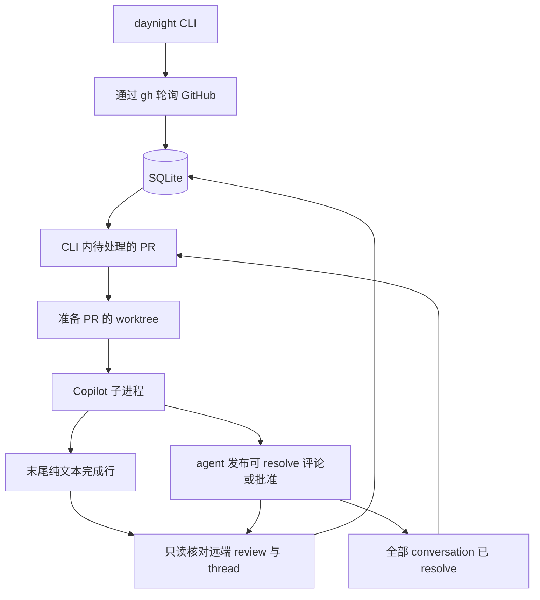

# Daynight review 架构设计

状态：review 已接入配置、SQLite、GitHub 观测、Git 管理、Copilot 会话、内置 skill
和前台协调，并通过原生 review conversation 管理后续轮次。
受控执行链与真实服务的证据分别保存。验证命令与 receipt 解释见
[仓库验证说明](../../README.md#validation)，逐次运行结果随对应 PR 与 CI 保存。

`review` 是 `daynight` 客户端中的完整命令模块。`review run` 在单个前台 Node.js
进程内持续轮询和管理审查，`review add-repo` 管理配置，`review list` 与 `review ls`
读取本地状态。客户端安装、顶层分发和自更新见[客户端架构](daynight.md)；
[review 需求](../spec/daynight-review.md)定义业务行为，
[前台审查决策](../../.agents/notes/archived/architecture/2026-10-16-foreground-review-cli.md)
保留执行模型的选择依据。

## 使用方式与配置

```text
daynight review add-repo https://github.com/OWNER/REPO.git
daynight review add-repo git@github.com:OWNER/OTHER.git --path ./review-other
daynight review run
daynight review list
daynight review ls
```

共享配置路径由 `config/paths.ts` 构造，review 运行路径在其基础上组合；命令固定
使用当前用户主目录下的 `~/.daynight/config.yml`。`~` 由程序
解析为操作系统当前用户的主目录，再使用平台路径操作构造文件位置，不依赖调用者的工作目录或 shell
的路径展开。Windows 同样使用当前用户主目录下的 `.daynight` 目录。

`review add-repo` 只处理配置：读取现有文件或创建初始文档，解析远程身份和目标路径，校验完整
结果，再保存 YAML。它不接入运行时，不获取 review 实例锁，也不进行 clone、认证检查、
GitHub 查询、SQLite 初始化、PR 边界选择或运行中配置重载。成功输出说明配置已保存，
下次启动生效。review 模式加载配置、打开 SQLite、确保配置中的仓库已克隆到本地，
然后持续轮询 GitHub，并以普通子进程调用 Copilot。有效的运行或列表调用在缺少
文件、`review` 节点或 `review.repositories` 字段时，先通过[客户端配置引导](daynight.md#按需配置引导)登记仓库；
保存后才继续原操作，且不要求服务地址。非交互环境给出 `daynight review add-repo <remote>` 指引。YAML
语法或结构错误、已有 review 字段无效或读取失败时，显示配置路径及具体原因并
退出。按下 Ctrl+C 后，停止轮询和启动
新审查，停止活跃子进程，记录未完成工作并退出。

`~/.daynight/config.yml` 的配置示例如下：

```yaml
review:
  repositoryRoot: ~/daynights
  pollIntervalMs: 60000
  maxConcurrentWorker: 1
  agentTimeoutMs: 1800000
  maxAttempts: 3
  retryDelayMs: 30000
  copilotModel: auto
  copilotReasoningEffort: high
  repositories:
    - remote: https://github.com/OWNER/REPO.git
      path: /home/alice/daynights/github.com/owner/repo
```

数值字段省略时使用上述默认值；显式传入的不合理值报错。使用 YAML 1.2 解析器读取
数据，共享 `config/document.ts` 拒绝语法问题、重复键和未知顶层字段，根节点仅接受
`serverUrl`、`serverToken`、`workerId`、`worker` 和 `review`。review 投影再校验
`review` mapping、其字段清单及字段值；server 和 worker 投影不校验 `review` 内部值。
旧顶层 review 字段明确拒绝；已有配置须将全部 review 设置移入 `review` 并删除原条目，
不自动迁移。节点归属的决策见[review 配置分区](../../.agents/notes/implemented/architecture/2026-10-27-review-configuration-section.md)。
同一文件的 `serverUrl` 由独立 server 投影拥有；review 保留它且不校验其值。
所有 review 数值必须是正的安全整数；毫秒计时字段还必须不超过
`2147483647`。运行和列表的 `repositories` 必须是非空列表，每项只接受 `remote`
和 `path`，两者均必填。自动引导仅处理文件、`review` 节点或 `review.repositories`
字段缺失；显式空列表和非 mapping 的 `review` 节点仍报错。添加命令及交互引导允许
已有文件缺少 `review` 或 `review.repositories`，校验现有 review 设置后建立首个完整
列表；显式传入无效 review 值仍须拒绝。

`copilotModel` 和 `copilotReasoningEffort` 是两个独立的可选 `review` 内字符串。
示例中的 `auto` 和 `high` 均不是默认值。两者都复用 `nonEmptyString` 校验，拒绝
非字符串、null、空串、纯空白和 NUL，保留合法字符串原值，不维护静态枚举。
模型名称、账户可用性、推理强度等级及模型兼容性由 Copilot 判断；显式 `auto` 交由
Copilot 自动选择模型。两个字段均可省略，或只设置一项，或同时设置；省略项不增加
对应 flag，继续使用 Copilot 自身的选择。运行时在启动读取的全局配置中固定这两个
值，适用于全部仓库，文件修改在下次启动生效。共享 YAML 键清单识别 `review`，server
投影仍只校验自己的字段；交互引导和仓库登记通过既有文档节点写入机制保留字段与注释。
验证、默认语义和参数归属由
[模型选项决策](../../.agents/notes/implemented/feature/2026-10-22-review-copilot-model.md)记录。

`review.repositoryRoot` 默认是 `~/daynights`，仅属于添加命令的路径选择。根目录接受本机
绝对路径、配置目录相对路径，以及 `~` 或 `~/...` 形式的当前用户主目录展开；不支持
其他用户的波浪号形式。省略 `--path` 时，命令在根目录下按规范化的 host/owner/name
生成仓库目录，组件使用确定性的文件系统安全编码，以容纳端口及 Windows 保留名称。
生成结果立即作为绝对 `path` 保存；修改根目录只影响后续添加。显式 `--path` 按调用者
的当前工作目录解析并保存绝对路径。运行时不根据 `repositoryRoot` 推导仓库位置。

手写的仓库 `path` 接受本机绝对路径或相对于配置目录的路径，不展开波浪号；Windows
盘符相对路径也会报错。既有路径组成部分必须是目录；尚未创建的克隆目录允许缺失。
数据库和会话等状态目录固定为 `~/.daynight/`。配置解析校验正整数限制、仓库身份的
唯一性，以及克隆路径与状态路径互不重叠。

配置解析先检查路径的字面结构；review 启动加载及添加时，通过既有目录的设备号和
inode 识别实际位置及祖先关系，处理符号链接和挂载边界。如果两个缺失路径的既有祖先和后续组成部分
数量相同，则在该祖先中临时创建一个唯一的探测目录，在其中逐级建立一个候选路径，再
查询另一个候选写法是否指向同一目录。判断依据是实际目录身份，不依赖操作系统、小写
转换或 Unicode 归一化推断，因此可以处理大小写规则和 Unicode 编码别名。仅配置一个
仓库或既有祖先不同的路径无需探测；需要探测时，目录权限、建立、查询或清理失败均使
配置校验明确报错。探测不创建真实克隆目录或审查状态；只按倒序非递归删除此次建立的
目录，清理失败会保留现场并报告所有相关错误。

同一规范化仓库的重复添加若省略 `--path`，直接复用保存的路径，不重新应用根目录；
显式指定同一实际路径时同样不重写配置，指定不同路径则报错。
添加命令修改 YAML 文档节点以保留已有设置和注释；`config/files.ts` 统一负责配置
读取、独立写锁和保留权限的原子替换。`config.yml.lock` 是独立于
`instance.lock` 的配置写锁，覆盖读取、校验和替换全过程；占用时立即明确报错。
异常退出后必须确认没有配置写入者，再人工移除该锁。现有配置必须是普通文件；
修改时拒绝符号链接及其他文件类型。保存先在同目录写入唯一临时文件，再以 rename
替换配置，保留既有文件的权限模式。校验或替换前的失败保留原文件，并清理本次拥有的
临时资源。该写锁协调配置命令，不取代人工编辑器的文件管理。
`commands/review/configuration-guide.ts` 拥有首次交互引导，复用同一登记逻辑和保存协议：
先收集输入，再持锁重新读取并核对 `review.repositoryRoot` 与 `review.repositories`，
合并服务、worker 及其他 review 选项的并发修改后保存。写入定位 `review` 内的文档节点，
保留已有 YAML 注释和标量别名语义。

将 HTTPS 或 SSH GitHub 远程地址解析为 host/owner/name。地址写法变化或程序重启都
不得让同一仓库再次初始化。已有克隆与配置不匹配时拒绝使用，不得覆盖；保留其工作
文件和分支。HTTPS 地址保留非默认端口；SSH 端口只属于 Git 传输，不作为 API 端口。
配置解析得到的 `coordinate` 是规范化的 host/owner/name，稳定仓库 ID 由后续 review
启动的 GitHub API 查询确定。[仓库添加决策](../../.agents/notes/archived/feature/2026-10-18-add-repo-configuration.md)
记录配置职责和路径固定的选择。

源码开发使用 pnpm、TypeScript ESM 和 Node.js 24 LTS，持久化使用 `better-sqlite3`，
依赖版本固定。发布的 CLI 运行于 Node.js 22 及以上版本，包与运行时依赖的 engine
要求遵循[客户端设计](daynight.md#构建安装与交付)。
review 模式需要预先安装 Git、`gh` 和 Copilot CLI，`gh` 认证提前准备好。Copilot 还需要
受支持的凭据和可访问的模型。配置文件不包含凭据。

## 本地审查状态列表

`review list` 与 `review ls` 分派到同一列表操作。完成必要的仓库配置引导后，
列表读取当前 `config.yml`，使用
`parseConfiguration` 完成 YAML、字段、仓库身份及路径字面关系校验；它不调用会建立
文件系统探测目录的运行时配置加载流程，也不要求本地克隆已存在。配置读取或解析
失败保留具体原因并以非零状态退出。

`readReviewListingSnapshot` 以 `readonly` 和 `fileMustExist` 打开已有数据库，在一个
短的 deferred 事务内检查表结构版本并读取仓库、Open PR 和相关审查记录。读取路径
接受表结构版本 1 或 2，不调用运行时开库、迁移、恢复或日志写入。版本 1 读取
按原有记录语义返回，新字段仅由运行时显式迁移建立。数据库缺失时返回
空快照且不创建文件。缺失判断逐级检查父路径，直到最近既有祖先，并要求该祖先
解析为目录；中间父目录同样缺失可以表示未初始化。非目录祖先、悬空的祖先符号链接、
权限错误或文件系统根查询失败均报错，不能归为未初始化。已有空文件、损坏或版本
不匹配也均报错。读事务保留仓库、PR 和审查状态之间的一致性，允许 daemon 继续提交。
连接使用有上限的 busy timeout，读取和关闭错误均可见。SQLite 读取已有 WAL 数据库时可能创建或更新 WAL/SHM 协调伴随
文件；只读连接的保证是没有应用状态写入，不是状态目录的逐字节不变。

列表将配置与已存仓库远程地址都规范化为 host/owner/name，再用持久化的 host 和
GitHub ID 关联 PR 与审查记录。同一配置身份若对应多个已存 GitHub ID，命令明确
报错，避免猜测初始化边界。只显示当前配置的仓库，保持配置顺序；仅列出编号大于
永久跟踪边界的 Open PR，并按编号排序。已完成或失败的审查仍可属于 Open PR。
关闭 PR 和已移除配置的历史不显示。

输出首先声明本地持久化快照及 `Running` 的记录含义，每个仓库显示 `Last observed`
的最近成功完整轮询时间，无时间时为 `never`；`Last poll error` 单独显示已保存的
轮询错误。时间戳不证明最近一次轮询成功或进程仍存活。未登记或未初始化的仓库显示
`Not initialized.`。没有已保存的跟踪范围内 Open PR 时显示 `No tracked ongoing PRs.`。

表格列为 `PR`、`PR STATE`、`REVIEW`、`ATTEMPTS`。Draft 的行状态为 `Paused`，
已有当前审查时另行显示其保存状态。非 Draft 当前审查映射为 `Preparing`、`Running`、
`Retry waiting`、`Completed`、`Failed` 或 `Interrupted`；没有当前审查或记录已被
取代时为 `Pending`。审查按 desired revision、head SHA 和 base ref 同时匹配当前
目标，base SHA 不参与匹配，以保持仅 base tip 变化不触发审查的规则。

最新目标没有匹配审查而旧版本仍活跃时，当前行显示 `Pending (previous revision
<state>)`，尝试次数为 `-`；旧版本的修订序号、保存状态和 `attempts: count/max`
独立显示。当前审查的尝试次数、重试时间和错误只属于当前目标；旧版本的重试时间和
错误带 `Previous revision` 前缀。错误文本中的终端控制字符被转义，防止破坏表格或
产生终端控制效果。整个命令不启动 daemon、Git、gh 或 Copilot，不获取实例锁、
不做认证或网络请求，也不恢复中断状态。
[列表决策](../../.agents/notes/archived/feature/2026-10-18-review-status-listing.md)
记录状态归属和本地快照范围的选择。

`cleanup_pending` 独立于审查状态，重新打开的 PR 也可能保留此屏障。行详情显示
`Worktree cleanup: Pending` 及已保存的清理错误；没有当前审查的非 Draft PR 显示
`Pending (cleanup blocked)`，Draft 仍显示 `Paused`。旧活跃审查的独立详情继续显示，
已经匹配当前目标的审查状态与待清理资源分别呈现。列表只报告屏障，不执行资源清理、
进程排除或恢复。

## 单进程与普通模块



轮询与审查调度是在同一个 Node.js 进程内运行的异步任务。轮询器不等待整轮审查结束
才再次轮询。内存中的映射在每项 worktree 操作的第一个异步步骤之前预留该 PR；准备、
子进程执行和清理共用这个预留，避免轮询为同一个 worktree 启动另一项操作。
SQLite 在程序退出后保留审查进度。`maxConcurrentWorker` 控制不同 PR 之间并行执行
的审查准备与执行数量；这里的 Worker 是 CLI 进程内的一项审查工作。清理使用同一
PR 预留，但不占审查 Worker 容量。待处理期间的多次更新合并处理，FIFO 待审队列
保留已等待 PR 的位置；已执行 PR 的新修订排到其他等待工作之后。每轮调度显式让出
一次事件循环，避免持续到期的快速轮询只在微任务间循环，阻塞定时器和子进程 I/O。

同一 PR 只运行一个 daemon 管理的主审查会话。该主 agent 按内置 skill 在同次 attempt
内委派多个独立角度，不为 subagents 新建 Worker、PR 会话、worktree 或尝试预算；
不同 PR 的容量控制与同一 PR 的操作预留保持原有含义。

| review 模块文件（相对于 `src/commands/review/`） | 职责 |
|---|---|
| `command.ts` | review 组与操作参数、帮助、操作分发和各操作依赖的按需加载 |
| `config.ts` | YAML 解析、字段及仓库路径校验、配置加载 |
| `paths.ts` | review 用户主目录、保留状态路径和仓库路径关系 |
| `repositories.ts` | 添加时的路径生成、幂等判断、配置写锁与原子替换 |
| `listing.ts` | 当前配置加载、持久化快照归属和状态列表格式化 |
| `model.ts` | 仓库、PR、审查目标、尝试、会话、worktree 和安全恢复证明等领域类型 |
| `polling.ts` | 单次或批量仓库观测的编排、仓库登记、原子提交和轮询失败记录 |
| `store.ts` | SQLite 表结构、观测结果、审查进度、重试状态和只读列表快照 |
| `coordinator.ts` | 轮询调度、PR 操作预留、并发容量、重试和清理调度 |
| `instance-lock.ts` | 实例锁持有者校验、存活探测与并发接管 |
| `runtime.ts` | review 模块组装、实例持有关系、信号与有序关闭 |
| `skill.ts` 与 `skills/daynight-review/` | 发布资源校验、内容寻址快照、发现结果校验，以及内置审查方法 |
| `processes.ts` | 本次执行的进程组或 Windows 进程树停止与执行证据 |
| `publication.ts` | 稳定审查发布身份和完整远端结果的匹配规则 |
| `adapters/github.ts` | 通过 `gh` 读取仓库、PR、分页、当前 CI、review 和 conversation 完整状态，不登记本地状态 |
| `adapters/worktrees.ts` | 克隆校验、fetch、PR worktree 准备与清理 |
| `adapters/copilot.ts` | 提示词、会话选择、子进程执行和完成检查 |

review 的领域类型由 `model.ts` 持有，业务模块和适配器不通过 SQLite 实现取得类型。
终止与资源排除证明仍保留原有的字面量类型约束；移动类型不放宽恢复前置条件。
`polling.ts` 组合 GitHub 的只读结果与 store，适配器本身不接收数据库。客户端外壳、
命令登记和通用平台能力的归属见[客户端架构](daynight.md#源码组织)。

使用普通函数和具体类型。需要在验证中控制外部命令和时间时，将其作为依赖传入。
所有进程调用均使用参数数组，配置内容和分支名不得插入 shell 代码。使用能识别平台
差异的命令库处理 Windows CLI 命令包装脚本。

## 本地数据与 SQLite

配置、数据库、会话文件、实例锁、日志、缓存和临时文件放在当前用户的
`~/.daynight/` 下：

```text
~/.daynight/
  config.yml
  config.yml.lock             # 仅配置写入期间持有
  state.sqlite
  instance.lock
  instance.lock.sqlite        # 实例锁操作的持久化串行化数据库
  copilot/                    # CLI 配置和保留的会话
  cache/review-skills/<digest>/ # plugin.json 与 skills/daynight-review/ 不可变快照
  tmp/
  logs/<review-id>/<attempt>-<unique>/  # 发现与审查的 stdout、stderr 和 CLI 诊断
```

PR worktree 位于各受监控仓库根目录的 `.worktrees/` 下，布局见下文的生命周期说明。
会话数据和日志放在可清理的 worktree 之外。将 Copilot 的状态、缓存、日志和临时目录
都设在这个状态目录下。SQLite 的 WAL、SHM 等伴随文件也保留在该目录。启动目录变化
不会改变数据库、会话或实例锁的位置。凭据使用已准备好的 `gh` 认证环境。带端口的
API 请求为兼容 `gh` 的主机名校验，会在受控内存中读取已有主机凭据，再仅通过当前
子进程的环境变量传递。令牌不得写入 SQLite、配置、命令参数、公开异常或日志。
配置与状态位置的选择记录在
[用户主目录配置决策](../../.agents/notes/archived/architecture/2026-10-16-user-home-review-configuration.md)。

状态表按仓库观测、审查执行和远端发布分别保存：

| 表 | 键 | 保存的状态 |
|---|---|---|
| `repositories` | 主机 + 稳定的 GitHub 仓库 ID | 远程地址、本地路径、可为空的 `start_pr_no`、初始化时间、最近成功轮询及错误 |
| `pull_requests` | 仓库 ID + PR 编号 | 观测到的 open/draft/head/base branch、待审及已完成修订序号、会话 UUID 及已建立标记、worktree 路径、清理状态 |
| `reviews` | 审查 UUID | PR 身份、不可变的修订序号/head/base branch、固定的 base SHA、状态、尝试次数、重试时间、子进程身份、日志路径、最近错误 |
| `review_publications` | 审查 UUID | `prepared`、`pending`、`verified` 或 `legacy` 阶段，`identity_format`（`line`/`legacy`），固定发布者，`approved`/`commented` 结果，远端 review/thread 身份及 follow-up 已消费标记 |

修订序号是本地递增的数字，用于表示观测到的审查触发事件。即使 head SHA 未变化，
它也能避免丢失 Draft 转 ready、修改目标分支或上一轮反馈解决的触发事件。
待审修订序号与已完成修订
序号分开保存。一轮正在执行的审查只持有启动时捕获的修订序号；完成它不得同时将更新
的待审修订标记为完成。审查状态为 `preparing`、`running`、`retry_wait`、`completed`、
`failed`、`interrupted` 或 `superseded`。活跃审查的唯一索引覆盖 `preparing`、
`running`、`retry_wait` 和 `interrupted` 状态的记录，配合每个 PR 的操作预留，
保证一个 PR 同时只有一轮当前审查。不要为这些由程序内部管理的记录添加外键。

相关状态变更使用短事务。事务不得跨越 Git、API 或 agent 调用。启用 WAL、
`synchronous=FULL`，并设置有上限的 busy timeout；数据库保存在本地文件系统。
运行时通过显式表结构迁移从版本 1 升到版本 2，增加发布记录，保留原表中的永久
边界、修订、尝试预算、会话、worktree、日志和进程证据。旧的 completed 记录以
`phase=legacy` 保存；`preparing`、`running`、`retry_wait` 和 `interrupted` 记录以
`phase=prepared` 保存，两者均显式记录 `identity_format=legacy`，发布者保持未知，
直至远端证据确定实际 actor。新建轮次使用 `identity_format=line`。只读列表不迁移，
迁移和查询失败均暴露。参见
[SQLite 事务](https://www.sqlite.org/lang_transaction.html)和
[同步设置](https://www.sqlite.org/pragma.html#pragma_synchronous)。

状态模块以同步函数维护这些记录，时间、UUID 和已经验证的外部结果由调用者传入。
`start_pr_no` 从 NULL 写入整数的操作只允许成功一次；零表示成功完成的空扫描，不表示
需要重新初始化。已完成审查只推进它捕获的修订；最终失败的修订不能通过新建审查 ID
重新获得尝试预算。新轮次启动前保存当前认证 viewer 的 node ID，发布记录以
`prepared` 固定本轮发布者；迁移轮次先按历史远端证据取得其实际 actor。
账户变化不能让该轮改用另一发布者。完成标记接受且正式审查进程排除后转为
`pending`。远端核对失败只重新查询，
不重新调用 Copilot，也不消耗 agent 尝试；该状态跨重启保留。核对成功后，在同一事务
中记录远端结果并推进捕获修订。`approved` 对当前目标停止调度；复用该保存结果结束
新待审轮次前，必须在新鲜快照中核对同一 remote review ID 仍为 `APPROVED`，actor、
head 和稳定身份均相符。历史 dismissed review 不能充当批准。`commented` 保存
实际 review/thread 身份，并且只在一次完整快照确认所有 conversation 已解决后消费
一次 follow-up。已有较新目标时合并该信号，避免产生重复轮次。

会话 UUID 在启动前保存，已建立标记只向前推进。worktree 登记、
待清理标记和清理错误也保留在数据库中，但不能替代 Git 身份或会话文件检查。
`cleanup_pending` 是独立于 PR 开关状态的资源屏障，观测到重新打开不会清除标记或错误。
`listCleanupCandidates` 包含已重新打开的待清理 PR；只在调用者确认清理操作已停止并
排除相关 agent、工具后，才能通过 `cancelCleanup` 撤销其清理意图。该操作仅清除
待清理标记和错误，保留 worktree 路径及会话。

运行时开库只执行迁移和连接设置，不自动恢复审查；列表使用独立的只读快照入口。
`preparing` 状态可能仍有 Git 操作，
`running` 或 `interrupted` 可能仍有子进程；不能只根据状态或 PID 推断它们已经停止。
取代准备工作或解除中断前，由协调模块明确确认相应操作已结束。数据库保存这项确认
带来的状态变化，本身不证明外部进程已经停止。状态实现决策见
[持久化审查状态](../../.agents/notes/archived/architecture/2026-10-17-durable-review-state.md)。

## 轮询与工作选择

1. 对尚未初始化的仓库，枚举所有状态、所有分页中的 PR，计算最大编号，在一次成功的
   数据库提交中保存 `Start PR No`。成功空扫描保存零，失败保持未初始化；扫描期间
   创建的 PR 可能落在永久边界内。
2. 后续轮询枚举边界以上的 Open PR，包括 Draft。完整扫描后，对未出现的已跟踪 PR
   单独读取并确认关闭。不完整响应不能作为关闭证据。首次发现、head SHA、目标分支名、
   Draft 转 ready 和 closed 转 open 的观测推进待审修订。Draft 期间保存变化但不执行。
3. 新轮次候选必须 Open、非 Draft、有未完成轮次、没有最终失败抑制或活跃/不确定操作，
   且当前目标尚未获得已核对的 Daynight approval。独立异步查询当前 CI 及完整 review
   snapshot：只有 CI 通过且所有作者都没有未解决的原生 review thread 才能取得工作
   预留。outdated thread 仍阻塞。等待不创建审查、会话或 worktree，不占 Worker 或
   尝试；队首等待不阻挡其他就绪 PR。资格只对匹配的修订、head 和目标分支有效，按
   轮询间隔刷新；错误遵守限流期限，重启重新查询。
4. 成功 `COMMENT` 留下一次性反馈屏障。完整 snapshot 确认所有 conversation resolve
   后，原子消费该屏障并推进一轮；已有更新目标则合并到最新待审轮次。无需先观察
   open 数量，作者在 agent 完成前就 resolve 仍能唤醒。原生 review 正文和普通 issue
   comment 没有 resolution 状态，不参与反馈屏障。resolve 只是再验证信号，不能代表
   修复已经正确。
5. 第一个 await 之前同步预留 PR，执行 Git 前持久化 `preparing`。准备 worktree 后、
   启动新审查前重新校验目标、CI 和 conversation，再核对数据库目标及取消状态。资格
   回退时释放容量并保留会话和预算。只有资格通过才持久化固定目标和 `running`，
   然后启动 Copilot。预留涵盖整个执行和进程排除，清理必须等待它释放。
6. 同一轮发布确认不属于新轮次。绕过 conversation gate 必须有捕获 actor、head 和
   稳定身份匹配的实际 `APPROVED`、带自身 thread 的 `COMMENTED`，或同一 actor 可
   恢复的有效 `PENDING` 草稿。失败 attempt 次数不能替代这些证据：无发布且存在
   其他未解决 conversation 时继续等待，不消费模型预算。已接受 marker 的远端查询
   失败保存为只读待核对工作，无需模型重启。确认完成后再按新轮次资格决定后续工作。

head SHA 与目标分支名标识代码目标，固定 base SHA 保持该轮 diff 和 CI 上下文。
仅 base tip 变化、仅标题/description 编辑和 CI 重跑不生成新轮次。当前目标已经
approval 时保持完成，不撤销批准；新 head 或目标分支变化仍需审查。不得将最大 PR
编号或 `updated_at` 用作永久轮询游标。仓库扫描失败保存错误，不重置边界或停止其他
仓库；同一 PR 的多次变化与反馈信号合并，完成旧轮次不能覆盖较新待审目标。

CI 资格通过只读 GraphQL 查询取得。检查 head 和可用的 `potentialMergeCommit` 的
`statusCheckRollup`，覆盖 check runs 与旧式 statuses；同时分页读取 check suites，防止
需要批准或尚无 jobs 的 workflow 被成功汇总遗漏。按 workflow 身份、事件和运行序号
选择最新运行及尝试，已替代的历史失败不阻塞。无法证明替代关系的 suite 保守保留其
阻塞作用。所有已报告 CI 完成且为 `success`、`skipped` 或 `neutral` 才放行；确实没有
检查时直接放行。分页固定目标、suite 总数及唯一身份并校验完整覆盖；可见的集合变化、错误、未知状态或
不完整数据都不能授权启动。

conversation 和发布对账使用 `getPullRequestReviewSnapshot` 取得完整远端快照，
分别分页读取全部 review、review thread 及 thread 中用于证明归属的评论。集合身份、
计数、游标和必需字段必须一致，API 错误或不完整集合不能证明未解决数量为零。
只有正向确认 parent review 为 `PENDING` 的未发布草稿 thread 才从已提交 conversation
中排除，避免要求作者处理不可见草稿；归属未知的 thread 仍保留其阻塞作用。
新轮次启动前捕获的发布者 node ID 与 review 的 author node ID 精确匹配；
当前 viewer 改变不能覆盖已保存的发布者。新读取账户可核对原 actor 的已提交结果；
没有结果或只有 pending 草稿时等待原 actor 恢复，不启动模型或消费尝试。新轮次的
稳定身份必须是 review 正文中的完整独立行或 HTML 注释，commit 必须是捕获 head。
只有显式迁移为 `identity_format=legacy` 的轮次可以按有边界的旧 token 识别带前缀
的历史正文；写入前先取得该 token/head 对应的实际历史 actor，不能假定当前 viewer
就是原发布者。该来源标记贯穿 actor 捕获和待核对阶段，所有新写入仍使用严格身份。
多个候选按明确
规则核对，不能用不相符或较旧结果覆盖有效的 approval。`COMMENTED` 只有具备真实、
归属于该发布的原生 thread 才是成功反馈；它们即使已经 resolve 仍是有效发布证据。

CI 只是启动条件，不递增待审修订。已完成审查不会因 CI 重跑而再次启动；已开始的
agent 也不因后续新登记的 CI 自动取消。没有检查时直接放行意味着后续才登记的 workflow
可能在审查启动后出现。CI、snapshot 请求与其他受管操作共同响应关闭，并等待已发出
请求结束。资格与完成核对规则的选择见
[conversation 轮次决策](../../.agents/notes/archived/architecture/2026-10-21-review-conversation-cycle.md)。

`adapters/github.ts` 提供只读查询，`polling.ts` 编排一次仓库观测，不启动定时器。
通过参数数组调用 `gh api --include`
逐页执行显式 GET，先读取完整 HTTP 状态和响应头。成功响应必须是有效 JSON；失败
响应先按状态和响应头处理限流，正文可以是 HTML 或空内容，JSON 错误信息仅为可选
元数据。非零 HTTP 退出保留响应信息；超时、取消、输出溢出或格式错误则使本次扫描
失败。`Link` 先校验 HTTPS API 来源、
所属仓库路径、查询条件和页码，再转换为受控请求。支持仓库名路径和 GitHub 返回的
数字 ID 路径；关系参数按允许的空白和引号语法读取，格式错误不能当作分页结束。
初始化只需要各 PR 编号，已永久排除的 PR 不要求解析无关的 head 或 Draft 元数据。

同一轮分页中重复出现的 PR 以最后读到的状态合并，每个 PR 只应用一次观测。收齐所有
页面和缺失 PR 的直接确认后，`polling.ts` 调用 store 的 `applyRepositoryPoll`，
在一个短事务中提交初始化边界或
整批观测，以及最近成功轮询时间。任一请求、确认或数据库写入失败均保留上次完整状态，
另行记录错误；不得将部分结果提交成成功扫描。

限流错误携带 HTTP 状态和可重试的绝对时间。等待时间同时考虑 `Retry-After` 的秒数或
HTTP 日期，以及主限额重置时间，取最晚约束。客户端在内存中按主机保留截止时间，
到期前不再执行该主机的 API 请求，因此同一批次中的其他仓库也不能绕过限流；其他
主机可继续。模块不自行休眠或重试，由协调模块复用客户端并安排下一次观测。
机制与凭据处理的依据见
[完整 GitHub 观测决策](../../.agents/notes/archived/architecture/2026-10-17-github-observation.md)。

轮询只能观测快照。两次轮询之间完整发生的 ready/Draft 往返，或修改目标分支后又改回，
可能被遗漏。完整扫描和重复轮询能最终观测到持续存在的状态，不保证完整的事件历史。
资料来源：
[列出 PR](https://docs.github.com/en/rest/pulls/pulls#list-pull-requests)、
[分页](https://docs.github.com/en/rest/using-the-rest-api/using-pagination-in-the-rest-api)和
[API 最佳实践](https://docs.github.com/en/rest/using-the-rest-api/best-practices-for-using-the-rest-api)。

## Worktree 生命周期

Git 模块先校验配置中的本地位置。缺失时通过 HTTPS 正常克隆，并显式选择 `origin`；
SSH 配置地址仍用于仓库身份识别，实际传输复用准备好的 `gh` 认证。已有仓库通过
local origin 的唯一原始 URL 和稳定 GitHub ID 校验，保留其 origin 配置、文件和分支。
模块不改全局 Git 或认证配置。带端口 HTTPS 传输复用受控凭据环境；SSH 端口不作为
API 或 HTTPS 端口。

克隆和首次 Git 检查均使用已验证的物理路径，保留配置别名的身份核对。目录名按所在
平台 Git 的规则处理，合法的前导和内部空格得到保留。POSIX 支持的尾空格名称可以正常
准备；Windows Git 保护规则拒绝的名称明确报错，并保留既有父目录和其他数据，不放宽
这些原生保护来使克隆通过。

PR worktree 放在实际仓库根目录下：

```text
<repository>/
  .worktrees/
    pr-<number>/
```

本地克隆及其 PR worktree 是系统独占的审查环境。daemon 只操作自己登记的固定 PR
路径，各 PR 的工作目录相互独立。Git 的 `locked daynight:<sessionId>` 标记将持久化
会话与实际登记关联；同一 PR 清理后重新打开时，仍用原会话 UUID。此机制记录在
[worktree 所有权决策](../../.agents/notes/archived/architecture/2026-10-17-owned-review-worktrees.md)，
环境边界的选择依据记录在[专用审查环境决策](../../.agents/notes/archived/architecture/2026-10-17-exclusive-review-environment.md)。

操作前必须确认配置路径是精确 Git 根目录，并比较物理目录身份。对 PR leaf 同时校验
精确 top-level、common directory、固定路径、会话锁标记和数据库登记；不能只比较
common directory，因为缺失的 `.git` 会让 Git 向上发现主仓库。leaf 的普通 `.git` 文件还
必须指向所属 linked Git admin，且该 admin 位于预期 common 的 worktree 登记目录下。
实际 admin、会话锁标记和 `gitdir` 回指必须对应同一 leaf；相对元数据路径按 Git 规定
的目录解析。强制 checkout/clean 显式绑定已校验的 git-dir 与 work-tree，避免可变的
`.git` 指针切换到主仓库或 sibling 的 HEAD/index。容器和 leaf 的符号链接、
未登记的既有目录，以及不匹配的锁均明确拒绝。

在基础仓库中通过显式 HTTPS URL 取得 PR head，包括 fork PR，而非读取 fork 分支：

```text
git fetch --atomic --refmap= --no-tags --no-write-fetch-head \
  --no-auto-maintenance --no-recurse-submodules HTTPS_URL \
  +refs/pull/N/head:refs/daynight/incoming/REVIEW_ID/head \
  +refs/heads/BASE:refs/daynight/incoming/REVIEW_ID/base
```

空 refmap 和显式 URL 避免命名 origin fetch 顺带更新共享的 remote-tracking refs；
FETCH_HEAD、共享分支和 tags 保持不变。需要时补全浅克隆历史。将获取到的 head 与
捕获目标及当前 PR 元数据核对，目标已变化则交回协调模块处理；仅 base tip 变化不产生
新的审查触发。为审查 UUID 固定 head、base 和 merge-base 私有 refs，再保存 base SHA，
使后续 fetch、force push 或相同目标重试不能替换该轮上下文。

受控 Git 命令显式禁止 replacement objects，并使用所属临时目录中的独立空 graft 文件。
这样，本地 `refs/replace` 或默认 `info/grafts` 不会在 SHA 不变时替换文件树或父关系，
这些本地元数据本身保持不变。准备结果中的非敏感 `gitEnvironment` 将相同原始对象视图
提供给后续 agent runner；空 hooks/template 目录与 graft 文件分开，且在 runner 生命周期
内保持有效。

所有 Git 调用按命令禁用 hooks、fsmonitor 和不需要的子模块递归，克隆模板为空目录；
fetch 还显式禁止递归子模块，以覆盖更具体的用户 fetch 配置。继承的仓库选择器和调试
环境只对子进程清除，避免 `git -C` 被重定向或认证信息进入输出；保留 HTTPS CA 等
传输信任设置及全局配置位置，避免破坏已准备好的企业环境。

首次创建前先排除路径冲突，再保存数据库意图并建立带锁的 detached worktree。中断
后，完全缺失的 leaf 和登记可重试；匹配的带锁登记可校验复用；不明资源不得接管。
新的修订先 detach，再清理 daemon 拥有的内容，避免附着分支时改写共享分支。
清理会检查当前和目标 gitlinks，避免新引入的子模块目录残留旧文件；仅清空所属工作
目录，保留共享管理数据、refs、配置及基础工作区中的子模块文件。PR leaf 及其所属
admin 内的嵌套 clone、生成文件和管理数据都属于可丢弃的审查内容。相同捕获目标的
确认或重试保留原工作树和本地上下文。

primary 的 sparse checkout 和 sparse index 不限制 PR 的完整代码视图。首次 add 使用
命令级完整检出设置；未启动审查的已有 leaf 在所有权和当前目标校验后，仅重建
自己的 index，再物化完整目标、detach 和清理。普通 checkout 或 read-tree reset
不足以清除旧 skip-worktree 位，因此需要先清空所属 index。primary 的共享及每工作区
配置、patterns、index、refs 和文件不改变；已启动后的同目标确认重试保留原 context。
非敏感 `gitEnvironment` 携带完整视图设置，runner 先清除继承的 Git 仓库/配置选择器，
再应用这些受控配置和原始对象设置。

更新或删除已校验的 PR 工作区时，使用标准 Git checkout、clean 和 worktree remove
命令清除所属内容。系统不维护嵌套 Git 仓库的依赖图，也不保护其他用途对这些可丢弃
管理数据的引用。固定路径、登记和进程排除校验仍是操作前提。

关闭或合并后先记录待清理状态，停止准备和执行，并获取同一个 PR 操作预留。删除前
再次确认远程关闭状态及数据库中无活跃审查。重新打开会取消删除资格，但不能清除
仍在执行或结果不确定的清理操作。清理流程必须等待自己已启动的命令确切结束，并取得
agent 排除证明后，才能对已重新打开的 PR 调用 `cancelCleanup`，保留其路径及会话，
再允许调度；已删除的 worktree 可在后续准备中重建。
只移除匹配所有权标记的具体 Git 登记，不做全局 prune。Git 删除成功后才完成数据库
清理；会话、审查历史和私有快照 refs 保留。清理失败继续待处理，即使此时 PR 已重新
打开，也保留待清理标记及错误。命令失败可能已经产生副作用，取消或进程结果不确定时
保留资源并报错，不能据此声明已经安全停止。

从配置移除仓库不构成删除已有克隆或 worktree 的授权。资料来源：
[本地检出 PR](https://docs.github.com/en/pull-requests/collaborating-with-pull-requests/reviewing-changes-in-pull-requests/checking-out-pull-requests-locally)、
[Git worktree](https://git-scm.com/docs/git-worktree)和
[Git fetch](https://git-scm.com/docs/git-fetch)。

## Copilot 会话与结果发布

review 运行时取得实例锁后，从稳定入口传入的安装目录捕获完整内置
`daynight-review` skill，准备内容寻址的不可变缓存快照。同次运行固定使用这份内容，
历史快照保留，以容纳已有会话与无法确认已停止的执行。资源无效阻止 daemon 启动；
配置和 SQLite 格式保持一致。打包、哈希、原子发布及加载流程由
[skill 设计](daynight-review-skill.md)统一定义。

在每个 PR 首次审查前生成并保存一个 UUID。每次尝试先在相同 worktree 和子环境下
调用 `copilot -C WORKTREE --plugin-dir=SNAPSHOT --no-auto-update skill list --json`，
要求发现的唯一已启用 `daynight-review` 实际目录等于本次快照的
`skills/daynight-review/`。两个阶段都使用单个 `--plugin-dir` 参数传入快照根，
子环境清除继承的 `COPILOT_SKILLS_DIRS`；同名覆盖或无效发现结果使尝试失败。
这能保留包含逗号的完整路径。确认发现进程已经排除后，
才直接调用正式审查：

```text
copilot -C WORKTREE --plugin-dir=SNAPSHOT --session-id UUID \
  -s --output-format text --stream on --no-color \
  --no-ask-user --no-auto-update --allow-all-tools --log-dir ATTEMPT_LOG_DIR
```

adapter 的同一正式审查 argv 构造路径独立处理两个启动配置字段：存在
`copilotModel` 时添加 `--model` 和原始值，存在 `copilotReasoningEffort` 时添加
`--reasoning-effort` 和原始值，各 flag 与值都是独立参数。新会话、
`--resume=FULL_UUID`、重试和后续修订均使用这一路径，skill discovery 不接收任一
覆盖参数。两个字段不保存到 SQLite 或会话状态，不改变 PR 会话 UUID、修订、
重试预算和进程监督。模型或强度不支持、账户不可用或组合不兼容时，Copilot 的退出
结果、输出及既有错误流程继续暴露失败。官方
[模型参数文档](https://github.com/github/docs/blob/5815d11586b0796688963a98c889680e60d72dc4/content/copilot/reference/copilot-cli-reference/cli-command-reference.md#L710)
定义模型覆盖和 `auto`，
[推理强度参数文档](https://github.com/github/docs/blob/5815d11586b0796688963a98c889680e60d72dc4/content/copilot/reference/copilot-cli-reference/cli-command-reference.md#L694)
定义强度覆盖及别名；
[程序调用参考](https://github.com/github/docs/blob/5815d11586b0796688963a98c889680e60d72dc4/content/copilot/reference/copilot-cli-reference/cli-programmatic-reference.md#L178)
说明仅部分模型支持推理强度。可用等级与兼容性归 Copilot 所有。

提示词通过 stdin 传入并关闭输入。Copilot 将管道输入作为非交互模式处理；不同时提供
`-p`，避免提示词进入 Windows 命令行并受长度和转义限制。使用 `cross-spawn` 解析
PATH、PATHEXT 和 Windows 命令包装脚本，调用方传递独立参数并保持 `shell: false`。
`COPILOT_HOME`、`COPILOT_CACHE_HOME` 及临时目录环境变量指向保留状态目录中的
对应位置。保留 HOME、GH_CONFIG_DIR、PATH 和已有认证环境；Copilot 可按其认证
优先级自动使用已登录的 `gh`，daemon 不复制 token 到提示词或日志。

agent 子进程继承准备结果中的原始 Git 对象环境，同时清除继承的 Git 仓库选择器，
避免其自行执行的 diff/log 命令采用另一仓库或本地的 replacement/graft 视图。

后续审查或确认调用使用 `--resume=FULL_UUID`。不得选择全局最近的会话。保留已经建立
的会话历史；历史缺失时报告该 PR 的错误，不得静默创建另一段对话。首次创建会话期间
发生崩溃时，必须先检查这个确切的 UUID 是否实际建立，再选择创建或恢复。不读取会话
JSONL。Copilot 的上下文压缩由其自身处理。

提示词显式调用 `/daynight-review`，提供当前快照的绝对 `SKILL.md` 路径和 digest，
要求恢复会话也加载本次内容，并显式要求执行该 skill 的原生 subagent 委派与汇总；
确认合法匹配的已提交结果保留只对账的例外。skill 负责审查方法、多角度委派与汇总、
证据标准和 PR 质量判断。提示词
提供仓库与 PR、审查 ID 与修订序号、确切的 head、目标分支、固定的差异上下文、
上一轮未完成审查的身份、代码缺陷严重程度规则和完成标记。必填的
`CopilotRunOptions.publicationIdentityFormat` 仅控制迁移轮次的历史结果读取，新的发布
仍使用严格身份，skill 内容不承担旧格式兼容。提示词要求 agent 读取当前
PR 标题、description 及其链接的相关范围需求。agent 以原定问题、预期结果和范围
检查完整捕获 diff，再选择至少两个与实际修改、约束和风险互补的角度，实际调用独立
subagents，宜并行执行。每个委派显式传递固定 head/base/merge-base、PR 范围、适用
仓库指示、证据与只读资源规则，返回候选引入问题、位置、覆盖、限制和处置建议。
主 agent 等待所有必要角度，独立验证、处理分歧并按根因去重，区分修复、延后及
不成立，在 attempt 输出汇总角度依据、覆盖、限制、处置及确认阻断项，再由自己使用
`gh` 发布。subagents 不修改源码或 Git 状态，不管理 worktree、不发布或修改远端 review
和 thread，也不输出完成标记。完整委派和资源规则归属[skill 设计](daynight-review-skill.md#多角度审查与汇总)，
选择依据见[多角度审查决策](../../.agents/notes/implemented/process/2026-10-22-pr-specific-review-perspectives.md)。

批准条件包括独立的 description 与范围两项质量门槛，以及没有 Critical/Major 代码
问题。一个 PR 必须解决一个明确问题且能够有效审查；扩大 description 不能单独为
无关改动提供依据。必要实现、结构调整、测试和文档按同一结果的联系判断范围，不按
行数或文件数拒绝跨模块的必要修改。具体规则由[review 需求 R10](../spec/daynight-review.md#r10-审查判断与结果发布)
持有，决策依据见[PR 质量门槛决策](../../.agents/notes/archived/process/2026-10-21-review-pr-quality-gates.md)。

agent 首先按稳定审查身份、捕获 commit 和本轮固定发布者核对既有结果。匹配的
`APPROVED` 直接确认，description 后续变化不能撤销它；已有 `COMMENTED` 必须证明
归属该 review 的实际 thread。这类真实提交结果才允许在 conversation 尚未解决时
恢复确认；同一固定发布者的有效匹配 pending 草稿也可继续发布。没有结果的失败
重试仍须等待其他 open conversation。发布途中已有
pending review 或 thread 时继续完成它，不能重复创建同一反馈。自己的过时 pending
草稿可以清理，以免遗留未提交内容；已提交 approval 不撤销。
确认已有合法匹配的已提交结果不重新进行多角度审查。新审查的工具不可用、必要
subagent 失败或覆盖未完成属于操作失败，可在当前预算内重试或重新委派；无法完成
时不发布 review 或完成标记，不能据此批准或伪造 finding。

新发布前立即读取标题和 description，结合需求重新评估质量门槛，并确认 PR Open、
非 Draft、head 和目标分支未变，没有尚未解决的 conversation。通过两项门槛且没有
Critical/Major 代码问题才 `APPROVE`；有真实阻断问题则 `COMMENT` 并留下至少一条
原生可 resolve 的 review thread。越界修改和代码问题评论在适合的相关 diff 行。
description 和其他 PR 级问题使用主要修改文件的文件级 thread，明确说明它是 PR 级
问题；review 正文或普通 PR comment 不能代替该反馈。评论使用英文并表明 agent 身份，
不使用 `REQUEST_CHANGES`，也不得为满足发布协议制造问题。

每个发布显式绑定捕获 `commit_id`，review 正文包含由 `publication.ts` 构造的稳定
审查身份。文件级反馈先创建带稳定正文和 commit 的 pending review，再调用 GraphQL
`addPullRequestReviewThread`，提供该 review 的 node ID、`subjectType: FILE`、真实
修改路径和反馈正文，最后提交 `COMMENT`。REST batch review comments 不提供文件级
subject 参数，不能伪造行号来代替；重试继续已有 pending review/thread。daemon 仍不
提交 review 或判断 finding 内容，只核对实际远端发布及会话轮次需要的结果。

GitHub 无法原子断言发布期间 head 始终不变，作者也不能批准自己的 PR；无法真实
完成发布必须暴露为操作失败。marker 是进程完成声明，远端 review/thread 才是发布
证据；两者都不构成 GitHub 与 SQLite 的跨系统事务。资料来源：
[Copilot 非交互调用](https://docs.github.com/en/copilot/how-tos/copilot-cli/automate-copilot-cli/run-cli-programmatically)、
[GitHub CLI 认证回退](https://docs.github.com/en/copilot/how-tos/copilot-cli/set-up-copilot-cli/authenticate-copilot-cli#authenticating-with-github-cli)、
[Copilot 命令行参数](https://docs.github.com/en/copilot/reference/copilot-cli-reference/cli-command-reference)、
[会话存储](https://docs.github.com/en/copilot/reference/copilot-cli-reference/cli-config-dir-reference)、
[创建 review](https://docs.github.com/en/rest/pulls/reviews#create-a-review-for-a-pull-request)、
[review thread mutation](https://docs.github.com/en/graphql/reference/mutations#addpullrequestreviewthread)和
[审查权限](https://docs.github.com/en/pull-requests/collaborating-with-pull-requests/reviewing-changes-in-pull-requests/reviewing-proposed-changes-in-a-pull-request)。

## 完成、重试与退出

每次尝试创建带唯一后缀的日志目录，启动意图保存后才拉起进程；启动前取消也不会占用
下一次尝试的日志路径。一次持久化尝试顺序包含 skill 发现和正式审查，预算只消费
一次，并共用整体 `agentTimeoutMs` 截止时间。发现日志分别写入
`skill-list.stdout.log` 与 `skill-list.stderr.log`，完整 JSON 另有大小上限；正式
审查分别流式写入 `stdout.log` 与 `stderr.log`。只有后者参与完成标记解析。

发现进程关闭并完成捕获后，进程监督器必须先返回已排除证明，store 才能在 running
尝试中按精确 PID 和进程身份清空当前登记，保留尝试预算和其他状态。随后重新检查
取消、整体截止时间和发现结果，才可登记正式审查进程。同一尝试始终只登记一个子
进程。排除失败时保留不确定性、PID 和实例锁，不继续启动；阶段间取消也不再启动
审查。发现不创建或检查 PR 会话历史，正式审查沿用既有会话与退出协议。

正式审查增量解码 UTF-8，
统一 CRLF。stdout 末行缓冲区默认最多保存 8192 个 UTF-16 码元，超长末行不能匹配
完成标记；完整日志通过流写入磁盘，不累计在内存中。等待子进程 close 且输出全部读取完毕，
要求进程正常退出且退出码为零，并且 stdout 最后一条非空行精确匹配：

```text
PR 123 Review Completed
```

预期 PR 编号来自本轮捕获的审查。拒绝子串匹配、额外格式、stderr 中的标记、标记后的
非空内容、捕获失败和非零退出。退出状态用于检查进程通信是否正常，不是结构化的问题
输出协议。完成检查只比较原始 stdout 的末行，不解释此前输出的 Markdown 结构。
命令找不到时单独记录启动失败：Windows 包装进程可能有 PID，却没有启动 agent。
只有匹配所请求命令的结构化 spawn ENOENT 加上包装进程关闭，才能使用此明确失败结论；
不能把普通输出捕获错误当作未启动。启动意图已提交时，失败仍消耗本次尝试预算。

精确完成标记与进程排除都成立后，先保存待核对发布状态，再查询远端结果。核对
成功后，原子记录 `approved` 或带 review/thread ID 的 `commented`，推进捕获修订。
查询错误、限流或不完整结果保留待核对状态和错误，按退避只读重试；重启继续该核对，
不运行 Copilot、不重新消费模型尝试，即使 marker 来自最后一次模型尝试也一样。
完整查询成功却没有匹配的合法结果属于协议失败，清除待核对阶段并回到既有有限模型
重试；最后一次尝试仍无合法结果则失败并抑制该修订。

目标未变化且缺少 marker 的审查沿用 `retry_wait` 和同一会话。恢复优先核对远端影响，
避免重复发布；匹配 approval 保持有效，匹配 COMMENT 必须有真实 thread。只有
这样的提交结果或同一固定 actor 可继续的有效匹配 pending 草稿，才允许绕过
conversation gate；失败 attempt 本身不提供例外。账户 B 可核对 actor A 已提交的
结果，缺少结果或只有草稿时等待 A，保留预算。执行或发布失败
最多尝试三次，从 `retryDelayMs` 开始指数退避，上限十分钟；耗尽记录 `failed` 和
原因，普通轮询与重启不能通过换审查 ID 重置预算。不能用虚构 finding 掩盖工具、
权限或发布失败。

尝试次数在提交启动 agent 的意图时原子递增，并在实际启动子进程前保存。提交后即使
启动失败或进程中断，该次预算也已消耗。仅进行 Git 准备不消耗 agent 尝试次数；准备
失败的重试调度由协调模块负责。重试保留审查 ID、捕获目标、预算与最近一次启动的
进程和日志引用，历史日志继续保留在该审查各次尝试的目录中。

更新的修订取代等待中的过时工作。旧子进程结束后，在同一会话中审查最新目标，提供
上一轮未完成审查的身份，并要求核对其已有影响。不得仅为获得旧完成标记而发布对过时
代码的审查。完成已捕获的修订后，更新的待审修订仍保持待处理。

PR 转为 Draft 或关闭时，停止活跃审查，并保留尚未确定的结果，直到可以安全重试或
清理。Ctrl+C 停止调度和轮询，终止当前执行并等待操作结束，记录未完成执行，再关闭
SQLite。review agent 遵守前台执行契约：返回前结束自己启动的工具和服务，正常退出及
完整关闭的 stdio 作为该契约的执行证据。此证据不等同于操作系统对任意后台后代的隔离证明。

Linux/macOS 为直接子进程建立独立进程组，同时保留引用、pipes 和 await，不调用 unref。
停止时向本次执行的进程组发送 TERM，超过宽限期再发 KILL。探测返回 EPERM 时仍检查
目标 PGID 的已有状态；仅无匹配执行成员或全部为 zombie 时确认不再执行。有执行成员时
保留原权限错误，状态读取或解析失败也保留不确定状态。Windows 在根进程仍存活时使用 `taskkill /PID ... /T /F` 停止普通进程树，避免
先杀包装脚本而丢失树根。正常、未被强制的退出及排空的 stdio 按前台契约处理。

取消时根已消失、进程终止失败、输出被强制放弃或其他执行证据不确定时，阻止该 PR
复用和清理，并保留实例锁及状态供人工确认。系统只操作本次运行实时持有的进程，
不根据持久化 PID 杀旧进程，也不重建已消失的任意进程树。Windows 包装脚本、后代进程
和信号差异在各平台使用受控执行文件验证。

每个状态目录只能由一个 daemon 实例持有。`instance.lock` 保存 `owner`、`pid` 和
`startedAt`。读取既有锁时严格校验元数据，其中 PID 必须是正整数且不超过
`2147483647`，再用 `process.kill(pid, 0)` 检查该 CLI 是否存在。探测成功表示仍存活；
只有 `ESRCH` 允许接管失效锁。`EPERM`、其他错误或无效元数据均保留锁并明确拒绝
启动。PID 已被其他进程复用时也保守拒绝，交由人工检查。`startedAt` 和文件时间只供
诊断，不能证明进程死亡；不使用保存的 PID 终止进程。

独立的 `instance.lock.sqlite` 通过短时间、同步的 SQLite `BEGIN IMMEDIATE` 事务，
串行化锁读取、存活检查、创建或替换和释放。失效锁的替换先完整写入临时文件，再在
事务内原子 rename 覆盖既有锁；并发启动不能删除另一个实例刚取得的锁。释放同样在
事务内重新核对持有者，仅删除自己的锁。进程崩溃由操作系统释放 SQLite 事务锁；
串行化数据库保留在原位置，运行期间不得 unlink，否则不同实例可能锁住不同文件。

自动接管只证明旧 CLI 不存在，不能证明旧 agent 或工具已结束。因此以失效锁接管
启动时，锁结果为 `previousProcessesExcluded: false`，进程监督模块不获得旧执行已
排除的证明。协调器将保存的
`preparing`、`running` 和 `interrupted` 审查标为中断并阻塞对应 PR。启动时发现
`cleanup_pending` 且无法确认旧执行已排除，则在第一次轮询前阻塞该 PR 的复用和
清理。无论 PR 当前是否重新打开，都保留清理标记及错误；轮询可以记录新的观测，
但不能清除该屏障。它只在操作已结束并排除旧 agent、工具后解除，使重新打开期间
再次崩溃的启动仍能发现未确定性。诊断要求人工确认旧执行已停止；受影响的会话和
worktree 保留。同一仓库中的其他 PR 和其他仓库继续轮询和执行。只要旧执行仍未
确认排除，有序关闭也保留实例锁。

异常退出时没有未确定审查或待清理资源，自动接管即可继续运行，无需人工删除锁。
存在这些资源时，运维人员先停止当前 daemon，确认上一 CLI 及其所有 agent、工具均
已停止，再只删除 `instance.lock` 并重新启动，保留 `instance.lock.sqlite`、状态、会话
及日志。不存在实例锁的启动沿用明确确认旧执行已排除的恢复契约，将保存的
`preparing` 或 `running` 记录经 `interrupted` 转入针对原捕获目标的重试或确认，
绝不直接标记完成。更新目标可在同一会话中取代它们。不接管仍在运行的 agent，也不
重建任意进程树。锁恢复选择见
[失效实例锁决策](../../.agents/notes/archived/bug-fix/2026-10-18-stale-instance-lock-recovery.md)。
Node 文档说明了相关的
[子进程限制](https://nodejs.org/api/child_process.html#subprocesskillsignal)。
进程证据的依据还包括 [Node 进程组](https://nodejs.org/api/child_process.html#optionsdetached)、
[POSIX 信号与 zombie 语义](https://pubs.opengroup.org/onlinepubs/9799919799/functions/kill.html)
和 [Windows taskkill](https://learn.microsoft.com/en-us/windows-server/administration/windows-commands/taskkill)。

## 错误与可观测性

记录可读事件，包含仓库、PR 编号、修订序号、审查 ID、尝试次数和阶段。在轮询定时器、
命令回调、重试定时器和清理操作之间显式传递这些上下文。报告命令退出或超时、原因、
下次重试时间及受影响的资源。仓库级操作携带仓库身份。日志和控制台输出不得包含凭据。
限制输出捕获容量，并在记录本次结果之前保留活跃尝试的证据。

例如，`OWNER/REPO PR 123 review=UUID` 的控制台事件应显示工作选择、子进程启动、
末行接受或重试以及清理。运维人员可通过同一个标识筛选事件来调查一轮审查。启动时
输出初始化边界和未完成状态信息。错误必须可见，并影响相应的 PR 或仓库；配置无效
或数据库启动失败时停止 CLI。不得让无人观测的游离 Promise 隐藏任务失败。

## 验证与交付

应用工具链提供 `pnpm typecheck`、`pnpm test`、`pnpm build` 和独立的 `pnpm acceptance`。
CI 要求源码、包元数据、构建或依赖输入发生变化时升级包版本；具体范围和本地检查命令见
[README](../../README.md#package-versions)。版本检查只在 PR 的 Linux CLI 任务中运行，
使用事件中的 base 与 head 提交；任务失败使最终 `checks` 汇总失败。main push 保留全量
应用检查。包构建及命令间依赖隔离由[客户端设计](daynight.md)定义。

review 测试覆盖组与操作参数、帮助、编译后的入口、仓库添加、审查列表、严格配置解析
和路径校验；GitHub Actions 在 Linux、macOS 和 Windows 上运行这些检查。SQLite 测试使用真实磁盘数据库，验证迁移、事务回滚、
连接锁冲突、重开后的边界与预算、修订转换、会话和 worktree 登记。列表验证缺失或无效
数据库、当前配置过滤、已记录状态与进程存活的区别、最新目标与旧活跃审查的独立归属，
以及真实 WAL 上并行读事务的一致性。GitHub 测试使用
受控 API 和子进程验证完整分页、失败保留、限流、关闭确认和观测事务回滚。真实 Git
fixtures 验证克隆、私有 refs、detached head、dirty 内容、所有权、浅克隆、子模块及
其他 PR 工作区保留。Copilot 测试使用受控可执行文件和真实 SQLite，验证会话选择、
启动意图、stdin 提示词、模型与推理强度在新建/恢复/重试/修订中的独立参数传递、
均省略/仅模型/仅强度/同时设置四种组合、skill 发现不接收两种覆盖、精确路径选择、分流日志、两阶段的预算/截止时间/
取消/进程排除、完成标记及异常输出，不调用真实模型或发布 review。质量门槛的提示词
断言覆盖优先恢复既有发布、保留 approval、新发布前重评当前标题和 description、
`COMMENT` 必须有原生 thread，以及两项门槛通过且没有 Critical/Major 才能批准。
初次读取 PR 信息、相关需求、检查完整 diff、按内容独立委派及汇总的指令由加载的
skill 提供；提示词断言不证明模型对这些指令的实际执行。多角度执行证据需要观察
实际原生委派、固定目标输入、返回结果及主 agent 汇总，打包或文字匹配检查不能替代。
skill 资源验证覆盖完整 bundle、内容哈希、原子缓存和已有快照损坏；安装验收验证
实际发布资源存在。
执行边界的选择依据记录在[Copilot 会话执行决策](../../.agents/notes/archived/architecture/2026-10-17-copilot-session-execution.md)。
协调器测试使用真实 SQLite、受控观测和失败注入，验证公平调度、并发容量、永久边界、
预算抑制、取消、清理及恢复。conversation 用例覆盖任意作者与 outdated thread 的
阻塞、相同 SHA resolve 后一次后续轮次、完成前 resolve、合并新目标、重复轮询与
重启不重复消费、过往 dismissed approval 不抑制新待审轮次、无发布失败遇到他人
open thread 时等待，以及 actor 切换后已提交结果的核对与草稿等待。marker 后发布
查询失败单独验证只读恢复。公平调度案例通过注入
时钟及显式控制 CI 响应、执行结束
来建立先后关系：先确认新修订已持久化，再让两个等待 PR 的 CI 就绪，逐次释放 Worker，
验证两个等待 PR 均先于持续更新 PR 的后续修订，且就绪候选保持 FIFO。时钟在准入比较
期间固定，机器负载不会使其中一个候选的 CI 证据先过期；选择依据记录在
[公平调度验证决策](../../.agents/notes/archived/testing/2026-10-19-deterministic-coordinator-fairness.md)。
集成案例组合真实本地 Git、Copilot 受控进程和生产进程监督模块。编译后 CLI 测试验证
实例锁、状态创建、信号退出和资源释放，无需真实远程认证。调度器内部失败也会取消
仍在等待的轮询，再等待所有已启动操作结束。
[协调决策](../../.agents/notes/archived/architecture/2026-10-17-foreground-review-coordination.md)
记录这些责任和异常恢复前提。
显式 `pnpm test:apfs` 在 macOS 挂载临时的大小写敏感和不敏感 APFS 镜像，
日常 `pnpm test` 和 CLI CI 不选择该镜像专项；其余路径与清理测试继续运行。
专项验证缺失路径的大小写冲突、
Unicode 编码别名、状态目录别名及探测目录清理。fixture 创建单分区 GPT 镜像，固定
其 `realpath`，保存 `attach -plist` 返回的 GPT 根设备，并在断言前从同用户镜像清单
正向确认精确路径和根设备，才授予清理所有权。`plutil` 只定向提取带类型要求的身份
字段。每次 detach 前校验当前所有权；观测区分 `mounted`、`unmounted_attached` 和
`absent`。挂载路径消失不能证明完整镜像已脱离，未经正向验证的 attach 失败也不能
仅凭清单缺失删除目录。只有已验证所有权下的精确镜像缺失才允许删除。

一个 30 秒绝对清理预算覆盖所有串行查询、诊断、等待及最多三次普通 detach。明确的
`Resource busy` 后，把剩余时间分给后续尝试和最终观测窗口；快速失败时，尝试通常
位于约 0、10、20 秒，第三次之后继续观测而不增加调用。首次 Busy 立即采集卷级
`lsof`，随后刷新精确镜像状态，再对当前所属根设备、子设备及 raw 别名查询一次有界
诊断；该顺序避免清单查询先消耗已知持有者的六秒生命周期。每项诊断保持两秒上限。
受控的已知持有者案例向 fixture 提供经过就绪确认的自有子进程 PID，卷级查询使用
`-p` 与 `-a`，要求 PID 和挂载文件系统同时匹配，避免为这个定向断言扫描所有进程。
未提供已知 PID 时保留通用卷级查询，设备与 raw 别名查询也保持原有范围。该选择
限制采样对象，不保证目标进程能在期限内完成检查；超时和命令状态继续暴露。
保存状态转换及原始错误，
身份、清单查询、无关命令错误或期限内持续附着均使测试失败并保留现场。

八项原生文件系统断言的函数体保持不变。大小写敏感组最后增加一个同用户子进程只读
持有普通文件的真实案例，cwd 位于主机仓库；必须观测实际 Busy、卷级 `lsof` 中的已知
PID、Busy 后至少六秒的释放确认、最多三次普通 detach、完整镜像缺失和子进程退出。
案例记录 monotonic 调用时间及最终状态，与 `afterAll` 共享包含失败的一次性清理
Promise，防止重复获得清理预算。120 秒 setup、40 秒 teardown、600 秒平台限制均
保持不变；新增案例为 40 秒，其 finalizer 仍为 30 秒。
[设备归属决策](../../.agents/notes/archived/bug-fix/2026-10-20-apfs-device-ownership.md)和
[观测窗口决策](../../.agents/notes/archived/bug-fix/2026-10-20-apfs-finalization-window.md)
记录所有权与期限机制；
[受控持有者观测决策](../../.agents/notes/archived/bug-fix/2026-10-21-apfs-controlled-holder-observation.md)
记录 PID 与文件系统同时选择的依据。真实普通文件案例必须由 macOS 原生 CI 证明
两秒内捕获实际 PID，不能由模拟命令参数测试替代；它不用于识别历史持有者或证明
原生部分卸载阶段。

独立的 `pnpm acceptance` 先打包，再在临时 consumer 中正常安装，驱动实际生成的
`daynight` bin。真实 SQLite 和本地 Git 配合受控的原生 gh 执行文件及 Copilot 命令
包装脚本，验证配置登记、根目录变更后保留既有路径、本地审查列表，以及完整的审查、
重试、重启和关闭清理流程；模型和推理强度从 YAML 经运行时到新建/恢复进程 argv
的传递，以及 skill 发现不接收任一覆盖，由安装后的原生受控 Copilot 记录验证，
测试不替换产品内部依赖。该证据证明参数传递与会话编排，不发起真实模型请求，
不证明模型能力、强度支持或账户可用性。
该审查生命周期安装步骤需要包注册表访问，使用本地 consumer，也不需要真实 review 凭据。
客户端的[自更新验收](daynight.md#验证与交付)独立验证真实 npm 全局安装的替换与归属。
CI 只上传精选的工具版本清单、审查生命周期 receipt 和 `.tmp/update-evidence.json`。
异常退出验收在直接工具句柄全部关闭后同步结束 CLI，检查锁保留、存活实例拒绝和自动接管失效锁；进程树终止保留独立的原生验证。
[仓库验证说明](../../README.md#validation)定义原生平台 receipt 的源码身份与真实服务验收边界。

独立的既有数据 fixture 直接构造重构前的 YAML 与版本 1 SQLite 表和记录，不使用
当前 store 创建基线。安装后的列表必须只读旧状态，运行时显式迁移并复用永久边界、
修订、预算、会话、日志、进程和 worktree 身份，保留清理屏障。迁移 fixture 分别
验证完成记录的 `legacy` 阶段与活跃未完成记录的 `prepared` 阶段，二者均保留明确的
旧身份格式及未知 publisher。带前缀旧正文中的有效 APPROVED 和带实际 thread 的
COMMENT 在丢失 marker 后，按旧 token/head 找到实际 actor，再保留该身份完成对账；
新轮次仍拒绝旧格式。匹配 approval 保持完成；缺少有效 approval 的相关已完成记录
可消费一次采用轮次，包括只有正文而无 thread 的历史 COMMENT。不能伪造历史 actor
或 thread，也不能反复重置预算；无关历史不启动模型。

下表定义模块、原生子进程和安装后验收需要观测的行为；实际通过记录及其对应修订
随对应 PR 与 CI 保存。历史平台 receipt 不构成自动接管失效锁行为的验证：

| 范围 | 必须观测的行为 |
|---|---|
| 轮询 | 初始化覆盖所有分页和 PR 状态；永久边界；扫描失败不得关闭 PR 或将仓库视为空仓库 |
| 触发条件 | head、目标分支名、ready 状态变化与已完成 COMMENT 的反馈解决触发；同 SHA 允许一次后续轮次；仅 base SHA 或元数据变化不触发；已批准目标保持完成；Draft 不得启动；旧审查完成后保留较新待审修订 |
| Worktree | 所属仓库根目录的 `.worktrees/`、固定 PR 路径、其他 worktree 保留、fork PR 引用、确切的 detached head、脏文件残留、正确的仓库与路径校验、关闭和重新打开时的清理 |
| agent 输出 | 分块 Unicode 与 CRLF、精确末行、错误 PR 编号、stderr 中的标记、带前后缀或闭合代码围栏的标记、标记后的内容、捕获失败、非零退出 |
| 会话与重试 | 固定 UUID 后显式恢复、首次启动中断、历史缺失报错、优先核对既有发布避免重复、只有真实同轮发布或原 actor 可继续的匹配草稿才绕过 conversation gate、actor 变化后确认提交结果或等待原 actor、持久化尝试预算、marker 后远端核对只读重试且可重启 |
| 审查指令 | 读取当前标题、description 及相关范围需求；检查完整捕获 diff；description 与范围独立阻断批准；发布或确认前重评；只在门槛通过且没有 Critical/Major 时批准 |
| 审查列表 | `review list` 与 `review ls` 等价、配置仓库顺序和 PR 编号排序、Draft 与仍 Open 的完成或失败记录、永久边界过滤、最新修订和旧活跃审查分别归属、重试及错误、待清理屏障与清理错误、最后完整观测时间、缺失状态不创建数据库、无效数据库报错、运行中只读一致快照 |
| CLI 生命周期 | 审查期间继续轮询；准备、执行和清理的操作预留；抑制失败修订；`maxConcurrentWorker` 并发上限；Ctrl+C；拒绝第二个实例；异常退出后的失效锁自动接管；锁状态含糊时拒绝；中断审查及待清理资源阻塞与诊断 |
| 配置与目录 | 固定的 `~/.daynight/config.yml`、严格 YAML、独立可选 `copilotModel`/`copilotReasoningEffort` 的非空字符串原值、四种设置组合、无效值及投影隔离、交互引导/仓库登记保留字段与注释、启动时固定模型选项、缺少文件或仓库字段时按需引导及恢复、非交互 `review add-repo` 指引、无效已有 review 值及共享文档错误报错、添加时创建配置和保留注释、全局根目录仅在添加时生成固定绝对路径、显式路径按当前目录解析、重复添加幂等及冲突、配置写锁和失败保留、不同启动目录复用状态、手写相对路径按配置目录解析、按实际文件系统规则检查重复与重叠路径、探测目录清理和失败报告；用注入的主目录解析结果隔离测试文件 |
| 平台 | `daynight review run`、各平台用户主目录和路径分隔符、含空格或 Unicode 的路径、Windows CLI 命令包装脚本、每个受支持系统上的子进程终止和最终输出 |

需要在获得授权的测试仓库中实际运行 Copilot 与 GitHub，才能证明真实的会话续接、
行级评论和批准行为。受控的完整执行链验证编排、打包及文本/会话协议；真实模型判断、
认证权限和远程发布效果仍需独立的实际运行证据。

YAML 字段、状态路径和持久化身份继续沿用；发布和反馈轮次通过显式 SQLite 迁移记录，
不按命令分区。Webhook、分布式执行、UI 和其他 agent 提供方属于独立功能。
进程监督服务会改变执行模型，超出本 CLI 设计的
范围。单进程模型明确要求运维人员介入处理状态含糊的异常退出，不承诺透明恢复仍在
运行的子进程。
