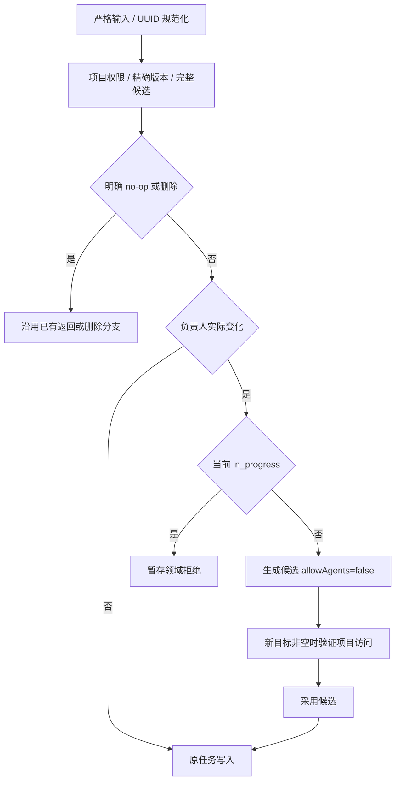

# Task 负责人设计

状态：原生负责人列及事务、读取生产者、任务筛选、项目内人员读取、CLI 负责人命令、Web 负责人写入/展示/筛选和 独立持久资料缓存，以及本人自动领取规则已实现。[需求](../spec/daynight-task-assignment.md)拥有行为，取舍由[基础决策](../../.agents/notes/archived/architecture/2026-11-03-task-assignment-foundation.md)拥有。

## 数据所有权

`model.Task`、`store.TaskWrite` 和 HTTP Task/summary/graph DTO 使用可空 `AssignedTo`。数据库列为 `tasks.assigned_to uuid NULL`；响应的 assignedTo 不使用 omitempty。它是普通 Task 元数据，properties 的静态定义与独立行模型保持原有职责。

迁移 `028_task_assignment.sql` 增加列及 `(project_id, assigned_to, created_at, id) WHERE deleted_at IS NULL` 索引。既有行包括软删除行取得 NULL，其他任务事实与历史迁移 checksum 不变；不添加外键或历史身份推断。`063_task_assignment_all_index.sql` 保留该部分索引，并增加相同列顺序的完整索引，供通过 `task_resource_rows` 按负责人读取或解析的查询选择。完整索引包含软删除和父 Goal 已删除的行，查询仍通过 `effective_deleted_at IS NULL` 过滤可见性。索引增加存储和写入维护；迁移在事务中构建索引，期间阻塞相关写入，构建时间随数据规模变化。

## 输入与完整候选

create 的可选 string 指针表达默认未分配和显式目标。PATCH 使用字段存在性与可空值区分省略、null 清空、UUID 设置，server/service 的至少一个字段检查包含外层存在性。HTTP 拒绝错误类型和未知字段，service 在构造与比较候选前规范化非 null UUID。

中性任务写入模块拥有 currentTaskWrite。普通 metadata 候选、状态、worker 和属性操作从同一完整当前值构造，复制 AssignedTo 并 clone properties；修改候选不改变当前快照。PATCH changed 比较包含负责人值相等性，不比较指针地址。

## 共用规则与错误

Tasks.write 在明确 no-op/删除路径之后，只对真正 create/update 的完整候选执行负责人策略。等值状态和 worker 摘要可能没有候选 values，不能把零值解释成清空负责人。

`core/task` 判断负责人是否实际变化，先检查执行状态，再生成强制关闭许可的完整候选；service 在同一项目写事务中通过 ProjectAccess 验证非空新目标后才采用候选。同一 SQL 写 assigned_to、allow_agents、版本与更新时间；独立授权记录或用户资料不拥有目标资格。赋值相同则保留其他合法修改，历史目标即使失权也不阻止无关操作。状态不变使既有 SQL 计时 CASE 保留原区间。

策略拒绝和候选准备拒绝使用同一错误分类。目标 ProjectAccess 不存在明确转为 invalid_input，避免被外层误译为项目不存在；Fault 暂存，在事务正常完成后返回。事务提交、回滚、取消或存储失败优先于暂存拒绝并保留错误链。

## 一致读取与执行边界

完整 Task、task-sync 和图各自的 projection/scanner/assembler 直接读取 assigned_to::text；字段、版本、依赖和属性属于同一既有读取快照。summary 与图携带轻量 UUID，不嵌入可变用户资料。

锁序保持项目→父任务→属性→Session。成员变更共享项目锁；自动领取在同一写事务内要求当前 AssignedTo 非空且等于 principal.UserID，领取结果绑定该认证调用者。负责人变化不重写 worker 或 Session/archive 身份；completed 记录和原 Session/archive 历史继续保留，新的负责人不因此获得旧执行的控制权。[本人领取决策](../../.agents/notes/archived/architecture/2026-11-03-worker-self-assigned-claims.md)拥有领取资格与原执行授权分离的取舍。

## 原生任务筛选与游标

HTTP 单值 assignedTo 输入在 service 边界转换为显式 all/unassigned/user 选择，零值是 all。me 先解析为 principal.UserID，user 选择仅携带规范 UUID；选择本身可比较并参与游标范围，不为被查询的人增加成员资格要求。

Snapshot.Tasks 按规范选择使用静态 SQL 片段：all 不增加条件，unassigned 使用 assigned_to IS NULL，user 使用绑定的 UUID 等值。输入值只作参数，不拼接 SQL。条件在 ORDER/LIMIT 之前；worker inventory 分支同样先应用显式原生条件，再执行既有 worker 解码、归属匹配和最终 limit+1。worker 自动候选选择 me，在游标核验前解析为固定认证账号的 userId；完整既有 worker 库存省略负责人条件，继续为 all。

page.go 仅为 kind=tasks 编码和要求 cursor version 3，并保存必需的规范选择 all/unassigned/user:UUID，以及 type 和 parent 筛选。项目列表使用独立 kind 与版本 2，绑定主体和项目列表范围；账号级 Worker 列表使用版本 1。二者均不编码任务选择字段；workerId 筛选的 Task 页仍是 tasks version 3。任务旧版本拒绝，而 me 与对应 UUID 在规范 scope 相同时可续页。项目、状态、ready、许可、平台、workerUser/workerId 和位置仍绑定原 scope。

## 项目内人员读取

Tasks 服务和 taskHandler 复用既有项目读取组合，专用 core/API 条目恰含 userId、version、nullable name、nullable avatarUrl 与 hasProjectAccess；响应始终有 items 和 unresolvedUserIds 两个非 null 数组。资料保持 canonical users 的实际 nullable 值，不合成姓名或邮件。

HTTP 以局部 query 解析只允许重复 userId，不放宽共用 queryValues 的单值规则。省略参数是完整目录；明确的限定模式先校验非空、最多 100 个互异规范 UUID。service 同样验证直接调用，避免空数组被当作完整模式。两个模式均在一次 ReadSnapshot 内先 RequireProjectRead，再读资格和资料。

store/postgres/internal/project_access.go 拥有单主体准入和批量查询共用的 ProjectAccessRelation；当前关系合并 owner Team 成员与 direct grant，为每个 project/user 返回最大有效角色及原始用户 ID。负责人目录、限定解析和 hasProjectAccess 复用该关系，不另写 direct 资格 SQL；用户资料由各自读取路径单独投影。

### 完整目录

从 ProjectAccessRelation 的原始 user_id 与当前项目有效可见任务的 DISTINCT assigned_to 做 UNION，再 LEFT JOIN users，并读取原始候选 ID 与 nullable users.id。这样仍有原始关联但用户行缺失时可以报告完整性错误，不会被 INNER JOIN 静默删去。访问关系存在性给出 hasProjectAccess；失权但仍被任务引用的人保留为 false，仅被自身或父 Goal 已删除的任务引用时不保留资格。结果按 UUID 排序，unresolvedUserIds 为空。

### 限定解析

从最多 100 项的 unnest(requested UUID array) 出发，将项目和请求用户 ID 限定到 ProjectAccessRelation，并以项目内 assigned_to 索引的 LATERAL LIMIT 1 探测保留资格，再按资格 LEFT JOIN users。两种来源分别按 Team member 与 grant 的原生主键探测。限定模式不先枚举全项目负责人，工作集合只来自请求 ID；未请求的坏用户引用不影响本次解析。

| 资格与资料 | 组装结果 |
|---|---|
| 无项目访问与当前保留任务资格 | unresolved；不暴露全局 users 是否存在 |
| 有资格且 users 行存在 | 最小资料，保留 nullable name/avatarUrl，明确访问状态 |
| 有原始资格但 users 行缺失 | 内部完整性错误，整个读取失败 |

Go 组装仍验证规范 ID、互斥和完整覆盖：items 与 unresolved 恰好覆盖规范请求一次，各自稳定排序。query/scan/rows/取消或事务失败不安装部分集合。错误不借用 ErrNotFound 表示资料缺失，避免外层误译为项目 404。

完整目录保留独立资料枚举能力；Web 的选择器从当前 task-sync 的完整 assigneeVersions 清单取得资格和内容版本，仅通过限定模式补读缺失或变化资料，空集合不发请求，不能省略参数退化为全量。TaskAssignees 拥有认证 scope 内的读取与显示，TaskCacheScope 拥有独立 profiles store 的持久内容；资料不写入 Task 版本或持久任务记录。CLI 已严格消费 Task/graph 的 assignedTo，普通元数据命令使用完整 Task 响应，不为姓名调用目录；[客户端设计](daynight-project-task.md)拥有命令、me 身份与输出。

## CLI 字段与命令

CLI 的 Task/graph 读取器严格要求 nullable assignedTo，可读输出显示当前 UUID 或 unassigned，JSON 保留该字段。create/update 使用 UUID 设置。CLI 创建省略负责人时先调用现有 getCurrentUser()，再显式提交当前账号 UUID；显式 UUID 跳过身份查询，查询失败或取消则不创建。服务端和 ApiClient 保留可选 nullable 输入，不推断负责人。update 以互斥的清空选项发送 null；普通 PATCH 完整响应直接成为结果，不增加成功后的 GET 或人员查询。list 支持 UUID/me/unassigned，并与 ready、状态、许可和平台条件组合；有界 ready 命令保持原有参数。me 解析使用每页成功响应的 principal 头，完整遍历绑定第一页身份，空页也校验，且不额外请求 /me。完整命令、响应验证与错误边界由[客户端设计](daynight-project-task.md)拥有。

## Web 字段与任务写入

TaskDetailSession 继续唯一拥有所有 Task mutation，assignedTo action 复用普通 PATCH helper。规范目标与previous值比较决定预期v或v+1；等值保留updatedAt/许可，实际变化要求目标/false及其他材料保持。所有其他action也核验assignedTo未变，withdraw只获准移除其worker归属。

HTTP200确认后才能抬高已提交版本下限；响应读取失败或未知结果沿既有GET核对队列，不重放PATCH。更高版本完整当前值可替代原意图，旧历史/旧owner不能发布结果。确认、摘要同步与详情持久化继续属于现有ticket/generation边界。

Web 所有 Task/detail/summary/graph 解析和比较纳入 assignedTo。原生负责人最初通过 schema 4 进入缓存，真实 Project ownership 在 schema 5 引入时要求重建旧格式。schema6引入独立profiles store时，从schema5升级保留当时兼容Task内容及userFence，1/2/3/4重建不兼容任务数据。当前schema9为cancelledAt重建Task记录及水位，profiles格式不变；不把缺字段解释为null。完整升级范围由[缓存设计](daynight-task-sync.md)拥有。可变人员内容按自身 version 独立持久化，不进入 Task version 或任务记录。

## Web 人员与界面所有者

TaskAssigneesProvider 在认证 TaskCache 边界中提供按项目共享的人员所有者。TaskSync 在同一项目读取快照中复用完整目录资格查询，返回完整 assigneeVersions 清单；每项仅有 userId、version 和 hasProjectAccess。版本对规范化可空元组 [userId,name,avatarUrl] 计算 SHA-256，以 64 位小写十六进制输出；客户端把它作为服务端签发的内容标识，不复现散列。访问状态独立于内容版本，角色、登录时间与任务引用变化不使相同资料失效。计算复用实际资料读取，无需 PostgreSQL 迁移；每轮成本随合格人员数量与资料总字节增长，清单传输只随人员数量增长。

当前挂载行、详情和具体过滤以独立 symbol 登记 ID 需求。ProjectPage 与独立 TaskDetailPage 的正 revision receipt 只表示本挂载已有成功项目同步，不能让持久资料自行授予访问。完成 /me 身份核验及当前项目在线清单后，TaskAssignees 通过 scope 的 readProfiles 读取当前查看者、项目、userFence 下的资料，以清单版本验证后恢复显示；仅本地摘要 preview 不提供人员资格清单。当前访问标记始终从在线 assigneeVersions 取得，不从资料 store 恢复。

需求合并、排序去重后只补读缺失或内容版本变化的合格 ID，每批最多 100 项；nullable 姓名或头像仍是已解析内容。限定读取共享在途工作，需求变化不丢弃同一身份和项目历史中的有效结果。GET 自带实际内容 version，writeProfiles 保存真实观测；manifest V1 后读到资料 V2 时不能把 V2 标记为 V1，也不能立即循环重查等待中的旧清单。请求记录派发时的 graph receipt 观测身份；超前资料与临时 unresolved 的例外只在该次观测有效，新的正 graph receipt 即使内容版本相同也会清除例外并重新核验。重复 receipt、组件重开和需求变化保持同一观测，普通匹配版本缓存仍不重读。旧观测的冲突响应不能在新观测中恢复例外；当前清单和请求观测共同阻止过期结果覆盖较新判断。

选择器的候选集合来自在线完整清单，首次打开只填补尚未加载的候选资料；普通重开复用匹配内容和在途工作，Retry 恢复失败或缺失项，不重新传输整份头像目录。完整清单的资格和访问变化可更新显示，而相同内容版本直接复用已有姓名与头像。

profiles store 按 [viewerUserId,projectId,profileUserId] 隔离内容，记录 userFence 和 profile {userId,version,name,avatarUrl}，不存 hasProjectAccess。持久读取与写入经过当前 ticket 的 userFence/cacheGeneration 校验，发布前再次检查认证 scope、项目历史及所有权。缓存事件与读取捕获先采用当前 userFence/cacheGeneration，再判断当前在线清单是否存在；generation 更替立即使旧请求失效。当前投影为 assigneeVersions:null 或已无授权投影时，撤回 people、资格清单、unresolved、临时例外及目录 ready 状态；目录已请求则回到 loading，否则为 idle。跨标签页先安装新历史而本页同步仍在途时也遵守这一规则，不能因缺少新清单跳过撤回。相同 userFence 的原始 profiles 和待保存内容独立保留，只有新在线清单匹配后才恢复显示；userFence 改变清除旧内容。页面卸载关闭连接并保留内容，注销/换号/会话失效及项目撤权清除所属资料。GET 成功后可在当前 scope 显示资料；持久写入失败保留 dirty 内容与可恢复错误，Retry 先重试保存，不重传已有内容。损坏资料在事务内定向清除当前项目 profiles，保留 Task 记录并暴露错误，后续 Retry 按当前清单重新读取。错误和清理故障保留原状态与原因，不制造失权资料。

可信同用户 404 先由 scope.canRevokeProject 核验捕获 ticket，再沿 scope.signal 撤权；菜单关闭或需求变化不丢失父项目失权，旧 E1 不能清新 E2。[请求复用决策](../../.agents/notes/archived/bug-fix/2026-11-04-task-view-request-reuse.md)保存内容版本、持久复用和元数据扫描成本的取舍。

TaskAssigneeIdentity 显示真实 nullable 姓名/头像，name 缺失显示短 UUID，图片失败使用当前身份首字形态；不生成 email。TaskAssigneeSelect 紧邻状态 24px 成组，TaskAssigneeFilter 拥有 all/me/unassigned/user 显示状态。AssigneePicker 的 fixed 菜单在 surface 的焦点所有者子树内，尺寸和 12px 边界按视口计算，随 scroll/resize/fullscreen 及进入动画稳定定位；键盘与 Escape/Tab/外部点击保留现有详情层级和焦点。

ProjectPage 在完整 index 上逐任务联合计算负责人和状态匹配，再筛选顶层条目并分页。ChainList 只要普通分量中有联合匹配成员即保留真实代表，展开全部普通成员，并保留完整 component 进度和依赖；外部前置不充当匹配成员。页签数字另以相同负责人 predicate 投影完整范围，不使用状态匹配或分页后的列表：独立任务逐个计入匹配的未结束成员，任务链对每个范围内成员集合检查是否存在同时匹配负责人且未结束的成员，存在则计一链；Goal 数字依据容器自身负责人和非终态状态。概览与图不继承列表过滤，显式概览定位调整遮挡目标的条件。界面不使用规则旁白，只有必要错误、访问状态和恢复入口。

## 观测与验证

复用 request_id、user_id、project_id；目录 component=task_assignee，phase=catalogue/resolve，记录数量及耗时，不记录请求 ID 集合、姓名、头像或邮箱。HTTP context 贯穿授权、快照与查询，无后台任务或新调度边界。原始错误链保留在内部，响应与日志沿用清洗分类和事务完成优先级。

真实 PostgreSQL 验证迁移保全、三套字段投影、nullable 输入、等值及失权目标、全部写入保留、竞态和后续失败回滚。原始 JSON 检查字段存在；迁移 026 的历史事实测试固定其历史 schema，现行迁移另行覆盖。

查询验证过滤先于分页、完整 scope、旧任务游标拒绝和其他列表版本不变、worker inventory 组合、自动候选本人筛选与 claim 事务负责人校验。目录验证两种模式的原始引用完整性、隐私、精确覆盖、100/101 边界、真实快照并发及所有失败路径。至少 10000 任务和 100 人员的生产查询 EXPLAIN ANALYZE BUFFERS 与响应样本通过显式本地 `bash scripts/stress.sh`（在服务模块内）运行，并绑定被测代码；常规 Go CI 排除该压力样本，保留真实 PostgreSQL 的过滤、游标、权限及失败路径验证和严格覆盖率门槛。数量样本不改变 Web 图规模限制，也不是生产容量上限。

Web 验证覆盖 schema 6 持久资料、schema 5 无损升级及 schema 1/2/3/4 重建、mutation 同值/确认下限/材料保持、人员清单/内容版本/在途合并及负向撤权 fence、跨标签页新 generation 尚无在线清单（assigneeVersions:null）时立即撤回旧人员与 ready 目录、新清单后零重复下载复用内容、完整链筛选、菜单焦点及双语窄屏。生产功能场景task-assignment与task-assignment-layout分别拥有真实写入/未知结果核对，以及身份/布局/完整图显示的验证；完整inventory由Web验收所有者定义。
