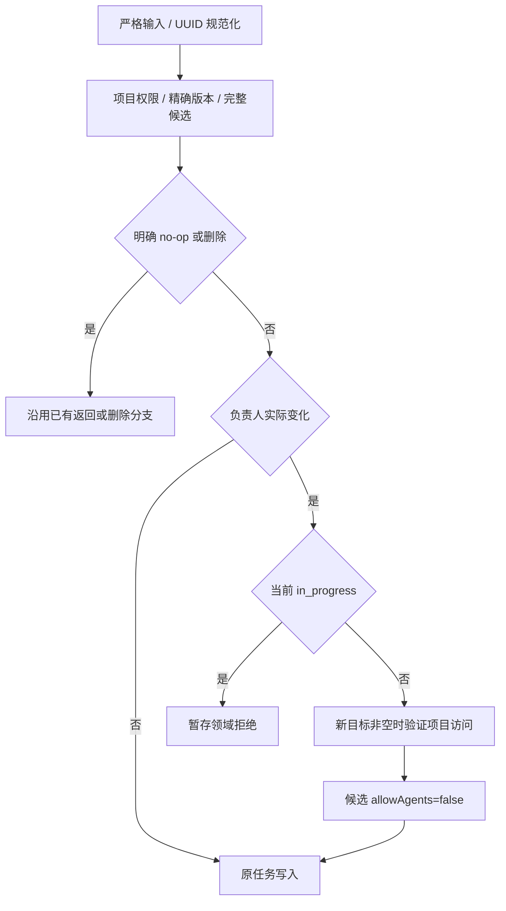

# Task 负责人服务端设计

状态：原生负责人列及事务、读取生产者、任务筛选和项目内人员读取已实现。[需求](../spec/daynight-task-assignment.md)拥有行为，取舍由[基础决策](../../.agents/notes/implemented/architecture/2026-11-03-task-assignment-foundation.md)拥有。

## 数据所有权

`core.Task`、`store.TaskWrite` 和 HTTP Task/summary/graph DTO 使用可空 `AssignedTo`。数据库列为 `tasks.assigned_to uuid NULL`；响应的 assignedTo 不使用 omitempty。它是普通 Task 元数据，properties 的静态定义与独立行模型保持原有职责。

迁移 `028_task_assignment.sql` 增加列及 `(project_id, assigned_to, created_at, id) WHERE deleted_at IS NULL` 索引。既有行包括软删除行取得 NULL，其他任务事实与历史迁移 checksum 不变；不添加外键或历史身份推断。负责人查询直接复用该索引，不增加 DDL。

## 输入与完整候选

create 的可选 string 指针表达默认未分配和显式目标。PATCH 使用字段存在性与可空值区分省略、null 清空、UUID 设置，server/service 的至少一个字段检查包含外层存在性。HTTP 拒绝错误类型和未知字段，service 在构造与比较候选前规范化非 null UUID。

中性任务写入模块拥有 currentTaskWrite。普通 metadata 候选、状态、worker 和属性操作从同一完整当前值构造，复制 AssignedTo 并 clone properties；修改候选不改变当前快照。PATCH changed 比较包含负责人值相等性，不比较指针地址。

## 共用规则与错误

Tasks.write 在明确 no-op/删除路径之后，只对真正 create/update 的完整候选执行负责人策略。等值状态和 worker 摘要可能没有候选 values，不能把零值解释成清空负责人。

策略只在负责人实际变化时检查执行状态和新目标资格，然后强制关闭许可；同一 SQL 写 assigned_to、allow_agents、版本与更新时间。赋值相同则保留其他合法修改，历史目标即使失权也不阻止无关操作。状态不变使既有 SQL 计时 CASE 保留原区间。

策略拒绝和候选准备拒绝使用同一错误分类。目标 Member 不存在明确转为 invalid_input，避免被外层误译为项目不存在；Fault 暂存，在事务正常完成后返回。事务提交、回滚、取消或存储失败优先于暂存拒绝并保留错误链。

## 一致读取与执行边界

完整 Task、task-sync 和图各自的 projection/scanner/assembler 直接读取 assigned_to::text；字段、版本、依赖和属性属于同一既有读取快照。summary 与图携带轻量 UUID，不嵌入可变用户资料。

锁序保持项目→父任务→属性→Session。成员变更共享项目锁；自动领取在同一写事务内要求当前 AssignedTo 非空且等于 principal.UserID，领取结果绑定该认证调用者。负责人变化不重写 worker 或 Session/archive 身份；released/completed 历史继续保留，新的负责人不因此获得旧执行的控制权。

## 原生任务筛选与游标

HTTP 单值 assignedTo 输入在 service 边界转换为显式 all/unassigned/user 选择，零值是 all。me 先解析为 principal.UserID，user 选择仅携带规范 UUID；选择本身可比较并参与游标范围，不为被查询的人增加成员资格要求。

Snapshot.Tasks 按规范选择使用静态 SQL 片段：all 不增加条件，unassigned 使用 assigned_to IS NULL，user 使用绑定的 UUID 等值。输入值只作参数，不拼接 SQL。条件在 ORDER/LIMIT 之前；worker inventory 分支同样先应用显式原生条件，再执行既有 worker 解码、归属匹配和最终 limit+1。worker 自动候选选择 me，在游标核验前解析为固定认证账号的 userId；完整既有 worker 库存省略负责人条件，继续为 all。

page.go 仅为 kind=tasks 编码和要求 cursor version 2，并保存必需的规范选择 all/unassigned/user:UUID。项目列表和账号级 Worker 列表继续使用版本 1，不编码任务选择字段；workerId 筛选的 Task 页仍是 tasks version 2。任务旧版本拒绝，而 me 与对应 UUID 在规范 scope 相同时可续页。项目、状态、ready、许可、平台、workerUser/workerId 和位置仍绑定原 scope。

## 项目内人员读取

Tasks 服务和 taskHandler 复用既有项目读取组合，专用 core/API 条目恰含 userId、nullable name、nullable avatarUrl 与 hasProjectAccess；响应始终有 items 和 unresolvedUserIds 两个非 null 数组。资料保持 canonical users 的实际 nullable 值，不合成姓名或邮件。

HTTP 以局部 query 解析只允许重复 userId，不放宽共用 queryValues 的单值规则。省略参数是完整目录；明确的限定模式先校验非空、最多 100 个互异规范 UUID。service 同样验证直接调用，避免空数组被当作完整模式。两个模式均在一次 ReadSnapshot 内先 RequireProjectRead，再读资格和资料。

### 完整目录

从原始 project_members.user_id 与当前项目未软删除 tasks 的 DISTINCT assigned_to 做 UNION，再 LEFT JOIN users，并读取原始候选 ID 与 nullable users.id。这样仍有原始关联但用户行缺失时可以报告完整性错误，不会被 INNER JOIN 静默删去。成员存在性给出 hasProjectAccess；只有软删除任务的引用不保留资格。结果按 UUID 排序，unresolvedUserIds 为空。

### 限定解析

从最多 100 项的 unnest(requested UUID array) 出发，以成员主键及项目内 assigned_to 索引的 LATERAL LIMIT 1 探测资格，再按资格 LEFT JOIN users。限定模式不先枚举全项目负责人，工作集合只来自请求 ID。

| 资格与资料 | 组装结果 |
|---|---|
| 无成员与当前保留任务资格 | unresolved；不暴露全局 users 是否存在 |
| 有资格且 users 行存在 | 最小资料，保留 nullable name/avatarUrl，明确访问状态 |
| 有原始资格但 users 行缺失 | 内部完整性错误，整个读取失败 |

Go 组装仍验证规范 ID、互斥和完整覆盖：items 与 unresolved 恰好覆盖规范请求一次，各自稳定排序。query/scan/rows/取消或事务失败不安装部分集合。错误不借用 ErrNotFound 表示资料缺失，避免外层误译为项目 404。

完整目录面向显式打开或重试；周期消费者使用当前展示/选中 ID 的限定模式，空集合不发请求，不能省略参数退化为全量。CLI/Web 消费和刷新 owner 仍是独立客户端能力，人员资料不写入 Task 版本或浏览器持久任务记录。

## 观测与验证

复用 request_id、user_id、project_id；目录 component=task_assignee，phase=catalogue/resolve，记录数量及耗时，不记录请求 ID 集合、姓名、头像或邮箱。HTTP context 贯穿授权、快照与查询，无后台任务或新调度边界。原始错误链保留在内部，响应与日志沿用清洗分类和事务完成优先级。

真实 PostgreSQL 验证迁移保全、三套字段投影、nullable 输入、等值及失权目标、全部写入保留、竞态和后续失败回滚。原始 JSON 检查字段存在；迁移 026 的历史事实测试固定其历史 schema，现行迁移另行覆盖。

查询验证过滤先于分页、完整 scope、旧任务游标拒绝和其他列表版本不变、worker inventory 组合、自动候选本人筛选与 claim 事务负责人校验。目录验证两种模式的原始引用完整性、隐私、精确覆盖、100/101 边界、真实快照并发及所有失败路径。至少 10000 任务和 100 人员的生产查询 EXPLAIN ANALYZE BUFFERS 与响应样本通过显式本地 `bash scripts/stress.sh`（在服务模块内）运行，并绑定被测代码；常规 Go CI 排除该压力样本，保留真实 PostgreSQL 的过滤、游标、权限及失败路径验证和严格覆盖率门槛。数量样本不改变 Web 图规模限制，也不是生产容量上限。
