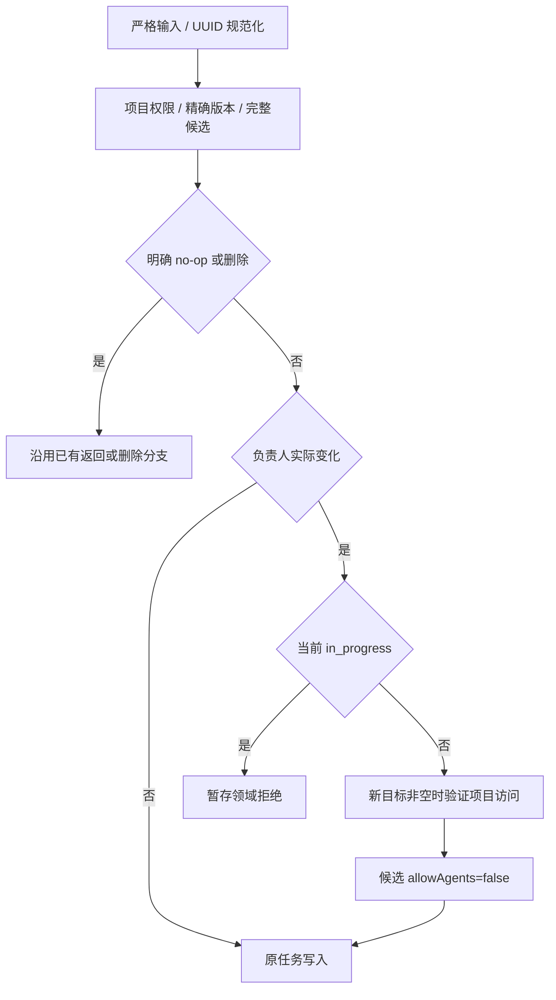

# Task 负责人服务端设计

状态：原生负责人列及服务端事务、读取生产者已实现。[需求](../spec/daynight-task-assignment.md)拥有行为，详细取舍由[基础决策](../../.agents/notes/implemented/architecture/2026-11-03-task-assignment-foundation.md)拥有。

## 数据所有权

`core.Task`、`store.TaskWrite` 和 HTTP Task/summary/graph DTO 使用可空 `AssignedTo`。数据库列为 `tasks.assigned_to uuid NULL`；响应的 `assignedTo` 不使用 omitempty。它是普通 Task 元数据，properties 的静态定义与独立行模型保持原有职责。

迁移 `028_task_assignment.sql` 增加列及 `(project_id, assigned_to, created_at, id) WHERE deleted_at IS NULL` 索引。既有行包括软删除行取得 NULL，其他任务事实与历史迁移 checksum 不变；不添加外键或历史身份推断。

## 输入与完整候选

create 的可选 string 指针表达默认未分配和显式目标。PATCH 使用字段存在性与可空值区分省略、null 清空、UUID 设置，server/service 的至少一个字段检查包含外层存在性。HTTP 拒绝错误类型和未知字段，service 在构造与比较候选前规范化非 null UUID。

中性任务写入模块拥有 `currentTaskWrite`。普通 metadata 候选、状态、worker 和属性操作从同一完整当前值构造，复制 AssignedTo 并 clone properties；修改候选不改变当前快照。PATCH changed 比较包含负责人值相等性，不比较指针地址。

## 共用规则与错误

`Tasks.write` 在明确的 no-op/删除路径之后，只对真正 create/update 的完整候选执行负责人策略。等值状态和 worker 摘要可能没有候选 values，不能把零值解释成清空负责人。

策略只在负责人实际变化时检查执行状态与新目标资格，然后强制关闭许可；同一 SQL 写 assigned_to、allow_agents、版本与更新时间。赋值相同则保留其他合法修改，历史目标即使失权也不阻止无关操作。状态不变使既有 SQL 计时 CASE 保留原区间。

策略拒绝和候选准备拒绝使用同一错误分类。目标 Member 不存在明确转为 invalid_input，避免被外层误译为项目不存在；Fault 暂存，在事务正常完成后返回。事务提交、回滚、取消或存储失败优先于暂存拒绝并保留错误链。

## 一致读取与执行边界

完整 Task、task-sync 和图各自的 projection/scanner/assembler 直接读取 assigned_to::text；字段、版本、依赖和属性属于同一既有读取快照。summary 与图携带轻量 UUID，不嵌入可变用户资料。

锁序保持项目→父任务→属性→Session。成员变更共享项目锁，工作领取仍绑定认证调用者。负责人变化不重写 worker 或 Session/archive 身份；released/completed 历史继续保留，新的负责人不因此获得旧执行的控制权。

当前服务端生产者携带字段，客户端普通命令和浏览器缓存仍消费各自已实现的投影。CLI/Web 新字段消费者分别与相关界面和缓存格式一并交付；当前消费者的读取范围仍由各自协议拥有。

## 验证

真实 PostgreSQL 验证迁移保全、三套字段投影、nullable 输入、等值及失权目标、全部写入保留、竞态和后续失败回滚。原始 JSON 测试检查键存在，单纯反序列化到指针不能证明 null 与缺失的区别。迁移 026 的历史事实测试固定其历史 schema；新增列的现行迁移测试另行覆盖，故障视图继续到达原本要证明的读取错误。
