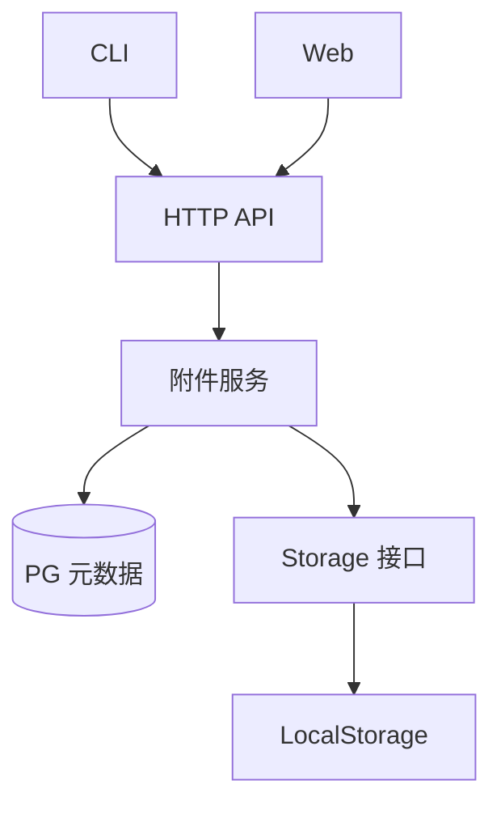

# Task 附件与通用文件存储设计

状态：通用存储、附件元数据、文件 HTTP/预览入口、CLI 附件命令、Web 管理界面和
部署持久卷及独立附件完整阅读页已实现，停止写入后的配套备份恢复已有真实容器验证。跨层组合验收复用
真实服务、安装 CLI 和生产浏览器。附件业务层统一按项目和 task 前缀组织存储地址。

行为要求由[附件需求](../spec/daynight-task-attachments.md)拥有；本文解释通用存储接口、
附件元数据及各端集成机制。
[附件基础决策](../../.agents/notes/archived/architecture/2026-10-21-task-attachment-storage-design.md)、
[项目分片决策](../../.agents/notes/archived/architecture/2026-10-24-project-sharded-attachment-layout.md)、
[旧布局兼容退出决策](../../.agents/notes/implemented/simplification/2026-11-09-remove-attachment-layout-migration.md)、
[附件变更与 Task 删除串行决策](../../.agents/notes/implemented/architecture/2026-11-06-attachment-task-deletion-serialization.md)、
[附件准入锁决策](../../.agents/notes/implemented/bug-fix/2026-11-06-attachment-admission-locks.md)、
[附件目标 gate 决策](../../.agents/notes/implemented/architecture/2026-11-06-attachment-target-gate.md)及
[附件路径限制决策](../../.agents/notes/implemented/feature/2026-11-06-attachment-path-limit.md)
保存选择依据、已接受的限制及重新评估条件。

[鉴权架构](daynight-auth.md)通过当前会话或 PAT 与项目成员权限保护所有附件
请求；行为见[鉴权需求](../spec/daynight-auth.md)。`Attachments` 方法显式接收 principal。
读取在文件 I/O 前的 `ReadSnapshot` 中检查成员、task 和附件归属。普通上传、覆盖和删除使用持有
目标和 Parent SHARE 锁的事务，按 UUID 顺序取得最终锁并在新语句复核 Parent；Parent 变化返回
`resource_conflict`，不追加锁或重放。随后通过 `pg.ReadProjectAccess` 以单条语句重新读取当前项目授权，
再检查 Task 有效删除状态、路径，执行文件操作并通过同一事务写入元数据，直至事务完成才释放资源锁。
该准入查询不锁定 ownership、owner Team member 或 direct grant 来源行，也不在 Task 锁之后获取
Project 锁。权限检查先于暴露 Task 删除状态。准入后的 grant 或 Team 成员撤权无需等待文件 I/O；
已准入操作可以完成，撤权后没有其他有效来源的新请求拒绝，文件写入后不因撤权重新拒绝元数据写入。
凭据在 HTTP 准入时验证，不与后续文件/PG 操作组成原子事务。本文的可信同源执行、普通 iframe、
相对资源、键盘机制和单 gateway 部署继续保留；单文件操作和 K1 边界继续有效。MCP 分块上传的生命周期屏障见下方私有传输内容。

## 目标与操作单位

Task 可以保存设计文档、架构文档、图片、HTML mockup 等文件。内容由独立存储模块
管理，元数据保存在 PostgreSQL。Web 浏览和预览文件，CLI 直接读取原始内容。

每次上传、覆盖或删除一个普通文件。目录由相对路径形成：

```text
docs/
  design.md
  architecture.md
  images/
    topology.png
mockup/
  index.html
  assets/
    style.css
    app.js
```

以 `(taskId, attachmentRelativePath)` 标识附件。相同 task、相同完整路径上传时直接
覆盖；不同目录的同名文件可以共存。覆盖更新文件内容和元数据，不保留历史版本。
每个文件独立生效，多文件依次上传时页面可能同时读取尚未全部更新的资源。

目录没有独立记录。存在 `docs/design.md` 时显示 `docs/`，最后一个文件删除后该目录
不再出现在树中。操作入口接受单文件；没有目录上传、目录整体替换或空目录操作。

附件操作不改变 task 的 `version`、`updatedAt`、状态、依赖和任务图。已完成的 task
仍然可以添加、覆盖、读取和删除附件。

## 现有结构与集成位置

以下是当前集成位置。存储、HTTP、CLI、Web 管理界面和部署持久卷已有实现。

| 当前结构 | 集成方式 |
|---|---|
| [Task 模型](../../packages/daynight-server/internal/core/model/task.go)保存正文、状态、版本及依赖 | 新增独立附件模型与服务，不向 task PATCH 加入文件传输 |
| [HTTP 组装](../../packages/daynight-server/internal/server/server.go)在同一 mux 注册 API 和内嵌页面 | 附件 API 与预览复用同一服务及 origin |
| [JSON 解码](../../packages/daynight-server/internal/server/httpx/http.go)读取并校验受 1 MiB 限制的 JSON | 二进制上传使用独立的流式处理，既有 JSON 限制保持原义 |
| [附件迁移](../../packages/daynight-server/internal/core/store/postgres/migrations/004_task_attachments.sql)定义独立附件表 | 既有迁移机制维护该表，归属由服务校验 |
| [CLI API 客户端](../../packages/daynight/src/api/client.ts)区分 JSON、字节与空响应 | 复用期限、取消、错误及元数据预算；原始文件流不经过 JSON 解码 |
| [CLI 上下文](../../packages/daynight/src/cli/context.ts)提供 text 与 bytes 输出 | `stdoutBytes` 可等待且保留背压，`closeStdoutBytes` 负责命令结束前的输出清理 |
| [任务详情](../../packages/daynight-web/src/features/task-detail/TaskDetailDialog.tsx)独立加载 task | 组合附件区域，附件 hook 独立持有分页、写状态和预览，保持图和详情读取行为 |
| [localhost Compose](../../deployment/localhost/compose.yaml)经 gateway 同源交付，服务使用 [UID 10001](../../deployment/localhost/Dockerfile) | 项目独立的附件持久卷挂载到服务可写根目录，沿用同一 Web 服务及监听端口 |

## 模块职责与依赖



服务内通用文件存储包位于 `internal/core/filestorage/`，本地实现在其
`local/` 子包。该包不依赖 task、project、HTTP 或 PG。附件服务选择 bucket、组成
存储路径，调用 Storage 并读写附件元数据；其他业务可以用自己的 bucket 复用它。

HTTP 层负责流传输、响应头、错误映射和 URL 路径解析。附件服务负责 task 归属、
业务路径及元数据。PG store 沿用具体实现；文件内容的 Storage 是本设计明确的
后端扩展接口。

## Bucket 与路径

Storage 用 `(bucket, path)` 定位文件。Bucket 是一个合法的单层目录名，按用途由
调用方选择。逻辑路径是保留大小写的非空相对路径，以 `/` 分隔。Bucket 不接受
路径分隔符，bucket 与 path 都拒绝控制字符及越出根目录的写法。

Task 附件使用固定 bucket：

```text
bucket = task-attachments
path   = <canonicalProjectId>/<canonicalTaskId[:2]>/<canonicalTaskId>/<attachmentRelativePath>
```

例如：

```text
task-attachments /
  <canonicalProjectId>/8c/8cb70697-87ec-4bfb-a9cb-bf9e065b51e8/docs/design.md
  <canonicalProjectId>/8c/8cb70697-87ec-4bfb-a9cb-bf9e065b51e8/mockup/index.html
```

project 和 task 使用服务已有的规范 UUID 写法。附件业务层的私有地址构造器依次规范化 project ID、
task ID，校验原始附件相对路径，再精确拼接地址。规范化后才取 task UUID 前两个字符，最多 256 个分片；
同一分片内每个 task 仍有完整 UUID 目录。原始路径校验必须在添加前缀之前，避免前缀掩盖 `C:/file` 等
原本非法输入；不使用会清理路径的 join。用户文件名保留大小写和合法 Unicode 原貌，不静默改名或归一化。
拒绝绝对路径、空路径段、`.`、`..`、反斜杠及控制字符。新建和覆盖前，附件业务层还按 Unicode 字符计数，拒绝超过 1024 个字符的相对路径；包含分隔符且不改变通用文件存储的地址规则。读取、删除和分页使用原路径 I/O 安全规则，不复查写入字段容量。

Put/Open/Delete 共用业务地址值中的规范化 ID、原始相对路径和派生存储路径。principal 与原始输入校验后，
读取快照或变更事务检查项目成员、task 归属和逻辑冲突或元数据；通过准入后才执行文件 I/O。List 仅查询元数据，
元数据和公开 URL 继续使用原有 task 内路径，浏览器与 CLI 无需计算、传入或感知分片。

已有文件 `docs` 时不能创建 `docs/design.md`；已有 `docs/design.md` 时不能创建
文件 `docs`。附件服务检查该业务冲突，LocalStorage 也明确暴露实际文件系统冲突。
路径处理必须限制在配置的存储根目录内，符号链接不能使访问越过根目录。
LocalStorage 准备根目录时探测实际大小写能力；Linux 不支持时以配置错误拒绝
启动。macOS 原生开发允许使用普通大小写不敏感目录，并逐段核对真实目录项拼写。
只有文件系统能解析但目录项没有精确拼写的路径才判为别名冲突，不用 Unicode
case folding 模拟文件系统规则。创建父目录前、发布临时文件、打开和删除时均受
该检查保护；命名空间修改由同一实例的锁串行化。别名写入返回已有路径冲突响应，
不写入元数据；原文件内容和目录保持不变。这不提供不同大小写名称共存能力。
大小写检查不改变业务寻址；跨进程目标 gate 另保护同一路径的附件操作。Linux gate 保留真实共存测试，
macOS APFS 专项仍可显式运行，日常开发无需镜像。
[开发文件系统覆盖决策](../../.agents/notes/archived/testing/2026-10-23-native-development-filesystem-coverage.md)
记录这项平台覆盖取舍。

本地物理布局直接采用：

```text
<storage-root>/
  task-attachments/
    <canonicalProjectId>/
      <taskShard>/
        <canonicalTaskId>/
          docs/
            design.md
          mockup/
            index.html
            assets/
              style.css
```

project/shard/task 前缀由附件业务层的一个私有函数统一生成。
LocalStorage 仅按接收的 bucket/path 操作，不理解 project 或 task。普通删除逐层移除空祖先，
可清理空 task、shard 和 project 目录，在 bucket 前停止；非空兄弟目录保持不变。
项目目录提供地址组织，根约束与符号链接解析仍遵循通用 LocalStorage 合同，不能等同为独立操作系统沙箱。
新增其他用途只需使用其他 bucket，bucket 按首次写入创建，不增加 bucket 管理 API 或分片配置。

## Storage 接口与本地实现

接口形状如下，最终声明遵循 Go 包的导出规则：

```go
type FileInfo struct {
    Size int64
}

type Object struct {
    Body io.ReadCloser
    Info FileInfo
}

type Storage interface {
    TryAcquireResidency(ctx context.Context, key string) (io.Closer, error)
    AcquireGate(ctx context.Context, domain GateDomain, key string) (io.Closer, error)
    Put(ctx context.Context, bucket, path string, content io.Reader) (FileInfo, error)
    Open(ctx context.Context, bucket, path string) (Object, error)
    Delete(ctx context.Context, bucket, path string) error
}
```

契约如下：

- `Put` 流式消费内容，创建或覆盖准确的 bucket/path。成功返回实际保存的字节数。
  `Put` 不关闭调用方提供的 reader；HTTP 请求体和本地输入流由各自调用方管理。
- `Open` 打开当前文件，返回内容流与该次已打开文件的实际大小。调用方负责关闭
  `Body`。响应长度不能仅使用 PG 保存的大小，文件与元数据可能处于已知的不一致
  状态。
- `Delete` 删除准确的文件。文件不存在时删除已经完成；权限、I/O 等其他错误明确
  返回。删除不递归移除业务目录下的其他文件。
- Context 取消通过写入、读取和关闭流程向上传递；实现检查流复制过程中的取消，
  调用方负责通过取消 HTTP 请求或关闭自己拥有的输入流解除阻塞。不承诺中断任意
  调用方 reader 内部无法取消的阻塞。
- 缺失、非法路径和 I/O 错误保留可识别原因及错误链。接口不要求 `io.Seeker`，也不
  提供通用 Stat、Scan 或版本操作。

LocalStorage 在目标文件所在目录创建内部临时文件，流式写完并关闭后再替换目标。
内部短锁保护当前实例的目录准备、发布和删除；附件用例另持有跨进程目标 gate，覆盖文件 I/O 与 PG 操作。
空内部目录可以在发布时让位于文件，非空目录和仍有上传临时文件的目录保持冲突；
通用文件操作本身不隐式取得业务目标 gate。

存储 gate 接口按控制域和键取得可取消的 permit。本地后端在固定控制目录内分别为目标与私有域使用 256 个持久锁文件条带，结合进程内准入和操作系统 advisory lock 协调共享根的实例；对象清理不能删除锁文件。条带碰撞会串行化无关操作。私有传输持有私有 permit 时再进入附件目标 gate，调用方不得重复取得目标 gate。permit 的生命周期独立于数据库连接，失去数据库锁不代表文件操作已经停止。
活跃 I/O 另用非阻塞、完整 key 的 ResidencyGate；用户和 Task 槽按操作族、规范 UUID 和槽号命名，使用完整 key hash 的稳定控制文件与本地引用计数，避免条带碰撞造成无关 owner 被拒。释放关闭句柄并移除本地零引用项，但不 unlink 锁文件：其他实例可能已打开旧 inode。控制文件可持续存在，累计磁盘量不受该机制约束。

替换前的普通写入失败或取消，清理本次调用拥有的临时文件并报告错误及清理失败。文件存储记录发布事实：复制、Sync 或 Close 在发布前失败为 `NotPublished`，进入可能改变目标的发布后无法确定结果为 `Unknown`，明确发布成功为 `Published`；错误链保留原始原因。用户可访问
的路径不会指向正在写入的半个文件；内部临时名不属于附件路径或历史版本。

替换实现需要满足目标平台的完整文件发布语义。存储模块仅保证一次文件写入的结果，
不扩展为文件系统与 PG 的事务，也不增加进程异常后的扫描清理服务。

后续存储后端实现同一个 bucket/path 契约；task 逻辑路径、API 和 CLI 用法保持稳定。

## PostgreSQL 元数据

新增 `task_attachments` 表：

| 字段 | 用途 |
|---|---|
| `project_id` | 所属 project |
| `task_id` | 所属 task |
| `path` | task 内完整相对路径 |
| `content_type` | 上传时确定的 MIME type |
| `size_bytes` | `Put` 返回的实际大小 |
| `created_at`、`updated_at` | PG 生成的创建与更新时间 |

以 `(task_id, path)` 作为主键，path 使用 `COLLATE "C"` 保持排序与唯一性区分大小写。业务服务在读写前检查 project/task
归属及任务未删除状态，不新增 foreign key。[Task 软删除](daynight-task-deletion.md)不改附件元数据或字节；普通附件变更的 Task 锁与软删除的写锁串行，删除先提交时等待中的变更返回授权的 `410 task_deleted` 且不修改文件。MCP 分块写入和提交也受 Task 锁及 fresh Project 生命周期检查保护；删除先提交时不得暂存或发布文件。文件操作与数据库提交仍不具备跨存储原子性；文件成功后数据库失败或提交结果未知时，保留实际错误和提交状态，不猜测补偿文件。Bucket 是附件服务中的固定值，存储路径由规范化 projectId、taskId 及 path
推导，表中不保存分片、`storage_key` 或物理根目录。

覆盖保留 `created_at`，更新 MIME、大小和 `updated_at`。删除后重新上传同一路径
创建新的附件记录。分页按相对路径的确定顺序进行 keyset 读取，cursor 包含上次路径，
并绑定 project、task 与附件列表类型；沿用既有 opaque cursor 和 `items/nextCursor`
形式。附件游标单独保存 version/kind/projectId/taskId/path，严格拒绝未知字段、
尾随 JSON 和跨作用域重用；不伪造既有 task 列表所需的 UUID/time 游标。每页使用
当前数据，不提供跨页快照。REST 与 MCP 调用普通 `List`，在同一快照一次取得请求条数加一项 lookahead；cursor 指向最后返回路径。读取完整规范元数据，不按字节裁页或复查字段容量。

## 上传、覆盖、读取与删除

共享附件写入用例在取得目标 gate 和发布文件之前，校验原始 `contentType` 不超过 2048 字节并符合既有 MIME 语法；所有复用该用例的入口使用相同限制。读取、列表和删除直接消费规范存储元数据，不执行写入字段或容量校验，也不增加历史扫描或迁移。

附件领域拥有 5242880 字节的文件上限。共享 Put 和已准入的 PutFrom 将实际输入包装为限长 reader；越过上限显式失败而非以截断 EOF 成功。local 临时文件完整复制、同步并关闭后才发布，因此超限在发布前失败，不改变目标与元数据。结果转换保留存储发布事实和数据库完成事实，不能把确定未发布的超限归为未知，也不能把发布后的数据库或响应故障当作回滚。

上传依次校验业务输入和归属、调用 `Storage.Put`、创建或更新 PG 元数据，全部成功
后才返回成功。Storage 写入业务层推导的固定地址，不分配持久化唯一 key。

删除先检查附件记录与归属，再调用 `Storage.Delete`，随后删除 PG 元数据。读取先检查
归属及附件记录，再按推导路径调用 `Open`；目标 gate 保持到取得同一串行状态下的元数据和稳定文件句柄，流读取不再持锁；此前失败留下的不一致不会自动修复；缺失附件返回 404。记录存在而实际内容
缺失、权限不足或读取失败，按存储故障明确报告，不能返回伪造空文件。

读取响应的实际长度取自已打开文件；MIME 来自附件元数据。流开始前的失败使用既有
结构化错误响应，流开始后的失败记录并中断传输，不追加 JSON 或成功标记污染内容。

### 已知问题：文件与 PG 不具备原子性

文件操作与 PG 更新不属于同一事务。文件已经替换或删除后，PG 更新可能失败；进程
也可能在两者之间退出。因此可能出现文件与元数据不匹配、文件有内容但无附件记录，
或附件记录仍存在而文件已经缺失。共享目标 gate 防止同一路径的成功覆盖、删除和打开交错，
不承诺跨介质原子提交或失败后的一致性。

该问题是已接受的限制。错误必须明确返回，发布可能已经发生时须保留该事实；客户端不
隐式重试写操作。目标 gate 不提供补偿、回滚、状态机、对账、后台回收或自动
恢复机制。

## HTTP API

公共 task 前缀为：

```text
T = /api/v1/projects/{projectId}/tasks/{taskId}
```

| 方法与路径 | 行为 |
|---|---|
| `GET T/attachments` | 分页读取附件元数据 |
| `PUT T/attachments/files/{path...}` | 上传一个文件，相同完整路径覆盖 |
| `GET T/attachments/files/{path...}` | 返回原始文件内容，用于 CLI 读取和下载 |
| `DELETE T/attachments/files/{path...}` | 删除指定文件 |
| `GET T/preview/{path...}` | 以浏览器 inline 方式提供文件及相对资源 |

上传请求体直接携带文件字节，`Content-Type` 表达文件 MIME。上传端按文件类型选择
合法 MIME，无法识别时使用 `application/octet-stream`；服务拒绝非法 header 值。
缺失 Content-Type 时使用 application/octet-stream。服务不使用 JSON 解码器接收文件，
也不将完整文件载入内存。从首次读取开始设置 60 秒实际 socket 读取期限；完整读取后清除 deadline，超时或未读完的请求关闭连接。超限返回 `413 payload_too_large`，读取超时在可写时返回 `408 request_timeout`，资源名额满立即返回 `429 resource_busy`。

共享 `BoundedContent` 以 `ContentOverflowError` 标识实际读到第 5242881 字节，保留 `payload_too_large` 领域 Fault 的 unwrap 语义；一般容量 Fault 不代表这个流式终止事实。HTTP 的既有正文错误分类器只在错误树中的文件发布为 `not_published`、事务为未尝试提交的 operation 拒绝且回滚和清理无失败时，将该类型映射为终止 413。关闭原生 chunked body 对剩余 framing 或 trailer 的读取可能因立即读取期限取消原请求 context；拒绝复用[服务端传输响应机制](daynight-server.md#http-传输准入)的一秒 socket 写入期限、独立有界响应 context、flush 与错误日志，业务继续使用原 context。未知或已发布的文件结果、事务完成失败、附带取消及清理失败保留普通错误分类。

附件 I/O 在相应授权后依次获取实例、用户和 Task 名额；失败时释放已取得的名额。实例容量是 `min(4,max(1,floor(P/2)))`，P 是连接池最大连接数；用户两个槽、Task 一个槽通过共享存储的 ResidencyGate 跨实例协调。REST 持有至结果发送及清理完成。MCP 的 inline、chunk、commit 每次实际 I/O 与结果发送持有名额，begin 和空闲 ticket 不占用；私有传输账本仍管理空闲 ticket 与暂存容量。

```http
PUT T/attachments/files/mockup/assets/style.css
Content-Type: text/css

body { background: white; }
```

新建成功返回 `201`，覆盖成功返回 `200`，响应是附件元数据；删除成功返回 `204`。
元数据示例：

```json
{
  "path": "mockup/assets/style.css",
  "contentType": "text/css",
  "sizeBytes": 1842,
  "createdAt": "2026-10-21T10:00:00Z",
  "updatedAt": "2026-10-21T10:00:00Z"
}
```

列表返回 `items` 与 `nextCursor`，复用既有 limit/cursor 约定。路径各段单独 URL 编码，
服务在路由重写或自动清理前检查非法路径，避免上传、删除被静默重定向至其他文件。
文件 URL 的 query 不作为文件路径，允许相对资源使用普通缓存参数。路径守卫只对
附件请求检测原始命名空间意图，不能因后续 parent 段或冗余前缀将修改重定向到旧
JSON 路由；正常既有路由行为保持原义。
所有入口均检查 project/task 归属。无效输入、缺失资源及内部失败使用既有 HTTP 错误
信封、requestId 和日志规则，保留原始错误链。

原始读取使用下载响应头，预览使用 inline 响应头，并以实际打开文件的大小发送内容。
列表与可覆盖的文件使用 `Cache-Control: no-store`，刷新后读取当前内容。
`path_conflict` 映射 409；存储记录存在而磁盘内容缺失仍为 500，不能被 not_found
错误链误判。流式中止只记录附件操作错误，现有日志包装器直接重抛 ErrAbortHandler，
保留真正 panic 的原有脱敏处理。

## 请求生命周期与诊断

复用服务现有 requestId、Context 和结构化日志。HTTP 请求建立关联，附件服务向
Storage 与 PG 传入同一个 Context；日志携带 request_id、project_id、task_id、
合法相对路径、操作和阶段。错误复用现有 LogFailure 的 type/component/phase/cause/
error_code/diagnostic 字段，保留错误链并经过现有脱敏规则，不记录文件正文、凭据或
物理根目录。流已经开始时的失败同样关联该请求，并终止传输。

文件操作在当前请求内完成；不引入后台任务或脱离请求的执行边界。CLI 复用已有
操作上下文和信号，Web 切换资源时取消本次拥有的请求。流的所有者在完成、失败或
取消时关闭它，不能把客户端取消伪装成成功。

部署后可对一次已知的附件请求按 requestId 核对现有日志，例如：

```bash
docker compose -f deployment/localhost/compose.yaml logs server | rg '"request_id":"attachment-check"'
```

对应请求使用 `X-Request-ID: attachment-check`，核对响应关联及失败时的组件、阶段和
脱敏诊断即可，不另建观测系统。

## Web 文件树与预览

`TaskDetailSurface` 通过 `TaskDetailReading` 在公共标题下组合 `TaskDetailPanels`，
以概览和附件两个稳定面板分开任务阅读与文件浏览。详情与面板以 `(projectId, taskId)` 为身份，
项目内详情默认概览，独立详情按 URL 初始化页签与文件；两个面板保持挂载，非当前面板同时使用 `hidden` 与 `inert`。页签按钮关联
`tabpanel`，使用 roving tabindex，方向键和 Home/End 自动激活并聚焦目标页签，原生
Enter/空格继续有效。`TaskAttachmentsPanel`、表单及目录控件保留组件身份，因此往返页签
保留选中路径、目录展开、列表/预览状态和未提交上传。`TaskDetailReading` 持有唯一的
`useAttachments` 控制器，并将同一实例交给描述导航与 `TaskAttachmentsPanel`。描述的
普通主键无 query/hash 相对文件链接选择该控制器中的路径、激活附件面板并聚焦
预览区域，不建立第二份清单、选择或请求状态。

文件树初始只显示根目录文件与第一层目录名称，目录使用默认关闭的原生
`details`/`summary`。`TaskAttachmentsPanel` 持有当前 project/task 已展开目录路径的
集合，目录控件的 `open` 由该集合决定。`summary` 激活同步更新展开状态，避免
浏览器排队的 `toggle` 事件晚于下一次链接定位才提交旧操作；原生 `toggle` 继续
核对控件状态。刷新、页签切换、语言切换及普通重渲染保留用户选择。

`TaskDetailReading` 将文件选择与目录定位分开表达。独立附件地址的初始选择、
外部路径变化及每次描述链接点击生成一次定位意图；树内选择、上传和页签切换
产生的受控地址回写被识别为本地结果，不生成定位。面板消费定位时只将目标路径
各段的祖先加入展开集合，兄弟分支及既有手动状态保持；路径意图不依赖清单是否
已经到达，因此后续分页出现的目标目录也遵循同一次定位。定位只消费一次，当前
选择不会持续约束目录状态，因此用户可以收起正在预览的文件所在目录。重复点击
同一描述链接仍是新的定位，普通刷新及页签切换不重新执行旧定位。相关取舍由[目录展开决策](../../.agents/notes/archived/feature/2026-10-25-attachment-directory-disclosure.md)
保存。

附件面板使用占满可用正文的 `attachment-split` grid：左侧
`attachment-sidebar` 放置文件树、刷新和上传；右侧 `attachment-preview-pane`
放置所选文件预览，以竖向分隔线区分。桌面左栏 250px，窄屏使用紧凑比例，在 320px
继续保持左右位置。每一级可收缩 flex/grid 子元素明确 `min-width: 0` 与
`min-height: 0`，对话框正文和面板隐藏溢出，外层不额外滚动。概览拥有独立滚动区，
其元数据侧栏继续沿用看板响应式布局。

左栏可独立纵向滚动，右侧以非滚动预览标题和可伸缩正文组成。共用面板直接从当前选中
附件的 `createdAt` 和 `updatedAt` 渲染两组 `time`，原始值保存在 `dateTime`，显示值
使用站内 locale 和浏览器时区的秒精度格式。文件信息宽度有上限，时间紧随其后，
操作靠右；窄屏允许分组换行。完整路径通过可访问名称与 title 保留，显示路径受控截断；
路径不能挤掉时间、下载和新标签页打开操作。
`attachment-preview-body` 是 Markdown、文本/JSON/源码及大图的唯一纵向滚动
所有者，渲染器内不再设置高度上限或嵌套纵向滚动。表格、代码只保留局部横向
滚动。HTML/PDF 就绪时切换为隐藏外溢的 `attachment-preview-body-native`，
`attachment-native` 和 iframe 占满可用高度，内部文档或浏览器阅读器负责唯一的
纵向滚动。加载、错误、无选择及不支持类型在同一正文布局内显示。

短视口压缩公共标题行、标题、页签、预览标题及底部间距，844×390 仍保留正文、
关闭按钮和所有操作。高度不超过 500px 的全屏与普通带归属详情在足够宽时将预览标题压为同一行：
文件信息允许收缩，路径和元数据沿用受控省略并保留完整 DOM/title；操作区不收缩，
下载保留文本，新标签入口只显示图标并保留可访问名称与 title，标题及面板压缩内边距。
在不高于 300px 且不宽于 600px 的极小视口中，文件信息压缩为一行，时间与操作并列，
为正文留出阅读空间。这些规则与公共全屏紧凑标题、元数据行及 footer 隐藏共同为 320×240 的预览正文和
原生 frame 分配非零可读空间。带 claim 的公共正文头部另按[归属布局](daynight-web.md#认领归属与强制撤回)独立有界滚动，普通/全屏都不能被长用户、账号或机器名称挤没附件正文。验证实际 clientHeight、文字/图像绘制与末尾滚动，
只检查控件不能证明阅读区可用。隐藏标题仍可取得完整内容；布局保持原有 body/frame
滚动所有权，不通过外层滚动或任意 reader 最低高度容纳右侧预览。内嵌预览标题在下载后紧邻提供新标签页打开链接；删除由左侧文件条目菜单提供。链接
在远程准入有效时使用当前选择的元数据路径，即使正文请求仍未完成也保持正确地址。
`attachmentPageUrl` 沿用 ID 与路径校验，生成逐段编码的独立页面 URL。选择与
滚动所有权的理由见[分屏决策](../../.agents/notes/archived/architecture/2026-10-22-task-attachment-split-view.md)。

上传表单位于默认关闭的原生 `details` 内，`summary` 使用当前语言的“上传文件”
文案。浏览器提供鼠标与键盘展开/收起以及折叠内容的焦点排除。表单始终挂载，收起
不会清空文件、目标路径或校验状态；页签往返保留展开状态，project/task 身份变化
随整个附件组件重置为收起。上传入口与文件树保留各自的展开状态。

用户选择一个文件，目标路径初始为文件名，可改为多层相对路径；`mime` 4.1.1 按
目标路径确定上传 Content-Type，未知类型使用 `application/octet-stream`。同路径
直接覆盖，单文件提供下载和删除，成功后刷新附件区域，不修改详情、task 版本或图。
页面沿用看板样式。

文件条目以并列的选择按钮和右侧“…”按钮组成，菜单绑定条目的完整路径，
不借用预览选择。菜单进入浏览器 top layer 并按可用视口定位，保持任务详情的 DOM
归属，避开分屏隐藏溢出和左栏滚动裁剪。选择删除只打开原生 modal 确认框，显示
完整路径、不可撤销提示、取消和明确删除按钮；初始聚焦取消。确认组件显式导入
既有 `auth.css`，复用 `auth-dialog` 和 `dialog-header`/`dialog-body`/`dialog-footer`，
由同一组规则约束高度与 flex 列布局。标题和操作栏不收缩，正文设置 `min-height: 0`、
`flex: 1 1 auto` 与 `overflow: auto`，成为超长路径的唯一纵向滚动所有者，避免
重复外壳样式受加载顺序影响而裁剪目标。正文使用带名称的 `group` 与显式
`tabIndex=0`，使键盘滚动区域与焦点枚举一致。原生 modal 隔离底层交互，确认层复用 `dialogFocusables` 枚举可用控件，显式循环边界 Tab/Shift+Tab，
包括提交中焦点位于对话框自身的情形；当前层停止键盘事件冒泡，保留外层详情的键盘所有权。
未提交状态可用 Escape、取消及遮罩关闭并恢复操作入口；提交中保持目标和确认框，
禁用重复确认及冲突写入。错误在确认层明确展示，保留重试与取消入口。确认层
订阅当前语言，不渲染语言选择器及其偏好反馈；语言变化只重译内容，不重新提交。
页面保留自身语言入口与偏好反馈。页签激活状态显式传给附件组件，用于关闭
隐藏面板中未提交的菜单和确认；task/project 变化释放原组件。
[删除确认决策](../../.agents/notes/archived/feature/2026-10-23-attachment-delete-confirmation.md)
记录层级与交互取舍。

`useAttachments` 分开持有列表、写操作、选中路径和预览。列表逐页读取，并检查路径
树冲突与重复游标；续页失败保留已经读取的文件并标明不完整，提供重试。描述
导航也等待这份完整清单后才判定缺失，列表加载、列表错误、非法路径、确认缺失与
预览失败各自可见，不将错误转换成空列表。分页刷新尚未完整时，保留同一身份和
选中路径最近已知的元数据，避免后续页暂未返回导致已加载预览重挂载；完整清单
确认该路径缺失后释放它。结果绑定 project/task，内容状态同时绑定 path；切换身份、选择或卸载通过 AbortController 和
请求 generation 排除旧结果。写操作不自动重试，普通错误在附件区域明确展示。

远程准入暂停独立于 project/task 身份。控制器订阅暂停并同步取消列表、预览与写入
reader，使用暂停代次及请求身份拒绝迟到结果，结束本地 busy；已发布清单、选择和
预览及表单草稿继续由原资源持有。恢复时完整清单不自动重读；中断的不完整读取在后台重新遍历，只有所有页成功后才替换已发布清单，失败时保留原清单并显示错误。真实资源变化与撤权仍释放
原状态。暂停中可更换本地选择，已加载的原生预览保持挂载以便选回；尚未建立文档的 frame、未加载的图片和 Markdown 图片不建立新的源。HTML 文档已建立但子资源仍未完成时，保留该文档和其中输入，不能以 iframe 的 `load` 事件作为唯一保留条件。下载、新标签及 Markdown 远程链接撤销 `href`
和下载属性并保留可访问名称与禁用语义，本地 fragment 链接仍可使用。已加载的可信
HTML 继续遵循普通同源 iframe 的执行模型，不提供独立的脚本或子资源网络隔离。

覆盖成功增加预览 revision；删除成功仅在目标为当前选择时清空预览，删除其他路径
保留当前预览内容及组件身份，刷新清单不会额外增加其 revision。手动刷新发现所选文件的 `updatedAt` 改变时重新请求正文；
`path/updatedAt` 作为预览组件身份，使同路径的图片和 frame 重新挂载。HTTP 的
`Cache-Control: no-store` 保持可覆盖路径的当前读取语义。

| 类型 | 预览机制 |
|---|---|
| Markdown | `react-markdown` 10.1.0 与 `remark-gfm` 4.0.1 渲染 CommonMark/GFM，含表格；共享 Mermaid 图表组件渲染静态图形及局部错误/源码，原始 HTML 保持转义 |
| 图片 | 原生 img 的加载、错误和重试状态 |
| PDF | HEAD 检查后交给浏览器原生 iframe |
| 文本、JSON、源码 | 原始文本节点与 pre，保留换行 |
| HTML | HEAD 检查后在普通同源 iframe 中加载执行 |
| 其他格式 | 元数据及下载链接 |

`MarkdownContent` 负责 CommonMark/GFM、Mermaid 图表及样式，URL 转换与链接激活由
调用方提供。图表的延迟加载、串行配置/语义预检/渲染、图片节点绘制前拒绝、
隐藏页签测量、静态图片安全与异步资源生命周期统一遵守[图表设计](daynight-task-inspection.md#mermaid-图表)，
内嵌及独立完整详情不建立第二套渲染机制。`MarkdownAttachmentBase` 区分 `document` 与 `root`：附件调用方使用
当前文件的目录作为资源基准，描述调用方使用任务附件根；不虚构描述文件名。路径解析逐段处理 URL 编码和 parent 段，拒绝
越过任务根，保留 query/hash。独立 `#fragment` 保持原值，不改成文件请求。绝对、
协议和根相对 URL 保持正常 URL 语义，并经过渲染库的默认安全规则；原始 HTML
不作为可执行节点插入 Markdown。描述的内嵌导航和原生点击规则见
[阅读设计](daynight-task-inspection.md#markdown-与附件链接)，决策见
[Markdown 描述决策](../../.agents/notes/archived/architecture/2026-10-22-task-description-markdown.md)。

HTML 入口是固定同源 URL，例如：

```text
/api/v1/projects/{projectId}/tasks/{taskId}/preview/mockup/index.html
```

HTML/PDF 的 HEAD 可用性检查只判断响应状态和 requestId，不尝试读取不存在的 JSON
body。成功后 frame 正常 GET 文件和其资源；HEAD 仅证明入口可用，实际 HTML
交互和 PDF 绘制仍需由真实 frame 验证。入口中的 `./assets/style.css`、
`./assets/app.js` 和相对 fetch URL 按浏览器规则读取同目录结构，不改写文件内容；
以 `/` 开头的地址仍指向主站根目录。HTML 附件属于可信项目代码，拥有主应用同源
权限，普通 iframe 不使用 sandbox；不增加专用预览 session/token、独立 origin/
端口、Service Worker 或离线文件系统。[鉴权架构](daynight-auth.md)在附件请求
准入时验证登录态，并在文件 I/O 前检查项目成员，保留可信 HTML 的同源执行约定。

居中详情对话框拥有 body portal、背景 inert、共享滚动锁和被动卸载后的焦点恢复；其普通尺寸、概览滚动与详情页签由[看板设计](daynight-web.md#居中任务详情)说明，附件页签的分屏和右侧滚动由本节拥有。全屏沿用同一附件控制器、面板、文件输入及 frame，不改变 path/timestamp 预览身份或发起新的内容请求；应用拥有的滚动位置按新布局合法范围恢复，frame 内部滚动继续归原生文档或阅读器。

`AttachmentKeyboardOwner` 由共享详情 Surface 经 Reading 和附件面板传到预览，包含
活动阅读容器的 `root` 与语义 `onEscape`。弹窗始终提供 owner，独立页仅全屏时
提供。`TrustedFrame` 在 load 时记录当前同源 document；document 或 owner root 变化时
释放旧监听，回调 ref 保持最新。document 的 keydown 监听对每个 Escape/Tab 事件
临时注册专属 Window 冒泡处理器，排在子应用当前已有的 Window 消费者之后；处理器
只处理同一事件，检查 `defaultPrevented` 后同步执行 Escape 或边界 Tab。子应用在
Document 或 Window 消费的快捷键均不会触发外层操作。

每个临时处理器使用 `AbortController` signal 释放；父窗口的零延迟清理定时器处理
事件被停止传播后留下的处理器。清理只使用 signal 和父窗口定时器，不访问可能已因
跨源导航而不可访问的 WindowProxy。document/owner 变化、停用及卸载同时移除
Document 监听并释放全部待处理器；退出独立页全屏不重建 frame。`dialogFocusables`
使用 `tabbable` 6.5.0 的生产默认可见性检查，边界 Tab/Shift+Tab 围绕当前 owner root
与 frame 控件处理。
PDF 浏览器内部 reader 可能不提供可控 document，不能把 HTML 的桥接结果作为 PDF
键盘证明；保留原生 reader 与显式退出/返回控件，并记录真实浏览器验证的边界。
[全屏阅读决策](../../.agents/notes/archived/feature/2026-10-25-task-detail-fullscreen.md)
拥有该 owner 扩展的理由，[Web 附件决策](../../.agents/notes/archived/feature/2026-10-21-task-attachment-web.md)保留原有同源与清理取舍。

## 独立附件阅读页

独立附件入口是完整任务详情的一种初始状态。
`/projects/{projectId}/tasks/{taskId}/attachments/{path...}` 与基础任务路径由同一
`TaskDetailPage` 展示 `TaskDetailSurface`，附件路径默认激活附件并选中文件；显式
页签选择遵守完整详情的导航准入。完整详情的共享主体、任务/页签/文件 URL、
浏览器历史及项目图刷新由[独立详情设计](daynight-task-inspection.md#独立完整任务详情)
拥有。附件预览的真实新标签链接仍使用 `attachmentPageUrl`，进入完整详情并定位
当前文件，不传递来源窗口的数据或状态。

`TaskDetailSurface` 通过 `TaskDetailReading` 在同一 project/task 身份内持有一个
`useAttachments` 控制器，概览描述导航与完整 `TaskAttachmentsPanel` 共用它。
弹窗及独立页面因此使用相同目录、刷新、上传、文件菜单、删除确认和预览。独立
导航由外层记录页签与文件状态，路由恢复应用选择，并在附件路径定位时补充展开
其祖先；独立资源页的子 Task 和外部 Goal 弹窗及项目页弹窗由各自的阅读载荷控制选择。树内选择及成功上传引起的地址回写不产生新的目录
定位，页签变化也不重新打开用户已收起的目录。同任务的页签与文件变化保留主体、
附件控制器、目录展开、侧栏位置及草稿，跨任务或身份
变化按原有请求生命周期释放。所选文件删除后仍保留 URL 路径，完整清单确认缺失
后显示对应状态；删除其他文件保持当前预览。

文件路径先按原始 `/` 分段再逐段解码，拒绝解码后含 `/` 的段，规范化 UUID 并复用
`isAttachmentPath`；大小写和合法 Unicode 拼写不变，字面 `%2F` 通过 `%252F` 表达。
`attachmentPageUrl` 与原文件 URL builder 共用地址规则。新路径元数据及缺失仅在
完整清单后确认；不完整刷新保留同任务、同路径最近已确认的元数据。加载、清单错误、
路径错误、缺失和预览错误由现有所有者展示，不能把失败当作空列表。正文继续复用
`AttachmentPreview`、既有内容 URL、相对资源和请求取消，不另建树、渲染器或元数据接口。

独立详情的整页尺寸链在实际高度的标题与页签后为面板分配余下空间。共享分栏及
断点保持左侧独立滚动；右侧预览正文承担 Markdown、文本和图片滚动，HTML/PDF
由拟合正文的 iframe 内文档滚动。所有可收缩层保持零最小尺寸，外壳隐藏外溢，不
以固定头高减法或 frame 最低高度产生嵌套滚动。

`AttachmentPreview` 接收可选的语义键盘 owner。普通独立详情不提供 owner；全屏
专注阅读提供当前 Surface 的 root/onEscape，即使 frame 已加载也会安装桥，退出
立即释放。内部原生删除确认继续拥有当前层焦点和键盘交互；弹窗的焦点圈定、
frame document/owner/卸载清理和关闭恢复按上述共享规则执行。

Go UI mux 精确登记基础任务和附件页面 GET/HEAD，继续交付相同 no-store index。
附件原始路径守卫在 ServeMux 清理或重定向前验证路径，保留中间 `..` 掩盖命名空间
的意图检查。无效页面 ID 仍由前端显示未找到页面，数据与授权由已有接口检查。
[完整阅读决策](../../.agents/notes/archived/architecture/2026-10-22-task-attachment-full-reader.md)记录了非模态渲染及路径基础的历史取舍，[共享附件页决策](../../.agents/notes/archived/architecture/2026-10-24-shared-attachment-page.md)
保留完整附件面板复用的理由，[独立详情决策](../../.agents/notes/archived/architecture/2026-10-24-standalone-task-detail.md)记录了当前完整任务详情组合的历史取舍。

源码、构建产物及浏览器环境的证据必须对应其被测对象，历史运行结果
不能替代当前扩展的验证。原有边界的选择依据记录在
[附件组合验收决策](../../.agents/notes/archived/testing/2026-10-21-task-attachment-cross-layer-acceptance.md)。

## CLI

命令位于既有 `task` 下：

```bash
daynight task attachment put <task-id> ./design.md --path docs/design.md
daynight task attachment put <task-id> ./index.html --path mockup/index.html
daynight task attachment list <task-id> --tree
daynight task attachment list <task-id> --json
daynight task attachment read <task-id> docs/design.md
daynight task attachment read <task-id> mockup/assets/logo.png > ./logo.png
daynight task attachment remove <task-id> docs/design.md
```

全部命令支持现有 `--project` 选择规则；省略时复用仓库关联发现。
[attachment.ts](../../packages/daynight/src/commands/task/attachment.ts)在实际上传前打开
来源并检查该句柄为普通文件，后续读取使用同一句柄，最终显式关闭。`put` 省略
`--path` 使用来源文件 basename，MIME 由 `mime` 4.1.1 根据最终逻辑目标路径推导，
未知扩展名使用 `application/octet-stream`。目标路径逐段 URL 编码一次，保留文件名
拼写及其中的 `%` 等字符。

默认 list 输出带标签的文件元数据，`--tree` 展示目录结构，`--json` 输出完整元数据
数组，两种格式选项互斥。分页以 path 作为身份，拒绝重复路径或循环 cursor，读完
所有页后才打印。`--path` 声明为 text，支持内联赋值；put/read/remove 启用 `--`
终止选项解析，用于前导连字符的位置路径。

`read` 向 stdout 输出原始字节，不解码、不增加标签、转义或额外换行。诊断写 stderr；
失败非零退出，已输出的部分内容可能不完整。上传及读取都采用保留背压的字节流，
不能复用现有汇总 UTF-8 JSON 的响应路径，也不能通过 string stdout 输出二进制。

元数据继续沿用 JSON DTO 校验和分页。字节通道复用
[操作生命周期](../../packages/daynight/src/api/operation.ts)中的取消、请求期限、整次
操作期限。元数据继续受现有 JSON 单响应及累计字节上限约束；原始文件上传和读取
使用有界缓冲流，不套用 JSON 字节上限，内存占用不随文件总大小增长。共享取消和
期限不因此放宽。客户端按操作接受 PUT 的 200/201 元数据、GET 的 200 原始内容及
DELETE 的 204 空响应；错误响应继续使用 JSON DTO 和字节预算。

[byte-output.ts](../../packages/daynight/src/cli/byte-output.ts)在首次非空输出时才动态
加载 `node:child_process` 并启动本次命令拥有的
[输出辅助进程](../../packages/daynight/src/cli/byte-output-helper.ts)。父进程通过管道
发送不超过 64 KiB 的 frame，每段等待辅助进程的 stdout 写入完成及 IPC 确认，再
推进 HTTP 响应读取。阻塞的 fd 1 写入位于子进程中，因此父进程的取消和期限仍能
执行，尤其避免 Windows 同步 stdout 写入阻塞父进程事件循环。

取消、超时、EPIPE 或辅助进程失败时中止请求，终止并回收该子进程。正常完成先关闭
辅助输入，等待退出；所有结束路径均有界等待并保留清理错误。
`runServerCommand` 接受返回 `string | void` 的 callback：元数据返回完整文本，read
逐段调用可等待的 `stdoutBytes` 后返回 void。真实 CLI 上下文始终提供
`closeStdoutBytes`，runtime 在 dispose 操作和移除信号监听器前调用它；测试或嵌入
上下文可以不提供该可选关闭函数。该辅助进程只服务一次命令的字节输出，不是后台
服务。机制选择见[CLI 决策](../../.agents/notes/archived/feature/2026-10-21-task-attachment-cli.md)。

文件传输失败、stdout 关闭或操作取消时关闭本次拥有的流并解除网络请求。写请求不
自动重试或经重定向重发，结果未确认时明确提示操作可能已经生效。

命令登记、帮助及静态补全继续通过既有声明式命令树生成，帮助不加载配置、Git 或
网络依赖。

## 配置、部署与备份

服务为 LocalStorage 使用所选 Daynight root 下的 `storage` 作为默认目录；
`storage.root` 可在 YAML 中设置，`DAYNIGHT_STORAGE_ROOT` 可显式覆盖。相对路径
以 Daynight root 为基准。启动以 `local.New` 准备根目录，向工厂提供
`server.Dependencies{Store, Files}`，在监听前完成验证；后续启动失败与 HTTP
排空后均关闭已取得的文件根句柄。无法访问或创建目录时启动失败。物理目录不进入
API、PG 或 CLI 配置，所有客户端继续使用既有 `serverUrl`。

两套 Compose 显式选择 `/var/lib/daynight` root，并将项目作用域的
`attachment-data` 命名卷挂载到其 `storage` 目录。生产镜像已为 UID/GID
`10001:10001` 准备目录；Docker 对空卷的初始化保留该目录所有权，普通非 root
服务直接写入，不增加 root entrypoint。Go fixture 使用其所属独立 root。

localhost 的 PG 与附件卷在正常停止、重启、重建及 `down` 后保留，显式
`down --volumes` 同时销毁两者。dev-ci 每次隔离 Compose 项目拥有独立的 PG 与
附件卷，现有 runner 按项目标签记录所有卷并清理、核验其全部消失。测试项目不使用
开发环境持久卷。实现取舍由[部署决策](../../.agents/notes/archived/architecture/2026-10-21-task-attachment-persistence.md)
拥有。

上传、下载和预览继续经过同一个 gateway；对应代理规则必须支持二进制请求与流式
响应，并沿用既有生命周期策略。本设计不另设一套任意文件大小或时限参数。

数据库与附件目录构成一组备份材料。停止全部服务实例和其他直接数据库或文件写入方后，
通过 `pg_dump` 备份 PG，并使用同一生产镜像的非 root `tar` 容器备份附件根目录；
两者完成前保持停止写入。恢复到空卷时，先恢复匹配 SQL 与文件，再为所有受影响项目
执行 `UPDATE projects SET task_cache_epoch = gen_random_uuid()`，最后启动服务。
配套恢复、选择性导入及其他历史替换都遵守这个顺序，选择性操作只轮换受影响项目。
SQL 备份会保存并恢复旧 UUID，恢复 UUID 本身不能标识历史替换；正常任务写入、重启
和容器重建保留 epoch。UUID 轮换不修改任务版本或时间戳，数据库时间及导入任务时间
的有效性需另行确认；未来时间数据不能仅靠轮换 UUID 修正。任务同步及历史失效合同由
[任务同步设计](daynight-task-sync.md)拥有。

开放服务后核对旧 epoch 请求取得完整任务快照，并验证附件读取、预览及新上传。
该手动流程不承诺修复备份前已经存在的文件与元数据不一致，也不增加备份平台或恢复
协调机制。可执行操作由[部署说明](../../deployment/localhost/README.md#persistence-and-backup)
拥有。

## 实现验证

通用存储、元数据与 HTTP 由组件及实际二进制检查验证；持久卷和隔离清理由
dev-ci 的实际部署验证。CLI 命令及字节输出已有实现，原生平台、安装产物和
完整服务组合的验证结论仍须来自各自源码绑定的实际运行，本机验证不能代替
Windows/macOS 托管结果。Web 管理界面交付组件、状态及前端 fixture，真实浏览器
探针覆盖该环境的视觉与焦点。源绑定结果归属对应 PR 与 CI。组合验收的机制见
[跨层验收决策](../../.agents/notes/archived/testing/2026-10-21-task-attachment-cross-layer-acceptance.md)，各层验证职责如下：

- Storage：bucket 隔离、真实相对路径、同路径完整覆盖、原始字节一致、实际大小、
  缺失与权限错误、取消、普通失败的临时文件清理及路径不能越出根目录；同/不同分片及
  project 前缀下同名文件的字节独立、兄弟目录保留与空目录清理，由真实本地文件验证。
- 附件服务：通过合成 principal、Project/Task 数据及实例所属的窄操作依赖，控制直接调用的
  Project read、path-conflict 和 metadata read/write/delete，另用严格 snapshot、mutation
  和直接 DAO 预期验证真实 callback 的 capability、context、参数和顺序。纯输入/分页编码、
  文件 gate、I/O、staging/publication、租约与释放机制保持真实，验证规范化 UUID 分片地址、
  准入、文件/元数据顺序、结果和错误链、完成事实、取消及传输清理。测试不连接数据库；
  写入参数不当作持久化证据。Core Attachment 保全冲突查询的 Project/Task/context 及
  metadata write/delete 的取消 context、精确参数、单次调用与错误链；Core Project 的独立
  read delegation 测试保全原 principal、Project ID、context 与完整 access 返回值。
- PG：附件 DAO 验证实际 SQL、文件/目录前缀冲突、覆盖保留元数据身份、删除、分页、历史
  字段值及 task 版本/状态/图不变；根 scope 测试验证 Task/Project 删除与附件变更的真实
  锁顺序、准入后的撤权、事务完成，以及文件副作用后的回滚和持久化读回。
- HTTP：二进制单文件上传、原样读取、下载与 inline 响应、相对资源、URL 编码、
  非法路径拒绝，以及失败明确暴露；不以跨介质原子性作为验收条件。
- CLI：实际构建入口的上传、完整列表、文本和二进制 stdout、背压、取消、管道中断、
  既有 project 选择、帮助及补全。
- Web：详情页签与状态保留、共用完整附件页的两种展示、独立模式地址同步与前进后退、
  项目页嵌入模式和独立页子层选择的前进后退、单文件操作、相对资源、真实内容绘制、唯一纵向滚动与读至
  结尾、键盘与原生 frame 行为，以及失败恢复和切换文件时的过期请求取消。
- 部署：真实非 root 容器写入、同源 gateway 传输、正常重建保留附件、dev-ci 卷隔离
  及清理、配套备份恢复，以及正常重启保留 epoch、恢复后轮换 epoch 和旧 epoch 完整重建。

[附件服务测试归属决策](../../.agents/notes/implemented/testing/2026-11-09-attachment-service-test-ownership.md)
记录服务、Store 与本地文件验证职责。

Go、CLI 和 Web 分别验证附件存储、协议与界面行为；正常同数据读写须由独立产品
组合验证证明，部署验证拥有持久化和备份恢复。Go 模块的 `TestAttachmentGrantRevocationWithFreshProcess`
新构建二进制，使用真实认证 HTTP 与隔离 PostgreSQL：1 MiB 上传正文未完成时成员撤销
先返回 204、新访问返回 404，已准入上传再以 201 完成，并核对字节和资源清理。

Web 的受控浏览器 fixture 使用完整 Chromium 检查 PDF iframe compositor 中的专用色块；
按连通区域、边界及密度区分页面绘制和缩略图，成功状态、load 或固定等待不能代替绘制。
多页阅读使用真实滚轮、键盘和末页绘制标记，不能以私有查看器 DOM 偏移代替可见结果。
[Web 验证说明](../../packages/daynight-web/README.md#validation-and-build)拥有模块入口与
范围。实际验证结果须绑定源码和环境，失败或取消时回收所属资源；受控 API 不证明真实
数据库或部署行为，也不能代替安装 CLI 的同数据组合验证。[历史决策](../../.agents/notes/archived/testing/2026-10-21-task-attachment-cross-layer-acceptance.md)
记录了旧跨产品验收的选择理由，其结果只属于实际测试的源码。

MCP 附件列表使用普通批量数据库读取及完整项的条数分页；cursor 指向最后返回路径，不使用元数据字段或编码响应字节准入。REST 需要 PAT 或浏览器会话，MCP OAuth 凭据不能用于 REST。删除沿用共享附件用例的授权与副作用语义，并区分文件副作用开始前的拒绝与可能发生的副作用。上传提供有界 inline 内容和下述分块提交。

## MCP 私有传输内容

私有传输生命周期先持久化调用方提供的 UUID、用户、稳定授权主体、方向、目标和不可变参数，再允许创建以该 UUID 命名的私有对象。PAT 使用凭据 ID，OAuth 使用 Grant ID；每次外部调用重新检查当前凭据和任务权限。重复 ID 只有完整绑定相同时返回已有记录。私有内容使用独立命名空间和 UUID 对象名，不使用调用方的物理路径；其范围读取直接定位偏移。

每个用户最多保留四个未关闭传输。跨实例账本分别记录保留总量与尚未确认物化的部分：文件发布和回执确认前，未物化部分继续保守占用；实际删除私有命名空间并确认关闭后才返还总量和槽位。配置预算以及磁盘余量采样分别限制分配；物理 I/O 仍可能失败。提交目标可能同时需要私有块和目标临时副本，部署容量必须覆盖所需文件大小和并发。终态与核对数据保留 24 小时，空闲期限为 60 分钟，最长为 24 小时。

上传块的 UUID、偏移、长度、hash 和私有对象地址分别持久保存；回执与预留消费在同一短事务提交。重复块只有身份、偏移、长度和 hash 均一致才返回已有回执。新块在预留或写私有对象前检查累计实际字节不超过 5 MiB。提交先检查声明长度、已确认偏移和上限，再验证整体 hash，保留目标暂存容量，并以原 transfer 的唯一 operation 进入 committing。已确认块按偏移流式读取，完整文件无需物化到内存；最终发布的共享 reader 也独立检查上限。5 MiB 可由 begin、十个 512 KiB chunk 和 commit 完成，普通 MCP 请求外壳仍限 4 MiB。

每次外部调用重新检查当前凭据和任务权限，私有传输保留其凭据及项目授权的加锁准入。分块写入先锁 transfer，再按资源锁计划锁目标和 Parent 并以新语句检查 Project 生命周期；私有文件和块回执写入在该作用域内完成。提交在目标 gate 内完成身份和路径准入，最终事务锁住目标和 Parent 并再次检查 Project 和 Task 生命周期后，才组合暂存、发布目标并写入 metadata。删除先提交时这些物理变更不执行；写入先取得锁时删除等待。已准入身份的凭据或成员权限后续撤销不取消该次提交。提交读取逐块确认的 immutable receipt，并持有 private permit；最终事务直接读取这些回执，不逆向获取 transfer 行锁。租约续期也须通过生命周期屏障；续期失败取消所属操作，不自动重放。文件发布与 metadata 仍非原子，失败后不删除目标或伪造结果。详见[上传删除屏障决策](../../.agents/notes/implemented/architecture/2026-11-06-upload-deletion-barrier.md)。

私有文件操作持有与数据库事务独立的跨进程 namespace gate，获取后重新检查状态和权限。清理先持久化 `cleanup_pending`、取消本实例操作，再等待同一 gate 并删除整个受限命名空间；文件删除失败保留清理责任和账目。租约失效不会释放活着的文件 permit。提交操作失联时保留 `unknown` 和原操作标识，原 permit 持有者仍可记录同一操作后来取得的可证结果，包括 Project 删除前已提交的正式附件结果；这不重新准入已删除 Project。Project 删除后的临时分块仍按私有传输机制清理，清理范围仅限私有命名空间，不删除或改写正式附件。启动扫描和每十分钟的有界维护可跨重启续扫；应用关闭时取消并等待维护器和持有的操作，再释放底层存储。普通状态查询不占文件 I/O 槽，也不等待共享容量账本。决策及权衡见[私有传输生命周期](../../.agents/notes/implemented/architecture/2026-11-06-private-transfer-lifecycle.md)。

`core/mcptransfer` 拥有传输状态、操作身份和准入规则；service 在同一事务中协调凭据、任务及账本，并管理文件 permit 和清理生命周期。DAO 执行锁定与数据操作。

附件读取默认返回完整元数据和后续调用所需的引用，不对 inspect 或 open 结果执行字段、schema 或字节准入。授权只查询父任务是否存在和删除，不加载完整任务或属性；普通 `Open` 读取保存的 metadata，不复查 MIME 容量。调用方提供的 MCP 输入路径仍不超过 4096 字节，并遵守原路径 I/O 安全规则；输入拒绝不回显超长路径。显式 inline 和 chunk 默认最多读取 8 KiB，单次上限为 512 KiB；自动格式遇到二进制时只返回引用，调用方须显式选择 base64 才能取得原字节。文本分块在 UTF-8 字符边界结束，偏移与长度始终按原始字节计算。inline 只返回完整内容，超过选择的上限时要求调用方使用快照。

inspect 打开稳定文件并使用内容 I/O 预算。open 查询已登记状态时使用控制预算；新快照在任何文件等待前切换到独立的内容 I/O 预算，资源饱和时明确拒绝，避免阻塞状态与取消调用。服务登记调用方 UUID 后，使用受目标 gate 保护的稳定附件句柄流式创建私有快照并记录完整大小及 SHA-256。重复 open 只返回已登记状态，不重新复制；preparing 不提供可读内容。chunk 在私有 permit 下直接定位快照偏移，每次重新检查当前凭据、稳定授权主体和任务访问权限。覆盖原路径不会改变快照，close 只请求清理私有命名空间。设计权衡见[不可变下载决策](../../.agents/notes/implemented/architecture/2026-11-06-mcp-attachment-download.md)，普通元数据和页面职责见[读取简化决策](../../.agents/notes/implemented/simplification/2026-11-09-canonical-resource-pages.md)。

私有传输 service 测试使用明确的 DAO、事务结果和直接下层附件操作预期，保留实际
Lifecycle、permit、文件、gate、取消与 drain、续期、chunk stream、hash，以及完整容量
边界。写入与后续读取的给定事实独立，逻辑回执不作为持久化证据。Store 使用真实
PostgreSQL 验证回执与预留账目的原子性、失败回滚、授权替换、晚到回执及 Project
生命周期锁；core 拥有精确 JSON 绑定等价与有界极端指数证明。独立 startup/shutdown
入口保留真实跨进程 gate、活跃写者清理拒绝及强制退出后的孤儿回收，不加入正常 API
集成场景。当前验证职责及取舍见
[MCP 传输测试归属决策](../../.agents/notes/implemented/testing/2026-11-09-mcptransfer-test-ownership.md)。

各实现任务运行所影响模块的既有检查；CLI 使用 `pnpm typecheck`、`pnpm test`、
`pnpm build` 及相关安装验收，Web 使用 README 拥有的 `web:*` 验证，Go 服务使用
隔离 PostgreSQL 下的 `bash scripts/check.sh` 与 `bash scripts/startup-shutdown.sh`。服务既有 build、vet、按[服务端验证策略](../../packages/daynight-server/README.md#race-instrumentation)选择的 race、go-cov
及未取整总语句覆盖率严格大于 90% 的门槛保持不变。
