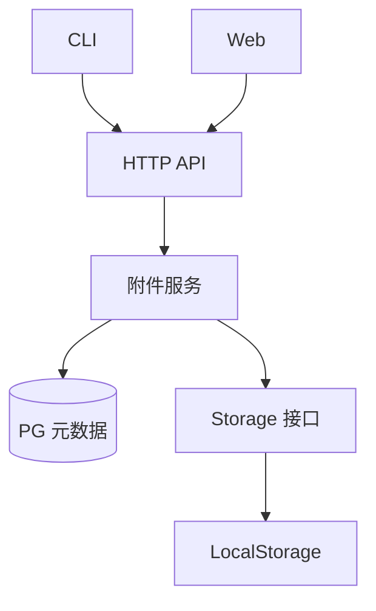

# Task 附件与通用文件存储设计

状态：通用存储、附件元数据、文件 HTTP/预览入口、CLI 附件命令、Web 管理界面和
部署持久卷及独立附件完整阅读页已实现，停止写入后的配套备份恢复已有真实容器验证。跨层组合验收复用
真实服务、安装 CLI 和生产浏览器。

行为要求由[附件需求](../spec/daynight-task-attachments.md)拥有；本文解释通用存储接口、
附件元数据及各端集成机制。
[决策记录](../../.agents/notes/implemented/architecture/2026-10-21-task-attachment-storage-design.md)
保存选择依据、已接受的限制及重新评估条件。决策采用不表示功能已经交付。

[鉴权架构](daynight-auth.md)通过当前会话或 PAT 与项目成员权限保护所有附件
请求；行为见[鉴权需求](../spec/daynight-auth.md)。`Attachments` 方法显式接收 principal，在
文件 I/O 前的 `ReadSnapshot` 中检查成员、task 和附件归属；快照完成后执行存储
及元数据操作，允许已准入操作完成，I/O 后不重新检查成员。凭据在 HTTP 准入
时验证，不与后续文件/PG 操作组成原子事务。本文的可信同源执行、普通 iframe、
相对资源、键盘机制和单 gateway 部署继续保留；单文件操作和 K1 边界继续有效。

## 目标与操作单位

Task 可以保存设计文档、架构文档、图片、HTML mockup 等文件。内容由独立存储模块
管理，元数据保存在 PostgreSQL。Web 浏览和预览文件，CLI 直接读取原始内容。

每次上传、覆盖或删除一个普通文件。目录由相对路径形成：

```text
docs/
  design.md
  architecture.md
  images/
    topology.png
mockup/
  index.html
  assets/
    style.css
    app.js
```

以 `(taskId, attachmentRelativePath)` 标识附件。相同 task、相同完整路径上传时直接
覆盖；不同目录的同名文件可以共存。覆盖更新文件内容和元数据，不保留历史版本。
每个文件独立生效，多文件依次上传时页面可能同时读取尚未全部更新的资源。

目录没有独立记录。存在 `docs/design.md` 时显示 `docs/`，最后一个文件删除后该目录
不再出现在树中。操作入口接受单文件；没有目录上传、目录整体替换或空目录操作。

附件操作不改变 task 的 `version`、`updatedAt`、状态、依赖和任务图。已完成的 task
仍然可以添加、覆盖、读取和删除附件。

## 现有结构与集成位置

以下是当前集成位置。存储、HTTP、CLI、Web 管理界面和部署持久卷已有实现。

| 当前结构 | 集成方式 |
|---|---|
| [Task 模型](../../packages/daynight-server/internal/core/task.go)保存正文、状态、版本及依赖 | 新增独立附件模型与服务，不向 task PATCH 加入文件传输 |
| [HTTP 组装](../../packages/daynight-server/internal/server/server.go)在同一 mux 注册 API 和内嵌页面 | 附件 API 与预览复用同一服务及 origin |
| [JSON 解码](../../packages/daynight-server/internal/server/http.go)读取并校验受 1 MiB 限制的 JSON | 二进制上传使用独立的流式处理，既有 JSON 限制保持原义 |
| [附件迁移](../../packages/daynight-server/internal/core/store/migrations/004_task_attachments.sql)定义独立附件表 | 既有迁移机制维护该表，归属由服务校验 |
| [CLI API 客户端](../../packages/daynight/src/api/client.ts)区分 JSON、字节与空响应 | 复用期限、取消、错误及元数据预算；原始文件流不经过 JSON 解码 |
| [CLI 上下文](../../packages/daynight/src/cli/context.ts)提供 text 与 bytes 输出 | `stdoutBytes` 可等待且保留背压，`closeStdoutBytes` 负责命令结束前的输出清理 |
| [任务详情](../../packages/daynight-web/src/features/task-detail/TaskDetailDialog.tsx)独立加载 task | 组合附件区域，附件 hook 独立持有分页、写状态和预览，保持图和详情读取行为 |
| [localhost Compose](../../deployment/localhost/compose.yaml)经 gateway 同源交付，服务使用 [UID 10001](../../deployment/localhost/Dockerfile) | 项目独立的附件持久卷挂载到服务可写根目录，沿用同一 Web 服务及监听端口 |

## 模块职责与依赖



服务内通用文件存储包位于 `internal/filestorage/`，本地实现在其
`local/` 子包。该包不依赖 task、project、HTTP 或 PG。附件服务选择 bucket、组成
逻辑路径，调用 Storage 并读写附件元数据；其他业务可以用自己的 bucket 复用它。

HTTP 层负责流传输、响应头、错误映射和 URL 路径解析。附件服务负责 task 归属、
业务路径及元数据。PG store 沿用具体实现；文件内容的 Storage 是本设计明确的
后端扩展接口。

## Bucket 与路径

Storage 用 `(bucket, path)` 定位文件。Bucket 是一个合法的单层目录名，按用途由
调用方选择。逻辑路径是保留大小写的非空相对路径，以 `/` 分隔。Bucket 不接受
路径分隔符，bucket 与 path 都拒绝控制字符及越出根目录的写法。

Task 附件使用固定 bucket：

```text
bucket = task-attachments
path   = <canonicalTaskId>/<attachmentRelativePath>
```

例如：

```text
task-attachments /
  8cb70697-87ec-4bfb-a9cb-bf9e065b51e8/docs/design.md
  8cb70697-87ec-4bfb-a9cb-bf9e065b51e8/mockup/index.html
```

Task ID 使用服务已有的规范 UUID 写法。用户文件名与路径保留原貌，不转小写、
不静默改名、不作 Unicode 归一化。拒绝绝对路径、空路径段、`.`、`..`、反斜杠及
控制字符；路径校验后才进行物理路径解析。

已有文件 `docs` 时不能创建 `docs/design.md`；已有 `docs/design.md` 时不能创建
文件 `docs`。附件服务检查该业务冲突，LocalStorage 也明确暴露实际文件系统冲突。
路径处理必须限制在配置的存储根目录内，符号链接不能使访问越过根目录。
LocalStorage 准备根目录时探测实际大小写能力；Linux 不支持时以配置错误拒绝
启动。macOS 原生开发允许使用普通大小写不敏感目录，并逐段核对真实目录项拼写。
只有文件系统能解析但目录项没有精确拼写的路径才判为别名冲突，不用 Unicode
case folding 模拟文件系统规则。创建父目录前、发布临时文件、打开和删除时均受
该检查保护；命名空间修改由同一实例的锁串行化。别名写入返回已有路径冲突响应，
不写入元数据；原文件内容和目录保持不变。这不提供不同大小写名称共存能力，
也不增加物理路径编码、布局迁移或跨进程协调。Linux gate 保留真实共存测试，
macOS APFS 专项仍可显式运行，日常开发无需镜像。
[开发文件系统覆盖决策](../../.agents/notes/implemented/testing/2026-10-23-native-development-filesystem-coverage.md)
记录这项平台覆盖取舍。

本地物理布局直接采用：

```text
<storage-root>/
  task-attachments/
    <canonicalTaskId>/
      docs/
        design.md
      mockup/
        index.html
        assets/
          style.css
```

Task ID 前缀分片可以由本地实现在有目录规模依据时采用；它不进入逻辑路径、PG 或
API。当前布局没有分片配置或迁移工具。新增其他用途只需使用其他 bucket，bucket
按首次写入创建，不增加 bucket 管理 API。

## Storage 接口与本地实现

接口形状如下，最终声明遵循 Go 包的导出规则：

```go
type FileInfo struct {
    Size int64
}

type Object struct {
    Body io.ReadCloser
    Info FileInfo
}

type Storage interface {
    Put(ctx context.Context, bucket, path string, content io.Reader) (FileInfo, error)
    Open(ctx context.Context, bucket, path string) (Object, error)
    Delete(ctx context.Context, bucket, path string) error
}
```

契约如下：

- `Put` 流式消费内容，创建或覆盖准确的 bucket/path。成功返回实际保存的字节数。
  `Put` 不关闭调用方提供的 reader；HTTP 请求体和本地输入流由各自调用方管理。
- `Open` 打开当前文件，返回内容流与该次已打开文件的实际大小。调用方负责关闭
  `Body`。响应长度不能仅使用 PG 保存的大小，文件与元数据可能处于已知的不一致
  状态。
- `Delete` 删除准确的文件。文件不存在时删除已经完成；权限、I/O 等其他错误明确
  返回。删除不递归移除业务目录下的其他文件。
- Context 取消通过写入、读取和关闭流程向上传递；实现检查流复制过程中的取消，
  调用方负责通过取消 HTTP 请求或关闭自己拥有的输入流解除阻塞。不承诺中断任意
  调用方 reader 内部无法取消的阻塞。
- 缺失、非法路径和 I/O 错误保留可识别原因及错误链。接口不要求 `io.Seeker`，也不
  提供通用 Stat、Scan 或版本操作。

LocalStorage 在目标文件所在目录创建内部临时文件，流式写完并关闭后再替换目标。
内部短锁只保护当前实例的目录准备、发布和删除，不覆盖内容流传输或 PG 操作。
空内部目录可以在发布时让位于文件，非空目录和仍有上传临时文件的目录保持冲突；
不提供共享根目录多进程写入的协调。
替换前的普通写入失败或取消，清理本次调用拥有的临时文件并报告错误。用户可访问
的路径不会指向正在写入的半个文件；内部临时名不属于附件路径或历史版本。

替换实现需要满足目标平台的完整文件发布语义。存储模块仅保证一次文件写入的结果，
不扩展为文件系统与 PG 的事务，也不增加进程异常后的扫描清理服务。

后续存储后端实现同一个 bucket/path 契约；task 逻辑路径、API 和 CLI 用法保持稳定。

## PostgreSQL 元数据

新增 `task_attachments` 表：

| 字段 | 用途 |
|---|---|
| `project_id` | 所属 project |
| `task_id` | 所属 task |
| `path` | task 内完整相对路径 |
| `content_type` | 上传时确定的 MIME type |
| `size_bytes` | `Put` 返回的实际大小 |
| `created_at`、`updated_at` | PG 生成的创建与更新时间 |

以 `(task_id, path)` 作为主键，path 使用 `COLLATE "C"` 保持排序与唯一性区分大小写。业务服务在读写前检查 project/task
归属，不新增 foreign key。Bucket 是附件服务中的固定值，存储路径由 taskId 与 path
推导，表中不保存 `storage_key` 或物理根目录。

覆盖保留 `created_at`，更新 MIME、大小和 `updated_at`。删除后重新上传同一路径
创建新的附件记录。分页按相对路径的确定顺序进行 keyset 读取，cursor 包含上次路径，
并绑定 project、task 与附件列表类型；沿用既有 opaque cursor 和 `items/nextCursor`
形式。附件游标单独保存 version/kind/projectId/taskId/path，严格拒绝未知字段、
尾随 JSON 和跨作用域重用；不伪造既有 task 列表所需的 UUID/time 游标。每页使用
当前数据，不提供跨页快照。

## 上传、覆盖、读取与删除

上传依次校验业务输入和归属、调用 `Storage.Put`、创建或更新 PG 元数据，全部成功
后才返回成功。Storage 直接写入固定逻辑路径，不分配持久化唯一 key。

删除先检查附件记录与归属，再调用 `Storage.Delete`，随后删除 PG 元数据。读取先检查
归属及附件记录，再按推导路径调用 `Open`；缺失附件返回 404。记录存在而实际内容
缺失、权限不足或读取失败，按存储故障明确报告，不能返回伪造空文件。

读取响应的实际长度取自已打开文件；MIME 来自附件元数据。流开始前的失败使用既有
结构化错误响应，流开始后的失败记录并中断传输，不追加 JSON 或成功标记污染内容。

### 已知问题：文件与 PG 不具备原子性

文件操作与 PG 更新不属于同一事务。文件已经替换或删除后，PG 更新可能失败；进程
也可能在两者之间退出。因此可能出现文件与元数据不匹配、文件有内容但无附件记录，
或附件记录仍存在而文件已经缺失。并发覆盖或删除也可能导致最终内容与元数据来自
不同操作，不承诺跨介质的全局提交顺序。

该问题是已接受的限制。错误必须明确返回，并说明文件操作可能已经生效；客户端不
隐式重试写操作。实现不增加跨存储锁、补偿、回滚、状态机、对账、后台回收或自动
恢复机制，也不将一致性修复作为本方案的交付条件。

## HTTP API

公共 task 前缀为：

```text
T = /api/v1/projects/{projectId}/tasks/{taskId}
```

| 方法与路径 | 行为 |
|---|---|
| `GET T/attachments` | 分页读取附件元数据 |
| `PUT T/attachments/files/{path...}` | 上传一个文件，相同完整路径覆盖 |
| `GET T/attachments/files/{path...}` | 返回原始文件内容，用于 CLI 读取和下载 |
| `DELETE T/attachments/files/{path...}` | 删除指定文件 |
| `GET T/preview/{path...}` | 以浏览器 inline 方式提供文件及相对资源 |

上传请求体直接携带文件字节，`Content-Type` 表达文件 MIME。上传端按文件类型选择
合法 MIME，无法识别时使用 `application/octet-stream`；服务拒绝非法 header 值。
缺失 Content-Type 时使用 application/octet-stream。服务不使用 JSON 解码器接收文件，
也不将完整文件载入内存。

```http
PUT T/attachments/files/mockup/assets/style.css
Content-Type: text/css

body { background: white; }
```

新建成功返回 `201`，覆盖成功返回 `200`，响应是附件元数据；删除成功返回 `204`。
元数据示例：

```json
{
  "path": "mockup/assets/style.css",
  "contentType": "text/css",
  "sizeBytes": 1842,
  "createdAt": "2026-10-21T10:00:00Z",
  "updatedAt": "2026-10-21T10:00:00Z"
}
```

列表返回 `items` 与 `nextCursor`，复用既有 limit/cursor 约定。路径各段单独 URL 编码，
服务在路由重写或自动清理前检查非法路径，避免上传、删除被静默重定向至其他文件。
文件 URL 的 query 不作为文件路径，允许相对资源使用普通缓存参数。路径守卫只对
附件请求检测原始命名空间意图，不能因后续 parent 段或冗余前缀将修改重定向到旧
JSON 路由；正常既有路由行为保持原义。
所有入口均检查 project/task 归属。无效输入、缺失资源及内部失败使用既有 HTTP 错误
信封、requestId 和日志规则，保留原始错误链。

原始读取使用下载响应头，预览使用 inline 响应头，并以实际打开文件的大小发送内容。
列表与可覆盖的文件使用 `Cache-Control: no-store`，刷新后读取当前内容。
`path_conflict` 映射 409；存储记录存在而磁盘内容缺失仍为 500，不能被 not_found
错误链误判。流式中止只记录附件操作错误，现有日志包装器直接重抛 ErrAbortHandler，
保留真正 panic 的原有脱敏处理。

## 请求生命周期与诊断

复用服务现有 requestId、Context 和结构化日志。HTTP 请求建立关联，附件服务向
Storage 与 PG 传入同一个 Context；日志携带 request_id、project_id、task_id、
合法相对路径、操作和阶段。错误复用现有 LogFailure 的 type/component/phase/cause/
error_code/diagnostic 字段，保留错误链并经过现有脱敏规则，不记录文件正文、凭据或
物理根目录。流已经开始时的失败同样关联该请求，并终止传输。

文件操作在当前请求内完成；不引入后台任务或脱离请求的执行边界。CLI 复用已有
操作上下文和信号，Web 切换资源时取消本次拥有的请求。流的所有者在完成、失败或
取消时关闭它，不能把客户端取消伪装成成功。

部署后可对一次已知的附件请求按 requestId 核对现有日志，例如：

```bash
docker compose -f deployment/localhost/compose.yaml logs server | rg '"request_id":"attachment-check"'
```

对应请求使用 `X-Request-ID: attachment-check`，核对响应关联及失败时的组件、阶段和
脱敏诊断即可，不另建观测系统。

## Web 文件树与预览

`TaskDetailSurface` 通过 `TaskDetailReading` 在公共标题下组合 `TaskDetailPanels`，
以概览和附件两个稳定面板分开任务阅读与文件浏览。详情与面板以 `(projectId, taskId)` 为身份，
项目内详情默认概览，独立详情按 URL 初始化页签与文件；两个面板保持挂载，非当前面板同时使用 `hidden` 与 `inert`。页签按钮关联
`tabpanel`，使用 roving tabindex，方向键和 Home/End 自动激活并聚焦目标页签，原生
Enter/空格继续有效。`TaskAttachmentsPanel`、表单及目录控件保留组件身份，因此往返页签
保留选中路径、目录展开、列表/预览状态和未提交上传。`TaskDetailReading` 持有唯一的
`useAttachments` 控制器，并将同一实例交给描述导航与 `TaskAttachmentsPanel`。描述的
普通主键无 query/hash 相对文件链接选择该控制器中的路径、激活附件面板并聚焦
预览区域，不建立第二份清单、选择或请求状态。

附件面板使用占满可用正文的 `attachment-split` grid：左侧
`attachment-sidebar` 放置文件树、刷新和上传；右侧 `attachment-preview-pane`
放置所选文件预览，以竖向分隔线区分。桌面左栏 250px，窄屏使用紧凑比例，在 320px
继续保持左右位置。每一级可收缩 flex/grid 子元素明确 `min-width: 0` 与
`min-height: 0`，对话框正文和面板隐藏溢出，外层不额外滚动。概览拥有独立滚动区，
其元数据侧栏继续沿用看板响应式布局。

左栏可独立纵向滚动，右侧以非滚动预览标题和可伸缩正文组成。完整路径通过可访问
名称与 title 保留，显示路径允许换行或受控截断；路径不能挤掉下载和新标签页打开操作。
`attachment-preview-body` 是 Markdown、文本/JSON/源码及大图的唯一纵向滚动
所有者，渲染器内不再设置高度上限或嵌套纵向滚动。表格、代码只保留局部横向
滚动。HTML/PDF 就绪时切换为隐藏外溢的 `attachment-preview-body-native`，
`attachment-native` 和 iframe 占满可用高度，内部文档或浏览器阅读器负责唯一的
纵向滚动。加载、错误、无选择及不支持类型在同一正文布局内显示。

短视口压缩公共标题行、标题、页签、预览标题及底部间距，844×390 仍保留正文、
关闭按钮和所有操作。隐藏标题仍可取得完整内容；布局不通过恢复对话框纵向滚动
容纳右侧预览。内嵌预览标题在下载后紧邻提供新标签页打开链接；删除由左侧文件条目菜单提供。链接
使用当前选择的元数据路径，即使正文请求仍未完成也保持正确地址。
`attachmentPageUrl` 沿用 ID 与路径校验，生成逐段编码的独立页面 URL。选择与
滚动所有权的理由见[分屏决策](../../.agents/notes/implemented/architecture/2026-10-22-task-attachment-split-view.md)。

上传表单位于默认关闭的原生 `details` 内，`summary` 使用当前语言的“上传文件”
文案。浏览器提供鼠标与键盘展开/收起以及折叠内容的焦点排除。表单始终挂载，收起
不会清空文件、目标路径或校验状态；页签往返保留展开状态，project/task 身份变化
随整个附件组件重置为收起。上传入口与文件树保留各自的展开状态。

用户选择一个文件，目标路径初始为文件名，可改为多层相对路径；`mime` 4.1.1 按
目标路径确定上传 Content-Type，未知类型使用 `application/octet-stream`。同路径
直接覆盖，单文件提供下载和删除，成功后刷新附件区域，不修改详情、task 版本或图。
页面沿用看板样式。

文件条目以并列的选择按钮和右侧“…”按钮组成，菜单绑定条目的完整路径，
不借用预览选择。菜单进入浏览器 top layer 并按可用视口定位，保持任务详情的 DOM
归属，避开分屏隐藏溢出和左栏滚动裁剪。选择删除只打开原生 modal 确认框，显示
完整路径、不可撤销提示、取消和明确删除按钮；初始聚焦取消。确认组件显式导入
既有 `auth.css`，复用 `auth-dialog` 和 `dialog-header`/`dialog-body`/`dialog-footer`，
由同一组规则约束高度与 flex 列布局。标题和操作栏不收缩，正文设置 `min-height: 0`、
`flex: 1 1 auto` 与 `overflow: auto`，成为超长路径的唯一纵向滚动所有者，避免
重复外壳样式受加载顺序影响而裁剪目标。正文使用带名称的 `group` 与显式
`tabIndex=0`，使键盘滚动区域与焦点枚举一致。原生 modal 隔离底层交互，确认层复用 `dialogFocusables` 枚举可用控件，显式循环边界 Tab/Shift+Tab，
包括提交中焦点位于对话框自身的情形；当前层停止键盘事件冒泡，保留外层详情的键盘所有权。
未提交状态可用 Escape、取消及遮罩关闭并恢复操作入口；提交中保持目标和确认框，
禁用重复确认及冲突写入。错误在确认层明确展示，保留重试与取消入口。语言选择
位于可操作的确认层，重译不会重新提交。页签激活状态显式传给附件组件，用于关闭
隐藏面板中未提交的菜单和确认；task/project 变化释放原组件。
[删除确认决策](../../.agents/notes/implemented/feature/2026-10-23-attachment-delete-confirmation.md)
记录层级与交互取舍。

`useAttachments` 分开持有列表、写操作、选中路径和预览。列表逐页读取，并检查路径
树冲突与重复游标；续页失败保留已经读取的文件并标明不完整，提供重试。描述
导航也等待这份完整清单后才判定缺失，列表加载、列表错误、非法路径、确认缺失与
预览失败各自可见，不将错误转换成空列表。分页刷新尚未完整时，保留同一身份和
选中路径最近已知的元数据，避免后续页暂未返回导致已加载预览重挂载；完整清单
确认该路径缺失后释放它。结果绑定 project/task，内容状态同时绑定 path；切换身份、选择或卸载通过 AbortController 和
请求 generation 排除旧结果。写操作不自动重试，普通错误在附件区域明确展示。

覆盖成功增加预览 revision；删除成功仅在目标为当前选择时清空预览，删除其他路径
保留当前预览内容及组件身份，刷新清单不会额外增加其 revision。手动刷新发现所选文件的 `updatedAt` 改变时重新请求正文；
`path/updatedAt` 作为预览组件身份，使同路径的图片和 frame 重新挂载。HTTP 的
`Cache-Control: no-store` 保持可覆盖路径的当前读取语义。

| 类型 | 预览机制 |
|---|---|
| Markdown | `react-markdown` 10.1.0 与 `remark-gfm` 4.0.1 渲染 CommonMark/GFM，含表格；原始 HTML 保持转义 |
| 图片 | 原生 img 的加载、错误和重试状态 |
| PDF | HEAD 检查后交给浏览器原生 iframe |
| 文本、JSON、源码 | 原始文本节点与 pre，保留换行 |
| HTML | HEAD 检查后在普通同源 iframe 中加载执行 |
| 其他格式 | 元数据及下载链接 |

`MarkdownContent` 只负责 CommonMark/GFM 渲染及样式，URL 转换与链接激活由
调用方提供。`MarkdownAttachmentBase` 区分 `document` 与 `root`：附件调用方使用
当前文件的目录作为资源基准，描述调用方使用任务附件根；不虚构描述文件名。路径解析逐段处理 URL 编码和 parent 段，拒绝
越过任务根，保留 query/hash。独立 `#fragment` 保持原值，不改成文件请求。绝对、
协议和根相对 URL 保持正常 URL 语义，并经过渲染库的默认安全规则；原始 HTML
不作为可执行节点插入 Markdown。描述的内嵌导航和原生点击规则见
[阅读设计](daynight-task-inspection.md#markdown-与附件链接)，决策见
[Markdown 描述决策](../../.agents/notes/implemented/architecture/2026-10-22-task-description-markdown.md)。

HTML 入口是固定同源 URL，例如：

```text
/api/v1/projects/{projectId}/tasks/{taskId}/preview/mockup/index.html
```

HTML/PDF 的 HEAD 可用性检查只判断响应状态和 requestId，不尝试读取不存在的 JSON
body。成功后 frame 正常 GET 文件和其资源；HEAD 仅证明入口可用，实际 HTML
交互和 PDF 绘制仍需由真实 frame 验证。入口中的 `./assets/style.css`、
`./assets/app.js` 和相对 fetch URL 按浏览器规则读取同目录结构，不改写文件内容；
以 `/` 开头的地址仍指向主站根目录。HTML 附件属于可信项目代码，拥有主应用同源
权限，普通 iframe 不使用 sandbox；不增加专用预览 session/token、独立 origin/
端口、Service Worker 或离线文件系统。[鉴权架构](daynight-auth.md)在附件请求
准入时验证登录态，并在文件 I/O 前检查项目成员，保留可信 HTML 的同源执行约定。

居中详情对话框拥有 body portal、背景 inert、共享滚动锁和被动卸载后的焦点恢复；其居中尺寸、概览滚动与详情页签由[看板设计](daynight-web.md#居中任务详情)说明，附件页签的分屏和右侧滚动由本节拥有。`dialogFocusables` 使用 `tabbable` 6.5.0 的生产默认可见性检查，统一枚举对话框与同源 frame 的可 Tab 元素；frame 的 load 监听桥接 Esc 与首末 Tab/Shift+Tab 到对话框，并在替换或卸载时释放。该桥仍属于预览组件，不因外壳居中另建键盘所有者。详细历史与取舍见 [Web 附件决策](../../.agents/notes/implemented/feature/2026-10-21-task-attachment-web.md)。

`tests/mockups/attachments.html` 仅由 Vite 开发服务提供，实际组件和 CSS 使用内存
fixture API 与原生 fixture 文件，覆盖有文件、空态、加载、失败和忙碌状态及长内容。fixture 分配的对象
URL 在删除后仍保持有效，到 fixture dispose 才释放，避免已加载组件使用失效地址。
生产构建保留单一应用 index，不包含该入口或 fixture 文件。该 mockup 及本地浏览器
探针验证前端交互；真实服务的安装 CLI/生产浏览器旅程另由组合验收覆盖。

## 独立附件阅读页

独立附件入口是完整任务详情的一种初始状态。
`/projects/{projectId}/tasks/{taskId}/attachments/{path...}` 与基础任务路径由同一
`TaskDetailPage` 展示 `TaskDetailSurface`，附件路径默认激活附件并选中文件；显式
`tab=overview|attachments` 可选择页签。完整详情的共享主体、任务/页签/文件 URL、
浏览器历史及项目图刷新由[独立详情设计](daynight-task-inspection.md#独立完整任务详情)
拥有。附件预览的真实新标签链接仍使用 `attachmentPageUrl`，进入完整详情并定位
当前文件，不传递来源窗口的数据或状态。

`TaskDetailSurface` 通过 `TaskDetailReading` 在同一 project/task 身份内持有一个
`useAttachments` 控制器，概览描述导航与完整 `TaskAttachmentsPanel` 共用它。
弹窗及独立页面因此使用相同目录、刷新、上传、文件菜单、删除确认和预览。独立
导航由外层记录页签与文件状态，路由恢复只应用选择；弹窗继续使用本地选择。同任务
的页签与文件变化保留主体、附件控制器、目录展开、侧栏位置及草稿，跨任务或身份
变化按原有请求生命周期释放。所选文件删除后仍保留 URL 路径，完整清单确认缺失
后显示对应状态；删除其他文件保持当前预览。

文件路径先按原始 `/` 分段再逐段解码，拒绝解码后含 `/` 的段，规范化 UUID 并复用
`isAttachmentPath`；大小写和合法 Unicode 拼写不变，字面 `%2F` 通过 `%252F` 表达。
`attachmentPageUrl` 与原文件 URL builder 共用地址规则。新路径元数据及缺失仅在
完整清单后确认；不完整刷新保留同任务、同路径最近已确认的元数据。加载、清单错误、
路径错误、缺失和预览错误由现有所有者展示，不能把失败当作空列表。正文继续复用
`AttachmentPreview`、既有内容 URL、相对资源和请求取消，不另建树、渲染器或元数据接口。

独立详情的整页尺寸链在实际高度的标题与页签后为面板分配余下空间。共享分栏及
断点保持左侧独立滚动；右侧预览正文承担 Markdown、文本和图片滚动，HTML/PDF
由拟合正文的 iframe 内文档滚动。所有可收缩层保持零最小尺寸，外壳隐藏外溢，不
以固定头高减法或 frame 最低高度产生嵌套滚动。

`AttachmentPreview` 的关闭能力可选。`TrustedFrame` 仅在实际任务详情 dialog 祖先
与关闭回调同时存在时安装 Escape/边界 Tab 桥。独立完整详情不安装该桥，内部原生
删除确认继续拥有当前层焦点和键盘交互。内嵌详情的焦点圈定、frame load/替换/卸载
清理和关闭恢复按原规则执行。

Go UI mux 精确登记基础任务和附件页面 GET/HEAD，继续交付相同 no-store index。
附件原始路径守卫在 ServeMux 清理或重定向前验证路径，保留中间 `..` 掩盖命名空间
的意图检查。无效页面 ID 仍由前端显示未找到页面，数据与授权由已有接口检查。
[完整阅读决策](../../.agents/notes/implemented/architecture/2026-10-22-task-attachment-full-reader.md)
拥有非模态渲染及路径基础，[共享附件页决策](../../.agents/notes/implemented/architecture/2026-10-24-shared-attachment-page.md)
保留完整附件面板复用的理由，[独立详情决策](../../.agents/notes/implemented/architecture/2026-10-24-standalone-task-detail.md)
拥有当前完整任务详情组合。

前端实际组件 mockup 与真实服务验收分别证明其被测行为；fixture 临时对象 URL
只用于演示。源码、构建产物及浏览器环境的证据边界沿用
[附件组合验收决策](../../.agents/notes/implemented/testing/2026-10-21-task-attachment-cross-layer-acceptance.md)，
历史运行结果不能替代当前扩展的验证。

## CLI

命令位于既有 `task` 下：

```bash
daynight task attachment put <task-id> ./design.md --path docs/design.md
daynight task attachment put <task-id> ./index.html --path mockup/index.html
daynight task attachment list <task-id> --tree
daynight task attachment list <task-id> --json
daynight task attachment read <task-id> docs/design.md
daynight task attachment read <task-id> mockup/assets/logo.png > ./logo.png
daynight task attachment remove <task-id> docs/design.md
```

全部命令支持现有 `--project` 选择规则；省略时复用仓库关联发现。
[attachment.ts](../../packages/daynight/src/commands/task/attachment.ts)在实际上传前打开
来源并检查该句柄为普通文件，后续读取使用同一句柄，最终显式关闭。`put` 省略
`--path` 使用来源文件 basename，MIME 由 `mime` 4.1.1 根据最终逻辑目标路径推导，
未知扩展名使用 `application/octet-stream`。目标路径逐段 URL 编码一次，保留文件名
拼写及其中的 `%` 等字符。

默认 list 输出带标签的文件元数据，`--tree` 展示目录结构，`--json` 输出完整元数据
数组，两种格式选项互斥。分页以 path 作为身份，拒绝重复路径或循环 cursor，读完
所有页后才打印。`--path` 声明为 text，支持内联赋值；put/read/remove 启用 `--`
终止选项解析，用于前导连字符的位置路径。

`read` 向 stdout 输出原始字节，不解码、不增加标签、转义或额外换行。诊断写 stderr；
失败非零退出，已输出的部分内容可能不完整。上传及读取都采用保留背压的字节流，
不能复用现有汇总 UTF-8 JSON 的响应路径，也不能通过 string stdout 输出二进制。

元数据继续沿用 JSON DTO 校验和分页。字节通道复用
[操作生命周期](../../packages/daynight/src/api/operation.ts)中的取消、请求期限、整次
操作期限。元数据继续受现有 JSON 单响应及累计字节上限约束；原始文件上传和读取
使用有界缓冲流，不套用 JSON 字节上限，内存占用不随文件总大小增长。共享取消和
期限不因此放宽。客户端按操作接受 PUT 的 200/201 元数据、GET 的 200 原始内容及
DELETE 的 204 空响应；错误响应继续使用 JSON DTO 和字节预算。

[byte-output.ts](../../packages/daynight/src/cli/byte-output.ts)在首次非空输出时才动态
加载 `node:child_process` 并启动本次命令拥有的
[输出辅助进程](../../packages/daynight/src/cli/byte-output-helper.ts)。父进程通过管道
发送不超过 64 KiB 的 frame，每段等待辅助进程的 stdout 写入完成及 IPC 确认，再
推进 HTTP 响应读取。阻塞的 fd 1 写入位于子进程中，因此父进程的取消和期限仍能
执行，尤其避免 Windows 同步 stdout 写入阻塞父进程事件循环。

取消、超时、EPIPE 或辅助进程失败时中止请求，终止并回收该子进程。正常完成先关闭
辅助输入，等待退出；所有结束路径均有界等待并保留清理错误。
`runServerCommand` 接受返回 `string | void` 的 callback：元数据返回完整文本，read
逐段调用可等待的 `stdoutBytes` 后返回 void。真实 CLI 上下文始终提供
`closeStdoutBytes`，runtime 在 dispose 操作和移除信号监听器前调用它；测试或嵌入
上下文可以不提供该可选关闭函数。该辅助进程只服务一次命令的字节输出，不是后台
服务。机制选择见[CLI 决策](../../.agents/notes/implemented/feature/2026-10-21-task-attachment-cli.md)。

文件传输失败、stdout 关闭或操作取消时关闭本次拥有的流并解除网络请求。写请求不
自动重试或经重定向重发，结果未确认时明确提示操作可能已经生效。

命令登记、帮助及静态补全继续通过既有声明式命令树生成，帮助不加载配置、Git 或
网络依赖。

## 配置、部署与备份

服务使用必填 `DAYNIGHT_STORAGE_ROOT`，为 LocalStorage 指定明确的根目录。
当前启动以 `local.New` 准备根目录，向工厂提供 `server.Dependencies{Store, Files}`，
在监听前完成验证；后续启动失败与 HTTP 排空后均关闭已取得的文件根句柄。
启动时校验配置并以服务用户准备所需目录；无法访问或创建时启动失败。引入该必填
配置的同次交付必须更新所有现有服务启动调用方，包括 Compose、镜像目录权限、
Web 验收启动器、Go 子进程测试及 CLI 真实服务验收，不能等待后续持久卷任务。
物理目录不进入 API、PG 或 CLI 配置，所有客户端继续使用既有 `serverUrl`。

两套 Compose 均将项目作用域的 `attachment-data` 命名卷挂载到
`/var/lib/daynight/storage`，并以该路径设置 `DAYNIGHT_STORAGE_ROOT`。生产镜像已为
UID/GID `10001:10001` 准备目录；Docker 对空卷的初始化保留该目录所有权，普通非
root 服务直接写入，不增加 root entrypoint。Go 启动与重启 fixture、Web native
runner 继续使用其所属独立目录。

localhost 的 PG 与附件卷在正常停止、重启、重建及 `down` 后保留，显式
`down --volumes` 同时销毁两者。dev-ci 每次隔离 Compose 项目拥有独立的 PG 与
附件卷，现有 runner 按项目标签记录所有卷并清理、核验其全部消失。测试项目不使用
开发环境持久卷。实现取舍由[部署决策](../../.agents/notes/implemented/architecture/2026-10-21-task-attachment-persistence.md)
拥有。

上传、下载和预览继续经过同一个 gateway；对应代理规则必须支持二进制请求与流式
响应，并沿用既有生命周期策略。本设计不另设一套任意文件大小或时限参数。

数据库与附件目录构成一组备份材料。停止全部服务实例和其他直接数据库或文件写入方后，
通过 `pg_dump` 备份 PG，并使用同一生产镜像的非 root `tar` 容器备份附件根目录；
两者完成前保持停止写入。恢复到空卷时，先恢复匹配 SQL 与文件，再为所有受影响项目
执行 `UPDATE projects SET task_cache_epoch = gen_random_uuid()`，最后启动服务。
配套恢复、选择性导入及其他历史替换都遵守这个顺序，选择性操作只轮换受影响项目。
SQL 备份会保存并恢复旧 UUID，恢复 UUID 本身不能标识历史替换；正常任务写入、重启
和容器重建保留 epoch。UUID 轮换不修改任务版本或时间戳，数据库时间及导入任务时间
的有效性需另行确认；未来时间数据不能仅靠轮换 UUID 修正。任务同步及历史失效合同由
[任务同步设计](daynight-task-sync.md)拥有。

开放服务后核对旧 epoch 请求取得完整任务快照，并验证附件读取、预览及新上传。
该手动流程不承诺修复备份前已经存在的文件与元数据不一致，也不增加备份平台或恢复
协调机制。可执行操作由[部署说明](../../deployment/localhost/README.md#persistence-and-backup)
拥有。

## 实现验证

通用存储、元数据与 HTTP 已有组件和实际二进制检查；持久卷通过现有 runner 的
两个实际 dev-ci 项目验证。CLI 命令及字节输出已有实现，原生平台、安装产物和
完整服务组合的验证结论仍须来自各自源码绑定的实际运行，本机验证不能代替
Windows/macOS 托管结果。Web 管理界面交付组件、状态及前端 fixture，真实浏览器
探针覆盖该环境的视觉与焦点。源绑定结果归属对应 PR 与 CI。组合验收的机制见
[跨层验收决策](../../.agents/notes/implemented/testing/2026-10-21-task-attachment-cross-layer-acceptance.md)，各层验证职责如下：

- Storage：bucket 隔离、真实相对路径、同路径完整覆盖、原始字节一致、实际大小、
  缺失与权限错误、取消、普通失败的临时文件清理及路径不能越出根目录。
- 附件服务与 PG：task 归属、大小写及同名路径、文件/目录冲突、覆盖保留元数据身份、
  删除、分页和 task 版本/状态/图不受附件操作影响。
- HTTP：二进制单文件上传、原样读取、下载与 inline 响应、相对资源、URL 编码、
  非法路径拒绝，以及失败明确暴露；不以跨介质原子性作为验收条件。
- CLI：实际构建入口的上传、完整列表、文本和二进制 stdout、背压、取消、管道中断、
  既有 project 选择、帮助及补全。
- Web：详情页签与状态保留、共用完整附件页的两种展示、独立模式地址同步与前进后退、
  嵌入模式选择不写历史、单文件操作、相对资源、真实内容绘制、唯一纵向滚动与读至
  结尾、键盘与原生 frame 行为，以及失败恢复和切换文件时的过期请求取消。
- 部署：真实非 root 容器写入、同源 gateway 传输、正常重建保留附件、dev-ci 卷隔离
  及清理、配套备份恢复，以及正常重启保留 epoch、恢复后轮换 epoch 和旧 epoch 完整重建。

Go 的 `installed_cli_task_attachment_workflow` 使用既有安装回执与实际服务，比较文本、
空内容及超过 1 MiB 的二进制；覆盖多级/特殊路径、同 basename、覆盖、超过 100 条
列表、删除和 requestId。实际进程重启复用同一存储根，核对 metadata、bytes 和完整
任务资源。回执保存附件 path/size/SHA-256 与分页数量，所有 fixture 的清理 gate
必须确认 `storageRootRemoved`。

Web 新增 `task-attachments` 功能场景，在原生和实际生产容器上让同一次安装的 CLI
与页面操作同一批数据；原有八个图功能场景及四个原生容量/超限场景保持完整。
完整上下文交付另加入 `capacity-external`，原生容量/超限共五个场景；机制与统计
由[看板设计](daynight-web.md#验证与-ci)拥有。
另有 `project-view-tabs` 验证项目内任务视图；[双语界面](daynight-web-i18n.md)增加三个功能场景，
[三状态架构](daynight-task-status.md)拥有当前状态设置。状态、冲突、恢复与组合场景只允许
登记资源和精确次数的 PUT status；附件写入保持自己的 fixture-scoped allowlist。
当前严格 inventory 为原生 33 个、容器 28 个，共 61 个结果，任务描述阅读、鉴权、设置、
许可和计时场景仍保有独立的写入边界。

附件场景与
`language-state-preservation` 仅允许精确 fixture task/file 的 PUT/DELETE，后者验证切换期间
待完成操作只执行一次；`refresh-staleness` 仅允许一次已登记 fixture task/file PUT，将真实上传响应挂起并跨自动读取验证状态与几何保留。描述阅读、其他图场景、任务视图及其他语言场景继续 GET/HEAD。
完整 Chromium channel `chromium` 对 PDF 的证明来自 iframe 实际
compositor 像素中的 fixture 专用色块。判断器将匹配像素按连通区域分组，独立计算
各个实心色块的像素数、边界和密度，并在延伸到 frame 右半区的页面候选中检查
最大的色块。此位置规则基于 fixture 与固定查看器布局，排除仅缩略图已绘制的情形；
独立边界也使单独绘制的缩略图不会稀释页面色块的密度。成功 PNG 与区域指标保留在绘制回执中，
匹配阈值由[组合验收决策](../../.agents/notes/implemented/testing/2026-10-21-task-attachment-cross-layer-acceptance.md)
拥有。成功状态、load 和固定等待均不能代替绘制。独立阅读验收另以真实滚轮、
键盘及多页 PDF 的末页专用绘制标记证明内容可读至末尾；私有查看器 DOM 只提供
只读偏移诊断，不能替代真实输入和绘制。实际故障来自隔离数据库与存储文件，
请求屏障仅控制时序，不伪造服务响应。判定与环境限制继续由该决策拥有。

运行回执校验 Git SHA/dirty 标记及实际 tarball/entry 摘要；dirty 标记不是脏源码内容
指纹。CI 继续要求干净 checkout 等于 `GITHUB_SHA`。浏览器、CLI 和辅助子进程/组均
归本次 run 管理，失败或取消也必须清理。Web CI 完成生产浏览器、容量及恢复后，
再运行一次既有真实部署附件检查，保留配套备份恢复回执。所有通过结论须绑定
对应实际运行的源码、产物及环境回执。

本方案没有新增 MCP 或模型工具定义，模型工具 schema 与 token 预算不适用。

各实现任务运行所影响模块的既有检查；CLI 使用 `pnpm typecheck`、`pnpm test`、
`pnpm build` 及相关安装验收，Web 使用 README 拥有的 `web:*` 验证，Go 服务使用
隔离 PostgreSQL 下的 `bash scripts/check.sh`。服务既有 build、vet、race、go-cov
及未取整总语句覆盖率严格大于 90% 的门槛保持不变。
