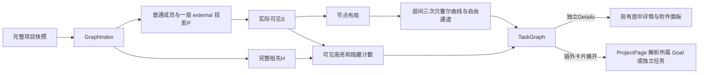

# 任务依赖追踪与详情阅读设计

一层 external 前置上下文、渐进概览、完整上游检查、独立 Details、外部卡片跳转与平滑路线已实现。Markdown 描述、附件导航和 bundled skill 指引也已实现。[要求](../spec/daynight-task-inspection.md)拥有行为。

## 实现范围

普通链图的完整 P、渐进 S、50/100 概览、显式 20 直接邻居批次、真实诱导边、reset 和实际 S 刷新保留共同构成图浏览机制。
图与详情保留并校验 externalDependsOn，性质也进入图等价和详情新鲜度；
成员来自普通依赖弱连通分量，虚线箭头来自显式外部边，虚线卡片表示链外上下文，
机制由[外部依赖架构](daynight-external-dependencies.md)定义。完整数据、进度和七项统计不因展示缩小。完整详情在弹窗与独立页面共用主体；TaskDetailPanels、附件分屏、五态读取、locale、鉴权/资源失效及手动/定时刷新策略保持，图检查不新增业务请求或刷新触发。

普通链图的主体切换图局部检查，独立 Details 入口阅读详情。完整 H 从完整索引计算，可见 H 和它们的全部真实可见路线/箭头同步高亮，隐藏 H−S 按 ID 去重计数。选择不展开、不布局、不编译几何、不适应或移动视口。Details、普通成员的方向控件及链外卡片的独立展开入口均为主体的兄弟原生按钮，键盘动作明确。

## 责任与数据流

ProjectPage 持有当前图资源的 `projectGraphWitness`、详情资源和列表浏览状态；ChainList 在同一浮层会话中保留最初列表按钮 `opener` 及最初 task witness `openedTask`，用于关闭焦点恢复。`TaskGraph` 拥有链投影、渐进可见集合、局部检查和根节点 framing，不与详情 ID 绑定。`GraphProjection` 只包含主体、外部节点和真实边，`ChainProjection` 另保留实际 root 和完成数；`layoutGraph` 以共享投影计算几何。`TaskGraphCanvas` 接收控制器生成的节点、几何、检查状态及视口计算，不推导链成员；图局部 Context 为节点和边提供呈现状态。`TaskGraphToolbar` 接收调用方的摘要、文案和动作。`TaskGraphDialogShell` 拥有 portal、浮层、滚动锁、焦点约束、Escape 和全屏，`TaskChainDialog` 提供实际链元数据和内容。完整索引拥有 H，渐进可见规则拥有 S；不能从已淡化或已显示元素反推完整依赖和统计。

## Goal 整体图

项目 Goal 整体图与普通链图共享 `GraphProjection`、画布、工具栏和弹窗机械层，但各自拥有布局、成员和交互策略。`projectGoal` 从完整索引按 Parent 选择全部直接成员，再读取成员完整 `dependsOn`，将可访问的范围外直接前置按 ID 去重；只以成员为 target 产生真实边，边的 external 分类取目标的 `externalDependsOn`。外部节点之间的边、更深祖先和仅反向后续不进入投影。空成员集合是有效空图，不使用虚拟根。Goal 标题与自身状态来自 typed Goal，进度和暂停统计只计算直接成员。

`GoalTaskGraph` 直接呈现全部成员和外部节点，不调用链的渐进可见集合或检查状态机。Goal 模式卡片为 220×96，主体是唯一 Task 详情入口，没有检查、重复 Details、展开或外部导航尾部；普通链保留自己的动作。专属布局按全部真实边的弱连通组件分组，以最长前置深度分层，层内网格换行，并按画布比例将组件矩形装箱；关联组件局部规划真实路线后连同节点平移，避免跨组件重新路由。空图不计算 bounds，异常输入和布局失败显式显示并可重试。首次等待已挂载画布报告非零尺寸，以完整几何计算 0.8–1 的可读视口；放不下的轴从左或顶部留 32 物理像素开始。工具栏和画布控件共用受控全图动作，按当前尺寸重新布局并完整适应，最小缩放允许完整 fit。图身份与拓扑分离，拓扑包含节点角色、边端点和分类；真实拓扑或方向变化按当前尺寸重新布局并恢复可读视口，相同数据、状态变化、详情、全屏和被动 resize 保留几何与视口。

`GoalGraphDialog` 使用共享弹窗外壳及项目已有 Clock/Pause provider，图内显示后台同步错误和重试，同时保留有效内容。项目图 target 由权威摘要中的资源类型决定：Goal 可以为空或在筛选/分页之外，Task witness 仍解析为多成员普通链。history 继续保存 UUID；Goal 卡片打开详情时保留同一个图和 witness。入口和来源焦点的所有权见 [Web 设计](daynight-web.md#项目详情-projectsprojectid)，范围及阅读要求见 [Goal 需求](../spec/daynight-goals.md#goal-整体依赖图)。

## 完整依赖与可见交互

`M = 普通边弱连通分量`，`X = union(externalDependsOn(m), m∈M)−M`，`P = M∪X`，`S ⊆ P`。
投影从普通成员读取直接 external 前置并去重，不从 X 继续追溯；完整索引保留全部祖先供 H 使用。绘制P中两端都在S的全部真实边，不生成捷径/聚合。proposed、todo、in_progress、done和cancelled按相同拓扑参与展开和H，保留状态、自动执行许可、暂停与阻塞。虚线箭头精确表示显式外部性质，普通上下文边实线；取消旧共享成员徽标。

选中s得到`H = {s} ∪ ancestors(s)`。选中和前置样式不同，无关项淡化但可辨；只改变S∩H以及终点在H的可见真实边，隐藏数为|H−S|，通过工具栏内稳定的 `role="status"` 元素反馈，为零时隐藏且不占空间。图工具栏统一显示链内/外部数量、可见/总任务和依赖数量、隐藏上游、布局方向及全屏/收起操作，不保留常驻操作说明段落。图浮层工具栏使用可换行 flex，左侧汇总组可按剩余宽度换行，右侧操作组按需换行；窄屏汇总与操作分行，完整按钮与原生键盘聚焦继续可用，工具栏不横向滚动。普通和全屏图浮层共用无局部语言选择器及语言偏好反馈的标题栏，标题与关闭操作在长标题和窄屏下保持可访问。画布缩放/适应控件固定在左下角，与右下角署名分开；画布紧接工具栏并以 flex 使用剩余高度。同卡片/空白清除，另一卡片替换。reset或同作用域快照更新后选择仍可见则保留/重算，否则清除。项目、链、页签或画布卸载清除局部检查。同代表的 M 变化重置 S/检查/旧动作并重新 framing，但不卸载画布、图浮层所有者或活动详情；有效定位任务的代表变化初始化对应图，图浮层仍保持打开。图浮层关闭或离开任务链视图才结束该图的浏览会话，打开状态和焦点归属由[Web 设计](daynight-web.md#项目详情-projectsprojectid)拥有。

普通成员的显式方向展开和 reset 仍可改变结构及其既有锚点/视口/焦点；检查本身不能触发这些动作。
链外卡片“展开”把实际 task ID 交给 ProjectPage：通过 `componentByTask` 解析其当前普通分量，
完整索引中的多成员目标直接替换当前图 witness，并使用目标代表的布局方向；图有效性要求
该任务存在且所属分量有多个成员，不要求它匹配列表筛选或位于当前页。状态/负责人筛选、
页码、条目、子任务展开和列表滚动在跳转期间及关闭后保留，概览显式定位独立使用 `listTarget`。
连续跨 Goal 跳转保持图浮层/全屏 owner 及最初 `opener`、`openedTask`；关闭后以 `preventScroll`
恢复仍可见的原按钮，Goal 列表来源的入口失效时先使用原来源 Goal 的可见展开控件，再使用原任务的当前可见链或列表/页签回退点。历史恢复没有运行期入口时使用当前 witness 的真实 Parent 查找可见 Goal，不改变筛选或页码。
单成员目标关闭原图并打开既有任务详情。该动作不追加原画布的外部祖先。普通失败保留旧图仅限同一身份/项目/鉴权作用域，401、会话/身份和资源转换沿用主线失效/取消/私有内容卸载。对话框打开时不抢焦点；消失入口使用既有关闭回退。locale重译新文案和可访问说明，不替换S、几何、视口或资源。

`getTaskExpansion(index, P, S, taskId, direction)` 只为普通成员返回该方向前 20 个 P 内隐藏直接邻居、剩余数及准确 `addedEdges`，包括批内真实边；不递归，无手动边上限。链外卡片不提供原地的前置/后续展开。卡片宽 220px；普通成员两方向都无可展开邻居时高 96px（94px 主体、2px 边框），不渲染 footer 或分隔线；至少一方向有控件时高 136px，包含 40px 双列 footer，另一空方向保留列位置。链外卡片使用 136px 高度及独立展开 footer。主体切换检查，Details 与展开控件为兄弟原生按钮。每个可见快照只派生一次展开数据，布局、React Flow 尺寸、初始视口、锚点居中和键盘揭示共用每卡片的实际宽高。展开重排 S，当前缩放居中锚点并聚焦主体；全局“收起到概览”重算/定位并保留 reset 焦点。

## 平滑路线

路由保留可见节点布局和顺序，规划器统一拥有边几何和节点避让。水平模式从源右中心到目标左中心，垂直模式从源下中心到目标上中心；均按 CanvasNode 的实际宽高规划。垂直模式将节点矩形和坐标转置到横向规划坐标，按层中心分组，并以层内节点最大边界确定空隙；规划后转回实际坐标，卡片文字和尺寸不旋转。规划器在中间层选择距卡片至少16单位的自由通道，不同位置的层间端点由完整三次贝塞尔曲线连接，控制点位于空隙中线与起止位置，曲线凸包限制在无卡片空隙中。水平曲线以水平向右切向出入，垂直曲线以垂直向下切向出入；相同位置的连续通道合并为直线。`compileDependencyRoute`编译统一的M/L/C路线，虚线使用真实弧长和精确三次子曲线，内部切口位于全局5/4周期的第7单位，直线和曲线绘制片段的弧长均不超过8192单位；累计相位误差在最大1.8倍缩放下不超过0.025 CSS px。[方向决策](../../.agents/notes/implemented/feature/2026-11-05-task-graph-direction.md)拥有双方向扩展，[贝塞尔路线决策](../../.agents/notes/archived/architecture/2026-10-25-bezier-task-dependency-routing.md)与[统一路线决策](../../.agents/notes/archived/architecture/2026-10-22-uniform-task-dependency-routing.md)保留原始曲线和通道选择理由。

编译器消费规划路线，产生canonical平滑路径与外部paint pieces。所有可见依赖、方向、实际body和箭头完整；外部高亮仍为5/4虚线。曲线弧长/分片在几何变化时计算，最大支持缩放的累计相位误差满足既有≤0.1CSSpx要求。选中/前置/无关呈现引用同一份几何，不能以删边、降为实线或临时返回折角掩盖失败。

## 居中详情

`TaskDetailSurface` 组合已有详情 hook、关系跳转、PR 和附件组件；`TaskDetailDialog` 提供弹窗外壳，独立页面使用相同主体。样式由 `task-detail.css` 的 `task-detail-*` 命名空间拥有。普通模式外壳相对可用视口居中，宽度 `min(960px, 100% − 2 × gutter)`，桌面 `gutter = 24px`，600px 及以下为 12px；最大高度为 `min(880px, 100dvh − 2 × gutter)`。标题栏、详情页签和关闭按钮处于面板滚动内容之外。实际任务标题直接作为顶栏 `h2` 和对话框可访问名称，加载与首次失败使用状态标题；正文头部只保留状态和操作控件；tooltip 与限时气泡的机制由[详情提示设计](daynight-web.md#任务详情提示)拥有，不参与页签和阅读区的高度分配。完整标题自身有界、可聚焦并支持原生键盘滚动；已加载标题文字右侧放置不收缩的复制图标按钮，保持标题和按钮间距，顶栏保留全屏切换、“…”菜单与关闭入口，当前状态菜单位于标题下的公共状态行、平台切换之前；“…”紧邻关闭按钮左侧，收纳按当前任务/页签/附件生成的真实新标签链接和任务删除，独立页菜单只提供删除。菜单先关闭并聚焦“…”按钮，再打开既有删除确认，取消确认可恢复到仍存在的入口；菜单的键盘导航和外部关闭独立于详情的 Escape 层级。详情通过共享 `LocaleProvider` 沿用应用当前语言。默认“概览”正文独立滚动，包含描述、PR 与元数据/关系；完整 ID 旁与标题旁统一使用 `TaskCopyButton`，以两个错位叠放方框表示复制，保留双语 `aria-label` 和原生 `title`。组件直接调用 Clipboard API 写入完整原值，pending 时禁用按钮，成功与失败使用 `TaskDetailNotice`；标题实例按 project/task 与标题值绑定，ID 实例按完整 ID 绑定，卸载使迟到结果失效。复制失败保留可选原文和重试；桌面为阅读主栏与 265px 侧栏，850px 及以下侧栏收为 225px，600px 及以下堆叠。附件页签占用全部正文宽度，在所有宽度下保持左列表、右预览；尺寸链及唯一右侧滚动所有者由[附件设计](daynight-task-attachments.md#web-文件树与预览)拥有。长文本换行，代码和表格只在所属区域横向滚动。描述使用共享 Markdown 视图和现有附件导航，详情加载与错误继续由详情资源拥有。

`DetailFrame` 提供共享的 section/main 外壳、受控的 `KeptMountedSlot` 和全屏滚动恢复；Task 业务及 Session、Steps 控制器仍由各自组件持有。`useDetailOverlay` 管理焦点、键盘与计数滚动锁；`OverlayOwnerContext` 沿 React 树跨 portal 传递父层，注册子层时以 inert 租约隔离父层。只有注册树的顶层消费详情 Escape/Tab，重叠租约全部释放后才恢复父层。Discussion 消息详情和确认框注册为子层；[Thread Web设计](task-thread-web.md#阅读键盘与验证)拥有消息详情的关闭与焦点归还。附件菜单与原生删除确认在详情子树内拥有当前层键盘处理，Escape 关闭该层并保留详情；具体行为由[附件设计](daynight-task-attachments.md#web-文件树与预览)拥有。清理 inert、滚动锁和监听器的同步阶段与 DOM 移除后恢复焦点的阶段保持既有职责。原入口消失或处于隐藏的项目任务区时，不以 DOM 仍连接作为可聚焦证据。优先选择仍可见图浮层的关闭控件，否则使用当前可见任务或页签控件；概览或空项目中没有任务入口时恢复当前项目页签或标题。任务关系切换不卸载外壳，不中途恢复到旧入口。外壳不引入图重挂载。`dialogFocusables` 与实际对话框中的同源附件 frame 共用可见控件枚举，frame 的文档与活动键盘所有者共同决定监听生命周期，重载、owner 变化和卸载均释放旧监听；子层占有键盘时 frame 桥接让出事件。独立完整详情页普通模式使用浏览器键盘行为，全屏模式使用下述阅读工作区所有者；附件的完整清单、渲染与滚动仍由[附件设计](daynight-task-attachments.md#独立附件阅读页)拥有。

## 全屏阅读工作区

`TaskDetailDialog` 与 `TaskDetailPageContent` 各持有本次阅读工作区的 transient
fullscreen 状态，向 `TaskDetailSurface` 传递活动值和变更操作。关系导航保留该模式，
关闭或卸载后新工作区从普通模式开始。模式不进入 URL、历史或存储。共享主体只改变
同一外壳的 presentation class 和尺寸，不改变 `presentation`、React key、portal 或
阅读面板的挂载位置，也不创建第二份详情。详情 session、附件控制器、文件输入、
草稿、写入锁和 pending 请求继续归原所有者。

全屏采用 fixed/inset 和 `100dvh` 填满内容区，去掉弹窗边距与圆角，保留同一标题、
页签、退出和关闭入口。可收缩 flex/grid 链使用零最小尺寸，正文仍由概览、文件树和
预览各自滚动。切换前捕获应用拥有容器的滚动位置，在新布局中按合法范围恢复，
包括文末附近；原生 HTML/PDF 保持 frame identity 和 URL，由内部文档或浏览器
阅读器继续拥有滚动。该模式使用 CSS，避免浏览器 Fullscreen API 排除 body portal
或引入另一套退出生命周期。

高度不超过 500px 时，`.task-detail-fullscreen` 独立采用紧凑空间分配：标题与操作
共享紧凑顶栏，完整标题保留在可聚焦、单行高度的滚动窗口中。正文状态行将状态
与负责人控制组、平台切换依次放在左侧，ready/blocked 在后，自动执行在右侧；状态、负责人与平台
使用 24px 紧凑控件，600px 及以下按[状态区布局](daynight-web.md#平台要求与确认下拉框)统一换行，自动执行位于末行右端；页签和面板压缩间距。附件预览标题同时压紧路径、
元数据和操作，具体由[附件设计](daynight-task-attachments.md#web-文件树与预览)
拥有。普通带归属详情在同样短视口下复用紧凑页签、附件内边距与预览标题；独立页保留返回/语言辅助栏，以紧凑间距让中英文完整控件在 320px 下同排可用。包含 claim 的正文头部另受[归属布局](daynight-web.md#认领归属与强制撤回)的有界滚动约束，在普通及全屏都保留可收缩高度、完整归属信息和键盘可达操作。这些尺寸规则共同为 320×240 下的概览正文及原生预览实际分配非零可读空间；继续使用原有 DOM 与各内部滚动所有者，不通过外层正文滚动或 reader 最低高度争夺空间。

`TaskDetailSurface` 统一处理未被子层消费的 Escape：全屏时退出并聚焦切换按钮，
普通弹窗关闭，普通独立页保持原生行为。菜单、确认与同源 HTML 子应用先处理自身
事件；已有 `defaultPrevented` 阻止外层消费。图全屏位于详情之下，关闭顺序依次为
子层、详情全屏、详情弹窗、图全屏、图浮层。弹窗沿用既有背景 inert、焦点约束与计数滚动锁，
全屏切换不重复申请这些资源。独立页全屏隐藏辅助顶栏，标题栏保留返回已知项目路径
的入口，退出恢复辅助顶栏；普通页 Escape 不执行 history 推测或窗口关闭。

Session 子树继续拥有其设置面板和 Session 全屏的键盘层级。`SessionComposer` 与 `useSessionFullscreen` 使用[公共选择组件的 popup 判断](native-select.md#原生弹窗与外层关闭)，尊重 `defaultPrevented` 及 IME；原生菜单打开时只停止 Escape 传播，保留浏览器默认取消，不关闭设置、Session 全屏或外层详情。共享全屏处理器同时覆盖 Timeline 交互单选和 Terminal 录制缩放，包含 React 根与 document 两个入口；后续非 popup Escape 才按当前最上层退出并恢复原焦点。

Surface 向 Reading 与附件预览传递语义键盘所有者：活动阅读 root、当前层资格和 `onEscape`。
弹窗始终提供，独立页仅全屏时提供。已加载 frame 的文档和 owner 变化会更新监听，
不依赖 reload；具体 document 清理、边界 Tab 和原生 PDF 的限制由
[附件设计](daynight-task-attachments.md#web-文件树与预览)拥有。此扩展与居中/独立页
生命周期的取舍见[全屏阅读决策](../../.agents/notes/archived/feature/2026-10-25-task-detail-fullscreen.md)。

## 独立完整任务详情

`TaskDetailPage` 在工作空间与详情弹窗外组合 `TaskDetailSurface`，保留完整内容与
已有操作。页面外壳提供返回项目、语言选择及满视口尺寸；主体使用同一份描述、PR、
状态菜单、关系、元数据、自动执行许可、暂停展示与解除、执行平台及附件组件。`TaskDetailDialog`
提供 body portal，共享详情弹层拥有 inert、滚动锁、焦点循环、Escape 与关闭恢复；这些模态能力
不属于普通独立页面；共享主体根据当前入口与阅读模式注册语义键盘所有者。状态行的平台选择、控件锁定 tooltip 与独立浮层反馈
沿用当前详情实现；状态、许可与平台通过同一个确认 union 和精确版本审查拥有者
提交，附件删除继续使用既有确认层。具体平台复核与错误反馈由
[Web 平台设计](daynight-web.md#平台要求与确认下拉框)拥有。

路由使用 `TaskDetailNavigation` 表达 `tab` 与可空 `path`。
`taskDetailUrl(projectId, taskId, navigation)` 生成任务入口或附件路径入口及所需的
`tab` 查询参数。`/projects/{projectId}/tasks/{taskId}` 对普通 Task 默认为概览，对 Goal 默认为描述，已有附件路径
默认为附件；显式 `tab=overview|description|attachments|steps|discussion|session` 进入共享导航准入。Goal 的 `description` 和 `overview` 均选择默认描述页签，详情只提供描述、附件和讨论；普通 Task 只接受自身支持的页签，`description` 回退概览。Session不可用时回到概览，Discussion始终存在。没有文件的附件页签使用
基础任务路径，隐藏的已选文件可随概览 URL 保留。路径沿用现有分段编码、UUID 和
附件路径校验；App 同时感知 pathname 和 search，登录返回地址保留导航查询参数，
构造登录入口时移除临时 `authError`，使旧登录失败不成为返回后的状态。

独立外壳拥有任务关系、页签和附件选择的导航。显式交互通过 `navigate()` 请求准入后写入
目标 URL，Back/Forward 由应用导航所有者在采用目标前决定草稿去留；相同 Task 的
页签和附件往返保留主体。确认历史目标不再写历史，同一状态不重复生成条目。
独立页以身份、项目和根资源绑定轻量阅读载荷，保存根 Goal 的图和子 Task，以及外部 Goal 对话框及其子层选择。Goal 详情不提供子任务列表。跨 Goal 的 Details 跳转在一次阅读选择中同时指定目标 Goal、描述页签和 `GoalChildren.task`，直接打开对应 Task；链外 Expand 对多成员目标指定目标 Goal 及 `GoalChildren.graphRootId` 的完整分量代表，并将 `task` 清空，单成员目标仍打开 Task 详情。两种动作不依赖详情列表行或焦点 witness。来自独立详情的未归属多成员 Expand 通过项目地址的临时 `#chain={taskId}` 传递图 witness；项目 owner 在完整索引可用后清除 fragment，准入目标图并保留自己的列表状态，无效或已消失目标显示现有不可用提示。`#task={taskId}` 保留现有任务阅读／列表定位含义；fragment 不成为持久偏好或根详情分享格式。受控图和子 Task 的历史恢复继续使用原资源与宿主准入。URL 继续拥有根页签和文件；每个受控条目初始化时以 replace 保存选择，用户阅读变化以 push 提交，关闭经既有保护后以 replace 清除相应子层。遍历只应用已准入载荷，不重放用户操作。`TypedDetail` 在确认 Goal 类型后接入受控子层；`TaskDetailDialog` 透传页签与文件选择，项目页调用者也以项目阅读载荷控制详情及其子层。页面载荷只保存资源 ID、图根和阅读导航，不保存资源内容、权限、草稿或 DOM；焦点入口和阅读工作区仍由原组件持有。异常载荷显示导航错误，不用于打开其他资源。相同 Task 只有在资源、父宿主和呈现方式均保留时才视为同一草稿工作区。项目根 Task 的 `summary` 与 `direct` 入口可能在 `TaskDetailSurface` 和 `TypedDetail` 间替换草稿宿主；两者切换须先经过离开保护，即使 Task ID 相同。同一详情 hook 改变读取来源时重新建立该来源的 opening，切换前的正文不能满足新来源资格；未完成或未知写操作继续由会话核对，不重新提交。Goal 根详情及其子 Task 按实际资源和宿主判断，不仅因根来源变化认定离开；已验证的 direct Goal 在图暂缺时仍可保留原 typed owner。若已有图却不能确认目标为 Goal，来源切换先保护草稿。子 Task 首次准入后在本次挂载保持其读取来源，图暂缺或恢复不会切换宿主；尚未准入的子选择等待图后再确定来源。身份、权限或历史退休仍撤销旧资源。恢复项目摘要来源的详情时，图快照尚未提供资源类型则保持加载，不将该选择改作 direct 读取；本地摘要的 revision 0 不建立 Task 正文读取资格。类型确认为 Goal 后沿用 Goal 的 typed/direct 读取，明确的 direct 入口也不依赖项目图。已挂载的同一摘要详情在快照暂缺时保留已识别的类型和最近的摘要观察，以维持原阅读器；这些临时观察不写入历史，也不取代身份、权限和历史代次的原准入与撤销；退休后的旧图不能重新证明类型，普通缓存代次变化不退休阅读器。历史编号、取消恢复和未编号项限制由 [Steps 导航设计](daynight-task-steps.md#web-呈现导航与大集合)拥有。
弹窗通过标题栏“…”菜单中的新标签真实链接导出当前选择，附件
预览的新标签入口也进入完整详情并定位该文件。两个窗口不交换任务对象、图快照、
草稿或确认状态。

`TaskDetailPage` 使用当前 opening 的 direct Task 观察读取完整正文与写入基线；页面恢复可见时立即重读 Task，以更新写入资格和 Session 生命周期。关系另行读取局部任务链，局部投影不承诺包含外部后续。关系在页面可见时独立周期刷新，不依赖项目同步；普通失败或超时保留已显示的关系并提供重试，可信拒绝和历史退休撤回关系。单次网络读取有界，隐藏时取消并暂停，恢复可见后重读。该观察与项目同步共享 epoch 历史退休机制，但不依赖项目图、摘要或持久缓存。成功写入后保留确认及版本下界，新的实时 GET 达到下界后才重新允许写入；冲突和未知结果只读核对。账户变化等待刷新保持页面可见与本地交互，沿用认证外壳的远程暂停和真实失效边界。

主体保持外层容器；`TaskDetailReading` 按身份、project、task、history 和 opening 绑定。历史退休时卸载阅读资源。同任务的 query、页签和
附件路径变化保持挂载，所以目录展开、上传草稿、预览与滚动状态按原规则保留；
任务或身份变化则释放旧资源。详情会话继续提供精确 int64 版本、共享写入锁、冲突
重读和未知写结果核查，不重放不确定请求。无变化的后台详情读取保留实际 DOM、
焦点及标题/面板几何，错误保留原有可见状态和重试入口。

Go UI mux 精确登记基础任务页 GET/HEAD；附件入口继续使用既有登记和原始路径
守卫。页面只交付相同 index，业务数据沿用原有鉴权接口。当前机制及先前附件独立
组合的取舍见[独立详情决策](../../.agents/notes/archived/architecture/2026-10-24-standalone-task-detail.md)。

## 状态与详情会话

创建默认为 proposed，可显式选择 todo，专用set-status设置五状态并使用观察版本，全部实际前置及受保护后继仍由服务核验。
图节点无 task version，检查不发起写请求。共享 TaskDetailSession、状态/许可/暂停解除/平台互斥、冲突与未知 GET 核对及
身份隔离由[状态设计](daynight-web.md#版本化状态设置与任务会话)与[状态架构](daynight-task-status.md)拥有。
状态、许可、暂停解除及平台刷新保留选择、S、视口、详情页签和附件 controller；确认资源或身份失效按会话规则清除私有内容。

Task 属性、状态、删除、claim 和 Steps 写入共用 `TaskDetailSession` 的操作所有者。每次操作持有组合 scope signal 的 controller，准备与准入等待取消后直接结束，不重新进入等待。`submitted` 继续防止重放；内部 `onDispatch` 单独记录实际派发，可信回执及真实提交版本另行记录，不改变服务器协议。暂停时本地收尾只更新仍归原操作的当前记录或既有 retired record，不经过 gate、缓存安装或 API；可信回执保持 confirmed，派发后未确认保持 unknown，未派发和已知拒绝沿用原分类，缺少真实版本时为 `null`。该收尾先于旧 404/410 的清理分支，避免撤销保留正文。

正文、缓存和后续读取仍通过原身份、资源及版本准入。延迟发布由原所有者持有并可取消，替换或销毁时终止并接收错误；临时暂停恢复后可发布同一结果。清草稿、重置、关闭及导航还核对原编辑实例、内存 draft revision 和提交时导航上下文，较新编辑或导航不受旧结果破坏。操作锁与本地 promise 不由等待展示准入的工作持有；收尾不能释放新操作的锁或覆盖新 token。

图检查与 Details 入口保持独立。

## Markdown 与附件链接

`MarkdownContent` 复用 `react-markdown` 与 `remark-gfm`，拥有 CommonMark/GFM、
Mermaid 图表及共享样式，覆盖标题、段落、列表、引用、代码、表格、链接和图片。
模块级稳定的 `pre` renderer 只将 `mermaid` fenced code block 交给图表组件，
其他代码块保留原生 `pre/code` 结构。URL 转换与链接激活继续由调用方提供。原始 HTML
作为文本，URL 协议沿用已有规则。空描述使用双语目录中的空态消息；用户 Markdown
字节不随语言切换变化。概览继续拥有纵向阅读滚动，代码和表格只在局部横向滚动，
宽内容不能撑破 320px 的尺寸链。

`MarkdownAttachmentBase` 显式区分任务 `root` 与实际文件 `document`。描述从当前
任务附件根解析相对链接和图片；附件 Markdown 从实际文件目录解析。既有路径解析
逐段解码、处理 parent 段并拒绝越过任务根，继续使用真实预览 URL 构造器；不为描述
虚构文件名。API 保存和 CLI/Agent 读取保持原始字符串，不增加格式标记、迁移或
旧数据特判，描述更新保留完整字段替换及观察到的版本语义。

`TaskDetailReading` 在当前 project/task 身份内持有单个 `useAttachments`，将同一
控制器交给描述导航、`TaskDetailPanels` 和 `TaskAttachmentsPanel`。普通主键点击
无 query/hash 的有效相对文件链接时，选择解码后的路径、激活附件页签并将焦点带入
已有 `.attachment-preview-pane`。清单完整前保留加载，只有完整分页清单才判定
缺失；非法路径、清单失败、确认缺失与预览失败分别可见，适用时提供重试。非法
Markdown 引用反馈绑定其所属的语义任务/页签/文件选择；首次激活保留相应提示，
外部历史恢复其他导航状态时清除旧反馈，避免覆盖恢复后的文件预览。附件区
和描述没有第二份清单或预览请求所有者。独立使用的 `TaskAttachments` wrapper 保留
自身 hook；独立完整详情通过同一个 `TaskDetailReading` 共享描述与附件状态，沿用原有文件身份，并按普通/全屏阅读模式选择键盘所有者。

链接保留真实 preview `href`。修饰键、非主键、上下文菜单、绝对 URL、协议 URL、
以 `/` 开头的 URL、`#fragment` 及 query/hash 链接使用经过现有 URL 策略处理的
原生导航，不生成 Markdown 标题 ID。预览、原生 frame 键盘桥及 focus cleanup 保留
原所有者；选择、关闭、任务/鉴权/资源失效通过原有取消和 generation 规则排除旧
结果，同路径更新仍使用既有 revision 与 `updatedAt` 重读规则。

公开 skill 源为 `packages/daynight/src/commands/skill/skills/using-daynight/`。
公共手册说明 Markdown 与引用；仓库创建、handoff、执行和 Goal 指引共用 task-content 标准；任务定义、成果及
session 方法与过程的内容归属由 [Agent skill 设计](daynight-agent-skill.md#文档职责与任务资料)
拥有，阅读层不维护另一套栏目或强制证据位置。description 明确当前责任与资料入口，
未指定附件交付时正文完整无需主附件；Goal 需求阶段的完整 `spec.md` 和 managed 必需
附件不能由正文替代。Goal 持有共享需求、设计和整体验收，阶段 task 保留生产责任、Goal ID 和路径；架构 description 直接注明
需求生产 task ID、Goal ID、spec 路径及适用原型，并实际读取已确认内容。

每个 Goal 交付正文直接列出架构生产任务 ID、共享资料拥有者 Goal ID 及各必需来源：来源 description 全文或适用
章节、真实附件完整路径，或保留所属架构任务身份的不可变仓库引用。正文来源通过
`task show` 读取，间接后继同样保留入口；登记时核验，实施前读取所列输入。资料引用
不新增执行依赖，也不复制整套共享材料。真实资源确认上传后才加入引用，链接按实际
所有权和根/文档路径解析。依赖、PR 属性、Goal 阶段、创建/实现/合并权限继续独立；
创建默认 proposed，内部已确认任务可显式选择 todo，登记不执行，精确版本 set-status 不授予额外实现或交付权限。
交付验证检查实际 npm bundle 及隔离安装夹具，
安装目录通过正常重新安装更新。机制取舍见
[Markdown 描述决策](../../.agents/notes/archived/architecture/2026-10-22-task-description-markdown.md)。

## Mermaid 图表

`MarkdownContent` 将 `mermaid` fenced block 交给共享图表组件，普通 Markdown
无需等待 Mermaid 12.2.0 的动态加载。来源仍以任务根或附件文件目录解析，不改变
存储格式或权限。显式稳定类型表约束[要求](../spec/daynight-task-inspection.md#markdown-图表)中的
15 类入口和 SDK 识别、解析及绘制 ID；SDK 新增类型不会自动开放。默认流程图使用
Dagre，显式 `flowchart-elk` 使用 SDK 内置布局，其他类型使用各自布局。

SDK 初始化、类型判定、语义预检和绘制共享一个串行队列，避免全局配置互相覆盖。
配置固定 `strict`、应用主题和关闭可配置 HTML labels；拒绝来源中的配置指令及
frontmatter。源码上限为 50,000 个 UTF-16 代码单元。固定版本的 parser DB 提供
语义预算，每项上限 500：流程图、类图、状态图、ER 和需求图分别计节点及边；
时序图分别计参与者及消息/注释/控制标记；Gantt 与 Journey 分别计任务和分组，
Journey 另计参与者且只调用一次有派生副作用的任务 getter；饼图计分区，象限图计
点；XY 分别计 plot、全部数据点及分类轴 categories；Block 计展开后的块和边；
Packet 计行和全部字段；Kanban 计列与卡片；Event Modeling 分别计 box、swimlane
和 relation。异常 DB 结构作为兼容性错误暴露，而非默认为空。

Block 的 `space:N` 在 parser 建立层级时展开，因此先通过安全种子获取固定 SDK 的
lexer，在独立词法会话中检查空间展开总数、跨度和显式列数，避免大数分配；标签
和注释由同一 lexer 区分。解析后还按 SDK 实际绘制树估算 `setBlockSizes` 的调用量：
根的深度为 0 并计一次，深度为 d 的块计 2^d 次，合计上限为 50,000；超限在绘制前转为局部
复杂度错误。该固定版本对每个子节点递归两次，嵌套可能导致指数增长，仅限制块数
不足以约束该路径。估算依据真实层级而非源码或平面节点列表，仅限制尺寸计算调用，
不保证整个 parser 为线性或其同步工作可中断；解析仍受源码长度及展开预算约束。
SDK 升级须重新核对布局算法和预算。Gantt 的日期编译可能逐日循环，固定发布包通过 pnpm
补丁在根入口使用的 chunk 中对每次 `getTasks()` 的所有任务和编译 pass 累计
50,000 次实际日历步进，`clear()` 和读取入口重置预算。超限转为局部复杂度错误并
保留原始 cause；升级 SDK 时须重新验证补丁路径和真实 parser 合同。

流程图及可表达资源节点的类型在绘制前根据 parser 语义拒绝图片节点。图片绘制
等待的 `Image.decode()` 不能由阅读组件的 abort 中断；裸 `Promise.race` 也不能
终止 SDK 工作或释放其共享状态。预检保留普通形状 metadata、标签中的字面量
`@{` 和已解析的转义 key。图片节点支持需要可中断的隔离上下文及新的构建入口、
消息协议、CSP 和资源生命周期。

每次绘制使用唯一 ID 和可测量的离屏容器，成功或失败均清理，隐藏页签不会造成
零尺寸。返回 SVG 的根 `viewBox` 必须有有限且为正的宽高，应用以其设置固有尺寸并
移除根 `max-width` 收缩样式。结果通过 Blob URL 和原生 `img` 展示，不插入阅读
DOM，也不调用 `bindFunctions`。Event Modeling 的合法 XHTML 标签保留在静态图片中。
临时绘图 DOM、自定义样式资源和普通 Markdown 外部图片仍可能产生网络请求，该
机制不提供网络隔离。

图块拥有当前语言的状态、源码和图片资源。异步结果绑定来源与挂载生命周期；内容
变化立即停止呈现旧结果，晚到事件不能改写当前图块，替换和卸载时释放对象 URL。
模块级 renderer 身份稳定，父组件更新不会重建整个阅读树。可聚焦且具备可访问
名称的局部滚动区域保留自然尺寸和键盘阅读；320px 下不撑宽整体页面，概览及附件
正文保留纵向滚动所有权。标签、关系及数据的最终绘制须由真实浏览器验证。原有
[流程图决策](../../.agents/notes/archived/feature/2026-10-24-markdown-flowcharts.md)
及[稳定类型决策](../../.agents/notes/implemented/feature/2026-11-05-stable-mermaid-diagrams.md)
记录取舍。

## 验证与交付

完整输入、50/100/20、mandatory visibility行和渐进渲染政策保持。验收独立验证完整P/S/H、可见role/真实边、隐藏祖先去重、同卡片/空白清除、兄弟控件与键盘/焦点，以及选择/Details/关系前后的S、节点位置、canonical路径、actual pieces和viewport完全稳定。覆盖普通多起点、一层多个直接 external 前置及去重、上下文祖先排除、完整 H−S、外部卡片的 Goal/独立任务跳转、跨页/筛选隐藏的图目标、列表筛选/页码/条目/子任务展开/滚动保留、连续 Goal 跳转后的原入口焦点与入口失效回退、图 witness 消失/单成员关闭、todo/in_progress/done/cancelled、代表无普通前置、刷新消失、普通失败和鉴权失效。

独立地从完整项目数据构造一层投影 P，再结合实际 S 推导普通卡片是否存在隐藏直接邻居，验证 96/136px 高度；P 外无关后续不产生普通方向 footer。链外卡片始终保留独立展开 footer，并验证该入口进入真实所属资源、原图不会追加祖先。实际DOM路线的端点/方向、平滑相切、全部可见卡片避让、真实CTM、完整body coverage、参考弧长/phase及原生箭头独立判断，不能由生产规划器输出充当有效预期。可选输入只做编译忠实度，负例覆盖缺/多边、错误箭头、穿卡片和相位/覆盖失败。稳定性比较使用图坐标/相对变换，页面滚动诊断单独保留，不能把一致的文档平移误判为图变化。

Web 模块测试和受控浏览器 fixture 验证各自范围，不能证明真实服务或安装 CLI 的组合结果。
全规模压力验证独立于常规 CI，保留四个完整 1,000 任务输入、999/5,000 边、每图五次、
selected/hidden 上游、visibility 和超限检查，以及 `openMs ≤ 3000`、
`select/detail/zoom/pan ≤ 300ms` 的目标。普通 Details 关闭后立即 zoom/pan，再可信选择
并执行高亮态同序列，取较慢状态，单独记录网络；关闭与缩放间不加等待、reset 或 fit。
实际结果必须绑定源码和环境；旧跨产品 runner 已删除，其结果不能证明当前版本。

描述阅读中的图检查、相对附件导航及关闭后的选择、几何和视口保持由 Web 模块验证。
详情身份暂停的模块协作验证使用同一真实 `TaskCacheScope`、`TaskDetailSession`、
Thread 和附件 owner，以及受控 HTTP 响应和操作屏障。可信不同用户的 Task 响应经实际
principal 校验通知 scope 的账户 owner；在回调内检查 scope 尚未失效且 signal 未取消，
再同步暂停准入并取消共享普通网络 lifetime。验证在派发前取消、派发后未确认和可信
确认后暂停时的本地收尾，确认 busy 与原 promise 不等待远程发布准入，且不自动读取或
重放。原 Task/Thread 正文和草稿、附件列表、选择与已加载预览保留，旧结果不能安装
不同用户正文或清除较新编辑、关闭旧窗口或导航；暂停时原生附件远程地址与下载能力
撤销。替换或释放 owner 时，延迟发布须取消并接收错误。该模块切片不证明真实跨标签页
通知、最终根账户和 header 接线或浏览器原生操作连通性；这些行为由相应浏览器组合
验证承担。
API 不引入格式标记或旧数据特判，现有字符串直接按 Markdown 展示。类型、模块单测、
受控浏览器和构建分别验证其职责，真实产品连接由独立组合验证承担。
