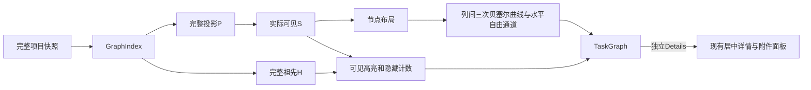

# 任务依赖追踪与详情阅读设计

完整前置上下文、渐进概览、局部依赖检查、独立 Details 与平滑路线已实现。Markdown 描述、附件导航和 bundled skill 指引也已实现。[要求](../spec/daynight-task-inspection.md)和[原型](mockups/task-inspection/index.html)分别拥有行为与视觉。

## 实现范围

完整 P、渐进 S、50/100 概览、显式 20 直接邻居批次、真实诱导边、reset 和实际 S 刷新保留共同构成图浏览机制。
图与详情保留并校验 externalDependsOn，性质也进入图等价和详情新鲜度；
成员来自普通依赖弱连通分量，虚线箭头来自显式外部边，虚线卡片表示链外上下文，
机制由[外部依赖架构](daynight-external-dependencies.md)定义。完整数据、进度和六项统计不因展示缩小。完整详情在弹窗与独立页面共用主体；TaskDetailPanels、附件分屏、三态读取、locale、鉴权/资源失效及手动/定时刷新策略保持，图检查不新增业务请求或刷新触发。

主体切换图局部检查，独立 Details 入口阅读详情。完整 H 从完整索引计算，可见 H 和它们的全部真实可见路线/箭头同步高亮，隐藏 H−S 按 ID 去重计数。选择不展开、不布局、不编译几何、不适应或移动视口。Details 与方向控件均为主体的兄弟原生按钮，键盘动作明确。

## 责任与数据流

ProjectPage保持详情资源和入口/关闭恢复所有权。当前画布拥有局部检查状态，不与详情ID绑定。图局部Context为节点/边提供呈现状态，受控节点几何和布局输入保持稳定。完整索引拥有H，渐进可见规则拥有S；不能从已淡化或已显示元素反推完整依赖和统计。

## 完整依赖与可见交互

`M = 普通边弱连通分量`，`P = M ∪ ancestors_all(M)`，`S ⊆ P`。绘制P中两端都在S的全部真实边，不生成捷径/聚合。todo、in_progress和done按相同拓扑参与展开和H，保留状态、自动执行许可与阻塞。虚线箭头精确表示显式外部性质，普通上下文边实线；取消旧共享成员徽标。

选中s得到`H = {s} ∪ ancestors(s)`。选中和前置样式不同，无关项淡化但可辨；只改变S∩H以及终点在H的可见真实边，隐藏数为|H−S|，通过工具栏内稳定的 `role="status"` 元素反馈，为零时隐藏且不占空间。单行工具栏统一显示链内/外部数量、可见/总任务和依赖数量、隐藏上游及全屏/收起操作，移除常驻操作说明段落。工具栏禁止换行，左侧文字组使用 `flex: 1`、`min-width: 0` 和单行省略截断，右侧操作组禁止收缩并始终完整显示；工具栏不横向滚动，控件仍支持原生键盘聚焦。窄屏压紧操作按钮，语言选择器的标签仅在视觉上隐藏，原生选择框及可访问名称保留。语言偏好错误提示相对工具栏定位并浮在其下方，重试入口保持可见且不挤占按钮宽度。画布缩放/适应控件固定在左下角，与右上角语言错误提示及右下角署名分开；画布紧接工具栏。同卡片/空白清除，另一卡片替换。reset或同作用域快照更新后选择仍可见则保留/重算，否则清除。项目、链、页签或画布卸载清除局部检查。同代表的 M 变化重置 S/检查/旧动作并重新 framing，但不卸载画布、全屏所有者或活动详情；代表变化仍按链切换处理。

显式方向展开和reset仍可改变结构及其既有锚点/视口/焦点；检查本身不能触发这些动作。普通失败保留旧图仅限同一身份/项目/鉴权作用域，401、会话/身份和资源转换沿用主线失效/取消/私有内容卸载。对话框打开时不抢焦点；消失入口使用既有关闭回退。locale重译新文案和可访问说明，不替换S、几何、视口或资源。

`getTaskExpansion(index, P, S, taskId, direction)` 返回该方向前 20 个隐藏直接邻居、剩余数及准确 `addedEdges`，包括批内真实边；不递归，无手动边上限。卡片宽 220px；两方向都无可展开邻居时高 96px（94px 主体、2px 边框），不渲染 footer 或分隔线；至少一方向有控件时高 136px，包含 40px 双列 footer，另一空方向保留列位置。主体切换检查，Details 与方向控件为兄弟原生按钮。每个可见快照只派生一次展开数据，布局、React Flow 尺寸、初始视口、锚点居中和键盘揭示共用每卡片的实际宽高。展开重排 S，当前缩放居中锚点并聚焦主体；全局“收起到概览”重算/定位并保留 reset 焦点。

## 平滑路线

路由保留可见节点布局和顺序，全部边从源右中心到目标左中心，规划器统一拥有边几何和节点避让。`planDependencyRoutes(nodes, edges)`按每个 CanvasNode 的实际 width/height（220×96 或 220×136）一次建立列和16单位扩张的占用行区间，各中间列按Dagre意图插值选择最近自由行，在列的右边界和下一列的左边界输出严格向右的通道端点。不同高度的列间端点由完整三次贝塞尔曲线连接，两个控制点分别位于空隙中线与起止高度；曲线凸包完全位于列间空隙，因此不会进入卡片。穿过中间列的段保持水平，等高连续段合并；所有曲线出入和相邻段的切向均水平向右。`compileDependencyRoute`编译统一的M/L/C路线，虚线使用真实弧长和精确三次子曲线，内部切口位于全局5/4周期的第7单位，直线和曲线绘制片段的弧长均不超过8192单位；累计相位误差在最大1.8倍缩放下不超过0.025 CSS px。[贝塞尔路线决策](../../.agents/notes/implemented/architecture/2026-10-25-bezier-task-dependency-routing.md)拥有曲线形状与避让机制，[统一路线决策](../../.agents/notes/implemented/architecture/2026-10-22-uniform-task-dependency-routing.md)保留此前通道与圆角选择的理由。

编译器消费规划路线，产生canonical平滑路径与外部paint pieces。所有可见依赖、方向、实际body和箭头完整；外部高亮仍为5/4虚线。曲线弧长/分片在几何变化时计算，最大支持缩放的累计相位误差满足既有≤0.1CSSpx要求。选中/前置/无关呈现引用同一份几何，不能以删边、降为实线或临时返回折角掩盖失败。

## 居中详情

`TaskDetailSurface` 组合已有详情 hook、关系跳转、PR 和附件组件；`TaskDetailDialog` 提供弹窗外壳，独立页面使用相同主体。样式由 `task-detail.css` 的 `task-detail-*` 命名空间拥有。普通模式外壳相对可用视口居中，宽度 `min(960px, 100% − 2 × gutter)`，桌面 `gutter = 24px`，600px 及以下为 12px；最大高度为 `min(880px, 100dvh − 2 × gutter)`。标题栏、详情页签、关闭按钮和底部说明处于面板滚动内容之外。实际任务标题直接作为顶栏 `h2` 和对话框可访问名称，加载与首次失败使用状态标题；正文头部只保留状态和操作控件；tooltip 与限时气泡的机制由[详情提示设计](daynight-web.md#任务详情提示)拥有，不参与页签和阅读区的高度分配。完整标题自身有界、可聚焦并支持原生键盘滚动，顶栏保留当前状态菜单、全屏切换、“…”菜单与关闭入口；“…”紧邻关闭按钮左侧，收纳按当前任务/页签/附件生成的真实新标签链接和任务删除，独立页菜单只提供删除。菜单先关闭并聚焦“…”按钮，再打开既有删除确认，取消确认可恢复到仍存在的入口；菜单的键盘导航和外部关闭独立于详情的 Escape 层级。详情通过共享 `LocaleProvider` 沿用应用当前语言。默认“概览”正文独立滚动，包含描述、PR 与元数据/关系；完整 ID 旁的复制按钮直接调用 Clipboard API，反馈与任务身份绑定，失败保留可选 ID 和重试；桌面为阅读主栏与 265px 侧栏，850px 及以下侧栏收为 225px，600px 及以下堆叠。附件页签占用全部正文宽度，在所有宽度下保持左列表、右预览；尺寸链及唯一右侧滚动所有者由[附件设计](daynight-task-attachments.md#web-文件树与预览)拥有。长文本换行，代码和表格只在所属区域横向滚动。描述使用共享 Markdown 视图和现有附件导航，详情加载与错误继续由详情资源拥有。

继续复用 body portal、共享滚动锁、背景 inert、焦点循环、遮罩关闭和分层 Esc。附件菜单与原生删除确认在详情子树内拥有当前层键盘处理，Escape 关闭该层并保留详情；具体行为由[附件设计](daynight-task-attachments.md#web-文件树与预览)拥有。清理 inert、滚动锁和监听器的同步阶段与 DOM 移除后恢复焦点的阶段保持既有职责。原入口消失或处于隐藏的项目任务区时，不以 DOM 仍连接作为可聚焦证据。优先选择仍可见的全屏退出控件，否则使用当前可见任务或页签控件；概览或空项目中没有任务入口时恢复当前项目页签或标题。任务关系切换不卸载外壳，不中途恢复到旧入口。外壳不引入图重挂载。`dialogFocusables` 与实际对话框中的同源附件 frame 共用可见控件枚举，frame 的文档与活动键盘所有者共同决定监听生命周期，重载、owner 变化和卸载均释放旧监听。独立完整详情页普通模式使用浏览器键盘行为，全屏模式使用下述阅读工作区所有者；附件的完整清单、渲染与滚动仍由[附件设计](daynight-task-attachments.md#独立附件阅读页)拥有。

## 全屏阅读工作区

`TaskDetailDialog` 与 `TaskDetailPageContent` 各持有本次阅读工作区的 transient
fullscreen 状态，向 `TaskDetailSurface` 传递活动值和变更操作。关系导航保留该模式，
关闭或卸载后新工作区从普通模式开始。模式不进入 URL、历史或存储。共享主体只改变
同一外壳的 presentation class 和尺寸，不改变 `presentation`、React key、portal 或
阅读面板的挂载位置，也不创建第二份详情。详情 session、附件控制器、文件输入、
草稿、写入锁和 pending 请求继续归原所有者。

全屏采用 fixed/inset 和 `100dvh` 填满内容区，去掉弹窗边距与圆角，保留同一标题、
页签、退出和关闭入口。可收缩 flex/grid 链使用零最小尺寸，正文仍由概览、文件树和
预览各自滚动。切换前捕获应用拥有容器的滚动位置，在新布局中按合法范围恢复，
包括文末附近；原生 HTML/PDF 保持 frame identity 和 URL，由内部文档或浏览器
阅读器继续拥有滚动。该模式使用 CSS，避免浏览器 Fullscreen API 排除 body portal
或引入另一套退出生命周期。

高度不超过 500px 时，`.task-detail-fullscreen` 独立采用紧凑空间分配：窄屏标题/
状态与操作形成两行，完整标题保留在可聚焦、单行高度的滚动窗口中；新标签链接
保留图标及可访问名称。平台与自动执行等正文头部控件在同一行布局，平台选择器
允许收缩；页签和面板压缩间距，静态说明 footer 隐藏。附件预览标题同时压紧路径、
元数据和操作，具体由[附件设计](daynight-task-attachments.md#web-文件树与预览)
拥有。这些规则只匹配全屏，在 320×240 下为概览正文及原生预览实际分配非零可读
空间；继续使用原有 DOM 与内部滚动所有者，不通过外层滚动或 reader 最低高度
争夺空间。

`TaskDetailSurface` 统一处理未被子层消费的 Escape：全屏时退出并聚焦切换按钮，
普通弹窗关闭，普通独立页保持原生行为。菜单、确认与同源 HTML 子应用先处理自身
事件；已有 `defaultPrevented` 阻止外层消费。图全屏位于详情之下，关闭顺序依次为
子层、详情全屏、详情弹窗、图全屏。弹窗沿用既有背景 inert、焦点约束与计数滚动锁，
全屏切换不重复申请这些资源。独立页全屏隐藏辅助顶栏，标题栏保留返回已知项目路径
的入口，退出恢复辅助顶栏；普通页 Escape 不执行 history 推测或窗口关闭。

Surface 向 Reading 与附件预览传递语义键盘所有者：活动阅读 root 和 `onEscape`。
弹窗始终提供，独立页仅全屏时提供。已加载 frame 的文档和 owner 变化会更新监听，
不依赖 reload；具体 document 清理、边界 Tab 和原生 PDF 的限制由
[附件设计](daynight-task-attachments.md#web-文件树与预览)拥有。此扩展与居中/独立页
生命周期的取舍见[全屏阅读决策](../../.agents/notes/implemented/feature/2026-10-25-task-detail-fullscreen.md)。

## 独立完整任务详情

`TaskDetailPage` 在工作空间与详情弹窗外组合 `TaskDetailSurface`，保留完整内容与
已有操作。页面外壳提供返回项目、语言选择及满视口尺寸；主体使用同一份描述、PR、
状态菜单、关系、元数据、自动执行许可、执行平台与附件组件。`TaskDetailDialog`
继续拥有 body portal、inert、滚动锁、焦点循环、Escape 与关闭恢复；这些模态能力
不属于普通独立页面；共享主体根据当前入口与阅读模式注册语义键盘所有者。状态行的平台选择、控件锁定 tooltip 与独立浮层反馈
沿用当前详情实现；状态、许可与平台通过同一个确认 union 和精确版本审查拥有者
提交，附件删除继续使用既有确认层。具体平台复核与错误反馈由
[Web 平台设计](daynight-web.md#平台要求与确认下拉框)拥有。

路由使用 `TaskDetailNavigation` 表达 `tab` 与可空 `path`。
`taskDetailUrl(projectId, taskId, navigation)` 生成任务入口或附件路径入口及所需的
`tab` 查询参数。`/projects/{projectId}/tasks/{taskId}` 默认为概览，已有附件路径
默认为附件；显式 `tab=overview|attachments` 覆盖该默认值。没有文件的附件页签使用
基础任务路径，隐藏的已选文件可随概览 URL 保留。路径沿用现有分段编码、UUID 和
附件路径校验；App 同时感知 pathname 和 search，登录返回地址保留导航查询参数，
构造登录入口时移除临时 `authError`，使旧登录失败不成为返回后的状态。

独立外壳拥有任务关系、页签和附件选择的导航。显式交互通过现有 `navigate()` 写入
目标 URL，Back/Forward 的路由应用只更新主体状态，不再写历史；同一状态不重复
生成条目。弹窗使用本地状态，只通过标题栏“…”菜单中的新标签真实链接导出当前选择，附件
预览的新标签入口也进入完整详情并定位该文件。两个窗口不交换任务对象、图快照、
草稿或确认状态。

`TaskDetailPage` 持有自己的 `useTaskGraph` 快照，为共享主体提供关系索引、后续
任务及新鲜度。首次加载、初次错误与保留快照的刷新错误由图资源各自表达，不能将
失败视为空关系。复用既有可见页面摘要同步和 `TaskDetailSession`，匹配的持久正文必须先经过本挂载项目同步准入，打开仍执行 live GET。摘要业务版本和项目 generation 驱动内容变化，重复时钟 receipt 不重复 GET；读取失败、原始差异与操作核对保留恢复读取。同用户的普通前台
身份核验保持页面可见与可交互，沿用认证外壳的请求暂停/恢复和身份替换边界。

主体及 `TaskDetailReading` 以 project/task 为状态作用域。同任务的 query、页签和
附件路径变化保持挂载，所以目录展开、上传草稿、预览与滚动状态按原规则保留；
任务或身份变化则释放旧资源。详情会话继续提供精确 int64 版本、共享写入锁、冲突
重读和未知写结果核查，不重放不确定请求。无变化的后台详情读取保留实际 DOM、
焦点及标题/面板几何，错误保留原有可见状态和重试入口。

Go UI mux 精确登记基础任务页 GET/HEAD；附件入口继续使用既有登记和原始路径
守卫。页面只交付相同 index，业务数据沿用原有鉴权接口。当前机制及先前附件独立
组合的取舍见[独立详情决策](../../.agents/notes/implemented/architecture/2026-10-24-standalone-task-detail.md)。

## 状态与详情会话

创建默认为 todo，专用 set-status 设置三状态并使用观察版本，全部实际前置及受保护后继仍由服务核验。
图节点无 task version，检查不发起写请求。共享 TaskDetailSession、状态/许可/平台互斥、冲突与未知 GET 核对及
身份隔离由[状态设计](daynight-web.md#版本化状态设置与任务会话)与[三状态架构](daynight-task-status.md)拥有。
状态、许可及平台刷新保留选择、S、视口、详情页签和附件 controller；404/身份变化按会话规则清除私有内容。
图检查与 Details 入口保持独立。

## Markdown 与附件链接

`MarkdownContent` 复用 `react-markdown` 与 `remark-gfm`，拥有 CommonMark/GFM、
Mermaid 流程图及共享样式，覆盖标题、段落、列表、引用、代码、表格、链接和图片。
模块级稳定的 `pre` renderer 只将 `mermaid` fenced code block 交给流程图组件，
其他代码块保留原生 `pre/code` 结构。URL 转换与链接激活继续由调用方提供。原始 HTML
作为文本，URL 协议沿用已有规则。空描述使用双语目录中的空态消息；用户 Markdown
字节不随语言切换变化。概览继续拥有纵向阅读滚动，代码和表格只在局部横向滚动，
宽内容不能撑破 320px 的尺寸链。

`MarkdownAttachmentBase` 显式区分任务 `root` 与实际文件 `document`。描述从当前
任务附件根解析相对链接和图片；附件 Markdown 从实际文件目录解析。既有路径解析
逐段解码、处理 parent 段并拒绝越过任务根，继续使用真实预览 URL 构造器；不为描述
虚构文件名。API 保存和 CLI/Agent 读取保持原始字符串，不增加格式标记、迁移或
旧数据特判，描述更新保留完整字段替换及观察到的版本语义。

`TaskDetailReading` 在当前 project/task 身份内持有单个 `useAttachments`，将同一
控制器交给描述导航、`TaskDetailPanels` 和 `TaskAttachmentsPanel`。普通主键点击
无 query/hash 的有效相对文件链接时，选择解码后的路径、激活附件页签并将焦点带入
已有 `.attachment-preview-pane`。清单完整前保留加载，只有完整分页清单才判定
缺失；非法路径、清单失败、确认缺失与预览失败分别可见，适用时提供重试。非法
Markdown 引用反馈绑定其所属的语义任务/页签/文件选择；首次激活保留相应提示，
外部历史恢复其他导航状态时清除旧反馈，避免覆盖恢复后的文件预览。附件区
和描述没有第二份清单或预览请求所有者。独立使用的 `TaskAttachments` wrapper 保留
自身 hook；独立完整详情通过同一个 `TaskDetailReading` 共享描述与附件状态，沿用原有文件身份，并按普通/全屏阅读模式选择键盘所有者。

链接保留真实 preview `href`。修饰键、非主键、上下文菜单、绝对 URL、协议 URL、
以 `/` 开头的 URL、`#fragment` 及 query/hash 链接使用经过现有 URL 策略处理的
原生导航，不生成 Markdown 标题 ID。预览、原生 frame 键盘桥及 focus cleanup 保留
原所有者；选择、关闭、任务/鉴权/资源失效通过原有取消和 generation 规则排除旧
结果，同路径更新仍使用既有 revision 与 `updatedAt` 重读规则。

公开 skill 源为 `packages/daynight/src/commands/skill/skills/using-daynight/`。
共享 task-content 标准由入口和 create-task、handoff、run-task 及适用 Goal 指引读取，
任务 description 明确当前责任与资料入口。六项内容由正文、实际引用或混合组织提供，
正文完整无需主附件；确认、验收结论和交付证据保存在本任务明确的正文或附件位置。每个 Goal 交付正文
直接列出架构任务 ID 及各必需来源：来源 description 全文或其中适用章节、真实附件完整路径
或不可变仓库引用；正文来源通过 task show 读取，间接后继同样保留入口。登记时核验，
实施前读取所列输入，仓库文档保留架构任务身份与不可变引用。资料引用不新增执行
依赖；共享要求、设计和原型引用实际来源，不复制整套资料。`[方案与验收](plan.md)` 或
`[交互原型](mockui/index.html)` 只用于实际归属且确认上传的文件。依赖、PR 属性、
Goal 阶段、创建/实现/合并权限继续独立。创建默认 todo，登记不执行；已有明确执行范围覆盖 ready 后继，
通过精确版本 set-status 开始或完成，不另设任务审批。状态不授予实现、发布或合并权限。
交付验证检查实际 npm bundle 及隔离安装夹具，
安装目录通过正常重新安装更新。机制取舍见
[Markdown 描述决策](../../.agents/notes/implemented/architecture/2026-10-22-task-description-markdown.md)。

## Mermaid 流程图

三个 Markdown 阅读入口共用 `MarkdownContent`，图形转换不改变存储格式、描述的
任务根目录基准或附件的文档目录基准。Mermaid 12.2.0 只在遇到 `mermaid` fenced
code block 后动态加载。应用接纳 `flowchart` 与 `graph` 流程图，其他图类型以局部
错误和源码呈现；普通 Markdown 无需等待图形模块。

渲染服务将 Mermaid 全局配置初始化、语义预检与单图渲染纳入同一串行队列，防止
并发图块互相改写主题及安全设置。配置固定使用 `strict`、关闭 HTML labels，
并显式选择 `dagre`；Mermaid 12 的默认 ELK 不作为隐式布局依赖。来源中的 Mermaid
配置指令和 frontmatter 被拒绝，图块不能改变应用设置。来源最多 50,000 个 UTF-16
代码单元，渲染器限制 500 条连线；越限沿用单图错误与源码展示。

绘制前，`mermaid.mermaidAPI.getDiagramFromText` 使用实际 Mermaid parser 建立
流程图，随后读取 `FlowDB.getVertices()`。顶点含有图片资源或类型为 `imageSquare`
时，以明确的图片节点错误和源码拒绝整个图块。Mermaid 图片绘制等待的
`Image.decode()` 不能通过阅读组件的 abort 中断；在调用 render 前拒绝该路径，
保证一个图片节点不会占住共享队列并阻塞后续图块。语义检查保留普通形状 metadata、
标签中的字面量 `@{` 以及 parser 识别的转义 YAML key，不以宽泛文本匹配删减语法。
该调用使用 Mermaid 导出的 `@internal` API，不进行深层运行时导入；固定版本与
真实 parser 测试共同约束升级，升级时必须重新确认顶点结构与绘制前拒绝行为。

每次绘制使用唯一 ID 和独立临时容器；容器保持可测量，避免预先挂载但隐藏的
附件页签给出零尺寸。完成或失败后清理临时容器，错误只由所属图块显示。返回的
SVG 转为图片资源，通过原生 `img` 展示；应用不将生成 SVG 插入阅读 DOM，也不
调用 Mermaid 的 `bindFunctions`，结果中的脚本和图形点击处理器不参与应用交互。
Mermaid 仍建立临时绘图 DOM，自定义样式资源及普通 Markdown 外部图片仍可能
产生网络请求，该机制不提供网络隔离。

图片节点支持需要可中断的隔离渲染上下文，并重新设计构建入口、消息通信、CSP
及资源生命周期；当前明确拒绝该能力，保留普通流程图与跨图块可用性保证。裸
`Promise.race` 超时不会终止 Mermaid 内部工作或释放其共享状态，不能作为中断
机制。

图块显示当前语言的加载状态、错误和源码入口。每个异步结果绑定其源内容与挂载
生命周期；内容变化立即停止呈现旧结果，晚到成功或失败不能改写当前图块。图片
资源在替换和卸载时释放。模块级 renderer 身份稳定，同文档多图和普通父组件更新
不会因 renderer 定义变化重建整个阅读树。

图形采用现有浅色 Markdown 配色和可阅读的自然尺寸。图块限制在阅读列宽内，
通过可聚焦、具备可访问名称的局部区域横向滚动；320px 下图像不撑宽整体页面，
原有概览和附件正文继续拥有纵向滚动，标题与操作保持可用。节点文字、箭头、
条件分支和中文标签的最终绘制由真实浏览器验证。机制取舍由
[流程图决策](../../.agents/notes/implemented/feature/2026-10-24-markdown-flowcharts.md)
拥有。

## 验证与交付

完整输入、50/100/20、mandatory visibility行和渐进渲染政策保持。验收独立验证完整P/S/H、可见role/真实边、隐藏祖先去重、同卡片/空白清除、兄弟控件与键盘/焦点，以及选择/Details/关系前后的S、节点位置、canonical路径、actual pieces和viewport完全稳定。覆盖普通多起点、外部、完成/todo、代表无普通前置、刷新消失、普通失败和鉴权失效。

独立地从完整 API 投影 P 和实际 S 推导每个卡片是否存在隐藏直接邻居，验证 96/136px 高度；P 外无关后续不产生 footer。实际DOM路线的端点/方向、平滑相切、全部可见卡片避让、真实CTM、完整body coverage、参考弧长/phase及原生箭头独立判断，不能由生产规划器输出充当有效预期。可选输入只做编译忠实度，负例覆盖缺/多边、错误箭头、穿卡片和相位/覆盖失败。稳定性比较使用图坐标/相对变换，页面滚动诊断单独保留，不能把一致的文档平移误判为图变化。

53场景（29原生/24容器）、四个完整1000任务输入及999/5000边、每图五次、mandatory visibility、超限、coverage、零retry、timeout和cleanup保持。验收验证selected/hidden上游及selectMs≤300，保留open≤3000及detail/zoom/pan≤300。普通Details→close→立即zoom/pan、可信可见任务选择、高亮态同序列，每项取较慢state、网络单独计量；close与zoom间不加等待/reset/fit。

`task-description-markdown` 在原生/容器目标保留独立描述阅读旅程，并验证图内检查→Details→相对附件导航→关闭后 S、选择、几何和视口保持。API 不引入格式标记或旧数据特判，现有字符串直接按 Markdown 展示，不批量改写已有任务描述。原型不替代生产验收。生产验证覆盖 typecheck、测试/coverage、build、真实 component/native/container/capacity 和独立审查。结果必须绑定确切源码。
