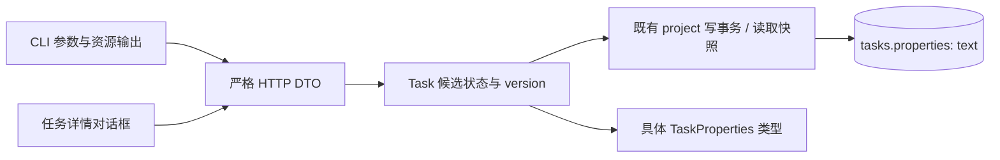

# Task 预定义属性设计

状态：服务端存储、迁移、HTTP 读写、CLI 属性操作与只读网页展示已实现。行为与验收编号由
[属性需求](../spec/daynight-task-properties.md)拥有；
[决策记录](../../.agents/notes/implemented/architecture/2026-10-21-task-properties-design.md)
保存备选方案与长期代价。[交互预览](mockups/task-properties.html)展示详情区域及边界数据。

## 问题与设计目标

Task 需要记录关联的多个 PR。把引用写进 description 会混合任务说明与结构化数据，
客户端也无法稳定提取。Server 需要拥有有限、明确的属性目录，首个属性
`pullRequests` 的每项只有 `url` 和 `title`。两者都是调用方提供的字符串；属性
机制不负责判断 PR 的格式、存在性或业务含义。

预定义属性复用现有 task 创建、更新与读取路径，
保留原有状态机、依赖校验和任务级并发控制。

## 现有结构与集成位置

下表保留设计基线 `781bd04` 的集成依据；行号与片段属于当时的既有机制，
具体属性类型及 codec 归属由下节说明。相对链接指向实际归属文件。

| 归属与位置 | 片段及影响 |
|---|---|
| [core/task.go](../../packages/daynight-server/internal/core/task.go)，第 13 行起 | `type Task struct` 是固定领域结构，需增加具体的属性类型。 |
| [service/task.go](../../packages/daynight-server/internal/service/task.go)，第 106–118 行 | `current.Version != input.Version` 与 `changed :=` 已拥有版本冲突和无变化判断。 |
| [store/project_tx.go](../../packages/daynight-server/internal/core/store/project_tx.go)，第 27 行起 | `SELECT ... FOR UPDATE` 的 project 锁序列化 task 写入；属性加入同一个 task 行更新。 |
| [store/snapshot.go](../../packages/daynight-server/internal/core/store/snapshot.go)，第 14 行起 | `IsoLevel: pgx.RepeatableRead` 使完整 task、依赖与属性使用同一读取快照。 |
| [store/task_graph.go](../../packages/daynight-server/internal/core/store/task_graph.go)，第 26 行起 | `TaskGraphTasks` 显式选择有界图投影，继续隔离完整属性内容。 |
| [server/http.go](../../packages/daynight-server/internal/server/http.go)，第 19 行起 | 已有请求大小、UTF-8 与严格对象校验；需将对象级严格规则复用到属性嵌套层。 |
| [CLI schema.ts](../../packages/daynight/src/cli/schema.ts)，第 105 行起 | 可重复选项按出现顺序形成数组，支持按位置配对 URL 与标题。 |
| [CLI parse.ts](../../packages/daynight/src/api/parse.ts)，第 52 行起 | `parseTask` 投影已知字段；需显式解析属性，否则会丢弃 server 返回的新数据。 |
| [TaskDetailDialog.tsx](../../packages/daynight-web/src/features/task-detail/TaskDetailDialog.tsx) | 详情已有描述与关系区域；PR 列表放在描述之后。 |

## 模块与数据流



`core` 持有领域类型，`api` 持有 JSON DTO，`server` 校验输入结构，`service`
组合候选值与检测变化。`internal/jsonobject` 复用严格对象解析，
`internal/taskproperties` 以具体类型编解码持久化文档及属性 patch，`store` 在
完整 task 读写中调用该 codec。CLI 和 web 各自在已有 API 层
声明相同资源结构，不引入跨语言共享代码生成或运行时属性插件。完整存储/读取类型包含只读 worker；公共创建和 patch DTO 单独只接受 PR 字段，[认领架构](daynight-worker-claims.md)拥有受保护操作。

```go
type PullRequestProperty struct {
    URL   string
    Title string
}

type TaskProperties struct {
    PullRequests []PullRequestProperty
    Worker       *WorkerClaim
}

type TaskPropertiesPatch struct {
    PullRequests *[]PullRequestProperty
}
```

完整领域资源始终使用非 nil 列表；API 的具体 DTO 使用 `url`、`title`、
`pullRequests` JSON 名称及显式 worker:null/对象。Patch 指针只表达是否提供属性，内容值本身没有默认值
语义。创建入口构造显式空列表；迁移处理旧数据，读取路径不会为缺失或损坏数据补值。

## 持久化与迁移

`003_task_properties.sql` 为属性列的有序迁移；已有迁移的内容及 checksum 保持
不变。启动迁移仍使用原有 checksum 检查与互斥机制。

```sql
ALTER TABLE tasks ADD COLUMN properties text NOT NULL
    DEFAULT '{"pullRequests":[]}';
```

这是属性列最初的默认值，表达已有任务没有关联 PR。015_task_worker.sql 在规范文本的末尾插入 worker:null，并把当前默认值改为同时包含两字段；不调用 JSON/JSONB cast 或重新解释 PR 字符串，NUL 转义与既有 Unicode 内容保持原值。迁移由既有启动迁移事务执行，
不改变 task 的 `version`、`created_at` 或 `updated_at`。应用创建与更新仍显式写入
完整属性值，默认值只负责迁移与缺省空属性语义。

文本列保存固定 DTO 序列化出的 JSON 文档。URL 和标题中的 NUL 会编码为转义，
不把 NUL 字节传入 PostgreSQL text。[PostgreSQL 18 JSON 类型说明](https://www.postgresql.org/docs/18/datatype-json.html)
指出 JSONB 会将 Unicode 转义转成内部文本并拒绝 `\u0000`；采用 JSONB 会额外
限制调用方可保存的内容。当前没有属性查询需求，文本列与有类型的应用编解码匹配。

Store 用具体的完整属性 DTO 编码与严格解码，校验必需结构、非 null PR 数组、显式可空 worker 及已知字段；公共属性写入使用独立 codec，即使 worker 为 null/原值也拒绝。
不使用 `map[string]any` 或存储任意请求片段。损坏 JSON、未知持久化字段、错误类型
及缺失字段均使读取失败并保留错误链。序列化表示并非公开契约；比较用领域值，
不比较 JSON key 排列、转义写法或字符串化结果。

属性位于 `TaskWrite`、完整 task SQL 投影、扫描器和 INSERT/UPDATE。与任务其他
标量同处一行，因此不需要额外关联表、foreign key、第二次查询或分开的提交点。
图查询继续使用现有显式投影，不读取属性列。

## HTTP 与事务

沿用 `POST /api/v1/projects/{projectId}/tasks` 与
`PATCH /api/v1/projects/{projectId}/tasks/{taskId}`，创建与更新增加可选
`properties`。嵌套对象使用既有严格 JSON 对象解析规则的可复用部分；不能只依赖
`json.Unmarshal` 到 struct，因为默认 struct 解码会忽略未知字段和重复 key。

```json
{
  "version": 3,
  "properties": {
    "pullRequests": [
      { "url": "https://github.com/owner/repo/pull/123", "title": "实现登录接口" }
    ]
  }
}
```

解析只约束对象、数组、字符串、字段存在性及已知字段名，字符串直接使用现有 JSON
解码结果。URL/title 不复用 task 标题或仓库 URL 校验器；这些校验器会增加非空、
NUL、协议或仓库结构限制。既有请求 1 MiB 上限自然约束一次写入，不另设 PR 条数
或单项长度上限。完整读取继续受客户端 128 MiB 单响应、256 MiB 累计与既有期限
约束，超过预算报错且不会截断 PR 列表。

Service 在已有 project 写事务内读取当前 task、比较期望版本、构造完整候选状态，
再执行既有状态及依赖校验。`properties:{}` 不产生属性修改意图；若也没有其他
可修改字段，则按既有空 patch 规则拒绝。已提供的 `pullRequests` 替换完整数组，
未提供的其他属性保留，worker 仅能通过受控归属操作修改。

按数组顺序逐项比较两个字符串；相等列表不改变版本和时间。真实属性变化与其他
真实字段变化合计只执行一次版本递增。写入失败与取消通过原有事务完整回滚。
不增加属性级版本、锁或冲突自动重试。

Task GET/list 及创建/更新结果都返回完整属性；分页、status/ready 筛选和 cursor
绑定保持原有含义。属性既不进入图响应，也不改变 summary、状态与 ready 计算。

## CLI 输入与输出

沿用共享命令定义，增加两种 `repeatable: true`、`allowEmpty: true` 的文本选项：
`--pull-request-url` 和 `--pull-request-title`。每个选项自己的数组保持输入顺序，
第 n 项与另一个数组的第 n 项配对。出现其中任一选项时，两者次数必须相等且至少
一对；不要求选项在命令行相邻。这样 URL、标题中出现空格、逗号或等号时仍有明确
的传参方式，无需给一个字符串增加分隔或转义协议。

`TASK_ID` 表示已有 task 的 UUID。

```bash
daynight task update "$TASK_ID" \
  --pull-request-url 'https://github.com/owner/server/pull/123' \
  --pull-request-title '实现登录接口' \
  --pull-request-url 'https://github.com/owner/web/pull/124' \
  --pull-request-title '添加登录页面'

daynight task update "$TASK_ID" --clear-pull-requests
daynight task create --title '验证登录' --pull-request-url= --pull-request-title=
```

Create 支持成对选项；Update 另有 `--clear-pull-requests`，与任一配对选项互斥。
参数层生成有字段存在性语义的属性 patch。Update 只改属性时也满足“至少修改一项”
要求，并沿用现有 GET version 或显式 `--if-version` 路径。

Windows 的 `.cmd` 启动器经 CMD 转发参数，字面 CR/LF 不属于其可靠的单参数表示。
[Node 子进程文档](https://nodejs.org/docs/latest-v24.x/api/child_process.html#spawning-bat-and-cmd-files-on-windows)
说明该脚本入口依赖命令解释器；所用
[cross-spawn 转义](https://github.com/moxystudio/node-cross-spawn/blob/77cd97f3ca7b62c904a63a698fc4a79bf41977d0/lib/util/escape.js#L3-L38)
保留字面换行。安装验收分别验证原生 launcher 可表示的配对参数，以及同一已安装
产物 Node 入口的 CR/LF/控制字符参数。所有平台继续验证 HTTP 传入的原始字符串
经原生 launcher 查询和输出；NUL 等无法作为进程参数的内容由 API 提供。

CLI 与 web 的完整 task 类型、已知字段投影和字符串解析均包含属性。
PR 字符串只检查 `typeof value === "string"`，不能使用限制 task 标题内容的
现有 `isText`。精确 JSON 版本处理继续只处理既有数字 version 需求，固定 PR
结构没有可调用方定义的数值字段，因此无需为本功能扩展通用 JSON 数值协议。
响应中的未知扩展字段按各客户端原有策略处理；写入仍由 server 严格限制。

文本资源块追加 PR 数量及按序编号的 title/url，使用现有 terminalText 可见转义，
输出空间随实际内容线性增长。JSON 直接序列化完整 task 属性，不加入显示占位文字。
Shell 补全从相同命令定义取得三个固定选项，不增加远端数据补全。

## 网页与交互预览

`TaskDetailDialog` 在描述之后渲染“关联 PR · N”，PR 位于居中对话框的阅读主栏。外壳尺寸、双栏/窄屏堆叠与滚动机制由[看板设计](daynight-web.md#居中任务详情)拥有；PR 卡沿用关系卡片边框、字体和间距，每张分别显示 title 与 URL。
`TaskPullRequests` 保留完整属性数组，按原顺序每页最多挂载 100 行；超过 100 项时
显示当前范围、总数及原生页码选择、上一页/下一页。分页只改变本地展示，不增加
请求、丢弃数据或改变 server 属性限制。任务或集合替换时同步回到第一页，分页
控制保持可访问焦点并宣告新范围。重复引用按全局下标拥有独立行，避免以 URL 为
React key 吞掉重复项。空列表有明确空态；
空字符串显示专用的“（空字符串）”标记，原始数据仍保持空字符串。

正文使用 React 文本节点，保留可见空白并换行，长地址使用 overflow wrapping。
为防止任意字符串成为可执行导航，页面仅为浏览器 URL 解析器识别的绝对 HTTP(S)
地址提供链接；href 使用原始字符串，`target="_blank"` 并设置
`rel="noopener noreferrer"`。解析失败或其他协议只影响是否提供导航，字符串依然
显示且可复制。这与服务端是否接受 PR 关联无关，也不校验目标是否为 PR。

一次合法的 1 MiB 写入可以包含数万条短引用；直接挂载全部记录使 React/DOM 与
accessibility tree 的大小随完整数组增长。固定页大小为 DOM 成本提供独立上限，
同时通过原生控制让全部记录可访问。它不依赖滚动位置、可变行高测量或额外组件库。

复用既有详情读取、取消、重试、关闭、焦点恢复与全图刷新提示。属性变化会更新
task 的 updatedAt，因此详情与旧图快照的比较仍能提示刷新。网页保持只读，不在
此设计增加属性编辑表单。图节点与完整图响应继续精简，PR 内容只由完整 task
读取获得。

[交互预览](mockups/task-properties.html)使用当前产品 CSS 和本地 fixture，可切换
多项、单项、空列表、空字符串、长文本、重复、分页与任意地址等数据。预览控制是设计
工具，产品界面仅包含只读详情；最终实现须使用真实 React 组件和服务接口验收。

## 观测、错误与执行边界

本设计没有后台工作、外部事件订阅、GitHub 请求或新的异步所有权。一次操作沿用
HTTP request context、请求 ID、project ID、task ID 及既有事务取消路径。
CLI 使用已有 operation scope、命令期限和错误映射；web 使用已有详情请求生命周期。

输入结构错误复用 `invalid_input`，版本冲突复用 `version_conflict`，持久化编解码
失败沿原有 cause chain 返回内部错误。日志保留 request_id、操作阶段与错误类别；
诊断指出如 `properties.pullRequests[1].title` 的字段路径，不回显 URL 或标题。
不因新增属性日志而改变现有错误响应、关联 ID 或数据可见性。

部署后可发送一次带空数组的版本化更新，并按响应 `X-Request-ID` 查询现有 JSON
日志的同一 `request_id`，核对 method、route、状态码、完成或失败阶段；然后 GET
核对数组及版本。此过程不依赖新日志系统，也不能把读取失败解释为空属性。

CLI 的模型可见增量是三个静态选项和输出中的真实 PR 数据，写入仍为现有的
GET+PATCH 或显式 version 的一次 PATCH，创建仍为一次 POST。没有模型专用新工具；
不单独估算模型 token 或创建测量工具，真实响应字节预算由现有客户端检查负责。

## 备选方案与代价

| 方案 | 可获得的能力 | 本设计的取舍 |
|---|---|---|
| 任意 key/value 与运行时字段定义 | 调用方能自行增加属性、类型和展示方式 | 与有限 server 属性目录的目标冲突；具体类型让扩展需要显式契约变更。 |
| JSONB 属性列 | PostgreSQL 可查询与索引内部字段 | 会拒绝部分已允许字符串；当前只读写完整值，没有查询收益。 |
| 关系表逐条保存 PR | 按 PR 查询或独立修改每条关联 | 需要顺序身份与额外读取，text 列同样限制 NUL；现有更新单位是整个列表。 |
| 文本列保存具体属性 JSON | 接受既定字符串内容，沿用单行事务与快照 | 依赖应用编解码发现存储损坏；将来属性查询需要有明确语义的索引或投影。 |
| 一项 CLI 参数携带 JSON 数组 | 直接表达 API 数据并方便程序生成 | 手写时有 shell 与 JSON 两层转义；已存在的重复文本选项可表达成对数据。 |

详细决策背景由[决策记录](../../.agents/notes/implemented/architecture/2026-10-21-task-properties-design.md)
拥有。上述取舍不预先承诺属性搜索、逐项修改或运行时扩展能力。

## 范围约束、风险与验证

| 能力 | 当前行为与后续增加代价 |
|---|---|
| 其他预定义属性 | 未知写入字段被拒绝。增加时修改具体类型、校验、输出与存储迁移；既有行通过迁移补充结构，读取不做旧格式 fallback。 |
| 属性过滤、排序和反向 PR 查 task | 当前列表支持状态、ready、自动许可与兼容平台，不按属性反查。未来属性查询须定义比较、投影、索引与 cursor 绑定；Worker 恢复使用 SQLite 已知 taskId 的 GET，无需 owner/worker 反向索引。 |
| PR 标题抓取与状态同步 | 当前值由调用方维护。未来要定义凭据、网络故障、生命周期及与人工值的所有权，作为独立设计。 |
| 网页编辑、逐项增删 | 网页只读，CLI 提交完整列表。未来可复用 task version；必须显式处理并发冲突，不能静默合并。 |

大量属性会增加完整 task/list 内容，但既有客户端预算保持严格执行；图投影与
summary 独立避免图容量契约随 PR 内容增长。存储文本缺少数据库 JSON 类型约束，
通过具体 codec 和真实损坏数据用例暴露错误。更换属性结构需要迁移数据；部署按
先 server、再新 CLI/web 执行，新客户端不以缺失 properties 推断空列表。已交付
旧客户端按现有已知字段投影忽略新增属性，其未提供属性的更新保持服务端现值；
验证这一兼容行为不引入新的格式兼容分支。

验证按 TP-V1–TP-V8 建立数据与可观察结果的映射：真实 PostgreSQL 覆盖迁移、NUL
转义往返、事务失败及并发；Go HTTP 覆盖严格嵌套结构；CLI 覆盖配对与真实服务输出；
生产浏览器覆盖展示、导航执行策略和既有焦点。沿用 README 中适用的 Go build/vet/
race/go-cov、CLI typecheck/test/build、web 覆盖率和生产浏览器门禁。Go 和 web 总
语句覆盖率均须严格大于 90%。

设计交付的验证包括 Markdown 本地链接、文档状态与路径、示例 JSON/SQL/命令
审查及预览脚本检查。服务端及后续客户端的运行结果随对应源码和 CI 保存。
