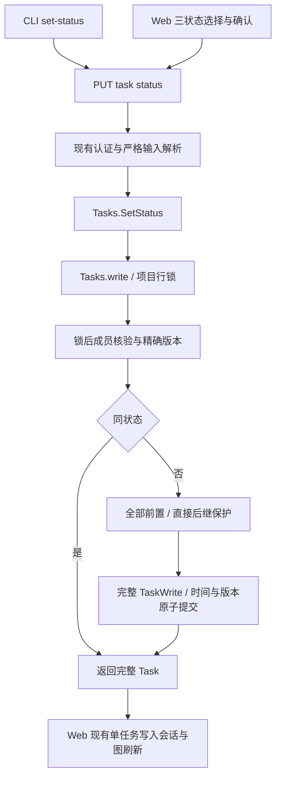

# 任务三状态与统一状态修改架构

状态：已实现。本文定义三状态模型、统一状态资源与跨端写入机制。[需求 TS1–TS5](../spec/daynight-task-status.md)拥有完整可观察行为。

状态与事务机制源码依据为 `18c794918ef0506a04bf294dad9cd8058ef2696b`；详情头部继承 `7b426bc0b632e57bb80dea0d5aca35b1e8f71a6e` 已交付的紧凑布局。[决策记录](../../.agents/notes/implemented/architecture/2026-10-24-task-status-assignment.md)保存选择与代价；[交互原型](mockups/task-status/index.html)演示生产样式的三状态交互。任务拆分与执行收据由 Daynight 所有。

## 问题与结构选择

原四个公开动作把状态修改绑定到有限前态，并让任务审批成为单独阶段。当前结构仅保留 todo、in_progress、done，默认 todo，任意状态对通过一个 setter 表达。旧 proposed 数据必须迁移，不以解码回退或兼容分支留在运行时。

现有 [task_lifecycle.go](https://github.com/codetreker/daynight/blob/18c794918ef0506a04bf294dad9cd8058ef2696b/packages/daynight-server/internal/service/task_lifecycle.go)已将动作汇入一个事务函数；[Tasks.write](https://github.com/codetreker/daynight/blob/18c794918ef0506a04bf294dad9cd8058ef2696b/packages/daynight-server/internal/service/task.go#L139-L176)拥有锁后成员核验、changed=false 返回和错误传播。保留这些机制，替换公开契约、前态规则与旧状态读取模型。

| 选择 | 收益 | 代价与结论 |
|---|---|---|
| 继续增加回退/重开动作 | 保持动作式调用 | 状态组合继续扩散到路由、CLI、确认和工作流，不满足统一入口 |
| 普通 metadata PATCH 恢复 status | 可与元数据原子组合 | 计时和图约束混入组合编辑；采用专用状态资源保持状态操作单一职责 |
| 专用目标状态资源及三状态模型 | 统一公开行为、事务规则和交互，删除任务审批层 | 需要数据迁移和跨端协调切换，采用此方案 |

## 组件与数据流



服务是状态、版本和时间的唯一写入权威。CLI choices、严格解析、项目锁、Web session、确认组件、附件 controller 与现有验收机制继续由原组件拥有，不引入平行机制。

## 历史数据、默认值与读取协议

已应用的013_task_required_platform.sql保持不可变；迁移014_task_status_assignment.sql在其后执行。保留 007/008 及其他已应用文件和 checksum。迁移内容为：

```sql
ALTER TABLE tasks ALTER COLUMN status SET DEFAULT 'todo';

UPDATE tasks
SET status = 'todo',
    version = version + 1,
    updated_at = statement_timestamp()
WHERE status = 'proposed';

ALTER TABLE tasks DROP CONSTRAINT tasks_status_check;
ALTER TABLE tasks ADD CONSTRAINT tasks_status_check
    CHECK (status IN ('todo', 'in_progress', 'done'));
```

[迁移 runner](https://github.com/codetreker/daynight/blob/18c794918ef0506a04bf294dad9cd8058ef2696b/packages/daynight-server/internal/core/store/migrate.go#L79-L115)以事务执行每个迁移和 ledger 写入，ALTER TABLE 的锁保持至提交。默认值、数据与约束原子可见；启动迁移在 listener 开启之前。协调部署时停止旧写入者，避免旧代码显式写入已删除状态。迁移失败正常暴露，不给溢出等错误补默认值。

转换行的状态与 ready 语义真实改变，所以 version 和 updatedAt 必须变化，使迁移前的审阅版本失效。迁移保留已有起止事实、createdAt、allowAgents、requiredPlatform、属性、Markdown、PR、全部边及外部分类和附件；非 proposed 行全部保留。该归类不调用运行时“退回 todo 清空时间”规则。再次迁移不重复转换或修改 ledger 时间。

运行时状态类型、创建默认值和读取模型仅包含三状态，summary 不返回 proposed。图统计满足：

```text
total = todo + inProgress + done
todo  = ready + blocked
```

原 proposed 的总数不丢失：按全部前置是否完成计入 ready/blocked，allowAgents 保留。没有新字段替代任务审批，不持久化 ready。

服务、HTTP、CLI 输入和 CLI/Web 读取器拒绝 proposed；数据库 CHECK 也拒绝新写入。普通 create/PATCH 继续拒绝调用者提交 status。CLI 的 `--status proposed`、`set-status … proposed` 在 I/O 前报错；图不再返回 proposed 统计或标签，任务链与列表只处理三状态。createdAt/id 分页顺序不改变，旧状态过滤按普通输入校验拒绝。

## HTTP 与服务契约

```http
PUT /api/v1/projects/{projectId}/tasks/{taskId}/status
Content-Type: application/json

{"version":123,"status":"in_progress"}
```

普通调用接受 version/status；done 目标另可提供 claimId，用于 owner 完成当前 active 执行。其他目标拒绝 claimId，不接受 query、时间、allowAgents、元数据或依赖。复用[严格对象和版本解析](https://github.com/codetreker/daynight/blob/18c794918ef0506a04bf294dad9cd8058ef2696b/packages/daynight-server/internal/server/http.go#L27-L68)，拒绝重复/未知/大小写变化字段、null、非正 int64 版本和无效状态，不归一化、不回退。

成功为 200、no-store 和现有完整 Task。保留 session/PAT、Cookie Origin、成员权限、非成员资源隐藏，以及受认证的 405 路径。普通成员与管理员的状态写入权限相同。删除四个旧动作路由，不重定向或保留别名。

```go
type SetTaskStatus struct {
    Version int64
    Status  core.TaskStatus
    ClaimID *string
}

func (s *Tasks) SetStatus(
    ctx context.Context,
    principal core.Principal,
    projectID, taskID string,
    input SetTaskStatus,
) (core.Task, error)
```

服务边界也检查正版本和三状态枚举，直接调用不能绕过 HTTP 校验；随后复用 Tasks.write。锁内顺序为：

1. 核验当前成员，读取当前项目内任务。
2. 比较精确 expected version，不符返回 version_conflict。
3. 同状态返回 changed=false，无存储修改。
4. 对实际改变检查 worker 归属；active 完成匹配 owner/claim，释放与 released 接续使用专用入口。
5. 实际进入 in_progress/done，要求全部直接前置完成。
6. done 返回其他状态，要求没有 in_progress/done 直接后继。
7. 构造完整 TaskWrite，一次写入状态、归属终态、时间、版本和 updatedAt，保留全部其他字段。

事务错误优先于暂存的领域拒绝，提交或回滚失败不能伪装为成功/资源不存在。invalid_transition 仍服务于 in_progress 中禁止实际改变 allowAgents 的既有规则，不因删除动作前态判断而全局删掉。

| 结果 | HTTP / code |
|---|---|
| 无效状态、JSON、版本、query | 400 invalid_input |
| 凭据缺失/无效 | 既有 401 unauthenticated |
| Cookie Origin 不符 | 既有 403 forbidden |
| 资源缺失/非成员 | 既有 404 not_found 隐藏语义 |
| 过期版本，包括同状态 | 409 version_conflict |
| 未完成前置或受保护后继 | 409 dependency_unsatisfied，稳定排序的任务 ID |
| 数据库/提交/回滚错误 | 既有操作错误，保留错误链 |

## 九种组合与依赖一致性

所有组合均检查权限和版本。下表描述无 active/released 执行归属任务的普通状态语义；worker 管理中的实际转换同时遵循[认领保护](daynight-worker-claims.md)。表中的依赖条件只针对实际改变：

| 当前 → 目标 | todo | in_progress | done |
|---|---|---|---|
| todo | 无修改 | 检查前置 | 检查前置 |
| in_progress | 允许 | 无修改 | 检查前置 |
| done | 检查后继 | 检查前置与后继 | 无修改 |

全部依赖包括 ordinary 和 external；外部分类仅影响任务链归类，不豁免执行约束。[现有依赖计算](https://github.com/codetreker/daynight/blob/18c794918ef0506a04bf294dad9cd8058ef2696b/packages/daynight-server/internal/core/store/query.go#L72-L80)也考虑全部边。

恢复[历史直接后继检查](https://github.com/codetreker/daynight/blob/250c9effdc30f5da0688aedf07089136c6231199/packages/daynight-server/internal/service/task_policy.go)的原则，直接查 sorted active/done 后继 ID，利用反向索引，不加载描述/依赖投影。后继 todo 允许重开，active/done 拒绝；不级联、不修改后继版本。

```text
A(done) → B(in_progress)
A set-status todo  => 拒绝，A/B 均不变
B set-status todo  => B 退回，清空本次计时
A set-status todo  => 允许；B 保持 todo，ready=false
```

状态和边修改都由现有项目行锁串行化。A 退回与 B 开始/完成竞争时，只提交维持“active/done 的所有前置已 done”的结果。每任务版本不能替代该跨任务边界。ready 仍为 todo 且无阻塞；重开使任务重新出现在未完成列表是实际状态变化的正常结果。

## 计时与资料保全

startedAt/completedAt 描述当前执行区间，不是不可变尝试历史：

| 实际改变 | startedAt | completedAt |
|---|---|---|
| todo/done → in_progress | 锁后数据库 statement 时间 | null |
| in_progress/done → todo | null | null |
| in_progress → done | 保留真实可空起点 | 数据库 statement 时间 |
| todo → done | null | 数据库 statement 时间 |

同状态和普通编辑保留时间；缺失历史起点不推算耗时。in_progress→todo→done 的终点已知、耗时未知；done→in_progress 开新一次区间。状态、计时、version、updatedAt 同一 SQL/事务提交，不能因失败留下部分更新。

[现有 UpdateTask](https://github.com/codetreker/daynight/blob/18c794918ef0506a04bf294dad9cd8058ef2696b/packages/daynight-server/internal/core/store/project_tx.go#L100-L124)会替换依赖行，因此完整 plan 必须保留标题、Markdown、properties/PR、allowAgents、requiredPlatform、dependsOn 和 externalDependsOn。不能只传 status 或空集合。附件独立于任务版本和事务，状态请求不改附件。

## CLI 与工作流

```bash
daynight task set-status <task-id> <status> \
  [--claim-id <claim-id>] [--if-version <version>] [--project <project-id>]
```

status 使用既有 positional choices 三值，Bash/Zsh 补全由 schema 派生。--claim-id 是仅限 done 的显式 UUID：参数阶段规范化并拒绝其他目标，带入时调用 completeWorkerTask 发送 version/status/claimId；不带时继续普通 setTaskStatus。不会从任务读取或环境推断 claim，也不在拒绝后回退普通完成。沿用 origin 项目发现、dn、lossless int64/BigInt、完整 Task 输出和请求序列化。带 --if-version 直接用审阅版本；省略时立即读后提交，但不能保护更早决策。写入不自动重试。

随包技能使用相同三状态，但入口拥有各自执行生命周期。普通 run-task 只处理一个明确指定任务：创建普通任务和 Goal 各阶段均为 todo，登记本身不开始执行；指定 ready todo 满足实际阶段资料后设置 in_progress，验收和必要授权交付后设置 done。既有执行授权的范围持续有效，但状态、ready 或完成本任务不会让普通技能自动选择后继，也不重建另一种批准字段。

Worker 的启动 prompt 显式指定 worker-managed 环境、using-daynight 技能和 execute-task-in-managed 模式，并提供原 project/task/claim/worktreeId、实际工作区/branch 和冻结配置。SKILL.md 据此路由到 references/execute-task-in-managed.md；普通执行读取 run-task.md，不加载 managed 详细规则。两种入口共用 references/task-execution.md 的资料、范围、交付、验收和证据要求，普通开始/重开/done 与 managed 原 claim 完成分别保留。Managed agent 复用已在执行中的 claim 和系统 worktree，完成全部条件后最后显式 claim-bound done；不再次 set-status in_progress，不选择下一任务或清理系统工作区。不能从任务 worker 属性、cwd 或环境变量自行推断 managed，显式上下文缺失或不匹配时等待。

allowAgents 仍默认 false，只控制自动发现选择。用户明确安排的任务可用手工状态操作，worker 拥有连续调度，agent 不自行开启许可。PR 审查批准、必要合并权限与任务审批不是同一概念，继续遵守现有交付规则。同状态响应只确认当前事实，不提供新执行权、归属或完成证据。

## Web 组件与会话

将[现有单任务 operation](https://github.com/codetreker/daynight/blob/18c794918ef0506a04bf294dad9cd8058ef2696b/packages/daynight-web/src/features/task-detail/TaskDetailSession.tsx#L6-L50)中的审批分支替换为 status，与 allowAgents、requiredPlatform 共用一处 controller：

```ts
type TaskMutationOperation =
  | { readonly action: 'status'; readonly status: TaskStatus; readonly version: bigint }
  | { readonly action: 'allowAgents'; readonly allowAgents: boolean; readonly version: bigint }
  | { readonly action: 'requiredPlatform'; readonly requiredPlatform: TaskPlatform | null; readonly version: bigint };

type TaskConfirmationState =
  | { readonly kind: 'status'; readonly detail: TaskDetail; readonly status: TaskStatus }
  | { readonly kind: 'allowAgents'; readonly detail: TaskDetail; readonly allowAgents: boolean }
  | null;
```

继承紧凑详情布局：实际任务标题位于共享头部，完整 ID 和复制操作位于概览；不恢复重复标题或详情语言选择器。标题下的公共状态行左侧依次放置状态菜单、平台切换与 ready/blocked 提示，右侧保留自动执行控件；状态按钮与平台选择器同为 24px 紧凑高度，显示当前本地化状态、颜色点和箭头。popover 固定三项 menuitemradio，当前项有标记且可选，支持方向键、Home/End、Enter/Space、Escape 与焦点恢复。选择后直接确认完整任务名、当前→目标及时间后果；同状态说明状态与时间不变。初始焦点取消，取消/Escape 不写入，确认才发版本化请求；无乐观持久化状态。

确认保存 reviewed detail，taskReviewKey 包含身份、版本、status、allowAgents、requiredPlatform、普通/外部边与派生阻塞。实质轮询变化使确认失效并重新审阅，不静默换版本。相同读取不关闭确认。

一个 project/task 一个写入会话，一个 union 一个确认窗。状态、许可、平台与[软删除](daynight-task-deletion.md)共同参与互斥；陈旧、读取失败、pending、unknown、核对中/失败均阻止任务写入。平台选择不同值后打开当前/目标确认窗，确认才提交，具体控件由[平台确认设计](daynight-web.md#平台要求与确认下拉框)拥有。in_progress 中禁止实际切换许可与平台的规则保留。资料/附件 tabs 保持挂载，reading key 仍为 project/task，不用状态或版本重新挂载附件。长标题完整换行，320px 控件换行而不横向溢出。

| 事件 | 行为 |
|---|---|
| 有效确认 | pending；保存审阅快照，废弃旧读取，禁用两种写入 |
| 合法 200 | 发布完整 Task，提升已确认版本下界，刷新图 |
| 明确拒绝 | 保留原错误/requestId，显示原因，重新决策 |
| version_conflict | GET 读取实际状态，再由操作者决定，不重发 |
| 网络/协议/服务不确定 | unknown，只 GET 核对 |
| 核对成功 | 显示实际状态，不归因原请求成功 |
| 核对失败 | 保留写错与读错，继续阻止三类修改，提供读取重试 |
| 关闭或切换详情 | 已提交请求继续归属于原任务；视图取消不证明回滚 |

Transport 检查身份、目标与 version∈{v,v+1}，session 用审阅前态约束精确分支：

```ts
const changed = reviewed.status !== operation.status;
const expectedVersion = operation.version + (changed ? 1n : 0n);
```

同状态 +0，实际改变 +1；检查保留字段和时间的类型、空值及保留规则，不用客户端墙钟预测数据库精确时间或要求新起点大于旧值。同状态不能深比较整个旧 Task：前置改变可更新 ready/blockedBy 而不改变本任务版本。保留 generation 与 committed-version 下界，旧读取不覆盖已确认结果。

移除旧状态的菜单、文案、i18n、CSS、统计、列表分组和任务链投影；链中全部 done 时为 done，否则任一 done/in_progress 使链为 in_progress，其余为 todo，外部上下文不计入链进度。外部依赖 Web 编辑器不在范围内，分类照常展示并使过期确认失效。

## Worker、可观测性与调用预算

[Worker 认领基础](daynight-worker-claims.md)接入同一项目写事务。SetTaskStatus 的可选 ClaimID 仅供 done；普通 CLI setTaskStatus 保持 version/status，typed completeWorkerTask 提供 done 与 claimId。成员/版本及同状态 no-op 之后，实际转换检查归属：active 完成要求 owner/当前 claim，普通退回不能替代 release；released 未完成成果须认领或人工 resume，completed 历史保留普通重开。自动 claim 重验 ready、allowAgents、平台、版本及唯一归属；移交要求 source owner/admin、当前目标成员、自动资格、依赖及真实停止，目标使用新 claimId/worktreeId 与明确 agent；released resume 同样开始新执行。运行时不由状态 setter 启动。

复用 request context、X-Request-ID 和 JSON slog。handler logger 记录资源 ID，context 进入 service/store；安全日志保留 type/component/phase/cause/error_code/diagnostic，不记录凭据、请求正文、SQL 或驱动敏感信息。状态资源日志用 set_status 阶段和 changed/unchanged 结果，不能把无修改说成状态改变。服务器不引入后台执行，取消向事务传播。

从冲突响应取得 requestId，部署验证使用既有 stderr 日志：

```bash
jq --arg request_id 'RESPONSE_REQUEST_ID' \
  'select(.request_id == $request_id)' .tmp/server.jsonl
```

该组记录应关联状态路由、资源标识及 version_conflict；成功也由既有 http_request 关联。Web 的异步请求/读取/图刷新仍由 task session 的 generation 和身份管理；退出/失权沿用既有私有状态清理。

不增加 MCP/Responses 注册，模型通过现有 shell 调 CLI，工具数量不变。显式版本使用既有项目解析加一次写入，省略版本再加一次任务读取，无隐藏轮询。现有任务详情样本的已安装 CLI JSON 为 1,737 bytes，示例请求正文 38 bytes；这是资源量级样本，不是新实现的 token、耗时或吞吐实测。

## 协调交付与验证

服务、三状态读取模型、CLI/Web、随包 skill、所有现有验收调用者与数据迁移在同一个可运行修订切换；不能先删后端动作使旧客户端失效。服务与生产 Web 资产配对部署，旧 CLI 升级后使用新接口，不保留旧路由别名。生产部署不是本次自动交付的隐含权限。

实现同步 README、server/project-task/Web/auth/timing、补全、agent-skill/Goal、task-inspection、worker 端点引用、部署验收和活跃决策。任务 ID、依赖、拆分和执行收据留在 Daynight。

| 验证组 | 结果 |
|---|---|
| 迁移 | 真实v12→当前版本（013平台后014状态），并独立核对v13→v14状态保全；旧状态转换一次、其他行不变、物料/时间保全；default/CHECK/ledger 原子、重复启动与失败回滚 |
| 三状态协议 | 九组合；新默认 todo；数据库/HTTP/service/CLI/读取器拒绝旧状态；无 proposed 统计项 |
| 版本 | >2^53 无损；当前同状态 +0/过期冲突；错误 +0/+1 分支拒绝 |
| 并发/依赖 | 普通/外部边一致；重开对后继开始/完成、状态对许可/边编辑、锁后失权都保全 |
| 时间/回滚 | 全组合时间表、锁后时间、未知历史、普通编辑保持、失败无部分结果 |
| Web | 三项菜单、双语/320px/长标题、焦点/Escape、确认失效、共享互斥、关闭重开、未知/读取失败 |
| 真实运行 | 冻结源码后实际安装 CLI、真实 PostgreSQL/认证服务与生产 Web 互读、重启、图/附件/计时一致 |

历史迁移测试使用对应历史前缀，旧状态字面量只在历史夹具中存在，不保留运行时常量。新迁移另测完整当前 schema。适用 CLI typecheck/test/build、Web 现有覆盖率/浏览器门禁、Go check.sh 的 build/vet/race/go-cov 和未舍入总 statement coverage>90% 均保持。

文档和原型验证不能替代服务端实现证据。主要风险是遗漏旧状态的读取分支、迁移破坏资料、+1-only 校验、退回计时复活或误把状态当执行权；相应以全层协议切换、真实升级夹具、精确响应分支和单一事务/会话所有者约束。后续若需尝试历史、批量级联或渐进旧协议支持，必须另作存储/一致性/兼容决定。
