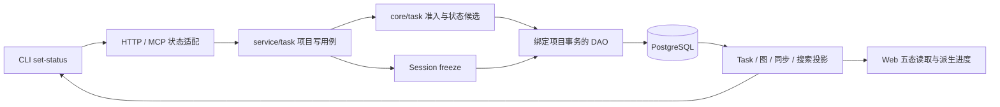

# 任务状态与待确认任务架构

状态：已实现。本文定义五状态模型、统一状态资源、取消与跨端读取机制。[需求 TS1–TS5](../spec/daynight-task-status.md)拥有可观察行为；[待确认状态决策](../../.agents/notes/implemented/feature/2026-11-10-proposed-task-state.md)与[取消决策](../../.agents/notes/implemented/feature/2026-11-06-task-cancellation-terminal.md)记录选型和代价。

## 结构与职责

普通 Task 使用 proposed、todo、in_progress、done、cancelled。Goal 的独立四态与时间规则由 [Goal 需求](../spec/daynight-goals.md)及[服务端设计](daynight-server.md)拥有。proposed 表示待确认提议，todo 表示已确认待办。done 描述完成交付，cancelled 描述取消交付。取消使用业务状态，不使用 deleted_at，因此原节点、依赖和资料保持可读。

`core/task` 拥有权限、版本、状态转换、依赖及 Worker 恢复准入；`service/task` 在项目写作用域内协调 Task 修改与 Session freeze；`core/store` 定义模型和事务合同，DAO 实现封装 SQL、数据库时间、锁及提交。HTTP/MCP 适配不承载状态业务规则。



## 状态判定与数据模型

共享领域模型区分以下判断：

```text
终态 / 前置满足：done 或 cancelled
必须满足前置：目标 in_progress 或 done
自动执行候选：todo
待确认任务：proposed
完成交付：done
```

Go、CLI和Web在各自纯模型中复用同一语义。CLI的src/task/status.ts提供状态值和谓词，api/types.ts只以type重新导出；参数定义、help和completion不因此加载ApiClient或业务模块。Web复用src/api/task-status.ts；DAO使用固定共享SQL片段计算ready/blocked。不能把所有 done 判断机械替换为终态：取消自身可以有未满足前置，completed claim 仍描述真实执行历史，done 重开只保护 in_progress/done 后继。

Task 增加 nullable cancelledAt。完整 Task、带时间的图节点、同步摘要和搜索/MCP 时间投影显式输出该字段；缺字段或非法时间是协议错误，不能回退为 null。原本不含执行时间的轻量 MCP TaskSummary/dependencyNode 保持轻量形状。

取消时间由数据库实际状态写入产生，当前 status=cancelled 当且仅当 cancelledAt 非空。startedAt/completedAt 保留原值。当前业务结束时间按状态派生，不持久化 endedAt；done 使用 completedAt，cancelled 使用 cancelledAt。版本编码、UTC/RFC3339 精度及 null 规则沿用各入口合同。

普通 Task 创建合同仅接受可选 proposed/todo，省略时由领域创建逻辑选用 proposed；数据库默认值一致。新迁移扩展 Task 状态约束并改变默认值，不修改既有记录。历史 014 迁移曾将 proposed 归类为 todo，并对转换行增加版本以使旧审阅失效；该历史及已应用迁移保持不变，不反向重建旧提议。当前 proposed 是独立的有效业务状态。

## 统一状态资源与事务

```http
PUT /api/v1/projects/{projectId}/tasks/{taskId}/status
Content-Type: application/json

{"version":123,"status":"cancelled"}
```

status 输入接受五态，不增加审批动作或阶段顺序。claimId 仅用于 done，其他状态拒绝；时间、query、依赖和其他元数据不属于状态请求。普通 Task create 的可选 status 只接受 proposed/todo；普通 PATCH 不接受 status。HTTP 与 service 均校验合法输入，认证、Cookie Origin、no-store、成员权限和资源隐藏保持。

项目一致性作用域核验当前权限、任务和精确版本。同状态返回完整 Task，无写入；陈旧同状态仍冲突。实际转换生成完整 TaskWrite，保留未修改资料，再在同一事务内写状态/时间/version/updatedAt 并冻结不再有效的 Session。数据库或 freeze 失败完整回滚，事务完成失败优先于暂存的业务拒绝。

| 当前 → 目标 | proposed | todo | in_progress | done | cancelled |
| --- | --- | --- | --- | --- | --- |
| proposed | 无修改 | 允许 | 检查前置 | 检查前置 | 允许 |
| todo | 允许 | 无修改 | 检查前置 | 检查前置 | 允许 |
| 人工 in_progress | 允许 | 允许 | 无修改 | 检查前置 | 允许 |
| done | 检查后继 | 检查后继 | 检查前置与后继 | 无修改 | 允许 |
| cancelled | 拒绝 | 拒绝 | 拒绝 | 拒绝 | 无修改 |

表中实际转换还受 Worker 归属保护。active claim 不能取消，须先完成 release 或合法解除归属，再读取新版本。release 清除当前归属后，任务遵循普通状态规则。done→cancelled 不撤销依赖满足，保留 completed 历史和原 completedAt。

退出 cancelled 的拒绝必须在所有业务入口成立。WithdrawableWorker/WithdrawCandidate 是独立于状态 setter 的 todo-producing 路径，因此明确拒绝 cancelled；不能依赖数据库时间约束报存储错误。认领与 claim-bound 完成也拒绝取消任务。Web 对取消记录不提供对应恢复动作。

## 依赖、查询与同步

普通和外部依赖使用相同前置满足判断。所有 full Task、ready、priority list、search ready 过滤中的 SQL 共用 done/cancelled 条件；状态规则仅要求 in_progress/done 的全部前置满足。取消不删除边、不级联改变节点、不传递重连，也不增加后继版本。

项目锁串行化 cancel/claim/withdraw 和边修改，一份精确版本不能同时取消并产生有效执行。done 重开仍保护真实 in_progress/done 后继；取消后继不要求前置持续满足。

各查询保留原默认范围：普通 HTTP 列表返回全部业务状态，CLI 默认未完成和 MCP 默认优先列表排除终态，搜索默认全状态。精确 proposed/cancelled 过滤及 all 包含相应节点。优先列表显式按 in_progress、ready todo、blocked todo、proposed、终态分组；proposed 属于默认未完成范围。取消与 done 共用原终态优先级，不新增分页排序档位。Project 删除预览的 unfinished 数排除两种终态。

取消只更新任务版本及 updatedAt，不轮换项目 epoch。节点仍存续，因此普通 delta 可传递取消摘要，客户端从完整图派生后继 ready/blocked。既有版本汇总 fence 使旧搜索/优先列表续页失效。软删除仍独立轮换 epoch，并遵守自身引用移除与访问规则。

统计显式包含 cancelled，保持 done 的交付含义：

```text
total = proposed + todo + inProgress + done + cancelled
todo = ready + blocked
ended = done + cancelled
```

## 计时与资料

| 实际状态改变 | startedAt | completedAt | cancelledAt |
| --- | --- | --- | --- |
| proposed/todo/done → in_progress | 新数据库时间 | null | null |
| 其他非取消状态 → proposed/todo | null | null | null |
| in_progress → done | 保留可空起点 | 新数据库时间 | null |
| proposed/todo → done | null | 新数据库时间 | null |
| proposed/todo/in_progress/done → cancelled | 保留 | 保留 | 新数据库时间 |

同状态和普通编辑保留端点。取消之前没有执行起点时不能推导执行耗时；done→cancelled 保留已交付执行区间，当前业务结束时间使用新的取消时间。

取消的数据保全和资源清理采用删除已有边界，但资料可见性保持正常。assignedTo、allowAgents、requiredPlatform、全部 properties、描述、Steps、Thread、执行历史和附件字节均保留。状态本身阻止执行；保留 allowAgents 不产生恢复许可。

## CLI、MCP 与仓库流程

CLI 通过既有 set-status 提交 cancelled，继续支持 daynight/dn、项目发现、lossless int64、精确审阅版本和无自动重放。--claim-id 仅选择 done 完成，不从环境或 Task 推断，也不在拒绝后回退普通完成。

MCP 创建普通 Task 接受 proposed/todo，创建 Goal 接受其四态；task_list/task_set_status 识别相应状态，状态写入复用同一 service 事务，claimId⇒done 条件保持。普通 Task 的取消不增加新的工具或操作流程往返。

服务端不再产生 released；CLI/Web 读端只接受 active/completed，并拒绝未知状态及 active+cancelled。Worker Task query 识别远端五态，本地 pending/active/done 仍是执行清理状态，不新增本地 cancelled。

仓库流程默认登记 proposed；内部已确认的方案后继和交付拆分显式创建 todo。明确授权的普通执行可从 proposed 直接进入 in_progress，不要求先确认到 todo；自动调度仍只选择 ready todo。仓库流程把取消视为无需执行或交接的终态，但不把它当作交付接受。普通执行只处理明确指定任务，取消任务不可重开；Goal 的结束与完整需求交付分别判断。状态与 ready 不授予权限或使技能自动选择后继。

## Web 读取、缓存与进度

Web 直接图模型与缓存摘要投影显式处理五态，共享前置满足、终态时间和进度规则。sameSummary 与完整响应保护包含 cancelledAt。读取资料不走 markDeleted，不清空仍有权访问的描述、附件、Steps 或 Thread。

持久缓存的必需字段变化通过显式 schema 升级重建受影响的 Project、summary 和 detail 记录；未改变的 profile 格式保留。不能用缺 cancelledAt→null 兼容旧缓存。既有用户/项目 generation、历史 fence、高版本合并和同版本不一致拒绝继续适用。

五态均有独立本地化文字与样式，proposed 显示为“待确认”/“Proposed”。未取消任务的菜单提供cancelled目标，并使用既有状态确认与action:status通道；已取消状态无reopen或withdraw动作，资料继续可读。active claim下取消项以aria-disabled标记并通过既有TaskControlTip在悬停/焦点时说明release要求，实际提交仍由服务端保护。确认展示不可恢复、资料可读和本任务作为前置时的满足后果，不引入原因表单或远端停止动作。

TaskDetailSession以原审阅身份、version与cacheGeneration核验取消。validStatusTiming显式要求实际取消保留startedAt/completedAt、新cancelledAt非空；不能落入done时间分支。成功精确+1，同状态+0；无效完整响应进入既有未知核对，后续仅GET、不重放。旧历史迟到结果不能覆盖新操作、解锁较新防重或设置删除终态。

状态筛选显式支持 proposed/cancelled，同时保留完整普通分量、Goal 进度范围和依赖；取消前置摘要经普通delta即可使后继派生就绪性更新。状态与筛选不改变资料读取权限或原有数据保全。

Web 完成进度以 done / (total - cancelled) 展示；共享纯投影及零分母处理见 [Web 设计](daynight-web.md#图投影与统计)。真实统计仍保留 ended、done 和 cancelled，Goal 自身状态独立于子任务进度。UI汇总类型TaskProgressStatus把全部done表示为done、全部cancelled表示为cancelled、混合终态表示为ended；ended不进入TaskStatus协议。全部普通成员均为 proposed 时汇总为 proposed；未开始的 proposed/todo 混合分量汇总为 todo。完整普通分量保留取消节点，外部上下文不计入进度。全部结束使用所有成员当前终态时间的最大值；最近七个本地日历日、纳秒精度、未知时间和 DST 行为沿用现有时间 owner。后台同步保留菜单、阅读、滚动、图视口和焦点。

## Worker 与资源清理

WorkerReady 要求 todo。取消无法认领；withdraw 另有取消保护。release 已让原 claim 退出有效自有清单，取消不会再创建一次所有权丢失事件。

Task 普通修改后的 FreezeTaskSessions 只保留 in_progress+active Web claim，其他状态进入既有冻结规则。旧执行不能继续被接受为有效执行者，历史和归档阅读仍保留。

Worker 仅凭成功完整自有 inventory 中 claim 缺席确认所有权丢失，进入既有停止、归档、资源归属核对、退避和重启恢复。网络失败、不完整清单或项目不可访问不能证明缺席。业务取消不意味着机器资源已消失；清理不绕过归档门槛，不提前删除源，不自动关闭 PR 或删除分支。

## 验证与发布边界

真实数据库验证默认 proposed 与显式 todo 创建、迁移资料保全、五态组合、blocked 取消、release 后取消、active/claim/withdraw 拒绝、时间与no-op、权限和事务回滚；竞争验证cancel与claim/withdraw只有一个有效结果。HTTP、MCP、CLI、图、同步和搜索验证一致字段、计数、依赖与分页 fence。

CLI native 验证两种 launcher 与严格解析，Web验证显式schema重建、双图投影、持久读取、ended统计、取消确认/筛选、active项禁派发、未知结果及旧历史保护。服务端与第一方读取必要修改以同一可运行修订交付，配套server、CLI和内置Web组合验收。普通实现不隐含npm发布或生产部署权限，不回退新状态以兼容旧客户端。模块门禁、覆盖率、必要CI和真实独立批准保持。
