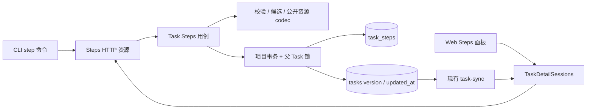

# Task Steps 架构设计

状态：服务端持久化、集合与单项读取、添加、内容与状态修改、移动和删除，以及 CLI list/show、Add、Update、Set-status、Move、Delete 与 Web Steps 阅读和状态设置已实现；Agent 指令资源与其余 Web 写入交互保留已确认的目标架构。本文区分已实现机制与客户端目标。Web 大集合采用每页 100 行的本地分页；交互原型由所属 Daynight Task 的附件拥有，仓库不保存原型文件。

## 目标与边界

Steps 是 Task 拥有的有序工作记录，跨 Session 和执行环境保留。项目定义步骤名称、粒度和流程；系统提供读取、添加、修改、设置状态、移动和删除操作。执行前预列和执行中追加使用相同操作；每轮 coding/review 可新增独立记录，保留各轮身份与成果。架构保留 Task 整体状态、依赖、Worker 归属及 Session 生命周期，Step 状态不参与领取、调度或 Task 完成判断。

公开约束包括 Task 内唯一的 8 位十六进制 ID、独立 Steps 资源、共享父 Task 版本、完整有序集合响应、64 MiB 编码容量，以及冲突和未知结果的读回规则。Task 的 show/list/ready/graph/task-sync 保持各自投影，不内嵌 Steps。

## 现有机制与复用点

以下复用点的证据固定在源码 revision `b84dc4e9159d85f53f3c98f88016bdc94f27729e`。`030_task_steps.sql` 已创建步骤表；后续 `031_terminal_sessions.sql` 保持独立职责。服务端、CLI list/show/Add/Update/Set-status/Move/Delete 及 Web 读取和状态设置部分描述当前实现；Agent 指令资源和其余 Web 写入部分描述尚待交付的目标机制；应用导航准入已由独立路由所有者实现。

| 证据 | 当前事实及设计含义 |
|---|---|
| [`WriteProject`](https://github.com/codetreker/daynight/blob/b84dc4e9159d85f53f3c98f88016bdc94f27729e/packages/daynight-server/internal/core/store/project_tx.go#L35-L51) 与 [`TaskHeader`](https://github.com/codetreker/daynight/blob/b84dc4e9159d85f53f3c98f88016bdc94f27729e/packages/daynight-server/internal/core/store/task_steps.go#L74-L76) | `FOR UPDATE` 依次锁项目和父任务头；Steps 使用同一锁序且不加载完整 Task。 |
| [`ReadSnapshot`](https://github.com/codetreker/daynight/blob/b84dc4e9159d85f53f3c98f88016bdc94f27729e/packages/daynight-server/internal/core/store/snapshot.go#L16-L24) | `RepeatableRead` 与 `ReadOnly` 已提供一致只读快照；父版本和步骤必须在其中共同读取。 |
| [`UpdateTask`](https://github.com/codetreker/daynight/blob/b84dc4e9159d85f53f3c98f88016bdc94f27729e/packages/daynight-server/internal/core/store/project_tx.go#L130-L174) | 更新同时写属性、替换依赖并调用 `freezeTaskSessions`；Steps 需要只触及父版本和更新时间的存储方法。 |
| [`taskWriteIdentity`、`requireTaskVersion` 与 `taskWriteHeader`](https://github.com/codetreker/daynight/blob/b84dc4e9159d85f53f3c98f88016bdc94f27729e/packages/daynight-server/internal/service/task_write_admission.go#L11-L48) | Task 与 Steps 共用中性的身份及精确版本检查；Steps 锁窄任务头，Worker 兼容和执行归属策略由 Task 操作拥有。 |
| [`TaskDetailSessions`](https://github.com/codetreker/daynight/blob/b84dc4e9159d85f53f3c98f88016bdc94f27729e/packages/daynight-web/src/features/task-detail/TaskDetailSession.tsx#L11-L69) | 一个 Task 入口拥有 mutation、身份 fence 和提交互斥；Steps 接入这一所有者。 |
| [`DETAIL_CACHE_LIMITS`](https://github.com/codetreker/daynight/blob/b84dc4e9159d85f53f3c98f88016bdc94f27729e/packages/daynight-web/src/features/task-detail/detail-cache.ts#L9-L20) | 单详情 2 MiB、总计 8 MiB；完整 Steps 不能进入该 TaskDetail 缓存。 |
| [`property` 命令](https://github.com/codetreker/daynight/blob/b84dc4e9159d85f53f3c98f88016bdc94f27729e/packages/daynight/src/commands/task/property.ts#L29-L49) | 显式 project/version 可跳过发现和预读；Steps 沿用这一请求预算。 |

## 职责与数据流



| 位置 | 职责 |
|---|---|
| `internal/core/task_steps.go` | Step、状态、父任务头和有序集合领域值；不包含 HTTP 处理。 |
| `internal/tasksteps/` | 纯字段校验、ID 规范化、不可变候选、语义比较及公开资源编码。 |
| `internal/core/store/task_steps.go` | 父任务头锁定、快照读取、步骤差异写入、只更新父版本和时间。 |
| `internal/service/task_steps*.go` 与 `task_write_admission.go` | 项目准入、版本、操作顺序、容量、事务结果和用例错误。 |
| `api/task_steps.go`、`internal/server/task_steps*.go` | 严格输入 DTO、路由、HTTP 方法与公共结果；输出复用中性 codec 的资源类型。 |
| CLI `api/task-steps.ts`、`commands/task/step*.ts` | 已交付 list/show/Add/Update/Set-status/Move/Delete 的严格解析、版本分支、完整确认、同操作事实核对、输出与诊断。 |
| Web `api/task-steps.ts`、Task 详情会话与 Steps 面板 | 独立资源读取、共享提交生命周期、草稿、呈现和附件导航。 |

`internal/tasksteps` 只依赖 `core` 和标准库。service、API 与 server 可依赖它；store 依赖 core 领域类型。公开 DTO 与容量编码在中性模块只有一个定义，避免 service 反向依赖 HTTP handler 或维护第二套字节估计。

## 存储选择

| 方案 | 写入与读取成本 | 取舍 |
|---|---|---|
| Task 行中的 JSON 列 | 修改任一步都重写完整集合，并扩大高频父行的职责 | Task 的常规生命周期与大正文耦合。 |
| 独立有序 JSON 集合行 | 父行保持较小；每次字段或状态修改仍重写完整集合 | 顺序自然，但身份和逐项完整性全部依赖集合解码。 |
| 独立 `task_steps` 行 | 内容修改只写目标行，排序只写受影响位置；完整响应仍遍历集合 | 采用此方案，保留独立项读写和数据库唯一性。 |

迁移 `030_task_steps.sql` 创建以下表结构，保留已有迁移及 checksum。

```sql
CREATE TABLE task_steps (
    task_id uuid NOT NULL,
    id text COLLATE "C" NOT NULL CHECK (id ~ '^[0-9a-f]{8}$'),
    position bigint NOT NULL CHECK (position >= 0),
    title text NOT NULL,
    description text NOT NULL,
    status text NOT NULL CHECK (status IN ('todo','in_progress','done','skipped')),
    created_at timestamptz NOT NULL,
    updated_at timestamptz NOT NULL,
    PRIMARY KEY (task_id, id),
    UNIQUE (task_id, position) DEFERRABLE INITIALLY DEFERRED
);
```

Task UUID 已全局唯一，步骤行不重复 project ID。授权先定位父项目和任务，再按 `task_id` 访问行。沿用[独立属性行](https://github.com/codetreker/daynight/blob/b84dc4e9159d85f53f3c98f88016bdc94f27729e/packages/daynight-server/internal/core/store/migrations/026_task_property_rows.sql#L3-L7)的所有权方式，不增加 foreign key。

每个 Task 的位置稠密为 `0..n-1`，查询使用 `ORDER BY position`。插入、删除和移动先在内存构造最终顺序，再更新受影响行的位置；不使用临时哨兵位置。延迟唯一约束允许一次事务中的交换和区间平移，在提交时检查最终唯一性，语义见 [PostgreSQL CREATE TABLE](https://www.postgresql.org/docs/18/sql-createtable.html) 与 [SET CONSTRAINTS](https://www.postgresql.org/docs/18/sql-set-constraints.html)。

移动只改位置，所有 Step 的 `created_at`、`updated_at` 保持。标题、说明或状态变化只更新目标 Step 的 `updated_at`；添加确定两端时间，删除释放该 Task 内的短 ID。Task 软删除保留步骤行，访问始终经过父任务墓碑判断。顺序写入使用普通 INSERT/UPDATE，不把延迟唯一约束作为 `ON CONFLICT` 仲裁器；NOT NULL 和 CHECK 仍立即校验。

数据库约束守住身份、位置和枚举；应用按 Unicode `White_Space` 检查标题，保留原始字符串。无效存储行使整个读取失败，不修复、截断或跳过。现有 Task 没有步骤行时自然得到 `[]`，无需数据回填或旧格式读取分支。

## 资源与 HTTP

领域状态与 Task 三状态分别定义，`skipped` 不进入 TaskStatus。位置只体现在数组顺序中。

```ts
type TaskStep = {
  readonly id: string;
  readonly title: string;
  readonly description: string;
  readonly status: "todo" | "in_progress" | "done" | "skipped";
  readonly createdAt: string;
  readonly updatedAt: string;
};
type StepsResource = {
  readonly projectId: string;
  readonly taskId: string;
  readonly version: bigint;
  readonly steps: readonly TaskStep[];
};
type Placement = { readonly before: string } | { readonly after: string }
  | { readonly position: "first" | "last" };
```

Step ID 恰为 UUIDv4 第一段的 8 位十六进制字符，输入接受大小写并规范化为小写，保留前导零；同一 Task 内现存记录唯一，跨 Task 可以重复。标题和 Markdown 说明保留原始 UTF-8 字符串且不得含 NUL；标题至少包含一个不属于 Unicode `White_Space` 的字符。创建省略说明保存 `""`，省略状态保存 `todo`；读取返回全部字段。时间以 UTC RFC 3339 表示。`done` 表示该步结束，不推导 review 通过或 Task 完成；四状态之间均允许显式设置。

下表的 `/steps` 表示完整路径 `/api/v1/projects/{projectId}/tasks/{taskId}/steps`。

| 方法与路径 | 输入 | 成功结果 |
|---|---|---|
| `GET /steps` | 无 query | `200 StepsResource`，完整有序集合。 |
| `GET /steps/{stepId}` | 无 query | `200`，projectId/taskId/version/完整 step。 |
| `POST /steps` | version、id、title；可选 description、status、before 或 after | `201 StepsResource`。 |
| `PATCH /steps/{stepId}` | version；title/description 至少一个 | `200 StepsResource`。 |
| `PUT /steps/{stepId}/status` | version、status | `200 StepsResource`。 |
| `PUT /steps/{stepId}/position` | version；before/after/position 恰好一个 | `200 StepsResource`。 |
| `DELETE /steps/{stepId}` | version | `200 StepsResource`，返回删除后的集合。 |

例如添加请求为 `{"version":12,"id":"a1b2c3d4","title":"Review 第 2 轮","status":"todo"}`；移动请求为 `{"version":13,"after":"6f7a8b9c"}`。HTTP add 必须给出提交前已确定的 ID，CLI 和 Web 在未显式给定时生成 UUIDv4 第一段。POST 的 Location 指向规范单项资源 `/steps/{stepId}`。所有引用只在指定 Task 中解释。添加省略锚点时位于末尾，before/after 互斥；移动的 before/after/position 恰好一个，锚点不能是目标自身。PATCH 只更新明确给出的字段，空字符串清空说明。删除结束记录存续期且不删除引用材料；之后可以使用同一 ID 创建全新记录，系统不提供逐次修改审计、恢复或历史归因承诺。

复用认证、Cookie 写 Origin 检查、HEAD、no-store、principal 回执、request ID 和 405/Allow。输入只接受一个 UTF-8 JSON 对象，沿用 1 MiB 请求体上限；拒绝未知/重复字段、非法 query、null、错误类型及只读字段。输入短 ID 接受大小写并转小写，响应解析要求已规范的小写 ID，不把坏响应改成合法值。

`StepsResource` 只从专用入口返回。Task、图及同步 DTO 不增加 Steps 字段；父版本与更新时间的正常变化足以使现有 task-sync 观察到该 Task。

## 读取与写事务

集合或单项读取在一个 `REPEATABLE READ` 快照中完成成员准入、父任务头读取和步骤读取。父版本与步骤属于同一状态。单项不存在返回子项 404；有效空集合返回显式空数组。

Task 元数据与整个 Steps 集合统一使用 `Task.version`，`StepsResource.version` 就是父版本，Step 和集合均不增加独立版本。该并发单位以单个 Task 内修改频率较低为前提，保留一份一致状态及统一的冲突检查。即使两次修改涉及不同字段，后提交的陈旧版本也会冲突；这是接受的粒度成本。冲突后读取当前 Task/Steps，再明确决定是否提交，不自动覆盖或重试。


写入采用以下固定顺序：

1. 认证并校验语法、project/task/step ID 和正 int64 版本。
2. 进入 `WriteProject`，复核成员，锁父 Task，区分不存在与软删除。
3. 比较观察版本；陈旧版本先返回 `version_conflict`。
4. 读取当前 Steps，按 Task 内 ID 解析目标；add 先查重复 ID，再查位置锚点。
5. 构造不可变候选并做语义比较。no-op 返回原集合、版本及全部时间。
6. 真实变化先检查 int64 耗尽，再取得数据库 UTC 微秒时间，确定候选时间和父新版本。
7. 编码完整候选并校验容量；通过后才写步骤差异和父任务 touch。
8. 提交成功才返回已校验结果；提交或响应阶段取消继续具有未知结果语义。

中性的成员、父任务头和精确版本检查提取为共享准入原语；原 Task 写入继续拥有 Worker 兼容和生命周期策略。Steps 不通过布尔开关跳过某个通用 helper 的策略，也不读取 Worker 属性来决定可写性。

父任务 touch 仅执行 `version = version + 1, updated_at = $chosenTime`，不调用完整 `UpdateTask`，不替换依赖、属性或执行时间，不冻结 Session。项目→父 Task→步骤的锁序与现有写入一致。

所有业务拒绝在数据修改前确定。Step 用例让拒绝和故障从事务回调传播并回滚；不沿用当前 `Tasks.write` 把 prepare Fault 转成成功回调的模式。现有[该处理](https://github.com/codetreker/daynight/blob/b84dc4e9159d85f53f3c98f88016bdc94f27729e/packages/daynight-server/internal/service/task.go#L157-L215)仅在 prepare 尚未写入时成立，不能用于写后容量拒绝。数据库、事务完成和取消错误保留原错误链。

### 精确容量与时间

公开 codec 使用与现有 [`writeJSON`](https://github.com/codetreker/daynight/blob/b84dc4e9159d85f53f3c98f88016bdc94f27729e/packages/daynight-server/internal/server/http.go#L163-L170)相同的 `json.Encoder.Encode` 设置，计入默认 HTML 转义及末尾换行。容量由该 codec 的实际 UTF-8 输出计量，父版本按 19 位最大正 int64 保留空间；上限恰为 67,108,864 字节。

用于容量校验的 Step 时间就是将要存储和返回的时间。数据库时间先转 UTC 并保持微秒精度，再生成候选；不先用应用纳秒值计量后交由数据库截断。现有[同步精度规则](https://github.com/codetreker/daynight/blob/b84dc4e9159d85f53f3c98f88016bdc94f27729e/packages/daynight-server/internal/core/store/task_sync.go#L19-L33)已明确 PostgreSQL 的微秒边界。

codec 是确定性的纯函数；容量检查和 HTTP 响应共用它。候选一旦通过，service 不再更改字段。超限返回 `steps_limit_exceeded` 与 encodedBytes/maxEncodedBytes，事务零变更；正常提交后的断连仍按未知结果处理。

### 错误优先级

有效写入的事务内顺序为成员/父资源可见性→父删除→版本→本地身份/锚点→no-op→版本耗尽→容量。当前版本 no-op 在最大版本仍成功；陈旧同值仍冲突。坏输入可在进入事务前拒绝。

服务的 Fault、HTTP 状态映射和已知错误分类共同增加 `step_id_conflict`、`steps_limit_exceeded`、`version_exhausted` 三个 409；错误 details 增加字节字段。正常子项缺失为 404，父软删除为 410，内部或持久化故障为 500。授权失败不能被子项检查泄露，内部故障不能降格为预期拒绝。

Steps 错误分类先检查事务/cleanup 的内部故障，再映射纯业务 Fault；业务拒绝与回滚清理故障被 errors.Join 合并时，整体为内部错误并保留两条原因，不能只靠 errors.As 找到首个 Fault 就返回 4xx。验证同时覆盖纯拒绝及拒绝伴随清理失败。

## CLI 与指令资源

`task step` 在通用 task handler 前分派，已交付 list/show/add/update/set-status/move/delete；定义树同时生成这些命令的帮助与 Bash/zsh 补全。四状态 Step 类型独立于 Task。`step-add.ts`、`step-update.ts`、`step-move.ts` 与 `step-delete.ts` 各自拥有参数与结果输出，`step-write.ts` 的 `performStepWrite` 和 `step-write-errors.ts` 拥有五个写命令共用的版本分支、不可变身份与结果事实；attempt 保留操作名、原身份、payload 和请求 UUID，没有未来操作注册器。

`listTaskSteps`、`getTaskStep`、`addTaskStep`、`updateTaskStep`、`setTaskStepStatus`、`moveTaskStep` 与 `deleteTaskStep` 复用既有 `runServerCommand`、`exchange`、精确 bigint JSON、认证与预算。显式 project 避免项目/父 Task 预读；显式版本一次对应写入，默认 GET Steps 后一次写入，预读失败不递交。Add 的短 ID 在递交前确定，另生成完整请求 UUID；重复或未知结果不自动重放或换 ID。完整严格 201、principal、规范 Location、父版本 +1、目标字段/新时间和位置共同确认新增，默认分支还核对已读旧项保持。显式版本不补造旧基线。Update/Set-status 分别提交 PATCH/PUT，先核对完整 200、目标显式字段与 no-op/+1 版本；有预读时严格核对省略字段、顺序、全部非目标及创建时间，同值版本/更新时间保持，真实变化 +1 且目标更新时间变化。

`moveTaskStep` 校验规范目标、恰好一种位置和非自引用锚点，经已有 exchange 提交 PUT 并确认完整结果中的首尾或相邻位置。默认预读允许比较每条 Step 的全部字段和内容时间、非目标相对顺序，以及真实变化 +1/no-op 同版本；显式版本只确认资源、位置和允许的版本范围，维持一次写请求。最大正 int64 的 no-op 允许同版本成功。

Delete 以仅含 version 的 JSON 正文请求单项目标；严格 200、principal、完整作用域资源、父版本 +1 和目标缺失共同确认删除。默认分支还核对目标在预读中存在，剩余项所有字段、时间和顺序保持。末项删除保留合法空集合。

五个写命令共用确认、拒绝及 unknown 的处理。公开错误保留容量 encodedBytes/maxEncodedBytes、原请求 UUID 和分别观察的服务/响应 ID；回显相等不构成确认门槛。完整解码 4xx 为已知拒绝；已递交而没有可信回执的故障为 unknown。只有同一 Operation/API/认证身份仍有效时，至多以 UUID.r1 读取一次完整集合，报告当前版本和目标 found/absent，结论仍 unknown、非零退出且不输出成功资源。取消/耗尽不创建脱离读取，无观察时给出普通显式 project list/show 指导，不回退旧预读或重放。当前缺失不证明未知删除的历史归因，当前同 ID 记录也不证明是原记录。

严格写入回执的 `confirmedMutationId` 与既有 Thread 共用 transport 的实际确认机制，穿过后续清理；runtime 接受具体调用者的安全 failureText。确认后渲染、输出或清理失败保留已确认身份，不降为 unknown。可读成功输出对应操作的确认 ID 与完整集合，JSON 仅输出完整资源及 LF。终端控制/bidi 转义、PT4 可信发现事实和任意 cause 的安全边界保持。

canonical skill 的 Step 工作流指导保留其独立交付职责。

canonical skill 的 task-content 区分持久 Steps 与 Session 计划、工具日志和授权；task-management 拥有操作语义，write-safety 拥有父版本与核对，task-execution 按项目规则维护 Steps。SKILL/handbook 只增加概念与导航，不增加固定阶段、执行模式或原生 todo 提升规则。独立 CLI usage 手册同步已交付能力，Agent 指令指导仍由其专属交付拥有。

## Web 资源与单一写入所有者

### 已实现的读取

`TaskDetailSessions` 的每个 Task entry 拥有独立的 Steps read state，`useTaskSteps` 只按活动页签订阅视图。共同 Task 提交生命周期仍归同一个 owner；读取接入没有另建写控制器。`api/task-steps.ts` 复用 request、principal 检查和精确 bigint JSON codec，完整校验资源身份、正 int64 父版本、唯一规范短 ID、原值文本、四状态和 UTC 微秒时间。非法响应整体失败，不补造字段或丢弃条目。

首次激活才读取，完整资源只保存在 session 内存。每项独立保留真实版本，既不替旧 TaskDetail 补造 updatedAt，也不推进项目同步水位。owner 比较授权摘要、父详情、同 generation 待准入的父详情、已确认父修改和已验证 Steps 的最高版本；更高下限把旧集合标为 stale。同一缓存 generation 的已知下限只增不减，父刷新、Steps 重读及最后退订只释放完整集合和请求，不遗忘该标量；身份、缓存 generation、父删除及撤权终结这一历史。合法 Steps 响应在身份与 generation 核验后即提高下限，后续缓存准入失败不能撤销已观察事实。活动读取最多一个在途请求，目标推进合并到后续读取；非活动视图不读取。过期结果排队一次当前下限的重读，持续违反相同下限则暴露协议错误，避免无界请求循环。

超前资源等待摘要追上，并触发已有父 GET 和项目刷新。摘要追上才准入，摘要跳过中间版本则重新读取。等待准入与实际读取有不同状态，等待中的刷新入口仍可用；父读取失败传播为 Steps 失败，已有确认行仍可阅读。同版本但内容不同的响应报协议错误，不覆盖已确认集合。

读取和准入均受身份、scope signal、缓存 generation、局部请求 generation 及版本下限约束。scope 的权限撤回事件和身份 retirement 同步取消读取并清除完整数组。集合 404 先读取父 Task，父仍可读时仅报告 Steps 错误；可信父 404 才调用既有 scope retirement。403 不推断项目撤权，410 交给共同父删除所有者：取消父读取并推进 generation，同时在父响应异步准入前后检查删除终态。晚到的父读取、待准入响应或已递交写入回执不能恢复已删除详情；同步快照替换 generation 时，以当前授权缓存索引识别已移除的 Task，并向视图发布删除终态，不能让滞后的图节点或 generation 门控掩成加载态。合法的新缓存 generation 仍按原恢复机制重新准入。

64 MiB 集合不写入现有 TaskDetail LRU 或 IndexedDB，不改变其 schema。只读准入事务核对 ticket、generation 与当前摘要，不持久化集合。最后一个需要集合的视图退订且没有在途状态操作依赖时清空完整资源、未准入响应并取消其准入等待；隐藏面板只保留按 ID 的展开选择与页码，重新激活按需读取。

### 已实现的状态写入

Step 状态操作接入现有提交和核对生命周期，并按 Task-result/Steps-result 分派；不复制第二个控制器。Steps 写成功保留确认集合，把父详情标为需刷新，并触发父 GET 和项目同步。只有当前父详情、授权摘要和 Steps 资源在同一身份与缓存 generation 下匹配父版本，才恢复共同可提交基线。同步直接跳过中间版本时仍按最新下限收敛，不重放修改。核对期间父读取先结束而摘要或 Steps 再推进时，owner 合并并调度新下限的父 GET；持续落后时有界失败并保留恢复入口。

Web 写入 API 保留容量 details 与安全错误信息。成功 HTTP 状态但非法 body 仍需读回完整 Steps，不能展示请求目标为已确认事实。子 Step/锚点 404 保留当前可访问 Task、其他项和草稿；来源不明时按同一身份 fence 核验父 Task，只有确认父不可访问才 retirement。

unknown 冻结共同提交入口，保留原身份、操作和恢复所有权，按原身份读取完整集合。读回仅确认当前状态，不归因某次丢响应操作；失败保持锁定。最后读者退订时，pending/unknown 操作继续拥有恢复身份，完成或重开后按需重读，不为隐藏会话永久保留大集合。

## Web 呈现、导航与大集合

### 已实现的阅读

`TaskDetailPanels` 固定提供概览之后的 Steps slot 和 `tab=steps`，继续使用相同弹窗与独立页、roving tab、hidden/inert、语言和焦点所有者。`TaskDetailSurface` 注入 `TaskStepsPanel`，`TaskDetailReading` 提供共享 Task-root Markdown render/navigation callback；正文与概览沿用同一个 `useAttachments` controller。文件链接从 Task 附件根解析，保留修饰键和既有 URL 策略，不新增附件清单或预览所有者。

Steps 组件保留按稳定 ID 的多项展开状态及当前页码；服务顺序决定编号，跨页和刷新重排不重绑身份。四状态使用独立消息组，`skipped` 不进入 TaskStatus。状态控件使用四项单选菜单，提交确认前保留原状态；其他写入能力没有空壳入口。

完整资源仍一次读取，主列表每页最多挂载 100 行。超过 100 项展示全局范围、前后页和数值跳转，页码不生成随集合增长的 option 列表；分页只限制 DOM，不改变完整服务顺序，也不增加服务查询。刷新缩小集合时将显示页限制在仍存在的范围。600px 以下标题与状态/ID 换行，320px 下公共外壳和阅读控件保持可达。高度不超过 600px 时，分页随列表滚动，避免窄屏双行分页条覆盖正文。窄屏页签在高度充足时换行；高度不超过 500px 时使用单行横向滚动，为正文与附件预览保留空间。页签所有者在聚焦及选中样式、语言更新后的 layout 阶段显露完整目标，避免字体变粗后右缘仍被裁掉。

### 写入目标

Steps workspace 按 Task 身份保存展开 ID、一个表单、草稿、预览及确认选择。操作 token 绑定提交回执，迟到结果不能关闭后来创建的表单。own-form 在 pending/unknown 冻结字段；无关父写入只锁提交。删除正在编辑的项时，同一确认层明确告知未保存修改会丢弃。

### 已实现的应用导航准入

`app/navigation.ts` 的窗口级 `BrowserNavigation` 拥有已准入 location、历史条目和离开选择。`Application`、`AuthenticatedApp` 与 `App` 通过 `useBrowserLocation` 订阅该 location，不直接用原生事件卸载 Surface。`navigate`、`replaceRoute` 在写历史前准入；关系跳转与模态详情关闭通过 `requestAction` 在修改本地选择前准入。取消程序导航不写历史，确认只执行一次已选动作。

`TaskDraftBoundary` 将注册绑定到当前 `TaskCacheScope` 实例、Project 和 Task。后继草稿工作空间在保持挂载的位置调用 `useDirtyTaskDraft`，提供实时 `isDirty` 与 `discard` 回调；切换隐藏页签仍保留注册。独立页的相同 Task 页签/附件导航保持 Surface，不弹放弃确认；模态详情转入独立页会卸载原 Surface，仍需准入。注销只释放注册，不推断放弃。明确放弃调用回调后保留尚未卸载的注册，因此后续新草稿仍受保护；确认动作内部的同步路由调用共享本次准入。

应用导航在 `history.state.__daynightNavigation` 保存窗口内的 segment 标识、entry index 和完整 URL，并保留其他 state 字段。启动仅用 `replaceState` 标记当前条目，不添加初始化条目。应用 push 的 index 在同一连续 segment 中按实际步长增加，replace 保留 index；URL 必须与 marker 匹配，避免把复制了 state 的原生 fragment 误认成有效编号项。从未编号位置发起新的应用写入时，仅为实际写入条目开启新 segment，旧 segment 不再参与索引差值恢复；不补标中间的原生历史项。

对于同一 segment 内有效编号的 Back/Forward，浏览器 URL 已改变时仍呈现已准入 location。脏草稿使导航所有者保留原条目并显示一个离开选择；连续遍历更新最新目标。确认直接采用已到达目标，不追加或重放历史。取消通过 `history.go(fromIndex - observedIndex)` 恢复原条目，恢复状态消费回程事件并阻止新的程序导航，直到完成恢复；不从卸载 cleanup 推断决定。

整文档离开由 `beforeunload` 请求浏览器原生确认。原生 fragment、其他无有效 marker 的历史项及跨 segment 遍历沿用原生行为，不保证取消后恢复原历史位置或保留跨 Task 离开的草稿，存在位置恢复失败或草稿丢失风险。索引差值算法不为这些条目补造数值；后续扩展由同一路由/历史所有者承担，不改变 Steps 数据与 API。

守卫仅属于当前窗口和活动编辑作用域，不形成业务恢复或路由持久化服务。身份 scope 的同步 abort、已确认项目撤权及父 Task 删除立即终结注册、清理私有草稿并撤销待定选择，不能被保留草稿阻止；暂时读取失败或权限重校验不触发此清理。确认层复用 `TaskConfirmation` 的取消初始焦点、焦点循环及独立 Escape 层，取消返回仍存在的触发器或回退焦点。离开选择出现时先关闭 Task 内的消息详情和附件删除原生对话框，避免浏览器 top layer 将应用确认层变成不可交互；取消导航不重新打开这些子层，也不丢失草稿。

### 后续写入交互

未提交 Markdown 预览沿用已实现的 Task-root renderer 和同一个附件 controller。

写入沿用已实现的每页 100 行边界。跨页移动按 ID 作用于完整数组；添加、移动、删除后选择目标或相邻项所在页并恢复焦点。草稿和展开状态由 ID 保存，换页不会丢失。

该方式沿用[现有 PR 区域](https://github.com/codetreker/daynight/blob/b84dc4e9159d85f53f3c98f88016bdc94f27729e/docs/design/daynight-task-properties.md)限制挂载数量的方式，避免合法大集合直接形成巨大 DOM。超过 100 项才出现分页控件，展示全局范围和总数；不足一页时保留原列表。视觉验收使用 Task 附件中的交互原型，覆盖 241 项、跨页移动与添加、删除末页及保留草稿等情境。

添加位置和相对移动的目标选择也使用有界本地控件：位置类型只有末尾/之前/之后等固定项，目标按名称或 8 位 ID 在完整内存集合中筛选，每次最多挂载 100 个候选，并提供结果翻页。当前选择按稳定 ID 保留，筛选或翻页不改变已选目标，任何非当前行页的目标仍可到达。主列表页码使用数值跳转及前后页控件，不为所有页生成无限增长的 option 列表。上述控件不增加服务端查询或分页 API。


## 性能与调用预算

单项字段写入可以局部持久化，但每次完整响应和容量检查仍为 O(n + B)，其中 B 为编码字节量；排序对受影响行是 O(n) 上界。最大合法集合的解码、候选和编码缓冲会占用显著请求内存，不能宣称整体操作 O(1)。

已交付 CLI list/show 各读取一次完整资源。Steps 正文的有效单响应上限取配置预算与 64 MiB 资源上限的较小值，恰好达到上限允许；共享 transport 的单响应 128 MiB/操作总量 256 MiB 默认值与更严格的配置限制保持。CLI Add/Update/Set-status/Move/Delete 的显式 project/version 为一次对应写入，默认版本为一次 GET 加一次写入；unknown 仅在同一仍有效操作内额外读取至多一次，全部消耗共享期限和累计字节。Web Steps 写后还需父详情/同步准入，代价在交互上以 busy/freshness 表达，不以旧数据冒充当前基线。

本功能没有新增 MCP/模型工具定义，工具 schema/token 预算不适用。命令调用和输出预算由上述具体资源形状拥有；本文未给出吞吐、耗时或 token 节省基准，不作相应收益结论。

## 迁移与部署

迁移 `030_task_steps.sql` 增加表和约束，迁移注册保留已应用文件。迁移与 ledger 同事务；已有任务的字段、版本、时间、属性及历史不变。Steps API 读取零行得到合法空集合，不扫描或转换描述、Session todo 和原生历史。

服务端先提供资源，CLI 和 Web 以同一契约交付。旧客户端忽略新入口并保留原 Task 投影；这是未变化的旧接口，不增加旧数据兼容分支。新客户端连接不支持 Steps 的服务时明确报告能力缺失，不能显示为空集合。

本次交付覆盖前向迁移、正常重启和已写 Steps 数据保留。服务端二进制回退及相应降级恢复方案不在交付范围，不承诺旧二进制能启动已升级的数据库；既有迁移顺序和 checksum 检查保持严格。发布前复核实际迁移序号及全部 producer/consumer，CLI release-input 改动按既有规则提升版本。

## 验证与组件依赖

| 验证层 | 对应要求与必要观察 |
|---|---|
| 纯候选与 codec | ID/Unicode、no-op、相对排序、时间保持、精确转义/换行字节、边界/超限及版本耗尽。 |
| 真实 PostgreSQL | 升级、重启、快照读写交错、并发同版本、软删除和 deferred order constraint；在已写部分位置/步骤行、已 touch 父版本但尚未提交处注入可确认回滚的失败，逐项核对完整集合、排列、父版本及全部时间零变更。提交结果未知另走读回，不能作为回滚证明。 |
| HTTP | 严格字段、认证/成员、子 404/父 410、409 details、JSON DELETE、方法/HEAD/no-store、取消与提交后丢响应；对实际集合 GET 和修改响应检查 64 MiB 临界编码字节、换行和完整资源形状，不能只测纯 codec。 |
| 打包 CLI | 精确大版本、一请求显式写、预读失败不递交、请求 ID 留存、非法/不匹配结果、完整 JSON 和帮助补全。 |
| Web session/cache | 单一互斥、普通 Task/Worker 写入驱动 Steps 重读、同步跳过中间版本、迟到读取排除、非法成功 body、父/子失效、unknown 读回、关闭后回执、权限 generation；保留草稿且基线能够重新收敛。 |
| 生产浏览器 | 草稿、已编号历史项单次/连续 Back/Forward 的取消及采用、四状态、排序/删除焦点、中英文、320px、长内容、241 项分页、有界目标选择、跨页移动和末页删除。 |
| 指令语义与分发 | 持久 Steps 被保留、Session 日志不被上传；项目自定流程不被固化。打包/安装字节检查和语义情境分别报告。 |

真实集成验收连接持久化服务、打包 CLI 与生产 Web，覆盖跨端互读、重启和故障。沿用 Go build/vet/race/go-cov 及严格大于 90% 覆盖门槛、CLI typecheck/test/build 和 Web 质量/浏览器门禁；原型检查只证明呈现。

| 组件输出 | 技术依赖 |
|---|---|
| 服务端 Steps 资源 | 表、领域候选、codec、事务和 HTTP 形成公开数据契约。 |
| CLI 与指令资源 | typed client、命令、诊断、帮助/补全及 canonical skill 消费服务端契约。 |
| Web Steps 工作空间 | 独立资源读取、共享写入会话及页签/表单/导航消费同一服务端契约；显示使用每页 100 行及有界目标选择。 |
| 跨端组合验收 | 持久化服务、安装后 CLI、分发指引与生产 Web 共同证明完整读取、七种命令、原子修改、跨 Session 持久化、Web 交互和内容边界。 |

上述关系表达组件职责。各能力可以围绕完整的读取或具体修改操作形成独立交付结果，验收基于已有前置能力；CLI 与 Web 对同一公开契约具有独立消费关系。

## 可观测性与失败边界

复用现有请求 context、slog JSON 和 [RequestLogging/LogFailure](https://github.com/codetreker/daynight/blob/b84dc4e9159d85f53f3c98f88016bdc94f27729e/packages/daynight-server/internal/server/logging.go)。middleware 建立 request_id，认证后绑定 user_id，再附加经准入的 project_id/task_id；目标操作附加规范 step_id，列表以 Task 为最具体资源身份。

CLI 与 Web 在递交 Steps 修改前生成标准 UUID 作为此次请求 ID，使用服务已支持的 `X-Request-ID` 传递，并与原 payload、Step ID 保留。恢复 GET 使用原 ID 加 `.r1`、`.r2` 等后缀，每个请求仍有独立 request_id，可按前缀关联；无须新增 HTTP header、幂等键或后端操作记录。该关联只用于诊断，不证明历史归因，也不参与授权或版本判断。直接 API 调用仍可使用既有请求 ID 规则。

Steps 日志使用 `component=task_step`、operation、phase=read|prepare|persist|commit|response，以及 changed/unchanged/refused 等业务结果。事务和响应另有独立终态，不能把取消、5xx 或一个 HTTP 状态当作回滚或业务成功的证明：

请求级 logger 与 RequestID 的访问仍归 handler。用例和 store 返回可识别的失败阶段、提交已知性及结果元信息，handler 在同一请求上下文中记录这些事实和响应阶段；service/store 不反向导入 server 日志包。读取使用 `.rN` 关联约定记录 read_kind，关联标签只影响诊断，不改变读取或授权语义。

| 边界 | 必须保留的事实 |
|---|---|
| 候选拒绝或提交前失败 | commit 未尝试；确认回滚时记录 tx_outcome=not_committed。清理故障保留原错误链和独立分类。 |
| Commit 成功 | tx_outcome=committed；之后响应失败不改变这一事实。 |
| Commit 返回明确回滚结果 | tx_outcome=not_committed。 |
| Commit 无法确认 | tx_outcome=unknown；后续 cleanup Rollback 不能反推先前未提交。 |
| 响应 | 独立 response_outcome=written|failed|canceled_before_body，包含已写字节；网络写完也不等于客户端确认接收。 |
| 读回 | phase=read，read_kind=reconcile；记录当前版本与 found/absent/current_state，不宣称未知操作造成了该状态。 |

现有 [`transact`](https://github.com/codetreker/daynight/blob/b84dc4e9159d85f53f3c98f88016bdc94f27729e/packages/daynight-server/internal/core/store/transaction.go#L13-L66)通过 `TransactionError` 保留 operation/commit/cleanup 阶段、提交已知性和 errors.Is/As 错误链；Steps 消费这些元信息，不创建第二个事务执行器。成功返回意味着 commit 已确认，明确的 `ErrTxCommitRollback` 表达未提交，其他未确认的 Commit 错误保守分类为 unknown。

Steps 的公共资源 writer 使用同一 codec，返回明确的已写/失败/写前取消结果并记录 response 阶段。现有 `writeJSON` 在取消时可静默返回，通用请求日志对未写响应会使用默认状态；Steps 不据该默认 200 判定业务成功，不为此重写无关路由的生命周期。

新的错误诊断使用固定 code/phase 到安全说明的允许列表。cause 保留错误类别及必要的固定原因码（例如 PostgreSQL SQLSTATE），不把任意 err.Error、数据库消息、输入值或 fault message 原样写入日志。原始错误链继续向调用者传播；HTTP 对外和日志分别使用受限表示。验证用标题、Markdown、URL、令牌及数据库错误中的哨兵文本确认它们不进入日志，并覆盖三个新 409 的安全诊断。

HTTP→service→事务沿同一 context 同步调用，没有新增后台队列、goroutine 或重试循环。取消传到查询与提交，事务 cleanup 保留现有有界独立 context 并区分其结果。Web 读取调度、路由准入和 UI 回执仍由现有身份 generation、owner 与 operation token 管理；关闭视图不撤销已提交修改，身份失效清除私有结果。

部署后用一次 Steps 修改的请求 ID 关联写入与恢复读取：

```bash
jq -c --arg rid "$STEP_REQUEST_ID" \
  'select(.request_id == $rid or (.request_id | strings | startswith($rid + ".r"))) | {type,component,operation,phase,outcome,tx_outcome,response_outcome,read_kind,cause,error_code,status,project_id,task_id,step_id}' \
  service.jsonl
```

应能区分已确认回滚、提交歧义、提交后的响应失败及后续当前状态读取。日志元信息不作为客户端结果确认、授权、容量或幂等依据；浏览器与 CLI 的成功确认继续服从公共资源与读回规则。

## 架构基线摘要

服务端采用独立步骤行、稠密顺序、共享父版本和独立 HTTP 资源；CLI list/show/Add/Update/Set-status/Move/Delete 已通过独立 typed 客户端消费该资源。Web 读取和状态设置已接入现有详情会话的独立资源状态与共同提交生命周期；应用导航准入已按独立窗口所有者实现；指令资源、其余 Web 写入及后继草稿注册保留相同目标契约。各层保持项目流程、Worker 和 Session 边界。

大集合按 100 行本地分页，只约束 DOM 挂载。集合完整性、顺序及服务端操作保持相同契约；Task 附件中的交互原型提供 Web 的具体视觉与跨页交互输入。本架构及其交付边界约束后续实现。
