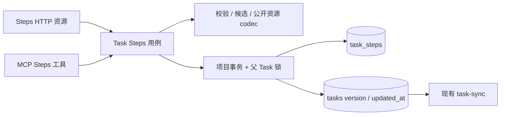

# Task Steps 架构设计

状态：服务端持久化、集合与单项读取、添加、内容与状态修改、移动和删除以及 MCP 工具已实现。CLI 与 Web 不提供 Steps 入口。

## 目标与边界

Steps 是 Task 拥有的有序工作记录，跨 Session 和执行环境保留。项目定义步骤名称、粒度和流程；系统提供读取、添加、修改、设置状态、移动和删除操作。执行前预列和执行中追加使用相同操作；每轮 coding/review 可新增独立记录，保留各轮身份与成果。架构保留 Task 整体状态、依赖、Worker 归属及 Session 生命周期，Step 状态不参与领取、调度或 Task 完成判断。

公开约束包括 Task 内唯一的 8 位十六进制 ID、独立 Steps 资源、共享父 Task 版本、完整有序集合响应、64 MiB 写入候选编码容量，以及冲突和未知结果的读回规则。Task 的 show/list/ready/graph/task-sync 保持各自投影，不内嵌 Steps。

## 现有机制与复用点

以下复用点的证据固定在源码 revision `b84dc4e9159d85f53f3c98f88016bdc94f27729e`。`030_task_steps.sql` 已创建步骤表；后续 `031_terminal_sessions.sql` 保持独立职责。服务端 Steps 资源仍可用，CLI 与 Web 不消费该资源；应用导航准入由独立路由所有者实现。

| 证据 | 当前事实及设计含义 |
|---|---|
| [`WriteProject`](https://github.com/codetreker/daynight/blob/b84dc4e9159d85f53f3c98f88016bdc94f27729e/packages/daynight-server/internal/core/store/project_tx.go#L35-L51) 与 [`TaskHeader`](https://github.com/codetreker/daynight/blob/b84dc4e9159d85f53f3c98f88016bdc94f27729e/packages/daynight-server/internal/core/store/task_steps.go#L74-L76) | `FOR UPDATE` 依次锁项目和父任务头；Steps 使用同一锁序且不加载完整 Task。 |
| [`ReadSnapshot`](https://github.com/codetreker/daynight/blob/b84dc4e9159d85f53f3c98f88016bdc94f27729e/packages/daynight-server/internal/core/store/snapshot.go#L16-L24) | `RepeatableRead` 与 `ReadOnly` 已提供一致只读快照；父版本和步骤必须在其中共同读取。 |
| [`UpdateTask`](https://github.com/codetreker/daynight/blob/b84dc4e9159d85f53f3c98f88016bdc94f27729e/packages/daynight-server/internal/core/store/project_tx.go#L130-L174) | 该历史实现同时写属性、替换依赖并冻结 Session；Steps 需要只触及父版本和更新时间的存储方法。 |
| [`taskWriteIdentity`、`requireTaskVersion` 与 `taskWriteHeader`](https://github.com/codetreker/daynight/blob/b84dc4e9159d85f53f3c98f88016bdc94f27729e/packages/daynight-server/internal/service/task_write_admission.go#L11-L48) | Task 与 Steps 共用中性的身份及精确版本检查；Steps 锁窄任务头，Worker 兼容和执行归属策略由 Task 操作拥有。 |

## 职责与数据流



| 位置 | 职责 |
|---|---|
| `internal/core/model/task_steps.go` | Step、状态、父任务头和有序集合领域值；不包含 HTTP 处理。 |
| `internal/core/task/codec/` | 纯字段校验、ID 规范化、公开资源类型与精确编码。 |
| `internal/core/task/steps/` | 不可变候选与顺序变更规则。 |
| `internal/core/store/postgres/task/` 与 `internal/core/store/postgres/internal/task_steps.go` | 父任务头锁定、快照读取、步骤差异写入、只更新父版本和时间。 |
| `internal/service/task/task_steps*.go` 与 `task_write_admission.go` | 项目准入、版本、操作顺序、容量、事务结果和用例错误。 |
| `api/task_steps.go`、`internal/server/task/task_steps*.go` | 严格输入 DTO、路由、HTTP 方法与公共结果；输出复用中性 codec 的资源类型。 |

`internal/core/task/codec` 不依赖 API 或业务流程；service、API 与 server 复用其资源类型与编码，候选规则由 `internal/core/task/steps` 拥有。公开 DTO 与容量编码只有一个定义，避免 service 反向依赖 HTTP handler 或维护第二套字节估计。

## 存储选择

| 方案 | 写入与读取成本 | 取舍 |
|---|---|---|
| Task 行中的 JSON 列 | 修改任一步都重写完整集合，并扩大高频父行的职责 | Task 的常规生命周期与大正文耦合。 |
| 独立有序 JSON 集合行 | 父行保持较小；每次字段或状态修改仍重写完整集合 | 顺序自然，但身份和逐项完整性全部依赖集合解码。 |
| 独立 `task_steps` 行 | 内容修改只写目标行，排序只写受影响位置；完整响应仍遍历集合 | 采用此方案，保留独立项读写和数据库唯一性。 |

迁移 `030_task_steps.sql` 创建以下表结构，保留已有迁移及 checksum。

```sql
CREATE TABLE task_steps (
    task_id uuid NOT NULL,
    id text COLLATE "C" NOT NULL CHECK (id ~ '^[0-9a-f]{8}$'),
    position bigint NOT NULL CHECK (position >= 0),
    title text NOT NULL,
    description text NOT NULL,
    status text NOT NULL CHECK (status IN ('todo','in_progress','done','skipped')),
    created_at timestamptz NOT NULL,
    updated_at timestamptz NOT NULL,
    PRIMARY KEY (task_id, id),
    UNIQUE (task_id, position) DEFERRABLE INITIALLY DEFERRED
);
```

Task UUID 已全局唯一，步骤行不重复 project ID。授权先定位父项目和任务，再按 `task_id` 访问行。沿用[独立属性行](https://github.com/codetreker/daynight/blob/b84dc4e9159d85f53f3c98f88016bdc94f27729e/packages/daynight-server/internal/core/store/migrations/026_task_property_rows.sql#L3-L7)的所有权方式，不增加 foreign key。

每个 Task 的位置稠密为 `0..n-1`，查询使用 `ORDER BY position`。插入、删除和移动先在内存构造最终顺序，再更新受影响行的位置；不使用临时哨兵位置。延迟唯一约束允许一次事务中的交换和区间平移，在提交时检查最终唯一性，语义见 [PostgreSQL CREATE TABLE](https://www.postgresql.org/docs/18/sql-createtable.html) 与 [SET CONSTRAINTS](https://www.postgresql.org/docs/18/sql-set-constraints.html)。

移动只改位置，所有 Step 的 `created_at`、`updated_at` 保持。标题、说明或状态变化只更新目标 Step 的 `updated_at`；添加确定两端时间，删除释放该 Task 内的短 ID。Task 软删除保留步骤行，访问始终经过父任务墓碑判断。顺序写入使用普通 INSERT/UPDATE，不把延迟唯一约束作为 `ON CONFLICT` 仲裁器；NOT NULL 和 CHECK 仍立即校验。

数据库约束守住身份、位置和枚举；应用按 Unicode `White_Space` 检查标题，保留原始字符串。无效存储行使整个读取失败，不修复、截断或跳过。现有 Task 没有步骤行时自然得到 `[]`，无需数据回填或旧格式读取分支。

## 资源与 HTTP

领域状态与Task五状态分别定义，`skipped` 不进入 TaskStatus。位置只体现在数组顺序中。

```ts
type TaskStep = {
  readonly id: string;
  readonly title: string;
  readonly description: string;
  readonly status: "todo" | "in_progress" | "done" | "skipped";
  readonly createdAt: string;
  readonly updatedAt: string;
};
type StepsResource = {
  readonly projectId: string;
  readonly taskId: string;
  readonly version: bigint;
  readonly steps: readonly TaskStep[];
};
type Placement = { readonly before: string } | { readonly after: string }
  | { readonly position: "first" | "last" };
```

Step ID 恰为 UUIDv4 第一段的 8 位十六进制字符，输入接受大小写并规范化为小写，保留前导零；同一 Task 内现存记录唯一，跨 Task 可以重复。标题和 Markdown 说明保留原始 UTF-8 字符串且不得含 NUL；标题至少包含一个不属于 Unicode `White_Space` 的字符。创建省略说明保存 `""`，省略状态保存 `todo`；读取返回全部字段。时间以 UTC RFC 3339 表示。`done` 表示该步结束，不推导 review 通过或 Task 完成；四状态之间均允许显式设置。

新增和修改的完整目标候选调用 Task 与 Step 共用的文字准入策略，分别限制标题 1024 字节和说明 65536 字节。读取使用 `ProjectCollection/ProjectItem` 纯投影，不调用严格候选校验或容量计量；正常扫描和 JSON 编码失败沿原链路传播。移动和删除不对目标施加单字段写入限额。目标文字和完整集合编码必须分别通过准入。

下表的 `/steps` 表示完整路径 `/api/v1/projects/{projectId}/tasks/{taskId}/steps`。

| 方法与路径 | 输入 | 成功结果 |
|---|---|---|
| `GET /steps` | 无 query | `200 StepsResource`，完整有序集合。 |
| `GET /steps/{stepId}` | 无 query | `200`，projectId/taskId/version/完整 step。 |
| `POST /steps` | version、id、title；可选 description、status、before 或 after | `201 StepsResource`。 |
| `PATCH /steps/{stepId}` | version；title/description 至少一个 | `200 StepsResource`。 |
| `PUT /steps/{stepId}/status` | version、status | `200 StepsResource`。 |
| `PUT /steps/{stepId}/position` | version；before/after/position 恰好一个 | `200 StepsResource`。 |
| `DELETE /steps/{stepId}` | version | `200 StepsResource`，返回删除后的集合。 |

例如添加请求为 `{"version":12,"id":"a1b2c3d4","title":"Review 第 2 轮","status":"todo"}`；移动请求为 `{"version":13,"after":"6f7a8b9c"}`。HTTP add 必须给出提交前已确定的 ID。POST 的 Location 指向规范单项资源 `/steps/{stepId}`。所有引用只在指定 Task 中解释。添加省略锚点时位于末尾，before/after 互斥；移动的 before/after/position 恰好一个，锚点不能是目标自身。PATCH 只更新明确给出的字段，空字符串清空说明。删除结束记录存续期且不删除引用材料；之后可以使用同一 ID 创建全新记录，系统不提供逐次修改审计、恢复或历史归因承诺。

复用认证、Cookie 写 Origin 检查、HEAD、no-store、principal 回执、request ID 和 405/Allow。输入只接受一个 UTF-8 JSON 对象，沿用 1 MiB 请求体上限；拒绝未知/重复字段、非法 query、null、错误类型及只读字段。输入短 ID 接受大小写并转小写，响应解析要求已规范的小写 ID，不把坏响应改成合法值。

`StepsResource` 只从专用入口返回。Task、图及同步 DTO 不增加 Steps 字段；父版本与更新时间的正常变化足以使现有 task-sync 观察到该 Task。

## 读取与写事务

集合或单项读取在一个 `REPEATABLE READ` 快照中完成成员准入、父任务头读取和步骤读取。父版本与步骤属于同一状态。单项不存在返回子项 404；有效空集合返回显式空数组。

Task 元数据与整个 Steps 集合统一使用 `Task.version`，`StepsResource.version` 就是父版本，Step 和集合均不增加独立版本。该并发单位以单个 Task 内修改频率较低为前提，保留一份一致状态及统一的冲突检查。即使两次修改涉及不同字段，后提交的陈旧版本也会冲突；这是接受的粒度成本。冲突后读取当前 Task/Steps，再明确决定是否提交，不自动覆盖或重试。


写入采用以下固定顺序：

1. 认证并校验语法、project/task/step ID 和正 int64 版本。
2. 进入 `WriteProject`，复核成员，锁父 Task，区分不存在与软删除。
3. 比较观察版本；陈旧版本先返回 `version_conflict`。
4. 读取当前 Steps，按 Task 内 ID 解析目标；add 先查重复 ID，再查位置锚点。
5. 构造不可变候选并做语义比较；新增和修改先检查完整目标文字。合法 no-op 返回原集合、版本及全部时间。
6. 真实变化先检查 int64 耗尽，再取得数据库 UTC 微秒时间，确定候选时间和父新版本。
7. 编码完整候选并校验容量；通过后才写步骤差异和父任务 touch。
8. 提交成功才返回已校验结果；提交或响应阶段取消继续具有未知结果语义。

中性的成员、父任务头和精确版本检查提取为共享准入原语；原 Task 写入继续拥有 Worker 兼容和生命周期策略。Steps 不通过布尔开关跳过某个通用 helper 的策略，也不读取 Worker 属性来决定可写性。

Step 写入由同一实例绑定项目写准入及 Add、Change、Move、Delete 集合准入。用例保留父任务门禁、真实编码、差异写入、capture 和事务完成协调；集合决策由 Core 负责。

父任务 touch 仅执行 `version = version + 1, updated_at = $chosenTime`，不调用完整 `UpdateTask`，不替换依赖、属性或执行时间，不冻结 Session。项目→父 Task→步骤的锁序与现有写入一致。

所有业务拒绝在数据修改前确定。Step 用例让拒绝和故障从事务回调传播并回滚；不沿用当前 `Tasks.write` 把 prepare Fault 转成成功回调的模式。现有[该处理](https://github.com/codetreker/daynight/blob/b84dc4e9159d85f53f3c98f88016bdc94f27729e/packages/daynight-server/internal/service/task.go#L157-L215)仅在 prepare 尚未写入时成立，不能用于写后容量拒绝。数据库、事务完成和取消错误保留原错误链。

### 精确容量与时间

公开 codec 使用与现有 [`WriteJSON`](../../packages/daynight-server/internal/server/httpx/http.go)相同的 `json.Encoder.Encode` 设置，计入默认 HTML 转义及末尾换行。容量由该 codec 的实际 UTF-8 输出计量，父版本按 19 位最大正 int64 保留空间；上限恰为 67,108,864 字节。

用于容量校验的 Step 时间就是将要存储和返回的时间。数据库时间先转 UTC 并保持微秒精度，再生成候选；不先用应用纳秒值计量后交由数据库截断。现有[同步精度规则](https://github.com/codetreker/daynight/blob/b84dc4e9159d85f53f3c98f88016bdc94f27729e/packages/daynight-server/internal/core/store/task_sync.go#L19-L33)已明确 PostgreSQL 的微秒边界。

写入 codec 是确定性的纯函数；写入容量检查和该写入的 HTTP 响应共用它。读取使用独立的纯字段投影和正常编码，不校验保存的完整集合或复查其容量。候选一旦通过，service 不再更改字段。超限返回 `steps_limit_exceeded` 与 encodedBytes/maxEncodedBytes，事务零变更；正常提交后的断连仍按未知结果处理。

### 错误优先级

有效写入的事务内顺序为成员/父资源可见性→父删除→版本→本地身份/锚点→目标文字准入（新增和修改）→no-op→版本耗尽→完整集合容量。合法当前版本 no-op 在最大版本仍成功；陈旧同值仍冲突。坏输入可在进入事务前拒绝。

服务的 Fault、HTTP 状态映射和已知错误分类共同增加 `step_id_conflict`、`steps_limit_exceeded`、`version_exhausted` 三个 409；错误 details 增加字节字段。正常子项缺失为 404，父软删除为 410，内部或持久化故障为 500。授权失败不能被子项检查泄露，内部故障不能降格为预期拒绝。

Steps 错误分类先检查事务/cleanup 的内部故障，再映射纯业务 Fault；业务拒绝与回滚清理故障被 errors.Join 合并时，整体为内部错误并保留两条原因，不能只靠 errors.As 找到首个 Fault 就返回 4xx。验证同时覆盖纯拒绝及拒绝伴随清理失败。

## CLI 入口退役

CLI 的 Task 命令定义、分派、API 导出、补全和手册主题清单均不包含 Steps。旧命令按未知 Task 操作在配置、Git 和网络之前失败。通用 HTTP 确认与输出机制继续服务 Thread 等调用者，历史 Inbox 事件保留共同解码。新生成的 Worker 提示不再指向旧命令；已安装 skill 通过现有更新机制刷新，首次安装及其他项目副本使用 `skill install`。退役决策见[CLI 退役记录](../../.agents/notes/implemented/simplification/2026-11-23-retire-cli-task-steps.md)。

## Web 资源与单一写入所有者

Web 不请求或保存 Steps 资源，也不提供其写入入口。普通 Task 修改继续由 `TaskDetailSessions` 管理提交生命周期、身份校验和结果核对，详见[详情会话设计](daynight-task-inspection.md#状态与详情会话)。

## Web 呈现、导航与大集合

Web 不展示 Steps 集合。旧 `tab=steps` 地址和已保存的该选项按缺省页签恢复，普通 Task 进入概览，附件路径继续定位附件。详情页签和附件阅读由[任务详情设计](daynight-task-inspection.md#独立完整任务详情)拥有。

### 应用导航准入

`app/navigation.ts` 的窗口级 `BrowserNavigation` 拥有已准入 location、历史条目和离开选择。`Application`、`AuthenticatedApp` 与 `App` 通过 `useBrowserLocation` 订阅该 location，不直接用原生事件卸载 Surface。`navigate`、`replaceRoute` 在写历史前准入；关系跳转与模态详情关闭通过 `requestAction` 在修改本地选择前准入。取消程序导航不写历史，确认只执行一次已选动作。

`TaskDraftBoundary` 将草稿注册绑定到当前 `TaskCacheScope` 实例、Project 和 Task。标签编辑草稿及启用 `trackDraft` 的 Discussion 草稿提供实时 `isDirty` 与 `discard` 回调；切换隐藏页签仍保留注册。独立页的相同 Task 页签/附件导航保持 Surface，不弹放弃确认；模态详情转入独立页会卸载原 Surface，仍需准入。注销只释放注册，不推断放弃。明确放弃调用回调后保留尚未卸载的注册，因此后续新草稿仍受保护；确认动作内部的同步路由调用共享本次准入。

应用导航在 `history.state.__daynightNavigation` 保存窗口内的 segment 标识、entry index、独立 entryId 和可选轻量页面选择，并保留其他 state 字段。页面选择不含业务响应、草稿、秘密或 DOM。完整 URL 只保存在当前导航所有者的内存表中，避免邀请 fragment 被浏览器序列化保留；读取编号条目时，segment、index、entryId 和内存中的精确 URL 必须同时匹配，因此复制了 state 的原生 fragment 仍是未编号条目。启动仅用 `replaceState` 标记当前条目，不添加初始化条目。应用 push 的 index 在同一连续 segment 中按实际步长增加，replace 同步替换该 index 的 URL；邀请消费后的 fragment 清理使用同一所有者替换当前地址和内存记录，保持已准入 location 一致，不分配新 index。未编号邀请的清理移除复制的导航 marker 并保留其他 state，不把清理后的原生条目重新解释成已有编号。从未编号位置发起新的应用写入时，仅为实际写入条目开启新 segment 并释放旧 URL 表，旧 segment 不再参与索引差值恢复；不补标中间的原生历史项。导航所有者释放时清空 URL 表。

对于同一 segment 内有效编号的 Back/Forward，浏览器 URL 已改变时仍呈现已准入 location。脏草稿使导航所有者保留原条目并显示一个离开选择；连续遍历更新最新目标。确认直接采用已到达目标，不追加或重放历史。取消通过 `history.go(fromIndex - observedIndex)` 恢复原条目，恢复状态消费回程事件并阻止新的程序导航，直到完成恢复；不从卸载 cleanup 推断决定。

整文档离开由 `beforeunload` 请求浏览器原生确认。原生 fragment、其他无有效 marker 的历史项及跨 segment 遍历沿用原生行为，不保证取消后恢复原历史位置或保留跨 Task 离开的草稿，存在位置恢复失败或草稿丢失风险。索引差值算法不为这些条目补造数值；后续扩展由同一路由/历史所有者承担。

守卫仅属于当前窗口和活动编辑作用域，不形成业务恢复或路由持久化服务。身份 scope 的同步 abort、已确认项目撤权及父 Task 删除立即终结注册、清理私有草稿并撤销待定选择，不能被保留草稿阻止；暂时读取失败或权限重校验不触发此清理。确认层复用 `TaskConfirmation` 的取消初始焦点、焦点循环及独立 Escape 层，取消返回仍存在的触发器或回退焦点。离开选择出现时先关闭 Task 内的消息详情和附件删除原生对话框，避免浏览器 top layer 将应用确认层变成不可交互；取消导航不重新打开这些子层，也不丢失草稿。

## 性能与调用预算

单项字段写入可以局部持久化，但每次写入的完整响应和容量检查仍为 O(n + B)，其中 B 为编码字节量；排序对受影响行是 O(n) 上界。最大合法集合的解码、候选和编码缓冲会占用显著请求内存，不能宣称整体操作 O(1)。


MCP 提供七项 Steps 读取与写入工具。列表使用一次 `limit+1` DAO 查询及绑定父版本的游标；summary 不读取完整描述，显式 full 返回完整内容。读取直接投影保存的规范字段，不设置领域结构、容量或响应字节检查，不逐项查询和计量；cursor 指向最后返回项。单项分别使用普通 Get/GetSummary，输入的父版本条件仍显式比较。共享 MCP 入口的读取结果不执行输出 schema 或字节准入，大对象许可、输入和期限规则继续适用。写入复用上述原子用例及严格完整候选 codec，即使返回 summary 也在物化完整集合前取得大对象许可。工具发现与容量策略见服务端 [README](../../packages/daynight-server/README.md#mcp-http-entry)。

## 迁移与部署

迁移 `030_task_steps.sql` 增加表和约束，迁移注册保留已应用文件。迁移与 ledger 同事务；已有任务的字段、版本、时间、属性及历史不变。Steps API 读取零行得到合法空集合，不扫描或转换描述、Session todo 和原生历史。

Steps 的 HTTP 和 MCP 仍遵循各自资源契约；CLI 和 Web 不提供 Steps 入口，普通 Task 投影保持独立。

本次交付覆盖前向迁移、正常重启和已写 Steps 数据保留。服务端二进制回退及相应降级恢复方案不在交付范围，不承诺旧二进制能启动已升级的数据库；既有迁移顺序和 checksum 检查保持严格。发布前复核实际迁移序号及全部 producer/consumer，普通 CLI 变更保持包版本，正式发布按既有发布流程单独提升版本。

## 验证与组件依赖

| 验证层 | 对应要求与必要观察 |
|---|---|
| 纯候选与 codec | ID/Unicode、no-op、相对排序、时间保持、精确转义/换行字节、边界/超限及版本耗尽。 |
| Service 写协调 | 公开输入、项目准入、父任务门禁、同事务 DAO 调用、真实编码和 capture，分别检查回调与事务完成结果；Move/Delete 的集合规则由 Core 测试，SQL 区间与持久化由 PostgreSQL 测试负责。 |
| 真实 PostgreSQL | 升级、重启、快照读写交错、并发同版本、软删除和 deferred order constraint；在已写部分位置/步骤行、已 touch 父版本但尚未提交处注入可确认回滚的失败，逐项核对完整集合、排列、父版本及全部时间零变更。提交结果未知另走读回，不能作为回滚证明。 |
| HTTP | 严格字段、认证/成员、子 404/父 410、409 details、JSON DELETE、方法/HEAD/no-store、取消与提交后丢响应；对实际集合 GET 和修改响应检查 64 MiB 临界编码字节、换行和完整资源形状，不能只测纯 codec。 |
| 打包 CLI | 帮助、补全和手册发现不提供 Steps；旧命令明确失败，普通 Task 流程保持，已安装 skill 按现有更新机制刷新。 |
| Web | 弹窗、独立详情和 Goal 内嵌详情没有 Steps 页签或请求；旧地址、历史恢复、附件导航、普通 Task 修改和访问校验保持。 |
| 指令语义与分发 | 产品手册和新生成的 Worker 提示不指向旧 CLI 命令；Session 日志不被上传，项目自定流程不被固化。打包/安装字节检查和语义情境分别报告。 |

真实服务验证 Steps 资源读写、重启和故障；打包 CLI 与生产 Web 验证退役入口及普通 Task 行为。沿用 Go build/vet/go-cov 及严格大于 90% 覆盖门槛、CLI typecheck/test/build 和 Web 质量/浏览器门禁；Go race 按[服务端验证策略](../../packages/daynight-server/README.md#race-instrumentation)在本地默认/main 开启、PR 关闭。

| 组件输出 | 技术依赖 |
|---|---|
| 服务端 Steps 资源 | 表、领域候选、codec、事务和 HTTP 形成公开数据契约。 |
| CLI 与指令资源 | 命令、API、帮助/补全及 canonical skill 不提供 Steps；普通 Task 与历史 Inbox 解码保持。 |
| Web 任务详情 | 不提供 Steps 入口；普通 Task、附件和导航保持既有访问与状态边界。 |
| 组合验证 | 服务端 HTTP 与 MCP 验证读取和原子修改；安装后的 CLI 和生产 Web 验证入口退役及普通 Task 行为。 |

上述关系表达组件职责。各能力的验收基于实际前置能力；HTTP 和 MCP 保留各自的公开契约。

## 可观测性与失败边界

复用现有请求 context、slog JSON 和 [RequestLogging/LogFailure](../../packages/daynight-server/internal/server/httpx/logging.go)。middleware 建立 request_id，认证后绑定 user_id，再附加经准入的 project_id/task_id；目标操作附加规范 step_id，列表以 Task 为最具体资源身份。

调用方可使用 `X-Request-ID` 关联修改及后续只读核对；恢复 GET 可使用原 ID 加 `.r1`、`.r2` 等后缀，每个请求仍有独立 request_id，可按前缀关联。该关联只用于诊断，不证明历史归因，也不参与授权、版本判断或幂等。

Steps 日志使用 `component=task_step`、operation、phase=read|prepare|persist|commit|response，以及 changed/unchanged/refused 等业务结果。事务和响应另有独立终态，不能把取消、5xx 或一个 HTTP 状态当作回滚或业务成功的证明：

请求级 logger 与 RequestID 的访问仍归 handler。用例和 store 返回可识别的失败阶段、提交已知性及结果元信息，handler 在同一请求上下文中记录这些事实和响应阶段；service/store 不反向导入 server 日志包。读取使用 `.rN` 关联约定记录 read_kind，关联标签只影响诊断，不改变读取或授权语义。

| 边界 | 必须保留的事实 |
|---|---|
| 候选拒绝或提交前失败 | commit 未尝试；确认回滚时记录 tx_outcome=not_committed。清理故障保留原错误链和独立分类。 |
| Commit 成功 | tx_outcome=committed；之后响应失败不改变这一事实。 |
| Commit 返回明确回滚结果 | tx_outcome=not_committed。 |
| Commit 无法确认 | tx_outcome=unknown；后续 cleanup Rollback 不能反推先前未提交。 |
| 响应 | 独立 response_outcome=written|failed|canceled_before_body，包含已写字节；网络写完也不等于客户端确认接收。 |
| 读回 | phase=read，read_kind=reconcile；记录当前版本与 found/absent/current_state，不宣称未知操作造成了该状态。 |

现有 [`transact`](https://github.com/codetreker/daynight/blob/b84dc4e9159d85f53f3c98f88016bdc94f27729e/packages/daynight-server/internal/core/store/transaction.go#L13-L66)通过 `TransactionError` 保留 operation/commit/cleanup 阶段、提交已知性和 errors.Is/As 错误链；Steps 消费这些元信息，不创建第二个事务执行器。成功返回意味着 commit 已确认，明确的 `ErrTxCommitRollback` 表达未提交，其他未确认的 Commit 错误保守分类为 unknown。

Steps 的公共资源 writer 使用同一 codec，返回明确的已写/失败/写前取消结果并记录 response 阶段。现有 `writeJSON` 在取消时可静默返回，通用请求日志对未写响应会使用默认状态；Steps 不据该默认 200 判定业务成功，不为此重写无关路由的生命周期。

新的错误诊断使用固定 code/phase 到安全说明的允许列表。cause 保留错误类别及必要的固定原因码（例如 PostgreSQL SQLSTATE），不把任意 err.Error、数据库消息、输入值或 fault message 原样写入日志。原始错误链继续向调用者传播；HTTP 对外和日志分别使用受限表示。验证用标题、Markdown、URL、令牌及数据库错误中的哨兵文本确认它们不进入日志，并覆盖三个新 409 的安全诊断。

HTTP→service→事务沿同一 context 同步调用，没有新增后台队列、goroutine 或重试循环。取消传到查询与提交，事务 cleanup 保留现有有界独立 context 并区分其结果。

部署后用一次 Steps 修改的请求 ID 关联写入与恢复读取：

```bash
jq -c --arg rid "$STEP_REQUEST_ID" \
  'select(.request_id == $rid or (.request_id | strings | startswith($rid + ".r"))) | {type,component,operation,phase,outcome,tx_outcome,response_outcome,read_kind,cause,error_code,status,project_id,task_id,step_id}' \
  service.jsonl
```

应能区分已确认回滚、提交歧义、提交后的响应失败及后续当前状态读取。日志元信息不作为客户端结果确认、授权、容量或幂等依据；调用方的成功确认仍须遵守公共资源与读回规则。

## 架构基线摘要

服务端采用独立步骤行、稠密顺序、共享父版本、独立 HTTP 资源和 MCP 工具。CLI 与 Web 不提供 Steps 入口，保留普通 Task、导航和附件行为。各层保持项目流程、Worker 和 Session 边界。
