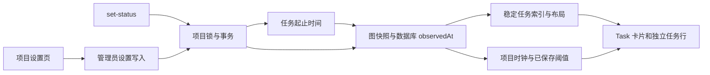

# 任务执行耗时与卡住提醒架构

本设计落实[需求 TT1–TT6](../spec/daynight-task-timing.md)，
[决策记录](../../.agents/notes/implemented/architecture/2026-10-23-task-timing-design.md)保存采用理由。
任务起止持久化、图数据库时间、项目阈值、设置页、共享时钟和实时展示构成当前机制。
整体验收必须使用对应源码的运行证据，设计与实现代码不能替代运行结果。

## 现有结构与职责

[状态服务](../../packages/daynight-server/internal/service/task_lifecycle.go)提供统一 SetStatus，普通任务更新没有状态字段。
[项目写事务](../../packages/daynight-server/internal/core/store/project_tx.go)通过项目行锁串行化写入，再在同一事务修改任务、版本和依赖；
`updated_at` 随普通编辑变化，不能作为执行起点。
[图读取服务](../../packages/daynight-server/internal/service/task_graph.go)在只读快照中读取项目、任务与统计，并在数据读取后采样数据库 `observedAt`。

Web 的 [useTaskGraph](../../packages/daynight-web/src/features/projects/useTaskGraph.ts) 每五秒读取图，内容比较排除 `observedAt`；
最新服务端样本由独立 `GraphSnapshot.observedAt` 保存，因此仅时钟变化时复用图与索引仍能取得新样本。
[TaskNode](../../packages/daynight-web/src/features/task-graph/TaskNode.tsx) 已将检查任务的主体按钮和打开详情的 Details 按钮分开。
`GraphIndex` 拥有任务与统计，布局来自投影和展开状态；项目设置与每秒计时不应成为这些计算的输入。
项目设置页与成员页为同级路由，共用管理员判断、身份请求等待、项目导航和面板样式。



## 存储与生命周期

`009_task_timing.sql` 给 `tasks` 增加可空 `started_at`、`completed_at timestamptz`，已有记录保持 `NULL`。
core 与 API 使用可空时间字段，JSON 明确输出 `startedAt`、`completedAt`，不省略未知值。

任务写入根据数据库旧状态与目标状态维护计时，而非依赖调用者传入时间：

| 实际写入 | 起点 | 终点 |
|---|---|---|
| todo/done → in_progress | 锁后 `statement_timestamp()` | null |
| in_progress/done → todo | null | null |
| in_progress → done | 保留真实可空起点 | 锁后 `statement_timestamp()` |
| todo → done | null | 锁后 `statement_timestamp()` |
| 普通编辑或同状态 | 保留 | 保留 |

同状态在版本检查后无修改；过期同状态仍冲突。历史 proposed→todo 迁移保留执行时间，
不调用运行时重置规则。缺失历史起点不补造，后续完成可仅有真实终点，耗时未知。
[状态架构](daynight-task-status.md)拥有任意转换和计时之间的完整约束。

状态、时间、版本与依赖写入共用既有事务。时间表达式使用项目锁获取后的 SQL statement 时间，
不能使用事务开始时间：事务可能等待项目锁，过早时间会把等待阶段错误计入执行。
完整任务、列表、ready、图投影与 CLI/Web 类型、读取器和夹具共同保留这些时间字段。
严格解析要求字段存在，已知值为合法 UTC `Z` 时间，秒后允许 1–9 位小数并保留原始字符串；未知事实必须明确为 `null`，不用缺省值兼容旧响应。
摘要缓存按任务业务版本与项目设置版本分别合并，排除 `observedAt` 并分离设置元数据与任务索引身份；页面时钟消费独立的最新样本和本页单调接收时间。

## 项目设置资源

`010_project_settings.sql` 迁移给 `projects` 增加 `execution_warning_minutes integer NOT NULL DEFAULT 60` 和
`settings_version bigint NOT NULL DEFAULT 1`，约束分别为正值，迁移不修改已有 project.createdAt/updatedAt。
直接使用项目行承载这组有界设置，复用项目锁，不引入独立设置表或外键。
所有项目查询与创建路径输出同一嵌套结构：

```json
{
  "settings": {
    "version": 1,
    "executionWarningMinutes": 60
  }
}
```

`GET /api/v1/projects/{projectId}`、项目列表与图中的 Project 均包含 settings。
设置写入使用 `PATCH /api/v1/projects/{projectId}/settings`：

```json
{"version":1,"executionWarningMinutes":90}
```

响应返回已保存的完整 Project，沿用既有响应包装和错误模型。
版本在 Go 中为 `int64`，CLI/Web 使用现有无损 JSON 读取方式保留精确十进制数值，不能先经不安全的 JavaScript number 转换。
分钟数范围为 `1..2147483647`；HTTP 严格对象解析拒绝缺失、重复、未知、`null`、小数、越界及非正值。
CLI 复用既有嵌套原始数字读取。Web 的 Project、列表与图使用定向 `project-json.ts` envelope 解码，
复用 `json-source.ts` 原始片段定位，将已知 settings 子对象交给根版本解码；完整正文仍由原生 JSON 验证，
未知嵌套值与通用 parseApiJson 的处理语义保持，不依赖较新浏览器的 reviver source context。
Project、items[] 和 graph.project.settings.version 均保持 bigint，覆盖超过 `2^53` 的值。
摘要缓存按已有 settings.version 合并 Project，设置版本始终保持 bigint，资源和 JSON 输出不改变类型；
设置变化更新 Project 而保留相同任务的 tasks、summary 引用与 GraphIndex。

写入顺序是项目行锁、锁后成员身份与管理员权限复核、精确版本检查、同值判定、更新。
同值且版本正确时返回原项目，不增加版本或修改 updatedAt；过期同值请求仍返回 `version_conflict`。
实际变化在同一 SQL 中递增 settings_version 并以 statement_timestamp 更新 project.updatedAt，保留 createdAt 与任务时间。
成员降权或被移除后不能在等待锁结束时提交旧权限写入。
非成员沿用 `not_found` 隐藏资源，普通成员修改返回 `forbidden`。
数据库、取消或响应错误沿既有错误链传递，不用本地默认值掩盖未知设置。

## 时钟与图快照

图资源的顶层 `observedAt` 来自同一只读事务中的数据库时钟查询，采样安排在图数据和统计读取之后。
它与任务起止时间共享时钟来源；不使用 Go HTTP Date 的秒精度时间或客户端墙钟推算执行耗时。

Web 在 task-sync 响应解析完成后立即捕获 `performance.now()`，在 IDB 原子应用和索引计算之前保存 `GraphSnapshot.receivedMonotonic`。
同一 snapshot 保存该响应最新 `observedAt` 和仅用于本机最近刷新标签的 `receivedAt`；服务端样本和单调接收时间必须成对更新。
摘要按任务 ID 和精确业务版本合并，Project 设置独立按版本合并；仅时钟变化时复用整个 graph/index，仅设置变化时替换 Project 元数据并复用任务索引。持久与跨页数据不能恢复本页的单调时钟锚点。
因此缓存图自身的 `graph.observedAt` 可能仍是旧样本。
页面时钟消费最新 `snapshot.observedAt` 与 `snapshot.receivedMonotonic`，使用如下独立锚点：

```ts
type ClockAnchor = {
  readonly serverMilliseconds: number;
  readonly receivedMonotonic: number;
};

const currentServerTime = (anchor: ClockAnchor) =>
  anchor.serverMilliseconds + performance.now() - anchor.receivedMonotonic;
```

这是接收时基于服务端样本推进的显示时钟，不保证消除网络传输延迟；每次既有项目摘要同步会重新对齐。
`GraphSnapshot.receivedAt` 仍用于“最近刷新”墙钟标签，不复用为计时锚点。
独立时间样本、项目设置元数据与 `{tasks, summary}` 索引身份已分开，
仅时钟或设置变化都不重建 `GraphIndex`。
时钟与阈值不得进入投影、节点位置或边路由的 memo 依赖。

`TaskExecutionClockProvider` 按 projectId 组织稳定 store/context，`useTaskExecution` 用 useSyncExternalStore 订阅。
仅已挂载的已知起点进行中任务订阅时钟；存在这类订阅且页面可见时才有一个一秒定时器。
完成任务只订阅设置变化以更新说明，不订阅时钟；未知计时无活动订阅。隐藏页暂停 ticker，恢复可见时立即发布单调差值结果，
既有项目摘要同步随后重建锚点。无运行订阅或卸载时清理 timer/visibility listener；项目和身份切换释放旧页面的 store。
API 读取沿既有前台身份 guard、AbortController 和 generation，旧响应不能更新新项目时钟或阈值。
单调差值包含接收到提交的 UI 延迟；服务端采样至接收/解析完成的网络与解析延迟仍是估计精度边界，不通过客户端 Date.now 补偿。
运行同提交暂态的负估计只在显示层限为零，完成态始终使用持久化起止差。

## 项目设置与卡片消费者

`/projects/:id/settings` 与成员页为同级路由，支持 GET/HEAD 深链接，复用项目导航、面板、表单、错误和权限展示模式。
ProjectSettingsPanel 按 user/project 键隔离，成员查看权威值，管理员可编辑分钟、保存或取消。保存期间禁用相应写操作。
草稿与已保存 Project 分开；成功 PATCH 返回完整 Project 后更新权威值，确认的 4xx 拒绝不应用草稿。
409/403 重新读取 Project 和成员，冲突后展示当前设置与角色，不重发 PATCH；404 或自身成员消失清除私有 Project 和草稿。
网络、协议或 5xx 错误代表未确认写入，先进入 uncertain 并核对 Project/成员；核对成功后才能再次保存，
失败保留明确错误、阻止 Save 并提供只读重试。路由离开或 abort 仅取消旧客户端工作，不能证明远端未提交。
共享 foreground request guard 保留同用户表单与焦点，换号 generation 使旧读写失效。

`TaskExecutionPresentation` 在图卡片与独立任务行复用耗时、提醒和可访问说明。
进行中为当前服务端显示时间减起点，完成为终点减起点，未知起点不显示耗时。
严格比较原始毫秒值 `elapsed > executionWarningMinutes * 60_000`，格式化仅影响文字。
使用琥珀色强调、图标和双语文本表示“可能卡住了”，保留进行中蓝色状态、耗时、自动执行许可及既有选择强调。
提醒放在现有元数据区域，不覆盖 Details、检查主体或展开控件，不改变 `220×96` / `220×136` 几何。
底部为较宽的英文 Details 标签与耗时留出 42px 预留区，避免沿用原有 28px 后两者重叠；以真实浏览器边界验证长耗时和两种语言。
time 使用 `PT<秒数>S` 语义时长；可见文字对小于一分钟及 d/h/min 或天/小时/分钟做本地化向下取整。
节点和独立行保留原可访问名称，精确原始起止、耗时和阈值经 aria-describedby/time title 提供。
独立行的可见新元数据对名称计算隐藏，计时 tick 不改变按钮名称；没有 alert/status/live-region 逐秒广播。
完成、未知与进行中都保留现有焦点和控制；显式外部边、链外卡片及选中/前置强调不被琥珀提醒覆盖。链汇总没有单任务耗时。

## 验证与交付

存储验证覆盖迁移、锁等待后的时间、生命周期冲突与回滚、普通编辑保持起止、旧数据未知、快照字段和实际 CLI 读取。
项目设置验证覆盖默认值、项目隔离、管理员写入与成员只读、锁后降权、并发单胜者、过期同值冲突、严格输入及设置页面状态。
卡片用确定性时钟验证 59:59、60:00、60:01 的精确边界，验证自动推进、后台恢复、错误墙钟、设置重新判断、完成冻结、未知值、图身份与焦点不变，
并以真实服务、隔离 PostgreSQL、生产 Web 和实际 CLI 验证真实阈值跨越与完整数据链路；不要求在持续前进的数据库时钟中命中精确相等瞬间。

服务端使用文档规定的 `scripts/check.sh` 与 Go 覆盖率门槛；CLI 与 Web 运行各自 README 规定的类型、测试、构建和适用接受性检查。

## 运行诊断与接口成本

新增设置请求沿用既有认证、请求上下文和结构化诊断，关联 `request_id`、`user_id`、`project_id`，
并保留 `component`、操作 `phase`、错误类别与原始错误链。任务写入另有关联 `task_id`。
未来调查者可在服务端 JSON 日志中按 `project_id` 和设置请求的 `request_id` 过滤，确认保存阶段及错误类别；不记录令牌、描述内容或表单原始正文。

服务端不增加后台作业或告警扫描器。网页时钟仅属于当前项目页面，错误与取消归现有页面请求所有者；
浏览器定时器只推进本地显示，不产生逐卡网络请求或遥测。每个任务增加两个可空时间字段，
每个图增加一个时钟字段，每个项目增加固定大小 settings。图原有节点/边上限、五秒轮询及列表分页保持不变；
设置读取复用 Project，修改仅增加一次显式 PATCH，不新增模型工具或无界历史输出。
