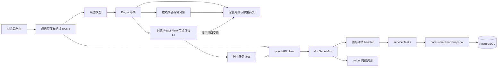

# 项目与任务看板设计

状态：完整图 API、项目任务看板、Go 内嵌交付及 localhost/dev-ci 部署已实现；长斜线 SVG 虚线绘制曾造成 raster/commit 阻塞，采用局部水平线与短原生转角路径分解；完整生产验收已交付。运行结果随对应 PR 与 CI 保存；本地回执不能代替干净 hosted 验证。原始看板基线为[只读 MVP](../spec/daynight-web.md)，当前项目工作区以实际组件为准，早期内层分类页签见[任务视图交互预览](mockups/task-views.html)；[原始看板预览](mockups/task-dashboard.html)和[项目详情截图](mockups/task-dashboard-project.png)保留初始视觉基线。[决策记录](../../.agents/notes/archived/architecture/2026-10-20-task-dashboard-mvp-design.md)保存选型与范围取舍。

[预定义属性设计](daynight-task-properties.md)的 server 接口、CLI 和任务详情中的
只读 PR 区域已实现。[需求](../spec/daynight-task-properties.md)与
[交互预览](mockups/task-properties.html)分别拥有行为和样式。

已实现的[附件架构](daynight-task-attachments.md)扩展 task 详情，提供文件树、
单文件上传/覆盖/删除、下载及同源预览。[附件需求](../spec/daynight-task-attachments.md)
拥有文件行为，[Web 决策](../../.agents/notes/archived/feature/2026-10-21-task-attachment-web.md)
记录状态、渲染和焦点机制。图、统计与 task 元数据保留读取约定；状态通过专用版本化 PUT 设置。任务的布尔 allowAgents 与可空枚举 requiredPlatform 已实现，通过普通版本化 PATCH 修改，详情确认开关、平台确认下拉框及共享请求归属见下文。

[鉴权架构](daynight-auth.md)拥有 UniAuth 登录、项目权限、成员与邀请及个人访问
令牌；`AuthenticatedApp` 和 API 客户端已接入生产入口。
[需求](../spec/daynight-auth.md)拥有完整行为。生产 `Application` 在常驻 LocaleProvider 中按
当前地址组合公开推广页、公开指南和 `AuthenticatedApp`；后者复用 messages.auth 的英语/简体中文目录
及同一语言偏好。[公开入口设计](daynight-landing.md)拥有分流、介绍、演示和元数据。后端使用升级后的公开 UniAuth
SDK 提供 App-aware provider discovery；发现失败与用户会话失效分开呈现。新壳
复用现有任务页签、渐进图和居中 `TaskDetailDialog`，保留可信同源 frame、相对资源及键盘机制。
[Web 鉴权决策](../../.agents/notes/implemented/feature/2026-10-22-web-auth-workspace.md)
记录组件、会话生命周期和验证边界。

[语言设计](daynight-web-i18n.md)拥有已实现的类型化目录、Intl 格式化器、首屏解析、常驻 Provider、共享选择器和全部现有第一方组件的双语呈现；[双语需求](../spec/daynight-web-i18n.md)拥有完整覆盖与验收。语言偏好使用独立的 origin-local 键，不改变本文的项目浏览记录、API、图或附件生命周期。

[执行计时架构](daynight-task-timing.md)的起止字段与数据库 `observedAt` 已进入严格 API 读取器。
`useTaskGraph` 从 task-sync 获取最新服务端样本，保存为独立 snapshot 字段，保持仅时钟变化时的图/索引身份。[缓存架构](daynight-task-sync.md)拥有已实现的 IndexedDB 摘要、原子增量应用和身份生命周期；详情已在同一 scope 下按需持久化，以摘要业务版本和恢复需要驱动 GET。
[外部依赖架构](daynight-external-dependencies.md)的存储及严格读取准备也已实现：
GraphTask/详情保留必填 externalDependsOn，API 层校验正规化 ID、去重及完整依赖的子集，
摘要自身内容比较和详情描述符纳入该集合。buildGraphIndex 用普通依赖构造弱连通分量，
完整依赖用于验证、上下文和检查；关系标签和虚线消费显式性质，卡片角色另按成员集合计算。
项目阈值、精确设置版本、管理员设置页及局部执行计时/提醒共同接入。

## 目标与现有基础

浏览器完成“项目列表 → 项目统计 → 独立任务列表或根任务链 → 任务详情”的完整读取路径。数据继续归属 `daynight-server`，不接入 客户端的 review 命令，不新增父子任务。任务仅有 todo、in_progress、done，创建默认 todo，详情提供
版本化状态菜单；许可和平台使用各自确认入口，图和一般元数据继续保持读取。

已有基础与集成位置：

| 事实 | 证据与影响 |
|---|---|
| Go 服务已有项目与任务 JSON API | `packages/daynight-server/api/projects.go` 的 `ProjectPage` 返回项目及 `nextCursor`；`api/tasks.go` 的 `Task` 包含 `dependsOn`、`externalDependsOn`、`blockedBy`、`ready`、`allowAgents`、`requiredPlatform`。 |
| 页面与 API 同源 | `internal/server` 在同一 mux 注册精确页面、静态资源及 API 路由；`internal/webui` 内嵌真实构建产物，未知 API 保留 JSON 404。 |
| 已有一致读取机制 | `packages/daynight-server/internal/core/store/snapshot.go` 的 `ReadSnapshot` 使用只读 `REPEATABLE READ`。 |
| 分页之间没有共同快照 | [服务端分页约定](../spec/daynight-server.md)明确这一边界；不能用多次 task list 拼成准确的项目全图。 |
| web 与 CLI 工作区独立 | 私有 React/TypeScript/Vite 包使用显式 `web:*` 命令；根 build/typecheck/test 继续只覆盖 CLI，web 使用按[CI 路由](../../README.md#ci-selection)选择的独立 job。 |

## 看板基线与附件扩展

原看板交付两个页面、一个详情侧栏和一个新增只读 API。该基线使用手动刷新，保持
原有写入接口、依赖规则与本机监听方式。当前项目任务页使用每 5 秒的可见页面自动刷新，
延续完整快照替换与资源隔离；[自动刷新决策](../../.agents/notes/implemented/feature/2026-10-22-project-task-auto-refresh.md)
部分取代原基线的手动触发策略。附件是独立的文件资源扩展，使用自己的
元数据、HTTP 接口和局部状态，不把文件写入混入 task PATCH 或图快照。

项目列表只展示项目元数据，不为每张卡额外请求任务统计。统计集中在项目详情，避免列表产生 N 次图查询。创建编辑、实时推送和大图分片的延后成本及保留条件由[要求文档](../spec/daynight-web.md#明确延后的能力)定义；生产鉴权壳、项目创建、成员与邀请管理由[鉴权架构](daynight-auth.md)拥有。

## 页面与视觉

采用浅色内容区、白色卡片、深色窄导航栏和克制的靛蓝强调色。节点颜色始终表达业务状态；选中态使用描边，不覆盖状态颜色。产品标签使用当前英语或简体中文目录，用户内容、代码标识和仓库地址保留原文；切换遵守[语言设计](daynight-web-i18n.md)的状态、焦点和布局约束。

三状态均有本地化文字和颜色，统计使用六项网格并在窄屏自然换行。
当前模型、确认与版本响应由[三状态架构](daynight-task-status.md)拥有；早期四状态读取与审批
保留在历史决策中。图组件负责导航，状态写入由完整详情及共享会话拥有。

### 工作空间导航

`AuthenticatedApp` 的 Workspace 保持路由、认证屏障与正文所有权，`WorkspaceSidebar`
负责导航呈现。侧栏分为可滚动的 `.sidebar-main` 和不收缩的 `.sidebar-bottom`：
前者持有品牌和项目主导航，后者持有同一个 `/account` 链接、工作区说明及切换按钮。
sticky 视口高度和纵向 flex 布局让长页面、短窗口及折叠状态都保留底部入口。
链接的 `aria-current="page"` 提供当前路由选中态；图标、可访问名称及悬停提示在竖条中仍然可用。

`useSidebarPreference` 独立管理桌面 `collapsed`。origin-local
`daynight.web.sidebar.collapsed` 只接受 JSON boolean，缺失时为 false 且不写入。
读取失败、格式无效、写入失败使用带原始 cause 的内部 issue，呈现当前目录的脱敏提示；
显式切换保留新内存值并尝试保存，重试保存当前值，成功后清除 issue。外观值不包含
用户、项目或令牌，跨项目及身份切换保留；它不依赖 project feature 的偏好 helper。

桌面网格使用 190px 或 68px 侧栏；740px 及以下固定为 60px 竖条，展开覆盖导航宽
220px。媒体查询与脚本使用同一 740px 断点约定。临时 `drawerOpen` 与持久 `collapsed`
分离，手机开关不写桌面记录。覆盖导航位于 Workspace 认证屏障内，提供具名模态语义、
实际可见控件的 Tab 约束、背景 inert 和共享 `useBodyScrollLock` 引用计数锁。
清理恢复原 inert 与滚动状态，不释放图全屏或详情持有的锁。Escape/遮罩关闭恢复展开
按钮焦点；路由导航交给既有正文聚焦。路由、桌面断点、身份核验开始、身份阻塞或卸载
均关闭临时层。正常身份核验仍保留正文可见与交互；单独传递核验状态以关闭导航，不扩大
原有 `blocked` 语义，不覆盖原生身份恢复对话框。

侧栏状态不参与用户、项目、缓存或详情的 React key。宽度变化仅改变布局，图沿用已有
尺寸观察，不重新初始化视口或增加读取、缓存及轮询器。跨标签实时同步与服务端同步可独立
扩展，当前记录只表示一个本地外观值。[侧栏偏好决策](../../.agents/notes/implemented/feature/2026-10-25-sidebar-preference.md)
拥有状态、错误与身份边界的取舍；[账户导航决策](../../.agents/notes/implemented/feature/2026-10-25-bottom-account-navigation.md)
保留底部入口布局的原始理由。

### 项目列表 `/projects`

- 页首显示“项目”和刷新按钮。
- 卡片显示项目名称、仓库地址、创建日期和“查看任务”。长名称、地址允许换行，仓库地址按普通文本展示。
- 复用 `GET /api/v1/projects?limit=50&cursor=...`，服务端先按成员关系过滤，再以“加载更多”遍历，按 ID 去重。
- 加载下一页失败时保留已加载卡片，错误和重试定位在列表末尾；首次加载失败使用整页错误。
- 刷新重置分页，从新列表开始。列表没有跨页一致性承诺，不显示未经完整读取的项目总数。

### 项目详情 `/projects/{projectId}`

```text
← 项目                         最近刷新时间   [刷新]
项目名称
仓库地址

概览       │ 概览  查看项目整体进展与当前任务状态。
任务列表   │ [任务总数] [已完成] [待处理]
           │ [进行中]   [可开始] [被阻塞]
           │ 可开始与被阻塞均为待处理的子集

选择任务列表：
概览       │ 任务列表  浏览独立任务与按依赖关联的任务链。
任务列表   │ [独立任务 2] [任务链 7]
           │ [ ] 显示已完成任务链（0）  最新创建在前 · 2 / 2 条任务链
           │ ▾ Goal A         进行中       3 / 8 已完成 [查看依赖关系]
           │   子任务 · 7                        [查看 Goal 详情]
           │   任务 A1                                  已完成
           │   任务 A2                                  进行中
           │   任务 A3                                  待处理
           │ ▸ Goal B         进行中       1 / 5 已完成 [查看依赖关系]

点击 Goal 展开子任务；点击子任务打开详情。
点击“查看依赖关系”：居中图浮层（桌面 80vw × 80dvh）
┌ 任务链标题 · 状态 · 完成进度                         [关闭] ┐
│ 横向依赖图                                [全屏] [概览] │
│ A → C → E                                  [−][+][适应] │
│ B ⇢ C                 B：外部前置，保留完整上游           │
└ 实线：普通依赖；虚线：外部依赖；虚线卡片：链外前置       ┘
```

- `ProjectView` 持有唯一项目快照、`useTaskGraph` 同步、详情选择、项目订阅与浏览偏好。公共标题、刷新、错误和详情不属于任何可隐藏内容区。概览展示同一快照的六项统计和整体进度；任务列表使用同一完整索引和分类。停留概览仍需要当前统计，因此原有五秒同步按页面可见性运行，不按外层选择创建第二套请求或缓存。
- `ProjectSectionTabs` 拥有外层导航的呈现与键盘方向，`ProjectOverview` 呈现统计与进度列表，`ProjectTaskWorkspace` 组合既有内层列表与任务时钟。两个面板复用 `.project-section-heading`，标题与说明以 flex 单行、基线对齐，间隔 12px；标题不收缩且无下边距，说明允许收缩并在溢出时显示省略号，完整文案保留在文本节点及原生 `title` 提示中。标题/说明的桌面字号为 16px/12px，740px 及以下为 15px/11px，字重、颜色和标题区下方间距沿用各自规则。桌面导航列宽 150px、间距 28px，1000px 及以下为 130px/20px；740px 及以下改为上方横排。统计默认三列，1500px 起六列，740px 及以下两列。
- 整体进度复用 `ProjectView` 已按精确服务顺序反转的完整任务链与独立任务类别，不使用完成筛选后的列表。`overview-progress.ts` 读取普通分量缓存的 `progress`，排除全 done 的组，代表任务提供标题和导航 witness。独立任务以最近七天的已知完成数作分子，与全部未完成数相加作分母，仅有未完成项时生成末尾汇总行。零任务与全完成分别显示空态；六项项目统计仍读取完整 summary。统计口径由[需求](../spec/daynight-web.md#项目整体进度)拥有，取舍见[进度决策](../../.agents/notes/implemented/feature/2026-10-26-project-overview-progress.md)。
- 概览时间窗口在仅本地摘要期间使用本机墙钟作暂时分类；成功同步后以 snapshot 的服务端 `observedAt` 和 `receivedMonotonic` 为时间锚，利用 `performance.now()` 推进；完整时间戳的亚毫秒精度参与边界判断。仅为下一个相关时间边界安排一次 timeout，越过包含端点后重算。离开概览、页面隐藏或卸载释放计时与监听，恢复可见时依据当前锚重新计算；时间过期不需要新 snapshot 或网络成功，图索引保持复用。该计时只负责近期进度，执行耗时订阅继续由任务区时钟拥有。
- `ProjectView` 独立保存一次性的概览导航目标，类型为任务链 witness task ID 或独立任务类别。入口复用两级选择和离开前位置保存，目标消费的布局 effect 排在任务滚动 hook 的布局恢复之后，待活动列表已挂载时滚动、聚焦并记录新位置；因此同次激活先恢复的旧偏移不会覆盖显式定位。链 witness 经当前 `componentByTask` 解析代表，独立汇总定位稳定的独立任务面板。定位不写 `openChainWitness`，不打开图；目标不可见时消费请求并聚焦类别入口，显示本地化提示。短暂高亮拥有独立清理，后续同步不重复定位，不新增 URL、持久化格式或数据请求。
- `useProjectSection(projectId)` 复用 `useProjectViewPreferences.ts` 的 `useNamedPreference`，同步读取独立的 `daynight:project-section:${projectId}` 记录，严格接受 JSON 字符串 `"overview" | "tasks"`；没有记录时默认概览，刷新或返回项目的首次渲染即使用该项目保存的选择，不写 URL 或 history。`ProjectSection` 类型与内层 `TaskView` 同属偏好模块，项目 identity 改变时读取对应项目记录。读取或格式失败使用概览并显示外层专用偏好提示；写入失败保留本次内存选择并报告未保存。持久化选择由[外层视图恢复决策](../../.agents/notes/implemented/bug-fix/2026-10-25-project-section-restoration.md)拥有。
- 桌面左侧竖向导航，窄屏改为内容上方横排；`tablist` 的 `aria-orientation`、方向键、稳定的 tab/panel ID 和实际方向一致。空项目、首屏加载、失败及保留旧快照的刷新错误继续由同一项目 owner 管理，外层导航不依赖任务总数。
- 任务区首次选择后才挂载，后续以 `hidden` / `inert` 隐藏而不卸载，保留列表与独立偏好；外层离开任务列表或内层离开任务链时关闭图浮层并清除临时定位任务，返回后不自动打开。详情对话框位于两个内容面板之外，切换不会建立新的详情会话。内层“独立任务 / 任务链”容器保留稳定关联 ID，只有活动类别挂载列表内容。该层次区分由[项目分区决策](../../.agents/notes/implemented/feature/2026-10-25-project-overview-task-sections.md)拥有。
- 内层默认任务链，之后恢复该项目的选择；两个内层页签数字均表示完整快照中的未完成任务数，包含待处理和进行中。独立任务只计普通度数为零的单成员，任务链只计多成员普通分量。遍历完整索引中的唯一 task，按普通分量归类后仅计入状态非 `done` 的任务，每个成员恰好属于一个分量。数字不依赖外层/内层选择、打开的图浮层或完成筛选，全部完成显示 0；两者之和等于项目 `todo + inProgress`。列表工具栏继续以独立任务或普通分量条目显示可见/全部数量。新快照同时更新分类和数字，刷新失败保留上次成功值；机制与取舍见[页签计数决策](../../.agents/notes/implemented/feature/2026-10-22-unfinished-task-tab-counts.md)。

- 任务链是普通依赖的弱连通分量，一个分量只产生一个条目；普通多起点合流不重复成员。没有普通前置及后续的单成员进入独立任务，即使外部前置使其阻塞。代表是服务端精确顺序中最早的普通入度零成员，供应标题和排序。状态及完成筛选不改变拓扑，完整快照先计算分量与进度再过滤条目。机制与取舍见[外部依赖决策](../../.agents/notes/implemented/architecture/2026-10-23-external-dependency-design.md)。
- 独立任务使用紧凑原生整行按钮，显示标题、自身状态、自动执行许可、平台要求、ID、创建时间及已知执行耗时/提醒，点击直接打开详情，不挂载单节点画布。任务链以该代表任务作为顶层 Goal 条目，保留原标题、整链状态与进度；Goal 标记只表达浏览层级，不引入新任务类型或标题匹配规则。独立任务默认隐藏自身已完成条目；任务链完成筛选仅隐藏整条已完成的 Goal。各自的紧凑工具栏左侧为带完成数量的原生复选框，右侧显示最新创建在前及可见/全部数量；任务链按 `rootProgress.status === "done"` 判断完成，独立任务按自身状态判断。完成根仍有未完成后续时继续显示。统计、完整索引、完整投影数据保留、可见集合按渐进规则协调，切换与筛选本身不触发 API 请求；独立的定时刷新按可见性继续运行。
- 两个内层类别分别保留页面浏览位置及完成项显示选择。任务滚动 hook 仅在快照可用且外层任务列表活动时拥有 window scroll/pagehide；离开前保存当前位置，在布局阶段释放监听，面板重新可见后恢复，避免概览滚动污染任务记录。概览只保存本次项目挂载期间的内存位置，首次为零。完成链 JSON 布尔值、类别和 `{ chains, standalone }` 滚动记录保持原格式；读取、格式或写入失败显示本地偏好提示，并保留本次页面内操作。子任务列表展开、图浮层打开、详情、全屏和图视口不持久化，原 `daynight:project-view:${projectId}` 记录不再读写。机制见[浏览偏好决策](../../.agents/notes/archived/feature/2026-10-21-task-browsing-preferences.md)与[图浮层决策](../../.agents/notes/implemented/feature/2026-10-26-task-chain-graph-dialog.md)。
- `ProjectView` 的临时定位任务初始为 null，只有“查看依赖关系”按钮打开图浮层，Goal 主体展开操作不写入该状态。通过 componentByTask 解析其当前普通分量及可见代表，有效定位任务不随代表变化而覆盖；任务被移除、成为单成员或链被完成筛选隐藏时关闭浮层并清除定位任务。没有可见链时不选择其他条目；重新显示或返回视图等待新的打开操作。真正空项目、当前类别为空与当前类别全部完成且隐藏有不同空态；全部完成空态的显示入口先聚焦持续存在的复选框，再显示列表。
- 完整图索引保留服务端 `(createdAt,id)` 升序。两类展示序列从完整顺序生成倒序副本，得到创建时间与相同时间 ID 的倒序展示；更新时间不影响位置。前端不通过 JavaScript 毫秒时间重新排序，避免丢失数据库时间精度。职责与取舍见[任务链展示决策](../../.agents/notes/archived/feature/2026-10-21-task-chain-presentation.md)。
- 紧凑条目保留自然换行、原生操作及可见焦点。Goal 主体与“查看依赖关系”是同一标题行内的兄弟按钮；主体保留 `task-root-<id>`，供概览定位，并用 `aria-expanded` / `aria-controls` 关联子任务区。依赖图按钮使用 `task-chain-graph-<id>` 和 `aria-haspopup="dialog"`，名称包含对应任务标题。桌面标题保持 13px、窄屏 12px，进度区按断点收窄；窄屏允许图入口换行。独立任务保留同一紧凑视觉与直接详情交互，不显示链进度。
- 每个 `ChainRow` 以行内 state 拥有独立展开选择，初始收起，可同时展开多条 Goal。该行持续挂载时，详情和图开关、同代表刷新保留选择；外层概览隐藏保留任务子树，内层类别切换、完成筛选移除或代表改变导致行卸载时重置，不新增 localStorage 记录。成员列表直接取 `component.memberIds`，从 `index.nodes` 顺序去除代表任务后，按 `in_progress` → `todo` → `done` 的状态优先级稳定排序，同状态保留快照顺序；顶层 Goal 继续沿用原有创建时间倒序。列表不按后继遍历或图可见集合 S 截断，因此包含其他起点与合流成员且排除链外上下文。成员读取不附加状态过滤条件，`done`、`in_progress`、`todo` 子任务全部保留，Goal 完成筛选不传递给子任务列表。memoized `GoalTaskRow` 以紧凑原生按钮逐行显示标题、任务自身状态与适用的就绪/阻塞提示，调用项目共用的 `onOpenTask`；每行局部订阅项目共享时钟，在独立标题文本后复用语义耗时，短标题后紧随显示，长内容自然换行。耗时对按钮名称计算隐藏，并选择仅含耗时的 tooltip，保留提醒的原有消费者；子任务区标题另提供代表任务自身的详情入口，整链进度继续包含该任务。机制与取舍见[Goal 列表决策](../../.agents/notes/implemented/feature/2026-10-26-goal-task-lists.md)。
- 图节点使用固定尺寸和两行标题；省略内容在详情对话框中完整展示。
- 默认从左到右布局，前置在左、后续在右，箭头始终表达执行方向。
- 图内提供缩放、平移、适应画布，触屏和窄屏可滚动。初始缩放范围为 0.8–1；若此缩放无法容纳当前可见图，将当前根放在左侧 32px 并垂直居中，避免长链打开在中段。显式适应画布允许缩小至 0.2，保留平移查看。初始化仅执行一次，详情选择与平移不重新居中或计算布局；显式展开和reset可改变可见布局，reset重新定位概览。
- `ChainList` 的独立依赖图按钮触发打开操作，与行内子任务披露状态分别管理；具名 `TaskChainDialog` 位于列表行之外，保留在应用根节点和当前任务链类别内。默认居中尺寸为 `80vw × 80dvh`；740px 及以下宽高各为视口减 24px，四边 12px 安全间距。标题展示链名、状态和完成进度，关闭按钮始终可用。画布以 flex 占据标题、工具栏和图例之外的空间。背景遮罩保留列表的当前展开状态和几何，关闭、遮罩或 Escape 释放浮层并以 `preventScroll` 恢复原依赖图按钮；原入口消失时使用当前可见 Goal 展开控件、筛选控件或列表区域。
- 图浮层统一拥有普通/全屏模式、祖先兄弟 inert 恢复、可见控件 Tab 循环与一份引用计数 body 滚动锁。工具栏“全屏查看”及“退出全屏”只改变同一浮层的尺寸，不更换 TaskGraph、React Flow、布局、S、检查或视口；返回默认尺寸聚焦全屏按钮。图工具栏左侧汇总完整/可见数量，左右分组按可用宽度换行，窄屏计数与操作分行，操作保持完整可见，隐藏上游为零不占空间；缩放/适应控件位于左下角，语言偏好错误与重试仍可访问。关闭图浮层才释放画布，下次显式打开重新初始化。
- 详情继续 portal 到 body 并覆盖图浮层，沿用详情对应用根节点的隔离。图容器以 `tabIndex={-1}` 承接标题、图例和画布空白等非交互区域的点击焦点，避免焦点落回 body 后丢失局部键盘事件；容器自身不进入 Tab 顺序，从容器按 Tab 进入首个可见控件，Shift+Tab 进入末个。图的键盘处理保持局部，详情事件不经过图；Escape 每次只处理子菜单/确认、详情全屏、详情弹窗、图全屏或图浮层中的最顶层。详情关闭优先回到原子任务行、Goal 详情入口、独立任务行或图内按钮；入口已移除时先使用仍可见的图浮层关闭按钮，再使用当前任务区或项目回退。图与详情共用引用计数滚动锁，任一卸载顺序都在最后一个持有者释放后恢复原值。机制取舍见[图浮层决策](../../.agents/notes/implemented/feature/2026-10-26-task-chain-graph-dialog.md)，它保留[全屏查看决策](../../.agents/notes/implemented/feature/2026-10-22-task-graph-fullscreen.md)的同画布与分层理由。
- 保留 React Flow attribution；禁用节点拖动、连线、重连、删除，保留焦点与选择。
- 页面展示最近一次成功快照的本机接收时间，不把 project.updatedAt 当作任务图更新时间。

### 居中任务详情

`TaskDetailDialog` 普通模式通过 body portal 相对可用视口居中，最大宽度 960px，桌面四周
至少 24px；600px 及以下边距为 12px。外壳最大高度为
`min(880px, 100dvh − 2 × gutter)`，公共标题、状态、页签和底部说明处于面板滚动区
之外，关闭入口始终可访问。顶栏的 `h2.task-detail-title` 直接使用实际任务标题并提供对话框的可访问名称；没有已加载详情时使用加载或失败状态标题。完整标题自身有界、可聚焦并原生滚动，状态、新标签和关闭控件保持可访问；详情通过同一个 `LocaleProvider` 使用应用当前语言，顶栏保留实际标题及文字右侧的复制图标按钮、全屏按钮、“…”菜单与关闭入口；菜单位于关闭按钮左侧，收纳任务删除和按当前任务/页签/附件生成的新标签真实链接，独立页只保留菜单中的删除。菜单关闭后聚焦“…”再打开删除确认，取消确认恢复该入口。任务删除在共享详情主体中明确确认“解除全部传入依赖并删除”，说明可能改变 ready；确认按执行时全部引用这一类别授权，不冻结显示数量，捕获 removeDepends=true 后由会话传给 API。操作所有权、已删除终态和缓存移除由[软删除设计](daynight-task-deletion.md)拥有。正文头部的公共状态行依次放置状态菜单、平台切换和 ready/blocked 提示，右侧保留自动执行控件；提示归属独立浮层。`task-detail.css` 使用统一的 `task-detail-*` 类名。
`TaskDetailPanels` 提供默认概览及附件页签，两面板保持挂载并以 hidden/inert 隔离
隐藏控件；页签使用可访问关联、roving tabindex、方向键与 Home/End 自动激活。
project/task 身份切换按入口状态初始化。`TaskDetailSurface` 拥有两种容器共用的
详情读取、内容和现有操作；弹窗中的任务/页签/附件导航仍为本地状态。标题栏与附件
预览的新标签入口都进入独立完整详情，前者保留全部导航状态，后者定位当前文件。
`AuthenticatedApp` 对基础任务路径和附件路径组合 `TaskDetailPage`，后者拥有自己的
项目图快照并展示同一主体，不挂载工作空间侧栏或弹窗外壳。任务/页签/文件 URL、
历史、查询参数和独立刷新由[独立详情设计](daynight-task-inspection.md#独立完整任务详情)
拥有；文件渲染与滚动由[独立附件阅读页](daynight-task-attachments.md#独立附件阅读页)拥有。

弹窗与独立页的外层阅读工作区各自持有全屏模式，Surface 标题栏统一提供双语切换
按钮。CSS 将同一外壳铺满视口，不更换 portal、presentation、key 或阅读面板，
也不重新申请弹窗滚动锁；应用滚动容器在切换布局前后按合法范围恢复原位置。
短全屏压紧标题、操作、元数据行和页签，隐藏静态说明 footer，并为概览及预览保留
非零可读空间；320×240 验证检查实际正文高度、滚动和绘制，按钮可达只是一部分。
页签、附件、输入草稿和写入 session 保持原所有者。Escape 先由菜单/确认/frame
子应用处理，再退出详情全屏并聚焦切换按钮，随后普通弹窗才关闭，再退出图全屏，最后关闭图浮层。
独立页全屏隐藏辅助顶栏但保留明确返回项目入口，普通页 Escape 保持原行为。
frame 接收活动 root/onEscape 所有者，已加载 document 随 owner 变化更新键盘监听
而不重载。完整机制与状态寿命由[全屏阅读设计](daynight-task-inspection.md#全屏阅读工作区)拥有。

概览是详情中任务内容的滚动所有者。阅读主栏展示共享 CommonMark/GFM 视图渲染的描述和关联 PR，265px 辅栏
展示时间、完整 ID、直接前置、当前阻塞项和直接后续。ID 与已加载标题旁的复制按钮共享 `TaskCopyButton`，统一使用两个错位叠放方框及双语可访问名称、悬停说明。组件直接调用 `navigator.clipboard.writeText` 写入各自完整原值，pending 时禁用，结果通过限时气泡展示；失败保留可选择原文与重试入口，不显示虚假的复制成功。标题实例绑定 project/task 与标题值，ID 实例绑定完整 ID；实例卸载使迟到结果失效。850px 及以下辅栏为 225px，
600px 及以下堆叠为单栏；长文本换行，表格和代码在局部横向滚动。附件页签占满正文
宽度，在所有支持宽度保持左列表、右预览；父级正文、面板及右侧外壳隐藏溢出，每侧
分别拥有滚动。Markdown/文本/图片由预览正文纵向滚动，HTML/PDF 由拟合正文的
iframe 内文档纵向滚动。短视口压缩标题与间距以保留内容，不能引入包围右侧的第二个
纵向滚动区。分屏尺寸链、操作及状态由[附件设计](daynight-task-attachments.md#web-文件树与预览)拥有。

依赖引用可以切换同一对话框内容，全部依赖标签使用可访问的按钮。
[居中详情决策](../../.agents/notes/implemented/feature/2026-10-22-centered-task-detail-dialog.md)
保留外壳和生命周期的理由，[分屏决策](../../.agents/notes/implemented/architecture/2026-10-22-task-attachment-split-view.md)
拥有页签及滚动所有权。

描述与附件复用 `MarkdownContent` 及样式。`MarkdownAttachmentBase` 显式区分资源基准：描述使用
任务附件根，附件使用实际文档目录，不为描述构造虚拟文件名。`TaskDetailReading` 持有一个
`useAttachments` 控制器，描述导航与 `TaskAttachmentsPanel` 共享完整分页清单、
选择、预览和错误。
普通主键无 query/hash 的相对文件链接通过该控制器选择路径、激活附件页签并聚焦
预览；完整清单读取前不报告缺失。路径错误、清单错误、缺失和正文错误分别展示，
其重试与资源失效继续属于原附件请求生命周期。真实 href 及其余浏览器导航行为
保留。Markdown 的机制与范围由[描述阅读设计](daynight-task-inspection.md#markdown-与附件链接)
及[决策](../../.agents/notes/implemented/architecture/2026-10-22-task-description-markdown.md)拥有。

PR 区域在描述之后，标题与 URL 分别使用文本节点，空字符串显示专用标记，重复项
保留独立行，长文本按阅读主栏宽度换行。`TaskPullRequests` 用本地 100 行分页
限制挂载规模，保留完整数组和原顺序，并提供可访问的范围/总数与分页控制。HTTP(S)
绝对地址提供 `_blank` 与
`noopener noreferrer` 导航，其他字符串仍展示原文。属性格式、原值保存和导航资格
的分工由[属性设计](daynight-task-properties.md)拥有。

使用既有 `GET /api/v1/projects/{projectId}/tasks/{taskId}`。节点详情单独加载、失败局部重试，不阻塞图。切换节点时取消旧请求，并检查请求所属 project/task，防止晚到响应覆盖新选择。

前置与阻塞 ID 来自当前显示的完整任务详情，关系名称与直接后续来自任务图快照。
详情依赖指向快照中没有的节点时显示其 ID 并允许打开，不伪造标题；直接后续明确标为
“任务图快照中的后续”。详情是否需要重新核对由当前 task 描述符和读取观察决定，
不能只比较图 receipt 序号。已知任务信息改变且尚待必需读取时显示旧详情反馈；完整
详情已经完成所需读取、与图字段仍不符时提示刷新全图，不能把旧详情误称为旧图。
普通后台读取只保留现有正文，不在标题区增删网络进度段落；读取错误或 `requiresFreshRead`
才通过限时气泡显示旧详情说明。网络 `refreshing` 继续控制读取中的陈旧比较，独立于该可见提示。
因此未变化响应在等待前后不会挤动页签或缩小正文与附件区域。
[详情刷新呈现决策](../../.agents/notes/implemented/bug-fix/2026-10-23-quiet-task-detail-refresh.md)
记录普通轮询保持安静的原因；[详情提示决策](../../.agents/notes/implemented/bug-fix/2026-10-24-task-detail-notifications.md)拥有错误与新鲜度反馈的浮层呈现。详情读取成功不会单独修改画布或统计。

`TaskDetailReading` 将唯一的 `useAttachments` 控制器交给描述导航与附件页签的
`TaskAttachmentsPanel`。列举、
写操作及预览不依赖详情请求或图刷新；切换页签保留附件与表单状态，隐藏面板
不参与焦点循环。文件条目菜单和原生删除确认属于该详情子树，并优先处理自身
Escape/Tab；隐藏附件页签关闭未提交的删除状态。上传目标初始为所选文件名，可编辑为多层相对
路径；同路径覆盖，成功后只刷新附件数据。具体分页、错误和内容机制由
[附件设计](daynight-task-attachments.md#web-文件树与预览)拥有。

对话框打开后焦点进入关闭按钮，Tab 在对话框内循环，Esc、关闭按钮和遮罩点击关闭。外层键盘监听在状态或自动执行确认窗打开或事件已由附件子层消费时不处理该事件，保证同一次 Escape/Tab 只作用于当前交互层。
`focus.ts` 的 `dialogFocusables` 统一调用 `tabbable` 6.5.0，使用生产默认的完整可见性检查，按实际可 Tab
次序识别表单、链接、iframe 和 contenteditable。可信同源 frame 在 load 后登记
键盘桥接：Esc 调用当前关闭回调，首末 Tab/Shift+Tab 回到对话框相邻可聚焦元素；监听
随 frame 替换或卸载释放。关闭后优先恢复仍连接、可见且未被 inert 隔离的原入口；入口已随刷新消失或位于隐藏任务区时，
优先使用仍可见图浮层的关闭按钮，否则使用当前可见任务、项目页签或项目 H1。

卸载时，`useLayoutEffect` 同步移除键盘监听、恢复背景 inert 与 body 滚动状态；独立的 `useEffect([])` cleanup 在 DOM 删除后，调用 ref 中最新的焦点恢复回调。刷新可能同时卸载对话框和相邻任务链，恢复必须等旧节点真正移除后再检查 `isConnected`，否则焦点会先落到即将删除的节点，随后丢失到 body。关系跳转继续复用对话框，不触发卸载恢复。具体失败机制与验证由[焦点恢复决策](../../.agents/notes/archived/bug-fix/2026-10-20-drawer-focus-restoration.md)记录。

### 任务详情提示

`TaskDetailSurface` 内的公共提示层承接状态、自动执行、平台、复制、保留详情、刷新失败和过期快照反馈；独立页保留图快照时的刷新失败，以及顶部语言偏好读取/保存提示，也进入该层；语言选择器的其他调用位置保持自身呈现。浮层位于容器右下方，不参与标题、页签和面板的高度分配，并限制堆叠宽高，长错误在气泡内部滚动。首次加载失败和附件列表、预览的内容状态仍属于各自面板。

普通与成功气泡显示 3 秒，错误和带操作气泡显示 8 秒，支持手动关闭；悬停或焦点在气泡内时暂停，离开后继续计时。语言切换和普通重绘保留原展示期限；已经确认的成功不在重开详情时重播。关闭或超时只改变呈现，不改变 mutation、原始错误、版本、新鲜度或禁写状态。未解决的刷新与 GET 核对可从紧凑浮动入口重新打开；气泡消失时若焦点仍在其中，恢复到有效入口，保持模态焦点约束。

运行中锁定说明由自动执行和平台控件的 tooltip 提供，禁用控件的包裹入口可接收键盘焦点，并提供可访问说明。tooltip 支持悬停和聚焦，保持原控件的禁用值和禁止提交语义，不分配正文高度。

### 自动执行许可与确认

详情和图 DTO 的 `allowAgents` 均严格解码为布尔；缺失、null 或其他类型拒绝。`TaskAgentPermission` 在标题下的公共状态行右侧组合标签与 switch，左侧依次为状态菜单、平台切换和 ready/blocked 提示。状态来自已确认详情，不做乐观切换；此入口在概览与附件页均可用，不重复渲染状态 badge 或 Overview 编辑区。空间充足时自动执行与左组首行顶部对齐；空间不足时允许左组内容与完整的自动执行组合换行，自动执行保持右对齐，完整标签与控件互不重叠；锁定原因通过控件 tooltip 展示，失败、未知结果和人工等待反馈归属详情提示层。`TaskAgentPermissionFeedback` 仅在当前详情观察到同一操作从 pending 变为 confirmed 时显示成功气泡，3 秒后移除；气泡定位于对话框之上，不参与标题、页签及正文的高度分配。计时与显示状态属于呈现，不清除或改写会话中的 mutation；挂载时已有 confirmed 结果、普通刷新和语言切换均不重播，卸载清理计时。独立任务行和图节点的紧凑许可标记只表达自身任务，根链条目不聚合许可，也不增加图卡高度。

两个方向复用 `TaskConfirmation` 的模态、取消初始焦点、长任务名滚动、下层 inert 和焦点恢复。确认冻结目标布尔值、身份、源状态和精确版本；后台已知变化使确认失效。`TaskDetailSession` 与状态设置及平台确认共用同一个进行中 operation；pending、未知或必需核对期间阻止相冲突写入，关闭/重开详情、切换任务或项目不会把原操作交给新资源。普通可选周期 GET 不废弃仍有效的版本。

确认后 `setTaskAgentPermission` 通过普通 task PATCH 提交目标许可与精确 bigint 数字。成功响应核验原 project/task、未变生命周期、目标许可和单次版本增长，然后安装完整详情并刷新图；许可变更保持执行起止、PR 和依赖。冲突重读并重新审阅，明确失败保持原值，网络/5xx/协议错误或响应丢失先 GET 核对，不重放 PATCH。`in_progress` 禁止实际切换；该锁不改变明确执行、ready 或依赖语义。

### 平台要求与确认下拉框

详情与图 DTO 要求 `requiredPlatform` 字段为 null、windows、linux 或 macos，缺失和非法值拒绝；nullable 值不经过运行时默认。独立行与图节点保留只读 `TaskPlatformBadge`，按自身任务值显示平台文案。详情状态行左组在当前状态菜单后紧邻放置一个紧凑平台下拉框，两者共用 24px 高度、4px 圆角、边框、浅底色、字色、排版、箭头留白及禁用/聚焦样式，不带通用按钮阴影；平台保持原生 select，状态保留颜色点和自有菜单，ready/blocked 提示跟在后面；提供不限平台/Any platform、Windows、Linux、macOS；它的受控值始终来自最近确认的详情，兼有展示和操作入口。空间充足时自动执行控件与左组首行顶部对齐；窄屏允许左组内容及完整的自动执行组合换行，自动执行仍靠右对齐，各控件保留完整标签且互不重叠。平台入口在概览和附件页均可用；概览不再挂载独立平台编辑器或 Save platform 按钮。

`TaskPlatform` 模块中的 `TaskPlatformSelect` 提供平台入口，`TaskPlatformConfirmation` 与 `TaskPlatformFeedback` 拥有确认和反馈。选择当前值不创建操作；选择不同值只建立 `PlatformConfirmation`，捕获已审阅的完整详情、project/task、源平台、目标平台和精确 version。选择不限平台的目标为 null。下拉框立即保持原已确认值，目标值由确认窗口的当前/目标转换说明表达，不保存独立选择草稿或乐观更新。后台已知详情或版本变化使确认失效，不能静默换版本提交旧决定。`matchesPlatformReview` 以 `taskReviewKey` 验证原审阅。`TaskDetailSurface` 在弹窗与独立页共用 `DetailConfirmation` 的 status/permission/platform/delete 判别联合，保存唯一的本地确认并统一校验与提交路由，避免确认相互叠加；父详情在最上层确认开启时保持 inert。

确认复用 `TaskConfirmation` 的长任务名、取消初始焦点、Tab/Shift+Tab 限制、Escape 和遮罩关闭；现有可选 `content` 区域容纳当前平台与目标平台转换说明，状态确认继续使用该区域展示其转换与计时后果。确认按钮只提交一次所捕获的目标与版本；取消、关闭和 Escape 均不写入，返回仍连接且可用的平台 select。入口已消失或被禁用时，焦点回退至详情标题。成功、失败、冲突和未知结果反馈由详情提示层展示，切换详情页签仍可访问；既有 `TaskDetailReading` 面板及附件工作空间的身份、输入、预览和阅读状态保持。

`TaskDetailSessions.setRequiredPlatform` 复用单任务 mutation 及 `canSetRequiredPlatform` 的可用条件，API client 的 `setTaskRequiredPlatform` 通过普通 PATCH 只发送 version 与 requiredPlatform。pending、结果未知、核对及已知陈旧期间同时阻止许可和状态写入；`in_progress` 禁用平台入口，并通过可悬停及键盘聚焦的 tooltip 说明锁定原因。关闭详情、切换任务或项目后，已提交操作仍属于原 task。API client 接受精确原版本的服务空操作或单次版本增长；确认只提交相对源平台的真实变化，会话要求单次增长并核验身份、目标平台及未变状态和许可，然后安装完整详情并刷新图。明确失败保留已保存值，版本冲突读取当前任务后要求新决定，断连、5xx、协议错误或响应丢失先 GET 核对且不重放 PATCH。服务端同值和运行锁语义由[服务架构](daynight-server.md)拥有，控件分配的取舍由[确认下拉框决策](../../.agents/notes/implemented/simplification/2026-10-24-task-platform-confirmation-control.md)拥有。

### 版本化状态设置与任务会话

`TaskDetailSession.tsx` 按 project/task 保存详情与 status/allowAgents/requiredPlatform/删除操作；工作空间 provider
按 user ID 和身份 generation 隔离，导航保留当前操作，登出或身份替换卸载，晚到结果不进入新身份。
它只协调当前工作空间，不是服务端所有权锁。状态、许可、平台和删除确认共用单写入 owner 与一个确认 union，
pending、stale、unknown、读取/核对失败期间均阻止任务写入，关闭详情不代表事务回滚。

共享头部保留实际标题及标题复制、全屏、“…”菜单和关闭入口，ID 及其复制位于概览，继承应用语言。
当前状态菜单位于标题下的公共状态行，在平台切换之前，ready/blocked 提示在两者之后；自动执行保持右侧。
菜单固定三项 menuitemradio，当前项标记且可选，支持方向键、Home/End、Enter/Space、Escape 及焦点恢复。
选择后确认完整任务名、当前→目标和计时影响；同状态明确不修改时间。取消初始焦点、下层 inert，
取消/关闭/Escape 不提交。标题和确认正文各自有界且支持原生键盘滚动，控制在 320px 保持可用。
资料与附件 panels 保持挂载，reading key 只取 project/task，状态与版本不重建附件 controller。

确认冻结 reviewed detail、目标和精确 bigint version；review key 包含身份、状态、许可、平台、普通/外部边和
派生阻塞。实质读取变化使确认失效，不换新版本静默提交；相同观察与可选 GET 不关闭确认。
图 receipt 仅表示读取上下文，不等于任务 revision；已知描述符变化要求新的完整 GET。
后台读取保留同任务面板和附件输入，首次读取、身份/资源切换使用独立加载边界。

状态 transport 使用 PUT status，body 为 version/status。version codec 保留根 TaskDetail.version
数字 lexeme，内部 bigint，序列化仍为精确 JSON 数字，不经 Number、不改变浏览器支持范围。
200 还须匹配身份、目标、保留字段和计时规则；session 精确要求同状态 +0、实际改变 +1。
同版本可有新 ready/blockedBy，不深比较旧 Task。数据库新时间不以浏览器时钟预测或强制大于旧值。
generation 和 confirmed-version floor 防止旧读取覆盖确认结果。

成功安装完整详情，再通知匹配项目刷新；保留图选择、S、视口、全屏与焦点。
冲突保留原错误并 GET 重读，下一次设置重新确认。网络、5xx、协议错误或丢响应为 unknown，
只 GET 核对，读取到目标状态也不归因原请求成功；核对失败同时保留写入和读取错误，持续禁写。
404 清除旧正文和面板但保留操作反馈及 GET 重试；晚到结果只属于原键。状态和错误双语播报。
操作、复制、读取错误、保留数据和过期快照反馈统一使用详情提示层；持久错误/核对入口不能因超时、附件独立阅读或页签切换而丢失。

[三状态架构](daynight-task-status.md)拥有 service、依赖、计时、迁移和完整响应分支。
[实际组件夹具](../../packages/daynight-web/tests/mockups/browsing.html)复用生产会话与样式，
纯前端场景不能代替真实服务与 PostgreSQL 的跨端验收。历史只读[任务视图预览](mockups/task-views.html)
保存当时的视觉样本，当前状态交互以生产组件及[三状态原型](mockups/task-status/index.html)为准。

## 图投影与统计

为每个 task 建立完整节点和全依赖有向后续索引。以普通边 `D−E` 建立无向邻接，
遍历弱连通分量并计算唯一成员及进度。每个分量取精确快照顺序中最早的普通入度零成员为代表。
多成员分量进入任务链，单成员普通度数为零进入独立任务；状态和筛选不参与计算。
全依赖仍用于环、blockedBy/ready 验证和递归上游检查，不能把外部前置从执行条件中移除。

完整投影和渐进可见集合为：

```text
M = representative 所属的普通边弱连通分量
P = M ∪ ancestors_all(M)
C = P − M
S ⊆ P，包含代表，当前实际可见 ID
可见边 = P 中两端均在 S 的全部真实依赖
虚线边 = 终点任务 externalDependsOn 中包含起点的关系
虚线卡片 = C 中的任务
链进度 = M 内已完成数 / |M|
链状态 = 全部 done 时 done；否则有 done/in_progress 时 in_progress；其余 todo
```

`buildGraphIndex` 验证完整快照并保存分量、componentByTask 和成员进度。
`projectChain` 从分量全体成员补齐所有前置，排除链外任务的无关后续。
普通上下文边实线；即使另有普通路径连接两端，显式外部捷径仍虚线。共享成员集合及徽标被移除，
相同链外前置仍可在多个画布作为上下文出现。主集合及统计不受 S 影响。
完整上下文与渐进数据的原始理由见[上下文决策](../../.agents/notes/implemented/feature/2026-10-22-complete-prerequisite-context.md)
和[渐进图决策](../../.agents/notes/implemented/feature/2026-10-22-progressive-task-graph.md)。

`visibility.ts` 的 `createGraphOverview(index, P)` 在 P≤50任务且≤100依赖时全显；否则从代表任务按快照稳定顺序无向 BFS，先后续再前置。只有加入后实际诱导图仍满足50/100才接纳，只从接纳者继续。`projectVisibleTasks(P,S)` 提供当前布局输入和全部诱导边，不画捷径或聚合节点。

`getTaskExpansion` 按指定方向选 P 内前20个隐藏直接邻居，不递归，返回本批ID、新增诱导边和剩余数；新增边包含批内关系，无手动边上限。卡片宽220px，两方向都无可展开邻居时高96px（94px主体、2px边框），不渲染footer或分隔线；至少一方向有控件时高136px，包含40px双列footer，另一空方向保留列位置。主体切换检查，Details 与方向控件为兄弟原生按钮。每个可见快照只派生一次展开数据，布局、React Flow、视口适配与键盘揭示共用实际卡片尺寸。显式展开在新布局以当前缩放居中锚点并聚焦主体；全局reset重算/定位概览并保留控件焦点。

`reconcileVisibleTasks` 在同一成员/代表作用域的成功刷新保留旧实际 S 中仍属于新 P 的任务，
加代表后仅留对应诱导无向连通部分，不自动并入新基线。刷新保持视口，失败保留旧视图。
`GraphVisibility` 同时持有投影、topologyKey、S、动作与检查 ID；topologyKey 来自快照顺序的主成员集合。
代表不变而成员变化时，重算有界 S、清除检查和旧动作，并用按 topologyKey 重建的 InitialViewport 重新定位。
VisibleTaskGraph 仅按 rootId 挂载，因此同代表下的 TaskCanvas 与 ReactFlow 仍是原实例，
图浮层所有者及活动详情的 inert/滚动锁持续有效。有效定位任务的代表变化会初始化对应图，
浮层保持打开；任务不再属于可见多成员链时关闭浮层并清除定位任务。

ChainList 在 keyed 行之外持有焦点记录；原控件已脱离且焦点落到 BODY 才恢复到存活链入口、筛选控件或有可访问名称的列表区域，
已有详情和列表外有效焦点保持。同一画布内的节点/footer 焦点仍由本地策略处理。
详情打开时刷新不抢焦点，丢失入口由既有关闭回退处理。图提供主体检查、独立 Details 与平滑路线，选择与详情保持独立。

布局适配器使用固定 Dagre 3.1.1，统一设置 `rankdir: "LR"` 和
`ranker: "longest-path"`，节点宽度为 220px，高度按可展开邻居为 96px 或 136px，按 ID 稳定输入节点和边，减少同一
输入重复布局时的跳动。返回坐标转换为左上角位置，每个 CanvasNode 返回实际 width/height；路由器按这些矩形规划边点列。空投影在调用
Dagre 前返回零尺寸，非空几何无效时明确失败。只在展开或新快照到达后计算布局；
视口缩放与选择不触发重新布局。

全局 longest-path 提供单一可预测的排名策略，避免让每种图根据探测耗时选择算法。
它可能拉长边；Dagre 对长边插入 dummy 节点，后续成本还取决于各边跨 rank 数之和，
不能仅用原始 V/E 或是否达到 1,000/5,000 推断耗时。默认交叉最小化、排序轮次和
坐标对齐策略保持启用。容量门槛验证固定拓扑矩阵，不能视作任意 DAG 的相同耗时承诺。

锁定的运行时补丁覆盖 Dagre 3.1.1 的公开 ESM/CJS 入口，包含两个保持输出的冗余
消除：平面图没有 `borderType` 节点时跳过必为空的 type-2 冲突扫描；按 truthy 且
相等的 barycenter 建有序候选桶，同时保留原全局外层事件顺序、逆序配对遍历和
引用移除语义。这些条件保证补丁相对同一 longest-path 配置的未补丁实现保留坐标、
边路由及 bounds；ranker 策略本身不承诺与 network-simplex 的几何相同。原始机制见
[pinned type-2 conflict scan](https://github.com/dagrejs/dagre/blob/c3ed0802cd98de74c21cff1f754689ebbb0f8dae/lib/position/bk.ts#L92-L145)
与 [pinned barycenter scan](https://github.com/dagrejs/dagre/blob/c3ed0802cd98de74c21cff1f754689ebbb0f8dae/lib/order/sort-subgraph.ts#L59-L94)。
冻结安装、容器构建必须包含此补丁；升级依赖时必须重做 ESM/CJS 的精确差分、LR
方向/无重叠及默认排序语义回归，不能只凭新的类型检查或平均耗时接受升级。

`web:test` 必需执行 `scripts/dagre.test.mts` 的三项原生检查。它从已安装入口逆向
应用提交补丁并校验发布 bundle 的 SHA-256，在内存重建 pristine 实现；23 个
fixture × 四个方向 × 三种 ranker 比较 ESM/CJS 的全部节点坐标、边路径、bounds
与重复布局，还直接验证同 barycenter、逆向配对移除和 usedBias。许可证引用及
不存在失效 source map 的检查同时执行，不另存第二份第三方源码。

图计算模块不导入 React、fetch 或 React Flow。其输入是已解析的图 DTO，输出是可测试的数据结构：

```ts
type ComponentProgress = { total: number; done: number; status: TaskStatus };
type TaskComponent = { memberIds: ReadonlySet<string>; progress: ComponentProgress };
type GraphIndex = {
  nodes: ReadonlyMap<string, GraphTask>;
  successors: ReadonlyMap<string, readonly string[]>;
  representativeIds: readonly string[];
  components: ReadonlyMap<string, TaskComponent>;
  componentByTask: ReadonlyMap<string, string>;
};
type ChainProjection = {
  rootId: string;
  mainIds: ReadonlySet<string>;
  externalIds: ReadonlySet<string>;
  edges: readonly { source: string; target: string; external: boolean }[];
  completed: number;
};
declare const buildGraphIndex: (graph: TaskGraph) => GraphIndex;
declare const projectChain: (index: GraphIndex, rootId: string) => ChainProjection;
declare const layoutGraph: (
  projection: ChainProjection,
  nodeHeights?: ReadonlyMap<string, number>
) => CanvasLayout;
```

`ChainProjection.rootId` 是当前分量的派生代表 task ID，不是持久链身份。
`componentByTask` 用于把保存的原成员定位值解析到当前代表，不能把解析结果写回覆盖仍有效的定位值。

`buildGraphIndex` 用 Kahn 遍历校验无环，同时建立后续索引。必须验证唯一 ID、前置引用闭包、外部子集唯一且属于完整依赖、合法状态、blockedBy 与未完成前置相符、ready 与状态相符、summary 与节点折叠一致。三种状态均可读取，summary 包含六项计数，满足
`total = todo + inProgress + done` 与 `todo = ready + blocked`。只有 todo 计入 ready/blocked；in_progress
和 done 需要前置全部完成。无效数据整体拒绝，不能靠默认空数组或删除坏边继续展示。

完整索引构建为 `O(V+E)`：全边验证及普通分量遍历各处理有限次节点和边，成员进度在分量遍历中累计。单链祖先投影为 `O(V+E)`；使用迭代栈、队列和 Set 防止重复路径及深链递归溢出。当前快照保存分量映射及进度，布局只为当前打开的链生成，不再预计算可重叠根的成员与共享归属。替换快照时整体释放索引、投影缓存与旧布局，不保存跨快照可变图。

## 技术选型

推荐 **React + TypeScript + Vite + React Flow + Dagre**。没有现有 UI 框架需要兼容；React Flow 提供缩放、平移、节点事件和键盘能力，Dagre 提供横向 DAG 布局。

| 方案 | 成本与适用性 | 选择 |
|---|---|---|
| React + React Flow + Dagre | 复用图交互和可访问性；需要明确禁用编辑功能，显式节点尺寸 | 推荐 |
| React + 完全自建 SVG 画布 + Dagre | 需要自行实现视口变换、键盘定位、焦点和平移缩放测试 | 交互预览使用；产品视口与节点交互继续由 React Flow 提供 |
| Vue + Vue Flow + Dagre | 同样能够实现；仓库没有 Vue 基础，不能减少本次工作 | 保留为可替代方案 |

依据：[React Flow 布局指南](https://reactflow.dev/learn/layouting/layouting)、[Dagre 示例](https://reactflow.dev/examples/layout/dagre)、[可访问性](https://reactflow.dev/learn/advanced-use/accessibility)、[Vue Flow](https://vueflow.dev/guide/)、[Vite 构建](https://vite.dev/guide/build)。Dagre 对外联子图的限制针对嵌套分组；这里每个根条目是独立平面图，不使用嵌套 subflow。

React Flow 12.12.0保留220px宽、96px或136px高的可见卡片、原生测量、视口及只读控件；布局、路由、适配和键盘揭示共享每个 CanvasNode 的实际 width/height。替代代码将主体检查、Details与方向展开分为兄弟原生控件；前两者不改变S或视口，方向/reset沿用PR134。TaskInspectionContext提供selectedTaskId/highlightedIds，稳定受控node/data和memoized内容隔离检查呈现与几何。完整H决定可见前置/真实边/箭头高亮及按ID去重隐藏数，详情资源独立。

路由由[贝塞尔路线决策](../../.agents/notes/implemented/architecture/2026-10-25-bezier-task-dependency-routing.md)拥有：按实际节点宽高一次建立列与16单位扩张占用行，按中间列意图选最近自由行，保留节点布局和固定源右中心/目标左中心端口。列间不同高度的端点由三次贝塞尔曲线连接，控制点位于列间中线及起止高度，凸包限制弯曲只发生在空隙中；中间列使用水平自由通道，相邻段以水平向右切向连接。routes编译M/L/C及真实弧长分片，曲线片段保留精确三次几何，全部虚线绘制片段弧长≤8192单位，切口位于全局5/4周期的第7单位；最大1.8缩放下累计相位误差≤0.025CSSpx。DependencyEdges声明式渲染三个恒定RGB原生marker和body组局部stroke继承，保留全部可见真实边及实际paint pieces；检查不重算几何。

普通键盘reveal用布局/卡片/viewport坐标，避免原生focus临时overflow滚动误判；footer消失但卡片仍在时，最终DOM commit恢复主体并抑制reveal，整卡片消失用既有回退，不抢dialog焦点。普通失败保留只限同身份/项目/authscope；current401/会话/资源转换保留私有数据失效规则。当前手动/定时刷新和locale触发保持。机制详见[检查决策](../../.agents/notes/implemented/feature/2026-10-22-task-dependency-inspection.md)。
`routes.ts` 将提取后的长直线拆成不超过 8,192 图坐标单位的片段，新增切点位于
5/4 虚线周期内相位 7 的 gap 中点，保持连续弧长相位、完整路线和原生 marker。
直线在局部坐标绘制并旋转回世界坐标，长度上限约束 macOS Metal 后端的 dash 工作；
曲线与短转角仍由原生路径绘制。分片成本计入 renderMs/openMs，选择、平移和缩放复用
已编译几何。[线段长度上限决策](../../.agents/notes/implemented/bug-fix/2026-10-22-bounded-dashed-dependency-lines.md)
记录 GPU 约束与额外 DOM 成本。


初始视口根据已知 Dagre 几何计算，等待 React Flow viewport 初始化且实际测得的
画布宽高为正后一次应用。完整图可在 0.8–1 倍显示时整体适应；否则使用 0.8 倍锚定最左 rank，根已在该 rank 时保持垂直居中；外部上游位于根左侧时，将该 rank 的最上方节点放在画布 32px 内边距处。不能将根固定在左侧而把新增祖先放到不可见区域；平移、缩放、适应画布和键盘节点聚焦可访问其余内容。该策略只在初始化运行，选择和详情不重新适应。节点保留 React Flow 的原生 ResizeObserver；96/136px 实际尺寸与 DOM 通过浏览器边界回归。路由端点固定为实际源矩形右中心与目标左中心；该只读结构不需要编辑端口或逐边端点就绪登记。布局、检查呈现、静态边、视口和请求分别归所属模块。

受控 React Flow 节点仅保存 task、实际尺寸、位置及稳定回调，不保存检查 role。图局部 Context 提供呈现状态，memoized 节点正文保留标题、状态和外部/共享标识；检查可以同步更新全部可见前置与无关项的外观，不替换几何对象或触发投影、布局和路线编译。

任务链列表按 `ChainRow` memoize；图检查与详情选择位于静态行渲染之外，详情切换不会重绘无关行。
打开状态、索引或回调改变仍触发对应行更新，完整图数据变化后更换索引会更新所有链行；
不能通过缓存保留旧统计或旧 task 数据。

锁定的 `@xyflow/system@0.0.83` 仅声明补丁显式保留 NodeBase 泛型约束，ESM/UMD
运行时字节不变，`exactOptionalPropertyTypes` 与依赖类型检查继续有效。静态测试
保护自定义数据与位置字段约束；容器构建必须复制 root patches 作为安装输入。

## 日常使用引导页

`features/setup/SetupGuidePage.tsx` 与 `styles/setup.css` 拥有静态五步指南。
`Application` 响应当前地址，将精确 `/setup` 分流到公开静态外壳，query 不影响匹配；
公开首页和认证页面分别由[公开入口设计](daynight-landing.md)定义。
该外壳保留本地语言 Provider、语言选择器、面包屑、标题、跳过导航和正文聚焦，
不挂载 `AuthenticatedApp` 的身份、provider、邀请、任务缓存或前台认证重检生命周期。
工作空间顶栏语言选择器前的书本图标与文字链接使用 `target="_blank"`、
`rel="noopener noreferrer"`，不拦截点击。引导页中的项目链接采用完整页面导航，
项目链接进入 `/projects`，离开指南后由正常应用入口处理认证。

`messages.setup` 的类型化目录拥有五步标题、前置条件、成功标志、自然语言示例、
复制与导航文案。终端命令以完整字符串呈现和复制，多行使用真实换行，不从 HTML 或
零散翻译词语恢复。CLI 直接使用已发布的设备登录与项目发现能力，安装指令的公开契约
继续由客户端和 skill 模块拥有。当前服务地址直接读取 `window.location.origin`；
该展示不参与 CLI 服务配置。

指南及其公开外壳没有 API 请求、完成度探测、凭据输入或本地引导状态。匿名访问、
刷新、语言切换、复制与焦点/可见性恢复均不启动认证。五步全部展开，使命令可重复
查阅且不需要保存向导位置。[公开指南决策](../../.agents/notes/implemented/architecture/2026-10-26-public-setup-guide.md)
拥有入口隔离；[引导决策](../../.agents/notes/implemented/feature/2026-10-25-web-setup-guide.md)
保留五步内容、复制和服务路由选择的理由。

页面只允许当前 generation 的一次复制。同步防重锁在异步剪贴板调用前建立，等待时
禁用全部复制按钮；结果保存语义，由当前目录生成浮动 `role=status` 反馈，提示不占据
文档流。剪贴板不可用或拒绝时保留可选择命令并说明手动复制。语言切换推进 generation、
清理原提示及当前等待状态，旧调用随后完成时不发布结果；卸载也使旧调用失效。
切换本身不执行复制。页面、命令块与顶栏在公开阅读布局的可用宽度内自然换行或局部滚动，
320px/390px 下没有整页横向溢出。

`server.uiRoutes` 以现有 handler 注册 `/setup`，与其他页面共享 GET/HEAD、
`no-store`、方法拒绝和请求记录。`validateAuthSettings` 同时保留 `/setup` 根和后代
命名空间，配置及启动验证先于路由注册，避免 callback 冲突导致 ServeMux panic。
已有冲突配置须更换 callback 并同步 UniAuth 登记值；页面无需增加 API 或数据库字段。

## 模块职责与调用方向

```text
packages/daynight-web/
  src/main.tsx                      浏览器入口
  src/app/                          认证外壳、路由、WorkspaceSidebar、侧栏偏好与滚动锁
  src/api/{types,client,parse}.ts    DTO、请求、运行时解析与错误
  src/i18n/                         语言目录、格式化器、生产根 Provider 与共享选择器
  src/features/projects/           ProjectsPage、ProjectPage、ProjectTaskTabs、StandaloneList、偏好 hooks、统计卡
  src/features/task-cache/         四 store、身份 scope、原子摘要合并及完整本地图投影
  src/features/task-graph/          model.ts、layout.ts、dashes.ts、ChainList、TaskGraph、TaskNode
  src/features/task-detail/         TaskDetailDialog、TaskDetailSession、详情请求 hook、PR 展示及 focus helper
  src/features/task-detail/attachments/  路径树、附件 hook、操作和内容预览
  src/styles/                      设计变量、排版与样式
  scripts/                         构建发布、严格覆盖率、生产验收及布局差分检查
  tests/                           组件、算法与真实浏览器验收
  tests/mockups/                   仅开发使用的实际看板、附件、语言组件及前端 fixture

packages/daynight-server/
  api/task_graph.go                 HTTP 图 DTO
  internal/core/task_graph.go       无传输依赖的读取模型
  internal/core/store/task_graph.go PostgreSQL 快照查询
  internal/service/task_graph.go    图读取编排、上限与统计
  internal/server/task_graph.go     图 HTTP handler 与 DTO 转换
  internal/webui/                   内嵌 FS、HTML 与资源 handler
```

| 模块 | 拥有的内容 | 依赖方向 |
|---|---|---|
| 浏览器 app/router | URL 解析、history/popstate、页面装卸与 404；WorkspaceSidebar 的呈现及独立本地侧栏偏好 | 组合页面；导航偏好只访问浏览器存储，不调用项目私有 helper 或业务 API |
| api/client、api/parse | 相对 `/api` 请求、AbortSignal、JSON/附件 DTO 校验、文件传输、HEAD 与 typed error | 不引用组件和图布局 |
| i18n | 两种目录、格式化、当前语言、独立保存与偏好错误、共用选择器 | 生产根及独立入口显式挂载；领域组件订阅展示，不调用业务 API 或图布局 |
| projects hooks | 列表游标、完整派生图快照、加载/刷新状态、按项目隔离的视图偏好 | 摘要同步调用 api 和 task-cache；偏好只访问浏览器存储 |
| task-cache | schema、用户/项目 fence、当前持久集合合并、摘要版本与提交后发布 | 网络与解码在事务外；纯投影复用 model，不拥有页面交互 |
| task-graph/model | 全边验证、普通分量、派生代表、成员进度与全前置闭包 | 仅依赖 DTO 类型与标准集合 |
| task-graph/visibility | 概览BFS、直接邻居批次、实际S协调和完整诱导投影 | 依赖完整model数据，不调用API |
| task-graph/layout | 将投影映射为确定的节点坐标和边 | 依赖 model 与 Dagre |
| React Flow 组件 | 视口、只读节点、缩放、平移和节点选择 | 接收布局与 onSelectTask，不调用 API |
| 虚线绘制分解 | 保留弧长/相位的局部轴向 line 与短原生转角 path | 只依赖布局坐标类型，不访问 DOM、视口或 API |
| 静态依赖 SVG | 公开 ViewportPortal 内的完整 canonical 路线、原生箭头、派生 body paint 与可访问语义 | 接收不可变布局，复用 React Flow 视口变换，不订阅逐边状态 |
| TaskDetailDialog、TaskDetailPanels | 当前 taskId 的详情、状态控件、居中外壳、概览/附件页签、关系跳转、body portal、焦点和关闭 | 消费任务会话，通过 TaskDetailReading 组合概览与附件；不自行修改图快照 |
| TaskDetailSession | 工作空间/当前身份生命周期内按 project/task 隔离的详情、状态设置的防重和结果核对 | 确认状态后发布对应项目刷新，关闭对话框不遗失进行中提交 |
| TaskDetailReading、MarkdownContent | 共享 Markdown 视图、明确的资源基准、描述附件导航与单一控制器组合 | 调用同一个 useAttachments，将其交给描述导航和 TaskAttachmentsPanel；渲染器接收 URL 与点击策略 |
| 附件 hook/model | 当前 project/task 的分页、写状态、选择、预览状态及目录树 | 调用 api；不修改详情或图快照 |
| 详情主体、TaskDetailPage 与附件预览 | 两种容器共享完整详情；独立页持有图快照和任务/页签/文件导航，附件共享完整清单与渲染 | 使用原有详情、图和文件接口；仅实际任务对话框中的 frame 复用 focus helper 安装键盘桥 |
| Go server | HTTP 解析、响应、路由与方法语义 | 调用 service 或 webui |
| Go service | 具体 store 的读取事务、领域拒绝、图摘要 | 调用 core/store，返回 core 模型 |
| core/store | 同一快照内的具体 SQL 查询与扫描 | 使用 pgx，不依赖 HTTP、React 或 API DTO |
| webui | 内嵌资源及正确的 Content-Type、缓存策略 | 不访问 service/store，不另包日志中间件 |



### 前端数据和状态所有权

认证身份下的 TaskCacheScope 拥有持久摘要及可发布投影，页面维护图加载与当前资源；不引入 Redux 或查询框架。专用 TaskDetailSession 保存项目/任务键对应的详情与状态操作，纯图模型只计算派生内容。TaskCacheProvider 包裹全部认证路由并位于详情 Provider 外，独立任务和附件路径页共享该 scope。

- Workspace 按认证身份保持正文和导航边界；`useSidebarPreference` 只拥有 origin-local 桌面折叠值和保存错误，手机覆盖导航为独立临时状态。二者不参与项目、缓存、详情或图的 key，也不触发业务读取。
- `useProjects` 拥有当前已加载页、nextCursor 和下一页错误。首次请求、加载更多和刷新有各自状态；刷新使旧游标及旧请求失效。
- `useTaskGraph(projectId)` 拥有完整派生 TaskGraph、接收时间、独立数据库样本、成功 receipt revision、请求序号、refresh 与可见页面轮询。身份核验后先发布经生命周期与完整性验证的本地摘要，后台同步；本地 snapshot 的 revision=0，成功接收与服务端时钟字段为空，不增加在线授权。没有有效缓存时保持加载态，同步普通失败保留已显示摘要，可信撤权清除内容。严格解析 task-sync 后立即捕获 receivedMonotonic，早于 IDB 应用和索引计算；每次成功同步成对更新 observedAt/receivedMonotonic，receivedAt 仅作本机最近刷新标签。TaskCacheScope 在一个事务内按业务版本合并当前完整持久集合，再提交摘要与最大 updatedAt；相等/旧版行不写入。仅时钟变化复用 graph/index，仅设置变化替换 graph.project 并复用 tasks、summary 与 index，任务变化整体替换相关资源。设置版本保持 bigint。稳定 graph.observedAt 可保留旧样本，当前时钟始终使用独立 snapshot 样本；磁盘或其他标签页不能提供它。
- `TaskExecutionClockProvider` 按项目拥有稳定 context/store，将最新服务端时间、单调接收时间和已保存阈值在 layout effect 一起发布。useTaskExecution 仅让已知起点的运行任务订阅一个可见页一秒 ticker；完成任务只订阅设置说明，未知任务无活动订阅。隐藏时暂停，恢复可见立即发布单调差值；正常轮询独立刷新锚点，最后运行订阅与 provider 卸载清理 timer/listener。计时局部更新不进入 GraphIndex、投影、布局或边路由；既有身份 guard 继续约束 API，没有新增失焦监听或网络轮询。
- `ProjectPage` 管理任务选择、当前页签、单成员及多成员普通分量的倒序展示序列、各自完成筛选和浏览位置。`ChainList` 使用可见代表序列，完整 `GraphIndex` 保存全部成员、上下文基础与项目统计。偏好 hook 通过 componentByTask 把原保存任务解析到当前代表，不因代表变化改写仍有效的成员定位值；分量不可见或任务消失时使用最新可见回退，没有可见链时保留定位/null。详情绑定 task ID，分类和完成筛选不关闭仍存在的详情。
- `useTaskDetail(projectId, taskId)` 消费 TaskDetailSession 中该键的详情与状态操作状态，
  在本挂载成功同步后以匹配持久正文加速打开，再 live GET。摘要业务版本、项目 generation 和恢复需要驱动读取，正常重复 receipt 不 GET；相同版本的前置变化只物化派生字段。相同活动资源且同 cacheGeneration 保留正文与附件，活动 GET 不被自动触发中断，必要后续读取合并；显式重试仍有优先权。revision 与
  loadedRevision 记录请求和成功 GET 起始上下文；requiresFreshRead 根据任务描述符、
  读取错误和显式核对判断，独立于网络 refreshing。未改变描述符的可选轮询不阻断状态、许可或平台操作。
  相同有序 PR 内容复用数组，保留分页和焦点；关闭详情释放普通读取，但不丢失进行中
  状态提交或未核对结果。代次检查隔离晚到响应和旧源状态，资源/身份切换保持加载边界。
- `TaskDetailReading` 持有唯一附件控制器，向描述导航和 `TaskAttachmentsPanel` 传递同一实例；
  `TaskDetailPanels` 的两个面板保持挂载，隐藏面板排除交互。页签状态属于当前 project/task，
  不进入项目浏览偏好。同任务自动或状态设置触发的后台详情读取保留附件选择、上传输入、
  写操作和预览 frame；task/project 切换仍以资源 key 卸载旧状态。
- `useAttachments(projectId, taskId)` 独立拥有按页加载的文件、选择、写操作与预览；所有结果绑定 project/task，预览还绑定 path。列表校验重复游标和目录冲突，续页失败保留已读取文件并明确标记不完整；刷新取消旧列表请求。所选路径或 `updatedAt` 改变时取消并重新读取内容，同路径覆盖后增加预览 revision。
- 图与详情的已加载数据分别绑定 projectId 与 `(projectId,taskId)`。渲染时只显示 key 相符的数据；key 变化立即显示新资源的加载状态，不能等 effect 清理后再去掉旧内容。同资源刷新才保留旧快照，取消/序号检查不能代替这一显示身份约束。对话框的焦点外壳保持独立，关系跳转不把焦点临时恢复到旧节点。
- API client 的明确入口为 `listProjects(query, signal)`、`getTaskSync(projectId, query, expectedUserId, signal, onPrincipalMismatch)`、`getTaskGraph(projectId, signal)`（完整图调用者与对照）、`getTask(projectId, taskId, signal)` 与 versioned `setTaskStatus`、`setTaskAgentPermission`、`setTaskRequiredPlatform`。错误类型区分已取消、网络/解析失败和服务端错误码；错误页面只展示脱敏文案及 requestId。图响应的 project.id、详情响应的 projectId/id 必须与规范化后的请求资源匹配，否则按协议错误拒绝显示。
- 页面导航使用 `pushState`，浏览器返回使用 `popstate`；在组件装卸边界取消请求。未知路径、无法解码的路径或无效 projectId 有明确错误页面，不发起拼接后的非法请求。

项目视图偏好均由 `useProjectViewPreferences.ts` 中的专用 hooks 读取和保存，使用下列
localStorage JSON 记录。图浮层打开状态不属于浏览偏好，原展开记录不再读写；其余选择与滚动记录不扩展格式，也不需要任务或数据库迁移。

| 键 | JSON 值与默认行为 |
|---|---|
| `daynight:completed-chains:${projectId}` | boolean；缺省 `false`。 |
| `daynight:task-view:${projectId}` | `"chains"` 或 `"standalone"`；缺省 `"chains"`。 |
| `daynight:completed-standalone-tasks:${projectId}` | boolean；缺省 `false`。 |
| `daynight:task-view-scroll:${projectId}` | `{ chains: number, standalone: number }`；两个值均为非负有限的页面纵向滚动坐标，缺省为 0。 |

滚动 hook 仅在快照可用且外层任务列表活动时监听 `scroll` 和 `pagehide`，离开任务区前
保存当前坐标，在布局阶段释放监听，并在目标内容可见后的 layout effect 恢复其坐标。
浏览器按实际文档高度限制可恢复的位置，依赖变化或完成项过滤可能缩短页面。读取、校验及
写入错误分别报告，当前内存状态仍可操作。

图画布位于固定尺寸的图浮层内，背景页面滚动位置由模态滚动锁保留。
关闭及焦点恢复不请求页面滚入图画布；图内键盘揭示仍只改变图视口。

### Go 路由和静态资源

Go 服务在同一 origin 提供 JSON API、页面和真实内嵌资源。

保留 `server.New` 的单一 `http.ServeMux`，继续由 `runtime.Start` 中现有 `RequestLogging` 包裹一次。UI 与 API 共用 request context、requestId、panic 处理和访问日志。

| 路径 | 行为 |
|---|---|
| `GET /{$}` | 精确根路径，返回 index 并显示公开推广页；`GET /` 不能替代精确匹配 |
| `GET /login` | 返回同一个 index，由现有认证生命周期显示独立登录页 |
| `GET /projects` | 返回同一个 index，认证后显示项目列表 |
| `GET /projects/{projectId}` | 返回同一个 index，资源存在性由图 API 决定 |
| `GET /setup` | 返回同一个 index，由公开静态入口显示日常使用指南，不发起任何 API 请求 |
| `GET /projects/{projectId}/tasks/{taskId}/attachments/{path...}` | 返回同一个 index，前端在工作空间外打开独立阅读页；文件存在性由完整附件清单决定 |
| `GET /assets/` 前缀 | 仅返回实际存在的构建资源；目录与缺失文件返回 404 |
| `/api/v1/...` | 项目、任务及 task-graph API 已实现 |
| 其他路径 | 404；未知 `/api/*` 保留 JSON 错误，不返回 HTML |

GET 沿用 Go 的 HEAD 语义；已知 UI、asset 和图路径不支持的方法返回 405 与 Allow。
已知页面形状的 ID 由前端解析，错误 ID 仍交付 index 后显示未找到页面。附件页面
路径先经过既有原始附件路径守卫，非法分隔符、空段、点段和上越在 ServeMux
规范化之前拒绝，不扩大任意页面回退范围。`internal/webui` 暴露具体 HTML/asset handler，server 拥有路由注册，不用外层 URL dispatcher 绕过原 mux。HTML、图和最新详情响应采用 `Cache-Control: no-store`，内容哈希资源采用长期 immutable 缓存；不注册 Service Worker。

### 本地构建与开发

生产构建采用 web typecheck → Vite build → 完整产物发布到 Go 的 `internal/webui/dist/` → Go build。生成目录忽略 Git；不提交占位页面。发布产物前验证 index 及引用资源存在，以临时目录准备完整新产物后替换旧产物；构建失败必须阻止 Go 构建，不能继续使用旧页面。

```text
# 仓库根目录：本地依赖安装
pnpm install --frozen-lockfile

# 私有 web 包的开发与校验
pnpm web:dev
pnpm web:typecheck
pnpm web:test
pnpm web:build
pnpm web:acceptance

# Go 模块：完整校验（显式提供隔离 PG URL）
DAYNIGHT_TEST_DATABASE_URL=... bash scripts/check.sh
```

`web:dev`、`web:typecheck`、`web:test`、`web:build` 和 `web:acceptance` 已实现。共享 `web:build` 调用 Vite 后执行 `scripts/publish-assets.mts`，验证普通文件、index 及其引用，完成整目录暂存与替换，替换失败时尝试恢复先前目录；恢复也失败时保留先前产物并传播两个原因。`web:test` 串行组合包内 `test:harness` 与 `test:coverage`：前者执行全部 Node 验收/工具 harness，后者执行完整 Vitest/V8 单元及组件测试与严格覆盖率检查；任何一段失败都使完整命令失败。`web:acceptance` 自行创建有所有权标记的 PostgreSQL 容器及卷，并与正常 dev-ci 生产构建并行准备原生 Go 进程；浏览器按原生功能、容器功能、原生容量的顺序完成验证，需要 Docker、Go 工具链与 Playwright Chromium。浏览器本机优先复用，CI 下载及全部临时 profile 放在项目 `.tmp/`。`web:build` 不调用 Go，避免循环依赖。Go `scripts/check.sh` 在执行需要内嵌资源的 Go 命令前，从仓库根调用该命令；Go 测试中重新构建的进程使用同一份真实资源。缺少 pnpm、依赖、index 或资源时明确失败。

开发模式的 Vite 将 `/api` 代理到本机 Go，不引入 CORS 通配配置；生产使用 `http://127.0.0.1:8787/`。运行机器只需要服务二进制与 PostgreSQL；源码构建固定使用 Node 24 与 pnpm 11.28.6。根目录现有 CLI build/test/acceptance 命令的含义保持独立，新增 web 命令显式选择 `@codetreker/daynight-web`。

### localhost 交付部署

生产交付直接集成既有 `deployment/localhost/`。继续执行 `bash deployment/localhost/up.sh`，一次构建并启动带页面的 Go 服务、PostgreSQL 和 gateway；完成后同一地址可打开项目页面与 API。镜像加入前端构建阶段，最终运行阶段仍只有非 root Go 二进制，不增加前端容器。日常重建与停止保持现有数据保留语义。

```text
仓库根构建上下文
  → Node 24 + pnpm 11.28.6：锁文件安装 → web:build
  → Go 构建阶段：Go 源码 + 已验证 dist → 二进制
  → 非 root 运行阶段：仅复制二进制
```

`deployment/localhost/compose.yaml` 使用仓库根 context 并显式指定 `deployment/localhost/Dockerfile`。Dockerfile 专属 `.dockerignore` 使用根相对 allowlist，纳入 workspace/root/web/Go manifests、锁文件、`patches/` 中的 Dagre 运行时与 XYFlow 声明补丁、实际构建脚本与源码，排除宿主 `node_modules`、`.tmp`、生成 dist 和无关工作区内容。安装层只下载 web 所需依赖；镜像内部执行同一 `web:build`，不依赖宿主预构建产物。

保留 nginx stream/TCP 转发、服务与 gateway 共享网络命名空间、服务 loopback 监听、宿主 loopback 端口发布、公开 `/readyz` 数据库就绪检查和命名卷。nginx 不增加 SPA fallback，HTML、资源和 API 都由同一个 Go mux 处理。正常重建栈继续保留数据库数据。操作细节由 `deployment/localhost/README.md` 拥有，拓扑与内嵌交付选择分别由[本机部署决策](../../.agents/notes/archived/architecture/2026-10-20-localhost-compose.md)和[内嵌交付决策](../../.agents/notes/archived/architecture/2026-10-20-embedded-dashboard-deployment.md)拥有。

### dev-ci 验收部署

`deployment/dev-ci/` 供本机调试和 CI 验收使用。它运行生产构建的完整应用，不提供另一套前端实现；Vite 开发仍使用既有 `web:dev`。

```text
deployment/
  localhost/
    Dockerfile                  UI/Go 共用生产镜像构建
    Dockerfile.dockerignore
    compose.yaml                日常持久化栈
    nginx.conf                  共用 TCP 转发配置
    up.sh                       日常完整启动入口
  dev-ci/
    compose.yaml                独立的临时验收栈
    run.sh                      启动、发现端口、执行命令与清理
    README.md                   本机/CI 使用与隔离契约
```

两份 Compose 分别拥有环境配置，dev-ci 直接复用 `deployment/localhost/Dockerfile` 和 `nginx.conf`。不把日常 Compose 文件作为 override 基底，避免继承固定项目名、8787 端口及持久卷后再逐一覆盖。生产构建只维护一份；测试比较两份有效 Compose 配置的关键拓扑、固定镜像与服务命令，允许差异限于项目身份、端口、测试数据和资源生命周期。

| 项目 | localhost | dev-ci |
|---|---|---|
| 用途 | 日常运行完整应用 | 本机与 CI 的隔离生产验收 |
| 启动入口 | `up.sh` | `run.sh <command> [args...]` |
| Compose 身份 | 现有 `daynight-localhost` | 每次生成 `daynight-dev-ci-<run-id>`，所有操作显式传 `--project-name` |
| HTTP | 现有 8787 或显式指定端口 | 127.0.0.1 上由 Docker 分配空闲端口，健康后通过 `compose port gateway 80` 发现 |
| PostgreSQL | 现有命名卷，重建保留 | 独立容器、数据库及项目作用域卷，API 创建测试数据，不发布数据库宿主端口 |
| 网络与卷 | 现有日常项目资源 | Compose 项目作用域；不设全局资源 name 或 external |
| 结束 | 保留业务数据 | 只清理当前 run 的容器、卷和网络 |

`run.sh` 在创建任何资源前生成并校验项目名、注册有界清理，固定同一组
file/project-directory/project-name 参数。使用生产 Dockerfile 构建本次唯一镜像标签，
记录 image ID；先启动 gateway/PostgreSQL 并发现主站 base URL，再配置精确 callback、
真实 UniAuth fixture 与私有 auth.env，最后启动服务并等待公开 readyz。
`DAYNIGHT_BASE_URL`、本 run 的私有配置/descriptor 交给子命令，凭据不进入公开回执。
`pnpm web:acceptance` 调用该入口运行容器浏览器用例，不启动、重建或清理日常
localhost 栈；Go 覆盖率和直接二进制测试继续使用已有独立 PostgreSQL 测试机制。
详细配置和重建恢复顺序由[dev-ci 指南](../../deployment/dev-ci/README.md)拥有。

正常退出、测试失败和信号取消都先终止本次子命令进程组，再收集本项目的必要日志及状态，执行仅针对该项目的 `down --volumes --remove-orphans`。进程组在 leader 退出后仍受管理，避免成功或失败的 callback 留下继续使用资源的后代。清理拒绝空项目名、非 dev-ci 前缀和 `daynight-localhost`，不执行全局 prune；本次镜像标签也只在确认本次容器退出后移除。取消后的清理采用独立有界步骤，清理失败必须使验收失败并保留原测试失败。run ID、base URL、image ID、资源清单和结果记录在任务 `.tmp/`，诊断不输出环境凭据、原始连接串或任务正文。恢复入口 `run.sh --cleanup RUN_ID` 只接受已有本地回执的有效身份，保留原 manifest，另写 recovery-manifest；执行恢复前必须先停止原 runner 与子命令进程组。CI 外层始终执行定向清理步骤，复用已登记的 run 身份；进程被强制终止而无法确认清理时，保留资源清单并报告未完成，不能宣称已回收。

两套环境定义、隔离 HTTP smoke、运行镜像身份和并发隔离均已本地验证，正常重建保留数据。12 项受控 Docker fixture 验证成功、失败、取消、恢复与遗留子进程清理；它们不代替真实 Docker 故障验收。较早渲染器的本地生产浏览器/性能与实际 Docker 故障矩阵已有通过记录；后者保留独立健康栈，
验证启动中途失败、callback 失败、取消及卷清理失败后的定向恢复。CI 运行既有
受控生命周期 fixture 和完整真实浏览器，不宣称重复这套手工 Docker 故障矩阵。
长虚线分解之前的静态 SVG 本地回执保留；当前绘制源码的完整本地生产、几何/相位与性能已通过，随后验证 clean CI 源码及镜像身份。localhost 的配置与数据不会作为测试前置被修改。

### CI 构建归属

同一个 Web 模块选择结果并行启用 `verify-web-quality` 与 `verify-web`，两个 job 各保留
20 分钟上限，最终 `checks` 同时依赖二者及其他已选择模块。共享 workflow 变更仍按原有
规则选择全部模块，不改变路径分类、合并结果验证或未选择 job 的 `skipped` 语义。

质量 job 使用 `scripts/ci.mts` 的内部 `quality` 模式，串行执行完整 `test:harness` 和
`test:coverage`，每个命令分别限时 180 秒。后者保留全部 Vitest/V8 文件与严格语句覆盖率
检查；只有该子进程的复制环境设置 `VITEST_MAX_WORKERS=2`，`forks` pool 和文件隔离不变。
仅测试文件逐项通过不足以证明 V8 报告和严格 checker 完成。质量 job 归档原始覆盖率及
完整源码清单摘要。

浏览器 job 和 `verify-server` 继续使用固定 Node/pnpm，在干净 checkout 从锁文件安装
依赖并构建真实 UI。Go gate 仍负责 build/vet/race/go-cov。浏览器 job 运行原有 dev-ci
生命周期 fixture；workflow 选择官方 Ubuntu package archives，随后通过 `scripts/ci.mts`
的 `browser` 模式安装固定 Chromium 及 Linux 依赖，保留 600 秒命令上限，再调用普通
core acceptance。镜像源选择由 [PR #148](https://github.com/codetreker/daynight/pull/148)
拥有；命令或 job 超时仍使检查失败。

CI 命令包装保留进程组所有权：命令结束后由 `requireGroupStopped` 确认其所属进程组已停止，
不能仅凭 leader 退出认定清理完成。命令错误、取消和清理错误均传播，同时失败时保留
完整原因。core 不再拥有质量/浏览器准备 callback、空成功阶段或覆盖率准入观察器。
本地 acceptance 继续使用已安装浏览器，不因 CI 拆分增加质量命令或准备等待。

core 并行准备原生 UI/Go/PostgreSQL 和正常 dev-ci 源码构建/启动。dev-ci 继续拥有本次
唯一镜像、运行镜像身份校验与完整 shell 清理。原生功能阶段及其浏览器回收通过后，
runner 原子写入绑定 acceptance run ID、dev-ci run ID 和 source SHA 的容器执行许可。
容器 callback 登记身份后等待并验证该许可，保留 900 秒等待上限，再记录浏览器 inventory
并执行原有全部功能场景。`ready.json` 保留准备时间的诊断用途，不授予浏览器执行权。

原生准备、功能阶段、完整 dev-ci 退出清理与容器浏览器回收结束后，才在仍存活的原生
Go/PostgreSQL 上执行全部容量/超限场景。任一 core 失败取消并排空所有已启动任务；
原生进程意外退出同样取消其他任务。容量保留单浏览器 worker、零 retries、固定输入、
几何与时间门槛，并与本 runner 的构建、功能检查和清理隔离。质量命令位于另一个 runner，
不分片浏览器场景，也不为容量增加跨 job 准入协议。

两个 Go-consuming job 继续复用以 server `go.sum` 为依赖身份的 Go 模块/编译缓存；
Go gate 仍先失效测试结果缓存。浏览器 job 的恢复与产物归档绑定同一个实际验收步骤。
[流水线决策](../../.agents/notes/archived/testing/2026-10-21-web-acceptance-pipeline.md)
记录 core 阶段、目标和恢复的原始选择；
[质量 job 隔离决策](../../.agents/notes/implemented/testing/2026-10-26-web-quality-job-isolation.md)
拥有两类 job 的职责、命令边界和替代方案。拆分不证明先前超时的 CPU/I/O 原因，也不保证
hosted 运行更快；实际结果绑定被测源码、工作量和 runner。

完整 core run 只准备一次已安装 CLI，在原生与容器附件功能场景中复用。生产浏览器与
恢复结束后，Ubuntu 浏览器 job 继续执行既有 `deployment/dev-ci/tests/attachments.mts`，
将附件卷和配套备份恢复回执归档到同一部署证据产物。质量与浏览器产物分别保留其身份和
既有留存期限。最终 `checks` 只接受所有前置 job 的 `success` 或 `skipped`；失败、取消
及其他结果使汇总失败。PR 路由和 main push 全量规则由[仓库 CI 路由](../../README.md#ci-selection)拥有。

## 执行耗时与提醒

`features/task-execution/clock.ts` 在本地摘要缺少实际响应样本时不显示运行中耗时或可能卡住提醒，已完成任务仍按持久端点计算；实际同步后从成对 observedAt/receivedMonotonic 推进服务端显示时间，补上接收后到渲染提交的单调耗时；不使用 Date.now 推算执行时间，也不补偿服务端采样至接收/解析完成的网络延迟。
运行耗时减 startedAt；同提交暂态的负差值只在运行显示中限为零，完成耗时始终取持久化端点差。阈值比较使用未格式化毫秒严格大于。
TaskExecutionPresentation 在图卡片与独立行以 time/title 和独立可访问描述提供共享格式、真实起止和阈值；Goal 子任务行只复用格式化耗时，选择 `tooltip="duration"`，不引入阈值或提醒说明。完成/未知不参加时钟 tick，ChainList 只显示各子任务自身耗时，不显示伪造整链耗时。
TaskNode 保留主体检查与 Details/展开独立控件，底部 42px 预留容纳英文 Details；琥珀提醒不替换蓝色状态、显式外部虚线、链外卡片与选中/前置样式。
独立行与 Goal 子任务行局部订阅并保持原 row 与焦点，视觉计时元数据不参与按钮名称；没有逐秒 alert/status/live region。子任务标题使用行内排版，耗时允许内部换行并保留完整文本，状态与行操作保留各自空间；没有逐行定时器或网络读取。

项目页头在成员读取未完成时预留完整授权操作几何，包括本地化链接及较长的管理员徽标宽度；隐藏占位不进入可访问树，确认成员后再替换为真实操作。
因此异步角色结果不会重新压窄长标题、改变页头高度或移动已恢复的页签滚动位置。
[页头布局决策](../../.agents/notes/implemented/bug-fix/2026-10-23-project-header-layout-shift.md)拥有该机制，
[任务视图决策](../../.agents/notes/implemented/feature/2026-10-22-project-task-views.md)继续拥有按项目/页签保存位置；计时订阅与图布局保持独立。

## 项目执行提醒设置

`AuthenticatedApp` 注册 `/projects/:id/settings`，与成员路由共用项目管理导航、面包屑和本地化标题；Go 同源页面入口提供 GET/HEAD 深链接及既有方法拒绝。
`ProjectSettingsPanel` 按 user/project 键隔离，`useProjectSettings` 组合完整 Project 和成员读取，只有明确的当前 admin 可编辑。
草稿、已保存资源、角色、pending、uncertain 与语义反馈独立；语言切换不重新发请求或丢失输入。
`api/project-settings.ts` 的 GET 使用权威 Project，PATCH 使用完整 bigint version 编码并返回完整 Project；输入使用正 int32 分钟校验。
确认的当前版本同值保存保留项目版本和 updatedAt，实际变化响应携带新版本与更新时间。

409/403 后重新读取 Project 与成员，按最新角色和值恢复而不重发旧 PATCH；404 或当前成员不存在清除私有资源。
确认的其他 4xx 拒绝保留可说明的错误。PATCH 的网络、协议或 5xx 失败不能证明未提交，状态转为 uncertain，
成功核对 Project 和成员后才允许下次写入；核对失败继续阻止 Save，提供只读重试。
路由/项目/身份切换取消旧请求并忽略晚到结果，但不把 abort 当作远端回滚；重新进入时必须完成初始权威读取。
共享 request 边界保持前台身份核验隔离，同用户后台确认不卸载表单，换号 generation 使旧结果失效。

Project、分页 Project 与图内 Project.settings 的版本通过专用 `project-json.ts` envelope 解码：
复用鉴权与根版本读取的 `json-source.ts` 原始片段定位，只对已知 settings 子对象调用根版本解码，
分别覆盖 root Project、items[] 和 graph.project；原生 JSON 先验证完整正文，未知嵌套对象保持原有语义。
不改变通用 parseApiJson 对未知嵌套 version 的处理，也不要求较新浏览器的 reviver source context。
超过 `2^53` 的 settings.version 保持 bigint，保存编码为 JSON 数字；缺失或错误 settings 不补默认值。

## 完整图 API

```http
GET /api/v1/projects/{projectId}/task-graph
```

Project.settings 是下述必填 ProjectSettings，HTTP 将版本写为精确 JSON 数字；完整图成功返回：

```ts
type ProjectSettings = {
  version: bigint;
  executionWarningMinutes: number;
};
type TaskGraph = {
  observedAt: string;
  project: Project;
  summary: {
    total: number;
    todo: number;
    inProgress: number;
    done: number;
    ready: number;
    blocked: number;
  };
  tasks: Array<{
    id: string;
    titlePreview: string;
    titleTruncated: boolean;
    status: "todo" | "in_progress" | "done";
    dependsOn: string[];
    externalDependsOn: string[];
    blockedBy: string[];
    ready: boolean;
    allowAgents: boolean;
    requiredPlatform: "windows" | "linux" | "macos" | null;
    createdAt: string;
    updatedAt: string;
    startedAt: string | null;
    completedAt: string | null;
  }>;
};
```

### Go 读取模型与事务

`internal/core/task_graph.go` 拥有只读投影，不把 HTTP 字段名或 JSON 编解码放入 core：

```go
type GraphTask struct {
    ID                string
    TitlePreview      string
    TitleTruncated    bool
    Status            TaskStatus
    DependsOn         []string
    ExternalDependsOn []string
    BlockedBy         []string
    Ready             bool
    AllowAgents       bool
    CreatedAt         time.Time
    UpdatedAt         time.Time
    StartedAt         *time.Time
    CompletedAt       *time.Time
}

type TaskGraphSummary struct {
    Total, Todo, InProgress, Done, Ready, Blocked int64
}

type TaskGraph struct {
    ObservedAt time.Time
    Project Project
    Summary TaskGraphSummary
    Tasks   []GraphTask
}
```

具体调用入口为：

```go
// internal/service/task_graph.go
func (s *Tasks) Graph(ctx context.Context, projectID string) (core.TaskGraph, error)

// internal/core/store/task_graph.go
func (s *Snapshot) TaskGraphSize(ctx context.Context, projectID string) (TaskGraphSize, error)
func (s *Snapshot) TaskGraphTasks(ctx context.Context, projectID string, previewCharacters int) ([]core.GraphTask, error)
func (s *Snapshot) ObservedAt(ctx context.Context) (time.Time, error)
```

`store.TaskGraphSize` 包含 int64 的 NodeCount 和 EdgeCount；它只描述查询结果。`Tasks.Graph` 使用现有具体 store，拥有 1,000/5,000/160 的策略常量，不新增可配置项、连接池或存储接口。

事务顺序固定为：规范化 projectId → `ReadSnapshot` → 同快照内检查成员关系并读取 `Project` → 精确节点/边计数 → 检查上限 → 查询轻量完整节点及前置 → 从节点折叠 summary → 查询数据库 `statement_timestamp()` 作为 `observedAt` → 完成事务 → 返回资源或待返回的领域错误。

store 的 SQL 直接读取 `left(title, previewCharacters)` 与 `char_length(title) > previewCharacters`，不先读取完整 title 或 description。复用现有 project 范围的有序 dependsOn/blockedBy 与 ready SQL 语义，并从同一关系集投影 externalDependsOn 子集，避免另写一套阻塞规则。查询使用现有 project 前缀索引和 `(created_at,id)` 排序；空数组和空节点列表保持 `[]`。计数与长文本扫描仍有数据库成本，上限保证的是返回与渲染规模，不是数据库查询已经有常数耗时。

`api/task_graph.go` 独立定义 JSON DTO，server 将 core 结果转换为 DTO 和 UTC 时间。HTTP handler 拒绝全部 query 参数，不接受分页或筛选；沿用请求 context 与正常的 GET/HEAD、405 方法边界。

### 错误详情与兼容范围

在 `service.Fault` 中增加可选的强类型 `GraphLimit *GraphLimitDetails`，其中包含精确数量和上限。`api.ErrorDetails` 增加对应可选数字字段，图规模错误仅输出这四个字段，原依赖错误继续输出 `taskIds`，不引入任意 map 或将 `taskIds: null` 混进图错误。

同步 `server` 的状态映射、details 转换和 `knownFault` 白名单，保持 `409 graph_limit_exceeded` 可识别且有 requestId。缺失项目或超限 Fault 在 snapshot callback 内暂存并正常完成回调；只有外层事务完成成功后才返回。数据库、取消、提交和清理失败优先，不能因保留了 Fault 就降格为 404/409。

图读取继续保持既有列表、详情和写入的一致性边界；执行计时迁移与这些资源的新增可空时间字段由[计时架构](daynight-task-timing.md)拥有，创建和修改输入仍不接受这些只读字段。

### 图 API 行为

- 无分页、无筛选。`tasks` 是完整项目图；edges 从 `dependsOn` 推导，不再重复传一份边。
- 在一个 `ReadSnapshot` 中检查成员关系并读取项目、节点数、边数、节点与依赖，最终推导统计。回调内领域拒绝仍沿用服务现有事务收尾约定，数据库及清理错误不被领域错误覆盖。
- 快照内先查询数量；超过 1,000 节点或 5,000 边时返回 `409 graph_limit_exceeded`，details 包含 `nodeCount/edgeCount/maxNodes/maxEdges`。不返回部分成功数据，不改变既有写入规则。
- 标题预览限制为 160 Unicode code points，并返回 `titleTruncated`；查询直接投影预览，避免先加载所有完整标题。GraphTask 不含 description；完整文本在点击详情时读取。
- 查询 `dependsOn`、`externalDependsOn` 与 `blockedBy` 只覆盖该项目。外部子集为必填字段，完整依赖仍包含所有关系；输入尚不接受分类。数组排序、任务排序与既有 API 规则保持稳定。HTTP 400/404/500 沿用现有 typed Fault 和错误脱敏。
- 增加图规模错误时，同步维护 `service.Fault`、HTTP 错误 DTO、状态映射与日志白名单。错误响应沿用 requestId；不返回 SQL、驱动错误或仓库凭据。
- 执行计时通过任务同行迁移持久化，图查询只投影这些字段；不加存储接口，不复用 CLI 的 YAML 或 SQLite。

## 请求、刷新与故障

项目列表、图、详情和附件请求分别归属其页面或选择。项目任务页在 document 可见时
每 5 秒读取 task-sync 并原子合并摘要；隐藏后停止定时触发，重新可见时立即读取并重新开始计时。自动
触发遇到活动同步请求时跳过，返回可见时也沿用活动读取；手动刷新取消活动同步请求并
立即开始新读取。隐藏不取消已发出的读取。导航和卸载清除定时器并取消所属请求，
请求序号和资源身份检查阻止晚到结果覆盖当前数据；取消不展示失败通知。

每次成功项目同步都推进本挂载的 receipt revision 和时钟；详情以自身摘要业务版本与项目 generation 判断内容变化，generation 改变立即移除旧正文/PR/loadedRevision，读取失败也不能恢复旧历史；每个已准入 opening 在操作阻止读取之前记录必要 live GET，磁盘、写结果和更早核对不能满足后一次打开的要求，正常重复 receipt 不触发未变化详情 GET。详情读取错误或原始派生差异仍可在后续周期恢复；打开和显式 Retry 保持 live GET。任务与统计相同的图复用索引与布局，设置变化只替换 Project 元数据，新的成功接收时间、单调接收时间与独立数据库样本仍更新。
同任务详情在刷新及恢复性失败时保留正文，详情读取期间的多次刷新合并为一次后续
请求；页面隐藏时自动详情读取与后续队列等待，已有读取可以完成。正文、附件和预览不重新挂载，普通后台读取不增加标题区高度；无变化数据在请求开始、等待和完成时保持标题、页签与当前面板的实际几何稳定。相同有序 PR 值保持引用和分页，内容变化才
按既有规则回到第一页。task/project 切换立即隔离旧内容并卸载旧附件状态。

首次加载显示 skeleton。手动刷新仅由刷新按钮显示忙碌文字并禁用，不插入刷新提示条，
统计和任务内容保持原有位置；自动周期更新最近成功读取时间。
[刷新提示决策](../../.agents/notes/implemented/simplification/2026-10-22-project-refresh-notice.md)
记录该呈现方式。刷新保留上次成功图和详情；恢复性失败保留旧数据、上次成功时间及明确错误，
自动重试期间保留错误，项目页持续显示；任务详情由限时气泡展示，并在气泡关闭后保留紧凑恢复入口。首次读取失败后也保留错误而不重复进入加载播报，成功后清除。成功图数据变化时
一次替换统计、索引和两类条目；打开的图浮层通过原定位任务解析当前可见多成员分量，
定位任务失效、成为独立任务或链被隐藏时关闭，不自动选择其他链。偏好保存不参与同步请求；
页签滚动位置分别恢复，不保存详情选择、图坐标或画布视口。当前详情仍存在则按其版本与恢复需要读取，不存在则关闭并提示。打开的详情不被后台刷新抢走焦点。

定时读取项目摘要；当前详情仅在版本变化或读取/核对恢复需要时另行读取。项目列表继续手动分页和刷新；附件的列表、
写操作与预览保持独立状态，预览选择变化会取消旧内容请求，刷新或写入后按其
元数据规则重读。附件写入不自动重试，失败时明确展示错误，保留 K1 的结果可能
已生效语义。

后端图超限是可解释的页面拒绝。同用户 principal 核对通过的项目 `404 not_found` 清除对应图及持久基线，缺失或无效身份头作为协议错误保留原有效内容；不可访问详情清除自身内容。项目错误提供返回入口；401 由认证层结束会话并卸载工作空间，详情同样清除旧内容。其他
错误提供重试和 requestId，避免渲染原始响应内容。标题和仓库地址使用文本节点；
描述使用 CommonMark/GFM，原始 HTML 保持文本，URL 沿用已有安全处理。描述与附件
Markdown 复用渲染器，分别使用任务根与文档目录；其他附件内容按
[附件预览规则](daynight-task-attachments.md#web-文件树与预览)处理。可信同源 HTML
仍只属于附件预览的既有执行模型。

## 观测与生命周期

浏览器页面拥有可见性驱动的定时读取，不增加服务端调度、推送连接或浏览器遥测服务。请求经过既有浏览器 fetch、图布局与 HTTP/数据库机制；验收环境另包含 dev-ci 子命令和 Compose 资源的生命周期。

- 浏览器的摘要同步由 cycle_id、projectId 和请求序号关联，记录 received/changed/duplicate、cache_hit、apply_ms 与错误分类；duplicate 包含相等与旧版行。四 store 的事务、通道和身份失效由 TaskCacheScope 拥有，详情由 projectId/taskId 和请求序号关联；组件卸载清理图定时器，组件卸载或选择变化负责取消请求。
- dev-ci 验收按 run ID、Compose project 与 image ID 关联启动、健康、测试和清理阶段；资源所有权及取消后的清理由[dev-ci 契约](#dev-ci-验收部署)定义。通过该 run 的清单与 phase/result 字段核对容器、卷和网络的最终状态。
- HTTP 入口沿用现有 requestId；图用例日志附 project_id、component、phase、耗时和 node_count/edge_count，禁止记录标题、描述、repoUrl、SQL 或完整响应。
- 使用既有请求 context 进入 store。布局同步计算只属于当前快照；关闭图浮层后释放节点、边和视口，不保留其他图实例。
- API 错误在 HTTP 边界记录一次；浏览器仅展示脱敏 message 与 requestId。静态资源请求也走现有访问日志，不新增第二套错误上报。
- 验证时从浏览器 Network 的 task-sync 记录响应或错误的 requestId（完整图仍可作对照）；在服务结构化日志中按该 requestId 与 project_id 过滤，确认一次请求的状态、耗时和图规模。禁止用任务正文定位。

模型工具预算不适用：本功能不新增模型调用或工具接口。

## 验证与 CI

自动刷新采用两类时间控制：`refresh-staleness` 使用真实服务变化验证周期更新与
恢复；附件和双语隔离场景控制浏览器定时器，精确断言操作自身的读写次数。容量
场景保留浏览器原生 5 秒定时器与性能时钟，按初始读取或定时回调标记每次 task-sync 请求，
验证图浮层关闭和重新打开本身不触发图读取。请求归因与性能计时分别观测，周期请求
继续计入实际浏览器工作。滚动恢复根据实际 `scrollTop` 连续 100ms 稳定判定，
由测试进程的单调时钟约束在 3,000ms 内；浏览器定时器受控时也能完成观测。

### 生产浏览器验收工具

`scripts/acceptance/runner.mts` 拥有新建运行的源码身份、构建、原生 PostgreSQL/
服务进程、Playwright、dev-ci 调用与恢复；模块导入不注册信号或启动工作。
`packages/daynight-web/scripts/acceptance.mts` 是解析命令及显式传入取消控制器的
CLI。`scripts/ci.mts` 的 browser 模式完成浏览器安装后调用同一普通 runner，quality
模式独立执行完整质量命令；core 没有准备 hook 或空质量阶段。
`pipeline.mts` 只表达本验收的固定阶段依赖，`permission.mts` 拥有绑定运行和源码的
原子许可；没有新增部署环境接口或旧二进制交接路径。`tests/e2e/` 拥有功能流程、
API 数据和固定图集。
[web 验证说明](../../packages/daynight-web/README.md#production-browser-acceptance)
拥有验证命令、要求与场景映射和回执解释。逐次运行结果随对应 PR 与 CI 保存。
较早渲染器的本地双目标与固定性能矩阵通过，但
[PR #52](https://github.com/codetreker/daynight/pull/52) 的真实 CI 发现共享图缩放 452.7ms；静态 SVG
渲染器的原生长虚线绘制也曾触发 hosted 超时；局部绘制分解随 PR #52 交付，
对应运行结果由该 PR 与 CI 保存。

每次运行生成真实 UI 与 Go 可执行文件、启动独立 PostgreSQL 18.6，等待服务
结构化就绪日志并记录二进制摘要；正常 dev-ci 生产构建/启动与这些工作并行。
两目标通过固定到 `0978963813fcefd9d553f6cb9bcc319084c764b3` 的真实 UniAuth
gateway 夹具取得正常浏览器会话和 PAT，数据准备与安装 CLI 使用同一授权通道。
App 与用户凭据只保存在私有 0600 元数据，公开回执和截图不包含秘密。受控外部
provider 响应证明 gateway/SDK 协议，不等同于真实上游账号登录。
原生目标分成二十九个功能场景和五个容量/超限场景，容器目标经实际生产镜像 gateway
执行同一个二十九场景功能集合。`refresh-staleness` 验证自动读取后图、统计和当前详情
的一致更新，以及保留浏览、焦点和附件状态的故障恢复；定时器、可见性、请求串行与
资源切换另由 hook/组件测试验证。浏览器顺序和清理屏障由[CI 构建归属](#ci-构建归属)定义。日常 localhost 栈
不参与测试。`project-view-tabs` 覆盖两类分类及依赖迁移、独立任务直接详情、独立完成筛选、
页签/滚动的跨刷新与项目隔离，以及图浮层的默认关闭、显式打开和离开视图后关闭。功能数据和容量数据均通过真实写 API 建立；图场景及 `project-view-tabs` 的浏览器
继续只发起 GET/HEAD，但 `refresh-staleness` 仅允许一次已登记 fixture task/file PUT，挂起真实上传响应并跨自动读取检查输入、预览、面板几何及唯一写入。`task-attachments` 与 `language-state-preservation` 仅允许精确 fixture task 内的文件
PUT/DELETE；`task-status`、`task-status-conflicts`、`task-status-recovery` 和 `task-status-transitions`
单独允许已登记 project/task 的 PUT status 和精确请求次数；六个鉴权场景仅放行各自
登记的精确管理请求；`project-settings` 另只放行四次登记设置 PATCH，覆盖成功、409、真实提交后丢失响应及降权 403，重读失败后只重试读取。该场景还检查真实大版本、项目隔离、成员只读及双语 320px/390px 控件与导航边界及文字不截断。`task-agent-permission` 只允许登记任务的许可 PATCH 和精确请求次数，覆盖普通成员双向确认、取消/Escape、锁定、冲突、已提交响应丢失与读取核对、详情关闭/切换后的请求归属、严格布尔/精确版本及双语窄屏几何；未知写入只核对，不重放。`task-platform` 仅允许登记任务的精确平台 PATCH，覆盖状态行选择后确认、当前值无操作、各取消路径零写入和下拉框焦点恢复、确认后设置/清除、状态/许可共享锁、冲突与真实丢响应后的 GET 核对、跨任务归属、人工开始后锁定、字段传播及双语 320px/390px 窄屏。
平台确认的浏览器辅助函数先等待下拉框可用，再聚焦并确认焦点，随后才选择选项；缓存详情可见不表示实时读取已允许编辑。取消后的原值、焦点恢复和零写入断言保持独立验证，不在取消后强制聚焦，也不放宽超时或重试规则。附件组件测试将删除确认框的 DOM 移除与被动清理中的焦点恢复分开，在附件重载仍挂起时等待预览区域实际获得焦点，随后放行重载并继续验证焦点保持。[可观测验收就绪决策](../../.agents/notes/archived/testing/2026-10-20-observable-acceptance-readiness.md)记录这项前置条件。

`task-detail-page` 在 browser context 层观测来源页与 popup，精确放行登记任务五次属性 PATCH、三次 PUT status（todo→in_progress→done→todo）及精确附件各一次 PUT/DELETE；核对逐次版本、起止/重置时间及运行中平台/许可锁定，来源页自身不放行写入，取消不增加请求，未知结果只读取核查。另一个匿名 context 通过真实应用/gateway 重定向验证保留导航查询参数的登录返回，仅控制 provider 端点且不允许应用写入。task-execution-time 保持浏览器 GET/HEAD-only，由正常 API/安装 CLI 准备起止、保存阈值和完成任务；挂起图响应与错误本机墙钟隔离本地单调 tick，验证实时/冻结/未知、卡片/独立行、外部虚线及焦点和图几何，其他写请求仍失败。附件场景在两目标上都让安装 CLI 与生产页面操作同一
组数据，按原始字节交叉验证写入、覆盖、下载与删除；具体机制见
[附件验证设计](daynight-task-attachments.md#实现验证)，选择依据记录在
[附件组合验收决策](../../.agents/notes/archived/testing/2026-10-21-task-attachment-cross-layer-acceptance.md)。

`auth-combined.mts` 另在原生/容器各生成一份必需组合回执，复用正常 Alice/Bob 身份、
真实安装 CLI 和同一目标数据，覆盖部分共享项目、原凭据服务重启、logout/PAT 独立、
撤销、已准入上传、socket 中断、正常签发 PAT 到期与双语 pending/reveal。它接收
runner 的服务重启 callback 与显式安装回执路径；目标 probe 在校验 run/source/
容器标记后读取实际 staging/SQL，客户端发送成功不作为服务端准入证据。详细机制由
[组合鉴权验收决策](../../.agents/notes/implemented/testing/2026-10-23-authentication-combined-acceptance.md)拥有。
这两份回执与现有 63 项 Playwright 场景并列，不复制容量矩阵或改变测量、预算和
清理屏障；运行结果与真实上游人工登录分别留证。

双语功能的三个稳定场景由[语言设计](daynight-web-i18n.md#验证与证据归属)定义，使用同一受监控页面与场景级 locale；首屏和偏好、图/详情/附件状态、错误及窄屏布局分别提供定向检查。语言不会复制容量矩阵或改变阶段与清理屏障。

单链先 POST 创建 1,000 个无依赖任务，再按索引从 999 到 1 PATCH 当前任务，
将依赖设为前一任务；每次保留实际返回的版本和字段。此顺序使每次环校验遇到的
前置仍为独立任务，避免 fixture 重复遍历不断增长的祖先链。最终仍是相同的
1,000 节点/999 边单链。每个图的完整 API snapshot 逐 ID 比较全部依赖，单链另
校验每个节点精确依赖前一节点；五次计时使用完成后的同一图。
真实数据库失败由有所有权校验的专用数据库故障注入触发；浏览器路由屏障仅用于
控制晚到响应的顺序，不能代替数据库失败证据。

Playwright 固定单 worker、零 retry；报告必须包含全部要求的唯一场景、一次成功
执行、有效 PNG 附件及一致的汇总，跳过、重试、flaky、缺失、多余或重复场景及
全局错误均失败。原生 functional/capacity 两份报告严格合并为三十四个唯一场景，
容器目标严格要求二十九个；原生与容器及同目标各阶段浏览器身份必须一致。
CI 要求当前 Linux 或 macOS 平台与浏览器回执一致、锁定 Playwright 的完整 Chromium channel `chromium`、干净 checkout，且 git SHA 必须
等于 `GITHUB_SHA`；本机可以显式选择现有 Chromium，回执必须记录这一差异。
完整 CI 工作流仍在 Linux 上执行；macOS 本机运行相同功能、容量与恢复验收，不放宽预算。
Linux 进程身份由 procfs 提供；macOS 使用项目临时目录内编译的 Apple SDK helper，
通过内核读取微秒级启动时间、实际 executable、PGID、argv 和精确环境标记。
浏览器 profile 按 argv 项匹配，macOS inventory 包含 Chromium bundle 内的 Helper 与 Crashpad。
原生服务存储使用独占控制目录；默认直接使用其 data 子目录，包括 macOS 普通大小写
不敏感目录，不自动挂载镜像。准备时实测并记录 `storage.caseSensitive`，浏览器阶段
记录 `caseSensitiveStorage`；只有 macOS 原生能力为 false 时，附件夹具采用无目录
大小写碰撞的路径。Linux 与生产容器保留原大小写夹具。旧回执缺少能力字段仍可恢复，
但不能据此推断已覆盖大小写共存。显式 `web:acceptance:apfs` 在不敏感父目录上使用
Case-sensitive APFS sparseimage。准备每个阶段都先写本地与主回执，attach 前持久化
意图；只有服务停止、目录/image inode 和挂载拓扑一致时才卸载，
卸载遇到明确的 busy 错误时，在同一 30 秒清理期限内每秒重试，并在每次尝试前重新核验
归属；确认不存在挂载后才递归删除。未知资源保留并报错。日常 `web:test` 在 macOS 上只运行
无挂载的存储回执测试；显式 `web:test:storage-native` 共享一个 APFS 卷验证完整存储生命周期。
显式 APFS 完整验收每次最多创建一个原生存储卷；日常验证无需管理员挂载授权。
Linux gated build 保留完整文件系统覆盖，Mac 普通目录的结果明确限定该覆盖范围。构建镜像可显式传入
`DAYNIGHT_NPM_REGISTRY`，默认仍为官方 npm registry。
PDF 预览通过轮询 iframe 的实际 compositor 截图，验证 fixture 专用色块已经绘制，
保留成功 PNG、色块计数/范围及 PDF 摘要；不能只依赖 MIME、load 或固定等待。

性能目标是原生 Go 生产进程。四个完整输入仍为1,000任务，单链999边，merge/shared/external各5,000边，external全数据为2 main/998 external。完整API逐ID/依赖比较；同图五次复用原ID。DOM工作负载改为≤50任务/100诱导边的概览及其全部可见边，并验证显式20直接批次和reset，不要求所有输入同时渲染。

每次从 trusted 输入到完整可见概览、根可操作和两次 animation frame，openMs≤3,000；select/detail/zoom/pan≤300。普通 Details→关闭→立即缩放/平移之后，可信选择可见任务，再执行高亮态同序列；每项取两态较慢值，网络分开计时，关闭与缩放间不插入 reset、fit 或等待。依赖检查验证完整 H、隐藏祖先去重及独立曲线/paint/marker。`visibility[5]` 逐次保留 repetition、overviewNodes/Edges、addedNodes/Edges、expandedNodes/Edges、resetNodes/Edges、selectedId 和 hiddenUpstream，要求顺序、预算、精确增量和 reset 计数正确。布局/渲染诊断与网络独立计量，1,001 节点和 5,001 边仍完整 409 拒绝。63 场景（原生 34、容器 29）、锁定浏览器、coverage、timeout、零 retry 和清理保持。鉴权和生命周期合并后源码仍需完整运行回执。

每个容量 dataset 的 `feedbackDiagnostics` 增量保存每次 open/detail/zoom/pan 的
`kind`、`repetition`、`start`、`capturedAt`、`conditionAt`、`frame1At`、
`frame2At`、`end`、`status` 和 `error`。`phases` 分别记录输入时间戳到 capture、
capture 到首次 ready、首次 ready 到第一帧及第一帧到第二帧的差值；尚未到达的
时间点与差值保留 null。首次条件/帧里程碑与最终 end 分开保存，不能把阶段差值
当作总耗时或扣除某一阶段后判断成功。原始 end-start、完整可见图就绪条件和所有时间门槛
保持不变，诊断写入/清理失败继续传播并保留测量失败原因。

`tests/e2e/capacity-trace.ts` 为每个重复保存 `*-chromium-trace.json` 附件，使用
CDP timeline、User Timing、frame 与 GC 事件关联浏览器内的输入/条件/帧标记。
它不启用 CPU sampling profiler 或 CDP screenshot category；既有场景 PNG 证据
保持独立。trace 通过有界完成等待和流式文件写入保存，CDP/文件资源必须关闭。
这些测试侧诊断用于定位 hosted 超时，不属于产品遥测，也不改变容量、交互或
成功判定标准。全部生产浏览器场景关闭 Playwright action/network trace，防止
会话 Cookie、PAT 与邀请内容进入产物；这项隐私约束由
[统一启用决策](../../.agents/notes/implemented/architecture/2026-10-22-authentication-activation.md)拥有。
定制 CDP trace、场景 PNG 和全部图/几何检查继续保留。`controllerDurations` 记录 fixture 创建、完整图 snapshot 校验，以及每次
重复的 interaction/total 耗时，用于区分浏览器交互与测试控制器成本；不参与性能
通过判定。此取舍由
[CI 验证效率决策](../../.agents/notes/archived/testing/2026-10-21-ci-validation-efficiency.md)拥有。

绘制分解后，已有 open/初始 readiness 的 countsDirty 检查还要求 SVG 声明的
`data-paint-piece-count` 为显式非负安全整数，且与实际 `.task-dependency-paint-piece`
数量一致；当前可见卡片/控件和全部诱导canonical路线必须完整，完整API输入另行验证。独立
几何检查通过实际 CTM 将全部 pieces 映射回原路线弧长，验证有序覆盖 0 到总长、
无跳段/重叠、5/4 相位与 gap 中点切缝，以及单位旋转、原生转角和 marker。
大共享图的完整分解几何检查在五次计时之后执行，close → zoom 区间不增加读回或
等待；正常 ready/count 判定与全部预算保持原义。

回执增量写入 `packages/daynight-web/.tmp/acceptance/<run-id>/`，顶层
`evidence.json` 指向最近一次结果，顶层 `schemaVersion: 3` 包含源码、二进制、
数据库/浏览器版本、两目标结果、生产镜像与清理状态。已安装 CLI 回执核对 Git SHA、
dirty 标记、tarball 和 entry 摘要，并重算实际产物摘要；dirty 标记不代表工作区文件
内容指纹，CI 的干净源码与 `GITHUB_SHA` 检查继续承担源码归属。`stages` 逐阶段记录名称、
结果、起止时间、实际取得的受管理命令进程身份 `commands` 和这些命令的
`commandGroups`；短命令仍记录其组，不能伪造已消失进程的身份。目标包含
`phases` 和严格合并的 `scenarios`；每个浏览器阶段记录 functional/capacity、
起止时间、Playwright 进程/组、浏览器身份及 `browserCleanup`。
`native/functional/`、`container/`、`native/capacity/` 分别保留原始 Playwright JSON、
场景截图和浏览器身份；容量的原 schema 1 性能回执位于
`native/capacity/performance.json`。额外必需的 schema 1 `kind: auth-combined` 回执为
`native/auth-combined/target.json` 和 `container/auth-combined/target.json`；每份
严格要求十一项具名检查、源码/浏览器/安装包、重启前后进程身份及浏览器/资源清理。
回执不保存凭据、配置 body 或原始日志，私有日志扫描只记录安全结果；既有场景
报告校验保持独立。CI 的 `daynight-web-acceptance` 产物同时归档
这些文件与 `.tmp/dev-ci/`、`.tmp/attachment-deployment-*/`，独立 `daynight-web-coverage` 归档原始语句报告及源码
清单。web job 被选中后，任何执行或清理失败必须让该 job 失败。

恢复命令为 `node packages/daynight-web/scripts/acceptance.mts --cleanup [run-id]`，
默认读取最近一次回执，缺失回执不操作资源。恢复只接受顶层 schema 3，schema 1、schema 2
及未知版本明确失败。恢复先确认原 runner、阶段命令身份和全部登记进程组均停止；
浏览器按 `native/capacity`、`container`、`native/functional` 的逆序检查和回收。
两个 `auth-combined/` 目录同样加入已有浏览器与命令进程恢复扫描。callback 和
Playwright 的进程及其组必须已停止，再依据记录的平台、PID、
executable、内核启动身份与源码身份处理资源。仍存活的原生服务必须额外匹配二进制摘要，Docker 只按本次精确标记
和名称清理。Chromium 单独记录隔离进程组、已验证 executable 和项目内 profile
所有权 marker；只对已确认的组和 profile 恢复。启动窗口出现未登记进程、无有效
leader 的孤立组或未知新增 profile 时明确失败，保留现场，不能猜测归属后删除。
安装产物只有一个 `installedCli` 记录：在调用工厂前保存确定的
`<acceptanceRun>/installed-cli` 根目录与 cleanup 状态，准备完成后才填入可选
`receiptPath/receipt`。工厂排他创建根目录，已有目录保留并报错。清理先确认登记的
命令和组已停止，完整产物仍存在时核对其身份，完成安装时回收所属 CLI；随后删除准确根目录并将
cleanup 成功写回原 evidence，再处理余下原生/Docker 清理。因此准备中断、尚无
完整回执或后续 Docker 清理失败时仍可重复恢复；活跃准备进程阻止删除。
恢复调用已登记 dev-ci run 的既有入口，另写 `recovery.json`，保留原始验收结果和
已经完成的清理状态。
CI 无论验收成功、失败或取消都执行恢复与归档；恢复成功不改变此前的测试失败。

### 验证矩阵

1. Go：真实 PostgreSQL 测试完整图与统计一致性、空项目、不存在、规模边界、长文本预览、并发写期间的一致快照、取消与数据库失败；增加静态资源、深链接、API 优先级、缺失资源与方法测试。
2. web：Vitest + Testing Library，重点测完整图独立分类、页签未完成任务数与默认/恢复、普通多起点合为唯一分量、筛选计数稳定、全部完成归零及刷新后的状态/分类计数、独立任务直接详情、分类迁移、独立筛选与浏览位置、普通起点/代表识别、闭包、菱形去重、显式外部边与链外前置、统计口径、请求取消/晚到、失败重试和居中详情焦点。项目列表必须覆盖续页游标、末页隐藏加载按钮、去重及下一页失败重试，证明所有项目可访问。断言可见行为，不依赖框架内部坐标。
3. 覆盖率：保留 Go go-cov 和原始 profile 的严格 `covered * 10 > total * 9`。web job 使用 Vitest V8 provider 输出的 `coverage-final.json`，按产品文件的语句命中表汇总计数并用整数执行同样严格比较。显式设置 `coverage.include` 为 `src/**/*.{ts,tsx}`；检查脚本另行枚举同一源码清单并逐文件核对报告，含未被测试导入的产品文件，缺失即失败。纯类型文件只有在确认没有运行语句时允许零语句；API、图算法和入口没有排除项。拒绝空、畸形报告，测试恰好 90%、舍入、未导入文件和遗漏文件等失败边界。第三方库与构建产物不属于产品源码。
4. 两个模块分别大于 90%，因此加权总体也大于 90%；不能靠 Go 的高覆盖率掩盖 web 缺口。现有 Go package/function/critical-block 与所有 CLI 原生平台门槛保持。
5. 浏览器验收使用 Playwright、构建后的真实页面、真实服务与隔离 PostgreSQL。通过 API 建立项目和任务，验证完整点击路径、共享/外部前置、空项目、局部失败与重试、深链接刷新、键盘节点操作，以及居中详情的实际几何、概览独立滚动、附件左右分屏与唯一右侧纵向滚动、焦点进入/Tab 循环/Esc、遮罩/关闭按钮和关闭后恢复焦点；收集截图、测试 SHA、通过结果和资源清理证据。
6. PR 按[仓库 CI 路由](../../README.md#ci-selection)选择受影响模块，main push 执行全量应用检查。最终 `checks` 只接受所有前置 job 的 `success` 或 `skipped`，失败、取消及其他结果使汇总失败；未选中的 job 为 `skipped`。Go job 与 web job 被选中时，各自在干净 checkout 中生成真实 UI 产物并完成既有集成验收；跨模块构建前置不改变模块路由。依赖变更遵守现有 workspace 与 PR 的 CLI 版本检查规则。
7. 性能验收使用 Linux CI 的固定 Chromium、生产构建和四个完整输入的渐进可见图，覆盖 1,000 节点的单链，以及恰好同时具有 1,000 节点和 5,000 边的分叉合流、多根共享和外部祖先密集图；外部图的链内 2 项与上下文 998 项分别计数。每次从图浮层关闭状态打开，重复五次，最慢一次从点击到可操作概览不超过 3,000ms；布局后打开详情、缩放或平移的可见反馈不超过 300ms。单独保存布局/渲染耗时和完整测试环境，接口耗时与详情网络时间分开记录。失败必须优化或重新评审支持上限，不能把超时结果当成已支持，也不默认引入后台 worker。

## 实施与验收边界

各组件保留有效测试与覆盖率，组合验收验证真实进程。设计预览不是实际 API、覆盖率、Docker 或集成完成证据。

任务浏览的前端 mockup 通过 `pnpm web:dev` 下的 `/tests/mockups/browsing.html` 打开，
挂载实际 `ProjectPage`、生产 CSS 和内存图/详情/空附件列表 fixture。场景以 URL hash
保留读取与状态场景；覆盖混合图、全部完成、空项目、项目隔离、三状态转换、直接完成、重开、
同状态、状态/许可确认与平台显式保存、pending、版本冲突、并发修改、结果未知、图刷新失败与任务切换；无保存记录时显示概览，刷新及返回项目恢复已选外层视图，进入任务列表后展示两个内层页签、
拓扑分类、独立行详情、倒序条目、Goal 子任务披露与详情、独立依赖图按钮、两类完成显示及浏览位置偏好、
紧凑条目与长标题换行，并区分类别为空、全部完成和没有任务；外层切换保留已挂载任务区并隔离滚动位置。[自包含任务视图预览](mockups/task-views.html)
保留早期内层分类的中文视觉基线，不代表当前项目入口与状态操作；实际组件入口与生产共享英语和简体中文目录。该开发入口不进入生产构建，真实服务验收仍由既有
原生、容器和容量场景拥有。

附件的前端 mockup 通过 `pnpm web:dev` 下的 `/tests/mockups/attachments.html` 打开，
复用实际组件、CSS、内存 fixture API 和原生资源文件，不请求 Go API 或 PG。生产构建
只保留应用单一 index，排除该开发入口。组件/状态测试覆盖附件交互；本地真实浏览器
探针验证 CSS 隐藏、contenteditable、frame Tab/Esc、portal/inert 和被动焦点恢复。
JSDOM 使用上游 `tabbable` 测试包装，不能提供可见性证据。本机 Chromium override
的回执只证明该环境的前端行为，不等同锁定 CI 浏览器或真实后端验收。
新增附件后端旅程纳入组合 CI inventory，既有看板的原生/容器/容量场景及其门槛继续有效。

## 风险与重审条件

- 大量共享节点会重复出现在不同根图中；通过去重统计和同时只打开一个图浮层控制成本。需要同时比较多条图时再重审交互。
- 1,000/5,000 是明确的保护上限。长虚线绘制分解已交付；旧回执不能替代当前源码的 CI 证据。布局归一化成本取决于 rank 跨距，不能把固定矩阵的结果宣称为任意 DAG 的相同耗时保证。
- 完整上游可能使一条链接近完整项目规模；外部前置必须保留显式标记与独立计数，避免把上下文误认为链内进度。容量矩阵保留原固定场景，并包含外部祖先密集场景。
- Node 成为 Go 二进制的构建前置；固定构建顺序与干净 checkout 验证，运行时仍只有 Go 与 PostgreSQL。
- 只有本机访问需求。出现远程访问要求时必须先补齐身份与授权设计。
