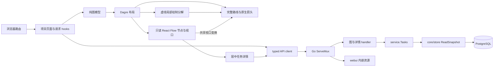

# Web 工作空间设计

生产 Web 由公开入口、认证工作空间、项目任务看板、任务详情和账号级 Worker 运行观测与配置编辑组成，使用同一 Go 内嵌资源管线。本文拥有它们的页面组合、请求生命周期与交付机制；[需求](../spec/daynight-web.md)拥有可见结果。运行结果按对应源码保留在 PR、CI 或实际验收材料中。本地回执与设计预览不能代替实际产品组合验收；[早期看板决策](../../.agents/notes/archived/architecture/2026-10-20-task-dashboard-mvp-design.md)保留原始设计背景。

[预定义属性设计](daynight-task-properties.md)的 server 接口、CLI 和任务详情中的
只读 PR 区域已实现。[需求](../spec/daynight-task-properties.md)拥有行为。

已实现的[附件架构](daynight-task-attachments.md)扩展 task 详情，提供文件树、
单文件上传/覆盖/删除、下载及同源预览。[附件需求](../spec/daynight-task-attachments.md)
拥有文件行为，[Web 决策](../../.agents/notes/archived/feature/2026-10-21-task-attachment-web.md)
记录状态、渲染和焦点机制。图、统计与 task 元数据保留读取约定；状态通过专用版本化 PUT 设置。任务的布尔 allowAgents 与可空枚举 requiredPlatform 已实现，通过普通版本化 PATCH 修改，详情确认开关、平台确认下拉框及共享请求归属见下文。

[鉴权架构](daynight-auth.md)拥有 UniAuth 登录、项目权限、成员与邀请及个人访问
令牌；`AuthenticatedApp` 和 API 客户端已接入生产入口。
[需求](../spec/daynight-auth.md)拥有完整行为。生产 `Application` 在常驻 LocaleProvider 中按
当前地址组合公开推广页、公开指南和 `AuthenticatedApp`；后者复用 messages.auth 的英语/简体中文目录
及同一语言偏好。[公开入口设计](daynight-landing.md)拥有分流、介绍、演示和元数据。后端使用升级后的公开 UniAuth
SDK 提供 App-aware provider discovery；发现失败与用户会话失效分开呈现。新壳
复用现有任务页签、渐进图和居中 `TaskDetailDialog`，保留可信同源 frame、相对资源及键盘机制。
[Web 鉴权决策](../../.agents/notes/archived/feature/2026-10-22-web-auth-workspace.md)
记录组件、会话生命周期和验证边界。

[语言设计](daynight-web-i18n.md)拥有已实现的类型化目录、Intl 格式化器、首屏解析、常驻 Provider、共享选择器和全部现有第一方组件的双语呈现；[双语需求](../spec/daynight-web-i18n.md)拥有完整覆盖与验收。语言偏好使用独立的 origin-local 键，不改变本文的项目浏览记录、API、图或附件生命周期。

[执行计时架构](daynight-task-timing.md)的起止字段与数据库 `observedAt` 已进入严格 API 读取器。
`useTaskGraph` 从 task-sync 获取最新服务端样本，保存为独立 snapshot 字段，保持仅时钟变化时的图/索引身份。[缓存架构](daynight-task-sync.md)拥有已实现的 IndexedDB typed 摘要及独立人员内容、完整属性同步、原子增量应用和身份生命周期；详情已在同一 scope 下按需持久化，以摘要业务版本和恢复需要驱动 GET。
[外部依赖架构](daynight-external-dependencies.md)的存储及严格读取准备也已实现：
GraphTask/详情保留必填 externalDependsOn，API 层校验正规化 ID、去重及完整依赖的子集，
摘要自身内容比较和详情描述符纳入该集合。buildGraphIndex 用普通依赖构造弱连通分量，
完整依赖用于验证、上下文和检查；关系标签和虚线消费显式性质，卡片角色另按成员集合计算。
项目阈值、精确设置版本、管理员设置页及局部执行计时/提醒共同接入。

[Webhook Web设计](webhook-web.md)拥有已认证工作区的显式归属配置、订阅与投递排错页面、严格wire读取、固定操作意图、GET-only未知恢复、独立载荷完整性及私有资料观察；[Web规格](../spec/webhook-web.md)拥有业务结果和机器验证。页面复用生产shell，catalog按当前service/principal决定新请求准入，与侧栏默认Team偏好解耦。

## 目标与现有基础

浏览器提供“项目列表 → 项目统计 → 独立任务、任务链或 Goal → 详情”和“我的 Worker → Worker 运行监控或配置”两条浏览路径。数据继续归属 `daynight-server`；Goal 与普通 Task 共享资源身份，普通 Task 可直接归属一个 Goal。任务有proposed、todo、in_progress、done、cancelled，创建默认proposed，可显式创建todo；详情读取五态并保留取消资料；未取消任务菜单提供五种状态目标，提供
版本化状态菜单；许可和平台使用各自确认入口，图和一般元数据继续保持读取。

已有基础与集成位置：

| 事实 | 证据与影响 |
|---|---|
| Go 服务已有项目与任务 JSON API | `packages/daynight-server/api/projects.go` 的 `ProjectPage` 返回项目及 `nextCursor`；`api/tasks.go` 的 `Task` 包含 `dependsOn`、`externalDependsOn`、`blockedBy`、`ready`、`allowAgents`、`requiredPlatform`。 |
| 页面与 API 同源 | `internal/server/webui` 在同一 mux 注册精确页面和静态资源路由，`internal/server` 注册 API 路由；`internal/service/webui` 内嵌真实构建产物，未知 API 保留 JSON 404。 |
| 已有一致读取机制 | `packages/daynight-server/internal/core/store/postgres/snapshot.go` 的 `ReadSnapshot` 使用只读 `REPEATABLE READ`。 |
| 分页之间没有共同快照 | [服务端分页约定](../spec/daynight-server.md)明确这一边界；不能用多次 task list 拼成准确的项目全图。 |
| web 与 CLI 工作区独立 | 私有 React/TypeScript/Vite 包使用显式 `web:*` 命令；根 build/typecheck/test 继续只覆盖 CLI，web 使用按[CI 路由](../../README.md#ci-selection)选择的独立 job。 |

## 看板基线与附件扩展

原看板交付两个页面、一个详情侧栏和一个新增只读 API。该基线使用手动刷新，保持
原有写入接口、依赖规则与本机监听方式。当前项目任务页使用可见时每 15 秒、隐藏时每 5 分钟的自动刷新，
延续完整快照替换与资源隔离；[自动刷新决策](../../.agents/notes/archived/feature/2026-10-22-project-task-auto-refresh.md)
部分取代原基线的手动触发策略。附件是独立的文件资源扩展，使用自己的
元数据、HTTP 接口和局部状态，不把文件写入混入 task PATCH 或图快照。

项目列表只展示项目元数据，不为每张卡额外请求任务统计。统计集中在项目详情，避免列表产生 N 次图查询。创建编辑、实时推送和大图分片的延后成本及保留条件由[要求文档](../spec/daynight-web.md#明确延后的能力)定义；生产鉴权壳、项目创建、成员与邀请管理由[鉴权架构](daynight-auth.md)拥有。

## 页面与视觉

采用浅色内容区、白色卡片、深色窄导航栏和克制的靛蓝强调色。任务状态及相邻状态控件的配色接入遵循[UI 语义角色](../ui-design.md#semantic-color-roles)，精确色值由该文档统一拥有；品牌开关、Worker 在线健康及助手 Composer 的品牌聚焦表面保留各自含义。节点颜色表达业务状态；选择和键盘焦点分别使用独立轮廓，不覆盖状态颜色。产品标签使用当前英语或简体中文目录，用户内容、代码标识和仓库地址保留原文；切换遵守[语言设计](daynight-web-i18n.md)的状态、焦点和布局约束。

五种业务状态均有本地化文字和颜色，统计使用七项网格并在窄屏自然换行。
当前模型、确认与版本响应由[状态架构](daynight-task-status.md)拥有；早期四状态读取与审批
保留在历史决策中。图组件负责导航，状态写入由完整详情及共享会话拥有。

### 工作空间导航

`AuthenticatedApp` 的 Workspace 保持路由、认证屏障与正文所有权。`app/sidebar/WorkspaceSidebar` 拥有折叠、抽屉、焦点和滚动生命周期；`WorkspaceNavigation` 根据 `AuthRoute` 组合当前范围、“我的”和“工具”三组固定入口；`SidebarProjectList` 消费现有 `useProjectList` 目录。`SidebarTeamContext` 分离 Personal ID、仅在 Team ready 时可生成链接的 ID 和仅用于可见性的 ID，未知范围保留禁用占位，已确认 Personal 隐藏团队设置。

三组共享可滚动的 `.sidebar-main`，不收缩的 `.sidebar-bottom` 仅持有切换按钮。项目子项使用与项目列表相同的分页目录和原生链接处理；共享路由及折叠竖条隐藏整棵项目树。项目、成员及设置路由仅选中已加载目录中匹配的项目，Team 列表与设置、共享列表、账号资源和工具按各自路由选中。明确项目的面包屑不推断侧栏 Team 归属，账号及工具使用纯文本范围父项。Team／Personal 项目列表 H1 和 document title 统一为“项目”，范围显示在 eyebrow。Worker 资源 ID 同时进入 Workspace 正文焦点 effect 与侧栏 routeKey，详情组件另以 workerId 作为 key，A/B 切换不会沿用旧抽屉或资源请求。

sticky 视口高度和纵向 flex 布局让长页面、短窗口及折叠状态都保留底部切换按钮。链接的 `aria-current` 提供当前路由或项目选中态；主入口的图标、可访问名称及悬停提示在竖条中仍然可用。完整名称作为链接名称及 title，视觉文字允许省略。详细取舍见[侧栏范围决策](../../.agents/notes/implemented/architecture/2026-11-12-sidebar-navigation-scopes.md)。

`TeamSelector` 在名称上方显示已知团队类型，未知时保留空行；名称优先截断并保留箭头。触发器所在侧栏内保留菜单 DOM，并使用 top-layer popover 脱离滚动裁剪；定位根据触发器、视口和菜单尺寸调整，菜单自身限制高度并滚动。保持 DOM 所属关系使手机抽屉的焦点隔离包含菜单；菜单先处理 Escape，创建时沿用抽屉与创建窗口的焦点交接。目录、分页和偏好仍由原有所有者管理，菜单的打开状态不依赖后台复核结果。详见[Team 切换菜单决策](../../.agents/notes/implemented/feature/2026-11-05-team-switcher-popover.md)。

顶栏头像和姓名触发 `AccountMenu`，其中“账户设置”沿用 `/account` 路由，分隔线后的“退出登录”使用危险动作样式和原生按钮。菜单接收工作空间已有的 `onSignOut`，选择退出时关闭菜单并调用该回调；身份清理、跨标签页通知、退出中及失败重试由文档账户 owner 管理，账户页的退出入口保持原有所有权。顶栏只保留菜单内退出入口，减少紧邻头像的误触机会，不另增退出确认窗口。
触发器暴露本地化名称及展开状态。点击和 ArrowDown 打开时聚焦首项，ArrowUp 聚焦末项；菜单按 DOM 顺序处理方向键循环及 Home/End 首尾定位，Enter/Space 激活，Tab 离开后关闭。触发器再次点击、外部点击、Escape 和页面切换关闭菜单，Escape 后焦点回到触发器。菜单限制在视口内，适应窄屏、长姓名和默认头像。入口取舍见[退出菜单决策](../../.agents/notes/implemented/bug-fix/2026-11-06-account-menu-sign-out.md)。

`useSidebarPreference` 独立管理桌面 `collapsed`。origin-local
`daynight.web.sidebar.collapsed` 只接受 JSON boolean，缺失时为 false 且不写入。
读取失败、格式无效、写入失败使用带原始 cause 的内部 issue，呈现当前目录的脱敏提示；
显式切换保留新内存值并尝试保存，重试保存当前值，成功后清除 issue。外观值不包含
用户、项目或令牌，跨项目及身份切换保留；它不依赖 project feature 的偏好 helper。

桌面网格使用 190px 或 68px 侧栏；740px 及以下固定为 60px 竖条，展开覆盖导航宽
220px。媒体查询与脚本使用同一 740px 断点约定。临时 `drawerOpen` 与持久 `collapsed`
分离，手机开关不写桌面记录。覆盖导航位于 Workspace 认证屏障内，提供具名模态语义、
实际可见控件的 Tab 约束、背景 inert 和共享 `useBodyScrollLock` 引用计数锁。
清理恢复原 inert 与滚动状态，不释放图全屏或详情持有的锁。Escape/遮罩关闭恢复展开
按钮焦点；路由导航交给既有正文聚焦。路由、桌面断点、真实身份失效或卸载
均关闭临时层。账户变化等待刷新时保持导航、焦点约束与滚动锁；请求和发布仍受认证准入约束。

侧栏状态不参与用户、项目、缓存或详情的 React key。宽度变化仅改变布局，图沿用已有
尺寸观察，不重新初始化视口或增加读取、缓存及轮询器。跨标签实时同步与服务端同步可独立
扩展，当前记录只表示一个本地外观值。[侧栏偏好决策](../../.agents/notes/archived/feature/2026-10-25-sidebar-preference.md)
拥有状态、错误与身份边界的取舍；[账户菜单决策](../../.agents/notes/archived/feature/2026-11-04-topbar-account-menu.md)
记录当前入口替代底部入口的历史理由。

### 我的进行中任务

`/my-tasks` 是账号级页面，侧栏 Team 不参与筛选。`api/personal-tasks.ts` 解析[服务端合同](../spec/daynight-personal-in-progress-tasks.md)，`useMyTasks` 逐页读取同一 inventory revision，核对数量、重复身份和项目元数据。首次遍历可展示已读取的局部结果；后续遍历成功后替换集合，失败保留可展示结果并标记未更新。每轮最多一次遍历，409 不立即重试。

读取绑定账号 scope 和请求代次。projection fence 在发布前复核项目资格；撤权或暂停事件退役受影响读取并撤下项目，恢复需要新读取。局部撤下后不再宣称原集合数量完整。页面使用统一同步周期与每项目 15 条的展示分页；执行时钟使用服务端观测锚点和项目阈值，复用现有时钟语义。Task 和 Goal 的真实 href 保持直接访问和修饰键导航。 普通点击在账号页面打开现有完整详情，`MyTasksDetailHost` 按选中项目挂载项目权限、详情 Session、完整图和负责人 receipt；同项目资源切换复用图，项目切换隔离图。详情使用直接读取，图失败交给现有错误和重试入口，mutation 同时刷新图及总览。列表过滤不决定详情准入。

`my-tasks` 阅读历史绑定账号，只保存项目页码、根详情、页签及 Goal 子选择；资源退役 fence 拒绝旧项目条目。`MyTasksDraftHost` 与子资源宿主沿用 browserNavigation 的草稿保护，同资源阅读切换保留草稿，离开和关闭先经过确认。外部 Task 根据真实 Parent 选择独立详情或 Goal 子任务；完整链按现有项目图语义导航。图尚未能解析目标时，Task 关系使用真实独立详情地址，链使用项目图地址，以保留可操作的导航。关闭焦点优先返回触发入口，其次项目标题和页面标题。

### 我的 Worker 列表与详情

`WorkersPage` 和 `WorkerDetailPage` 在既有按 `user.id:generation` 重挂载的认证工作空间内呈现 `/workers` 与 `/workers/{workerId}`。它们直接挂载在 `WorkspaceRoutes`，项目目录只为侧栏供给数据，成功与否不控制 Worker 页面准入。详情将运行观测与配置作为独立资源组合，即使近期观测不存在，仍保留 Worker ID 与配置入口。路由沿用规范 UUID 解析、登录 returnPath、原生 history、标题与面包屑；Worker 任务链接通过现有 taskDetailUrl 打开当前完整任务。

`api/workers.ts` 拥有 Worker 摘要、详情和 Probe 的严格读取器，以及列表和详情 GET。请求复用现有同源、no-store、取消、401 和 requestId 机制；在 JSON 解码或 404 处理前对每个非 401 响应执行 principal 校验。读取器区分 unknown/observed/stale 清单，验证显式 null、任务计数和数组一致、重复引用、Worker 请求身份、联合分支、时间与数值范围。客户端采样时间不与数据库时间强制排序。版本为实际非空文本，不在展示层加入 semver 或最低版本拒绝。

`useWorkers`、`useWorker` 通过共享 `useWorkerObservation` 持有页面内存。既有 TaskCacheScope 提供认证生命周期、ready gate、mismatch 失效回调及 Project 撤权事件；Worker 数据不进入其项目集合或 IndexedDB。读取开始前捕获用户 Project generation，发布前核对取消信号、请求 generation 和资源身份。独立投影按其读取快照判断撤权事件；匹配或未知代际使旧读取失效，较新代际不受旧事件影响。snapshot 换代与缓存失效在同一事务保存完整代际关系，撤权 ticket 携带祖先，因此换代提示丢失或乱序时仍可撤回祖先投影。损坏使前驱不可证明时隔离无法比较的内容并重新读取；可证明为后继的准入不受旧提示影响。存储不可用时隐藏项目私有投影，仍读取 Worker 身份和遥测并显示错误；单项目 generation 损坏只隔离该项目。Workspace 传入 readEnabled；账户变化等待刷新时取消私有读取并暂停计时，保留旧内存和展示。scope gate 还阻止身份状态尚未完成 React 重绘时的旧响应发布。

列表加载器逐页读取到 nextCursor 为 null，暂存所有摘要并拒绝循环游标或重复 Worker ID。只有整轮成功才一次发布，任何页失败都保留上次完整集合。快照的 items 始终保留服务端 (created_at, worker_id) 升序的跨页原始次序；created_at 是当前账号该 Worker 首次有效报告的持久化时间，后续报告不会更新。发布使用最后一页的 observedAt 与该响应接收时的 performance.now 建立统一锚点。WorkersPage 从原始快照筛选近期 Worker，再由 sortWorkers 复制数组并稳定地将 online 分组置前，组内不再比较 lastReportedAt 或 workerId。每次新快照或本地 ticker 重绘都从原始创建次序出发，因此尚未完成下次网络刷新时的 online 边界变化也能在新组内正确就位；已按 online 排列的数组不能作为后续分组的创建次序来源。摘要无需新增 createdAt，只有 machine、platform、上报时间及任务观测/计数，不执行逐 Worker 详情 fan-out，也不推断 OS release。

每个可见页面的运行观测通道共享一个 30 秒单飞刷新和一个 1 秒 ticker。纯 observation helper 使用 `observedAt + performance.now() - receivedMonotonic`，以 `< 120000ms` 判 online、`<= 72h` 判近期。页面隐藏、readEnabled 关闭或读取失败时，保留最后已发布时间并标记 stale，停止从旧锚点推进新结论。恢复可见或同账号核验后先发起新读取；成功才替换锚点并恢复 ticker。该生命周期与任务执行耗时不同：睡眠前的 Worker 锚点不能在重新可见时直接快进为当前在线结论。`WorkerReadNotice` 仅在保留快照且已有读取错误时显示警告和重试入口；没有错误的陈旧状态沿用徽标、任务快照说明与来源时间，正常检查不插入提示区域，原内容及焦点保持稳定。重试开始不清除已有错误，成功发布才移除失败提示。可信当前身份 404 清空运行观测，协议错误、网络错误及其他失败保留旧快照和“上次确认状态”；这些结果不替代独立配置资源的读取结果。

`api/worker-monitoring.ts` 对详情与批量摘要执行闭合字段、枚举、固定诊断和当前 principal 校验；监控不改变原快照合同。配置存储及诊断 sink 故障继续消费现有 runtime failure/重试字段；读取端不将旧成功快照或日志缺项推断为当前存储就绪、已确认停止或新执行资格。`useWorkerMonitoring` 复用账号和 Project generation 准入，读取详情时过滤撤权 scope 和关联，批量摘要按已加载 ID 分组，每批最多 100 个并各自保存 Redis 时间锚点。摘要保留权限过滤后的 admission 固定原因、观测时间和覆盖，列表卡片只渲染阶段及容量，省略原因和监控时间；因公共结果没有 scope 标识，项目撤权时使受影响的列表原因集合失效，保留总容量并以 generation fence 拒绝迟到响应。监控与原快照独立失败，保留主机资源及上次确认观测；监控年龄以 Redis `observedAt` 和接收时单调时钟推进，即使读取失败也可达到 90 秒陈旧及 3600 秒过期。异常详情在现有稳定身份的 metadata 中显示可选工作区位置，相对路径以可选择、可换行的 code 呈现，不可用原因使用固定本地化文案。普通后台检查不重挂载内容；实际撤权移除关联及展开错误与工作区位置，真实总容量和无身份原因保留。详情先显示运行质量、容量与准入、活动、异常与恢复，再显示原遥测；配置面板维持独立挂载与草稿。协议细节由[监控合同](../spec/daynight-worker-monitoring.md)拥有。

列表卡片的上报时间使用 `WorkerTimestamp` 的绝对时间模式，复用 `format.dateTime` 的语言、浏览器时区和秒精度；标签与时间作为不可拆分的一组，卡片底部的详情入口可独立换行。ticker 仍用于在线状态与可见性，不改变同一上报时间的显示。

详情的资源卡和环境/版本区域只格式化实际 telemetry：OS type/release/version/arch、CPU model/logicalProcessors/usagePercent、内存 bytes、启动工作目录文件系统容量及软件 Probe。总量 0 可展示但不计算除零 meter；没有真实设备字段时不生成设备名。软件 not_installed、Herdr not_running 和 error 分别呈现，checkedAt、sampledAt 和 lastReportedAt 保留来源时间含义。任务数组及计数只消费服务器当前权限过滤后的历史观测，不以项目或任务缓存补齐；撤权时详情过滤对应任务并重算可见数量，列表因缺少逐项目来源将计数置为不可用，直至权威重读。Worker 身份和遥测保留；stale 清单、offline Worker 和 unavailable 清单各有明确说明。

`WorkerStatusBadge` 复用绿色 online，并以 `#b54708` 文字/圆点和 `#fff0e6` 背景呈现 offline；陈旧读取另标上次确认。徽标的实际文本和隐藏的本地化“上次确认”伪元素叠在同一 grid 单元，预留该完整标签的固有尺寸；状态由当前变为上次确认时，窄屏标题信息不会因徽标扩宽重新换行，也不向可访问文本加入重复标签。任务面板标题同样预留当前任务标题的固有尺寸；快照说明一直保留布局占位，仅在当前观测时以 visibility 隐藏并从可访问名称排除，使重新确认不改变任务表格的位置。列表卡、详情面板和任务行复用工作空间样式与键盘导航，React 使用稳定 Worker/任务标识保持 tick 和刷新中的有效焦点。中英文目录覆盖状态、失败、时间、资源和可访问名称。桌面及 390px 的长机器名、目录和任务名自然换行。

[Web 观测决策](../../.agents/notes/archived/architecture/2026-10-29-web-worker-observations.md)保存页级读取、单调时钟及陈旧冻结的取舍；[静默检查决策](../../.agents/notes/archived/bug-fix/2026-10-30-quiet-worker-rechecks.md)记录正常过渡与实际失败的提示区分；[快照设计](daynight-worker-snapshots.md)和[客户端采集设计](daynight-worker-reporting.md)分别拥有服务端归一化与采集口径。

### Worker 云端配置编辑

`WorkerDetailPage` 在运行监控、配置和提示词三个平行页签之间切换，运行监控继续使用单调时钟及近期窗口。首次进入任一编辑页签时挂载 Worker 页级编辑协调器，分别启用所选资源的读取；打开后的编辑器及草稿在同一 Worker 的页签切换中保持挂载，隐藏资源暂停读取。提示词首次读取不依赖运行配置初始化或 Worker 在线。配置返回值没有 observedAt，不能放入 `useWorkerObservation` 或生成伪服务端时钟。Worker ID 始终来自路由；运行监控超窗、404 或首次失败不成为配置请求的前置条件。

页级协调器在草稿生命周期向 `BrowserNavigation` 注册一个共同 scope，聚合配置和提示词的实时 dirty 与放弃操作；scope 由当前认证实例和 Worker ID 组成，与任务草稿隔离。同一 Worker 路由及本地页签切换保留注册；其他应用内目标通过既有导航准入确认，原生文档离开复用 `beforeunload`。确认复用 `TaskConfirmation` 的背景隔离和键盘约束，显示前关闭配置的管理弹窗，避免背景隔离和焦点约束冲突。取消离开时，一份 dirty 返回其所属页签，两份 dirty 返回最后编辑的页签，并恢复相应有效控件的焦点。确认离开放弃两份草稿，不将未知保存结果重分类或重放；任一资源存在待定或未知写入，或配置回执等待发布时保留同一个页面 owner，避免另一资源完成时提前释放。认证信号失效或资源已确认不可用时撤销相应私有状态；普通身份检查和运行观测过期不撤销草稿。历史保护沿用[任务步骤导航](daynight-task-steps.md#web-呈现导航与大集合)的索引段限制，不重建原生或跨段历史。

`api/worker-configuration.ts` 复用同源客户端、no-store、取消、401、requestId 和 principal 准入，独立严格解析目标、观测与错误。每个响应在解析和资源错误处理前先核对当前账号。目标与观测版本保留规范十进制字符串，不经 Number 转换。数据含义及合法范围由[配置协议](../spec/daynight-worker-configuration.md)拥有，响应正文不增加 supported 或 Task 字段；客户端分别保存 Daynight-Worker-Control-Mode: 1 与 Daynight-Worker-Tool-Paths: 1 回显能力，资源合并和保存结果核对保留对应元信息。无回显按旧结构严格解析且不发送新正文；扩展值的缺失与明确 null 分别表示旧合同及尚未采纳。

`configuration/model.ts` 拥有表单投影、校验、逐字段覆盖和结果派生。agentControlMode 保持 nullable 草稿，通过现有 config-select 编辑 herdr/web，未采纳时实际无选中项，不用第三个默认选项伪装。ConfigurationFeedback 显式渲染模式字符串，与 native 对象分开；模式缺少实际应用观测时整体状态保持待应用。模式控件沿用原运行设置网格、固定保存条及草稿导航保护；preferPlatformSpecificTasks 独立保存为布尔草稿，由运行设置中的原生 checkbox 编辑，不混入数值输入。开关修改参与同一 dirty、保存和取消流程，逐项反馈明确处理 true、false 与 null，并计入整体应用结果；`useWorkerConfiguration` 拥有当前资源、编辑基线、原始草稿、提交快照及读取/保存状态。有效配置值与输入原文分别保存，使非法整数或 JSON 仍能完整显示。Agent/model/args 按同一 native 元组构造提交，项目覆盖仅输出显式拥有的字段；换 Agent 后的适用默认值是展示推导，不能把继承意图展开写回服务端。默认及项目配置的原生 select 使用局部容器绘制固定内缩的非交互箭头，并为箭头预留文字空间；禁用与聚焦仍由原生控件承载，长选项按可用宽度截断。

工具路径复用该草稿与提交生命周期。`ConfigurationToolPathsFields` 保留每项 choice/null 和 path 原文，显式恢复才生成 auto；`model.ts` 使用公共路径解析器与实际 Worker 平台校验。配置 GET 主动请求独立工具能力，合并保留本次响应的能力信息；新增能力首次出现只补其草稿与基线，不替换其它编辑。只有服务确认且 Worker 快照带工具报告时才允许提交路径。能力撤回后，保存其它字段使用旧投影并保留未提交的路径草稿，服务在 CAS 锁内保留工具目标。提交快照记录当次能力。未知结果查询必须实际返回当前 revision 的工具字段，才能将保留的路径绑定到新版本；缺失或陈旧投影继续保持未知。旧投影提交未包含工具字段时，逐工具比较原基线、本地草稿和回读目标：未编辑项采用当前目标，未提交编辑保留，双方修改同一项且值不同时保留原版本并显示冲突。不能用隐藏了工具字段的相等比较授权后续完整投影保存；已确认回执仍绑定其自身 revision，不借用更晚读取的版本。请求经过异步身份准入后，在派发前再次检查工具编辑资格。

`WorkerDetailPage` 将已有 `useWorker` 快照的 toolPaths、连接状态和平台经页级编辑协调器传给配置控制器与面板，不增加工具请求。`WorkerToolPathDetails` 在配置反馈与软件面板中复用，`tool-path-presentation.ts` 根据目标 revision、choice、实际选择和连接状态派生应用状态；不组合 dirty 草稿或旧 versions probe 生成工具事实。主要执行上下文先展示，另一上下文使用稳定 details 展开。actual、candidate 与按 selectionKey 聚合的 activeSelections 使用同一实际选择展示单元，但保持不同标签；不完整和运行责任错误独立于新目标状态。路径使用原生 details 和按钮，完整文本可选、换行并复制，后台数据更新保持节点身份。配置摘要将工具结果与原配置项一起核对，未使用自动工具的错误不提升为整个 Worker 不可运行。消费规则的取舍见[工具路径网页决策](../../.agents/notes/implemented/feature/2026-11-12-worker-tool-path-web.md)。

配置通道在页面可见、配置面板活动、readEnabled 且账号 scope ready 时每 5 秒单飞读取。隐藏、离开页签或账户变化暂停读取；展示生命周期独立于临时准入，保持已挂载编辑器与弹窗及本地交互。scope 和 workerId 拥有资源与写入生命周期，generation 和取消信号约束读取发布；页签切换暂停读取而不取消已派发的写入，配置回执在该面板及 scope 恢复准入后发布；身份准入暂停的结算遵循配置合同。资源退休仍使旧请求失效。恢复后读取最新目标及观测。数据和草稿仅保留在页面内存，不进入 TaskCacheScope 的项目集合或 IndexedDB；导航注册表只持有页面提供的实时读取与取消回调，不持久化或复制草稿。TaskCacheScope 只提供认证生命周期及准入。

后台读取发布最新资源与应用结果，保留编辑基线和原始草稿。字段提示独立比较该字段的合法解析值与当前保存目标；项目比较显式覆盖，保留继承与清除的区别。无效输入显示未保存，其他字段无效不会影响其提示；格式差异不改变原始草稿或应用观测。表单整体仍以原始编辑基线判断改动。表单控件保持稳定身份，既有焦点、选区和项目展开不随应用报告重建。首次有效资源建立草稿；用户显式取消修改或载入新目标才替换它。目标 revision 独立于 observationRevision，因此频繁应用报告不制造编辑冲突。

保存栏保持在表单末尾的文档顺序中，仅在草稿有未保存修改时固定于视口底部，并保留原有状态、取消和保存按钮。原位占位元素按保存栏实际高度保留空间，提供固定定位的横坐标与宽度；监听占位、保存栏和工作区尺寸及页面滚动，跟随侧栏和文本换行调整。固定定位不受表单上方错误提示把表单推离视口的限制。保存成功或取消后草稿恢复干净时解除固定定位与占位；失败、冲突、未知结果和参数无效继续使用原有按钮条件。页面由 document 滚动，编辑器在字段获得焦点、草稿编辑和视口或保存栏尺寸变化时检查遮挡，仅在必要时调整滚动，使可容纳的字段及错误位于保存栏之上；过高字段优先保留活动控件可见。字段之外的项目选择、移除和展开控件按其自身边界避让，保存栏自身按钮不参与避让。焦点和选区不变，后台配置观测不触发该滚动，隐藏配置页签不保留相关监听。[保存栏决策](../../.agents/notes/implemented/bug-fix/2026-11-06-worker-configuration-save-bar.md)记录布局取舍与验证边界。

保存捕获完整合法目标及基线 revision，只提交一次 PUT。已派发的提交与其快照保持绑定，后续输入另属当前草稿；旧提交完成不能覆盖新输入。409 读取最新资源并保留原草稿，提供查看与明确载入新值的路径，不自动换版本重发。明确失败保留输入；无法确认结果时保留未知状态，禁用可能重复的提交并通过 GET 核对。当前值匹配提交只说明资源现状，反馈不能声称原请求成功。核对失败保留可重试的读取入口，不能重放旧写入。

项目选择遍历完整可访问目录后供选择。明确的已加载状态区分首次读取与后台复核，有效空集同样属于已加载；后台读取完成前保留完整候选集，不插入 loading 行，真实失败仍按权限和错误规则处理。搜索与未应用选择属于弹窗本地状态，只在 Done 时应用。已选但不在当前目录的条目保持 ID 及原覆盖，不从历史缓存恢复名称或仓库信息。最终提交移除已有项目时，以一个确认窗口说明排除与停止的影响；取消、遮罩或 Escape 不发出 PUT。窗口沿用现有焦点约束、背景隔离和关闭恢复，不把任务认领或业务操作加入配置保存。

应用结果按 key、实际值与每项 targetRevision 派生。实际值与当前目标相同的独立标量或全局 native 可保留成功；目标值已变时仍展示旧实际值，并标记等待。项目准备/native 尚无当前目标观测，或最近 projectRemoval.targetRevision 不早于对应项目结果时，不能用旧成功宣告重新就绪。projectRemoval 自身保留实际状态和本批报送的 targetRevision，不被较新目标遮蔽；原停止记录的本机 origin 与当前停止核验的报告版本分别表达，不由页面改写历史。准备、native 与停止结果可独立成功或失败；已移出目标的 projectRemoval 继续显示在结果区域。observation.reportedAt 是本批应用结果接纳时间；服务端整体替换最近批次，页面以该批与当前目标比较，未包含的目标项保持 pending，不合并旧批次制造完整成功。offline 或缺少近期运行观测不使它变成当前执行证明。error、lastFailure 和 nextAttemptAt 分别显示当前失败、最近尚需报告的失败及重试期限，诊断只使用协议闭合字段的本地化文本。

[配置编辑决策](../../.agents/notes/archived/architecture/2026-11-04-web-worker-configuration-editor.md)保存资源、草稿和未知写入的职责分离及真实替代方案。生产组件和控制浏览器检查验证页面交互；真实配置下发、仓库准备及两种后端停止仍由实际 Worker 组合验收证明。

### 个人 Worker Prompt 编辑

`features/worker-prompts/` 共用三个个人资源的 API、纯状态转换、hook 和编辑器。账号、项目和 Worker 入口提供资源目标；项目请求等待 `ProjectAccessSession`，普通成员不继承共享设置的管理员限制。Worker prompt 与运行配置分别位于同级页签，读取、校验和保存互不阻塞；[页签组织决策](../../.agents/notes/implemented/architecture/2026-11-12-worker-detail-prompt-tab.md)记录其协调取舍。

状态独立保存最高版本资源、草稿基线、原文、编辑代次和提交快照。GET 按版本单调接纳，PUT 只提交冻结的账号、版本和正文；继续输入不被回执覆盖。冲突保留草稿并要求明确处理最新版本。已发送请求结果未知时保留快照，以 GET 核对当前事实，不重放写入。同账户身份准入暂停保留节点及草稿，确认失权或当前根 owner 失效身份时撤销旧资源和请求。身份错配后若 owner 保留页面，终止旧操作等待并仅记录已确认、明确拒绝或未知结果，不安装回执或重放写入；已确认结果提示刷新后继续。导航聚合 Worker 两份草稿，并在待定、已确认待呈现或未知写入期间保留对应页面 owner；放弃草稿不会撤销已发送写入。[编辑决策](../../.agents/notes/implemented/architecture/2026-11-09-web-personal-prompt-editor.md)记录取舍。

### Team 管理与共享项目列表

- `ProjectsPage` 的标题和副标题组成信息区，随后是创建和刷新操作；Shared 页面保持只有刷新。项目列表专属 `.project-list-heading` 允许换行，信息区使用 `flex: 1 1 240px`，操作组通过自动左外边距保持靠右。320、390 CSS px 下信息区占据内容宽度，操作组整体落到下一行；空间充足时左右并排，随实际内容宽度和侧栏宽度自适应。长名称在信息区内换行，既有字号、按钮、数据状态、请求和焦点顺序不变。取舍与几何验证边界见[标题换行决策](../../.agents/notes/implemented/bug-fix/2026-11-05-project-list-heading-wrap.md)。
- `/projects` 是默认 Team 入口；`/teams/{teamId}` 读取指定 Team，`/shared-projects` 使用共享范围。没有记忆时默认使用 `/me.personalTeam`，明确项目与任务链接保持原地址。
- Team 偏好按当前站点与账号独立保存：`localStorage` 的 `daynight.selectedTeam:<userId>` 只含已确认的 Team UUID，不保存名称、角色或成员资料。认证 scope 内首次显示工作空间时，无论入口是项目、Worker、账户还是共享页面，都恢复记忆并以精确 `GET /teams/{id}` 验证；明确 Team 路由优先使用 URL 中的 ID。一次成功安装选择后，普通导航继续使用当前内存选择；`/projects` 默认入口保留重新读取记忆的语义。独立 Task、附件、邀请与授权入口延后恢复，直到显示工作空间。只有可信 404 清除对应记忆并回 Personal，分页 Team 目录的缺项不代表失权。网络、5xx 或存储读取失败保留记忆并在工作空间提供重试；取消结果不能安装。写入失败保留当前内存选择，提示未保存并提供重试。共享范围不写 Team ID，CLI 默认配置独立。
- 普通 Team 范围的项目目录等待偏好 ready，避免恢复期间读取初始 Personal 范围；共享目录及明确资源的主体读取独立。侧栏的 Team 项目和设置链接在选择未就绪时不可导航到初始 Personal ID。`WorkspaceNavigation` 使用认证用户的 Personal Team ID 与可见性身份比较，确认 Personal 时不渲染 Team 设置入口；普通 Team 不受名称影响，使用所选 ID 生成唯一的设置链接，基本信息和成员分区都使其选中。此条件复用于桌面和窄屏导航，不改变直接地址的页面与权限。恢复与失败不改写明确 Project、Task 或附件地址，也不阻塞其主体。可见性取舍见[个人 Team 导航决策](../../.agents/notes/implemented/feature/2026-11-05-personal-team-sidebar.md)。
- Team 偏好与读取依附认证身份生命周期；身份切换、取消及后续选择阻止旧请求安装结果或覆盖另一账号的键。同一 `routeKey` 的已确认目标在后台精确 GET 期间保持 ready；首次读取或目标改变仍等待加载。同一次导航的已验证身份可用于侧栏入口的可见性，但实际链接仍须等待所选 Team ready。恢复默认选择的读取在发布前重新核对存储及待保存选择，不能覆盖另一标签页的新选择。确认回执与读取按 Team 和 membership 的独立版本仲裁；可信拒绝隔离私有内容，待定、未知及已确认结果仍保留。明确 Project 与 Task 链接不通过默认 Team 重写。[浏览器 Team 偏好决策](../../.agents/notes/archived/feature/2026-11-04-browser-team-preference.md)记录恢复和失效处理的取舍。
- 顶层从隐藏或外部失焦恢复时，Team 资源按自身生命周期重读。账户信号先同步重读共享记录，Team 的恢复回调随后检查身份暂停与活动状态；sticky 等待刷新不派发，健康返回不重复 `/me`。活动设置分区重新读取 Team 或成员，成员确认成功且仍具管理权限后再重读邀请；待定操作与已显示表单继续归原 owner。
- Team 目录的后台复核按当前已加载页数从第一页沿新游标连续读取，完整前缀成功后一次发布；相同条目与游标保留原引用。分页读取与复核由 generation 和认证 scope 仲裁，后发分页不会被旧复核覆盖。中断的首载或分页在准入恢复后继续，真实失败保留已有条目并提供重试；显式刷新和变更后的刷新仍读取目录。
- Team 设置外壳共用标题、当前 Team 名称和两个横向分区链接：`/teams/{teamId}/settings` 为默认基本信息，`/teams/{teamId}/members` 为成员与邀请。导航保留原生链接和浏览器历史；窄屏使用同一层级并可换行。外壳按认证身份和 Team 保持稳定容器，仅首次访问时挂载对应分区；同一 Team 的分区切换通过 hidden/inert 和各分区的 active 状态隔离展示与操作，不销毁草稿、确认、进行中或未知结果及一次性链接。离开设置后仍保留受保护操作和回执所需的 owner，身份失效沿用现有清理。保留生命周期与权限准入独立，失活分区不能发起新写入，恢复后重新取得写入新鲜度。该组织及替代方案见[设置分区决策](../../.agents/notes/implemented/feature/2026-11-10-team-settings-sections.md)。
- Team 选择器打开创建窗口。基本信息按身份读取完整 Team 和真实版本，以静态文本展示名称和 ID，删除位于分区底部的独立危险卡片；普通 admin 可通过名称旁按钮打开改名浮层并可删除，成员及 Personal 只读。名称行使用可换行的 flex 布局，使同排名称与按钮垂直居中；名称保留空白并可在长词内换行，按钮保持完整尺寸。浮层的名称输入使用多行控件，未编辑的原始名称不被控件换行规范化改写。删除确认展示重新读取的名称，比较控件规范化后的手输内容，请求仍携带原始名称和精确版本。
- 创建直接提交表单，改名和删除复用 `ManagementDialog` 的焦点与取消行为。mutation 在派发后无法确认结果时保留 unknown 和只读核对入口；确认的版本冲突触发重新读取，不能以旧版本重发。成功回执受身份和资源校验，创建进入新 Team，改名更新共享名称。删除与自退回执先更新目录并经现有偏好机制安全清理目标 Team 的选择，再读取完成时的实际浏览器地址；仍为同一 Team 的基本信息或成员分区则进入 Personal 项目页，其他资源地址保持不变。回调使用当前所有者与活跃状态，失活分区的完成不抢占焦点或启动分区恢复读取。账户变化等待刷新保留设置草稿、确认、已派发操作和弹窗展示，停止自动读取。待定或未知操作期间的 404 只说明当前不可见，不能抢先导航或丢弃结果；无操作时确认失权仍由偏好所有者安全清理记忆。

- 项目设置同时保留执行提醒表单和归属区段。执行提醒读取与写入先通过当前身份准入；可信撤权清除私有内容，缺失或无效身份头的响应不能证明撤权。身份错配且 owner 保留页面时，停止旧读取和发布，保留已有内容与草稿；已派发写入分别记录已确认、可信拒绝和未知结果，不能重发或安装迟到回执。同账户普通准入暂停仍可恢复。`ProjectOwnership` 使用已确认的 `ProjectAccess.canTransfer` 展示入口，打开确认前重验权限；目标来自已加入 Team 的分页列表、UUID 或同 origin 的 Team 页面链接。普通复核保留对话框、目录页与选择；确认等待在途复核并核对操作身份及归属版本。预览返回目标名称、精确版本和转移后的预期角色，确认提交观察到的 ownership、目标版本与当前用户。可信撤权清除未提交的项目及 Team 预览，并隔离私有对话框内容；已派发操作及其不含私有内容的 unknown 核对入口保持归属。冲突要求重新预览并确认；派发后未确认的结果保持 unknown，重读只展示当前事实，不重发或把 404 解释为成功。
- 成功回执按当前准入重核 access；失权时按原 ticket 撤回对应 `TaskCacheScope` generation，清除所属项目私有视图与打开的任务。失权后按 source Team ID 点读：成功选择原 Team，确定 404 才选择 Personal，网络失败保留成功结果并提供导航重试。提交时捕获的编辑器、草稿版本及导航上下文仍匹配时才关闭对话框或自动进入目标；离开或替换编辑器后的迟到结果不改变新页面状态。结果显示归属认证 Workspace，跨导航保留；权限仍在时留在项目并刷新 access。[转移决策](../../.agents/notes/implemented/feature/2026-11-05-web-project-transfer.md)记录原因和代价。
- 成员与邀请分区在 `/teams/{teamId}/members` 按身份读取 Team 和完整成员目录，邀请管理位于成员列表下方并保持 admin 读取与写入限制；不使用 Project participant 代替 Team 目录。目录保留 nullable profile 和真实成员版本，以用户 ID 作为资料缺失时的展示回退。角色与移除确认复用 `ManagementDialog` 和 Team mutation 状态；派发后的未知结果保留只读核对，冲突或权限拒绝刷新后要求重新确认。成员操作按登录身份和 Team 保持到跨路由的回执或未知结果；待定与未知操作阻止偏好读取的 404 抢先丢弃结果，核对只展示当前事实。成功回执独立于刷新结果显示，并刷新本人角色与 Team 列表；完成时仍在同一 Team 的任一设置分区则自退回执导航 Personal，离开该 Team 设置后的迟到回执只回退仍指向该 Team 的内存选择，不改变新路由。`useTeamPreference.leaveTeam` 丢弃已退出 Team 的待保存值，复用保存与重试机制将已退出 Team ID 作为替换条件；每次尝试均读取当前存储，仅当仍保存为该 ID 时写入 Personal，其他 Team 或缺失值保持原样。读取或写入失败保留这个条件，沿用保存错误与人工重试入口，后来的本地选择接替待保存值。生产 hook 测试覆盖正常回退、另一标签页选择、缺失记忆、未保存选择及存储故障恢复；完整 `AuthenticatedApp` 测试以延迟自退回执验证 Shared 和 Task 路由及下次默认入口恢复。独立 Project grant 保持不变。Personal 和最后 admin 的控件不可用，服务端仍负责并发权限与最后 admin 检查。
- Team 成员列表以共享 grid 列轨道和行 subgrid 对齐身份、角色及操作；最后 admin 说明占独立行，避免其高度改变控件与操作的对齐。窄屏把身份移到上一行，说明可换行。角色控件保留原生 select 交互，使用固定尺寸与独立绘制的箭头控制留白；Project 授权的控件样式独立保留。取舍见[成员角色对齐决策](../../.agents/notes/implemented/bug-fix/2026-11-05-team-member-role-alignment.md)。
- 卡片显示项目名称、仓库地址、创建日期和“查看任务”。长名称、地址允许换行，仓库地址按普通文本展示。
- Workspace 的认证身份内只挂载一个项目目录 Provider；侧栏与项目卡片共享目录、刷新及“加载更多”，切换项目保留已加载页；共享范围活动时不将其条目呈现为 Team 子项。
- 复用 `GET /api/v1/projects` 的 `teamId` 或 `shared=true` 范围和游标，服务端先过滤再分页，按 ID 去重并保留服务端顺序。切换范围清空旧游标和显示，取消旧请求并拒绝晚到结果。创建对话框捕获打开时的 Team ID；成功及移除自身成员后刷新共享目录。身份错配且 owner 保留对话框时，停止旧操作等待和结果发布，区分已确认、可信拒绝和未知创建结果；未知结果不能重发，已确认回执不能触发旧身份下的导航或目录更新。
- 加载下一页失败时保留已加载卡片，错误和重试定位在列表末尾；首次加载失败使用整页错误。
- 刷新重置分页，从新列表开始。列表没有跨页一致性承诺，不显示未经完整读取的项目总数。目录和配置元数据在请求开始时捕获缓存 generation；可信撤权撤回匹配项并使在途读取失效，持久清理失败保留拒绝及可见错误。fresh 授权读取可以恢复同一 ID；未访问没有准入记录不代表撤权。

### 项目详情 `/projects/{projectId}`

```text
← 项目                         最近刷新时间   [刷新]
项目名称  仓库地址

概览       │ 概览  查看项目整体进展与当前任务状态。
任务列表   │ [任务总数] [已完成] [待处理]
PR 列表    │ [进行中]   [可开始] [被阻塞]
标签       │ 可开始与被阻塞均为待处理的子集

选择任务列表：
概览       │ 任务列表
任务列表   │ [独立任务 2] [任务链 7] [Goal 3]
PR 列表    │ 负责人：全部  状态：全部状态       2 / 2 条任务链
标签       │ ▾ Goal A         进行中       3 / 8 已完成 [Goal 详情] [查看依赖关系]
           │   子任务 · 7
           │   任务 A1                                  已完成
           │   任务 A2                                  进行中
           │   任务 A3                                  待处理
           │ ▸ Goal B         进行中       1 / 5 已完成 [Goal 详情] [查看依赖关系]

任务链展开其范围内成员；typed Goal 列表的标题行主体展开或收起孩子，独立详情按钮打开 Goal 详情，点击 Task 打开详情。
点击“查看依赖关系”：居中图浮层（桌面 80vw × 80dvh）
┌ 任务链标题 · 状态 · 完成进度                         [关闭] ┐
│ 依赖图                          [水平/垂直] [全屏] [概览] │
│ A → C → E                                  [−][+][适应] │
│ B ⇢ C                 B：外部前置，保留完整上游           │
└ 实线：普通依赖；虚线：外部依赖；虚线卡片：链外前置       ┘
```

- `ProjectView` 持有任务快照、`useTaskGraph` 同步、详情选择、项目订阅与浏览偏好。项目标题、仓库地址和管理入口由 `useProjectPageRead` 通过既有 Project 读取接口独立提供；Project GET 自身验证项目读取权限，并经 `TaskCacheScope.ready` 等待当前身份准入；`ProjectAccessSession` 对 Project、权限和任务同步的观察排序，项目 revision 与取消信号阻止失权或身份变化前的迟到响应。该读取不等待依赖任务缓存的权限核验。当前身份绑定的可信 404 立即撤回当前 scope 的项目内容并重新核验权限；首次不可访问时保留不可访问提示和显式重试，同时隐藏挂载项目页以继续独立复核。隔离中的新 Project GET 仍可独立验证并恢复标题与管理入口；项目 revision、准入序号、读取代次与撤权收据阻止旧结果发布。同一否定的持久清理失败不撤销复核资格，后续新撤权使迟到结果失效；Project 成功不恢复任务缓存或伪造权限状态。撤权后的 Project 复核及被较新观察挡住的可信 404 的后续核验在途时暂停该项目的自动任务同步与自动权限核验，显式操作和后续撤权仍生效；自动同步在途的旧权限收据不覆盖该复核。独立权限读取的可信 404 安排一次 Project 复核；由 Project 404 发起的权限复核不再重复启动 Project，避免双 404 循环。读取派发后最多等待 60 秒，超时显示可重试错误并恢复自动调度。普通 Project 后台读取不暂停任务同步。跨 scope 的代际撤权与无代次临时隔离由[任务同步设计](daynight-task-sync.md#7-身份错误与本地生命周期)拥有。普通后台读取失败保留已有内容并提供重试，焦点恢复及周期核对在后台执行。任务图的加载、失败和保留快照提示属于概览与任务面板，不阻断已读取的项目标题及管理入口；详情仍位于面板之外。概览展示任务快照的七项统计和整体进度，任务列表使用同一完整索引和分类。停留概览仍需要当前统计，因此任务同步按页面可见性选择 15 秒或 5 分钟周期，不按外层选择创建第二套任务请求或缓存。读取边界的取舍见[项目页面读取决策](../../.agents/notes/implemented/architecture/2026-11-13-project-page-independent-read.md)。
- `ProjectSectionTabs` 按 overview/tasks/prs 顺序拥有外层导航的呈现与键盘方向，偏好与 history decoder 使用相同 section 集合。`PullRequestWorkspace` 独立于任务图挂载并按活动状态读取，保留 PR 筛选、游标页面与详情；读取和取消机制由[PR 读取设计](github-pr-reading.md)拥有。`ProjectOverview` 呈现统计与进度列表，`ProjectTaskWorkspace` 组合既有内层列表与任务时钟。概览与任务面板复用 `.project-section-heading`；概览的标题与说明以 flex 单行、基线对齐，间隔 12px，任务列表只保留标题。标题不收缩且无下边距，概览说明允许收缩并在溢出时显示省略号，完整文案保留在文本节点及原生 `title` 提示中。标题/说明的桌面字号为 16px/12px，740px 及以下为 15px/11px，字重、颜色和标题区下方间距沿用各自规则。独立任务与任务链的工具栏直接衔接列表或空态，不渲染说明段落及其占位。共用项目标题区以 `.project-title-line` 将项目名与唯一的仓库地址按文字基线排列，横向间隔 14px，空间不足时整项换行；子项允许收缩并在长文本内部换行，项目名不保留下边距，仓库地址沿用原有次要文字样式。桌面导航列宽 150px、间距 28px，1000px 及以下为 130px/20px；740px 及以下改为上方横排。统计默认三列，1500px 起六列，740px 及以下两列。
- `ProjectView` 从完整精确服务顺序生成展示副本，按普通分量的 UI 汇总状态稳定排序，再分类并生成近期投影；列表筛选不改变完整图。`overview-progress.ts` 保留所有未结束组和近期结束组，并保留真实 total/done/cancelled/ended 与汇总状态；展示百分比由 `completionProgress` 计算。独立汇总使用近期 done/cancelled 数加全部未结束数构造真实范围，行存在性和终态判断不依赖展示分母。全部 done 为 done，全部 cancelled 为 cancelled，混合终态为 UI-only ended；ended 不是 TaskStatus。未结束但已有终态或进行中成员为 in_progress，全部普通成员为 proposed 时汇总为 proposed，其余未开始分量为 todo。`OverviewProgressCount.status` 携带 UI 汇总状态，概要与 ChainRow 使用相同排序、标签和颜色，七项统计保持完整项目口径。详情机制由[状态架构](daynight-task-status.md)拥有，列表范围由[需求](../spec/daynight-web.md#项目整体进度)拥有。原近期聚合的历史取舍保留在[进度决策](../../.agents/notes/archived/feature/2026-10-26-project-overview-progress.md)。
- `task-status-rows.css` 通过 `data-task-status` 提供状态背景、边框、文字及悬停变量。`ProjectOverview` 直接使用既有 `OverviewProgressCount.status`，独立行、子任务、真实 Goal 和图卡片传自身状态，链标题使用分量状态。列表行由 `task-status-surface` 消费背景、边框及可读辅助文字；真实 Goal 的标题行消费背景，外框消费同一状态边框，标题行主体负责展开，独立详情和图按钮保持各自操作；展开内容保持中性且子行使用自身状态。`TaskNode` 直接引入共享样式并由 `graph.css` 消费背景变量，保留图自身的状态边框、文字、虚线及检查轮廓；选中、前置检查和无关节点不写背景色。独立行及图卡片的卡住提醒覆盖默认／悬停背景，各自保留告警边框和文字。详情不消费该属性，概览定位保留独立轮廓和阴影。行为由[条目背景需求](../spec/daynight-web.md#任务条目状态背景)拥有；[状态背景决策](../../.agents/notes/archived/feature/2026-10-28-task-status-backgrounds.md)与[图卡片背景决策](../../.agents/notes/archived/feature/2026-11-04-graph-status-backgrounds.md)保存原配色及复用取舍，真实 Goal 的状态来源由[Goal 状态背景决策](../../.agents/notes/implemented/feature/2026-11-12-goal-status-backgrounds.md)拥有。
- 统一配色的接入要求是由应用样式入口加载共享 `src/styles/task-state-colors.css`，使既有 `--row-*`、图 `--task-*`、详情标记、概览数字和共享 Step 状态消费[UI 语义角色](../ui-design.md#semantic-color-roles)。现有消费变量的映射必须与规范一致。辅助文字、完成时间和负责人文字按实际状态表面采用可读前景；焦点与选择保留各自轮廓，其中图节点的内侧主体焦点与外侧选择轮廓同时可见。完成进度条仅表达 done，使用绿色完成色，不再包含 cancelled 色段；已结束统计及状态仍保留各自语义。Step 的 todo/in_progress/done 使用同名角色，skipped 仅复用 cancelled 配色，不增加业务状态。
- 状态旁的实际活动、许可与运行健康分别采用自己的语义角色：active Worker 指示、Session working 注记及执行中工具使用 activity；暂停、阻塞、等待输入和需检查状态使用 attention；明确失败反馈和危险操作使用 error。许可标签采用中性描边与明确文字，开关保持品牌选中色。Session online 由 runtimeReady 判断并仅以绿色连接点表示健康，状态文字使用中性辅助色。`SessionActivity` 的 working 与 waiting_input 需要按已有 activity 值拆分展示标记，分别消费 activity 与 attention，同时保持原计时、动作及等待逻辑。配色接入不改变状态推断、Session 观察或请求生命周期；[Session 列表设计](task-session-status.md)拥有其来源、优先级与入口。
- `ProjectTags` 在项目访问边界内提供标签目录，`useProjectTags` 只保留当前身份、项目、查询与游标的内存页。首屏后台核验使用 `catalogEpoch` 判定后续游标是否有效；关联计数不改变 epoch，同 epoch 时另读当前页更新计数。名称变化或 cursor 失效回到首屏，等待期间保留已有页面和草稿。`api/task-tags.ts` 按原始版本发出条件写，删除先读取单项及可见数量并明确确认；批量 resolve 校验当前页外 ID。已派发写入在离开分区或路由后保留未确认状态，身份切换与项目撤权退休请求和私有草稿。实现及取舍见[标签目录决策](../../.agents/notes/implemented/feature/2026-11-13-project-tag-catalog.md)。
- `task-visibility.ts` 保留服务端 UTC 时间戳的纳秒精度，将当前时刻映射到浏览器本地日历，直接以本地年、月、日及午夜时分构造今天往前 6 天的起点和下一个午夜，不保留当前小时后再改日期；否则目标日期的晚间夏令时缺口可能先把该小时规范化到相邻日期，后续归零小时也无法恢复正确日期。日期偏移按本地日历计算，不减固定毫秒数。独立任务比较当前终态时间（done的completedAt、cancelled的cancelledAt）；已结束链遍历完整普通成员，取最晚已知终态时间作为可验证的近期证据，不使用代表任务或外部前置时间。任一已知成员近期结束即可证明整组近期结束，全部未知或没有近期证据时默认隐藏。`useOverviewProgress` 在项目 owner 中运行一次，当前时刻在仅本地摘要期间使用本机墙钟，成功同步后以 snapshot 的服务端 `observedAt` 和 `receivedMonotonic` 为锚，利用 `performance.now()` 推进。它为下一个本地午夜或更早的已知未来完成时刻安排一次 timeout，页面隐藏时清理计时、恢复可见时重算；切换概览和任务列表继续使用同一时间 owner。过期不需要新 snapshot 或网络成功，图索引保持复用。执行耗时订阅仍由任务区时钟拥有。
- `ProjectView` 保存一次性的概览导航目标，类型为任务链 witness task ID 或独立任务类别。入口复用两级选择和离开前位置保存；布局 effect 在任务滚动 hook 的恢复之后，使用最新 `componentByTask` 在完整筛选序列中解析目标和页码。目标不在当前页时，先切页并保留请求，等待该页挂载后才滚动、聚焦、高亮并记录新位置；独立汇总进入独立任务第一页并定位面板。显式定位因此覆盖同次激活的旧偏移恢复。定位不写项目图 witness，不打开图；仅当目标确实消失或不符合筛选时才消费请求、聚焦类别入口并显示本地化提示。高亮在超时或卸载时清理，后续同步不重复定位，不新增 URL、持久化格式或数据请求。
- `useProjectSection(projectId)` 复用 `useProjectViewPreferences.ts` 的 `useNamedPreference`，同步读取独立的 `daynight:project-section:${projectId}` 记录，严格接受 JSON 字符串 `"overview" | "tasks" | "prs" | "tags"`；没有记录时默认概览，刷新或以新访问返回项目时的首次渲染即使用该项目保存的选择；选择不写 URL。`ProjectSection` 类型与内层 `TaskView` 同属偏好模块，项目 identity 改变时读取对应项目记录。已准入的浏览器历史选择控制当前视图，只有用户提交切换才保存偏好，遍历不写偏好。读取或格式失败使用概览并显示外层专用偏好提示；写入失败保留本次内存选择并报告未保存。持久化选择的历史取舍见[外层视图恢复决策](../../.agents/notes/archived/bug-fix/2026-10-25-project-section-restoration.md)。
- 桌面左侧竖向导航，窄屏改为内容上方横排；`tablist` 的 `aria-orientation`、方向键、稳定的 tab/panel ID 和实际方向一致。空项目、首屏加载、失败及保留旧快照的刷新错误继续由同一项目 owner 管理，外层导航不依赖任务总数。
- 任务区首次选择后才挂载，后续以 `hidden` / `inert` 隐藏而不卸载，保留列表与独立偏好；主动外层离开任务列表或内层离开当前图所属类别时关闭图浮层并清除临时定位任务，主动返回后不自动打开；历史遍历可恢复此前的图选择。详情对话框位于两个内容面板之外，切换不会建立新的详情会话。内层“独立任务 / 任务链 / Goal”容器保留稳定关联 ID，只有活动类别挂载列表内容。该层次区分的历史取舍见[项目分区决策](../../.agents/notes/archived/feature/2026-10-25-project-overview-task-sections.md)。
- 内层默认任务链，后续新访问恢复该项目保存的选择。独立任务和任务链只包含 `parentId=null` 的普通 Task；Goal 页签读取 typed 摘要，空项目也保留三个页签。普通图先按完整可见普通依赖构造分量，再与所选 Parent 求交：完整多成员分量在某个范围只有一个成员时仍是任务链。链进度仅计算当前范围的唯一普通 Task，Goal 列表以实际直接孩子计算进度，Goal 自身不进入普通图。
- 代表任务仍为完整分量中的真实代表，用作链标题与图 witness；范围外代表不作为范围内 Task 显示负责人或状态。范围内每个 Task 包括代表恰好展示一次，链图保留完整可见依赖和原有普通/外部边分类。范围内独立 Task 直接展示；项目 Goal 列表单层展示全部直接孩子，Goal 详情只展示资源内容与分类统计。
- 三个类别共用负责人和状态筛选。`ProjectPage` 从完整快照与 `projectTaskScope(index, null)` 单独派生三个页签数字：单成员分量和多成员分量的范围内普通 Task 按 ID 去重后，用列表共用的负责人匹配规则逐个计入未结束任务；Goal 使用自身负责人匹配并计入所有状态。该投影不依赖状态筛选、搜索、分页、类别、图或展开状态；快照、负责人或当前 viewer 变化时重算，不裁剪完整索引，也不新增读取。列表筛选不改变图和进度；链只根据范围内成员匹配。`useProjectAssigneeFilter` 按账号和项目保存负责人偏好，状态保留在本次访问；`useTaskListScroll` 保存项目任务区的共享偏移。三个类别和概览独立持有页码，`usePagination` 每页选择 20 个顶层条目，子 Task 不占分页条目。筛选变化重置任务区页码；失败保留本次内存选择并显示提示。偏好和图交互的历史取舍见[负责人偏好决策](../../.agents/notes/implemented/feature/2026-11-09-project-assignee-filter-preference.md)、[筛选决策](../../.agents/notes/implemented/feature/2026-11-05-task-list-status-filter.md)及[共享滚动决策](../../.agents/notes/archived/bug-fix/2026-11-03-shared-task-list-scroll.md)。
- `GoalList` 为当前页每个 Goal 挂载 `GoalItem`，同一 `projectTaskScope` 同时供摘要、进度和内容；标题行主体以保留 `goal-list-toggle`、ref、`aria-expanded` 和 `aria-controls` 的原生按钮承载箭头、标题及静态摘要，详情和整体图是同级原生按钮，不在内容容器上监听展开。详情与图分别记录实际触发器供关闭焦点恢复；折叠时焦点从将隐藏的内容返回展开按钮。完成时间的提示位于展开按钮之外，以详情按钮为键盘触发器。交互取舍见[Goal 标题行展开决策](../../.agents/notes/implemented/bug-fix/2026-11-13-goal-row-disclosure.md)。
- `GoalItem` 按完整快照顺序映射 `scope.taskIds`，再以 `compareTaskMembers` 稳定排序并以 Task ID 为 key 单层渲染 `TaskMemberRow`。排序不拼接独立任务与链分类，确保相同优先级保留完整快照次序；实例 ID 为 `goal-${goal.id}`，成员接收自身 Tag、Worker 机器与 Task、Session 回调，Task 阅读回调携带实际来源 Goal。真实成员总数供标题数量和空态使用，完成进度仍排除取消成员。Goal 详情继续使用 `projectTaskScope` 的分类统计。成员行和实际列表容器各自拥有样式上下文，使窄容器换行与 Session 标注定位不依赖链容器。
- `GoalItem` 从同一范围的 Task ID 派生状态为 `in_progress` 的数量和 ID 集合；共享 `ActiveWorkerIndicator` 用该集合查询已有 Worker 投影，只在直接孩子存在 active claim 时呈现。它不聚合子链指示，后者可能包含范围外普通成员。标题、数量和元信息可自然换行，提示文字属于展开按钮的可访问内容，装饰点隐藏。状态、claim 和 Parent 的快照变化更新摘要，无额外请求或轮询；无变化核验沿用稳定行和阅读状态。取舍见[Goal 执行摘要决策](../../.agents/notes/implemented/feature/2026-11-13-goal-execution-summary.md)。
- Goal 类别使用共享图宿主及工作区已有 Pause/Clock 和 Session summary provider。展开的成员列表以 `goal-members-${goal.id}` 和直接成员集合登记现有 `useSessionChainVisibility`，收起时 ref 清理观察与登记；不同 Goal 的观察独立，Session 复用项目同步的内存 store，不增加每 Goal 或每任务的读取。`TaskMemberRow` 记录实际聚焦的 Session 控件；该控件因局部 Session 更新脱离 DOM、焦点落到 body 且 Task 主体仍可见时，以 `preventScroll` 恢复主体焦点。其他有效焦点不受影响，整行卸载由列表 owner 恢复。历史前进重开成员详情而没有运行期入口时，关闭操作用该 Task ID 与当前 Parent 找回仍可见的成员入口；入口失效则回同 Goal 控件，再回列表或页签，不持久化 DOM。详情和决策见 [Goal 需求](../spec/daynight-goals.md)及 [Goal 浏览决策](../../.agents/notes/implemented/feature/2026-11-11-goal-browsing.md)。
- Goal 列表展示名称、负责人、状态、直接孩子的执行摘要及完成进度。Goal 详情通过 typed loader 读取完整资源，复用详情 frame、附件及 Thread 控制器，但不挂载普通 Task 的 Session 或 Steps 控制器。`GoalDetailSurface` 依次提供描述、附件和讨论，默认描述；`overview` 的共享导航选择也准入描述。三个面板使用 `KeptMountedSlot` 保持挂载，隐藏时不可交互；同一 Goal 的刷新、子 Task 详情与全屏切换保留草稿、附件选择和各面板滚动。描述面板使用共享 Markdown 和该 Goal 的附件控制器，以自身为滚动 owner；桌面将正文和 `GoalInformation` 组成两列，窄屏按阅读顺序堆叠。信息栏的常规信息首项从完整详情读取 `id`，以共享 `task-detail-full-id` 样式展示完整 UUID，窄屏自然换行且文本可选择；`TaskCopyButton` 以该 ID 为 key，接收 Goal 专用双语操作与失败文案，复用剪贴板写入、pending 禁用、成功／失败和晚到结果隔离。`GoalDetailSurface` 在自身 `DetailFrame` 内提供 `TaskDetailNotifications`，以 Goal heading 为焦点回退，沿用 Task 的浮层位置、关闭和超时机制，不挤动信息栏；外部嵌套 Task／链 portal 保持自己的通知与 overlay 所有权。复制只依赖已准入的 Goal 详情，不依赖编辑权限、状态或统计读取，也不新增 API 或缓存协议。信息栏还从完整详情读取 `createdAt`、`updatedAt`，使用现有本地日期时间格式；从 `projectTaskScope` 读取独立任务数、任务链数和 total/done/cancelled/unfinished，复用完整图分类和 Parent 范围，不从渲染子集或顶层筛选计算。图暂缺时显示加载，空范围显示真实零值，图读取失败保留现有统计与重试。详情不挂载子任务列表或创建、加入入口。页签、URL 与历史的选择机制见[任务详情设计](daynight-task-inspection.md#独立完整任务详情)，取舍见[Goal 详情信息决策](../../.agents/notes/implemented/feature/2026-11-12-goal-detail-information.md)。Goal frame 完成 overlay 注册后才挂载图与子 Task portal，保证一次选择同时打开 Goal 与子层时已有真实父 owner；layout 更新在绘制前完成。共享 overlay owner 穿过 portal，使已准入的图与子 Task 独占焦点和 Escape，关闭后返回仍可用的入口。
- `FormDialog` 为项目页新建 Task 和新建 Goal 共用 `DetailFrame` 与 overlay owner；`task-organization.css` 限定弹窗外壳、标题、字段和操作区的皮肤。可收缩的表单和正文承担滚动，标题与 footer 保持可达；标题栏将账号刷新提示放在关闭按钮下方。原生字段的皮肤和聚焦轮廓限定于表单字段，按钮仍由 `app.css` 拥有。长选项和错误受正文宽度约束。详见[共享表单弹窗决策](../../.agents/notes/implemented/bug-fix/2026-11-12-shared-form-dialog-skin.md)。
- Goal 详情在元信息行将 `TaskStatusMenu` 与负责人并列，沿用 Task Detail 的紧凑色点、文字、箭头、菜单和键盘交互；进度由描述区域的信息栏显示。Goal 自身的精确完成时间在公共元信息行通过 `completedAtFor(detail)` 读取并显示，不使用子任务进度或时间；创建／修改时间仍归属描述信息栏。Goal 向共享菜单提供 `todo`、`in_progress`、`done`、`cancelled` 四项并允许从 `cancelled` 重开；普通 Task 的五项及取消后锁定保持其自身规则。Goal 编辑、负责人、状态和删除复用 `TaskDetailSession` 的版本化写入及历史退休。不同的非终态选择按当前详情版本提交；完成和取消经确认并使用冻结的审阅详情版本，详情实质变化使确认失效。删除确认说明不可见范围和后续 Worker 观察。项目页新建 Task 表单使用同一项目的可见 Goal 和负责人。已验证的 Goal 状态、归属 Goal 的 Task 状态及 Parent 回执在当前身份、项目和历史围栏内覆盖内存视图，使归属及 Goal 进度立即更新；持久快照仍由项目同步及 epoch、版本准入拥有。更高版本同步替代回执，同版本不一致报错。依赖的派生 readiness 保留最后一次服务端观测，遵守[派生状态一致性取舍](daynight-task-sync.md)。确认删除 Goal 时立即隔离旧项目历史，再读取当前 epoch，迟到的子 Task 和资料响应不能恢复旧内容。冲突或未知结果保留输入并通过只读核对恢复，不自动重放。决策见 [Web Goal 操作](../../.agents/notes/implemented/feature/2026-11-11-web-goal-operations.md)。
- 普通 Task 概览的关联信息栏在依赖项前只读展示真实 Parent：`TaskDetailSurface` 使用详情 `parentId` 生成 typed Goal 概览链接，仅当当前快照中可读摘要的类型为 Goal 时显示其标题及截断标记，否则显示 UUID；无 Parent 时显示空态。普通点击复用现有导航和草稿保护，修饰键及中键保留原生链接行为；目标是当前根资源时，由页面所有者先以完整目标阅读状态统一检查待移除阅读器的草稿并清除嵌套层，再进入目标 URL，保留根资源草稿。详情未加载时不提前展示。该区域沿用概览的生命周期与窄屏单列布局，不引入额外读取或 Parent 写入。详见[只读 Goal 链接决策](../../.agents/notes/implemented/simplification/2026-11-12-task-detail-goal-link.md)。
- 跨范围导航按目标 Task 当前 Parent 和动作分别准入：`onNavigateExternalTask` 的 Details 跳转在同一次阅读选择中打开对应 Goal 及其目标子 Task；`onNavigateExternalChain` 的链外展开对多成员目标打开 Goal 及 `GoalChildren.graphRootId` 指定的完整链图，并清空子 Task 选择。单成员展开仍打开 Task 详情。未归属的多成员展开直接更新项目图 witness，普通任务阅读仍沿用列表或详情导航。Goal 描述、图和目标 Task 使用原受控宿主，不依赖详情子任务行。资源不可用时显示回退提示。直接详情和附件地址使用真实资源 ID；历史代际退休时撤销旧详情及资料请求。机制和取舍见 [Goal 浏览决策](../../.agents/notes/implemented/feature/2026-11-11-goal-browsing.md)。
- 项目任务搜索独立持有草稿、已应用表达式、筛选和游标栈，不从摘要匹配或重新排序。非空输入变化只更新草稿；输入原始值变为空字符串或点击 × 时，`TaskSearchWorkspace` 共用清空处理，撤销待处理提交、调用 controller 的 `clear()` 并聚焦输入框。清空复位搜索状态、取消在途请求并推进 generation，迟到响应不能恢复结果；普通列表的筛选、页码和滚动位置独立保留。`api/task-search.ts` 校验主体、项目、搜索投影和固定错误详情，包括按 `id`、`title`、`description` 顺序且不重复的命中字段与描述摘录的一致性；Unicode 错误位置只转换为输入控件的 UTF-16 选择范围。每页请求服务端，首页成功重读退休后续游标，续页变化时清栈并有界重读首页。请求绑定项目、身份、历史、generation 和取消信号；可见时周期重读，后台检查保持既有界面，历史或访问退休撤回结果。命中仅选择 `direct` 详情观察，不制造完整 Task 或缓存资格；详情从实时读取准入。搜索决策见[Web 搜索记录](../../.agents/notes/implemented/feature/2026-11-06-web-task-search.md)，接口机制见[任务搜索设计](daynight-task-search.md)。
- `ProjectPage` 拥有项目图阅读状态，列表链图按钮和 Goal 整体图按钮打开各自资源，链外卡片导航更新历史中的 `projectGraphWitness`；Goal 主体展开操作不写该状态。历史继续保存资源 UUID 字符串，`resolveProjectGraphTarget` 根据完整摘要的类型准入 Goal，或使用完整索引确认实际 Task witness、解析当前 `componentByTask` 代表并要求多成员普通分量。`openGraphTarget` 供图宿主使用，`openChainId` 从中派生供链行高亮；有效定位任务不随代表变化而覆盖。图还要求外层为任务列表、内层为任务链或 Goal，不依赖匹配筛选或当前页。快照尚不可用时保留 witness；权威快照确认 Goal 不存在、链定位任务被移除或成为单成员时，或离开相应视图时，关闭图并清除定位，不选择其他条目；返回视图等待新的显式打开。真正空项目、类别为空与筛选无匹配有不同状态；入口消失时焦点恢复到仍可用的控件或列表区域。
- 项目 `ChainList` 的根行从完整 `component.memberIds` 查询既有 `workerMachines` 投影，任一 claim 为 `active` 即渲染非交互状态文字；外部依赖不在普通分量内。完整范围行放在负责人元信息后，跨范围行保留无负责人规则并放在任务数旁。它与范围进度、许可和 Session 汇总独立，随快照重绘，不发起额外请求。
- 完整图索引保留服务端 `(createdAt,id)` 顺序；展示从完整代表倒序副本按汇总状态稳定排序，再分类、筛选和分页。范围内任务链使用自己的成员计算进度和状态；不可见前置不制造图节点，图入口使用范围内真实成员作为 witness。`ScopedTaskChainRow` 接受完整索引、显式成员、进度及受控展开状态，`TaskMemberRow` 和 `StandaloneTaskRow` 分别共享任务行；列表保留定位与图浮层所有权。每个展示实例提供独立身份，派生 DOM 关联与 Session 可见性登记；没有 Session provider 时不登记观察。行内展开与图浮层分别管理，标题和按钮在窄屏自然换行。
- 图节点使用固定尺寸和两行标题；省略内容在详情对话框中完整展示。
- 图工具栏提供水平/垂直方向选择并显示选中态；缺省水平，前置在左、后续在右，垂直时前置在上、后续在下。方向按项目和图资源独立保存在当前浏览器，链使用代表任务 ID，Goal 使用 Goal ID。普通链主动切换仅重新挂载 `InitialViewport`，保持 React Flow、S、展开结果和检查选择，并按首屏规则为新布局重新定位可读视口；不变数据的后台核验保持方向、几何和视口。
- 普通链图内提供缩放、平移、适应画布，触屏和窄屏可滚动。初始缩放范围为 0.8–1；若此缩放无法容纳当前可见图，沿当前方向在最上游层边缘留 32px；代表任务位于该层时在交叉轴居中，否则交叉轴以最靠边的上游节点留 32px。折叠图锚定代表任务。显式适应画布允许缩小至 0.2，保留平移查看。初始化仅执行一次，详情选择与平移不重新居中或计算布局；显式展开和reset可改变可见布局，reset重新定位概览。
- `ChainList` 的独立依赖图按钮触发打开操作，与行内子任务披露状态分别管理；`ProjectListGraphHost` 接受明确的项目图 target，在任务链或 Goal 类别内根据 target 组合 `TaskChainDialog` 或 `GoalGraphDialog`，使用完整索引和摘要，并将实际图 DOM 报告给项目详情 owner。图宿主位于 Pause 和 Clock provider 内。默认居中尺寸为 `80vw × 80dvh`；740px 及以下宽高各为视口减 24px，四边 12px 安全间距。标题展示对应链或 Goal 的名称、状态和成员进度，关闭按钮始终可用。画布以 flex 占据标题、工具栏和图例之外的空间。背景遮罩保留列表的状态/负责人筛选、页码、条目、展开状态、几何与滚动。`ProjectPage` 保存运行期 `ProjectListOrigin`：来源类别、可空的来源 Goal ID、原 `resourceWitness` 和触发元素；Goal 列表提供实际来源 Goal ID，其他列表提供空来源。跨图导航只改变当前图 witness，图关闭或单成员外部目标的详情关闭后仍回到最初列表来源。恢复 helper 接收解析后的图目标及原资源 witness；关闭、遮罩或 Escape 释放浮层并以 `preventScroll` 恢复仍连接且可见的原入口；Goal 整体图入口消失时先回到同 Goal 的图按钮或展开/标题控件；链图入口消失时在 Goal 类别优先回到来源 Goal 的可见展开控件，在任务链类别用原 witness 查找当前页的有效链入口，回退到可见列表区域和当前类别页签。历史恢复没有运行期入口时使用可见回退，不持久化 DOM 或改变筛选和页码。
- Goal 整体图使用完整 Parent 成员与其直接外部前置，不使用链图的渐进可见集合。共享布局和 canvas 按完整 bounds 适配，节点卡片只打开 Task 详情；节点角色和依赖边的 external 分类分别保留。图的范围、动态最小缩放、拓扑 framing、空态和错误机制由[任务浏览设计](daynight-task-inspection.md#goal-整体图)拥有。图内重试使用现有同步 owner，详情及全屏切换不卸载画布。
- 图浮层统一拥有普通/全屏模式、祖先兄弟 inert 恢复、可见控件 Tab 循环与一份引用计数 body 滚动锁。工具栏“全屏查看”及“退出全屏”只改变同一浮层的尺寸，不更换 TaskGraph、React Flow、布局、S、检查或视口；返回默认尺寸聚焦全屏按钮。图工具栏左侧汇总完整/可见数量，左右分组按可用宽度换行，窄屏计数与操作分行，操作保持完整可见，隐藏上游为零不占空间；缩放/适应控件位于左下角；普通和全屏图浮层没有局部语言选择器或语言偏好反馈。关闭图浮层才释放画布，下次显式打开重新初始化。
- 详情继续 portal 到 body 并覆盖图浮层，沿用详情对应用根节点的隔离。图容器以 `tabIndex={-1}` 承接标题、图例和画布空白等非交互区域的点击焦点，避免焦点落回 body 后丢失局部键盘事件；容器自身不进入 Tab 顺序，从容器按 Tab 进入首个可见控件，Shift+Tab 进入末个。图的键盘处理保持局部，详情事件不经过图；Escape 每次只处理子菜单/确认、详情全屏、详情弹窗、图全屏或图浮层中的最顶层。详情位于图上方时，关闭优先回到仍有效的图内入口或图关闭按钮；图最终关闭后才恢复列表来源。其他详情关闭时回到原子任务行、Goal 详情入口或独立任务行，入口失效则使用当前任务区或项目回退。项目 owner 在 overlay 清理后统一协调焦点恢复，保留独立的列表来源与图内详情入口。图与详情共用引用计数滚动锁，任一卸载顺序都在最后一个持有者释放后恢复原值。机制取舍见[图浮层决策](../../.agents/notes/archived/feature/2026-10-26-task-chain-graph-dialog.md)，它保留[全屏查看决策](../../.agents/notes/archived/feature/2026-10-22-task-graph-fullscreen.md)的同画布与分层理由。
- 保留 React Flow attribution；禁用节点拖动、连线、重连、删除，保留焦点与选择。
- 页面展示最近一次成功快照的本机接收时间，不把 project.updatedAt 当作任务图更新时间。

### Task 与 Goal 标签展示

`TaskTagList` 接收条目自身的标签引用并以中性文字块展示名称；空集合显示当前语言的无标签文案。标签列表自然换行，长名称可在可用宽度内完整阅读。项目独立 Task、Goal 和 Goal 展开区域的直接子 Task 从 `snapshot.summaries` 按各自 ID 读取标签；链成员使用同一来源，不把标签加入 `GraphIndex` 或裁剪节点、边。Goal 展开与 Task 行保持原有按钮及焦点行为。

Task 和 Goal 详情使用自身严格详情；同一 ID 的摘要版本较新时，展示摘要中的标签，以便普通同步后的改名与删除及时可见，同时保持详情和列表的现有交互状态。缓存准入、版本和普通增量的合同由[任务同步设计](daynight-task-sync.md)拥有，展示组件不新增读取或写入。取舍见[标签展示决策](../../.agents/notes/implemented/feature/2026-11-13-web-task-tag-display.md)。

`TaskTagsEditor` 在 Task 与 Goal 详情共享 `TagPicker`。草稿以打开时严格详情的标签及版本为基准，目录仅持有当前页，选中身份独立保存，并在目录 epoch 变化后批量 resolve；已删除身份从选择中移除。条目保存通过 `TaskDetailSession` 以原始版本提交规范 ID 集合，校验回执与未修改字段；冲突及未知结果通过已有 reconciliation 展示当前详情，不重放写入。后台新详情不会覆盖草稿，用户明确采用当前版本后才能继续。提交后新增的草稿修改不会被旧回执关闭。选择器的新标签创建是独立目录写入；创建结束前等待关联保存，取消关联不会撤销目录写入。详情草稿导航和访问生命周期分别保护未保存内容及退休私有请求。取舍见[详情标签编辑决策](../../.agents/notes/implemented/feature/2026-11-13-web-tag-editing.md)。

### 居中任务详情

`TaskDetailDialog` 普通模式通过 body portal 相对可用视口居中，最大宽度 960px，桌面四周
至少 24px；600px 及以下边距为 12px。外壳最大高度为
`min(880px, 100dvh − 2 × gutter)`，公共标题、状态和页签处于面板滚动区
之外，关闭入口始终可访问。顶栏的 `h2.task-detail-title` 直接使用实际任务标题并提供对话框的可访问名称；没有已加载详情时使用加载或失败状态标题。完整标题自身有界、可聚焦并原生滚动，状态、新标签和关闭控件保持可访问；详情通过同一个 `LocaleProvider` 使用应用当前语言，顶栏保留实际标题及文字右侧的复制图标按钮、全屏按钮、“…”菜单与关闭入口；菜单位于关闭按钮左侧，收纳任务删除和按当前任务/页签/附件生成的新标签真实链接，独立页只保留菜单中的删除。菜单关闭后聚焦“…”再打开删除确认，取消确认恢复该入口。任务删除在共享详情主体中明确确认“解除全部传入依赖并删除”，说明可能改变 ready；确认按执行时全部引用这一类别授权，不冻结显示数量，捕获 removeDepends=true 后由会话传给 API。操作所有权、已删除终态和缓存移除由[软删除设计](daynight-task-deletion.md)拥有。正文头部的公共状态行依次放置状态菜单、平台切换和 ready/blocked 提示，右侧保留自动执行控件；提示归属独立浮层。`task-detail.css` 使用统一的 `task-detail-*` 类名。
`TaskDetailPanels`按概览、附件、讨论、可选Session组合内容，各面板保持挂载并以hidden/inert隔离隐藏控件；页签使用可访问关联、roving tabindex、方向键与Home/End自动激活。Discussion独立接收active并按可见性控制读取，其临时状态、连续位置与详情子层由[Thread Web设计](task-thread-web.md)拥有。
project/task 身份切换按入口状态初始化。`TaskDetailSurface` 拥有两种容器共用的
详情读取、内容和现有操作；项目页弹窗及独立资源页子层由各自的阅读历史控制。标题栏与附件
预览的新标签入口都进入独立完整详情，前者保留全部导航状态，后者定位当前文件。
`AuthenticatedApp` 对基础任务路径和附件路径组合 `TaskDetailPage`，后者拥有自己的
项目图快照并展示同一主体，不挂载工作空间侧栏或弹窗外壳。任务/页签/文件 URL、
历史、查询参数和独立刷新由[独立详情设计](daynight-task-inspection.md#独立完整任务详情)
拥有；文件渲染与滚动由[独立附件阅读页](daynight-task-attachments.md#独立附件阅读页)拥有。

应用路由由窗口级 `BrowserNavigation` 发布已准入 location，所有外壳通过
`useBrowserLocation` 消费它。程序导航、模态关系切换及关闭在历史写入或详情卸载前
请求脏草稿准入；同 Task 页签/附件保持注册。已编号历史恢复、身份退休和未编号条目的
保留限制由 [Steps 导航设计](daynight-task-steps.md#web-呈现导航与大集合)拥有。

账号页通过 `useAccountHistory` 消费绑定 userId 和 pageKey 的轻量页签选择。受控条目以 replace 初始化，用户切换以 push 写入，重复选择不写入；遍历只应用已准入选择。隐藏的账号 owner 不读写其他路由的状态，原生未编号条目保留当前选择。坏载荷显示错误并保留既有 owner；prompt 和凭据组件不以历史条目标识重新挂载。`BrowserNavigation` 的条目标识及载荷使相同 URL 的不同访问也发布新快照；写入和遍历继续使用原草稿准入。Worker 详情通过 `useWorkerHistory` 使用同一入口，载荷绑定 userId、pageKey 和 Worker ID，恢复运行监控、配置或提示词页签，严格拒绝未知选择、错误账号或 Worker 及多余字段。编辑协调器首次打开任一编辑页签后保持挂载；隐藏内容为 inert，取消离开后在历史恢复完成时以 replace 返回有草稿的页签，或两份均有草稿时返回最后编辑的页签。隐藏的 Worker owner 不读写其他页面的选择，坏载荷隐藏内容但保留原 owner。选择只含页签，不含业务数据。项目页同样消费绑定账号及项目页面的轻量选择，保存外层和内层页签、项目图 witness、根详情及 Goal 子层的资源与导航；数据读取和准入仍由原所有者决定。用户改变选择以 push 提交，关闭经草稿准入后以 replace 保存父选择，重复选择不写入。遍历只应用选择，不重放操作或保存偏好；详情按资源和宿主保持原挂载，不以条目标识作为 key。项目根 Task 的 `summary`/`direct` 来源切换可能替换草稿宿主，须经过离开保护；Goal 与子层依据实际宿主判断。具体取舍见[账号浏览历史决策](../../.agents/notes/implemented/feature/2026-11-11-account-reading-history.md)。

弹窗与独立页的外层阅读工作区各自持有全屏模式，Surface 标题栏统一提供双语切换
按钮。CSS 将同一外壳铺满视口，不更换 portal、presentation、key 或阅读面板，
也不重新申请弹窗滚动锁；应用滚动容器在切换布局前后按合法范围恢复原位置。
短全屏压紧标题、操作、元数据行和页签；认领归属所在的正文头部在普通/全屏都保持独立有界滚动，为概览及预览保留
非零可读空间；320×240 验证检查实际正文高度、滚动和绘制，按钮可达只是一部分。
页签、附件、输入草稿和写入 session 保持原所有者。Escape 先由菜单/确认/frame
子应用处理，再退出详情全屏并聚焦切换按钮，随后普通弹窗才关闭，再退出图全屏，最后关闭图浮层。
独立页全屏隐藏辅助顶栏但保留明确返回项目入口，普通页 Escape 保持原行为。
frame 接收活动 root/onEscape 所有者，已加载 document 随 owner 变化更新键盘监听
而不重载。完整机制与状态寿命由[全屏阅读设计](daynight-task-inspection.md#全屏阅读工作区)拥有。

详情外壳不显示跨页签的关系来源说明。关系区域通过现有后续标题、部分结果提示及读取错误和刷新入口表达可用信息；来源机制由本文的详情读取规则说明，取舍见[来源说明移除决策](../../.agents/notes/implemented/simplification/2026-11-06-task-detail-source-footer.md)。

概览是详情中任务内容的滚动所有者。阅读主栏展示共享 CommonMark/GFM 视图渲染的描述，265px 辅栏
在直接前置之前展示关联 PR，并展示当前阻塞项、直接后续、时间和完整 ID。ID 与已加载标题旁的复制按钮共享 `TaskCopyButton`，统一使用两个错位叠放方框及双语可访问名称、悬停说明。组件直接调用 `navigator.clipboard.writeText` 写入各自完整原值，pending 时禁用，结果通过限时气泡展示；失败保留可选择原文与重试入口，不显示虚假的复制成功。标题实例绑定 project/task 与标题值，ID 实例绑定完整 ID；实例卸载使迟到结果失效。850px 及以下辅栏为 225px，
600px 及以下堆叠为单栏；长文本换行，表格和代码在局部横向滚动。附件页签占满正文
宽度，在所有支持宽度保持左列表、右预览；父级正文、面板及右侧外壳隐藏溢出，每侧
分别拥有滚动。Markdown/文本/图片由预览正文纵向滚动，HTML/PDF 由拟合正文的
iframe 内文档纵向滚动。短视口压缩标题与间距以保留内容，不能引入包围右侧的第二个
纵向滚动区。分屏尺寸链、操作及状态由[附件设计](daynight-task-attachments.md#web-文件树与预览)拥有。

依赖引用可以切换同一对话框内容，全部依赖标签使用可访问的按钮。
[居中详情决策](../../.agents/notes/archived/feature/2026-10-22-centered-task-detail-dialog.md)
保留外壳和生命周期的理由，[分屏决策](../../.agents/notes/archived/architecture/2026-10-22-task-attachment-split-view.md)记录了页签及滚动所有权的历史取舍。

描述与附件复用 `MarkdownContent` 及样式。`MarkdownAttachmentBase` 显式区分资源基准：描述使用
任务附件根，附件使用实际文档目录，不为描述构造虚拟文件名。`TaskDetailReading` 持有一个
`useAttachments` 控制器，描述导航与 `TaskAttachmentsPanel` 共享完整分页清单、
选择、预览和错误。
普通主键无 query/hash 的相对文件链接通过该控制器选择路径、激活附件页签并聚焦
预览；完整清单读取前不报告缺失。路径错误、清单错误、缺失和正文错误分别展示，
其重试与资源失效继续属于原附件请求生命周期。真实 href 及其余浏览器导航行为
保留。Markdown 的机制与范围由[描述阅读设计](daynight-task-inspection.md#markdown-与附件链接)
拥有，[决策](../../.agents/notes/archived/architecture/2026-10-22-task-description-markdown.md)
记录原始取舍。

PR 区域位于侧栏关系读取错误提示之后、直接前置之前；标题与 URL 分别使用文本节点，空字符串显示专用标记，重复项
保留独立行，长文本按侧栏宽度换行。`TaskPullRequests` 用本地 100 行分页
限制挂载规模，保留完整数组和原顺序，并提供可访问的范围/总数与分页控制。HTTP(S)
绝对地址提供 `_blank` 与
`noopener noreferrer` 导航，其他字符串仍展示原文。属性格式、原值保存和导航资格
的分工由[属性设计](daynight-task-properties.md)拥有。

使用既有 `GET /api/v1/projects/{projectId}/tasks/{taskId}`。节点详情单独加载、失败局部重试，不阻塞图。切换节点时取消旧请求，并检查请求所属 project/task，防止晚到响应覆盖新选择。

前置与阻塞 ID 来自当前显示的完整任务详情，关系名称与直接后续来自任务图快照。
详情依赖指向快照中没有的节点时显示其 ID 并允许打开，不伪造标题；直接后续明确标为
“任务图快照中的后续”。详情是否需要重新核对由当前 task 描述符和读取观察决定，
不能只比较图 receipt 序号。已知任务信息改变且尚待必需读取时显示旧详情反馈；完整
详情已经完成所需读取、与图字段仍不符时提示刷新全图，不能把旧详情误称为旧图。
普通后台读取只保留现有正文，不在标题区增删网络进度段落；读取错误或 `requiresFreshRead`
才通过限时气泡显示旧详情说明。网络 `refreshing` 继续控制读取中的陈旧比较，独立于该可见提示。
因此未变化响应在等待前后不会挤动页签或缩小正文与附件区域。
[详情刷新呈现决策](../../.agents/notes/archived/bug-fix/2026-10-23-quiet-task-detail-refresh.md)
记录普通轮询保持安静的原因；[详情提示决策](../../.agents/notes/archived/bug-fix/2026-10-24-task-detail-notifications.md)记录了错误与新鲜度反馈的浮层呈现的历史取舍。详情读取成功不会单独修改画布或统计。

`TaskDetailReading` 将唯一的 `useAttachments` 控制器交给描述导航与附件页签的
`TaskAttachmentsPanel`。列举、
写操作及预览不依赖详情请求或图刷新；切换页签保留附件与表单状态，隐藏面板
不参与焦点循环。文件条目菜单和原生删除确认属于该详情子树，并优先处理自身
Escape/Tab；隐藏附件页签关闭未提交的删除状态。上传目标初始为所选文件名，可编辑为多层相对
路径；同路径覆盖，成功后只刷新附件数据。具体分页、错误和内容机制由
[附件设计](daynight-task-attachments.md#web-文件树与预览)拥有。

对话框打开后焦点进入关闭按钮，Tab 在对话框内循环，Esc、关闭按钮和遮罩点击关闭。外层键盘监听在状态或自动执行确认窗打开或事件已由附件子层消费时不处理该事件，保证同一次 Escape/Tab 只作用于当前交互层。
`focus.ts` 的 `dialogFocusables` 统一调用 `tabbable` 6.5.0，使用生产默认的完整可见性检查，按实际可 Tab
次序识别表单、链接、iframe 和 contenteditable。可信同源 frame 在 load 后登记
键盘桥接：Esc 调用当前关闭回调，首末 Tab/Shift+Tab 回到对话框相邻可聚焦元素；监听
随 frame 替换或卸载释放。关闭后优先恢复仍连接、可见且未被 inert 隔离的原入口；入口已随刷新消失或位于隐藏任务区时，
优先使用仍可见图浮层的关闭按钮，否则使用当前可见任务、项目页签或项目 H1。

卸载时，`useLayoutEffect` 同步移除键盘监听、恢复背景 inert 与 body 滚动状态；独立的 `useEffect([])` cleanup 在 DOM 删除后，调用 ref 中最新的焦点恢复回调。刷新可能同时卸载对话框和相邻任务链，恢复必须等旧节点真正移除后再检查 `isConnected`，否则焦点会先落到即将删除的节点，随后丢失到 body。关系跳转继续复用对话框，不触发卸载恢复。具体失败机制与验证由[焦点恢复决策](../../.agents/notes/archived/bug-fix/2026-10-20-drawer-focus-restoration.md)记录。

### 任务负责人

`TaskAssigneeSelect` 与状态控件组成同一个 24px 控制组，再排列平台和 ready/blocked；自动执行保持右侧。入口使用已确认详情，16px 头像配姓名，列表身份使用 17px 头像。`TaskAssigneeIdentity` 从项目人员 map 读取实际 nullable 姓名和头像，未载资料或无姓名显示短 UUID，图片失败保留身份替代形态；只有明确 `hasProjectAccess=false` 才显示失权状态，不生成邮箱。

共享 `AssigneePicker` 拥有搜索、活动项、键盘与菜单定位；打开或 Retry 按当前在线清单补读缺失或变化的人员资料，加载或失败时提交禁用。新历史尚无在线清单时撤回旧目录的 ready 状态，已打开菜单等待加载，不读取完整头像目录。菜单以 fixed 定位并 portal 到 surface 的焦点所有者子树，按视口保留 12px 边界，随 scroll、resize、fullscreen 和进入动画更新锚点。Escape 关闭菜单并恢复入口；Tab 或外部点击关闭但保留后续焦点行为。详情任务、禁用状态或准入变化使菜单关闭。选择当前值不创建 mutation，其他选择直接交给详情会话，不增加确认层或规则说明文案。

`TaskDetailSessions.setAssignedTo` 使用普通 PATCH 的 `setTaskAssignedTo`，只发送精确 version 与 nullable UUID。会话按原值是否等于规范目标预测版本 +0/+1；同值保留更新时间和许可，实际变化校验目标、`allowAgents=false` 与其余完整材料。所有其他 mutation 核验 assignedTo 保持不变。HTTP 200 的远端写确认先于完整正文安装；冲突只读刷新，未知结果沿现有 GET 核对队列，不重放 PATCH，旧 owner 或历史不能安装结果。pending、陈旧、unknown 和核对 gate 与其他任务操作共用。

`TaskAssigneesProvider` 位于认证 `TaskCacheProvider` 内和详情 Provider 外，按项目共享当前 scope 的人员需求和显示；独立详情与项目页共用它。每次成功 task-sync 提供完整 assigneeVersions 清单，不在任务摘要中嵌入姓名或头像。完成当前身份和项目在线准入后，scope 从 profiles store 恢复匹配版本内容；该 store 按查看者、项目、资料用户与 userFence 隔离，仅存 {userId,version,name,avatarUrl}。hasProjectAccess 始终来自在线清单，变化时无需重新下载相同头像。仅本地 preview 不恢复人员资格或在线准入。

挂载行、详情和具体人员筛选登记需求，按清单筛选有资格且内容缺失或版本变化的 ID，每批最多 100 项；空集合不请求，nullable 姓名和头像仍是完整资料。选择器直接使用完整清单，普通打开复用匹配内容和在途工作，Retry 恢复缺失或失败项。限定读取共享在途工作，需求变化保留同历史有效结果；保存资料 GET 实际 version，不用旧清单版本覆盖，也不因交错观察立即循环读取。scope 的 readProfiles/writeProfiles 与发布均检查身份、userFence 和当前 cacheGeneration。缓存事件与读取捕获先采用当前 generation/userFence；新历史的 assigneeVersions 为 null 时也立即撤回旧人员显示、资格、访问标记和 ready 目录，已请求目录回到 loading，未请求目录为 idle。普通 epoch 更替只保留同 userFence 原始内容，等待新在线清单匹配后恢复显示；注销/换号/身份失效及项目撤权清除所属资料。可信同用户项目 404 先按捕获 ticket 处理 scope 撤权，菜单关闭或需求变化不能丢失负向准入，旧历史不能撤回新历史。资料不写入 Task 版本或任务记录；读取与存储失败保留可恢复错误且不改 Task.assignedTo。完整内容版本和缓存机制由[负责人设计](daynight-task-assignment.md)拥有。

`TaskAssigneeFilter` 拥有 all/me/unassigned/user 显示条件，状态控件提供all/todo/in_progress/done/cancelled。状态筛选保留原生 select 和标签，以不拦截指针的对称 SVG 箭头替代浏览器默认箭头，并为其预留文字间距；箭头与负责人控件使用相同形状。`ProjectPage` 在完整 index 上按同一任务同时满足负责人和状态计算匹配 ID，再筛选及分页；`StandaloneList` 只呈现匹配行，`ChainList` 保留匹配普通成员所在真实代表并显示全部普通子任务。链进度、上下文、ready、概览统计与图继续使用完整 component/index，页签数字另按负责人投影，task-sync 不携带此筛选；显式概览定位调整遮挡目标的条件。交互保留必要错误、访问状态和恢复入口。字段、人员与筛选的完整机制由[负责人设计](daynight-task-assignment.md)拥有。

### 任务详情提示

`TaskDetailSurface` 内的公共提示层承接状态、自动执行、暂停解除、平台、复制、保留详情、刷新失败和过期快照反馈；独立页保留图快照时的刷新失败，以及顶部语言偏好读取/保存提示，也进入该层；语言选择器的其他调用位置保持自身呈现。浮层位于容器右下方，不参与标题、页签和面板的高度分配，并限制堆叠宽高，长错误在气泡内部滚动。首次加载失败和附件列表、预览的内容状态仍属于各自面板。

普通与成功气泡显示 3 秒，错误和带操作气泡显示 8 秒，支持手动关闭；悬停或焦点在气泡内时暂停，离开后继续计时。语言切换和普通重绘保留原展示期限；已经确认的成功不在重开详情时重播。关闭或超时只改变呈现，不改变 mutation、原始错误、版本、新鲜度或禁写状态。未解决的刷新与 GET 核对可从紧凑浮动入口重新打开；气泡消失时若焦点仍在其中，恢复到有效入口，保持模态焦点约束。

运行中锁定说明由自动执行和平台控件的 tooltip 提供，禁用控件的包裹入口可接收键盘焦点，并提供可访问说明。tooltip 支持悬停和聚焦，保持原控件的禁用值和禁止提交语义，不分配正文高度。

### 自动执行许可与确认

详情和图 DTO 的 `allowAgents` 均严格解码为布尔；缺失、null 或其他类型拒绝。`TaskAgentPermission` 在标题下的公共状态行右侧组合标签与 switch，左侧依次为状态与负责人控制组、平台切换和 ready/blocked 提示。状态来自已确认详情，不做乐观切换；此入口在概览与附件页均可用，不重复渲染状态 badge 或 Overview 编辑区。空间充足时自动执行与左组首行顶部对齐；空间不足时允许左组内容与完整的自动执行组合换行，自动执行保持右对齐，完整标签与控件互不重叠；锁定原因通过控件 tooltip 展示，失败、未知结果和人工等待反馈归属详情提示层。`TaskAgentPermissionFeedback` 仅在当前详情观察到同一操作从 pending 变为 confirmed 时显示成功气泡，3 秒后移除；气泡定位于对话框之上，不参与标题、页签及正文的高度分配。计时与显示状态属于呈现，不清除或改写会话中的 mutation；挂载时已有 confirmed 结果、普通刷新和语言切换均不重播，卸载清理计时。独立任务行和图节点的紧凑许可标记只表达自身任务，根链条目不聚合许可，也不增加图卡高度。

两个方向复用 `TaskConfirmation` 的模态、取消初始焦点、长任务名滚动、下层 inert 和焦点恢复。确认冻结目标布尔值、身份、源状态和精确版本；后台已知变化使确认失效。`TaskDetailSession` 与状态设置及平台确认共用同一个进行中 operation；pending、未知或必需核对期间阻止相冲突写入，关闭/重开详情、切换任务或项目不会把原操作交给新资源。普通可选周期 GET 不废弃仍有效的版本。

确认后 `setTaskAgentPermission` 通过普通 task PATCH 提交目标许可与精确 bigint 数字。成功响应核验原 project/task、未变生命周期、目标许可和单次版本增长，然后安装完整详情并刷新图；许可变更保持执行起止、PR 和依赖。冲突重读并重新审阅，明确失败保持原值，网络/5xx/协议错误或响应丢失先 GET 核对，不重放 PATCH。`in_progress` 禁止实际切换；该锁不改变明确执行、ready 或依赖语义。

### 暂停展示与解除

`readTaskPaused` 在完整详情与 task-sync 摘要准入时严格消费布尔 `paused`；缺席返回 absent，显式 false 保留为已存储值，错误类型产生协议错误。`task-cache/projection.ts` 从完整摘要派生 `pausedTaskIds`，由 `TaskProjection` 与 `GraphSnapshot` 携带。图节点仍显式剥离 properties 和 version；完整属性保留在摘要 map，不把展示需求扩展为新的服务端字段或图协议。

项目任务区的暂停 context 将原始集合提供给列表、任务链和图。`GoalDetailSurface` 在自身内容和链弹窗的共同 React 子树提供当前快照的同一集合，使嵌套 portal 也能读取；尚无快照时使用稳定空集合。项目 Goal 展开区的子任务行使用项目的同一暂停集合；详情只为恢复的图及嵌套 Task 提供该 context。快照变化更新标识与数量，不重挂载已打开的链图。任务自身的琥珀色标识共用图标和双语文案，根任务的标识与整链暂停数量分别表达；`done` 任务仍可显示自身标识。`task-pause` 的共享纯 selector 从当前范围的节点和原始集合派生去重的汇总资格：ID 存在于原始集合且状态不是 `done`，`cancelled` 仍可计入。项目概览使用完整项目普通节点；项目页面将完整普通节点按列表共用的负责人匹配规则筛选后，交给 selector 计算任务列表标题数量。链列表及链弹窗使用完整普通分量节点并排除外部前置；Goal 整体图的汇总只使用其直接成员并排除外部前置。各数量均不从状态筛选、列表类别、分页或可见子图推断；概览与链数量不受负责人筛选影响。概览从同一合格集合按原任务顺序选择定位目标；零数量隐藏入口。状态快照变化时重新派生，因此完成或重开立即影响数量，而原始属性及详情操作不变。七项统计、任务五态和页签未完成数不承担暂停语义。

`TaskDetailSurface` 在公共头部呈现暂停区域，读取当前完整 task 的属性，覆盖弹窗、独立页、全屏及全部阅读页签。`Unpause` 按钮直接调用详情会话的解除操作；运行态不构成锁定，准入、陈旧读取与未决写入沿用普通任务写入规则。按钮提交中禁用并显示 busy，区域保留已确认的暂停状态。失败、冲突和未知结果进入既有公共提示层与 GET 核对入口，错误不挤压阅读区。

解除操作通过普通 task PATCH 发送精确 `version` 与 `properties:{paused:false}`，返回完整 TaskDetail，复用每任务串行写入 owner、历史准入与缓存安装。确认响应只允许本次 paused 值和相应版本/更新时间变化，状态、计时、许可、负责人、平台、依赖、worker 与其他属性必须保持。成功先确认远端结果，再安装完整详情并刷新匹配项目；冲突读取后重新决定，未知结果只读核对且不重放，后来的目标值不证明原请求成功。关闭、切换和旧历史结果不解除新操作的共享写锁。

该入口只解除 task 的输入暂停标记，不发原生启动或恢复指令，不修改 worker.phase；Web backend 的恢复失败等待与其 retry 授权继续由运行时拥有。[Goal 暂停展示决策](../../.agents/notes/implemented/bug-fix/2026-11-11-goal-pause-presentation.md)记录 Goal 范围的接线取舍；[暂停汇总资格决策](../../.agents/notes/implemented/bug-fix/2026-11-10-paused-summary-eligibility.md)记录汇总与原始标识的区分；[负责人筛选汇总决策](../../.agents/notes/implemented/bug-fix/2026-11-12-assignee-scoped-pause-summary.md)记录列表标题范围；[Web 暂停操作决策](../../.agents/notes/archived/feature/2026-11-04-task-pause-web-controls.md)保存展示、投影和写入复用的历史取舍；[周期输入暂停决策](../../.agents/notes/archived/feature/2026-11-02-task-paused-worker-pings.md)记录了原生递交边界的历史取舍。

### 认领归属与强制撤回

详情弹窗、独立页及全屏通过共享 TaskDetailSurface 显示 worker 的当前归属。Active 显示认领用户名称或账号、机器、agent 和阶段；completed 历史不表示当前被认领；无 worker 时不显示当前归属，历史仍可读取。`ProjectMembersProvider` 共享 `ProjectParticipant` 资料，继承与本地快照必须同时匹配 projectId 和当前 `TaskCacheScope`；切换账号或项目后的首次渲染即隐藏旧资料，取消的旧请求不能回填。资料只按 claim 的 userId 查找，不以负责人或当前登录人替代。成功读取但缺席的用户显示真实 userId 和原成员标记；存在但姓名、邮箱均为空的参与者显示 userId，不标为原成员。

成员加载与错误只描述资料，不代表撤回权限失败。网络和服务错误保留显式资料重试；解析失败说明当前页面无法读取响应、页面与服务版本可能不兼容，在错误携带请求 ID 时保留它，并使用既有独立任务 URL 提供新标签页入口。新文档通过服务端 `no-store` 的 HTML 入口加载当前资产，原标签页不刷新，草稿留在原页并提示关闭前复制；新页仍失败时提示反馈问题。重试不会自动刷新页面，也不保证修复 DTO 版本不兼容。已经运行的旧脚本不能收到这项提示，需要从已有任务菜单在新标签页打开任务；不引入双 DTO 解码或通用版本迁移器。行为取舍见[认领资料恢复决策](../../.agents/notes/archived/bug-fix/2026-11-04-claim-profile-recovery.md)。

撤回可用性独立使用当前 `ProjectAccess` 的 effectiveRole、viewer 与 claim userId；仅在 access ready 且不处于刷新时提供本人或管理员操作。资料成功不授予权限，资料失败不撤销已验证权限。权限错误继续由既有 ProjectAccess 消费者表达，服务端保留最终成员及权限校验。

包含归属的 `task-detail-heading` 保留 flex 收缩、零最小高度和自身 `overflow:auto`，最大高度为 `min(50%, max(32px, calc(100% - 120px)))`，相对详情 body 保留页签和阅读空间，同时给极短视口留下可操作的头部滚动窗口。头部可聚焦并支持键盘/滚轮滚动，用户名称、账号与机器名称保留完整文字，聚焦内部操作会带入可见区域。撤回按钮在该局部滚动区域内清除全局按钮的顶部滚动留白，使其在 32px 高度的窗口中聚焦后仍完整可见；不改变其它页面按钮的滚动留白。高度不超过 500px 的带归属详情在普通视图复用短全屏的紧凑页签、附件内边距和预览标题布局；带归属独立页的辅助返回/语言栏使用较紧的内边距与间距，在 320px 宽度下保留中英文完整返回链接和语言选择器的同排布局，避免导航换行挤没正文。普通/全屏、弹窗/独立页使用相同的归属高度约束，完整信息与操作在头部局部滚动，概览和附件正文保留各自的阅读空间。

Active 归属的原 owner 或项目管理员可以选择“强制撤回”。确认复用 TaskConfirmation，冻结完整 task/claim 和精确 version；说明返回 todo、清空归属与执行时间并设置 allowAgents=false，也明确远端 agent 无法保证立即停止，worker 下次成功同步后开始收尾。取消和 Escape 不提交；已知后台变化关闭失效确认。Completed 或缺失 worker 不提供撤回。操作成功后状态、许可和归属共同更新，不做乐观清空。

TaskDetailSession 将 withdraw 纳入同一单任务 operation，与状态、许可、平台及删除共享 pending/未知结果禁写。API 使用 POST /worker-claim/withdraw，只发送 version 和 claimId。成功校验身份、单次版本增长、todo、worker 键缺失、allowAgents:false 及空起止时间，并核对标题、说明、依赖、平台和除本次 worker 变更之外的完整属性等保留资料；随后安装完整详情并刷新图。冲突重新读取、要求新决定；网络、5xx、协议错误或响应丢失只用 GET 核对，不重发请求，不把后来观察到的状态归因于未知提交。确认与反馈沿用详情焦点恢复、分层 Escape 和浮动提示规则。[归属协议](daynight-worker-claims.md)拥有事务、权限及清理边界，[强制撤回决策](../../.agents/notes/archived/architecture/2026-10-27-worker-force-withdrawal.md)保存取舍。

### 平台要求与确认下拉框

详情与图 DTO 要求 `requiredPlatform` 字段为 null、windows、linux 或 macos，缺失和非法值拒绝；nullable 值不经过运行时默认。独立行与图节点保留只读 `TaskPlatformBadge`，按自身任务值显示平台文案。详情状态行左组在状态与负责人控制组后放置紧凑平台下拉框，三者共用 24px 高度、4px 圆角、边框、浅底色、字色、排版、箭头留白及禁用/聚焦样式，不带通用按钮阴影；平台保持原生 select，状态保留颜色点和自有菜单，ready/blocked 提示跟在后面；提供不限平台/Any platform、Windows、Linux、macOS；它的受控值始终来自最近确认的详情，兼有展示和操作入口。空间充足时自动执行控件与左组首行顶部对齐。600px 及以下，`task-detail-badges` 与 `task-detail-state-controls` 使用 `display: contents`，由外层状态行以 6px 行距、4px 列距统一换行，并向头部两侧内边距各延伸 8px，为完整标签提供横向空间；状态与负责人保留同一组，但不再占满整行。原生平台 select 使用 `field-sizing: content` 按当前选项确定宽度，并以左右 7px 内边距保留浏览器原生箭头空间，避免最长选项和自定义状态菜单的额外箭头留白占据窄屏；不支持此属性的浏览器保留完整原生控件并允许额外换行。自动执行组合依靠 `margin-left: auto` 位于最后一行右端。负责人保留姓名省略规则，平台与自动执行完整可见，tooltip 包装保留实体盒和键盘焦点；DOM 顺序与视觉顺序一致。共享 Surface 将同一规则用于弹窗、独立页和全屏，短视口继续叠加既有紧凑规则。[窄屏状态区决策](../../.agents/notes/implemented/bug-fix/2026-11-06-phone-task-status-flow.md)记录布局取舍。平台入口在概览和附件页均可用；概览不再挂载独立平台编辑器或 Save platform 按钮。

`TaskPlatform` 模块中的 `TaskPlatformSelect` 提供平台入口，`TaskPlatformConfirmation` 与 `TaskPlatformFeedback` 拥有确认和反馈。选择当前值不创建操作；选择不同值只建立 `PlatformConfirmation`，捕获已审阅的完整详情、project/task、源平台、目标平台和精确 version。选择不限平台的目标为 null。下拉框立即保持原已确认值，目标值由确认窗口的当前/目标转换说明表达，不保存独立选择草稿或乐观更新。后台已知详情或版本变化使确认失效，不能静默换版本提交旧决定。`matchesPlatformReview` 以 `taskReviewKey` 验证原审阅。`TaskDetailSurface` 在弹窗与独立页共用 `DetailConfirmation` 的 status/permission/platform/delete/withdraw 判别联合，保存唯一的本地确认并统一校验与提交路由，避免确认相互叠加；父详情在最上层确认开启时保持 inert。

确认复用 `TaskConfirmation` 的长任务名、取消初始焦点、Tab/Shift+Tab 限制、Escape 和遮罩关闭；现有可选 `content` 区域容纳当前平台与目标平台转换说明，状态确认继续使用该区域展示其转换与计时后果。确认按钮只提交一次所捕获的目标与版本；取消、关闭和 Escape 均不写入，返回仍连接且可用的平台 select。入口已消失或被禁用时，焦点回退至详情标题。成功、失败、冲突和未知结果反馈由详情提示层展示，切换详情页签仍可访问；既有 `TaskDetailReading` 面板及附件工作空间的身份、输入、预览和阅读状态保持。

`TaskDetailSessions.setRequiredPlatform` 复用单任务 mutation 及 `canSetRequiredPlatform` 的可用条件，API client 的 `setTaskRequiredPlatform` 通过普通 PATCH 只发送 version 与 requiredPlatform。pending、结果未知、核对及已知陈旧期间同时阻止许可和状态写入；`in_progress` 禁用平台入口，并通过可悬停及键盘聚焦的 tooltip 说明锁定原因。关闭详情、切换任务或项目后，已提交操作仍属于原 task。API client 接受精确原版本的服务空操作或单次版本增长；确认只提交相对源平台的真实变化，会话要求单次增长并核验身份、目标平台及未变状态和许可，然后安装完整详情并刷新图。明确失败保留已保存值，版本冲突读取当前任务后要求新决定，断连、5xx、协议错误或响应丢失先 GET 核对且不重放 PATCH。服务端同值和运行锁语义由[服务架构](daynight-server.md)拥有，控件分配的取舍由[确认下拉框决策](../../.agents/notes/archived/simplification/2026-10-24-task-platform-confirmation-control.md)拥有。

### 版本化状态设置与任务会话

`TaskDetailSession.tsx` 按 project/task 保存详情与 status/allowAgents/暂停解除/requiredPlatform/assignedTo/删除操作；工作空间 provider
按 user ID 和身份 generation 隔离，导航保留当前操作，登出或身份替换卸载，晚到结果不进入新身份。
它只协调当前工作空间，不是服务端所有权锁。状态、许可、暂停解除、平台、负责人和删除操作共用单写入 owner；需要确认的操作共用一个确认 union，
pending、stale、unknown、读取/核对失败期间均阻止任务写入，关闭详情不代表事务回滚。

共享头部保留实际标题及标题复制、全屏、“…”菜单和关闭入口，ID 及其复制位于概览，继承应用语言。
当前状态菜单位于标题下的公共状态行，与负责人紧邻成组，之后为平台及 ready/blocked 提示；自动执行保持右侧。
普通 Task 菜单提供 proposed、todo、in_progress、done、cancelled 五项 menuitemradio，当前项标记且可选，已取消任务的入口锁定；菜单支持方向键、Home/End、Enter/Space、Escape 及焦点恢复。Goal 复用该菜单并提供自己的四态与重开规则。
选择后确认完整任务名、当前→目标和计时影响；同状态明确不修改时间。取消初始焦点、下层 inert，
取消/关闭/Escape 不提交。标题和确认正文各自有界且支持原生键盘滚动，控制在 320px 保持可用。
资料与附件 panels 保持挂载，reading key 只取 project/task，状态与版本不重建附件 controller。

确认冻结 reviewed detail、目标和精确 bigint version；review key 包含身份、状态、许可、平台、负责人、普通/外部边和
派生阻塞。实质读取变化使确认失效，不换新版本静默提交；相同观察与可选 GET 不关闭确认。
图 receipt 仅表示读取上下文，不等于任务 revision；已知描述符变化要求新的完整 GET。
后台读取保留同任务面板和附件输入，首次读取、身份/资源切换使用独立加载边界。

状态 transport 使用 PUT status，body 为 version/status。version codec 保留根 TaskDetail.version
数字 lexeme，内部 bigint，序列化仍为精确 JSON 数字，不经 Number、不改变浏览器支持范围。
200 还须匹配身份、目标、保留字段和计时规则；session 精确要求同状态 +0、实际改变 +1。
同版本可有新 ready/blockedBy，不深比较旧 Task。数据库新时间不以浏览器时钟预测或强制大于旧值。
generation 和 confirmed-version floor 防止旧读取覆盖确认结果。

成功安装完整详情，再通知匹配项目刷新；保留图选择、S、视口、全屏与焦点。
冲突保留原错误并 GET 重读，下一次设置重新确认。网络、5xx、协议错误或丢响应为 unknown，
只 GET 核对，读取到目标状态也不归因原请求成功；核对失败同时保留写入和读取错误，持续禁写。
404 清除旧正文和面板但保留操作反馈及 GET 重试；晚到结果只属于原键。状态和错误双语播报。
操作、复制、读取错误、保留数据和过期快照反馈统一使用详情提示层；持久错误/核对入口不能因超时、附件独立阅读或页签切换而丢失。

[状态架构](daynight-task-status.md)拥有 service、依赖、计时、迁移和完整响应分支。
当前状态交互以生产组件为准，验收须验证真实服务与 PostgreSQL 的跨端行为。

## 图投影与统计

为每个 task 建立完整节点和全依赖有向后续索引。以普通边 `D−E` 建立无向邻接，
遍历弱连通分量并计算唯一成员及进度。每个分量取精确快照顺序中最早的普通入度零成员为代表。
多成员分量进入任务链，单成员普通度数为零进入独立任务；状态和筛选不参与计算。
全依赖仍用于环、blockedBy/ready 验证和递归上游检查，不能把外部前置从执行条件中移除。

完整投影和渐进可见集合为：

```text
M = representative 所属的普通边弱连通分量
C = union(externalDependsOn(m), m∈M) − M
P = M ∪ C
S ⊆ P，包含代表，当前实际可见 ID
可见边 = P 中两端均在 S 的全部真实依赖
虚线边 = 终点任务 externalDependsOn 中包含起点的关系
虚线卡片 = C 中的任务
链完成进度 = M 内 done 数 / (|M| - M 内 cancelled 数)
链状态 = 全部 done 时 done；全部 cancelled 时 cancelled；混合终态时 ended；
         否则有终态或 in_progress 时 in_progress；全部 proposed 时 proposed；其余 todo
```

`completionProgress` 从真实 `{done, cancelled, total}` 纯粹派生展示用 done 和 total（即 `total - cancelled`）；零分母时百分比及轨道宽度均为 0，否则整数百分比向下取整，轨道保留精确比例。Goal 列表、Goal 信息栏和整体图、普通和范围链行、链详情及项目概览共用这一投影，本地化只格式化展示值。轨道只有完成色段；Goal 信息栏的实际 total/done/cancelled/unfinished 保持原值，展开空态也按真实 total 判断。投影不产生状态，也不改变真实成员、ended、排序或近期窗口。

`buildGraphIndex` 验证完整快照并保存分量、componentByTask 和成员进度。
`projectChain` 从普通分量全体成员只补齐直接 external 前置并去重，不沿链外任务
继续追溯普通或 external 祖先，也排除其无关后续。投影保留两端均在 P 的全部真实边。
普通上下文边实线；即使另有普通路径连接两端，显式外部捷径仍虚线。共享成员集合及徽标被移除，
相同链外前置仍可在多个画布作为上下文出现。主集合及统计不受 S 影响。
当前上下文与资源跳转由[一层 external 决策](../../.agents/notes/implemented/feature/2026-11-07-external-graph-navigation.md)记录；
完整祖先阅读的原始理由保留在[历史上下文决策](../../.agents/notes/archived/feature/2026-10-22-complete-prerequisite-context.md)，
有界概览的理由见[渐进图决策](../../.agents/notes/archived/feature/2026-10-22-progressive-task-graph.md)。

`visibility.ts` 的 `createGraphOverview(index, P)` 在 P≤50任务且≤100依赖时全显；否则从代表任务按快照稳定顺序无向 BFS，先后续再前置。只有加入后实际诱导图仍满足50/100才接纳，只从接纳者继续。`projectVisibleTasks(P,S)` 提供当前布局输入和全部诱导边，不画捷径或聚合节点。

`getTaskExpansion` 为普通成员按指定方向选 P 内前20个隐藏直接邻居，不递归，返回本批ID、新增诱导边和剩余数；新增边包含批内关系，无手动边上限。链外卡片使用独立“展开”按钮，不提供原地的方向展开。ProjectPage 按其 task ID 解析当前 `componentByTask`；无 Parent 且属于完整索引中多成员分量的目标直接设置项目图 witness 为实际 task ID，替换打开的链图，使用目标代表的布局方向偏好。目标即使被筛选隐藏或位于另一页也保持有效；列表筛选、页码、条目、子任务展开、共享滚动及最初入口焦点记录不因该导航改变。图浮层/全屏所有者保持挂载，目标图的探索与检查重新初始化。无 Parent 的单成员目标关闭原图并打开现有任务详情，保留最初列表来源；有可读真实 Parent 的多成员展开目标在同一次阅读选择中打开该 Goal 详情及其完整链图，单成员目标打开对应子 Task；独立 Details 动作打开对应子 Task。目标或 Parent 不可用时显示现有反馈。完整依赖检查 H 仍从完整 index 计算，隐藏数为 H−S，包括 P 外祖先。卡片宽220px，普通成员两方向都无可展开邻居时高96px（94px主体、2px边框），不渲染footer或分隔线；至少一方向有控件时高136px，包含40px双列footer，另一空方向保留列位置。链外卡片高136px，footer 提供独立展开入口。主体切换检查，Details 与展开控件为兄弟原生按钮。每个可见快照只派生一次展开数据，布局、React Flow、视口适配与键盘揭示共用实际卡片尺寸。显式展开在新布局以当前缩放居中锚点并聚焦主体；全局reset重算/定位概览并保留控件焦点。

`reconcileVisibleTasks` 在同一成员/代表作用域的成功刷新保留旧实际 S 中仍属于新 P 的任务，
加代表后仅留对应诱导无向连通部分，不自动并入新基线。刷新保持视口，失败保留旧视图。
`GraphVisibility` 同时持有投影、topologyKey、S、动作与检查 ID；topologyKey 来自快照顺序的主成员集合。
代表不变而成员变化时，重算有界 S、清除检查和旧动作，并用按 topologyKey 重建的 InitialViewport 重新定位。
VisibleTaskGraph 仅按 rootId 挂载，因此同代表下的 TaskCanvas 与 ReactFlow 仍是原实例，
图浮层所有者及活动详情的 inert/滚动锁持续有效。有效定位任务的代表变化会初始化对应图，
浮层保持打开；任务不再属于可见多成员链时关闭浮层并清除定位任务。

ChainList 在 keyed 行之外持有焦点记录；原控件已脱离且焦点落到 BODY 才恢复到存活链入口、筛选控件或有可访问名称的列表区域，
已有详情和列表外有效焦点保持。同一画布内的节点/footer 焦点仍由本地策略处理。
详情打开时刷新不抢焦点，丢失入口由既有关闭回退处理。图提供主体检查、独立 Details 与平滑路线，选择与详情保持独立。

布局适配器使用固定 Dagre 3.1.1，水平设置 `rankdir: "LR"`，垂直设置 `rankdir: "TB"`，并统一设置
`ranker: "longest-path"`，节点宽度为 220px，高度按可展开邻居为 96px 或 136px，按 ID 稳定输入节点和边，减少同一
输入重复布局时的跳动。返回坐标转换为左上角位置，每个 CanvasNode 返回实际 width/height；路由器按这些矩形规划边点列。空投影在调用
Dagre 前返回零尺寸，非空几何无效时明确失败。只在方向切换、展开或新快照到达后计算布局；
视口缩放与选择不触发重新布局。

全局 longest-path 提供单一可预测的排名策略，避免让每种图根据探测耗时选择算法。
它可能拉长边；Dagre 对长边插入 dummy 节点，后续成本还取决于各边跨 rank 数之和，
不能仅用原始 V/E 或是否达到 1,000/5,000 推断耗时。默认交叉最小化、排序轮次和
坐标对齐策略保持启用。显式本地压力验收的容量门槛验证固定拓扑矩阵，不能视作任意 DAG 的相同耗时承诺。

锁定的运行时补丁覆盖 Dagre 3.1.1 的公开 ESM/CJS 入口，包含两个保持输出的冗余
消除：平面图没有 `borderType` 节点时跳过必为空的 type-2 冲突扫描；按 truthy 且
相等的 barycenter 建有序候选桶，同时保留原全局外层事件顺序、逆序配对遍历和
引用移除语义。这些条件保证补丁相对同一 longest-path 配置的未补丁实现保留坐标、
边路由及 bounds；ranker 策略本身不承诺与 network-simplex 的几何相同。原始机制见
[pinned type-2 conflict scan](https://github.com/dagrejs/dagre/blob/c3ed0802cd98de74c21cff1f754689ebbb0f8dae/lib/position/bk.ts#L92-L145)
与 [pinned barycenter scan](https://github.com/dagrejs/dagre/blob/c3ed0802cd98de74c21cff1f754689ebbb0f8dae/lib/order/sort-subgraph.ts#L59-L94)。
冻结安装、容器构建必须包含此补丁；升级依赖时必须重做 ESM/CJS 的精确差分、LR/TB
方向/无重叠及默认排序语义回归，不能只凭新的类型检查或平均耗时接受升级。

`web:test` 必需执行 `scripts/dagre.test.mts` 的三项原生检查。它从已安装入口逆向
应用提交补丁并校验发布 bundle 的 SHA-256，在内存重建 pristine 实现；23 个
fixture × 四个方向 × 三种 ranker 比较 ESM/CJS 的全部节点坐标、边路径、bounds
与重复布局，还直接验证同 barycenter、逆向配对移除和 usedBias。许可证引用及
不存在失效 source map 的检查同时执行，不另存第二份第三方源码。

图计算模块不导入 React、fetch 或 React Flow。其输入是已解析的图 DTO，输出是可测试的数据结构：

```ts
type ComponentProgress = { total: number; done: number; status: TaskStatus };
type TaskComponent = { memberIds: ReadonlySet<string>; progress: ComponentProgress };
type GraphIndex = {
  nodes: ReadonlyMap<string, GraphTask>;
  successors: ReadonlyMap<string, readonly string[]>;
  representativeIds: readonly string[];
  components: ReadonlyMap<string, TaskComponent>;
  componentByTask: ReadonlyMap<string, string>;
};
type ChainProjection = {
  rootId: string;
  mainIds: ReadonlySet<string>;
  externalIds: ReadonlySet<string>;
  edges: readonly { source: string; target: string; external: boolean }[];
  completed: number;
};
declare const buildGraphIndex: (graph: TaskGraph) => GraphIndex;
declare const projectChain: (index: GraphIndex, rootId: string) => ChainProjection;
declare const layoutGraph: (
  projection: ChainProjection,
  nodeHeights?: ReadonlyMap<string, number>,
  direction?: "horizontal" | "vertical"
) => CanvasLayout;
```

`ChainProjection.rootId` 是当前分量的派生代表 task ID，不是持久链身份。
`componentByTask` 用于把保存的原成员定位值解析到当前代表，不能把解析结果写回覆盖仍有效的定位值。

`buildGraphIndex` 用 Kahn 遍历校验无环，同时建立后续索引。必须验证唯一 ID、前置引用闭包、外部子集唯一且属于完整依赖、合法状态、blockedBy 与未完成前置相符、ready 与状态相符、summary 与节点折叠一致。五种业务状态均可读取，summary包含八项计数，满足
`total = proposed + todo + inProgress + done + cancelled` 与 `todo = ready + blocked`。只有 todo 计入 ready/blocked；in_progress
和done需要前置全部为done/cancelled，proposed、todo 和 cancelled本身可有未满足前置。无效数据整体拒绝，不能靠默认空数组或删除坏边继续展示。

完整索引构建为 `O(V+E)`：全边验证及普通分量遍历各处理有限次节点和边，成员进度在分量遍历中累计。单链投影扫描成员直接 external 前置并筛选诱导边，不递归遍历上下文；完整上游检查仍为 `O(V+E)`，使用迭代栈、队列和 Set 防止重复路径及深链递归溢出。当前快照保存分量映射及进度，布局只为当前打开的链生成，不再预计算可重叠根的成员与共享归属。替换快照时整体释放索引、投影缓存与旧布局，不保存跨快照可变图。

## 技术选型

推荐 **React + TypeScript + Vite + React Flow + Dagre**。没有现有 UI 框架需要兼容；React Flow 提供缩放、平移、节点事件和键盘能力，Dagre 提供横向和纵向 DAG 布局。

| 方案 | 成本与适用性 | 选择 |
|---|---|---|
| React + React Flow + Dagre | 复用图交互和可访问性；需要明确禁用编辑功能，显式节点尺寸 | 推荐 |
| React + 完全自建 SVG 画布 + Dagre | 需要自行实现视口变换、键盘定位、焦点和平移缩放测试 | 交互预览使用；产品视口与节点交互继续由 React Flow 提供 |
| Vue + Vue Flow + Dagre | 同样能够实现；仓库没有 Vue 基础，不能减少本次工作 | 保留为可替代方案 |

依据：[React Flow 布局指南](https://reactflow.dev/learn/layouting/layouting)、[Dagre 示例](https://reactflow.dev/examples/layout/dagre)、[可访问性](https://reactflow.dev/learn/advanced-use/accessibility)、[Vue Flow](https://vueflow.dev/guide/)、[Vite 构建](https://vite.dev/guide/build)。Dagre 对外联子图的限制针对嵌套分组；这里每个根条目是独立平面图，不使用嵌套 subflow。

React Flow 12.12.0保留220px宽、96px或136px高的可见卡片、原生测量、视口及只读控件；布局、路由、适配和键盘揭示共享每个 CanvasNode 的实际 width/height。替代代码将主体检查、Details与方向展开分为兄弟原生控件；前两者不改变S或视口，方向/reset沿用PR134。TaskInspectionContext提供selectedTaskId/highlightedIds，稳定受控node/data和memoized内容隔离检查呈现与几何。完整H决定可见前置/真实边/箭头高亮及按ID去重隐藏数，详情资源独立。

依赖路线按当前方向使用实际节点尺寸、层间贝塞尔曲线与自由通道，水平连接右中心到左中心，垂直连接下中心到上中心；无论方向均避让卡片并保留箭头与外部依赖虚线。[检查设计](daynight-task-inspection.md#平滑路线)拥有几何机制，[方向决策](../../.agents/notes/implemented/feature/2026-11-05-task-graph-direction.md)记录双方向的选择。`DependencyEdges` 保留全部可见真实边及实际 paint pieces；检查不重算几何。

普通键盘reveal用布局/卡片/viewport坐标，避免原生focus临时overflow滚动误判；footer消失但卡片仍在时，最终DOM commit恢复主体并抑制reveal，整卡片消失用既有回退，不抢dialog焦点。普通失败保留只限同身份/项目/authscope；current401/会话/资源转换保留私有数据失效规则。当前手动/定时刷新和locale触发保持。机制详见[检查决策](../../.agents/notes/archived/feature/2026-10-22-task-dependency-inspection.md)。
`routes.ts` 将提取后的长直线拆成不超过 8,192 图坐标单位的片段，新增切点位于
5/4 虚线周期内相位 7 的 gap 中点，保持连续弧长相位、完整路线和原生 marker。
直线在局部坐标绘制并旋转回世界坐标，长度上限约束 macOS Metal 后端的 dash 工作；
曲线与短转角仍由原生路径绘制。分片成本计入 renderMs/openMs，选择、平移和缩放复用
已编译几何。[线段长度上限决策](../../.agents/notes/archived/bug-fix/2026-10-22-bounded-dashed-dependency-lines.md)
记录 GPU 约束与额外 DOM 成本。


初始视口根据已知 Dagre 几何计算，等待 React Flow viewport 初始化且实际测得的
画布宽高为正后一次应用。完整图可在 0.8–1 倍显示时整体适应；否则使用 0.8 倍定位上游层，代表任务已在该层时保持交叉轴居中，外部上游更靠前时以最靠边节点留 32px。折叠图锚定代表任务；方向切换按同一规则重新定位。平移、缩放、适应画布和键盘节点聚焦可访问其余内容；选择和详情不重新适应。节点保留 React Flow 的原生 ResizeObserver；96/136px 实际尺寸与 DOM 通过浏览器边界回归。路由端点使用实际源和目标矩形在流向上的中心；该只读结构不需要编辑端口或逐边端点就绪登记。布局、检查呈现、静态边、视口和请求分别归所属模块。

受控 React Flow 节点仅保存 task、实际尺寸、位置及稳定回调，不保存检查 role。图局部 Context 提供呈现状态，memoized 节点正文保留标题、状态和外部/共享标识；检查可以同步更新全部可见前置与无关项的外观，不替换几何对象或触发投影、布局和路线编译。

任务链列表按 `ChainRow` memoize；图检查与详情选择位于静态行渲染之外，详情切换不会重绘无关行。
打开状态、索引或回调改变仍触发对应行更新，完整图数据变化后更换索引会更新所有链行；
不能通过缓存保留旧统计或旧 task 数据。

锁定的 `@xyflow/system@0.0.83` 仅声明补丁显式保留 NodeBase 泛型约束，ESM/UMD
运行时字节不变，`exactOptionalPropertyTypes` 与依赖类型检查继续有效。静态测试
保护自定义数据与位置字段约束；容器构建必须复制 root patches 作为安装输入。

## 日常使用引导页

`Application` 响应当前地址，将精确 `/setup` 分流到公开静态外壳，query 不影响匹配；
公开首页和认证页面分别由[公开入口设计](daynight-landing.md)定义。外壳保留本地语言
Provider、语言选择器、面包屑、标题、跳过导航和正文聚焦，不挂载 `AuthenticatedApp` 的邀请、任务缓存或业务资源生命周期；文档根账户 owner 仍进行一次身份初始化。工作空间顶栏的书本图标和
文字链接使用 `target="_blank"`、`rel="noopener noreferrer"`，不拦截点击。项目和
账户链接采用完整页面导航，离开指南后由正常应用入口处理认证。

`features/setup/SetupGuidePage.tsx` 组合始终展开的 MCP 与 CLI 章节并拥有客户端选择和
共享复制状态；`McpSetupGuide.tsx` 呈现三步 MCP 说明，`CliSetupGuide.tsx` 保留五步 CLI
指南，`SetupCommand.tsx` 共享可选中内容与复制按钮。`mcp-configuration.ts` 以客户端和
endpoint 纯生成命令、远程终端变体及官方链接。地址以
`new URL("/mcp", window.location.origin).href` 从当前浏览器 origin 得出，shell 参数
使用 POSIX 单引号编码。页面说明命令在 POSIX shell 中执行，Windows 可使用 Git Bash；
该地址不改变 CLI 默认服务。`messages.setup` 类型化目录拥有两条路径的
文案及可访问名称，完整文本用于显示和复制，多行保留真实换行。

指南不发起业务 API、fetch、XHR、完成度探测或凭据输入；根账户 owner 在文档初始化时执行一次 `/me`；安装手册和账户链接只在用户点击时
导航。客户端选择仅存页面内存，切语言保留，重新打开恢复 Codex。两条展开路径无需保存
向导位置；[接入路径决策](../../.agents/notes/implemented/feature/2026-11-11-setup-mcp-guide.md)
记录路径和地址策略，[公开指南决策](../../.agents/notes/archived/architecture/2026-10-26-public-setup-guide.md)
记录入口隔离的历史取舍。

页面只允许当前 generation 的一次复制。同步防重锁在异步剪贴板调用前建立，等待时
禁用全部复制按钮；结果保存语义，由当前目录生成浮动 `role=status` 反馈，提示不占据
文档流。剪贴板不可用或拒绝时保留可选择内容并说明手动复制。语言或客户端切换推进
generation、清理提示与等待状态，旧调用的成功、失败和结束处理均不能影响新状态；卸载
也使旧调用失效。切换本身不执行复制。页面、命令块与顶栏在公开阅读布局的可用宽度内
自然换行或局部滚动，320px/390px 下没有整页横向溢出。

`server/webui.UI.RegisterRoutes` 注册 `/setup`，与其他页面共享 GET/HEAD、
`no-store`、方法拒绝和请求记录。`validateAuthSettings` 同时保留 `/setup` 根和后代
命名空间，配置及启动验证先于路由注册，避免 callback 冲突导致 ServeMux panic。
已有冲突配置须更换 callback 并同步 UniAuth 登记值；页面无需增加 API 或数据库字段。

## 模块职责与调用方向

```text
packages/daynight-web/
  src/main.tsx                      浏览器入口
  src/app/                          认证外壳、路由、sidebar 组件、侧栏偏好与滚动锁
  src/api/{types,client,parse}.ts    DTO、请求、运行时解析与错误
  src/i18n/                         语言目录、格式化器、生产根 Provider 与共享选择器
  src/features/projects/           ProjectsPage、ProjectPage、ProjectTaskTabs、StandaloneList、StandaloneTaskRow、偏好 hooks、统计卡
  src/features/task-cache/         五个 store、身份 scope、原子摘要合并、人员内容及完整本地图投影
  src/features/task-graph/          model.ts、layout.ts、dashes.ts、ChainList、ScopedTaskChainRow、TaskMemberRow、TaskGraph、TaskNode
  src/features/task-detail/         TaskDetailDialog、TaskDetailSession、详情请求 hook、PR 展示及 focus helper
  src/features/task-detail/attachments/  路径树、附件 hook、操作和内容预览
  src/features/task-thread/         持久讨论的页面controller、传输和消息呈现
  src/styles/                      设计变量、排版与样式
  scripts/                         构建发布、严格覆盖率、生产验收及布局差分检查
  tests/                           组件、算法与真实浏览器验收

packages/daynight-server/
  api/task_graph.go                 HTTP 图 DTO
  internal/core/model/task_graph.go 无传输依赖的读取模型
  internal/core/store/postgres/task/graph.go PostgreSQL 快照查询
  internal/service/task/task_graph.go 图读取编排
  internal/core/task/projection/   图限制与统计规则
  internal/server/task/task_graph.go  图 HTTP handler 与 DTO 转换
  internal/service/webui/           内嵌 FS 和资源读取
  internal/server/webui/            页面与资源 HTTP 路由和响应
```

| 模块 | 拥有的内容 | 依赖方向 |
|---|---|---|
| 浏览器 app/router | URL 解析、history/popstate、页面装卸与 404；WorkspaceSidebar 的呈现及独立本地侧栏偏好 | 组合页面；导航偏好只访问浏览器存储，不调用项目私有 helper 或业务 API |
| api/client、api/parse、api/workers | 相对 `/api` 请求、AbortSignal、JSON/附件与 Worker DTO 校验、principal 准入、文件传输、HEAD 与 typed error | 不引用组件和图布局 |
| i18n | 两种目录、格式化、当前语言、独立保存与偏好错误、共用选择器 | 生产根及独立入口显式挂载；领域组件订阅展示，不调用业务 API 或图布局 |
| projects hooks | 列表游标、完整派生图快照、加载/刷新状态、按项目隔离的视图偏好 | 摘要同步调用 api 和 task-cache；偏好只访问浏览器存储 |
| workers hooks/observation | 页面内完整 Worker 集合或运行观测、整轮分页刷新、陈旧状态和一个服务端锚定时钟 | 调用 typed 观测 API；只复用 scope 认证生命周期，不写项目缓存 |
| workers/configuration | 独立配置资源、编辑基线、原始草稿、提交快照及逐项应用结果 | 调用 typed 配置 API；不借用观测时钟，不写 Task/claim 或项目缓存 |
| task-cache | schema、用户/项目 fence、当前持久集合合并、摘要版本与提交后发布 | 网络与解码在事务外；纯投影复用 model，不拥有页面交互 |
| task-graph/model | 完整项目全边验证、普通分量、派生代表、成员进度与一层 external 投影 | 仅依赖 DTO 类型与标准集合 |
| task-graph/visibility | 概览BFS、直接邻居批次、实际S协调和完整诱导投影 | 依赖完整model数据，不调用API |
| task-graph/layout | 将投影映射为确定的节点坐标和边 | 依赖 model 与 Dagre |
| React Flow 组件 | 视口、只读节点、缩放、平移和节点选择 | 接收布局与 onSelectTask，不调用 API |
| 虚线绘制分解 | 保留弧长/相位的局部轴向 line 与短原生转角 path | 只依赖布局坐标类型，不访问 DOM、视口或 API |
| 静态依赖 SVG | 公开 ViewportPortal 内的完整 canonical 路线、原生箭头、派生 body paint 与可访问语义 | 接收不可变布局，复用 React Flow 视口变换，不订阅逐边状态 |
| TaskDetailDialog、TaskDetailPanels | 当前taskId的详情、状态控件、居中外壳、内容页签、关系跳转、body portal、焦点和关闭 | 消费任务会话，通过TaskDetailReading组合概览、附件、独立Discussion与可选Session；不自行修改图快照 |
| TaskDetailSession | 工作空间/当前身份生命周期内按 project/task 隔离的详情、状态设置的防重和结果核对 | 确认状态后发布对应项目刷新，关闭对话框不遗失进行中提交 |
| TaskDetailReading、MarkdownContent | 共享 Markdown 视图、明确的资源基准、描述附件导航与单一控制器组合 | 调用同一个 useAttachments，将其交给描述导航和 TaskAttachmentsPanel；渲染器接收 URL 与点击策略 |
| 附件 hook/model | 当前 project/task 的分页、写状态、选择、预览状态及目录树 | 调用 api；不修改详情或图快照 |
| 详情主体、TaskDetailPage 与附件预览 | 两种容器共享完整详情；独立页持有图快照和任务/页签/文件导航，附件共享完整清单与渲染 | 使用原有详情、图和文件接口；仅实际任务对话框中的 frame 复用 focus helper 安装键盘桥 |
| Go server | HTTP 解析、响应、路由与方法语义 | 调用 service 或 webui |
| Go service | 读取事务、领域拒绝、图摘要 | 调用 core/store 合同，返回 core 模型 |
| core/store 与 PostgreSQL 后端 | 同一快照的数据访问合同及其 SQL 查询与扫描实现 | 合同不依赖驱动；后端使用 pgx，不依赖 HTTP、React 或 API DTO |
| service/webui | 内嵌资源及文件读取 | 不访问业务 store |
| server/webui | 页面与资源路由、Content-Type 和缓存策略 | 读取资源，不另包日志中间件 |



### 前端数据和状态所有权

认证身份下的 TaskCacheScope 拥有项目持久摘要及可发布投影，项目页面维护图加载与当前资源；Worker hooks 只持有页面内存观测或配置编辑状态，并复用 scope 的认证生命周期，不进入项目缓存或建立全局注册表。不引入 Redux 或查询框架。专用 TaskDetailSession 保存项目/任务键对应的详情与任务写操作，纯图模型只计算派生内容。CurrentAccountProvider 将已有 session.user 与认证准入状态传给认证任务界面，不读取另一份账号或人员目录。/me 的完整表示由浏览器 private,no-cache HTTP 缓存按身份绑定的强 ETag 重验，每个新文档初始化仍实际认证，前台恢复不重新请求，不另建 /me IndexedDB。TaskCacheProvider 包裹全部认证路由，内部依次放置 TaskAssigneesProvider 和详情 Provider；独立任务和附件路径页共享该 scope。Discussion 的当前账号展示来自外层账号上下文，历史作者仍来自消息快照，负责人资料不成为 Thread 的读取依赖。

- Workspace 按认证身份保持正文和导航边界；`useSidebarPreference` 只拥有 origin-local 桌面折叠值和保存错误，手机覆盖导航为独立临时状态。二者不参与项目、缓存、详情或图的 key，也不触发业务读取。
- 项目目录 Provider 在 Workspace 的认证身份边界拥有当前已加载页、nextCursor 和下一页错误；`useProjects` 在 Provider 内管理请求，`useProjectList` 向侧栏及项目列表提供同一份状态和操作。首次请求、加载更多和刷新有各自状态；范围切换或刷新使旧游标及旧请求失效，卸载取消请求，身份变化重建目录。项目切换与侧栏折叠不重建目录或增加轮询。
- `useTaskGraph(projectId)` 拥有完整派生 TaskGraph、接收时间、独立数据库样本、成功 receipt revision、请求序号、refresh 与按可见性调整的页面轮询。身份核验后先发布经生命周期与完整性验证的本地摘要，后台同步；本地 snapshot 的 revision=0，成功接收与服务端时钟字段为空，不增加在线授权。没有有效缓存时保持加载态，同步普通失败保留已显示摘要，可信撤权清除内容。成功 task-sync API reader 在 body 读取完成后、JSON 解码/source scan/校验前立即捕获 receivedMonotonic，以本地 TaskSyncRead 交给 hook，历史和 IDB 应用及索引计算沿用同一 receipt；每次成功同步成对更新 observedAt/receivedMonotonic，receivedAt 仅作本机最近刷新标签。TaskCacheScope 在一个事务内按业务版本合并当前完整持久集合，再提交摘要与最大 updatedAt；相等/旧版行不写入。仅时钟变化复用 graph/index，仅设置变化替换 graph.project 并复用 tasks、summary 与 index，任务变化整体替换相关资源。设置版本保持 bigint。稳定 graph.observedAt 可保留旧样本，当前时钟始终使用独立 snapshot 样本；磁盘或其他标签页不能提供它。
- `useTaskGraph` 同时拥有稳定的页面 TaskSessionSummaryStore 和唯一 Session 发布权，经 ProjectPage、ProjectTaskWorkspace、TaskSessionSummaryProvider 传给列表。完整四态 map 使用同事务请求 Task binding 基线与当前结果/作用域核验，值及缺席共同抵御旧执行；30 秒从 body receipt 起算。Provider 与链可见性只控制展示，不建立请求。状态仅通知其内存消费者，不写 Task 缓存、广播或普通通知，不增加正文读取和图构建；[Session 状态设计](task-session-status.md)拥有完整绑定、期限、聚合和快捷入口。
- `TaskExecutionClockProvider` 在项目页和独立资源页的稳定根边界按项目拥有 context/store，覆盖任务区、详情和图 portal。空快照时保留同一 Provider，样本与设置未知；首份快照和同项目展示切换不重挂子树。运行耗时仅使用服务端样本，完成执行耗时由持久端点计算；完成距今独立使用服务端纳秒样本或缓存的本机时间锚点。有效运行或完成订阅共享一个可见页一秒 ticker，仅设置订阅不启动。隐藏暂停、恢复立即重算，最后活动订阅移除、样本清空或 owner 卸载释放资源。完成读取只在分段语义变化时更新，不把时钟引入 GraphIndex、投影、布局或边路由。具体合同见[时钟设计](daynight-task-timing.md)及[决策记录](../../.agents/notes/implemented/architecture/2026-11-12-shared-completion-clock.md)。
- `ProjectPage` 管理任务选择、当前页签、单成员及多成员普通分量的倒序展示序列、概览近期投影、共享负责人及状态筛选和分页、共享任务列表浏览位置。`ChainList` 消费当前页的代表序列，并以完整筛选条目数显示工具栏数量；完整 `GraphIndex` 保存全部成员、关系上下文与项目统计。概览的 `listTarget` 经 `componentByTask` 解析到最新代表，再按完整筛选序列定位目标页、滚动与焦点，必要时调整遮挡筛选；它不承担图打开操作。external 卡片的无 Parent 多成员目标直接更新项目图 witness，无 Parent 单成员目标关闭原图并进入既有任务详情；有真实 Parent 的目标进入该 Goal 详情。图 witness 从完整摘要和索引解析：Goal 使用其资源 ID，Task 必须属于多成员普通分量；有效任务不因代表变化被覆盖，两类图均不受列表筛选/当前页约束。图资源与显式列表定位各有状态所有者；`ProjectPage` 保存 `ProjectListOrigin` 并统一调度图与详情的焦点恢复，来源与当前资源 witness 分离且不写入历史或缓存。详情始终绑定 task ID，分类、筛选和翻页不关闭仍存在的详情。
- `useTaskDetail(projectId, taskId)` 消费 TaskDetailSession 中该键的详情与状态操作状态，
  在本挂载成功同步后以匹配持久正文加速打开，再 live GET。摘要业务版本、项目 generation 和恢复需要驱动读取，正常重复 receipt 不 GET；相同版本的前置变化只物化派生字段。相同活动资源且同 cacheGeneration 保留正文与附件，活动 GET 不被自动触发中断，必要后续读取合并；显式重试仍有优先权。revision 与
  loadedRevision 记录请求和成功 GET 起始上下文；requiresFreshRead 根据任务描述符、
  读取错误和显式核对判断，独立于网络 refreshing。未改变描述符的可选轮询不阻断状态、许可、平台或负责人操作。
  相同有序 PR 内容复用数组，保留分页和焦点；关闭详情释放普通读取，但不丢失进行中
  状态提交或未核对结果。代次检查隔离晚到响应和旧源状态，资源/身份切换保持加载边界。
- `TaskDetailReading` 持有唯一附件控制器，向描述导航和 `TaskAttachmentsPanel` 传递同一实例；
  `TaskDetailPanels`的内容面板保持挂载，隐藏面板排除交互；Discussion的网络活动仍由active和document可见性明确控制。页签状态属于当前project/task，
  不进入项目浏览偏好。同任务自动或状态设置触发的后台详情读取保留附件选择、上传输入、
  写操作和预览 frame；task/project 切换仍以资源 key 卸载旧状态。
- Discussion controller按user/project/task持有有界页面内存，复用scope认证生命周期而不写TaskCache；[Thread Web设计](task-thread-web.md)拥有连续游标、发送确认与引用读取。
- `useAttachments(projectId, taskId)` 独立拥有按页加载的文件、选择、写操作与预览；所有结果绑定 project/task，预览还绑定 path。列表校验重复游标和目录冲突，续页失败保留已读取文件并明确标记不完整；刷新取消旧列表请求。所选路径或 `updatedAt` 改变时取消并重新读取内容，同路径覆盖后增加预览 revision。
- 图与详情的已加载数据分别绑定 projectId 与 `(projectId,taskId)`。渲染时只显示 key 相符的数据；key 变化立即显示新资源的加载状态，不能等 effect 清理后再去掉旧内容。同资源刷新才保留旧快照，取消/序号检查不能代替这一显示身份约束。对话框的焦点外壳保持独立，关系跳转不把焦点临时恢复到旧节点。
- Worker 运行观测的列表和详情读取由 `api/workers.ts` 拥有，principal 准入、整轮集合及陈旧时钟遵守“我的 Worker 列表与详情”。`api/worker-configuration.ts` 独立拥有配置 GET/PUT，草稿与未知写入核对遵守“Worker 云端配置编辑”；两个通道都不调用 task-sync。
- API client 的项目入口为 `listProjects(query, signal)`、`getTaskSync(projectId, query, expectedUserId, signal, onPrincipalMismatch)`、`getTask(projectId, taskId, signal)` 与 versioned `setTaskStatus`、`setTaskAgentPermission`、`setTaskRequiredPlatform`。错误类型区分已取消、网络/解析失败和服务端错误码；错误页面只展示脱敏文案及 requestId。同步响应的 project.id、详情响应的 projectId/id 必须与规范化后的请求资源匹配，否则按协议错误拒绝显示。
- 页面导航使用 `pushState`，浏览器返回使用 `popstate`；在组件装卸边界取消请求。未知路径、无法解码的路径或无效 projectId 有明确错误页面，不发起拼接后的非法请求。

项目视图偏好均由 `useProjectViewPreferences.ts` 中的专用 hooks 读取和保存，使用下列
localStorage JSON 记录。负责人及状态筛选、分页页码和图浮层打开状态不属于持久偏好，原展开及“显示所有”记录不再读写。任务列表使用新的共享偏移键，不读取、转换或更新旧 `daynight:task-view-scroll:${projectId}` 记录；缺少新记录时从零开始。其余选择格式保持既有语义，不需要任务或数据库迁移。

| 键 | JSON 值与默认行为 |
|---|---|
| `daynight:project-section:${projectId}` | `"overview"`、`"tasks"`、`"prs"` 或 `"tags"`；缺省 `"overview"`。 |
| `daynight:graph-direction:${JSON.stringify([projectId, graphId])}` | `"horizontal"` 或 `"vertical"`；按项目与图资源隔离（链使用代表任务，Goal 使用 Goal ID），缺省 `"horizontal"`。 |
| `daynight:task-view:${projectId}` | `"chains"`、`"standalone"` 或 `"goals"`；缺省 `"chains"`。 |
| `daynight:task-list-scroll:${projectId}` | number；非负有限的页面纵向滚动坐标，由三个类别共享，缺省为 0。 |

滚动 hook 仅在快照可用且外层任务列表活动时监听 `scroll` 和 `pagehide`，离开任务区前
保存当前坐标，在布局阶段释放监听，并在重新进入任务区、内容可见后的 layout effect 恢复共享坐标。内层类别切换不调用恢复。
浏览器按实际文档高度限制可恢复的位置，依赖变化、筛选和分页可能缩短页面；分页 owner 先保证有效页，再由浏览器限制可恢复的位置。读取、校验及
写入错误分别报告，当前内存状态仍可操作。`useGraphDirection(projectId, graphId)` 在打开对应图时同步读取；读取或非法值回退水平，写入失败保留本次方向，成功写入清除写入错误，初始读取或格式错误在本次打开期间保留。

图画布位于固定尺寸的图浮层内，背景页面滚动位置由模态滚动锁保留。
关闭及焦点恢复不请求页面滚入图画布；图内键盘揭示仍只改变图视口。

### Go 路由和静态资源

Go 服务在同一 origin 提供 JSON API、页面和真实内嵌资源。

保留 `server.New` 的单一 `http.ServeMux`，继续由 `runtime.Start` 中现有 `RequestLogging` 包裹一次。UI 与 API 共用 request context、requestId、panic 处理和访问日志。

| 路径 | 行为 |
|---|---|
| `GET /{$}` | 精确根路径，返回 index 并显示公开推广页；`GET /` 不能替代精确匹配 |
| `GET /login` | 返回同一个 index，由现有认证生命周期显示独立登录页 |
| `GET /auth/complete` | 返回同一个 index，由完成页确认并发布账户后返回原目标 |
| `GET /projects`、`GET /teams/{teamId}`、`GET /shared-projects` | 返回同一个 index，认证后显示对应范围的项目列表 |
| `GET /workers`、`GET /workers/{workerId}` | 返回同一个 index，认证后显示账号级 Worker 列表或详情 |
| `GET /projects/{projectId}` | 返回同一个 index，资源存在性由图 API 决定 |
| `GET /setup` | 返回同一个 index，由公开静态入口显示日常使用指南，不发起任何 API 请求 |
| `GET /projects/{projectId}/tasks/{taskId}/attachments/{path...}` | 返回同一个 index，前端在工作空间外打开独立阅读页；文件存在性由完整附件清单决定 |
| `GET /assets/` 前缀 | 仅返回实际存在的构建资源；目录与缺失文件返回 404 |
| `/api/v1/...` | 项目、任务、task-sync、按 taskId 查询的 task-graph 及账号级 Worker API |
| 其他路径 | 404；未知 `/api/*` 保留 JSON 错误，不返回 HTML |

GET 沿用 Go 的 HEAD 语义；已知 UI、asset 和图路径不支持的方法返回 405 与 Allow。
已知页面形状的 ID 由前端解析，错误 ID 仍交付 index 后显示未找到页面。附件页面
路径先经过既有原始附件路径守卫，非法分隔符、空段、点段和上越在 ServeMux
规范化之前拒绝，不扩大任意页面回退范围。`internal/server/webui` 注册具体 HTML/asset handler，读取 `internal/service/webui` 资源，不用外层 URL dispatcher 绕过原 mux。HTML、图、Worker 观测、Worker 配置和最新详情响应采用 `Cache-Control: no-store`，内容哈希资源采用长期 immutable 缓存；不注册 Service Worker。

### 本地构建与开发

生产构建采用 `tsconfig.build.json` 类型检查 → Vite build → 完整产物发布到 Go 的 `internal/service/webui/dist/` → Go build。生产配置继承严格的公共 TypeScript 选项，只选择应用 `src/`、`vite.config.ts` 及其传递导入。`web:typecheck` 使用完整 `tsconfig.json`，独立检查应用、测试、脚本和工具配置；生产编译不要求其他模块的测试或验收夹具。生成目录忽略 Git；不提交占位页面。发布产物前验证 index 及引用资源存在，以临时目录准备完整新产物后替换旧产物；构建失败必须阻止 Go 构建，不能继续使用旧页面。

```text
# 仓库根目录：本地依赖安装
pnpm install --frozen-lockfile

# 私有 web 包的开发与校验
pnpm web:dev
pnpm web:typecheck
pnpm web:test
pnpm web:build
pnpm web:test:browser

# Go 服务：模块与命令生命周期校验（显式提供隔离 PG URL）
DAYNIGHT_TEST_DATABASE_URL=... bash scripts/check.sh
DAYNIGHT_TEST_DATABASE_URL=... bash scripts/startup-shutdown.sh
```

`web:build` 调用 Vite 后执行 `scripts/publish-assets.mts`，验证普通文件、index 及其引用，
完整暂存并替换资源；替换与恢复失败均须传播。`web:test` 串行运行工具测试和 Vitest/V8
单元及组件测试、严格覆盖率检查；`web:test:browser` 独立运行受控 API 浏览器 fixture。
完整规模图与几何测试由 `web:test:stress` 的独立配置选择，常规发现不包含 `.stress.ts`。
`web:build` 不调用 Go；Go 模块验证使用独立资源覆盖层。

开发模式的 Vite 将 `/api` 代理到本机 Go，不引入 CORS 通配配置；生产使用 `http://127.0.0.1:8787/`。源码构建固定使用 Node 24 与 pnpm 11.28.6；localhost 运行镜像还包含 Node 和图片验证依赖。根目录现有 CLI build/test/acceptance 命令的含义保持独立，web 命令显式选择 `@codetreker/daynight-web`。

### localhost 交付部署

生产交付集成 `deployment/localhost/`。执行 `bash deployment/localhost/up.sh`，一次构建并启动带页面的 Go 服务、PostgreSQL 和 gateway；同一地址可打开项目页面与 API。最终镜像以非 root 用户运行 Go 服务，包含 Node 24、sharp 图片验证 helper 和用于 Go 出站 HTTPS 验证的系统 CA 证书，不增加前端容器。日常重建与停止保持现有数据保留语义。

```text
仓库根构建上下文
  → Node 24 + pnpm 11.28.6：锁文件安装 → web:build
  → Go 构建阶段：Go 源码 + 已验证 dist → 二进制
  → 非 root 运行阶段：Go 二进制 + Node 24 + 图片验证 helper + 系统 CA
```

`deployment/localhost/compose.yaml` 使用仓库根 context 并显式指定 `deployment/localhost/Dockerfile`。Dockerfile专属`.dockerignore`使用根相对allowlist，纳入workspace/root/web/Go manifests、锁文件、`patches/`中的Dagre运行时与XYFlow声明补丁、实际构建脚本与源码。共享 CLI 的整个 `packages/daynight/src/` 树同时纳入 context 并 COPY 到前端阶段，支持 API、Thread、Session 与 Task 状态协议的传递依赖，避免重复维护逐目录的依赖清单。TypeScript 只检查生产入口可达的源码，Vite 只打包浏览器导入图；宿主`node_modules`、`.tmp`、生成dist和无关工作区内容继续排除。安装层只下载 web 所需依赖；镜像内部执行同一 `web:build`，不依赖宿主预构建产物。

保留 nginx stream/TCP 转发、服务与 gateway 共享网络命名空间、服务 loopback 监听、宿主 loopback 端口发布、公开 `/readyz` 数据库就绪检查和命名卷。nginx 不增加 SPA fallback，HTML、资源和 API 都由同一个 Go mux 处理。正常重建栈继续保留数据库数据。操作细节由 `deployment/localhost/README.md` 拥有，拓扑与内嵌交付选择分别由[本机部署决策](../../.agents/notes/archived/architecture/2026-10-20-localhost-compose.md)和[内嵌交付决策](../../.agents/notes/archived/architecture/2026-10-20-embedded-dashboard-deployment.md)拥有。

### dev-ci 验收部署

`deployment/dev-ci/` 供本机调试和 CI 验收使用。它运行生产构建的完整应用，不提供另一套前端实现；Vite 开发仍使用既有 `web:dev`。

```text
deployment/
  localhost/
    Dockerfile                  UI/Go 共用生产镜像构建
    Dockerfile.dockerignore
    compose.yaml                日常持久化栈
    nginx.conf                  共用 TCP 转发配置
    up.sh                       日常完整启动入口
  dev-ci/
    compose.yaml                独立的临时验收栈
    run.sh                      启动、发现端口、执行命令与清理
    README.md                   本机/CI 使用与隔离契约
```

两份 Compose 分别拥有环境配置，dev-ci 直接复用 `deployment/localhost/Dockerfile` 和 `nginx.conf`。不把日常 Compose 文件作为 override 基底，避免继承固定项目名、8787 端口及持久卷后再逐一覆盖。生产构建只维护一份；测试比较两份有效 Compose 配置的关键拓扑、固定镜像与服务命令，允许差异限于项目身份、端口、测试数据、资源生命周期和启动健康探测周期。dev-ci 在既有启动宽限内每 250ms 执行真实探针，正常两秒周期、probe、重试、超时、依赖及 `--wait` 保持各自语义；最低 Compose 版本为 2.20.2。日常栈沿用原有探测周期。取舍见[启动探测决策](../../.agents/notes/archived/testing/2026-11-04-dev-ci-startup-probes.md)。

| 项目 | localhost | dev-ci |
|---|---|---|
| 用途 | 日常运行完整应用 | 本机与 CI 的隔离生产验收 |
| 启动入口 | `up.sh` | `run.sh <command> [args...]` |
| Compose 身份 | 现有 `daynight-localhost` | 每次生成 `daynight-dev-ci-<run-id>`，所有操作显式传 `--project-name` |
| HTTP | 现有 8787 或显式指定端口 | 127.0.0.1 上由 Docker 分配空闲端口，健康后通过 `compose port gateway 80` 发现 |
| PostgreSQL | 现有命名卷，重建保留 | 独立容器、数据库及项目作用域卷，API 创建测试数据，不发布数据库宿主端口 |
| 网络与卷 | 现有日常项目资源 | Compose 项目作用域；不设全局资源 name 或 external |
| 结束 | 保留业务数据 | 只清理当前 run 的容器、卷和网络 |

`run.sh` 在创建任何资源前生成并校验项目名、注册有界清理，固定同一组
file/project-directory/project-name 参数。使用生产 Dockerfile 构建本次唯一镜像标签，
记录 image ID；先启动 gateway/PostgreSQL 并发现主站 base URL，再配置精确 callback、
真实 UniAuth fixture 与私有 auth.env，最后启动服务并等待公开 readyz。
`DAYNIGHT_BASE_URL`、本 run 的私有配置/descriptor 交给子命令，凭据不进入公开回执。
该入口与日常 localhost 栈独立；Go 模块验证使用独立 PostgreSQL 测试机制。
详细配置和重建恢复顺序由[dev-ci 指南](../../deployment/dev-ci/README.md)拥有。

正常退出、测试失败和信号取消都先终止本次子命令进程组，再收集本项目的必要日志及状态，执行仅针对该项目的 `down --volumes --remove-orphans`。进程组在 leader 退出后仍受管理，避免成功或失败的 callback 留下继续使用资源的后代。清理拒绝空项目名、非 dev-ci 前缀和 `daynight-localhost`，不执行全局 prune；本次镜像标签也只在确认本次容器退出后移除。取消后的清理采用独立有界步骤，清理失败必须使验收失败并保留原测试失败。run ID、base URL、image ID、资源清单和结果记录在任务 `.tmp/`，诊断不输出环境凭据、原始连接串或任务正文。恢复入口 `run.sh --cleanup RUN_ID` 只接受已有本地回执的有效身份，保留原 manifest，另写 recovery-manifest；执行恢复前必须先停止原 runner 与子命令进程组。显式恢复只复用已登记的 run 身份；进程被强制终止而无法确认清理时，保留资源清单并报告未完成，不能宣称已回收。

隔离 HTTP smoke、运行镜像身份和并发隔离由部署模块验证；受控 Docker fixture
不代替真实 Docker 故障验收。localhost 的配置与数据不作为测试前置被修改。

### CI 构建归属

Web 质量 job 使用 `scripts/ci.mts quality` 串行运行完整 Web 类型检查、工具测试、
实际 localhost Dockerfile 的 `web` 阶段构建、Vitest/V8 覆盖率采集及独立的源码清单与
严格语句覆盖率检查。各阶段期限分别为 1、3、5、15、1 分钟，采集使用四个 worker；
质量 job 总期限为 30 分钟，浏览器 job 为 20 分钟。Docker 阶段验证过滤后的 context、
容器锁文件安装、生产编译与资源发布，不启动服务、数据库或运行 Go 单元验证。
测试失败、取消或进程清理失败均须传播。已选中的 Web 质量 job 必须成功才能通过
最终 `checks`。实际选择规则由[仓库 CI 路由](../../README.md#ci-selection)拥有。

Web 模块浏览器 fixture 使用前端预览和受控 API，不启动 Go、数据库或安装 CLI。
其入口、环境要求及覆盖范围由 [Web 验证说明](../../packages/daynight-web/README.md#validation-and-build)
拥有。产品跨模块的真实连接与部署验证具有独立职责，不能以受控 fixture 的结果代替。

## 执行耗时与提醒

`features/task-execution/clock.ts` 在本地摘要缺少实际响应样本时不显示运行中耗时或可能卡住提醒，已完成任务仍按持久端点计算；实际同步后从成对 observedAt/receivedMonotonic 推进服务端显示时间，补上接收后到渲染提交的单调耗时；不使用 Date.now 推算执行时间，也不补偿服务端采样至 body 读取完成的网络延迟；解码、校验及缓存处理沿用提前捕获的 receipt。
运行耗时减 startedAt；同提交暂态的负差值只在运行显示中限为零，完成耗时始终取持久化端点差。阈值比较使用未格式化毫秒严格大于。
TaskExecutionPresentation 在图卡片与独立行以 time/title 和独立可访问描述提供共享格式、真实起止和阈值；项目 Goal 展开区的子任务行复用共享行的计时能力，Goal 详情不另建子任务计时消费者。完成/未知不参加时钟 tick，ChainList 只显示各子任务自身耗时，不显示伪造整链耗时。
TaskNode 保留主体检查与 Details/展开独立控件，底部 42px 预留容纳英文 Details；琥珀提醒不替换蓝色状态、显式外部虚线、链外卡片与选中/前置样式。
独立行与项目 Goal 展开区的子任务行局部订阅并保持原 row 与焦点，视觉计时元数据不参与按钮名称；没有逐秒 alert/status/live region。普通 Task 和链的完成时间表示完成时刻，独立于执行耗时，其消费者和提示机制见[完成时间设计](daynight-completion-time.md)。子任务标题使用行内排版，耗时允许内部换行并保留完整文本，状态与行操作保留各自空间；没有逐行定时器或网络读取。

项目页头在独立 Project 读取尚未提供链接时，为本地化的设置链接预留实际操作几何；隐藏占位不进入可访问树，Project 读取成功后替换为真实链接。页头不展示当前用户角色，设置的成员与邀请分组展示成员的有效角色及其来源。
链接替换保留操作宽度，不因权限核验结果重新压窄长标题或移动已恢复的页签滚动位置。
[页头角色展示决策](../../.agents/notes/implemented/simplification/2026-11-12-project-header-role.md)记录了当前取舍，
[任务视图决策](../../.agents/notes/archived/feature/2026-10-22-project-task-views.md)记录了按项目/页签保存位置的历史取舍；计时订阅与图布局保持独立。

## 项目设置工作空间

稳定的用户和项目 owner 组合五个分组及其独立 controller。URL 决定阅读选择；旧成员地址直接映射到成员与邀请。共享 Project 读取、活动范围、保留事实、成员结果与展示代际的组织由[项目设置设计](project-settings.md)拥有。

## 项目执行提醒设置

`AuthenticatedApp` 注册 `/projects/:id/settings`，成员旧地址映射到同一设置工作空间；项目管理导航、面包屑和标题统一设置入口；Go 同源页面入口提供 GET/HEAD 深链接及既有方法拒绝。
`ProjectSettingsPanel` 按 user/project 键隔离，`useProjectSettings` 读取完整 Project，
共享内存 access 提供已确认的本人角色；后台复核保留 admin 的编辑界面，但写入等待新鲜权限。
权限刷新沿身份/项目生命周期发布，保留独立设置草稿；成员资料不再承担本人准入。
草稿、已保存资源、角色、pending、uncertain 与语义反馈独立；语言切换不重新发请求或丢失输入。
`api/project-settings.ts` 的 GET 使用权威 Project，PATCH 使用完整 bigint version 编码并返回完整 Project；输入使用正 int32 分钟校验。
确认的当前版本同值保存保留项目版本和 updatedAt，实际变化响应携带新版本与更新时间。

409/403 后重新读取 Project 与当前 access，按最新角色和值恢复而不重发旧 PATCH；确认项目失权时清除私有资源。
确认的其他 4xx 拒绝保留可说明的错误。PATCH 的网络、协议或 5xx 失败不能证明未提交，状态转为 uncertain，
成功核对 Project 和 access 后才允许下次写入；核对失败继续阻止 Save，提供只读重试。
离开设置路由取消尚未派发的保存，并保留已派发操作的归属。可信项目撤权清除私有展示并使旧读取失效，
不取消已派发的保存；回执等待重新获得权限。身份作用域终止取消旧请求并忽略晚到结果，
但不把 abort 当作远端回滚。重新进入时必须完成初始权威读取。
设置保存、GitHub 连接管理、转移和删除共享同步操作 guard；各操作分别持有页面实例，任一所有者释放时不影响其他所有者。保存回执等待原页面及身份、权限准入；
未解决的未知结果或拒绝核对失败继续持有实例，直到只读核对完成或作用域失效。返回读取与恢复重试共用草稿和版本仲裁：
读取不能覆盖较新回执或待核对状态；草稿基于的版本已变化时显示当前保存值并保留草稿，禁止保存直至用户取消草稿。
草稿值已等于最新保存值时无需写入；这不证明先前未知操作的结果。
共享 request 边界在账户变化时暂停，保留表单并阻止迟到结果发布；真实会话失效仍退休原身份。

GitHub 连接设置读取独立的 Project GitHub 资源，并与项目设置、转移和删除共用同步管理 guard。轮询和 Webhook 状态分别呈现；配置版本和同步 revision 用于仲裁观察，服务是否配置是独立的部署事实。管理请求绑定当前身份和观察到的精确版本；冲突或未知结果触发只读核对，核对成功或作用域结束前保留 guard，草稿不被后台检查覆盖。断开已有绑定不依赖 App 可用性；发现安装和重连需要已配置的服务。服务端连接和调度机制由[连接运行设计](github-connection-runtime.md)拥有。

共享 access 与设置/成员资源的加载分别归各自所有者。普通权限复核不启动覆盖设置草稿的资源读取；成员和邀请在后台读取完整结果期间保持已展示内容。写操作先锁定原操作，再等待现有 access、身份准入与相关成员资源读取，并重新核对角色、归属、资源版本及原操作身份。写入还等待活动页面及当前权限核验；离开路由取消尚未派发的确认，不取消已派发操作的归属。确认撤权必须使现有资源请求的
generation 或读取寿命失效，响应发布时再次核对当前准入；渲染也排除 unavailable，
防止旧成功响应恢复私有名册。该读取失效不把已接受的写入当作回滚或释放 unknown。
资源读取已成功而并发 access 暂时失败时，保留可恢复资源或资源自己的失败状态；后续
access 恢复必须呈现已保存资源或触发明确重读。资源仍缺失时，保留可见错误与重试，
不能因 access.error 被清除而留下无资源、无重试的页面。普通角色刷新不覆盖用户草稿。
设置重试由失败所属的读取决定：已有有效资源且仅 access 失败时，只重验权限，保留草稿；
资源失败、缺失或 uncertain 时，沿用完整资源核对，恢复权威值与可写状态。
已确认的设置写入会废弃更早的读取代际；恢复读取不得用旧设置版本覆盖较新的权威值、
草稿或已确认成功反馈。邀请创建确认后保留一次性链接，并重新读取完整成员和邀请列表；
该读取先废弃更早的读取代际，防止创建前的列表覆盖已确认邀请，也不把局部追加当成完整目录。
此读取失效不取消已发送写入，也不把未知结果视为未提交。Project 与 Team 邀请管理在当前身份域内保留已发送操作及其结果，离开页面只暂停展示和读取；返回后可查看确认结果或核对未知结果，不能因重新挂载而重放。

Project、分页 Project 与图内 Project 的 settings.version 和 ownership.version 通过
`project-json.ts` envelope 无损解码；root Project、items[]、graph.project 与 task-sync.project
保持相同内在形状。GET Project 的 access、members.actorAccess 和 task-sync.actorAccess
也解码其 ownership 与 directGrant 版本。Project、access 与 participant 解码器复用 json-source.ts 的原始片段定位，
先验证完整 JSON，再为同层字段共用一次源码映射；settings、ownership 与权限来源增加时
不重复扫描同一个对象。只处理声明的资源子树；未知嵌套对象和 task properties 保持原有语义，
不要求浏览器提供 reviver source context。超过 `2^53` 的资源版本保持 bigint，写入时编码为
JSON 数字；缺失或错误 settings/ownership 不补默认值。

成员表分别展示 effective role、owner Team 继承角色和真实 direct grant。有效 admin 可为
仅继承的 participant 新增 grant，或按真实 role/version 替换、移除现有 grant；不能按任意
用户 ID 加人，也不为最后一条 direct admin 设置保护。members 的 items 与 actorAccess
由同一快照返回；MembersPanel 通过既有 access owner 的观察次序和身份/project 屏障发布
本人来源，不用旧角色与新名册混合展示。claim-owner 资料读取继续只承担展示。

管理操作使用 grants 回执：确认后废弃更早的读取并发布 actorAccess，展示操作对象和
结果；null 表示已确认失权，立即隐藏旧内容并保留结果；回执后发起新的权限读取，以当前
缓存代次处理确认撤权，也可恢复后来重新获得的准入。读取或清理失败显示错误与重试，
不依赖该读取判断提交。继承仍有效时保留页面并读取当前名册。冲突重新读取后须再次审阅；身份不符撤销
旧身份内容。网络、协议或未知提交错误不自动重放，明确读取当前事实后才能审阅新操作，
该读取不能恢复原回执。外部 Project admin 仅使用项目范围的名册和授权接口，不读取
owner Team 目录或设置。

## 项目删除

Project Settings 在归属区域后提供删除入口，仅当前 owner Team admin 可发起。预览读取项目身份、观察时刻、数量和分页 Worker 阻塞项；读取及发布均受主体、当前角色和项目缓存代次约束。确认输入与预览名称精确比较；控制字符和行分隔符使用可逆 JSON 转义，解码后比较，不修剪或归一化。取消、Escape 和遮罩关闭不写入，提交期间禁止重复提交和冲突管理写入。

删除不提交预览版本或名称条件。`api/project-deletion.ts` 校验主体、目标和严格成功回执；明确拒绝还校验请求关联，只有确认 `not_committed` 的内部错误可判断未提交。派发后的不可信响应保留 unknown，后续只读核对或 404 不能恢复原回执，也不重发 DELETE。可信 404 按读取或派发时的代次撤回私有投影；删除操作结果的后续清理等待原身份准入。

删除操作记录原用户、项目与操作身份、实际派发和可信回执；准备及准入等待可由原操作取消。本地 pending 和 promise 在结果分类后结束，不由等待发布准入的工作持有。未派发取消、已知拒绝、派发后未确认及可信确认保持不同结果，取消网络不表示回滚。确认回执先由身份作用域中的结果 owner 保存，正文安装或清理失败不改变成功事实。

暂停期间不执行回执后的资源清理、自动读取或导航，现有正文、详情与草稿保持；恢复原身份和资源准入后，可使用派发前代次发布同一结果。延迟发布属于原 owner，替代或销毁时取消并接收错误。可信回执的资源撤回使用原派发代次，不依赖当前分组或弹窗展示；代次准入阻止旧结果撤回后来授权的内容。关闭弹窗及自动导航还检查提交时的弹窗实例、输入 revision、分组展示代次和导航上下文；用户重开、修改输入或改变位置后，旧结果不关闭新弹窗或导航。撤回已开始而持久清理失败时保留确认结果与重试入口；重试检查撤权记录与原操作的用户、项目、userFence 和 cacheGeneration 相同，并重新核对代次准入，只清理匹配的持久代次；撤权记录可以来自另一 ticket，不再次广播或通知撤回，也不重复 DELETE。原操作的代次准入已失效时跳过清理，不能覆盖后来重新授权的代次；关闭和导航仍检查原上下文。清理和导航可独立重试。结果 owner 位于设置页之外，普通导航和关闭设置界面不丢失已派发操作的结果；独立页面提供可折叠并恢复的结果区，避免遮挡其他任务操作；Session 全屏将同页结果入口纳入前景焦点循环，任务确认窗与全屏共享该入口的 inert 所有权；可视视口缩放或平移时，结果栏和 Session 同步使用 visualViewport 的尺寸与偏移，并以实际栏高保留输入空间。导航是否完成以实际路由为准。设置、转移和删除各自保留页面所有权，身份作用域失效不发布旧身份结果。旧设置、Task 和附件链接在项目访问确认不可用时展示统一不可用页和返回项目列表入口；Task 自身不可用仍沿用其独立错误。详细取舍见[Web 删除决策](../../.agents/notes/implemented/feature/2026-11-06-web-project-deletion.md)。

## 完整项目图的本地投影

生产页面通过 task-sync 读取任务摘要，合并完整本地集合后物化 `TaskGraph`，不调用
服务端 task-graph。`task-cache/projection.ts` 从完整摘要计算 blockedBy、ready 和八项
summary，显式去掉 version 与 properties 后形成保留 assignedTo 的图节点；完整属性保留在摘要 map 中，`pausedTaskIds` 单独承载从摘要派生的暂停展示集合。摘要解析严格要求 nullable assignedTo、合法的可选 paused 布尔值并复用 parseTaskProperties，sameSummary 比较与详情 summaryOf 保留 assignedTo 和完整属性并使用 sameTaskProperties 比较全部键与 JSON 值，不因对象键序产生同版本差异。随后由既有 `buildGraphIndex` 验证依赖、状态、容量、统计与无环条件。所有依赖
必须在本地完整集合中可解析；完整项目索引供全边校验、统计和完整上游检查使用。
Web 画布从该索引独立投影普通成员及其一层直接 external 前置，不能以 CLI 的按任务返回集合替代完整项目快照。
[时间窗口架构](daynight-task-sync.md)拥有同步、持久化、版本、水位、身份和发布机制。

本地图保留以下结构，供页面、统计和图模型共同使用；Project.settings 的版本使用
既有精确 int64 解码，不能从缺失字段补默认值：

```ts
type TaskGraph = {
  observedAt: string;
  project: Project;
  summary: {
    total: number;
    proposed: number;
    todo: number;
    inProgress: number;
    done: number;
    cancelled: number;
    ready: number;
    blocked: number;
  };
  tasks: Array<{
    id: string;
    titlePreview: string;
    titleTruncated: boolean;
    status: "proposed" | "todo" | "in_progress" | "done" | "cancelled";
    dependsOn: string[];
    externalDependsOn: string[];
    blockedBy: string[];
    ready: boolean;
    allowAgents: boolean;
    requiredPlatform: "windows" | "linux" | "macos" | null;
    assignedTo: string | null;
    createdAt: string;
    updatedAt: string;
    startedAt: string | null;
    completedAt: string | null;
    cancelledAt: string | null;
  }>;
};
```

服务端 `GET /api/v1/projects/{projectId}/task-graph?taskId={taskId}` 使用相同的轻量
节点字段，但返回目标的完整普通链及一层直接 external 前置。其外部上下文节点可以引用
返回集合外的任务，不能直接交给要求完整项目依赖可解析的 Web 索引校验器。该接口的选择、容量、
同快照读取和错误由[服务端需求](../spec/daynight-server.md#任务链图查询)与
[服务端设计](daynight-server.md#任务链图查询)拥有。

## 请求、刷新与故障

项目目录请求归属认证 Workspace 内的 ProjectsProvider，导航与项目列表共享该请求所有者。图、详情和附件请求分别归属其页面或选择。项目任务页保持挂载时按 document 可见性选择唯一 interval，可见每 15 秒、隐藏每 5 分钟读取 task-sync 并原子合并摘要。隐藏转换不发请求，重新可见时立即尝试读取；每次转换从该时刻重建计时。失焦不改变周期，浏览器节流或冻结时后台周期仅为名义值。自动
触发遇到活动同步请求时跳过，返回可见时也沿用活动读取；手动刷新取消活动同步请求并
立即开始新读取。隐藏不取消已发出的读取。导航和卸载清除定时器并取消所属请求，
请求序号和资源身份检查阻止晚到结果覆盖当前数据；取消不展示失败通知。

每次成功项目同步都推进本挂载的 receipt revision 和时钟；详情以自身摘要业务版本与项目 generation 判断内容变化，generation 改变立即移除旧正文/PR/loadedRevision，读取失败也不能恢复旧历史；每个已准入 opening 在操作阻止读取之前记录必要 live GET，磁盘、写结果和更早核对不能满足后一次打开的要求，正常重复 receipt 不触发未变化详情 GET。详情读取错误或原始派生差异仍可在后续周期恢复；打开和显式 Retry 保持 live GET。任务与统计相同的图复用索引与布局，设置变化只替换 Project 元数据，新的成功接收时间、单调接收时间与独立数据库样本仍更新。
同任务详情在刷新及恢复性失败时保留正文，详情读取期间的多次刷新合并为一次后续
请求；页面隐藏时自动详情读取与后续队列等待，已有读取可以完成。正文、附件和预览不重新挂载，普通后台读取不增加标题区高度；无变化数据在请求开始、等待和完成时保持标题、页签与当前面板的实际几何稳定。相同有序 PR 值保持引用和分页，内容变化才
按既有规则回到第一页。task/project 切换立即隔离旧内容并卸载旧附件状态。

首次加载显示 skeleton。手动刷新仅由刷新按钮显示忙碌文字并禁用，不插入刷新提示条，
统计和任务内容保持原有位置；自动周期更新最近成功读取时间。
[刷新提示决策](../../.agents/notes/archived/simplification/2026-10-22-project-refresh-notice.md)
记录该呈现方式。刷新保留上次成功图和详情；恢复性失败保留旧数据、上次成功时间及明确错误，
自动重试期间保留错误，项目页持续显示；任务详情由限时气泡展示，并在气泡关闭后保留紧凑恢复入口。首次读取失败后也保留错误而不重复进入加载播报，成功后清除。成功图数据变化时
一次替换统计、索引和两类条目；打开的图浮层按资源类型解析 Goal 或原定位任务的多成员分量；
Goal 失效、链定位任务失效或成为独立任务时关闭，不自动选择其他资源。偏好保存不参与同步请求；
页签滚动位置分别恢复，不保存详情选择、图坐标或画布视口。当前详情仍存在则按其版本与恢复需要读取，不存在则关闭并提示。打开的详情不被后台刷新抢走焦点。

`ProjectView` 在发现所选任务移出快照时同时清空详情选择并设置 `selected-task-removed`
notice。该提示独有的右侧原生 × 按钮仅清除当前 notice，并以 `preventScroll` 将焦点
交还项目标题；不请求数据或写入偏好。详情选择已清空，因此后续自动同步不会重放
同一事件，新选择的任务再次移出时仍可产生提示，无需持久化已关闭状态或记录事件 ID。
提示保留 `role=status`，文案和按钮名称由 `workspace.project` 的双语目录提供。
flex 布局让文字收缩、任意长词换行，32px 按钮保持固定尺寸，焦点样式复用应用全局规则。
其他项目提示保持各自的呈现与生命周期。取舍见[提示关闭决策](../../.agents/notes/archived/bug-fix/2026-10-27-project-task-removal-notice-dismissal.md)。

定时读取项目摘要；当前详情仅在版本变化或读取/核对恢复需要时另行读取。项目列表继续手动分页和刷新；附件的列表、
写操作与预览保持独立状态，预览选择变化会取消旧内容请求，刷新或写入后按其
元数据规则重读。附件写入不自动重试，失败时明确展示错误，保留 K1 的结果可能
已生效语义。

后端图超限是可解释的页面拒绝。同用户 principal 核对通过的项目 `404 not_found` 清除对应图及持久基线，缺失或无效身份头作为协议错误保留原有效内容；不可访问详情清除自身内容。项目错误提供返回入口；401 由认证层结束会话并卸载工作空间，详情同样清除旧内容。其他
错误提供重试和 requestId，避免渲染原始响应内容。标题和仓库地址使用文本节点；
描述使用 CommonMark/GFM，原始 HTML 保持文本，URL 沿用已有安全处理。描述与附件
Markdown 复用渲染器，分别使用任务根与文档目录；其他附件内容按
[附件预览规则](daynight-task-attachments.md#web-文件树与预览)处理。可信同源 HTML
仍只属于附件预览的既有执行模型。

## 观测与生命周期

Worker 请求沿用 requestId 和当前账号/资源身份。页面取消请求和两个 timer，不建立脱离页面的后台读取；读取失败只影响观测新鲜度，不能改变 task、claim 或本机记录。独立 Worker 观测与任务执行时钟分别拥有锚点、陈旧语义和消费者。

浏览器页面拥有可见性驱动的定时读取，不增加服务端调度、推送连接或浏览器遥测服务。请求经过既有浏览器 fetch、图布局与 HTTP/数据库机制；验收环境另包含 dev-ci 子命令和 Compose 资源的生命周期。

- 浏览器的摘要同步由 cycle_id、projectId 和请求序号关联，记录 received/changed/duplicate、cache_hit、apply_ms 与错误分类；duplicate 包含相等与旧版行。五个 store 的事务、通道和身份失效由 TaskCacheScope 拥有，详情由 projectId/taskId 和请求序号关联；组件卸载清理图定时器，组件卸载或选择变化负责取消请求。
- dev-ci 验收按 run ID、Compose project 与 image ID 关联启动、健康、测试和清理阶段；资源所有权及取消后的清理由[dev-ci 契约](#dev-ci-验收部署)定义。通过该 run 的清单与 phase/result 字段核对容器、卷和网络的最终状态。
- HTTP 入口沿用现有 requestId；图用例日志附 project_id、component、phase、耗时和 node_count/edge_count，禁止记录标题、描述、repoUrl、SQL 或完整响应。
- 使用既有请求 context 进入 store。布局同步计算只属于当前快照；关闭图浮层后释放节点、边和视口，不保留其他图实例。
- API 错误在 HTTP 边界记录一次；浏览器仅展示脱敏 message 与 requestId。静态资源请求也走现有访问日志，不新增第二套错误上报。
- 验证时从浏览器 Network 的 task-sync 记录响应或错误的 requestId；在服务结构化日志中按该 requestId 与 project_id 过滤，确认一次请求的状态、耗时和图规模。禁止用任务正文定位。

模型工具预算不适用：本功能不新增模型调用或工具接口。

## 验证与 CI

Vitest 和 Testing Library 验证组件、状态、缓存、错误及异步请求的归属和恢复。
需要原生布局、焦点、历史、滚动或选区的行为由受控 API 的模块浏览器 fixture 验证；
JSDOM 的模拟几何不能证明这些浏览器行为。测试各自隔离身份与数据，未知写入通过
读取核对，不以重放模拟确认。完整命令及 fixture 范围见
[Web 验证说明](../../packages/daynight-web/README.md#validation-and-build)。

Web 覆盖率采集包含所有 `src/**/*.{ts,tsx}` 产品文件。独立 checker 对照源码清单和
`coverage-final.json` 的语句命中表，以整数严格检查 `covered * 10 > total * 9`；
缺失、空或畸形报告失败。纯类型文件须经编译器证明没有运行语句。类型检查、模块
测试、浏览器验证及构建各自承担职责；大规模压力测试使用独立本地入口，不进入常规 CI。

产品与服务之间的真实连接需要独立的组合验证；受控 API、截图和设计预览不能证明
真实服务、数据库、CLI 或部署的行为。失败与资源回收的结果随对应运行保留。

项目撤权的独立浏览器测试通过受控 API 和同账号多标签验证目录、Worker 与配置的
私有投影撤回、迟到读取隔离、健康项目的焦点与草稿，以及重新授权后的恢复；组件测试
补充存储清理失败和代际边界。该测试使用独立 Playwright 配置，不能证明真实服务或
安装 CLI。Go 模块的 `TestAttachmentGrantRevocationWithFreshProcess` 另用新构建服务、
真实认证 HTTP 和隔离 PostgreSQL 验证上传已准入后成员撤销的先后次序、字节与清理。
[附件准入验收归属决策](../../.agents/notes/implemented/testing/2026-11-06-attachment-admission-acceptance-ownership.md)
记录两者职责；原 combined/full-stack runner 已移除，其历史结果只适用于当时的源码与环境。

## 风险与重审条件

- 大量共享节点会重复出现在不同根图中；通过去重统计和同时只打开一个图浮层控制成本。需要同时比较多条图时再重审交互。
- 图读取和同步不复查保存集合的节点或边容量，布局与存储成本随实际集合增长。长虚线绘制分解已交付；旧回执不能替代当前源码的 CI 证据。布局归一化成本取决于 rank 跨距，不能把固定矩阵的结果宣称为任意 DAG 的相同耗时保证。
- 普通分量及其直接 external 前置仍可能使一条链接近完整项目规模；外部前置必须保留显式标记与独立计数，避免把上下文误认为链内进度。完整上游检查独立于一层画布投影，隐藏祖先仍准确计数。历史容量矩阵包含外部祖先密集输入，当前投影只保留直接前置；当前模块压力测试不能替代浏览器时延证据。
- Node 是 Go 二进制的构建前置，也是 localhost 镜像中图片验证 helper 的运行依赖；固定构建顺序并以干净 checkout 验证。
- 只有本机访问需求。出现远程访问要求时必须先补齐身份与授权设计。
