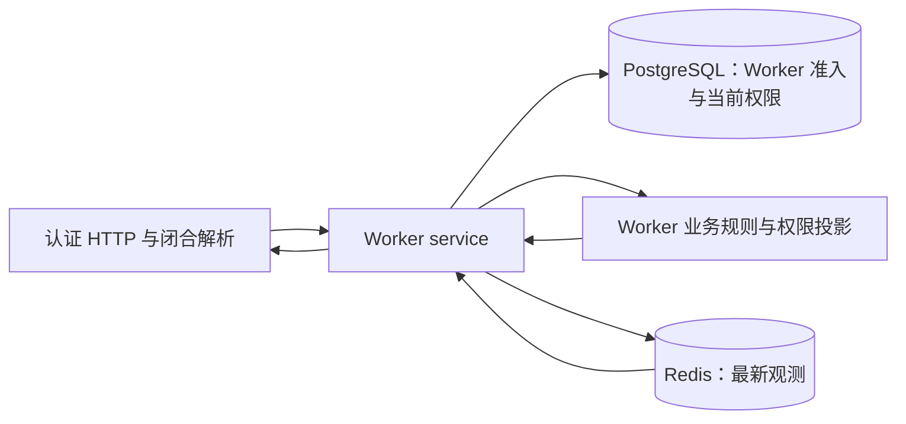

# Worker 当前监控服务端设计

账号级监控保存 Worker 最新运行观测，并在每次读取时应用当前权限。[监控合同](../spec/daynight-worker-monitoring.md)定义数据、拒绝及预算；[机器快照设计](daynight-worker-snapshots.md)拥有已有心跳、Worker 可见窗口和配置。[决策记录](../../.agents/notes/implemented/architecture/2026-11-09-worker-current-monitoring.md)保留存储和隔离的取舍。Web 在 Worker 页面读取这些观测；Worker 采集与完整系统验收分别有独立责任。

## 职责与数据流

`internal/server/worker` 负责方法、路径、查询拒绝、请求解析和响应编码；`internal/protocol/monitoring` 持有共享闭合结构、规范化与编码边界。`service/worker` 以认证 principal、当前账号和 Worker 可见窗口组织 PostgreSQL 读取、监控存储和投影；`core/worker` 校验执行关联并处理当前权限及响应预算。`core/store` 提供不暴露 Redis 驱动的 `MonitoringStore`；`core/store/redis` 拥有连接、帧和 Redis 命令。组件装配只为监控创建并关闭 Redis 客户端，正常业务和 readiness 不依赖它。

执行观测中的 claim 关联需要与当前账号、Worker 和活跃 claim 匹配。清理和资源责任是经过 Worker 准入的自报事实：已完成、撤回或重领的旧 claim 不再能证明当前执行所有权。读取依据当前项目访问及任务存在、未删除状态投影名称和 ID；被隐藏的明细及其关联错误、原因和数量分解一并过滤。总体容量和单独上报的无身份清理阻塞事实保留。项目级失败使用项目 scope，可表达没有 Task 的失败。监控关联不授予任何业务权限。

## Redis 帧与比较写入

每个账号和 Worker 使用一个 `dn:worker-monitoring:{userId:workerId}` String。首行是含版本、revision、runId、sequence、正文摘要、Redis 接收时间、到期时间和私有 StoredSummary 的 JSON，含换行最多 2 KiB；正文为最多 256 KiB 的规范化 Observation，整值最多 258 KiB。SHA-256 只覆盖正文。读取详情校验帧和正文摘要；摘要读取仅对已准入的 ID 获取 `GETRANGE 0 2047`，不扫描键或读取正文。空字符串与缺席由同一 Redis 脚本区分，避免并发创建导致错误判断。Redis `TIME` 提供观察时钟，不依赖浏览器时间。

服务端在比较前验证首行及闭合摘要，Lua 再比较所验证的首行；若并发修改使其变化，在同一 200 ms 总预算内重新读取和验证。Lua 只解析首行，按长度和字典序比较规范十进制 sequence，避免浮点精度损失。确认旧帧、类型、版本和比较条件后，唯一写命令 `SET ... EX 3600` 同时替换正文、元数据与 TTL；没有单独的索引或续期命令。重复与拒绝保持原数据和剩余 TTL；读取也不续期。CAS 顺序和错误码由[合同](../spec/daynight-worker-monitoring.md#错误cas-与存储)定义。

StoredSummary 额外保存最多 16 个固定原因索引及紧凑 project/task 权限引用；这些引用仅供 Server 核对，不输出到 HTTP 或日志。summary 查询先整批准入并读取首行，再在一个当前权限快照中重验 Worker 和批量读取引用所需的项目、任务来源。详情和摘要共享相同 scope 可见性；摘要先过滤再去重，生成独立的公共 admission，不返回引用或隐藏数量。格式与具体字段由[合同](../spec/daynight-worker-monitoring.md#错误cas-与存储)定义。

Redis 和 PostgreSQL 不共享事务。服务先进行资源准入，再读取或写入 Redis；访问关联在读取时重新判断。Redis 操作有 200 ms 总 deadline，go-redis 禁用命令和拨号隐式重试；写命令结果未确认时返回专用错误，不能推断提交或回滚。Redis 不可用、类型或帧错误和 OOM 是监控失败，不当作缺席。缺席表示已准入 Worker 没有当前值。

## 投影与编码预算

详情先过滤不可访问的关联，再补充当前项目名和任务标题。权限过滤后保留的无名称故障、真实总容量和其他基础事实占据预算，标签和普通活动按合同受限。预算按 Go 实际 JSON HTML escaping、响应外壳及换行计算，最大 512 KiB；无法容纳的标签使用 `labels-omitted`，必要时省略低优先级活动并标记 `detailCoverage=partial`。批量响应最多 100 项、256 KiB，保持请求顺序；公共原因只暴露当前可见的固定代码和覆盖质量，不返回关联身份或隐藏数量。PUT 原始请求和规范正文各最多 256 KiB。

## 格式切换

首行 codec 和 CAS 仅接受 v2。确认没有旧数据且旧写入已排空时可直接切换；存量存在或未知时，先关闭并排空所有旧 monitoring 写入，以 Redis TIME 记录 T0 并等待至少 3600 秒，使合法旧帧依原 TTL 自然过期，再完整部署 v2 Server 并验证后恢复 monitoring，最后部署 Web。期间监控端点明确返回 503，既有心跳、Task、claim 和清理保持独立。回滚采用相同排空和自然到期屏障；不迁移、删键、续期或混用版本。实际部署和回滚步骤由 [Server README](../../packages/daynight-server/README.md#monitoring-format-transition) 持有。

## 配置与验证

`DAYNIGHT_REDIS_URL` 为空时监控端点返回 `503 monitoring_unavailable`；非空值须为合法 `redis` 或 `rediss` URL；查询参数只接受 `db`，连接预算和重试策略固定。监控独享连接及其关闭生命周期，故障不会使已有 PostgreSQL API 或 readiness 不可用。日志保留错误链与组件、阶段、request ID 等安全诊断，不记录 Redis URL 或完整状态。连接及验证命令见 [Server README](../../packages/daynight-server/README.md#validate)。

HTTP、service 和 core 测试隔离直接下层，验证解析、准入、当前权限、取消、错误与真实编码预算。Redis DAO 使用独立的真实 Redis 验证 CAS 顺序、重复和拒绝不续期、缺席与损坏、并发、OOM、结果未知及 deadline；PostgreSQL DAO 使用独立实例验证当前权限来源。服务端验证不能代替生产者采集或完整产品链路的验收。
