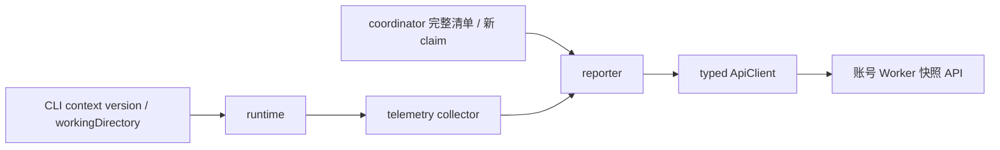

# Worker 采集与上报设计

[上报需求](../spec/daynight-worker-reporting.md)拥有时机、采集口径、错误和验证要求，[快照接口](../spec/daynight-worker-snapshots.md)拥有共享格式，[服务端设计](daynight-worker-snapshots.md)拥有保存与查询。[决策记录](../../.agents/notes/implemented/architecture/2026-10-28-worker-runtime-reporting.md)解释独立调度、纯探测及进程内状态的选择。

## 职责与数据流

`index.ts` 仅在 run 命令捕获 context.version 和 context.workingDirectory()。`runtime.ts` 在取得实例锁、稳定身份、存储、日志及认证账号后创建 collector 和 reporter；此时仓库准备与任务 tick 尚未开始。collector 使用同一 machine 描述和实际平台；machine 名称及派生 ID 仅为展示元数据，稳定 workerId 和 principal 承担账号归属。

`telemetry.ts` 只读采集运行环境，返回完整 telemetry 和私有 issue 列表。`reporter.ts` 拥有周期、触发合并、最新清单、尝试 Operation 和清洗诊断。`remote.ts` 使用固定服务凭据及 expectedUserId 将报告转交 typed ApiClient；调用者拥有 Operation 的取消及释放。API 对 mutable POST 使用精确 200 准入，不套用通用创建操作的 201 语义。

reporter 不拥有执行 backend，不调用 task/claim 更新。Herdr 观察器直接读取私有 API 端点，不经过 runtime 的 lazyHerdr；纯 Web 执行保持对 Herdr 的延迟初始化。

## 独立调度与生命周期

reporter 构造时立即触发，并设置独立 30 秒 interval。`running` 表示唯一进行中的循环，`pending` 合并期间的全部触发；一次尝试结束时最多接续一次新采集。期间若再次触发，仍只保留一个 pending，不保存旧请求正文。

每次尝试新建总预算 15 秒、单请求 10 秒的 Operation。collector 从剩余预算派生最多 5 秒的 collection Operation，各字段并行观察。原生版本命令使用 `cleanupWithinDeadline` 模式，在执行预算中预留终止与 join 时间，Windows 的 taskkill 也受同一剩余预算约束。普通 preflight 继续拥有自己的命令清理策略。

runtime 根 signal 中止时，reporter 停止 interval、清除 pending 并取消当前 Operation。runtime 等待 reporter.stop() 后继续 coordinator shutdown、backend、存储、日志与实例锁收尾。普通报告失败不终止执行；探测进程收尾无法确认与诊断输出失败会由 stop() 保留并传递，其他资源清理仍继续。

## 完整清单复用

coordinator 在完整 ownInventory 成功返回后、资源观察和较长任务操作前发布观测。分页或任一项目读取失败不发布部分集合。实际 claim 成功且本机 pending 已登记后，再发布确认的 task 引用。两个回调都不等待 HTTP。

reporter 防御性复制并冻结清单及引用。初始 inventory 为 null，完整成功观测替换它，包括空数组；失败不清空。新 claim 只在完整清单已知时按 taskId upsert，并保留该完整清单 observedAt。发送时取最新清单，避免采集开始后确认的新 claim 被同次报告遗漏。清单来源时间独立于 sampledAt 和服务端 lastReportedAt。

## 资源采集与有界等待

OS、内存和 CPU 使用 Node OS API。CPU 每次先读取逻辑处理器 times，约 200 毫秒后再次读取；校验型号与逻辑处理器数量一致，对所有处理器的 total/idle 差分汇总计算占用率。负差、零总差或越界值为字段错误，取消会清除采样 timer。

磁盘使用启动 workingDirectory 的 bigint statfs。先以 bigint 计算容量，再验证非负安全整数及 available<=total。collector 只保留一个 pendingDisk Promise；调用期限只中止对结果的等待，不宣称取消 OS I/O。未完成期间的新采集直接返回磁盘 timeout，不创建调用或新增该 Promise 的观察者；原调用成功或失败后释放 gate。

各字段 Probe 独立返回 checkedAt 和结果。采集错误保存闭合 code 与原始私有 cause；wire report 只含 code。合法部分报告仍发送，不能把一个工具失败扩大为整机不可观测。

## 纯版本探测与环境

`herdr/version-probe.ts` 从 preflight 提取纯 `--version` 调用和版本解析，preflight 在它之上继续执行启动能力及最低版本校验。collector 直接使用纯探测，因此旧版已安装 Codex 仍可展示。

原生探测复用任务原生环境构造：保留调用方 XDG 及 provider 认证位置，不使用 daemon 的隔离 XDG 替代。它不运行 agent、hook、安装或登录。Codex/Copilot 结果在 collector 中按单调时钟缓存，年龄不足 60 秒才复用，checkedAt 保留原值；失败也缓存，到期失败覆盖旧成功。ENOENT 还需核对 cwd 及可执行搜索路径，只有确证不存在才为 not_installed。

`createHerdrVersionObserver` 每次直接 ping 私有 endpoint，并校验 pong/version。确证端点不存在或拒绝连接返回 not_running，权限、协议、解析或其它 I/O 故障保持 error。它无版本缓存、ensure、实例启动、integration 修复或执行资源快照。

命令 runner 用 `HerdrCommandCleanupError` 显式标记无法确认进程树及流关闭。collector 对出现该标记的工具在本进程内永久禁止替代探测，后续返回 unavailable；reporter 保存原错误用于退出并继续其余部分心跳。一般 AggregateError 不触发此屏障。

## 失败与可观察性

reporter 按字段或 report 子系统保存故障签名和重复次数；故障变化时输出 worker_report_failed，恢复时输出 worker_report_recovered。诊断重新构造错误类别与 cause 结构，不传递原错误消息或命令输出。该状态只去重，不承担重试或恢复职责。

传输、响应解析及 principal 不一致使本次失败。后续触发重新收集并发送；响应丢失不证明服务端未写入，也不授权重放。无 SQLite 元数据、报告历史或跨进程日志恢复。服务端保持最新观测并按当前权限规范化引用，故客户端无需在本机保存另一份任务展示状态。

## 验证结构

reporter 测试以受控时间和延后 Promise 验证单飞、合并、独立周期、失败恢复、最新清单及 stop 的取消/join。collector 测试覆盖真实差分、字段错误、缓存过期、未完成 statfs gate、只读私有实例和严格命令清理。runtime/coordinator 测试验证认证后的启动顺序、完整清单发布点、确认 claim、长 tick 与纯 Web 的 Herdr 延迟边界；typed API 测试验证精确状态、响应和账号准入。

原生采集测试在实际平台运行 OS、CPU、内存、statfs 和版本命令，仅报告环境及 Probe 状态。各平台通过自己的实际运行结果建立能力依据；mock 结果不推断为该平台已通过。完整任务执行与恢复另由[整体架构](daynight-worker.md#验证边界)规定。
