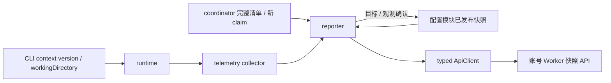

# Worker 采集与上报设计

[上报需求](../spec/daynight-worker-reporting.md)拥有时机、采集口径、错误和验证要求，[快照接口](../spec/daynight-worker-snapshots.md)拥有共享格式，[服务端设计](daynight-worker-snapshots.md)拥有保存与查询。[报告决策](../../.agents/notes/archived/architecture/2026-10-28-worker-runtime-reporting.md)解释独立调度与纯探测；[配置决策](../../.agents/notes/archived/architecture/2026-11-04-worker-cloud-runtime-configuration.md)记录了持久应用状态与报告确认的历史取舍。

## 职责与数据流

`index.ts` 仅在 run 命令捕获 context.version 和 context.workingDirectory()。`runtime.ts` 取得实例锁、稳定身份、存储、日志及认证账号，先查询云端目标并建立配置模块，再创建 collector/reporter；此时仓库准备、业务 backend 初始化与任务 tick 尚未开始。runtime 将固定的 workerId 与 serverOrigin 交给 collector，供其筛选 durable daemon 归属。collector 使用同一 machine 描述和实际平台；machine 名称及派生 ID 仅为展示元数据，稳定 workerId 和 principal 承担账号归属。

`telemetry.ts` 只读采集运行环境，返回完整 telemetry 和私有 issue 列表。`reporter.ts` 拥有周期、触发合并、最新清单、尝试 Operation 和清洗诊断。`remote.ts` 使用固定服务凭据及 expectedUserId 将报告转交 typed ApiClient；调用者拥有 Operation 的取消及释放。配置报告采用独立 typed 方法，对该请求设置配置能力标记并验证完整回执，普通报告保留精确两字段回执。API 对 mutable POST 使用精确 200 准入，不套用通用创建操作的 201 语义。

reporter 不拥有执行 backend，不调用 task/claim 更新。Herdr 观察器直接读取私有 API 端点，不经过 runtime 的 lazyHerdr；纯 Web 执行保持对 Herdr 的延迟初始化。

## 独立调度与生命周期

reporter 构造时立即触发，并设置独立 30 秒 interval。`running` 表示唯一进行中的循环，`pending` 合并期间的全部触发；一次尝试结束时最多接续一次新采集。期间若再次触发，仍只保留一个 pending，不保存旧请求正文。

每次尝试新建总预算 15 秒、单请求 10 秒的 Operation。配置 exchange 的 `waitReady(operation)` 在普通采样前、同步读取/prepare 和捕获前接入 manager 共享存储屏障；阻塞期间不保留新的普通读取队列。collector 从剩余预算派生最多 5 秒的 collection Operation，各字段并行观察。原生版本命令使用 `cleanupWithinDeadline` 模式，在执行预算中预留终止与 join 时间，Windows 的 taskkill 也受同一剩余预算约束。普通 preflight 继续拥有自己的命令清理策略。

runtime 根 signal 中止时，reporter 同步停止 interval、清除 pending 并取消当前 Operation；coordinator 的同一根信号监听同步关闭调度并中止全部 job controller，包括终止清理 job。取消阶段不等待 reporter.stop()，因此慢报告不能延后任务取消，终止清理也不能在报告 join 期间继续删除 worktree 或完成本机行。runtime 同时先启动配置 `beginDrain()`，再 join reporter、初始化移除及其它完成结果生产者；`stop()` 等待原配置 job 和文件队列，之后进入执行资源 shutdown。五秒 drain 只限制继续调度写重试，不 detach 活动 read/write/rename，实例锁保留到实际 I/O 和执行资源结束。未保存结果仍失败；backend 与 stores 的最后事件结束后才 close 诊断 sink。未完成 claim、worktree、原生 session ID 及 active/pending 行继续保留。普通报告失败不终止执行；探测进程收尾无法确认与诊断输出失败会由 stop() 保留并传递，其他资源清理仍继续。

reporter 保留带清理失败标记的原始错误，在 `stop()` 停止触发并 join 当前采集后，按原确认状态判断剩余责任。已确认的历史清理超时及 reporter 自身取消包装不再单独导致退出失败；混合 `AggregateError` 中仍未确认的清理、独立错误和诊断输出失败继续传播。已确认清理错误自身携带的原始命令失败仍属于历史上下文，不等同于聚合中独立的退出失败。此判断不清除历史错误分类，也不触发新探测；停止或取消的采集不会因晚到确认复活。

可信配置报告响应之后，`accept` 使用同一 Operation 的 signal 作为等待者预算，将捕获及回执先交给 manager-owned 提交。取消/超时使调用者离开等待，不能取消该提交或清除其结果。周期调度仍单飞并合并触发；文件恢复按序发布后通过原唤醒机制产生新的尝试。该屏障不承担服务端权威版本策略，不把已知回执伪装成读取或远端未知结果。

## 当前运行监控

配置持久化与诊断文件 sink 的真实 I/O 故障通过既有 runtime failure 观察呈现阶段、retryState 和 nextAttemptAt，恢复退休同一运行内的故障身份。监控不读 JSONL、不将日志当作恢复输入，也不从最近成功配置或报告推断当前存储准入；isReady/canAdmitNewExecution 仍由本机执行所有者判定。固定诊断类别沿原内容准入，不上传原始错误或增加快照字段。

取得实例锁后建立本次运行的内存观测器和随机 runId。Coordinator 在实际调度、执行、等待与清理边界同步更新状态；容量与领取准入共享责任投影，详情截断不改变总数。观测器不读取日志或额外发现资源。失败按受控类型映射为固定摘要：实际 Herdr 命令错误的明确非零安全整数退出、Git 命令错误的明确正安全整数退出为 command-failed；Git 启动失败的负 errno、仅信号退出或未知退出结果保持 unknown。清理阶段仅拆开已知 WorkerCleanupError 包装，不检查任意错误链或从消息猜测；原始错误仍由本机诊断处理。claim 异常的工作区位置从原操作选定的项目 checkout 与工作树绑定计算，不读文件系统或解析错误文本；Web 历史归档使用冻结的绑定，Herdr 使用生命周期 cwd 和受保护的项目绑定。没有可信配对时省略字段。快照深拷贝位置，预算不足时优先将最大编码路径改为明确超限，保留原始内存记录。共享字段、编码预算与 CAS 合同由[运行监控规范](../spec/daynight-worker-monitoring.md)持有。

独立发送器每 30 秒捕获当前状态，最多一个请求在途；变化合并，失败按 30/60 秒退避。首次读取绑定实际前驱，冲突或未知写入先读取并重新捕获；已建立运行被其他 run 覆盖时停止发送。停止期间发送器继续运行，执行和清理收尾后捕获 stopped，最多等待 5 秒发送并 join。该通道不控制原有报告、任务或资源生命周期。

## 配置快照与回执

reporter 通过 capture/send/accept 接缝与配置模块协作。本轮先取得机器采样及最新任务引用，配置准备后将同一份 WorkerReport 传给 capture，投影的请求计量与 send 使用这个对象，不在两处重复采样。配置模块从完整当前与保留记录中捕获不可变的本批报告、generation、实际发送的 recordId/失败来源和下一个游标。

本批同时受 1025 个非 mode 项、协商后的 1026 个总项、Go 编码加存储包装余量的 4 MiB 和整包 9 MiB 约束；固定一项真实未完成或失败移除，其余连续轮转。最近同 key 失败可以来自保留记录，捕获保存其准确 sourceRecordId/failureId，而不复制失败所有权或历史成功出处。服务端整体替换本批观察，不合并各批历史；本机记录不因本次遗漏而被删除。

成功回执交给原捕获的确认处理。只有 observationAccepted=true 才清除实际发送且身份仍匹配的失败；飞行期间的新失败保留，恢复不提前丢弃 lastFailure。游标仅在捕获 generation 仍为当前代时推进，拒绝或未知回执不让出未确认报告槽。目标与观测版本接收沿用配置管理器的原合同；首次同步的观测基线和未初始化状态的 "0" 分别处理。完成移除还须满足原执行结束、准确本批确认及本机保留责任的收敛条件。完整投影与状态表示由[Worker 设计](daynight-worker.md#云端接收与本机提交)拥有。

capture 和 accept 不执行 native、仓库或停止 I/O。接收唤醒配置应用循环，外部操作在报告预算之外完成，再通过配置提交队列发布实际结果。报告因此不等待项目变更，也不被任务清单错误阻断。配置持久化错误保持原错误链，不能把尚未持久化的实际值发布为成功。配置模块在 Worker 自有 JSON 保存应用与确认状态，机器采样、版本缓存和清单仍是进程内状态。

## 完整清单复用

coordinator 在全部项目的 ownInventory 完整覆盖后、资源观察和较长任务操作前发布观测。项目 404 形成局部覆盖时使旧完整清单失效，不发布部分集合；其他分页或读取错误同样使清单失效并保留真实错误分类。每轮读取前记录各项目的失效序号，交接读取结果时再次核对；读取期间或返回交接时发生的 404 不能被旧结果覆盖，也不能用于准入或缺席清理。实际 claim 成功且本机 pending 已登记后，再发布确认的 task 引用。回调都不等待 HTTP。

reporter 防御性复制并冻结清单及引用。初始 inventory 为 null，完整成功观测替换它，包括空数组；覆盖不完整或读取失败时显式清空。新 claim 只在完整清单已知时按 taskId upsert，并保留该完整清单 observedAt。发送时取最新清单，避免采集开始后确认的新 claim 被同次报告遗漏。清单来源时间独立于 sampledAt 和服务端 lastReportedAt。

## 资源采集与有界等待

OS、内存和 CPU 使用 Node OS API。CPU 每次先读取逻辑处理器 times，约 200 毫秒后再次读取；校验型号与逻辑处理器数量一致，对所有处理器的 total/idle 差分汇总计算占用率。负差、零总差或越界值为字段错误，取消会清除采样 timer。

磁盘使用启动 workingDirectory 的 bigint statfs。先以 bigint 计算容量，再验证非负安全整数及 available<=total。collector 只保留一个 pendingDisk Promise；调用期限只中止对结果的等待，不宣称取消 OS I/O。未完成期间的新采集直接返回磁盘 timeout，不创建调用或新增该 Promise 的观察者；原调用成功或失败后释放 gate。

各字段 Probe 独立返回 checkedAt 和结果。采集错误保存闭合 code 与原始私有 cause；wire report 只含 code。合法部分报告仍发送，不能把一个工具失败扩大为整机不可观测。

## 纯版本探测与环境

`herdr/version-probe.ts` 从 preflight 提取纯 `--version` 调用和版本解析，preflight 在它之上继续执行启动能力及最低版本校验。collector 直接使用纯探测，因此旧版已安装 Codex 仍可展示。

原生探测复用任务原生环境构造：保留调用方 XDG 及 provider 认证位置，不使用 daemon 的隔离 XDG 替代。它不运行 agent、hook、安装或登录。Codex/Copilot 结果在 collector 中按单调时钟缓存，年龄不足 60 秒才复用，checkedAt 保留原值；失败也缓存，到期失败覆盖旧成功。ENOENT 还需核对 cwd 及可执行搜索路径，只有确证不存在才为 not_installed。

`herdr/runtime-version.ts` 拥有平台与 durable/legacy 观察路径选择。非 macOS 平台直接使用 `createHerdrVersionObserver`；macOS 先检查 journal 是否存在，只有不存在时沿用共享端点以兼容遗留安装。存在 journal 时复用 `readHerdrLifecycleRecords` 的只读、当前格式事务；不调用可写 store、recover、迁移或 lazyHerdr。SQLite 可使用 WAL 协调文件，但不修改持久化执行记录或控制状态。无候选项时不构造原生进程观察器，纯 Web 保持 Herdr 延迟边界。

观察器按固定 workerId 与 serverOrigin 筛选，读取每项当前未确认停止的 run，以及已捕获 daemon 或已请求启动的 preparation。stopped_confirmed 不参与；原始 daemon 的 exited 结果表示它已不再运行，忽略该候选。stop_unknown 不阻止只读观察，但观察结果不能解除控制不确定性。缺失、changed 或 unknown 身份产生 `HerdrVersionUnavailableError`，映射到现有 unavailable code。观察器仅使用原生边界的 observe/peer，不请求信号、停止或执行资源初始化。

每个候选项通过原始进程身份检查后，解析记录中的 run 端点，在 ping 前后核对 peer 的 pid、bootId、birthToken 和 auditToken。`createHerdrVersionObserver` 仅发送 ping 并校验 pong/version。存活进程缺少端点或 peer 不一致为 unavailable；权限、协议、journal 或其它 I/O 故障保留字段错误。所有存活 daemon 的版本必须完全一致，否则单值字段返回 unavailable；无存活候选返回 not_running，不使用共享 daemon 填补 durable 结果。无版本缓存、ensure、实例启动、integration 修复或执行资源快照。

collector 对完整 Herdr 观察使用现有有界等待，每次异步步骤后检查同一 collection Operation。采集超时返回 timeout，根取消仍使整体采集失败；未完成的只读调用不被宣称已取消，其完成后不能发起后续 peer 或 RPC。原始 journal、run 路径、进程与 claim 身份仅用于本机判断，不加入 wire schema 或诊断正文。

命令 runner 用 `HerdrCommandCleanupError` 标记该次命令曾未能确认清理，`hasHerdrCommandCleanupFailure` 保留这一历史分类。私有 `WeakMap` 将错误关联到原始 `ChildProcess` 既有 `close` 监听的状态；确认依赖该命令对象及其输出流关闭，不使用可复用 PID、全局 Provider 标记或另一探测的结果。仅等待 `close` 超时且终止调用未失败的错误可以在晚到 `close` 后得到确认。只有 `exit`、leader 消失、终止失败后 `close`，以及其它清理 owner 或旧构造产生的无确认句柄错误，都不能据此解除阻塞。

`hasUnconfirmedHerdrCommandCleanup` 单独查询当前责任，递归检查 `Error.cause` 和 `AggregateError.errors`；任何一项尚未确认，整个对应探测仍受屏障保护。普通聚合错误没有清理标记时不产生清理屏障。`versions` 为 Codex/Copilot 分别保留原失败及 `cleanupUncertain`，未确认时继续返回 unavailable，不因 60 秒缓存到期启动替代进程。原责任全部确认后，下一轮正常采集先删除该工具的旧失败缓存，再执行版本命令；新探测结果使用本轮 `checkedAt`，成功才发布新版本，失败保留实际错误；未确认时返回的 unavailable 也带本轮检查时间，该时间不是成功证据。确认事件本身不产生成功报告、额外调度、轮询进程、重复监听或更长预算。历史取舍与不能以时间或缓存替代清理证据的原因见[探测恢复决策](../../.agents/notes/implemented/bug-fix/2026-11-06-native-probe-cleanup-recovery.md)。

## 助手托管预检接入

`worker/bots/host-capabilities.ts` 拥有独立的助手预检采集器，`telemetry.ts` 通过可选采集器接入同一次报告。runtime 将 Bot 管理组合的 `collect` 接入 `assistantHost`，使用当前有效的全局原生配置；组合与配置生效规则由[助手设计](assistant.md#产品组合)拥有。缺字段的旧 Worker 消费行为与[快照协议](../spec/daynight-worker-snapshots.md#助手托管预检)一致；此接入点不是用户配置开关。

预检读取 Worker 启动时的真实绝对目录与全局执行配置，不选择项目或创建目录。全局 Provider 保留自己的 model/args，其它 Provider 使用 null/[]，避免切换后继承错误的模型或参数。全部配置按 Web 适配器参数解析器检查，任务的 Herdr/Web 模式不改变 Bot 的 Web 规则。不支持的配置只返回闭合错误码并清空参数，不将原始错误或敏感参数带入 wire。

可执行来源与 Web 运行适配器一致：Codex 使用原生 PATH，Copilot 使用其随包平台可执行文件，Claude 使用 SDK 的随包平台可执行文件。只运行版本和启动参数帮助探测，不启动原生 Session、不发用户消息，也不读取认证文件来声称账户可用。目录存在、工具存在和参数可识别仍不能保证未来的认证、模型访问或真实启动成功；启动者必须再次验证并等待原生同步事实。

助手预检在报告 Operation 内拥有独立的五秒预算和严格进程清理责任。遥测采集先保存助手成功或失败的结果，等待普通采集和全部原生命令的有界收尾结束后，再传播取消或失败并保留所有清理错误；超时返回仍未确认，不等同于进程已经退出。`reporter.stop()` 在 join 后继续传播真实未确认责任。

助手采集器用 `cleanupFailures` 按 Codex、Claude、Copilot 分别持有原错误；未确认期间禁止该 Provider 的替代探测。下轮正常采集确认原责任已解除后才移除对应阻塞，再执行版本与 Web 参数帮助探测，成功后才报告 `available=true`；新失败按实际原因返回，新的清理错误重新绑定到新命令。它与 `versions` 的缓存各自持有责任，同一 Provider 的两类探测、不同 Provider 和不同轮次均不能互相确认。每轮仍检查当前配置、目录、预算及取消；确认不会绕过这些准入条件。报告仅包含有限 reason，私有 issue 通过现有 reporter 诊断和退出错误链传递。预检来源 observedAt 不随新的普通机器报告刷新，消费端以服务器时间独立检查 120 秒年龄上限。

该恢复机制只覆盖只读探测。默认解析仍使用当前有效报告，目标 Provider 不可用时保留拒绝原因，不自动改选同机其它 Provider；已有 Bot 的持久 ready 不能证明当前可创建。确认状态属于运行中 runner 的原始对象，网页刷新既不升级旧 Worker 代码，也不能补回旧错误缺失的确认句柄。升级及现场验证必须分别核对真实运行版本、Worker 报告和实际创建结果，不能从文档或新 collector 成功推定旧 Worker 已恢复。

### 匹配 Codex 调用的组合清理责任

telemetry 为显式组合创建一个 Codex probe owner，经 Bot host 的 `collect` 包装传给助手 collector；独立助手 collector 使用本地 owner。包装仍在关闭或未应用配置时省略采集，并丢弃跨配置变化的结果。owner 只串行匹配 `codex` executable 名、原始启动目录和选定 PATH 的普通版本与助手完整版本/帮助链，Windows 还比较 PATHEXT。助手使用已验证真实目录执行，匹配保留其原始启动目录来源。不同 executable、搜索输入、目录及其它 Provider 不进入这条等待链；不添加 executable 查找，不推断路径别名的文件身份。

两个 collector 分别捕获 bare Codex 搜索环境。Windows 按 Node 字母序选择第一个大小写不敏感 PATH/PATHEXT 键，删除重复别名后使用唯一大写键；同一捕获环境交给 launcher 和 owner。锁定 `cross-spawn` 的 shebang 搜索与 Node native 环境选择对重复键不同，唯一键使二者使用相同输入。其他环境键、Provider 和显式 executable 保留原环境。

owner 在等待前登记后续调用，join 前一链后检查取消和原始清理责任。匹配链的清理失败保留原错误并立即使普通 Codex 缓存失效；因此即使原 child 在下一轮前可靠关闭，也不能复用失败前成功。普通版本在 owner 内读取缓存，未确认的共享错误映射为本轮不可用并保留原对象。仅原命令可靠确认后才移除共享阻塞，普通失败缓存再按既有恢复规则失效并实际重采。历史清理类别、独立聚合错误、无确认句柄及终止失败的判断继续由原 runner 查询负责；其它 collector 或 Provider 的成功不能提供确认。等待不增加命令、监听或五秒预算，取消后不能启动排队探测。[组合清理决策](../../.agents/notes/implemented/bug-fix/2026-11-04-codex-reporting-probe-ownership.md)记录匹配范围与缓存取舍。

## 工具观察接缝

collector 通过可选快照输入接收工具管理器的 ToolPathTelemetry，不在普通心跳内解析路径、哈希文件或执行另一份探测。actual、candidate 和 activeSelections 共用该管理器的事实；接入时 Codex/Copilot 的旧 versions 来自指定上下文的同一 actual。Herdr 的旧 versions 继续只读已归属运行实例，不能把新准入 CLI 版本当作已运行 daemon 版本。默认未接入时省略扩展，旧 versions 继续原严格形状，不能把 bare 版本文本补成已验证路径。工具报告合同由[快照协议](../spec/daynight-worker-snapshots.md#工具路径观察)拥有。

API 在认证配置读取确认 Daynight-Worker-Tool-Paths 能力后才发送扩展；能力绑定 origin 和 principal，旧服务按原报告结构发送。工具投影先按 selectionKey 固定排序和完整组裁减，再执行 256 KiB 子预算及所选请求预算（配置报告 9 MiB，普通报告 1 MiB）。`prepareWorkerReport` 和 `workerReportBody` 按选定预算计量实际 UTF-8 JSON，`runtimeConfiguration` 同样按该预算整体省略；必需清单和配置结果不截断，编码超限在请求派发前失败。Operation 默认总量保持不变。不足时明确 report_budget_exceeded 和集合不完整，不截断路径、不删除普通心跳的必需字段。prepareWorkerReport 返回本地预算结果，ApiClient 的可选预算回调在实际请求准备时接收同一结果，回调失败不能改变报告提交或结果。连完整目标降级也无法容纳时省略可选工具观察，保留稳定错误码和 omitted 标志。无能力、未检查、目标错误和运行集合未知是不同事实；工具错误不得携带完整命令、环境或私有 cause。

## 失败与可观察性

reporter 按字段或 report 子系统保存故障签名和重复次数；故障变化时输出 worker_report_failed，恢复时输出 worker_report_recovered。诊断重新构造错误类别与 cause 结构，不传递原错误消息或命令输出。该状态只去重，不承担重试或恢复职责。

传输、响应解析及 principal 不一致使本次失败；服务端 `409 active_worker_limit_exceeded` 同样按报告失败处理，不改变本机执行。后续触发重新收集并发送；响应丢失不证明服务端未写入，也不授权重放。机器采集与清单没有 SQLite 元数据、报告历史或跨进程日志恢复。服务端保持最新观测并按当前权限规范化引用，故客户端无需在本机保存另一份任务展示状态。配置应用与观测确认使用独立 JSON owner，不复用任务索引或机器报告去重状态。

## 验证结构

reporter 测试以受控时间和延后 Promise 验证单飞、合并、独立周期、失败恢复、最新清单及 stop 的取消/join。配置测试核对不可变发送快照、回执准入、报告前恢复、飞行期间新失败、CAS 拒绝和结果未知；runtime 测试同时延后 native/项目应用与任务清单，确认配置通道持续工作。

collector 测试覆盖真实差分、字段错误、缓存过期、未完成 statfs gate、只读私有实例和严格命令清理。durable 版本回归使用真实只读 SQLite reader、run 路径解析与 collector，替换 RPC 和进程观察边界，验证多 run 共识、停止与过期身份、preparation、不确定与错误路径、期限、取消、私密证据隔离和记录不变；遗留路径与纯 Web 不获取原生执行资源。

runtime/coordinator 测试验证认证后的启动顺序、完整清单发布点、确认 claim、长 tick、纯 Web 的 Herdr 延迟边界，以及报告 join 延后时全部 job 的同步取消与未完成资源保留；typed API 测试验证精确状态、响应和账号准入。

原生采集测试在实际平台运行 OS、CPU、内存、statfs 和版本命令，仅报告环境及 Probe 状态。各平台通过自己的实际运行结果建立能力依据；mock 结果不推断为该平台已通过。完整任务执行与恢复另由[整体架构](daynight-worker.md#验证边界)规定。
