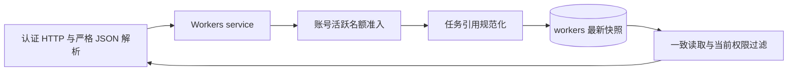

# Worker 运行快照服务端设计

账号级运行快照为认证客户端保存最近一次机器观测。[需求与协议](../spec/daynight-worker-snapshots.md)拥有字段和可观察行为；[快照决策](../../.agents/notes/archived/architecture/2026-10-28-worker-runtime-snapshots.md)保存职责分离的取舍，[准入决策](../../.agents/notes/implemented/architecture/2026-11-07-worker-active-admission.md)记录跨实例活跃名额。[客户端采集与调度](daynight-worker-reporting.md)提供完整观测及已有清单引用，任务执行仍由[claim 协议](daynight-worker-claims.md)管理。

## 结构与职责

`api/workers.go` 定义公开 DTO；`internal/server/worker` 注册报告、快照和[配置](daynight-worker-configuration.md)认证端点，输入解析拒绝各层未知、重复和错误分支字段。`service/worker` 选择事务作用域并组合任务清单与项目准入；`core/worker` 处理报告校验、任务匹配、时效及配置规则。报告、遥测和任务观测模型与 HTTP DTO 分离，store 保存由写入入口校验、规范化并编码的 JSONB。读取直接消费该表示，正常扫描、解码及输出错误沿原错误链传播。

报告 HTTP 先严格解析配置协议头，仅有效协议 1/2 使用 9 MiB 的 `DecodeObjectLimit`，未携带协议头使用普通 1 MiB 限额；未知或重复头在读取业务正文和调用业务前拒绝。实际字节计量、读取期限、取消及超限连接处理沿用共享 HTTP 机制。扩大传输额度不改变 telemetry、最终 Worker 或已接纳配置观测各 4 MiB 的存储预算与事务回滚。 [报告额度决策](../../.agents/notes/implemented/architecture/2026-11-12-worker-configuration-report-budget.md)记录单个合法配置结果的传输原因及部署约束。

机器信息不授予身份。资源由 `(principal.UserID,workerId)` 定位，Cookie 写入的 Origin、PAT、身份响应标头及 no-store 复用既有认证。报告日志使用 `component=worker_report`，关联 user_id、已验证 worker_id、request_id 与处理阶段；正文和原生命令内容不进入日志。

## 独立持久化

迁移 `025_worker_snapshots.sql` 创建 workers，包含 user_id、worker_id、created_at、last_seen_at、telemetry 和 task_snapshot。主键为 `(user_id,worker_id)`；`workers_recent(user_id,last_seen_at DESC,worker_id)` 支持账号近期筛选。telemetry、task_snapshot 具有 JSON object 约束，created_at 首次写入后保持不变。

[配置迁移](daynight-worker-configuration.md#持久化与表示)在同一 Worker 行增加独立目标及应用观测；不改变本节迁移的原始快照含义。此表没有 FK、历史报告或持久化 online 布尔值。旧 claim 和 task 时间不能证明机器仍在运行，因此迁移不回填快照。任务属性使用独立 task_properties 行，完整 JSON 文本由 Go codec 处理，不经过 PostgreSQL JSON cast。

`telemetry.assistantHost` 使用可选指针存入同一 JSONB，不需要额外表或迁移。HTTP 将允许字段与必填字段分开，保留旧客户端缺字段的准入；提供对象时执行完整的严格解析和服务层校验。整个 telemetry 替换意味着省略扩展会撤销旧能力，不保留过期成功。详情 DTO 显式映射该对象，Web Worker 解析器接受此可选扩展并继续拒绝未知字段；不增加助手入口或修改普通 Worker 展示。

## 报告事务

`Store.WriteWorker` 使用独立 READ COMMITTED 事务，不进入会锁 project 的 WriteProject。DAO 先取得按账号命名的事务级 PostgreSQL advisory lock，在锁取得后重新采集数据库 `statement_timestamp()`，再以此时刻读取目标 last_seen_at 和账号完整 active count。计数使用 `workers_recent` 的账号与时间范围，不物化完整快照。锁保持到提交或回滚，独立实例对同一账号的报告因此串行；不同账号不共用名额。业务层先拒绝完整计数大于 100 的所有报告，再在计数为 100 时仅允许已 active 目标续报。任何拒绝都使事务回滚。

准入通过后，DAO 按输入 task ID 的主键集合批量读取任务，JOIN store 的 canonical `ProjectAccessRelation` 及项目名，排除软删除记录。准入关系在同一语句内按认证 userId 筛选，计算当前 owner Team role 与 direct grant role 的最大值；只有继承访问也具有相同可见资格。Worker 不另行解释授权来源，不改写任何 grant。

按已准入的 task IDs 批量读取唯一 worker 属性，在 Go 中普通解码；core 使用 Task 的 claim 规则匹配引用。只有 project、task、claim、当前认证账号与 workerId 相符，claim active 且 task in_progress 才产生规范化任务项。属性写入 codec 负责完整 claim 格式及 Agent/控制模式；读取不重复结构或容量校验，快照只提取需要的字段。缺失归属、普通完成、撤回或失权竞态省略引用；自然属性解码及数据库故障保留原错误链并使请求失败。

UPSERT 同时写锁后采集的 last_seen_at、telemetry、task_snapshot，目标原有时间位于未来也使用本次成功时间。已知清单完整替换任务快照；null 清单根据旧状态保留 observed/stale 的任务与原时刻，并变为 stale，旧 unavailable 保持 unavailable。在 UPSERT 后、提交前计量最终合并的 Worker，包括 null 清单保留的旧任务；超过完整资源预算时拒绝并回滚。配置交换与这些写入同属事务；取消、SQL 错误或后续配置错误回滚全部结果并释放锁。事务辅助保留操作、提交与回滚错误链。

显式配置协议在机器观测 upsert 后，继续以同一 Worker 行处理首次候选和应用观测 CAS；该扩展的完整结构与事务由[配置设计](daynight-worker-configuration.md)拥有。观测 CAS 拒绝保留已有配置结果，不把合法机器观测当作失败。

该路径不写其他 Worker 的时间，也不写 task、claim、task version 或项目状态。报告返回服务端时间与最终保存的 lastReportedAt。响应丢失不证明回滚，客户端后续新报告仍以完整观测收敛。

## 读取快照与权限

列表和详情复用 read-only REPEATABLE READ，并在同一快照取得数据库 observedAt、Worker 行及任务可见性。近期条件为 `last_seen_at >= observedAt - interval '72 hours'`；详情额外按账号和 workerId 定位。GET 没有续活写入。

列表按稳定 `(created_at,worker_id)` keyset 在一次摘要查询中读取 `limit+1` 项。DAO 返回 `WorkerSummaryPage{Items,HasMore}`，service 映射响应，并在 HasMore 时用最后返回项生成 cursor。cursor 绑定认证 userId；它不将频繁变化的 last_seen_at 用作游标。近期索引与创建时间排序承担不同职责。

列表 SQL 直接读取规范存储字段 `telemetry.machine.ID/Name`、`telemetry.platform` 和 `task_snapshot.state/observedAt`。嵌套 `WorkerMachine` 由 Go writer 按导出字段名编码为 `ID/Name`；公开 HTTP DTO 的对应字段仍为 `machine.id/name`。任务引用转换为 UUID 后与 tasks 的 UUID 主键和 project_id 等值关联，再使用 `ProjectAccessRelation` 按认证 userId 计数当前可访问且未删除的快照任务。查询不传输完整 telemetry 或任务数组，也不枚举字段别名、复现 Go JSON 解码规则或校验未展示的完整结构。DAO 正常扫描摘要和时间值。详情读取单份完整快照，普通 Go 解码后以相同权限规则过滤。unavailable 输出 null，已知或 stale 输出实际可见数量。当前 claim 不参与旧观测的读取资格，因此完成和转交不会改写历史 phase/status，权限撤销与删除则立即约束后续读取的标题和计数。过滤不改写保存的快照；重新获得项目权限后，仍未删除的历史观测可再次返回。

写入入口拥有数据结构、字段、规范化和现有容量规则。列表与详情不追加存储数据校验、容量复查、读取字节预算或历史格式解释；不扫描或迁移历史数据，也不新增写入配额。该职责取舍由[读取简化决策](../../.agents/notes/implemented/simplification/2026-11-09-worker-bot-canonical-reads.md)记录。

## 时间与数据含义

在线规则由返回的 observedAt 和 lastReportedAt 派生：`observedAt - 120s < lastReportedAt <= observedAt` 为 online；恰好 120 秒及未来时间为 offline。服务端、CLI 与 Web 对同一时间样本使用此边界。72 小时只控制近期资源可见性。客户端 sampledAt、各 Probe.checkedAt 及 inventory observedAt 是来源时间，不能替代数据库 liveness 时钟。

服务端保存客户端实际提交的工作目录和资源测量，不推断设备名、物理核心或安装情况。字段格式和数值有效不证明采集工具真实运行；消费者应保留采样时间与明确 Probe 状态。taskObservedAt 表示服务端规范化任务快照的时刻，inventoryObservedAt 保留清单原始时刻，stale 状态不将旧任务伪装成刚同步的清单。

`WorkerAssistantHostState` 独立判断助手候选状态：无扩展为 unsupported；机器报告不新鲜为 offline；预检不新鲜为 stale；全部 Provider 失败为 unavailable；至少一个成功为 available。机器和预检使用同一 120 秒上限，拒绝未来时刻，且不互相刷新。函数不修改原 telemetry，创建解析仍需核对具体 Provider 和执行时环境。此判断不授予 Bot 启动权限，也不替代后续真实 Session 同步确认。

## 验证边界

存储与 service 验证使用真实 PostgreSQL 的独立 schema，覆盖跨实例竞争最后名额、99/100/101 个 active 的报告类型、不同账号隔离、锁后重新取时、精确边界和未来时间、取消与后续失败回滚，以及自然过期后的恢复。另覆盖时间与 telemetry 原子性、重复 null/真实空清单、稳定创建位置、当前权限过滤、完成/转交后旧状态、软删除及不透明 PR 字符串。历史任务数据与版本保持一致。

HTTP 验证覆盖 PAT、Cookie Origin、身份标头、闭合联合结构、必填/重复/未知字段、整数精度、无权限详情、方法和查询拒绝及清洗日志。时间边界必须覆盖恰好 72 小时和超窗，并核实 GET 不改变 lastReportedAt。服务端接收与读取能力不代替真实采集客户端或完整产品体验验收。
