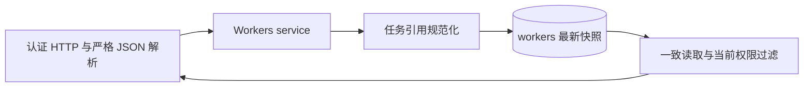

# Worker 运行快照服务端设计

账号级运行快照为认证客户端保存最近一次机器观测。[需求与协议](../spec/daynight-worker-snapshots.md)拥有字段和可观察行为；[决策记录](../../.agents/notes/implemented/architecture/2026-10-28-worker-runtime-snapshots.md)保存职责分离及真实替代方案的取舍。[客户端采集与调度](daynight-worker-reporting.md)提供完整观测及已有清单引用，任务执行仍由[claim 协议](daynight-worker-claims.md)管理。

## 结构与职责

`api/workers.go` 定义公开 DTO；`internal/server/workers.go` 注册三个认证端点，输入解析拒绝各层未知、重复和错误分支字段。`service.Workers` 处理 principal、规范 UUID、有效报告、账号绑定分页与事务编排。core 的报告、遥测和任务观测模型与 HTTP DTO 分离，store 保存受控 JSONB。

机器信息不授予身份。资源由 `(principal.UserID,workerId)` 定位，Cookie 写入的 Origin、PAT、身份响应标头及 no-store 复用既有认证。报告日志使用 `component=worker_report`，关联 user_id、已验证 worker_id、request_id 与处理阶段；正文和原生命令内容不进入日志。

## 独立持久化

迁移 `025_worker_snapshots.sql` 创建 workers，包含 user_id、worker_id、created_at、last_seen_at、telemetry 和 task_snapshot。主键为 `(user_id,worker_id)`；`workers_recent(user_id,last_seen_at DESC,worker_id)` 支持账号近期筛选。telemetry、task_snapshot 具有 JSON object 约束，created_at 首次写入后保持不变。

此表没有 FK、历史报告或持久化 online 布尔值。旧 claim 和 task 时间不能证明机器仍在运行，因此迁移不回填快照。`tasks.properties` 保持 text；其中 opaque PR 字符串继续由既有 Go codec 处理，不经过 PostgreSQL JSON cast。

## 报告事务

`Store.WriteWorker` 使用独立 READ COMMITTED 事务，不进入会锁 project 的 WriteProject。service 先取得数据库 statement_timestamp，按输入 task ID 的主键集合批量读取任务，JOIN 当前成员关系及项目名，排除软删除记录。

properties 在 Go 中解码。只有 project、task、claim、当前认证账号与 workerId 相符，claim active 且 task in_progress 才产生规范化任务项。现有 codec 负责完整 claim 格式及 Agent/控制模式，快照只提取需要的字段。普通完成、撤回或失权竞态省略引用；损坏的持久化内容仍使操作失败。

UPSERT 同时写 last_seen_at、telemetry、task_snapshot，只竞争该 Worker 行，并以 `workers.last_seen_at < EXCLUDED.last_seen_at` 拒绝旧 observation。已知清单完整替换任务快照；null 清单根据旧状态保留 observed/stale 的任务与原时刻，并变为 stale，旧 unavailable 保持 unavailable。

旧写被条件忽略时，RETURNING 没有行。随后在同一 READ COMMITTED 事务发出独立 SELECT 取得当前保存值。INSERT 的冲突判定可能遇到该语句快照中尚不可见的并发提交行；后续语句重新取得快照，避免同语句 CTE 反查仍不可见的情况。事务辅助保留操作、提交与回滚错误链。

该路径不写 task、claim、task version 或项目状态。报告返回服务端时间与最终保存的 lastReportedAt，不能把迟到旧写当作新观测。响应丢失不证明回滚，客户端后续新报告仍以完整观测收敛。

## 读取快照与权限

列表和详情复用 read-only REPEATABLE READ，并在同一快照取得数据库 observedAt、Worker 行及任务可见性。近期条件为 `last_seen_at >= observedAt - interval '72 hours'`；详情额外按账号和 workerId 定位。GET 没有续活写入。

列表按稳定 `(created_at,worker_id)` keyset 读取 limit+1 行。service 生成类型为 workers、绑定认证 userId 的 cursor；它不将频繁变化的 last_seen_at 用作游标。近期索引与创建时间排序承担不同职责，实际查询计划用于核对账号近期筛选及分页成本。

每页收集任务快照引用后执行一次当前成员关系与未删除任务的批量查询，再统一过滤任务数组。详情使用同一个过滤机制。计数由过滤后的数组产生；unavailable 输出 null，已知或 stale 输出实际可见数量。当前 claim 不参与旧观测的读取资格，因此完成和转交不会改写历史 phase/status，权限撤销与删除则立即约束后续读取的标题和计数。

## 时间与数据含义

在线规则由返回的 observedAt 和 lastReportedAt 派生：差值不足 120 秒为 online；达到 120 秒为 offline。72 小时只控制近期资源可见性。客户端 sampledAt、各 Probe.checkedAt 及 inventory observedAt 是来源时间，不能替代数据库 liveness 时钟。

服务端保存客户端实际提交的工作目录和资源测量，不推断设备名、物理核心或安装情况。字段格式和数值有效不证明采集工具真实运行；消费者应保留采样时间与明确 Probe 状态。taskObservedAt 表示服务端规范化任务快照的时刻，inventoryObservedAt 保留清单原始时刻，stale 状态不将旧任务伪装成刚同步的清单。

## 验证边界

存储与 service 验证使用真实 PostgreSQL 的独立 schema，覆盖并发 UPSERT 的旧写反查、时间与 telemetry 原子性、重复 null/真实空清单、稳定创建位置、当前权限过滤、完成/转交后旧状态、软删除及不透明 PR 字符串。历史任务数据与版本在新迁移前后保持一致。

HTTP 验证覆盖 PAT、Cookie Origin、身份标头、闭合联合结构、必填/重复/未知字段、整数精度、无权限详情、方法和查询拒绝及清洗日志。时间边界必须覆盖恰好 72 小时和超窗，并核实 GET 不改变 lastReportedAt。服务端接收与读取能力不代替真实采集客户端或完整产品体验验收。
