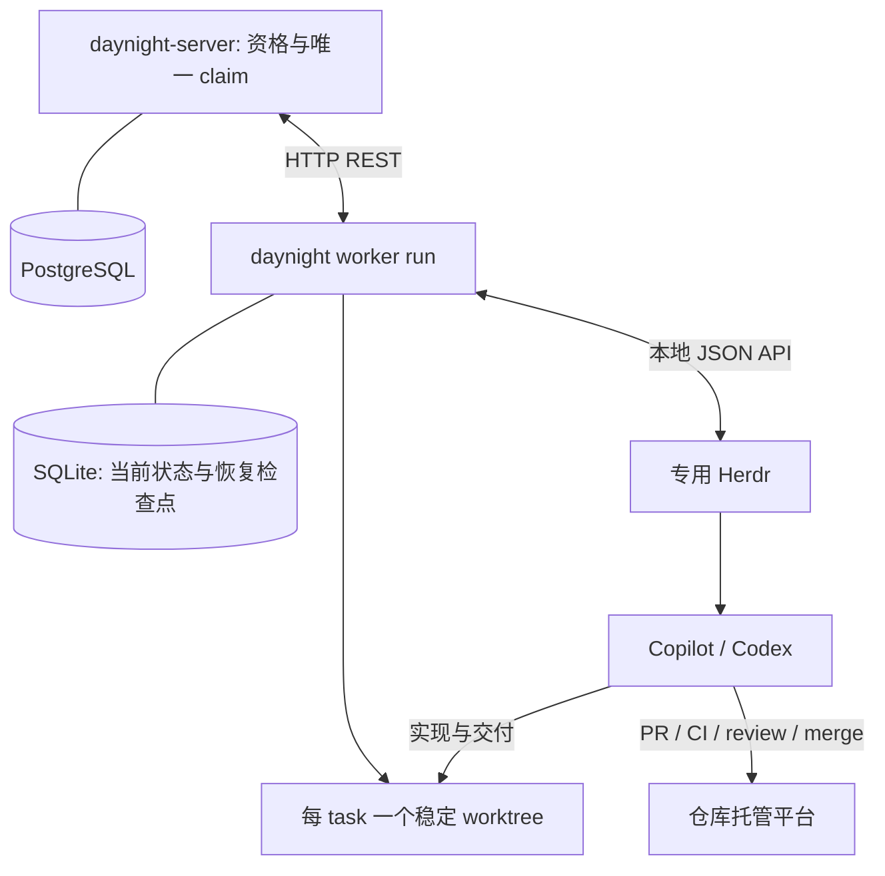

# Worker 架构设计

状态：自动执行许可、平台要求、唯一 worker claim 的服务端/typed client 基础、Agent 显式完成入口，以及本机身份、实例锁与 SQLite 记录已实现；前台 worker、Git 工作区、Herdr 和人工管理命令仍待运行时交付。本文拥有机制；[需求](../spec/daynight-worker.md)拥有产品行为，[设计决策](../../.agents/notes/implemented/architecture/2026-10-22-worker-design.md)保留真实备选方案。

## 目标与当前基础

`daynight worker run` 是一个前台常驻 CLI：通过 REST 领取多仓库中允许 Agent 执行的任务，使用系统管理的稳定 worktree 与专用 Herdr 执行，持久化状态并完成恢复和清理。Agent 负责完整交付、验收和最终 claim-bound done，worker 负责归属清单对账、资源与恢复。

设计初始源码基线为 `e533b8610ec38522fd5387e4715b573734bd16c2`。交付核对基线为 `2d7fdd1e4e178db17e46da5d3b6c0e4050edf730`：主线具有命令组合、严格 YAML、REST client、任务/属性、项目写事务和 review 的 Git/SQLite 基础；当时鉴权与显式动作生命周期已交付；当前状态由[三状态架构](daynight-task-status.md)拥有，认领基础由[归属架构](daynight-worker-claims.md)拥有，worker 的调度及资源运行时仍待实现。任务的服务端起止时间及图时钟遵循已交付的[执行时间契约](https://github.com/codetreker/daynight/blob/2d7fdd1e4e178db17e46da5d3b6c0e4050edf730/docs/spec/daynight-task-timing.md)，worker DTO 与生命周期扩展须保留该契约。

| 当前基础 | 复用点 |
|---|---|
| [命令组合](../../packages/daynight/src/commands/review/command.ts) | definition → command → runtime，业务按命令懒加载。 |
| [项目写锁](https://github.com/codetreker/daynight/blob/e533b8610ec38522fd5387e4715b573734bd16c2/packages/daynight-server/internal/core/store/project_tx.go#L29-L39)、[版本检查](https://github.com/codetreker/daynight/blob/e533b8610ec38522fd5387e4715b573734bd16c2/packages/daynight-server/internal/service/task.go#L100-L120) | 同一事务中检查资格、权限、版本和归属。 |
| [属性 codec](../../packages/daynight-server/internal/taskproperties/codec.go) | 新增预定义属性，保留已有 PR 属性；读与写权限分开。 |
| [REST client](../../packages/daynight/src/api/client.ts)、[分页范围](../../packages/daynight-server/internal/service/page.go) | 复用认证、int64、游标和不确定写入分类；新任务使用许可/平台候选筛选；完整 workerId 清单提供当前归属，已知 taskId 的读取核对显式写入。 |
| [review store](../../packages/daynight/src/commands/review/store.ts)、[worktrees](../../packages/daynight/src/commands/review/adapters/worktrees.ts) | 复用必要的持久性、Git/路径原语；worker 自己拥有状态和可提交分支。 |

## 总体结构



| 组件 | 唯一职责 |
|---|---|
| 服务端 | 任务自动执行许可/平台、ready、认证权限、原子 claim、归属更新、完成与移交。 |
| Worker | 轮转与名额、worktree、Herdr 启停、状态观察、恢复、自有 claim 清单对账及清理。 |
| Agent | 实现、测试、提交、PR、CI/review 修复、授权合并、任务验收及最终 claim-bound done；维护正常 task 资料。 |
| Herdr | PTY、agent 启动/输入/状态及原生会话引用。 |

不增加 agent report 命令、结果文件、callback 服务、报告事件流或通用开发流程引擎。Worker 读取 Herdr 最新状态与自己的当前 claim 清单；任务 PR/验收资料由 Agent 维护。Review 保留自己的 PR revision、publication 和 coordinator；只在第二个真实调用方需要时提取窄的共享原语。

## 配置与目录

共享 `~/.daynight/config.yml` 的根字段 `workerId` 保存稳定随机 UUID。`ensureWorkerIdentity` 在首次缺失时复用现有配置锁和原子替换写入；持锁后重读，避免并发创建不同身份。已有合法值直接复用，不重写文件；非法值明确拒绝，不生成替代身份。配置注释、其他字段及文件权限沿用共享配置写入机制。身份成功持久化后才可进行 claim。

Worker 固定使用 `~/.daynight/worker/`，不提供状态路径覆盖。`resolveWorkerPaths` 根据实际用户 home 与平台路径 API 生成路径；review 继续使用自己的路径和锁。服务连接复用 CLI 默认 `https://daynight.cc` 与已保存凭据，`serverUrl` 只在连接测试服务时显式覆盖。

```text
~/.daynight/
  config.yml           # 根字段 workerId，其他共享配置保持原所有者
  worker/
    state.sqlite       # 仅 projects、tasks 两个业务表
    instance.lock
    logs/
    tmp/
    h/                 # 一个专用 Herdr 实例的私有 config/state
<repositoryPath>/.worktrees/daynight/<taskId>/
```

每个用户环境一个 worker 实例。`acquireWorkerInstanceLock` 复用平台实例排他原语，以同一 `state.sqlite` 为取得/释放文件锁时的 SQLite gate，不创建第二数据库或锁表。存活进程或未知进程状态不能被夺锁。失效 PID 的锁可重新取得，但这只排除了原 worker 进程，不能证明它启动的原生 agent 已停止；调用者仍须核对真实资源。

调度器的目标配置使用独立 `worker` mapping；以下为运行时配置设计，本机存储模块不负责加载这些配置或启动任务：

```yaml
workerId: 1390453c-e768-4bd3-9aa8-17329f758b2c
worker:
  maxConcurrentTasks: 2
  pollIntervalMs: 60000
  maxRecoveries: 3
  retryDelayMs: 30000
  agent:
    type: copilot
    model: auto
    args: []
  repositories:
    - remote: https://github.com/owner/repository.git
      path: /workspace/repository
      agent:
        type: codex
        args: []
```

仓库地址/路径和 agent 类型是明确配置。并发为正整数，轮询/重试间隔为正整数，自动恢复上限为非负整数。表中数值是建议默认值，配置错误明确拒绝。仓库可给出 `projectId` 解决服务端仓库绑定歧义，不能猜测同仓库多个 project。保护目录不与 disposable worktree 或 Git 元数据重叠。

Agent 类型不变时仓库字段覆盖全局字段；切换类型时按新类型解析，不继承另一类型的模型和参数，未指定模型使用其原生命令默认。Worker 管理的 session/cwd/恢复参数不能由普通 `args` 覆盖。运行启动时加载配置，重启使修改作用于后续新 claim；首次 pending 物化保存最终 agent、可空 model、args 与恢复上限，不保存认证 token。同一 claim 恢复始终沿用原快照，已开始执行却丢失原快照时暂停核对。

## 服务端模型与资格查询

`allowAgents` 与 `requiredPlatform` 已在完整 task、图投影、普通 PATCH 与列表筛选中实现；持久化、可空字段存在性、锁定和版本事务见[服务架构](daynight-server.md)。worker claim、执行归属和状态保护已接入同一事务；[归属架构](daynight-worker-claims.md)拥有具体字段、endpoint 与授权。运行时资源启动和恢复是独立能力。

任务顶层字段：

```text
allowAgents: boolean
requiredPlatform: null | windows | linux | macos
```

旧任务经各自迁移取得 `allowAgents=true`、平台 null，保留其他数据、版本和时间；新任务为 `allowAgents=false`，未指定平台时为 null。创建输入拒绝 `allowAgents`，平台接受省略、null 或三个枚举之一。普通 task PATCH 中许可未提供保持、显式 false 关闭、null 和其他类型拒绝；平台未提供保持、枚举设置、null 清除。资源必须显式输出 requiredPlatform，严格 DTO 不以缺字段 fallback 兼容旧数据。许可和平台变化均在 in_progress 锁定，精确版本同值请求不增加版本或时间；普通人工状态设置保持不受两字段限制；现有服务端 released 执行通过显式人工 resume 接续原成果；终止后新执行的目标差异见“Agent 完成与人工操作”。

Web 在任务详情标题下的同一状态行中，左侧显示状态、ready 与可选平台信息，右侧显示单一“自动执行” / “Automatic execution”标签与开关组合。组合控件同时表达服务端已确认的许可状态并提供操作入口；详情仅保留此组合控件，自动执行状态不另设 badge 或下方 Overview 开关。列表中的自动执行状态标记保持其原有用途。实际任务标题直接用于详情顶栏并保留有界的完整文本键盘阅读，长标题与窄屏不覆盖状态或开关；平台等左侧信息仅在左组内换行，右侧控件保持右对齐并与第一行状态顶部对齐。锁定原因通过支持悬停与键盘聚焦的控件 tooltip 展示；错误、未知结果和等待人工输入的反馈由[详情提示层](daynight-web.md#任务详情提示)展示为限时浮动气泡，恢复入口与会话写入保护保持可达。成功反馈由详情中观察到的 pending→confirmed 转换触发，以不参与布局的浮动气泡展示 3 秒；持久 mutation 状态继续归属任务会话，关闭重开不重播已确认结果。

每次开启或关闭都打开对应确认框；确认按钮直接提交目标值及打开确认框时观察到的精确 version。取消、Escape 或关闭不提交，开关保持服务端已确认值；请求成功后安装完整返回 task 并刷新图。修改与 status 共用单 task 写入控制，提交或结果不确定期间阻止重复写入；确认拒绝保留原值，版本冲突读取最新状态并要求重新决定，断连/5xx/协议错误先核对实际结果，不自动重发。任务切换、关闭详情和后台刷新保持请求归属，已提交操作不依赖弹框仍然挂载。

开启框说明 worker 可在任务处于 todo、依赖完成并符合运行条件时自动领取；关闭框说明 worker 将不再自动领取。自动执行许可与 ready 独立，手工 set-status 与普通元数据修改均保留许可。实际切换在 `in_progress` 拒绝；权限和版本检查先于同值判定，精确版本同值 PATCH 返回原 task，不增加版本或更新时间。关闭许可不隐式停止执行或移交资源。

确认表示明确操作意图，不能从 session/PAT 类型推断物理人工。CLI/skill 禁止自动 worker 自行启用许可，操作沿用现有项目成员写权限。Web 的双向确认、状态展示和失败交互遵循本节的布局与操作规则，具体组件与工作空间请求归属由[看板设计](daynight-web.md#自动执行许可与确认)拥有。CLI update/list/ready 的 `--allow-agents true|false` 映射到该普通更新或查询字段；随包自动候选同时使用 true 与实际平台兼容筛选，领取前从最新完整详情重验许可、ready 和平台；明确由用户指定的单任务执行沿用人工状态设置；已有 released 归属时使用显式人工 resume，自动选出的 ID 不属于人工例外。

平台兼容查询已接入现有列表。随包 autopilot 从实际 process.platform 映射 win32/windows、darwin/macos、linux/linux（含 WSL），不确定或不支持时等待；ready 与补充 list 均传同一实际平台，领取前完整详情重验绑定精确版本。后续 worker daemon 以自身真实运行平台消费该接口：

```http
GET /api/v1/projects/{project}/tasks?ready=true&allowAgents=true&compatiblePlatform=linux&limit=10
```

查询可按 `allowAgents=true|false` 筛选，缺省保留现有全量任务语义。`allowAgents=true` 与 ready、`compatiblePlatform` 在排序/limit 前组合过滤，并加入游标范围。`compatiblePlatform` 包含 null 与相同平台，CLI list/ready 的 `--compatible-platform` 直接映射该查询并保留至每页；客户端拒绝不满足声明条件的响应，不在本地删项。Web 平台确认与既有许可和状态设置共用任务会话，界面与请求机制由[看板设计](daynight-web.md#平台要求与确认下拉框)拥有。沿用服务端创建时间/UUID 顺序。后续 Worker 按空闲名额读取候选，合法冲突后考虑下一个；空页/无兼容候选不占名额。已有未完成 worktree 的候选还需确认本机持有原执行资料，否则跳过并显示需要人工移交，不能在另一机器新建空 worktree。

### 受保护的执行属性与操作

完整 Task 的 properties 包含 pullRequests 与 worker:null|WorkerClaim。worker 记录 state=active/released/completed、用户、worker/机器、实际平台、agent、worktreeId、阶段和已取得的 Herdr/原生会话；普通 create/PATCH 不能写该字段。PR 与归属更新相互保留，图仍不包含属性。

[归属架构](daynight-worker-claims.md)拥有严格 DTO、文本迁移和完整 HTTP 契约。自动 POST worker-claim 在项目写锁内重验成员、精确版本、ready、allowAgents、平台和无 active claim；PATCH 只允许当前 owner 更新当前 claim 的执行摘要。自动初次认领为每次请求在内存生成新的、不复用的 claimId；稳定 workerId 和项目映射已持久保存，实际远端 claim 确认后才写 pending。未知认领不重放，通过成功完整的自己 claim 清单找回实际归属；没有领取前任务行或额外台账。Transfer 的 targetClaimId 则随 source 管理意图先持久保存。服务端保留最后记录并拒绝其 ID 被重新使用。

完成使用现有 PUT status 的 done 目标及匹配 claimId，要求当前 owner；普通 setter 不能释放 active 执行，也不能开始或完成 released 未完成成果。同版本同状态仍是不修改的成功。没有 worker 记录或仅有 completed 历史的任务保留普通三状态行为。

现有服务端 Release 要求原 owner/admin 与停止确认，返回 todo、清空任务起止时间并保留原资源绑定。现有自动重新认领要求保留 worktreeId/agent 并确认连续性；显式人工 resume 仅允许原 owner/admin 接续 released 成果，保留人工安排不受自动许可/平台过滤的规则。现有 Transfer 由原 owner/admin 提交，服务端核验目标当前成员、平台及原工作区，保持 in_progress 和任务计时，安装新的目标 claim。目标身份与授权提交者分别校验。这些资源连续性条件属于当前服务实现，终止清理目标及所需修订见“Agent 完成与人工操作”。

服务端只校验身份、标识及明确确认，不远程证明机器状态；停止、原成果和会话资料仍须由执行方核实。Daynight fencing 拒绝旧 claim 的写入，不能撤销 Git 托管凭据或终止原进程。失联不自动释放归属。

## SQLite：两个业务表

[本机记录模块](../../packages/daynight/src/commands/worker/store.ts)使用独立 schema：WAL、`synchronous=FULL`、`STRICT` 表及短 `BEGIN IMMEDIATE` 事务。`PRAGMA user_version=1` 与建表同事务提交；未知 schema 或不符合预期的数据库明确拒绝，不以空库掩盖损坏。不增加 Foreign key、事件表、报告收件箱或第二份任务台账。

| 表 | 持久事实 |
|---|---|
| `projects` | `server_origin/project_id` 为键，保存 `repo_url/local_path`。存在 pending/active 执行时，拒绝变更该项目的仓库绑定。 |
| `tasks` | `server_origin/project_id/task_id/claim_id` 为键，保存 workerId、worktreeId、pending/active/done、当次仓库绑定、冻结配置、实际 worktree/Herdr/native 关联、恢复、cleanup、source control 及创建/更新时间。结束行保留。 |

同一服务来源的 claimId 唯一；部分唯一索引保证同一 origin/project/task 至多一条 active。项目键与任务键带原服务范围，不能因配置换服而把旧执行发往另一个服务。任务行保留自己的 repo/path，不能由后来更改的项目映射推断旧资源所有权。

```text
项目映射持久化 → 远端实际取得 claim → 本机 pending 并冻结配置
→ 确认启动条件并提交 active → 创建/绑定实际资源
→ 统一终止清理完成 → 本机 done
```

`registerPending` 只登记已经取得或从自己清单找回的实际 claim，不为目标预登记。新执行必须有配置；有原执行痕迹却缺快照的恢复记录保留 null 与暂停原因，`activateTask` 拒绝启动，直到明确恢复原配置。重复登记返回已保存的原值，不以当前默认值替换。`bindWorktree`、`bindHerdr`、`bindNativeSession` 保存实际关联；native 引用包含 `herdr` 或 `native-history` 来源。更换失效 Herdr workspace 需要旧 agent 停止和旧 workspace 已关闭的确认，保留 worktree/native/config。

恢复记录保存累计 count、pauseReason 和一次 retryAuthorized。`beginRecovery` 原子检查预算并消耗一次恢复；超限或暂停需明确授权，重启不清零。有 cleanup/control 意图时拒绝普通恢复与重试，避免重新启动正在结束的业务。

Cleanup 保存 `terminal|shutdown`、原开始/截止、清理输入的 not-submitted/unknown/submitted/rejected/unavailable、结果、具体错误，以及 agentStopped/workspaceClosed/worktreeDeleted 三个有序确认。先记录 unknown 再提交输入；未知输入不自动重发，截止后不再提交。重复开始或从 shutdown 升为 terminal 均不能延长原截止。`completeTask` 必须取得 terminal 结果、原 agent 已停、workspace 已关和 worktree 已删除；任何失败保留责任。

Source control 只保存 release/transfer 的具体意图、原版本、target 身份及提交/结果，不提供任意动作日志。版本以精确 int64 十进制字符串持久化；远端提交要求本地完整终止清理且匹配原决定版本，未知写入不能重放。成功完整自有清单确认原 claim 缺席也能确认 ownership-ended，无须读取 task 状态分类。清理已完成而控制结果未确认时，不能置本机 done 或重建原资源。

`resumeAfterShutdown` 仅消费已经记录结果、原 agent 停止及 workspace 关闭的正常退出。它原子清除 shutdown 和旧 Herdr 绑定，保留 worktree/native/config、恢复计数、原暂停及重试授权；正常重启不消耗故障恢复预算。Terminal 不可恢复为普通执行。上述 API 只保存调用者确认的事实，外部资源检查和调度由各模块负责。

## 前台循环与 worktree

目标协调顺序为身份/锁/SQLite → 完整自有 claim 清单对账 → 专用 Herdr 资源核对 → 调度。当前用户/worker 的清单通过 task list workerId 条件逐项目读完分页，不附加候选资格筛选；原 claimId 不在成功完整清单就触发同一清理，不 GET 单 task 解释状态原因。同 task 新 claim 不能保护旧执行；清单失败或部分页不能用于删除。完成本轮对账后才登记新领取，避免旧清单清理新 claim。

```text
远端自己有、本机没有 → pending → 确认名额和启动条件 → active
两边都有同一 claim → 核对并运行或恢复原执行
本机有、远端自己没有 → terminal cleanup → done
```

Pending 表示已经取得或找回的 claim 等待名额与启动确认；active 承担启动、运行或收尾责任；done 表示该次本地收尾完成。等待 CI/review、人工输入、恢复暂停与清理均占名额；降低并发不抢占已有执行。不增加 verifying/completing 业务流程状态。

归属查询的 workerId 与隐式认证 userId 绑定 cursor 范围，store 在既有 TEXT codec 解码后、最终 limit/lookahead 前匹配，无需投影列或 claim 表。Typed ApiClient listTasks 成功穷尽所有页后才返回，失败不返回部分集合；listTaskPage 是显式部分页。新任务按资格和仓库顺序原子认领，并发失败方不启动资源。

同一有效 claim 的恢复需要原 worktree、native 会话及冻结配置；清单只恢复身份，不能重建丢失成果。显式管理写入可读具体 taskId 核对版本和未知结果，这不用于自动清理分类。每次请求直接调用进程内 ApiClient，独立有界并参与取消；常驻命令不套普通五分钟总期限。

分支 `daynight/<taskId>` 与目录 `.worktrees/daynight/<taskId>` 由 task 身份确定，同一有效 claim 的中断恢复使用原 worktreeId 和成果。实际 Git common directory、路径、分支与 claimId/worktreeId 归属标记都需核对，禁止套用 review 的 reset/clean。新 claim 使用新 worktreeId 和 native 会话；规范路径仍由旧 claim 占用时等待或报冲突，不复用或擅删。每次终止清理均删除本次 worktree，分支及执行历史保留。

## Herdr 与 agent

支持基线选择 Herdr 0.9.5，并检查实际 API 所需能力/字段，不只依赖内部 protocol 数字。缺失版本/能力时启动前给出错误；原生 session 恢复所需的官方集成与历史可用性也须预检。不自动下载、升级或修改全局集成。

每个 worker 只有一个专用 Herdr 实例，私有数据固定在 `~/.daynight/worker/h/`，短 session 名为 `w`，由私有 config/state root 和稳定 workerId 共同识别。每 task 使用其中独立的 workspace/pane/agent，标签包含 projectId/taskId/claimId。私有配置设置 `[session] resume_agents_on_restore=false`，Herdr 仅恢复布局和原生引用，worker 是原生 agent 唯一启动/恢复者。清理继承的 Herdr endpoint 环境，使用明确 session/endpoint。人工进入时打印同一私有环境对应的 Herdr attach 命令。

| 需要的 API | 用途 |
|---|---|
| `workspace.create {cwd,label,env}` | 使用已准备 worktree，创建任务终端；label 绑定 execution 身份。 |
| `agent.start {kind,pane_id,args}` | 在已就绪 shell pane 中启动 copilot/codex。 |
| `agent.prompt`、`agent.get` / `agent.wait` | 提交输入并观察最新状态和 native session 引用。 |
| `pane.process_info`、`pane.close`、`server.stop` | 观察并停止本 task 或专用服务，核实运行资源已结束。 |
| `session.snapshot` | 识别重启后的已有 workspace/pane，避免重复创建。 |

API 是本地换行分隔 JSON；Unix 使用 domain socket，Windows 使用 named pipe。启动前校验 API 和 client 两个实际端点的字节长度/平台约束，不满足限制时给出实际端点错误，不提供状态根覆盖或静默切换目录。

Worker 同一时刻只向一个 task 的同一已就绪 agent 提交一轮输入。超时/断连不证明输入未送达，先观察已有执行和 task 资料；不得盲目重发工作。Herdr idle/done 只表示执行观察，blocked 展示人工入口，unknown/不可达先核对并按恢复策略处理。

Prompt 加载随包 using-daynight，传入明确 project/task/claim、worktree/branch/session 与冻结配置。Worker 控制领取、资源和下一任务选择；agent 验证给定上下文后复用已开始执行，不重认领或重建工作区，完整交付和验收后最后显式 claim-bound done。Agent 维护既有 PR/证据，不输出新报告协议，等待时仍保留原任务。

## Agent 完成与人工操作

业务完成由 agent 按任务及仓库规则验证和记录。它满足全部必要交付、人验和授权条件后，最终重读原 task/claim/version，通过公开 CLI 显式 --claim-id 的 done 提交当前执行完成；未满足时在原任务/会话等待，不选下一任务或删除系统工作区。普通手工任务仍沿用原 setter。

Worker 不再核对 PR 合并、解析业务验收或再次 done。它仅按原 claimId 是否还在成功完整自有清单中决定资源收尾；缺席不分类 task 状态，部分/失败清单不用于删除。原生托管验证、完整验收和证据由 agent 负责，不增加报告或验收解释器。

服务端和 typed client 已提供受控 claim 管理。运行时人工入口由同一协调函数处理，前台存在时由它唯一控制 agent；无前台时先取得相同实例锁，仅处理指定执行。目标操作包括 run、查看/进入原会话、为已暂停执行授权一次 retry，以及显式 release/transfer/resume。

Release/transfer 先记录原 claim 和精确版本的管理意图，抑制普通输入和恢复，完成全部本地终止清理后再提交远端变更。Transfer 保存明确目标身份及新 claimId/worktreeId，不传输 source SQLite 快照、不预登记未授予的 target，也不运输未提交文件或 native history。未知结果读取核对，不重放或换 ID。

目标实际获得新 claim 后按正常 pending/active 路径冻结自己的配置并创建新 worktree/native 会话。显式 resume 同样是新执行；保留 previousClaimId、owner/admin、ready 和版本检查，不要求旧成果连续。普通 daemon 跳过 released 候选，继续分页而不自动重新认领刚释放的任务。

现有服务端 API 仍要求 released/resume/transfer 的 continuityConfirmed 及原 worktreeId/agent 连续，具体合同由[归属架构](daynight-worker-claims.md)记录。这些约束与终止删除目标存在差异；人工管理协议交付须修订它们，同时保留成员权限、精确版本、停止确认、目标资格及旧 claim fencing。本机存储不声称该服务修订或管理命令已完成。

## 退出、恢复与清理

只要原 claim 仍在自己完整清单且无终止意图，普通崩溃或 worker 正常退出均保留原 worktree/native history/config。原 claim 缺席则不区分 done、release、transfer，统一执行：

```text
持久保存原身份、清理提交状态和最多十分钟的固定截止
→ 通知原 agent 释放 worktree 外明确归属的临时文件、服务与进程
→ 清理结束或原截止到达
→ 终止并确认原 agent 停止
→ 关闭本任务 workspace/pane
→ 删除本次 worktree
→ 本机 done
```

普通循环的取消不取消清理责任；Ctrl+C 后以独立、受原截止约束的清理取消范围继续停止和资源核实。重启沿用原截止和输入结果，不能重发未知清理指令或创建新清理 agent。agent 不可用时记录不可用，再确认实际停止；停止、关闭或删除失败保留 active 与具体错误，下次只续清理。Agent 清理指令不删除系统 worktree，最后删除由 worker 核对原归属后执行。单任务清理不关闭共享专用实例或触碰其他任务。

| 情况 | 恢复动作 |
|---|---|
| Worker 死亡、Herdr 存活 | 重连同一专用实例，核对 pane/native session，确认存活时继续观察，不重复启动。 |
| Herdr/机器重启 | 先读取原管理/清理意图及归属，再证明原执行停止、原生 history 可用，随后恢复原会话；证据不足暂停。 |
| claim/资源启动/输入响应丢失 | 核对服务端、Git 或 Herdr 实际结果；未知不等于未发生。 |
| 异常/基础设施故障 | 在原 worktree/native 会话有上限恢复；累计预算和暂停跨重启保持。 |
| Ctrl+C | 停止新领取，记录 shutdown，给原 agent 清理外部资源的机会并确认停止、关闭 workspace，最后关闭专用实例；保留 claim/worktree/native/config。 |
| 已完成正常退出后重启 | 消费 shutdown 后继续原执行，保留原暂停与预算，不能把旧停止确认用于新启动的 agent。 |
| 终止清理失败或管理结果未知 | 继续原清理/核对，不恢复业务、不重建已删除 worktree。 |

原生恢复优先使用 Herdr 保存的引用；只接受 Herdr 或可靠 native history 的来源。私有 Herdr 不自动启动 native agent，避免与 worker 竞争。无客户端恢复、停止和两类 agent 的真实历史必须通过原生实测门禁，不能把 client attached 当作无人值守的隐含条件。

## 观测、关联和错误

相关性以 server/project/task、claimId、workerId、worktreeId、Herdr session/pane 和 native session 为主。取得 claim 后持久保存 pending，active 提交后才创建资源；每个调度并发分支显式携带执行上下文，REST/Herdr/后台等待继承取消信号，错误回到所属执行，不创建无归属的 detached Promise。

前台显示仓库、task、agent/平台、phase、最新 Herdr 状态、等待/暂停原因及原会话入口。使用既有诊断和文件原语写入 worker JSONL 日志，记录 `subsystem`、`phase`、错误类别、原因和可用关联 ID；不记录 token、完整敏感 prompt 或凭据参数。数据库保存最后具体错误，不用空值吞掉错误；日志不参与授权判断。

部署后按一次具体 task 过滤 `taskId` 与 `claimId`，核对 claim→pending/active→pane→清理日志及 SQLite 当前记录；示意：`jq 'select(.taskId == "<task-id>" and .claimId == "<claim-id>")' <worker-log.jsonl>`。日志结构须保留这些可查询字段。

## 验证与当前证据

Linux 本地 Herdr 0.8.2 的隔离无原生 agent 冒烟已验证：原始 JSON API、headless workspace 创建、人工模拟 working/idle、普通 shell/子进程关闭和 shell 工作区重启恢复。发现 134 字节 client socket 路径启动失败，缩短后 API/client 路径分别 100/107 字节成功。这些是该平台和版本的观察，107 不是三平台通用限制。

它没有运行 Copilot/Codex、没有验证原生检测、native history 恢复、原生 agent 脱离子进程或 macOS/Windows。运行时交付必须通过下面的独立门禁。

| 门禁 | 必须证明 |
|---|---|
| 服务端与迁移 | 许可默认/双向确认/取消/核对、平台清除/分页、属性写保护、同版本单赢家、旧 claim、权限、release/transfer 及手工路径。 |
| 本地状态与 Git | WAL/事务、动作结果不确定、稳定 worktree、所有权核对、冻结配置、恢复计数、结束记录和清理。 |
| Herdr 原生 | 支持基线、两 agent、三平台 API/输入/blocked、停止、无客户端 native restore 及真实历史保留。 |
| 端到端 | 安装 CLI、两 worker 竞争、多仓库轮转、PR/CI/review/合并/验收、人工介入/移交、各崩溃窗口与重启。 |

不得以模拟 lifecycle 或文档说明替代原生证据。实现通过适用 CLI/Go/Web 门禁，保留严格覆盖率、原生平台和实际服务证据。

## 模型入口大小

Agent 的模型入口使用随包 `using-daynight` 与既有 task CLI；Worker 自己的任务操作直接调用进程内 typed ApiClient。启动上下文传 task/claim/session/worktree 标识及技能路径，不复制完整 Goal 或全部交互资源。初始设计对三个代表性输入的测量中，简介为 1708～3067 个 UTF-8 字节，主 Markdown 为 7588～15259 个字节；这些是当时输入的测量范围，后续资料修改不受该大小约束。

已知任务先读取完整详情，再按正文入口读取实际必需资料、UI 和证据；正文完整时不强制读取主附件。共享内容规则由随包 `references/task-content.md` 拥有，调用次数取决于真实引用与阶段输入，不能假定固定为三次。保留完整要求，不截断来制造固定 token 上限；具体 token 随 agent/model、仓库指示变化，原生验收记录实际模型使用量。未增加 report tool、模型 RPC 或通用 MCP 服务。

## 选择与范围

| 真正比较过的方案 | 选择理由 |
|---|---|
| Agent 交付/验收并最终 done，worker 管资源/对账 | 保留任务现有流程，明确单一生命周期所有者。 |
| Worker 编排完整 PR/CI/review 引擎 | 需要重复每个仓库开发流程和非代码任务规则，未采用。 |
| report CLI/SQLite inbox 或结果文件 | 需要新消息、去重和恢复协议；现有状态与 task 资料足以承载观察，未采用。 |
| 共用 review coordinator/store | PR revision/发布与长任务的名额和恢复语义不同，采用窄基础原语复用。 |

包含自动执行许可/平台、唯一归属、前台执行、原生 agent、恢复、人工管理与完整验收。通用插件引擎、报告系统、自动跨机器文件搬运、基于失联超时抢占及通用自然语言验收引擎不在交付内。相应情况保留明确错误/暂停及人工入口；唯一归属、状态隔离、有效 claim 的原成果连续性和错误传播是本次必须成立的保证，不作为后续补丁。
