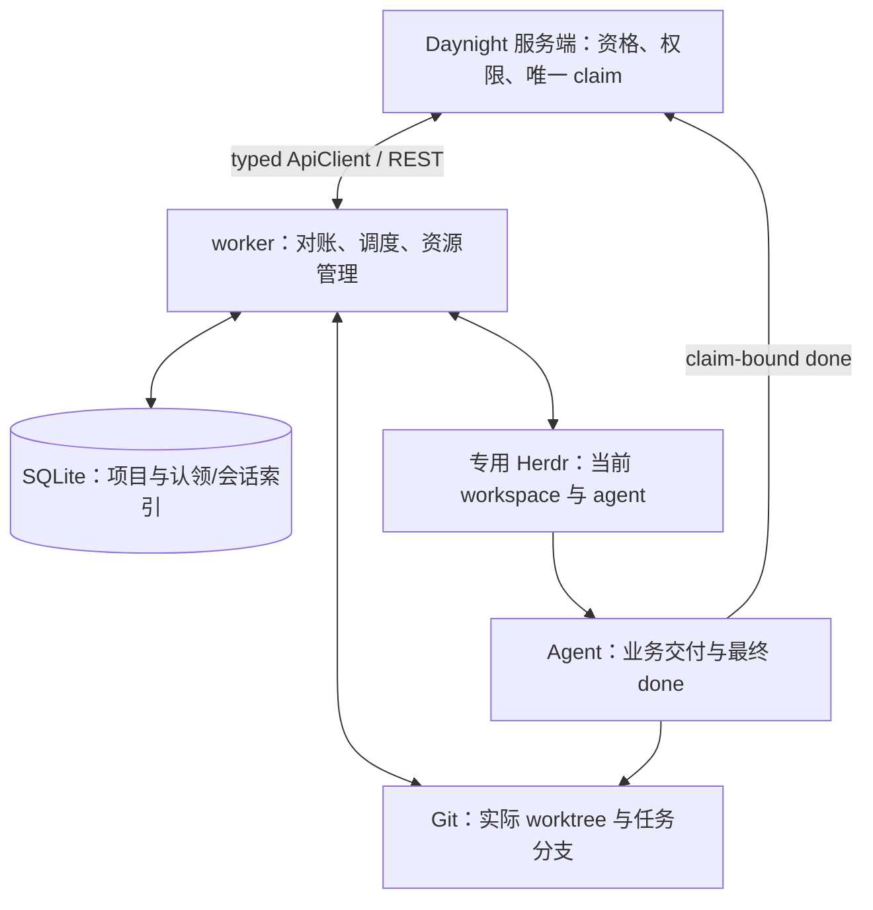

# Worker 架构设计

`daynight worker run` 是持续对账的前台进程：领取配置仓库中的合格任务，在稳定 Git worktree 中通过专用 Herdr 运行 Copilot 或 Codex，并在原 claim 结束后清理本机资源。[需求](../spec/daynight-worker.md)拥有产品行为，[认领架构](daynight-worker-claims.md)拥有服务端归属协议，[本机记录决策](../../.agents/notes/implemented/simplification/2026-10-27-worker-claim-records.md)记录存储简化的理由与代价。完整平台验收仍需独立的运行证据。

## 总体结构



服务端提供当前 claim 归属，SQLite 保存本机认领和原生会话索引，Git 与 Herdr 提供实际资源。Agent 完成实现、验证、PR、审查、授权合并和任务验收，最后提交原 claim 的 done；worker 按自己的完整 claim 清单决定资源生命周期，不再次解释业务验收。

## 配置与目录

共享 `~/.daynight/config.yml` 的根字段 `workerId` 是首次生成并原子保存的稳定 UUID。创建复用配置锁，持锁后重读，已有合法身份直接复用；非法值明确拒绝。Worker 固定使用 `~/.daynight/worker/`，没有状态根覆盖入口。

```text
~/.daynight/
  config.yml
  worker/
    state.sqlite       # projects、tasks
    instance.lock
    logs/
    tmp/
    h/                 # 专用 Herdr 配置与状态
<local_path>/.worktrees/daynight/<task_id>/
```

每个用户环境一个 worker。Run 和人工管理命令使用同一个实例锁，以同一 SQLite 作为取得/释放锁时的 gate；不添加锁表。失效 worker 锁可回收，但不能据此认定原生进程已停。

独立的 worker mapping 包含 repositoryRoot、maxConcurrent、pollIntervalMs、recoveryLimit、agent、model、args 和 repositories。默认值依次为 `~/daynights`、1、5000、3、copilot、null、[] 和 []。省略配置文件、worker 或可选字段使用这些默认值；显式 null 只对 model 有清除语义。类型错误、未知字段、读取失败和取消继续报错。读取配置不重写文件。

Repository entry 需要 remote/path，可提供 projectId、agent/model/args 覆盖。路径相对 config.yml 目录或为绝对路径，不依赖启动 cwd，不展开 tilde；重复项目、重叠仓库和与状态根重叠均拒绝。相同 agent 类型逐字段继承；切换类型清除未显式给出的 model/args。Args 整体替换，不能覆盖 worker 拥有的 cwd/session/model/mode 参数。

`worker repo list` 只读本地注册。Add/remove 选择远端现存可访问 Project；显式 --project 支持非交互，否则多选显示名称、完整 UUID 和 repoUrl。新注册使用 worker.repositoryRoot 计算绝对路径，已有注册保留传输 URL、路径和覆盖，remote-only 项只补 projectId。Remove 只改变后续领取范围，不删除 clone、claim、worktree 或原生历史。repositoryRoot 与 review 独立，改变根不移动已有注册。

项目选择使用同一份捕获的服务凭据及 worker 配置，网络与提示不持配置锁。Repo 命令保存只拥有 worker.repositories；setup 拥有 agent/model/args/repositories，repositoryRoot 始终不属于这些更新。选择指纹覆盖服务凭据、根的原始存在性与值、仓库列表；setup 另覆盖全局 native 字段的原始存在性与值。保存时锁内重读，拒绝相关变化及通过 YAML alias 改动无关有效字段，保留其余字段、注释和安全 alias。空配置的交互式 run 先引导选择；非交互给出 repo add --project 指引。选择、取消或远端失败都不能启动部分任务。

`worker setup` 拥有交互编排：验证 stdin/stderr 为终端，读取当前同源配置快照，汇总公共环境报告，单选 Copilot/Codex，读取完整可访问 Project 清单并预选已有注册，再校验候选配置及每组实际 native model/args。最终摘要展示保留的传输 URL/路径、删除的注册和不兼容参数重置，确认后通过 repositories 模块一次原子保存。所选 agent 应用于全部选中 Project；切换类型清除不兼容的全局或项目级 model/args，兼容值保留。

Setup 复用 Herdr preflight 的原生版本、目录、运行时、hook asset、有效 SessionStart 及 Codex hooks/隔离能力检查。公共报告检查平台、Node、Git、Herdr 版本、私有端点和随包 managed 技能；候选 integration 状态通过只读 herdr integration status 获取，不启动私有实例。运行时在 task cwd 使用 typed RPC integration 检查，并由原生命令报告恢复错误。Setup 启动目录的检查不证明 provider 登录、未来 task 目录信任、真实 hook 执行或 live 协议能力。

独立环境探测返回通过、缺项或未验证的结构化结果，所有已启动探测用 allSettled 等待收尾。普通缺项可给修复指引并保存配置；命令清理的 AggregateError 及其 cause 链始终优先于普通缺项或取消，未确认进程收尾使 setup 明确失败。Setup 不安装、登录、clone、打开 worker SQLite、取得 claim 或启动 worker/Herdr/native agent。

配置在启动或重启时加载，不热重载。同一 claim 保留 agent 类型和 session_id；需要重新启动时使用当前适用于该 agent 的 model/args。另一工具的配置不会套到原工具。移出配置的项目仍由已有 projects 映射参与对账，使用当前全局适用设置。

一个状态目录属于当前配置的单一服务、账号和 workerId。切换这些身份前先结束旧执行，再重建本机状态；六列记录不承担跨服务或跨账号的旧执行自动接续。

## SQLite：项目映射与六列任务记录

```sql
CREATE TABLE projects (
  project_id TEXT PRIMARY KEY NOT NULL,
  repo_url TEXT NOT NULL,
  local_path TEXT NOT NULL
) STRICT;

CREATE TABLE tasks (
  project_id TEXT NOT NULL,
  task_id TEXT NOT NULL,
  claim_id TEXT NOT NULL,
  status TEXT NOT NULL CHECK (status IN ('pending', 'active', 'done')),
  agent TEXT NOT NULL CHECK (agent IN ('copilot', 'codex')),
  session_id TEXT,
  PRIMARY KEY (project_id, task_id, claim_id)
) STRICT;

CREATE UNIQUE INDEX tasks_one_active_per_task
  ON tasks(project_id, task_id) WHERE status = 'active';
```

| 本机状态 | 责任 |
|---|---|
| pending | 已实际取得或找回 claim，等待启动 |
| active | 承担启动、运行、恢复或收尾责任，占用名额 |
| done | 原 claim 已结束，其本机资源已收尾 |

`agent` 来自实际取得的 claim；`session_id` 是 Codex/Copilot 原生会话 ID，尚未取得时为 NULL。Herdr workspace/pane/terminal ID 每次从资源观察取得。启动资源前先提交 active，终止清理全部完成后才提交 done；失败保留责任，结束行保留。

Projects 在远端认领前保存仓库映射。有未结束任务或实际受管资源时不能改变该项目绑定。存储使用实际 SQLite 事务、STRICT 表和唯一约束；没有配置快照、启动回执、PID、恢复次数、清理进度、管理意图或时间列，也不把这些信息转存其他台账。日志只用于诊断。

数据库按此 schema 新建。遇到旧的详细执行 schema 时明确要求停止 worker 并删除旧 SQLite；程序不迁移或自动删除旧库。workerId 与原生历史保持各自原有位置。

## 启动、发现与周期对账

启动先取得实例锁、稳定身份并核验账号，再解析当前配置的 Project 并保存 projects。首次完整清单查询范围为当前配置项目与已有 projects 的并集；空数据库也先完成映射，才能找回原 worker 已有的 claim。

```text
完整读取自己的远端 claim 清单
→ 枚举 SQLite、专用 Herdr 与已知仓库的受管 Git worktree
→ 补齐实际 claim 的 pending 记录
→ 推进已结束归属的资源清理
→ 重连或恢复仍归属执行
→ 优先启动已有 pending，有名额再领取新任务
→ 可取消的轮询等待
```

自有清单只使用 workerId 归属条件，不混入 ready、allowAgents 或候选平台筛选。分页、认证或项目读取失败不产生可用于缺席清理的集合。完整性只对成功查询的项目成立；Herdr 中未映射的项目资源报告错误并保留，恢复项目配置后再纳入对账。Herdr/Git 读取失败保持错误，不解释为空资源。

每个 task 的操作在进程内串行，不同任务的有界 RPC、恢复和清理可并行。实际运行或收尾资源按 claim 去重计入容量，即使记录缺失或曾为 done，也会阻止同 task 新 claim 启动；可关联 active 行的资源只计算一次。降低 maxConcurrent 不抢占已有任务。已有 pending 优先，项目内按稳定 task_id 顺序选择；新候选保持服务端 ready 顺序。Pending 启动和新领取均以一次成功的名额分配为轮转单位，每分配一个名额就从下一个项目继续选择；一个项目持续有候选时也不会一次占满所有空闲名额。

新领取直接调用进程内 typed ApiClient：原子 claim 成功后登记 pending，确认名额和旧执行收尾后提交 active，再准备资源。请求结果未知时记录 Warning，不创建资源、不重发原请求；后续完整清单找回实际授予。服务端精确版本与唯一 active claim 控制竞争。并发上限约束本机 active 资源数，迟到授予可以留下等待名额的 pending。

现有远端 phase、Herdr 和 nativeSessionId 字段是当前观察的展示投影。每次基于新读到的 task/claim 与精确版本更新，未知响应记录日志后重新读取；投影不决定本机资源动作，也不保存待提交摘要回执。

## Git 工作区与资源身份

每 task 使用分支 `daynight/<task_id>` 和目录 `.worktrees/daynight/<task_id>`。新分支从仓库 HEAD 创建，保留分支从原 tip 使用。已有目录必须与仓库、Git 注册、静态 claim/worktree 身份及精确 .git 指针匹配；正常恢复保留 dirty state，不 reset/clean。原生会话已知而原 worktree 丢失时报告错误并保留 active。

沿用现有 Herdr 标签和 Git locked-worktree 所有权标记。它们只承载静态资源身份及其校验，动态执行进度不进入标记。实际 pane、cwd、Git 注册和目录每次读取。Device/inode 只作辅助核对；符号链接、外来路径、缺指针或歧义注册不能授权破坏性删除。

清理先确认进程停止和 workspace 关闭，再删除已核对的 worktree 内容，保留 .git 指针至内容删除完成，最后移除目录与 Git 注册。中断后只根据仍存在的实际资源继续；仍存在但缺指针的路径保留并报告。分支和提交历史保留。

资源发现检查未结束行、done 行和遗留资源。现有 Git 标记只含服务、project/task/claim/worktree 身份及物理校验信息，不含 workerId；必须关联本机行、专用 Herdr 或当前自有 claim，才能认定由本 worker 管理。仅有 Git 标记、无法证明属于本 worker 的资源报告并保留，不因自有清单缺席就删除，也不猜测 agent 构造任务行。已知项目仓库和专用 Herdr 是扫描范围，不进行全磁盘发现。

## Herdr 与原生会话

专用 Herdr 保持 `resume_agents_on_restore=false`，由 worker 唯一决定 agent 启动或恢复。复用私有端点、XDG 隔离、原 native 认证环境、shell history 与 attach；原 task pane 环境不会因客户端连接被改写。

存活的原 agent 直接重连。需要重新启动时，先停止并关闭已存在的 inactive workspace，再以当前 native 环境创建新的 workspace/pane；该操作保留 task/claim/worktree 身份和 SQLite 中的 session_id。Herdr 0.9.5 还原的 shell 使用空附加环境，terminal 仍可保留旧原生会话引用，因此 inactive pane 的旧引用不作为新会话 ID 保存。重建后的 pane 具有正确 native 环境和空会话引用，再按已保存 session_id 选择 fresh 或 resume。

| 当前情况 | 动作 |
|---|---|
| 原 agent 仍活着 | 连接并观察，可保存实际原生 session ID，保持当前会话 |
| 需要启动且 session_id 有值 | 使用记录的 agent 和原生 ID 直接 resume |
| 需要启动且 session_id 为 NULL | 记录 Warning，启动全新原生会话，取得 ID 后写回同一行 |

NULL 分支覆盖上次已经启动但 ID 尚未保存就中断的窗口，沿用 task/claim/worktree。该分支没有历史反查、暂停或人工审批门槛。处理当前可见的同 claim 遗留进程后再启动，避免同时运行两个 agent。已知 ID 的 resume 失败是可见错误，不静默清除 ID。

首次启动和明确恢复使用完整 managed assignment，显式提供 worker-managed 环境、using-daynight、execute-task-in-managed 及 task/claim/worktree 上下文和本次执行配置。连接存活 agent 不重发启动指令。适配层递交调用方给出的不透明 prompt，不选择业务任务或解释验收。

保留当前输入 readiness 与 Codex composer 检查。原生信任/授权不被自动接受；通过 worker attach 在原终端明确处理。启动回执、输入提交状态和停止时读取的进程信息只留本次调用，进程中断后不承诺启动指令恰好递交一次。原生历史可用性由原生命令报告，不额外扫描 provider 数据库或会话 manifest。

自动恢复计数及超限等待只在当前进程中维护，重启清零。达到 recoveryLimit 后保留 active 与错误，可用人工 retry 或重启重新尝试。

## 结束、清理与退出

原 claim 不在成功完整自有清单中时统一终止清理，无需再按 task 状态分类 done/release/transfer。

```text
通知 agent 清理可归属的工作区外临时资源
→ 最多等待本次尝试的 10 分钟
→ 停止当前受管进程并确认退出
→ 关闭 Herdr workspace
→ 删除该 claim 的 worktree，保留分支
→ 本机 done
```

每个清理 job 的期限与进度只存在内存中，同进程轮询不重置期限。重启后按清单和剩余资源重新进入清理并重新计时，通知可以重复；已不存在的资源可完成对应步骤，失败保留责任。当前进程已确认归属结束的 job 可以在后续服务轮询失败时继续。不同任务分别有界，一个 RPC 不延误其他清理。已知目标的收尾与退出先观察对应的 Herdr 执行并推进停止；删除时只核对该目标的 Git 注册和目录。同项目其他 worktree 或其他仓库的注册问题分别报告，不阻塞可正常观察的 agent 停止或退出。

Ctrl+C 停止新认领，取消普通调度并等待同 task 操作结束。有效任务有界清理外部临时资源、停止 agent、关闭 workspace，保留 claim/worktree/session_id 和 active/pending 行，最后停止私有 Herdr。已结束归属的任务继续终止清理。退出失败返回错误并保留实际资源，不把未完成行写 done。

## Agent 完成与人工操作

Agent 完成全部交付和证据后，使用显式 claimId 与观察版本通过 task set-status done 提交现有完成操作。普通与 managed 技能各自负责其生命周期，缺失 assignment 不回落普通执行；待人验、必要 PR 未合并或验收不足时保持未完成。

人工 retry/release/transfer/resume 要求先停止 worker run，取得同一个实例锁后同步处理指定 claim。锁占用时明确提示停止 runner；命令没有后台队列或持久意图。

| 命令 | 同步动作 |
|---|---|
| retry | 核验仍属于本 worker 的 active claim，尝试一次重连或恢复；保持 claim、agent、worktree，NULL 按 Warning 后新建规则执行。pending 留给 run 正常调度。 |
| release | 核验 owner/admin、原 claim 和指定版本；通知、停止并关闭 workspace；提交 release；确认源归属结束后删除 worktree，旧行 done。 |
| transfer | 相同停止顺序，提交目标的新 claim；确认源结束后删除源 worktree。目标实际取得 claim 后自行登记 pending。 |
| resume | 核验 released previousClaimId 和指定版本，按当前配置申请 fresh claim/worktreeId；确认授予后写 pending、session_id=NULL，随后 run 启动。 |

Release/transfer 在远端确认前保留 worktree，拒绝时仍可恢复原执行；确认成功后本机删除前中断，下一次 run 按原 claim 缺席继续收尾。远端操作保留既有权限、精确版本、stoppedConfirmed 和目标资格检查。

新 claim/worktree ID 在提交前生成并输出。未知响应只 GET 核对、不自动重放。仍未知或命令中断时，操作者先核对远端结果，再启动 runner；没有跨进程原管理意图接续。管理期间 runner 停机是这一单控制者方案的操作代价。

## 观测关联和错误

沿用 stderr 与 JSONL，日志携带 workerId、实际平台、projectId/taskId/claimId、agent 和已知 sessionId。RPC、并发 job 与清理显式传递取消和关联信息。记录认领、重连/恢复、NULL 新会话 Warning、资源错误、清理和人工操作结果，保留错误类型及 cause，脱敏凭据且不记录完整 prompt。

运行时在完整清单和私有实例就绪后提示 worker attach。该命令只连接既有私有 Herdr，不读取业务凭据或 SQLite、不持 worker 锁；detach 保留正在执行的任务。按具体 claim 核对日志：

```bash
jq 'select(.taskId == "<task-id>" and .claimId == "<claim-id>")' <worker-log.jsonl>
```

## 验证边界

真实 SQLite 验证精确列数、枚举、nullable ID、历史行及唯一 active。Git 测试验证 dirty state、静态归属、遗留发现、重开与安全删除。受控 HTTP/Herdr 验证空库项目初始化、未知 claim 结果、重连、指定 ID resume、NULL 新建、容量、清理期限、取消和人工锁互斥。真实原生会话恢复与三平台完整 Goal 验收仍需各自来源明确的运行证据。

当前模型明确将清理原截止、恢复累计次数、原 model/args 和中断管理意图的跨重启保证收回到进程内。既有详细状态模型的原始理由与替代方案保存在[简化决策](../../.agents/notes/implemented/simplification/2026-10-27-worker-claim-records.md)及其前驱记录中。
