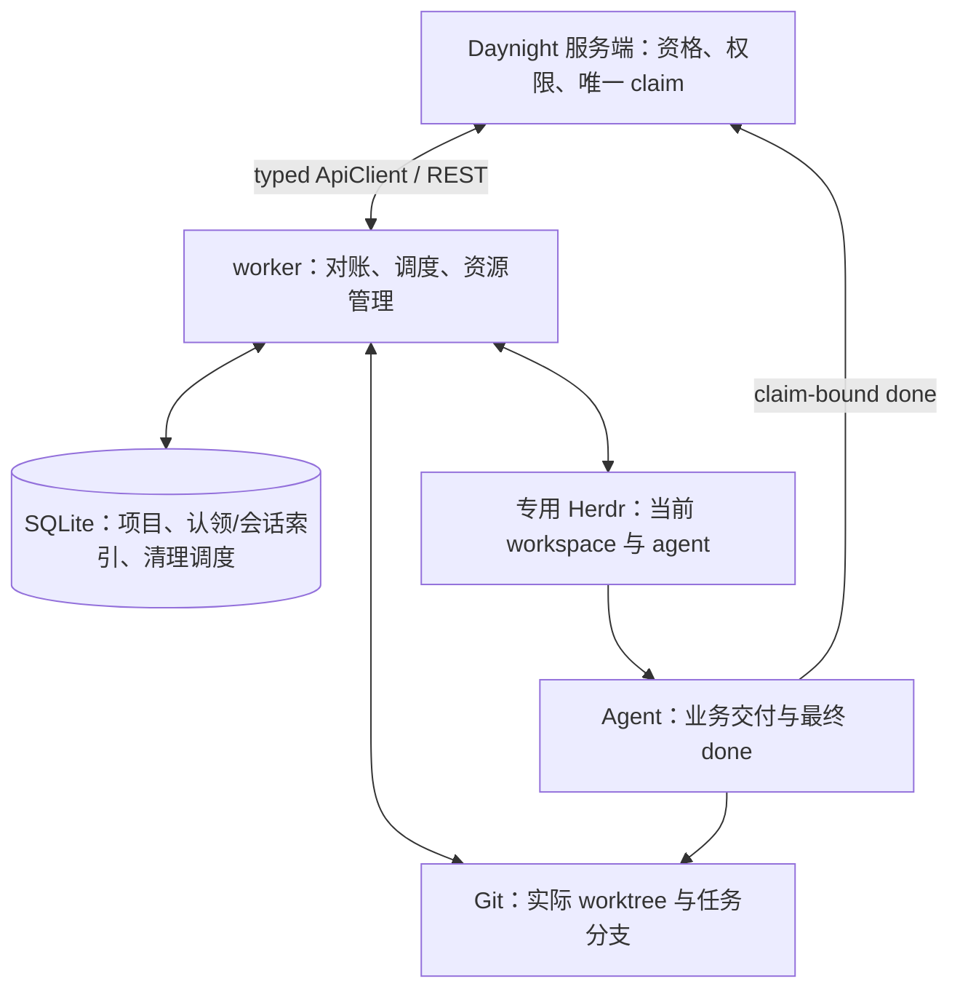

# Worker 架构设计

`daynight worker run` 是持续对账的前台进程：领取配置仓库中的合格任务，在稳定 Git worktree 中按冻结的 herdr/web 模式运行 Copilot、Codex 或 Claude，并在原 claim 结束后按 backend 的停止与归档条件收尾。[需求](../spec/daynight-worker.md)拥有产品行为，[认领架构](daynight-worker-claims.md)拥有服务端归属协议，[本机记录决策](../../.agents/notes/archived/simplification/2026-10-27-worker-claim-records.md)记录存储简化的理由与代价。账号级运行观测的[客户端采集与调度](daynight-worker-reporting.md)及[服务端存储与查询](daynight-worker-snapshots.md)各有独立职责，与本机执行协调及 claim 归属分离；它不授权资源清理或任务状态变更。Worker 沿用[客户端要求](../spec/daynight.md#c1-包与平台)的 Linux、Windows 和 macOS ARM64 支持范围；完整平台验收仍需独立的运行证据。

## 总体结构



服务端提供当前 claim 归属，SQLite 保存本机认领、原生配置冻结、原生会话索引、独立认领工具预留与终态清理调度，macOS Herdr 的独立 lifecycle 库保存原运行身份与停止证据，Git 与 Herdr 提供实际资源。[Herdr 生命周期设计](herdr-worker-lifecycle.md)拥有该机制，Linux/Windows 使用共享私有 daemon 路径。顶层 assignedTo 是独立人的责任归属，所有 worker 服务端写入保留它；自动候选使用 assignedTo=me，自动 claim 事务要求当前负责人等于认证账号 userId；未分配或他人任务不具备自动领取资格。既有 claim、Session 或 archive 权限保持原执行归属。Agent 完成实现、验证、PR、审查、授权合并和任务验收，最后提交原 claim 的 done；worker 按自己的完整 claim 清单决定资源生命周期，不再次解释业务验收。

## 状态来源与清理判定

Worker 用期望状态与实际状态之差选择动作，不以重复的步骤完成标记替代资源自身的状态。下表的来源在每次相关决策时读取；本机索引、done 状态或历史成功回执不能代替当前资源观察。

| 事实 | Source of truth |
|---|---|
| 当前 claim 是否仍归本 Worker | Daynight 成功完整的自有 claim 清单；显式操作使用原 task 的精确版本读取 |
| Herdr workspace、pane 与 agent 是否存在 | 专用 Herdr 当前 snapshot；停止中的原进程另核对 OS |
| macOS Herdr 原运行及停止证明 | lifecycle journal 的不可变原身份、停止意图与证明；未确认停止继续核对原进程实例和 OS，不能以 pane 缺席替代 |
| Web 原生操作及 generation | 原 Controller journal 与不可变 launch ticket |
| 原 Controller/native 进程是否停止 | 原进程实例证明及 OS process group / Windows Job 实际成员 |
| IPC endpoint 是否已移除 | 文件系统，Windows 管道生命周期由原进程停止确认 |
| Worktree 目录与 Git 管理注册是否仍在 | 当前文件系统与 Git 管理目录 |
| Session 归档是否 ready | 服务端对原归档身份、长度与摘要的回执 |

资源身份、控制意图、固定期限和重试策略可持久保存；“停止做过了”“删除做过了”等步骤状态不能授权跳过观察。一次清理调用返回临时的完成结果，只有本次观察满足全部资源目标才更新本机记录；终态原执行的停止观察独立决定执行容量。设计取舍见[资源状态决策](../../.agents/notes/archived/architecture/2026-11-04-worker-resource-state.md)。

macOS Herdr 将终态原运行停止证明作为执行槽释放目标；隔离资源继续保留文件责任；独立归档队列继续发布 ledger、冻结并上传归档，读回 ready/unavailable receipt 后才清理原 worktree。失败保留源和工作区并维持同 task 路径屏障，不用本机 done 认定归档或工作区已删除。采样、预算与处置规则由 [Herdr 录制设计](herdr-recording.md)拥有。

## 归属清单与格式转换

`worktrees/manifest.ts` 提供独立的同步清单存储，路径为 Git common 目录下的 `daynight/worktrees/<worktreeId>.json`。记录仅接受版本 1 的六个字段，按 worktreeId、完整 claim 和目录名分别拒绝冲突。发布先持久化两级命名空间，再 flush 文件并发布；重试已可见的相同记录时重新完成文件和目录屏障。读取不逐文件 flush，退休只在 expected 字段匹配后移除元数据。Worker 通过该清单定位当前资源；后端和本地责任结算后才退休元数据。平台目录同步能力的限制与现有持久文件原语相同。

`worktrees/migration.ts` 提供独立的显式转换入口：调用者持有既有实例所有权和仓库 gate，停止旧 Worker，并提供完整的清理调度、Web 与 Herdr 绑定。转换核对这些来源、旧 Git 注册和已发布清单；全部清单可靠发布并读回后才复核和解开旧 Worker 锁、移除关联的废弃 sidecar，再完整重枚举并发布格式标记。失败可按实际资源重试，冲突和读取失败保持可见；原 checkout 和冻结 cwd 不移动或改写。选中和保留的仓库在文件操作准入前完成转换；失败仅关闭对应仓库的文件 gate。转换不遍历 namespace 中的未知目录；只验证已有来源关联的 worktree，未关联目录保持原状且不阻断准备。非空且没有 Git 关联的目录不能凭清单获得删除授权。转换顺序与降级限制见[转换决策](../../.agents/notes/implemented/architecture/2026-11-11-worktree-resource-migration.md)。

历史执行可以保留已经交接的 cwd，同一 task 的后续 claim 也可以重用该目录。转换完整读取历史来源，按原 owner 关联 Web 终态清理完成记录，以及 Herdr 已确认资源删除或已核验的 never-started 退休记录；这些记录不证明当前目录缺席，也不授权重新删除。明确退休的历史绑定不占新清单的位置，仍有责任或证据不明的来源继续参与冲突检查。原锁、清单或来源身份与退休证据矛盾时保留错误；历史记录和残留调度不由转换器修改。

## 配置与目录

共享配置根（`DN_CONFIG_DIR`，缺省 `~/.daynight`）中的 config.yml 根字段 workerId 是首次生成并原子保存的稳定 UUID。创建复用配置锁，持锁后重读，只拥有根字段 workerId；共享保存入口核对全部非归属解码值，根循环 alias 等导致未知或其他字段变化时拒绝并保留原文件。合法身份只读复用，非法值明确拒绝。根选择同时覆盖 Worker、Controller 与 Review 状态，真实 HOME 和 Provider 原生目录保持原有归属。stateDirectory 等未知 YAML 字段不能改变状态根，唯一覆盖入口是绝对路径 DN_CONFIG_DIR。

```text
~/.daynight/
  config.yml
  worker/
    configuration.json # 云端目标、逐项实际值及报告确认
    state.sqlite       # projects、tasks、cleanup_schedules
    herdr-executions.sqlite # macOS Herdr 运行与停止证据
    instance.lock
    logs/
    tmp/
    h/                 # legacy 私有 Herdr 配置与状态
      r/<instance>/    # macOS 每个实际运行代次的独占实例
<local_path>/.worktrees/daynight/<worktree_id>/
```

每个配置根目录一个 worker；不同根不得管理同一任务 worktree。Run 和人工管理命令使用同一个实例锁，以同一 SQLite 作为取得/释放锁时的 gate，不添加锁表。失效锁可回收，但不能据此认定原生进程已停。一个状态目录绑定单一 service origin、账号和 workerId；切换前先处理原执行并重建本机状态，索引不提供跨服务或账号接续。

### 本地配置与首次候选

本地启动读取先投影服务连接、凭据、repositoryRoot、agentControlMode、可选 agentModel/agentReasoningEffort、完整 toolPaths 选择与原始 source；这些运行归属不在进程中热切换。取得原实例锁后确认认证账号，再访问该身份的缓存与云端配置。currentUser 的临时网络失败在锁下按 5、10、20、40、60 秒封顶退避；首次配置 GET 临时失败保留未读取状态，配置 manager 和 reporter 建立后由报告周期重试。认证、协议、格式及确定不兼容错误保持明确拒绝，未知不能变成 desired:null。已有目标时本地托管字段不参与权威选择。独立模式候选读取启动时本机有效 agentControlMode，目标已存在但未采纳模式时仍可上报；只有服务回显模式能力才交换扩展字段，无回显继续本机模式。API 只有认证配置读取确认工具能力后才发送工具扩展，旧服务仍使用本地选择。

首次候选的 maxConcurrent、pollIntervalMs、recoveryLimit、preferPlatformSpecificTasks、native 与 projects 使用 workerConfigurationDefaults 的独立默认值：1、60000、3、false、copilot/null/[]、[]。本地 repositoryRoot 默认 `~/daynights`，mode 默认 herdr；不从 review 推断任何 worker 值。未知 YAML 字段在投影时忽略、编辑时保留，读取不改写文件；显式已知值严格校验。导入从仓库项的 remote/projectId 取得 Project 关联；本机绑定实际使用时再校验路径，按 config.yml 目录解析并禁止 tilde、drive-relative 路径、重叠仓库或状态根。原始覆盖节点直接投影 nativeOverrides，不能从已展开配置反推省略、model:null 或 args:[]。

`configuration-bootstrap.ts` 拥有 desired:null 期间的当前文件候选。每个 pass 只读取一次 `readWorkerLocalConfiguration`，按同一 source 投影完整候选、mode 与工具，保留原始 native 覆盖意图。报告投影只规范化完整候选一次，controlModeBootstrap 与 toolPathsBootstrap 从该候选派生，不能混入启动时旧值；没有完整候选时，独立能力采纳继续使用启动时本地模式与工具选择。文件中的规范 origin 或显式 workerId 不匹配运行身份时拒绝；新凭据与本地执行覆盖不改变当前运行归属。一个 root 子任务拥有整个 60 秒 pass，报告 Operation 通过可取消等待加入它，等待者结束不撤销项目解析。source hash 与认证 scope 相同时可复用成功解析的 Project 身份，失败不写入缓存；候选明确被拒绝后失效并重新校验，服务端最终验证权限。

候选准备失败保持错误，在后续报告周期重新准备；不以可用项目的局部集合建立云目标或授予新执行。每个 null 周期先查服务端，已有目标优先，取消并 drain 旧候选；导入响应未知也先读，再从最新事实构造新请求。原协调器保留用于已有资源核验的视图；冷启动处于 null、未读取或不支持目标时，从真实本机项目映射提供原资源覆盖。快照单独提供 retainedRecoveryLimit，来自当前/保留记录中可继承的真实已应用标量，只供原执行恢复视图使用，不进入 effective 或新准入。原 Herdr 冻结元组只保存 Agent/model/args，恢复时须组合该已知策略；没有已应用事实就保持未知，不能从本地候选或默认值补造。Task/Bot 新准入保持关闭，原冻结执行继续原权限与生命周期。已知本地映射即使不再选中也须核对其资源；映射或仓库扫描未确认时不释放假容量。无 ID 的旧映射通过已有绑定或仓库发现识别，实际 worktree 清单属于其他 Project 时保留责任，不按新 ID 重绑。

`worker repo list` 只读本地注册。云端目标尚未建立时，setup 与 repo add/remove 仍通过现有完整 Project 清单、身份和路径计算处理本地候选。已有传输 URL、路径和兼容 native 值保留；同类型逐字段继承，切换类型清除未覆盖的 model/args，args 整体替换。repositoryRoot 与 review 独立，只为新路径展开，改变根不搬移已有仓库。

项目选择只在显式 setup/repo 命令执行；选择、取消或远端失败都不能启动部分任务。`worker run` 允许空项目且不调用选择向导，仍取得实例锁、初始化报告及对账原 Task，不为 Bot 伪造任务资源。

Setup 在终端内汇总只读环境报告、单选 Copilot/Codex/Claude、选择 Project，并验证每组实际 native model/args。摘要展示保留的 URL/路径、移除范围及不兼容参数重置，确认后一次保存 native 与完整选择，所选 Agent 应用于全部选中项目。公共报告检查平台、Node 和 Git；Herdr 模式另检查 Herdr、私有端点、hook 运行时及各 Agent 的版本与 integration，后者使用只读 `herdr integration status`。Web 模式的所选 native runtime 标为未验证，由 Controller 在派发前验证；Herdr 模式对所选配置使用共享 prerequisite checks，provider 认证仍标为未验证。Task 工具、Git transport 和 live backend 执行也不能由公共报告证明。共享检查覆盖原生目录、hook asset、有效 SessionStart 及固定参数能力；Codex 至少 0.135，并支持 --no-daemon、固定权限和 hook trust bypass。只读 --help 检查不证明 provider 登录、真实 hook 或 live 协议；运行时 integration 修复和 task cwd 的有效 hook 检查保持独立。普通缺项可保存并给修复指引，所有探测使用 allSettled 收尾；未确认清理的 AggregateError 及其 cause 优先于普通缺项或取消。Setup 不探测 managed skill，也不安装、登录、clone、打开 Worker SQLite、claim 或启动执行。

本地托管字段写入在交互前和紧邻取得本地锁之前核对云端目标；已有目标时要求从云端修改，缺失缓存不能绕过该判断。原 YAML 写入继续锁内重读、比较 workerId、服务/凭据、root、repositories 以及 setup 拥有的 native 基线，基线保留字段原始存在性和值，深比较支持未知字段的循环 alias。Repo 只拥有 repositories 及保留条目的 projectId，setup 另拥有全局 native 及确认重置的项目 native 字段；repositoryRoot 和保留条目的未知字段始终受保护，显式删除拥有整个条目。网络和提示不持配置锁；共享 alias 使非归属解码值改变时保留原文件并拒绝，无关节点、注释和安全 alias 保留。

### 本地原生覆盖与来源

`local-native.ts` 负责两个新字段的存在性、字符串约束及旧 model 同层冲突。`native-overrides.ts` 在已解析云端全局或项目原生元组上独立应用本地两项，抽取 model/effort 参数、去重并映射当前 Provider 的 Web/Herdr 表达。其它原生参数交给既有验证器；Codex 非相关 TOML 设置保留。

`runtime.ts` 的云端应用入口验证规范化结果，管理器仍持久保存原始云端 appliedValue。提供给 coordinator 与助手 host 的是规范化后配置；机器报告单独输出 `runtimeConfiguration`，由 `schemaVersion:1` 标识来源对象。这样本地覆盖不冒充 desired 或云端应用值，移除后重新组合会恢复真实下层来源。null/native 表示委托原生配置，不把未知值当作探测结果。尚未接纳的本地候选不成为有效执行配置或来源观察；原执行的实际参数继续由其冻结记录表达。

Worker SQLite `claim_native_configurations` 以 project/task/claim 关联不可变原生元组。新登记与冻结在同一事务中，旧无会话记录在首次启动前冻结；有会话而缺少旧快照的记录保持未知。原 Session 恢复不追加当前 model/effort，避免覆盖会话内原生设置。已有助手沿用自己的持久冻结记录。

本地新字段使新执行携带 `validateNativeSelection`，随 claim 配置和 Web launch ticket 冻结。Web 首次启动使用 Provider 原生目录校验；Herdr 在实际 task cwd 运行无业务输入探测。Codex 探测与实际 Herdr 启动共用规范化后的真实 cwd 和启动配置层，包括临时项目信任覆盖；它读取 app-server 配置与完整目录；配置未指定模型时，按原生目录的默认标记与顺序解析有效默认值，启动模型参数仍保持省略。能力验证包含隐藏模型，UI 选择器仍按 hidden 过滤。Claude 不持久保存探测 Session，Copilot SessionFs 读穿原生文件而全部写入仅在内存。Copilot 未解析默认模型而缺少 modelId、Codex OSS/local-provider 无法等效取得能力时明确失败，不猜测模型。恢复原 Session 不重新注入选择。

Worker 共享探测 verifier 保留未确认清理的进程身份及重试能力；新探测前、Herdr 资源释放前与 Worker 退出时等待清理。单个 Herdr adapter 仅等待共享清理，不关闭其它执行的探测准入。探测清理与已归属业务进程停止独立尝试并汇总错误；探测失败或等待不能阻止调用原进程停止。原停止证据可保存，探测清理未确认时仍禁止封段和资源释放。清理成功不证明业务 Agent 未启动，持久化 Herdr 原有启动与停止证明仍独立成立。

### 本地工具路径选择

`platform/tool-path-choice.ts` 拥有 `Tool`、`ToolContext`、`ToolPathChoice`、完整 `ToolPaths` 和纯字符串校验。`parseLocalToolPaths` 将 YAML 省略/null 投影为 auto，并拒绝三工具之外的键；`validateToolPath` 按本机 path API 检查绝对路径、合法 Unicode、控制字符和 4096 UTF-8 字节上限，返回未经修改的输入。Windows 额外要求盘符或完整 UNC share，避免 `\tools\codex.exe` 这类路径隐式依赖当前盘符。

`commands/worker/config.ts` 与 `configuration-source.ts` 共用这个解析器，两种本地配置结果都包含三项 choice；缺文件的默认读取仍不创建配置文件。语法检查不读取程序文件、不启动子进程，也不把路径规范化成另一入口，保留符号链接和词法路径供工具解析器核验。`parseWorkerCloudBootstrap` 提供完整三项 choice，由 API 按已协商能力投影；本地 choice 没有云端“未采纳”状态，独立候选在云端已有目标时仍可填未采纳项。

`platform/tool-executables.ts` 提供 `resolveToolLaunch({tool,context,choice,environment,cwd,workerNode?}, operation)`、`verifyToolLaunch(launch, operation, {trustedRuntimeRoot?})`、`toolCommand(launch, args)` 与 `probeResourceKey(launch, {cwd,environment})`。平台模块不依赖 Worker 调度或 Provider。捕获环境负责 Windows PATH/PATHEXT 大小写归一化；自动搜索按捕获 cwd 解释相对 PATH 项，发布的入口始终为绝对路径。自动 Codex 与 Herdr 使用 PATH，Copilot 的 Web 上下文使用随包 native，Herdr 上下文使用 PATH；显式选择不回退其它安装。

入口适配器支持 native、Node 入口及 npm Node shim。Node 入口使用 `workerNode`（缺省 `process.execPath`）的 realpath；Codex JavaScript loader 与普通 Node 入口使用相同命令，由 loader 自行选择 native。官方 Copilot 根据入口所属 manifest 定位同一安装的 native。解析器不登记 Codex 发行摘要或复刻 native 布局，实际版本和协议兼容性由运行探测确认。

shim 的目标从同一份有界字节快照提取，后缀选择忽略大小写，保留 Windows `PATHEXT=.CMD` 返回的词法入口。目标作为路径数据解析，不执行包装脚本的 shell 文本；注释、CRLF 和无害格式变化不要求完整模板相等。`read-cmd-shim` 的公开接口按路径重复读取，并按大小写敏感后缀选择 parser，因此这里复用目标提取规则而不调用该接口。

`ResolvedToolLaunch` 保存词法入口、canonical 入口、最终工具程序、可选解释器、结构化 `command`、`ToolArtifact[]` 和 `selectionKey`。artifact 记录角色、词法 path、realPath、size 与 SHA-256。哈希通过文件句柄流式读取，核对读取前后 stat、当前 path 的 stat 与 realpath；解析期间变化不能产生有效 launch。`verifyToolLaunch` 直接核验冻结 recipe 的命令、selectionKey 和文件记录，不重新分析发行布局，也不读取新配置或搜索 PATH。`toolCommand` 仅拼接已有 prefixArgs 与调用方 argv；消费者仍须在启动前核验。

元数据读取和 artifact hash 共用 `openRegularToolFile`。POSIX 使用 `O_RDONLY | O_NONBLOCK` 打开后才检查句柄是否为 regular file；不能仅依靠打开前的 stat，因为路径可能在检查后被换成 FIFO，而 operation 超时不能取消阻塞的内核 open 或释放其线程。错误、取消及晚到句柄仍启动关闭，并对等待设置 operation 边界；不禁止合同已支持的 symlink。

摘要使用最多 128 项的进程内缓存，按 canonical path 与 dev/ino/mode/size/mtimeNs/ctimeNs 完整签名匹配。命中仍打开文件、确认 regular file 并核对句柄、路径 stat 和 realpath；解析所读前缀或完整内容也须与摘要一致。缓存只在稳定性检查通过后更新，不跨进程保存；它减少重复读取大型解释器和 native 文件，不替代映射核验。

`selectionKey` 保留词法 artifact 路径和命令身份，能发现符号链接入口改指；source、目标 revision 和检查时刻不属于身份。独立 `probeResourceKey` 去掉词法别名，并排除已经完成选择的 PATH/PATHEXT，保留 canonical 命令、artifact 内容、cwd 和其它 native 环境，以便同一真实程序的自动与显式别名共享探测清理责任。键本身不实现锁、缓存或进程回收，后续消费者必须承担这些生命周期责任。`ToolSelectionError` 给出 tool/context/stage/code，固定错误消息不包含完整 argv、环境或原始工具输出。

资源键在 Windows 归一化检索键后排除 PATH/PATHEXT；POSIX 保持环境名大小写语义，普通 native 变量 `Path` 不能被当作 `PATH` 排除。

`commands/worker/tool-selection.ts` 统一拥有 Web/Herdr Codex/Copilot 与 Herdr 实例的目标 generation、候选验证、新执行准入与观察快照。版本、host 能力、模型目录与启动消费同一个完整 recipe；实际版本来自该 recipe 的原生响应。候选结果提交前重验目标 generation 和 cleanup generation，旧目标的迟到成功不能覆盖新选择。缓存候选身份改变时，同次操作先协调最近探针 recipe 的清理，再重新解析和探测当前选择；最后的新执行校验也遵循此顺序。最近探针责任独立于可清空的候选缓存，在首次 probe 前保留，失败或目标变化不能绕过旧清理。协调覆盖该 recipe 在不同 cwd 和环境中的探测范围，并在清理期间阻止旧 recipe 的迟到探测；清理确认后才准入新候选。新目标失败保留旧实际观察，只阻断依赖该工具的新执行。Herdr 模式同时验证原生 Agent 和 Herdr launch；macOS 使用独立探测实例，Linux/Windows 共享实例通过持久切换准入，旧责任未清空时新目标保持 pending。原 claim 请求在同一实例互斥内持久预留冻结配置后才发送，等待授予期间也阻止工具切换；实际 grant 原子转移为 pending 和原冻结配置。实例版本来自实际握手，受控 pane 映射将裸 kind 启动绑定到冻结命令。平台机制、首次输入与官方 Session 确认由[Herdr 工具启动设计](herdr-tool-launch.md)拥有。

Task 的冻结配置、Herdr preparation/run、共享实例 journal、Web 执行记录、Bot intent、Controller ticket 共用严格 `parseResolvedToolLaunch`，未知字段和不匹配的工具/context 拒绝。首次启动前保存 recipe 及同 selectionKey 的 `{version,checkedAt}`，恢复先读原 claim 配置，不能先被新的目标验证挡住。每次新 spawn 核验原文件；缺失或变化报告 `tool_identity_changed`，不改用 PATH 上的另一个安装。旧活执行的观察、输入、停止和归档继续原 process-proof/RPC。旧记录缺身份且已经 submitted/unknown 时禁止新 spawn；有完整 never-submitted 证明时才能创建原 ticketHash/launchId/executionId 绑定的私有 `tool-selections` 侧文件，原票字节保持不变，读回成功后继续冻结。侧文件为 create-only，symlink、错误 ticket 或冲突内容拒绝，不能重放首条输入或换 Session 绕过。

原生探测按 canonical `probeResourceKey` 共享清理 owner，缓存额外绑定 context、selectionKey、model、args 和 cwd。任一关闭结果未知使成功缓存失效，路径切换不能丢弃旧 owner；shutdown 等待全部历史责任。重新准备候选时，管理器先在本次操作预算内进入原 owner 的串行队列协调待清理责任，不启动新进程；清理确认后才检查可用性、捕获 cleanup generation 并重新探测，避免准入检查永久挡住清理重试。超时或清理仍未知时继续拒绝新探测，后续请求加入原责任。Web Copilot 的版本与 host 查询使用与 Provider 相同的 owned headless process 和 SDK `forUri`；模型查询在 supervisor 内直接使用 SDK，保留内存 SessionFs、拒绝权限及无业务 prompt 的保证。Provider bridge 不序列化函数型 SessionFs。

遥测快照只读已观察事实，不启动工具。活动组来自 Web/Bot 的持久配置、Herdr 原实例与各代映射事实，按 selectionKey 聚合；旧记录缺版本或检查时间时如实报告不完整，不重新探测拼接历史事实。后台候选准备具有独立预算，五秒 host 采样只消费已就绪选择。Copilot 仅在当前有效全局或项目选择它、或本 Worker 存在非删除 Copilot Bot 定义时参与后台准备；项目读取已解析继承的有效配置，Bot 定义包括 pending、failed 和可恢复记录。需求变化使准备时限失效，开启后下一轮可立即准备，关闭后停止后续后台准备。配置应用预检、明确模型发现与新执行仍按需准备，原冻结执行和清理责任保持不变。工具冻结与准入的取舍见[运行接线决策](../../.agents/notes/implemented/architecture/2026-11-12-worker-frozen-tool-runtime.md)和[后台需求决策](../../.agents/notes/implemented/bug-fix/2026-11-13-worker-copilot-background-demand.md)。

### Copilot authority 的私有运行目录

Web Copilot 只有在 macOS ARM64、原 SEA 内容及 SDK 1.0.11 符合既有图片 authority profile 时才采用 `copilot-read-authority-v1`。未知 build 保留普通 recipe；已匹配 profile 后的准备失败明确失败，不停用 authority 或换安装。`ResolvedToolLaunch.runtimeProfile` 保存原普通 sourceLaunch、物化 key、可信私有 root、manifest、preload 及固定协议。入口仍表示用户选择的 SEA，实际 executable 是 `distribution/index.js`，interpreter 是冻结 Worker Node，command 精确包含 Node、`--import`、preload URL 与 JS 入口。原 SEA、Node、preload 六文件闭包、控制模块格式的 package manifest 和 SDK manifest 都纳入 artifacts；生成物 manifest 和入口摘要进入 selectionKey。原普通 recipe 的 hash 保持不变。

Worker instance lock 下的 `copilot-tool-materializer.ts` 在 `<workerDirectory>/tool-runtimes/<materializationKey>` 发布持久依赖。key 从 canonical 来源、Node、adapter 内容及协议产生，排除词法别名、目标版本与随机路径。准备记录先持久化完整预留；owned helper 再保存 PID、出生时间、进程组及本次身份，父进程读回并提交记录后才放行提取。提交前失去父进程不启动 native，提交后保留可归属 leader，恢复必须先确认原进程组停止。未知提取不换 preparationId 重提。

提取使用独立私有 cache、extract-only 和 no-auto-update。完整 distribution manifest 包括文件与目录集合、类型、大小、SHA-256、模式；拒绝 symlink、额外或遗漏对象、路径逃逸与大小写碰撞，最多 10,000 对象、深度 32、512 MiB，manifest 最多 4 MiB。文件与目录 fsync 后原子发布并读回，partial staging 不能准入，已有 final 只能完整匹配复用。Controller 从可信配置根计算 runtime root，不采信 ticket 自报的根；每次 spawn 验证原来源、Node、冻结 adapter 闭包和完整发行树。当前 Controller SDK 必须仍支持冻结协议，但不能用当前安装路径替换原 adapter。

首次准备最多 60 秒，其中提取最多 20 秒，停止有独立有界预算。进程禁用 Node compile cache，发布树保持不可变。总容量为 2 GiB，提取前持久预留完整 512 MiB，并计入其它预留、历史 unknown 和已发布内容。只有确认原 owner 停止、删除 staging 后才能释放失败预留；发布成功改计实际字节。容量不足拒绝新准备，保留已有执行。Provider/probe close 和普通 shutdown 不删除发布树；它们随 Worker 状态生命周期保留，没有逐目录自动 GC。图片权限仍由[原生 Read authority](session-image-sources.md#原生单次读取准入)拥有。

### 云端接收与本机提交

[配置协议](../spec/daynight-worker-configuration.md)拥有服务端目标与观测 CAS，[本机配置决策](../../.agents/notes/archived/architecture/2026-11-04-worker-cloud-runtime-configuration.md)记录 cloud-first 与单提交 owner 的理由。配置模块只认识 Worker、Project 和运行参数，不导入 Task/claim，不查询执行资格，也不在任务 SQLite 保存配置状态。

configuration.json 使用 schemaVersion=5，保持单个 JSON 对象、原路径与受限权限。配置模块按下列责任组织：

| 模块 | 责任 |
| --- | --- |
| configuration-model.ts | 缓存、记录与捕获的完整类型及共用值规则 |
| configuration-cache.ts | 当前格式严格校验、版本 1–4 显式升级与冻结编码 factory |
| configuration-json.ts | 单遍分块 JSON 与缓存专用增量词法 guard |
| configuration-state.ts | 当前/保留记录转换、快照、报告选择和准确确认 |
| configuration-persistence.ts | 初始化读取、串行冻结检查点、存储 readiness、I/O 重试及关闭所有权 |
| configuration.ts | 权威安装、捕获 token、结果转换与发布、异步应用 job、原停止归属及当前进程证明 |
| configuration-exchange.ts | foreground/管理路径共用的准备、采样、代次围栏、单次发送及回执编排 |
| configuration-bootstrap.ts | 当前文件一致候选、root 有界准备、source/auth scoped 解析复用与取消收尾 |

authority 保存本机 generation UUID、已接纳的 desired 与 observationRevision；generation 不是服务端 epoch。desired:null 使用观察基线 "0" 与空当前集合，原保留事实仍在 retainedItems。currentItems 具有唯一 key，表示当前目标的完整本机应用与核验；retainedItems 保存仍有工作、停止、未知结果、失败或必要实际值的原记录。两组 recordId 全局唯一。每项 origin 记录原 generation、targetRevision 与 application/schema4 来源，actualSource 单独表达实际值的本机观察出处；复用值只复制原来源元组，不修改旧历史。旧格式已经丢失的成功版本使用 schema4/successRevision:null 明确为未知，不能由新的目标版本推断。nativeMode 留在对应记录中，执行资格只由本次进程的 recordId 证明提供。blockedByRemovalId 必须指向同项目的移除记录且无环。

版本 1–3 保留原升级规则后进入版本 4→5 的显式升级，正常运行只处理 5。版本 1 仍补入 preferPlatformSpecificTasks:false 与已初始化目标的同名 pending/null 项；原 value、failureId/lastFailure、backoffStep 与期限、started 和 nativeMode 保留，applying 重启为待核验。升级身份生成和结果冻结发生在写入前，重复编码不重新生成 UUID 或时间。格式、scope 和故障继续严格拒绝，不因迁移或历史结构超过新业务容量限制而清空责任。

读取使用一个文件描述符、fatal UTF-8 解码和固定 @discoveryjs/json-ext 1.1.0 JSON 模式。词法 guard 在交给 parser 前拒绝重复解码 key、非规范非负整数、过深容器、BOM、尾随内容及非法属性；真实 EOF、完整结构和身份通过后关闭读句柄，才允许迁移替换。提交队首从最新已提交状态计算下一状态并冻结，以可重新创建的 chunk iterator 写入同目录独占临时文件；逐块完整写、权限设置、fsync 和关闭后 rename，成功后发布同一个不可变引用。rename 只保证文件完整性，不能阻止旧快照覆盖较新目标。容器和文件不形成全量文本，单 token 仍受 JavaScript 表示限制，领域对象仍需要与保留事实相应的内存。损坏、身份不符及持久化错误沿原链传播，未提交结果不发布为成功。

当前 origin、principal 与 workerId 验证通过的 GET，或本机当前捕获对应的合法报告回执，完整安装服务端 desired 和准确 observationRevision，不以数值大小选择权威；较低 revision、同版本异内容、旧待应用目标及 null 都服从该规范状态。null 的基线固定为 "0"。结构合法但超出本机业务支持范围的目标仍持久保存为当前权威，快照保持不可准入，不继续采用旧本地意图。每次权威安装更新本机 generation；相同目标保留仍有效的记录和 job，job 适用性由 recordId、内容及证明决定，不能仅按 revision 判断。

目标变化建立新的当前核验身份，原工作和停止记录保留 origin。高版本原停止在服务端回退后继续拥有原操作；新目标仍排除项目时建立当前目标的停止核验，原 job 真正结束后通过同一适配器再观察资源。新目标重选项目时，准备等待原停止结束，不能提前 ready；原记录不直接作为较低目标的 observation，也不改写成该目标的历史成功。native 与准备 job 共享该项目实际停止槽，不能与尚未结束的停止重叠。启动后的真实本机项目映射仅在已认证且可用的目标下登记当前停止核验；ensureProjectRemoval 在串行提交时反馈该目标仍可用且项目已被选中或停止核验已登记，runtime 才记为已覆盖。未读取、null 或不支持目标不能完成这次覆盖；权威变为不可用时重置覆盖及其轮次身份，后续合法状态重新登记。每个覆盖轮次在等待 manager 前捕获该身份，等待后的进度与最终完成都必须仍属于同一轮次；旧结果即使在权威恢复后才返回，也不能完成新轮次或恢复旧进度。正常已同步 ACK 更新的配置 generation 不重置该轮次，避免持续报告阻断必要核验。缓存 applied 停止结果不能代替新 coordinator 的资源观察。没有原工作、待确认失败、停止或必要实际值的旧记录可收敛，不要求本机全部记录占用一次 wire 名额。

每次启动保留 native 实际值供观察，但重建本次运行证明。全局与项目 native 优先验证当前目标；目标失败后才在兼容的原 mode 下验证历史元组。schema 1/2 没有历史模式证明，按本机兼容模式重新验证，不能将该模式当作旧成功出处。本次验证证明归属于实际接受验证结果的记录，后续目标从实际提供复用值的前一当前或保留记录继承匹配证明，actualSource 保持原实际值来源。证明只随仍存在的记录保留，历史来源引用不能延长证明寿命。全局 mode 变化在继承前撤销所有项目旧资格，包括本代将被退休的原记录；同模式全局 native 失败不阻止健康项目独立验证。历史恢复只取得本进程资格，保持失败目标的非 applied 状态；正在验证目标时，未经本进程验证的历史保持 unavailable。已验证实际值在后续目标应用期间继续可用，相关工具选择变化使对应 native 必须重验，无关 Provider 的健康证明保持。结果提交仍检查原记录绑定、目标内容、mode 与选择，取消或被取代的结果不能授予新执行资格。

native 参数校验、版本探测与项目适配等外部 I/O 在提交队列之外运行，完成后只提交结果转换。native 应用显式接收目标 mode，在该模式下校验 native 及本地 model/effort，并在同一原生环境做纯版本探测；最低启动能力、integration、hook 和 task cwd 继续由原有 launch preflight 验证，配置成功不代替真实执行。应用单元为三个数值标量、preferPlatformSpecificTasks 布尔标量、mode 与完整全局 native 组合，以及独立项目项。mode/native 的验证结果经单一提交 owner 一次保存后发布；验证失败保留旧有效组合；未成功持久化的结果不发布，已完成应用的准确结果等待原检查点恢复。项目 native 验证记录绑定 {mode,native} 及接入工具管理器后提供的相关选择和 selectionKey，模式切换撤销旧资格并取消旧模式的项目 native 校验 job，随后独立重验项目。提交先计算模式撤销与本次已接纳验证结果形成的下一份进程内证明；当前选中的 native 应用项若仍为 applied 但缺少匹配有效模式和已应用值的证明，先归为 pending，保留历史值与未确认失败。应用状态原子保存成功后才一起发布缓存与证明，因此直接接收目标和报告确认回执都不会把尚待重验的重选项目报告为成功。未选中的历史项仍由原移除确认流程保留与收敛。提交再次核对目标 revision、mode 和 native，陈旧结果不能授予新 claim 资格。仓库准备与移除事实不因单独模式变化丢弃。独立成功值不因另一项失败回滚；从未成功的项保持 unavailable。失败按 5、10、20、40、60 秒退避，新目标替代旧应用重试。异步配置应用最多 16 个 job，按稳定 recordId 轮转；退避项让出槽位，原停止保有该次有界尝试的槽位。普通标量转换不占异步 job 槽。旧结果在队列内再次检查原记录是否适用。已经开始的项目移除保留原记录工作，后续重新选中不能抹掉它；当前停止核验独立报告自己的目标版本。runtime 只对已完成仓库准备的绑定确认 project ready；native 解析或能力检查本身不能证明项目可执行。没有对应副作用完成结果的项目项继续 pending。

`configuration-exchange.ts` 统一 foreground reporter 与实际配置管理调用者：先等待持久化就绪，准备当前权威及候选，再收集新 telemetry、捕获并验证 generation，发送一次，最后由 manager 接收并保存回执。prepare 后和发送前的代次围栏丢弃过期样本，不把旧工具 targetRevision 带入新目标。正常同步轮次不新增 GET；启动、未知结果、400/协议失败或能力重发现先读取；null 期间每轮先读取，以便竞争目标优先。单飞、触发合并与有限 prompt 批次由[采集设计](daynight-worker-reporting.md#配置快照与回执)拥有。

同一份实际 WorkerReport 用于 capture 预算与 send。捕获在本机保存随机 reportId、generation、精确 baseRevision、observation、实际 recordId/失败来源及下一个游标；token 不进入网络正文，也不能由等值报告重建。同 key 的最近待确认失败可以来自 current 或 retained，捕获保留真实 sourceRecordId/failureId，不复制失败所有权。当前代 observationAccepted=true 先确认该捕获实际发送且仍匹配的失败，再安装回执规范状态；false 且 observation 非空仍安装完整规范状态，下一轮基于它生成新报告，不能确认旧失败。observation:null 的 false 是正常未提交观察。旧 generation 的回执不改变当前目标、基线、失败或游标；远端已知成功、明确拒绝与未知继续各自保留原含义。

projectionCursor 是持久化的 recordId 字典序位置。投影先固定一项真实未完成或失败移除核验，其优先级包含被阻塞的原停止错误；wire 仍表达当前核验的真实 pending/error 状态。其余合格项从游标后选择连续前缀，首个放不下的项是下批起点，不跳过大项填小项。每批同时满足 1025 个非 mode 项、协商后的 1026 个总项、Go HTML/U+2028/U+2029 转义加 512 字节存储包装余量的 4 MiB，以及实际整包 9 MiB。请求碰到预算时对实际候选报告重新准备可选工具/来源观测，完整配置项与必需清单不截断。结构合法但当前 wire 无法表示的历史值继续保留本机，错误结构仍明确失败。

匹配且 observationAccepted=true 的当前代回执才确认本批失败来源与游标；围栏在同一串行提交内再次检查，排队期间被新权威取代的 ACK 也不能确认。完成停止还须核对实际 job 结束及准确的 applied 本批确认后才能收敛。未发送失败、未知结果和仍有资源责任的记录保留。服务端整体替换最近接纳批次，不累积各批 items；遗漏表示本次未观察，消费者不能据此宣称已应用。配置错误仍是闭合 code/category/phase 与时刻，原生命令、参数、输出和凭据不进入公开诊断。心跳不等待应用 job，退出取消并 join 配置应用和报告，由 runtime 统一持有生命周期。

### 临时存储恢复与准入

`configuration-persistence.ts` 拥有一条 FIFO 检查点队列。初始化完整读取、配置目录创建及旧格式迁移写入遇到真实文件 I/O 错误时，在原实例所有权中按 5、10、20、40、60 秒封顶退避重试；格式、身份、解析/编码和其它确定失败仍传播原错误。合法缺失文件保留既有首次创建含义，不能以空状态替代损坏或无法读取的缓存。

队首从最后已提交的状态调用 prepare 一次，冻结下一状态、记录身份和编码计划；每次实际写入重新创建 chunk iterator 与同目录临时文件。只有完整写入、同步、关闭和 rename 成功后才发布该头项。apply/stop 等外部副作用已完成时，原 job 持有准确结果等待检查点，不因写重试再次执行。后续有限完成结果继续排队，普通 receive、读取和工具刷新先等待共享 readiness，避免重复输入在故障期间持续积累。

`isReady()` 只描述当前 manager 的存储准入，`waitReady(signal)` 让每个调用者在自己的 Operation 中等待。运行期 `current()` 仍提供最后已提交的目标、实际值和项目视图，不发布未保存的 applied，也不制造空项目目标。可信 POST 回执进入 manager-owned 提交后，等待者取消只结束它的等待；回执、状态转换与文件写入的归属不转移，后续不能把已知远端结果改成未知或重放原报告。恢复按队列顺序发布，原 onChange/唤醒机制继续触发最新工作。

根取消或 `beginDrain()` 先关闭新 job 和输入准入，并启动独立五秒重试调度窗口，再 join reporter、初始化移除及其它可能等待检查点的生产者。`stop()` 等待原 job 和已拥有队列，最后封住完成结果入口。窗口到期不再调度新尝试，但不可取消的 read/write/rename 仍须 join，实例锁不能提前释放。未保存结果返回 `UnsavedConfigurationError` 的记录身份和原 I/O 错误；永久阻塞的系统 I/O 没有五秒内退出保证。重启只从已落盘 started 和原执行来源重查实际资源。

coordinator 的 `configurationComplete` 同时包含存储就绪与已有项目映射条件。Bot host 向 runtime/process 提供独立 `canAdmitNewExecution()`；能力采样的 `configuration()` 不替代这个门禁。首次环境准备后、持久 intent、注册及初次 launch submission 前重新检查；初次意图已经冻结但未派发时仍须等待。已提交或可能提交的原执行、拥有已知原生会话的冻结恢复及输入/停止继续使用原配置、身份和证明；等待不报告环境初始化失败。[Bot 执行设计](worker-bot-runtime.md#启动与授权)拥有具体边界。

配置持久化事件携带本次真实 I/O 失败次数、退避档位、记录身份及下次时间。报告回执和应用完成的本地 pending 结果保持其原 source、reportId 或 recordId；日志不能用当前权威版本改写较高版本原停止项。文件 sink 的未知 append、未派发遗漏及新 segment 仍独立计数，配置故障分组与五分钟摘要不把日志当作恢复状态。[配置诊断设计](daynight-worker-reporting.md#失败与可观察性)拥有固定分类、阶段、远端/本地确定性、字段与查询方法。

### 工具目标与验证接缝

配置快照的 toolTargets 使用运行管理器同一 `{source,revision,choices}` 输入。未启用云端工具能力时给完整本地选择；已协商云端值仍有未采纳 null 时返回 null，待逐项导入完成后才发布完整 cloud 目标。不能把本地 fallback 标成该云端 revision 的事实。显式 auto 始终保持 auto。

配置管理器接收 readToolSelectionKeys(native,mode)，由运行管理器提供真实选择键；refreshToolSelections() 让变化进入原串行提交 owner。Codex/Copilot native 依赖自身工具，Herdr 模式额外依赖 Herdr；无关工具变化不撤销该 native 证明。接入回调后，缺失或非法键不能取得资格，迟到应用结果必须仍匹配捕获的目标选择和键。工具变化不丢旧成功历史、失败或仓库准备，也不创建第二份工具应用账本。未接回调的既有运行入口保持原 native 校验，但不产生 toolPaths 实际观察。

### 实际配置消费

同一个 coordinator 接收不可变的有效配置视图，后续容量判断、恢复上限、平台优先策略和 native 选择读取成功值。preferPlatformSpecificTasks 的 false 是有效成功值，只有 null 表示尚无实际结果；新领取等待该配置可用。等值视图保留身份，避免无配置变化的报告确认使在途领取失效；实际视图变化仍阻止使用旧配置提交领取。降低 maxConcurrent 不抢占已有执行；pollIntervalMs 在每轮完成后的下一次等待读取当前成功值。健康原生进程不因参数更新重启；Herdr 与 Web 的新 claim 都保留已冻结原生配置；Web 执行库记录尚未建立时，coordinator 仍读取主 store 在 claim 登记事务中冻结的原生元组，避免在途领取期间的模式或参数变更重解释已取得的 claim。Web 执行记录存在时使用其冻结配置；不以当前默认替换 model/args，recoveryLimit 仍沿用原有实时策略。旧已有 Session 的未知配置不回填伪造快照，恢复时省略模型和 effort 覆盖。

项目目标、就绪集合与 projects 持久映射分开。只有已选且准备就绪的项目可以自动推进 active、pending 和新领取；在途领取完成后再次检查有效集合。移除先从有效集合排除并取消该项目 job，再由 stopProject 等待收尾，按 claim 串行使用 Herdr 或 Web 的直接停止能力。停止保留任务状态、认领、工作区及会话历史；映射继续服务归属清单、资源发现及人工处置。停止未确认时保留容量，已确认停止后仅保留工作区不永久占槽。重启时保留但未选的映射也进入配置模块的项目移除责任；结果、错误和重试沿用同一提交与报告入口。本次运行在登记成功后记住已登记的映射，后续从未登记项目继续；单批报告的条数或字节预算不阻止剩余本机移除责任登记。重启后重新观察所有映射，不能用前一运行的登记代替停止证据。重新选择不能抹掉已开始的停止，后续恢复沿用任务系统原有规则。

本机仓库绑定复用 Project 查询、既有映射及 repositoryRoot 路径生成。仓库准入串行核对全部保留映射和并发候选路径，准备在队列外运行，成功后复验并登记；失败或取消释放候选预留。这样慢 clone 不占用配置提交队列，也不能让并发项目写入相互重叠的目录。clone 失败时仅清除本次创建且仍为空的目录，部分内容保留。项目移除会取消在途准备；迟到结果必须重新核验目标。Git 发现失败不得推断资源缺席或释放未知责任；无法读取的项目禁止 pending 启动和领取，其未完成 claim 和已知资源责任保守计入容量，直到恢复观察或确认停止。健康项目可在自身资源观察完整且容量允许时继续调度。保留路径无法解析时，准入不能证明物理路径互不重叠，新的绑定仍须等待修复。配置结果仍由 configuration.json 的原提交 owner 合并。

运行中断网保留最近成功值。重启先核对云端再正常调度，缓存不升为权威。任务清单和业务后端准备分别保有自己的错误边界，不能阻断配置获取、缓存和报告；空项目也维持心跳。

Bot 记录位于同一 state.sqlite 的独立 `bots` 表，由[Bot 库存设计](worker-bot-inventory.md)定义身份、固定启动意图和权威清单对账。它不进入 coordinator 的 Task 库存与清理预算。

## SQLite：项目映射与认领索引

```sql
CREATE TABLE projects (
  project_id TEXT PRIMARY KEY NOT NULL,
  repo_url TEXT NOT NULL,
  local_path TEXT NOT NULL
) STRICT;

CREATE TABLE tasks (
  project_id TEXT NOT NULL,
  task_id TEXT NOT NULL,
  claim_id TEXT NOT NULL,
  status TEXT NOT NULL CHECK (status IN ('pending', 'active', 'done')),
  agent TEXT NOT NULL CHECK (agent IN ('copilot', 'codex', 'claude')),
  session_id TEXT,
  agent_control_mode TEXT NOT NULL DEFAULT 'herdr' CHECK (agent_control_mode IN ('herdr', 'web')),
  PRIMARY KEY (project_id, task_id, claim_id)
) STRICT;

CREATE UNIQUE INDEX tasks_one_active_per_task
  ON tasks(project_id, task_id) WHERE status = 'active';
```

| 本机状态 | 责任 |
|---|---|
| pending | 已实际取得或找回 claim，等待启动 |
| active | 承担启动、运行、恢复或收尾责任，占用名额 |
| done | 原 claim 的本机执行已结束；macOS Herdr 的 worktree 与 archive 责任仍由独立 lifecycle 保留 |

`agent` 来自实际取得的 claim；`agent_control_mode` 是服务端冻结的模式；`session_id` 是原生会话 ID，尚未取得时为 NULL。macOS Herdr workspace/pane/terminal 与原进程身份由独立 lifecycle 库保存并与当前观察核对；其他平台从当前资源发现。启动资源前先提交 active，终止清理全部完成后才提交 done；失败保留责任，结束行保留。

Projects 在远端认领前保存仓库映射。有未结束任务、未决认领工具预留或实际受管资源时不能改变该项目绑定。存储使用实际 SQLite 事务、STRICT 表和唯一约束；tasks 索引没有配置快照、业务启动回执、PID、执行恢复次数、管理意图或时间列。版本 16 的独立 `claim_tool_reservations` 按 Project/Task 保留原请求描述符、十进制精确版本及冻结配置；匹配 grant 的 pending、冻结配置与预留删除在一个事务内完成，不把请求记录解释为执行资源。独立 cleanup_schedules 表按 project/task/claim 标识清理责任，并绑定 worktreeId，保存期限、失败次数、下次资格时间和诊断。它只约束终态清理的责任和策略，不记录“已停止”“已关闭”“已删除”等资源完成标记。相同 claim 的 worktree 身份冲突拒绝写入，首个期限不延长。macOS Herdr 的原运行、输入准入、停止 journal、Session 连接和段边界由独立 lifecycle 库保存；配置选择、累计恢复次数和通用人工管理意图不进入 tasks 索引。原生操作回执由其执行 backend 读取权威来源；日志只用于诊断。

Worker 状态库以原索引结构作为版本 5 基线，版本 6 增加 cleanup_schedules，版本 7 删除 notified/submitted 两个步骤字段，保留原 projects/tasks 和清理身份、期限及调度。五个业务库的版本 0 统一在既有准入后丢弃原 schema 和数据，再执行各自基线与编号升级；已有空文件和查询访问同样初始化。旧详细执行 schema 的非零版本 1–4 仍明确拒绝并保留原库，要求停止旧 worker 后自行移除该库。独立 Herdr lifecycle 库的现存无版本或不兼容数据必须保留并拒绝，不能按上述规则重置。workerId 与原生历史保持各自原有位置。[SQLite 升级设计](cli-sqlite-migrations.md)拥有同步重置、非零来源检查和单库原子性。

## 启动、发现与周期对账

启动先取得实例锁、稳定身份并核验账号，读取云端配置并创建本机配置模块和独立 collector/reporter，随后才准备已选项目及业务执行 backend。CLI 显式注入运行包 version 和启动时捕获一次的 workingDirectory；reporter 的首次采集不等待仓库准备或 tick，之后由独立 30 秒 timer、完整清单及确认 claim 驱动。清单查询范围包括选中 Project ID 与已登记映射；配置通道不等待该清单成功，也不以尚未覆盖的项目制造空闲结论。无显式 ID 的旧配置在仓库发现失败后逐轮重试，未解析期间不发布完整清单，也不新增准入，因其本地资源尚无法按项目扫描。完整清单发布只包含不可变引用和来源时刻，位于资源观察与较长操作之前；报告无额外 inventory 查询或 SQLite 字段。[上报设计](daynight-worker-reporting.md)拥有单飞、合并、采样、缓存及传输机制。

每轮固定实际查询的项目集合；归属缺席、清理和归档判断只适用于该轮查询成功覆盖的项目。若查询期间登记了新映射，本轮不发布不完整清单，新项目在后续轮次查询，不阻塞独立心跳。

```text
逐项目完整读取自己的远端 claim 清单，补齐 SQLite 中的实际 claim
→ 观察专用 Herdr，优先排队推进仍归属的本机 active 和已确认的收尾责任
→ 完整发现 Herdr/Git 资源，核对遗留执行并汇总实际容量
→ 发现成功且有空闲名额时，优先启动 pending，再最多领取一个新任务
→ 可取消的轮询等待
```

自有清单只使用 workerId 归属条件，不混入 assignedTo、ready、allowAgents 或候选平台筛选。新候选单独组合 assignedTo=me、ready=true、allowAgents=true 和实际平台条件，在服务端排序和分页前过滤并绑定游标；每页保持相同选择。默认候选省略 platformSpecific；开启 preferPlatformSpecificTasks 后，候选分成 platformSpecific=true 和 false 两个独立流，分别与 compatiblePlatform=实际平台组合。每流继续使用 createdAt、id keyset，游标 scope 区分省略、true 和 false，不能跨类别续页。符合普通资格的任务按服务端顺序消费，active 候选明确拒绝。负责人不匹配的直接 claim 在项目写事务内拒绝，既有 claim 的恢复仍按原执行权限处理。分页、认证或项目读取失败不产生可用于该项目缺席清理的集合。404 标记不可用项目，不阻断其他成功覆盖的项目；显式旧 ID 不按仓库地址重绑。完整性只对成功查询的项目成立；Herdr 中未映射的项目资源报告错误并保留，恢复项目配置后再纳入对账。Herdr/Git 读取失败保持错误，不解释为空资源。

每个 task 的操作在进程内串行，不同任务的有界 RPC、恢复和清理可并行。执行容量按 claim 去重，普通启动或恢复先预留名额；终态清理确认精确原执行停止或权威未启动后不再占槽。未知或仍运行继续计占。文件、归档、隔离及同 task 旧 claim 屏障独立保留，不能凭已释放的执行槽删除资源或启动同 task 后继。降低 maxConcurrent 不抢占已有任务。已有 pending 优先，项目内按稳定 task_id 顺序选择，每分配一个名额就从下一项目继续，直到没有可启动项或容量已满。新领取在所有配置项目中每轮合计最多一个。preferPlatformSpecificTasks=false 时按原项目轮转读取兼容候选；为 true 时先轮转全部可领取项目的当前平台专用候选，耗尽该类别后才轮转不限平台候选。专用候选使用独立的项目游标；不限平台候选与关闭优先模式时的混合候选沿用常规项目游标。各游标跨轮保留，在各自类别内从下一项目继续，专用候选的扫描、跳过和成功领取均不推进常规游标。项目内保留服务端 createdAt、id 顺序，不能从一个项目取得不限平台候选后忽略其他项目的专用任务。空项目和被原资源准入屏障拒绝的候选可以跳过；确认授予并登记 pending 后立即结束本轮领取，即使任务暂不能 active。真实配置变化使旧候选流失效。所有类别的候选生成器在退出时关闭；后续新领取等待下一轮，由 pollIntervalMs、有效容量变化或配置变化触发。[领取节奏决策](../../.agents/notes/archived/feature/2026-11-04-worker-single-acquisition.md)记录其吞吐代价。

仍属于自己的本机 active 已占名额，先为这些任务排队，在各自串行操作内读取原 backend 并恢复；全局 Git 发现中其他工作区的文件系统错误不阻塞它们。前置 Herdr 重连或资源读取失败时，仅为本轮完整清单覆盖、项目已准备、持有原 worktree 与持久 Web 执行证据的 active Web 排队，再保留原错误结束本轮全局对账；取消不调度，原 claim、许可、暂停及身份仍在正常执行入口核验。新的 pending 启动和新 claim 分配要求完整自有清单、目标仓库的资源枚举与可证明的执行容量。可定位的其他仓库格式准备失败只关闭其文件 gate；未知执行责任或无法界定范围的观察失败仍保守计占或阻止准入。

Git 扫描将完整枚举结果分为 validated、quarantined 与 unknown。注册索引一次收集各 admin 的 pointer、marker、common 和读取错误，并按物理目标证明注册唯一性；人工或无 marker 注册也参加目标核对，路径别名不能隐藏重复注册。

正向 gitdir 和 commondir 中的相对路径以 Git admin 目录为基准，worktree 内 .git 文件的反向 gitdir: 相对路径以 worktree 目录为基准。POSIX 将原始路径交给文件系统解释，再比较物理结果，不预先折叠符号链接后的 ..。Windows 的 Node 文件系统调用会在打开前规范化路径，因此在查询完整路径前先按原始组件顺序遍历：每遇到 ..，必须以 lstat 证明它将消去的当前路径是存在的普通目录，再退回父目录；junction、symlink、缺失、非目录或 I/O 异常均保持 unknown。普通相对路径在这些证明成立后允许查询，不能仅凭原始字符串传给文件系统就认定遍历语义得到保留。

Windows 的 drive-relative 路径（如 `C:foo`）和 root-relative 路径（如 `\foo`、`/foo`）不能确定目标卷，必须拒绝，不能借进程当前盘符或当前目录补全；完整盘符绝对路径、完整 UNC 路径和普通相对路径都遵守上述父目录遍历证明。缺失组件中的未验证 . 或 .. 遍历保持 unknown。两个目标均缺失且路径拼写仅大小写不同时，不能证明它们是独立目标，注册唯一性保持 unknown；该约束适用于所有平台，不能根据缺失路径猜测文件系统的大小写语义。

明确指向其他目标的局部失败不污染当前目标，无法解析 pointer 或歧义关系仍保持 unknown。只有完整 owner、仓库和唯一注册位置可定位，且错误明确属于稳定观察下的静态局部校验失败时，才能成为 quarantine 候选。清单、当前目录对象或 Git 指针在观察期间变化时保持 unknown；损坏或未知清单不能当作无资源。

读取、原生查询及响应解析失败属于观察不完整；未分类异常保持 unknown，不按错误码拼写推断可隔离。上述复核沿用受控文件系统写入前提，不提供抵御恶意同用户并发替换的原子快照保证。严格 listWorktrees 对隔离或未知结果仍抛错，不将未验证资源省略为不存在；普通未注册路径和人工注册沿既有发现规则保留。

Coordinator 交叉核对隔离候选与本机持久执行、Web/Herdr 原责任、待确认停止记录或本轮自有 claim 的完整四字段身份。工作区已关闭但进程停止未确认的原 owner 仍参与 worktreeId 冲突检查，不能仅按 claim 去重计数后忽略身份矛盾。清单本身不是 Worker 进程归属证明；LocalTask 仅有 claim 坐标，也不能单独证明 worktreeId。映射及 Web 冻结仓库路径必须与扫描的物理仓库和规范 repo identity 一致；Herdr 保留的原始 worktreePath 和待确认停止记录的原 cwd 必须与清单所定位的实际路径一致，矛盾或无法解析保持 unknown。只有不存在矛盾且归属可证明的隔离资源才能保守纳入责任并保持库存覆盖完整。隔离项不提供可用 binding，阻止同 task 后继与自身 pending 启动；精确原执行停止后不再占执行槽，文件责任仍保留。健康任务在余量内继续调度。未知项不能按一个固定名额估计，也不能以历史快照代替当前容量上界。

Runtime 的未绑定仓库经远端解析 Project 后，用扫描结果核对 validated 与 quarantined 的全部项目身份；unknown 或外项目资源拒绝登记。映射登记只确认项目和路径，之后仍由 coordinator 重新证明资源归属及容量。缺 worktreeId 的旧责任清理继续使用严格查询，无法证明来源时保留责任。prepareRepository 先完成格式转换；转换失败只关闭该仓库的文件准入。扫描恢复后下一轮正常对账解除对应失败；监控报告具体 claim 隔离，或项目观察不完整造成的全局准入影响。

终态停止观察独立于文件 gate 和退避。Web 校验原 ticket、journal 与 Controller 身份，Controller 停止后重读 journal 并验证 native 记录前缀，再检查已记录 provider 的原实例；未登记或逃逸后代不在这一观察保证内。Legacy 使用本次 Worker 内原绑定和停止回执；重启后完整当前资源观察为空时按当前事实收敛，容量投影不补造历史停止证明或 StopObservation。原生 Herdr 使用对应运行已提交的 stop proof。读取失败或身份冲突为 unknown；恢复先预留并使旧观察失效，旧异步观察与旧清理通知不能覆盖新运行。运行时在轮次前捕获 wake revision，配置或有效容量事实变化请求下一串行轮次；重复事实不自唤醒。

每轮 Herdr 快照只用于调度和容量判断。实际启动或恢复在该 task 的串行操作内部重新读取 Herdr，再选择连接、重建 workspace 或启动原生进程。等待前一个操作期间，原 pane 可能已从 inactive 变为存活 agent；使用当轮旧快照不能授权重建或替换它。macOS 还须通过持久准入核对原运行，旧快照和空 pane 都不能替代原始停止证据；legacy 路径只依据当前资源检查。

当前运行监控消费同一容量准入投影与真实操作边界，不增加资源发现或改变清理责任。[上报设计](daynight-worker-reporting.md#当前运行监控)说明观测与独立发送的生命周期。

原 claim 在完整自有清单中缺席后，即使全局资源快照未发现它，本机未完成行也进入与已知资源相同的串行清理 job。清理目标由原 claim 身份及可选的真实 worktreeId 表示；Herdr、Web 或 Git 观察发现完整 owner 后沿用该身份。尚无 worktreeId 时不创建虚假 owner 或另建台账：先确认原模式没有剩余执行，再核对目标 Git 注册；没有完整 owner 时不推测目录。已识别的同 task 其他 claim 资源保持不变，旧 claim 的资源已消失便可结束旧索引。身份不完整的失败使用进程内退避，重启由保留的未完成索引行重新发现；完整 owner 才可持久保存 cleanup_schedules。

新领取在远端写入前跳过仍有同 task 旧资源的候选，再直接调用进程内 typed ApiClient：原子 claim 成功后登记 pending；macOS 随即保存该新 claim 的空运行记录，证明资源尚未启动，再确认名额和旧执行收尾后提交 active、准备资源。请求结果未知时记录 Warning，不创建资源、不重发原请求；后续完整清单找回实际授予。macOS 不把这种库存找回解释为 fresh launch provenance；缺少原 lifecycle 记录时保留未知，不因远端 native 摘要为空而补建运行。服务端精确版本与唯一 active claim 控制竞争。并发上限约束本机 active 资源数，迟到授予可以留下等待名额的 pending。

现有远端 phase、Herdr 和 nativeSessionId 字段是当前观察的展示投影。每次基于新读到的 task/claim 与精确版本更新，未知响应记录日志后重新读取；投影不决定本机资源动作，也不保存待提交摘要回执。

## Git 工作区与资源身份

每 task 使用分支 `daynight/<task_id>`，新 claim 使用 `.worktrees/daynight/<worktree_id>`。迁移的旧 claim 使用清单记录的原 taskId 目录，不改变冻结 cwd。准备工作区先独占 mkdir、可靠发布清单，再执行 unlocked Git add；空无主预留可非递归移除，非空无关联内容不能采纳。恢复核对原归属、仓库、唯一 Git 注册和双向指针，保留现存 dirty state。有效 claim 的原 checkout 缺失时，在原绑定位置从保留分支重建，不以历史未启动证明作为前置条件；目录内已丢失的未提交内容无法恢复。原 Git mutation 仍须完成本地收尾，原 backend 的身份、停止、启动及输入准入独立生效；重建工作树不授予 Web 或 macOS 原生执行的恢复许可。
确认任务分支不存在后，Git manager 使用受控、有期限且可取消的 Git 执行器从 origin 获取远端 HEAD 到绑定 worktreeId 的私有临时 ref，解析并固定 commit SHA，以该 SHA 创建分支和 worktree；新 clone 也执行此刷新。Fetch 禁止写入 FETCH_HEAD、额外 ref 映射、tags、递归子模块及自动 maintenance，使不同任务并发获取时不会共享基线。成功创建后以所读 SHA compare-and-delete 临时 ref；中断后同一 worktreeId 的后续尝试可覆盖并回收它，不作为旧基线复用。清理错误保持可见，不能掩盖创建错误。远端 HEAD 获取、commit 解析或 fetch 失败，以及刷新取消或超时时，不回退到本地 HEAD 或 origin/HEAD，也不创建新分支或 worktree。保留分支继续从原 tip 创建 worktree，已核验 worktree 直接复用；这两条路径不依赖网络。主 checkout 的分支、HEAD、内容及本地主线不因刷新而改变。决策及权衡见[远端默认分支基线](../../.agents/notes/implemented/bug-fix/2026-11-09-worker-remote-default-base.md)。

Worker 的 clone、fetch、worktree add/remove 和临时 ref 清理使用 owned Git：有界结果报告收尾仍在途时，原 project/task gate 保留至原 Git 子进程、已创建输出流及停止 helper 的本地 close 均完成。错误和迟到的收尾错误保持可见；不能以目录缺失代替 join。普通 Git 查询仍使用有界执行器。manager 关闭时拒绝新准备和修改，取消并等待已准入的仓库准备与 Git 句柄，再删除私有 hooks。已确认停止的 Agent 执行容量仍独立释放。local-closed 不证明逃逸或脱离 stdio 的后代停止，它们可能在资源交接后继续写入；取舍见[Worker Git 收尾决策](../../.agents/notes/implemented/architecture/2026-11-11-worker-git-mutation-closure.md)。

清单以 `projectId/taskId/claimId/worktreeId` 和目录名绑定资源。Herdr 标签使用相同四字段；macOS lifecycle 的完整 owner 另绑定 serverOrigin、workerId、ownerUserId 和 provider。清单不单独授权删除：非空目录还须具备唯一匹配的 Git 注册及双向指针。普通运行不使用旧锁或跨重启物理指纹；同次删除仍核验当前目录和元数据，外来锁保持错误。

Worktree inspection 在核验清单、目录、唯一注册、common directory 和双向指针后，从稳定的主仓库 `repository.root` 运行 `rev-parse --path-format=absolute --git-common-dir` 与 `config --get-all remote.origin.url`。两条查询同时传入已经验证的绝对 `--git-dir=<admin>` 和清单绑定的绝对 `--work-tree=<leaf>`；相对查询输出以实际 runner cwd 为基准解释。这样扫描与删除交错时，Windows 的进程 cwd 不会占用待删 leaf。Git 继续解释 linked worktree 的配置、`config.worktree` 和受支持的 `includeIf worktree/onbranch` 条件；`core.worktree` 重定向不改变清单所指物理目录的归属。原只读 runner、取消、绝对期限、origin 与分支校验、错误和 unknown 分类保持各自责任；该上下文只用于上述 metadata 查询。机制依据与取舍见[稳定 inspection cwd 决策](../../.agents/notes/implemented/bug-fix/2026-11-12-worktree-inspection-cwd.md)。

仅在 backend 允许终态删除时，清理先确认原进程停止、workspace 关闭及必要归档，再删除已核对的 worktree 内容，保留 .git 指针至内容删除完成，最后移除目录与 Git 注册。Worktree 目录和 Git 管理注册分别观察：目录消失即满足目录目标，原注册仍在时独立移除。中断留下的无指针空目录及未创建注册的空预留目录可通过非递归 rmdir 清除，非空且缺少归属证明的路径保留并报告。操作结果未知时再次观察资源，最终判定来自实际目录和注册的消失。分支和提交历史保留。

`worktrees.ts` 在完整归属检查后，为仓库 root/common directory、受管父目录、Git 注册目录及 worktree 记录实际身份，并保留清单、gitdir、commondir 和 .git 内容。内容删除前后用这些只读快照核验资源；遍历期间不逐文件重读全组归属和 Git 元数据。进程内按仓库物理身份与 task 串行化删除，同一 worktree 的另一次删除在原操作真正结束前拒绝进入。

`remove-worktree-contents.ts` 逐层遍历普通目录，以非递归 unlink 删除文件和链接，以 rmdir 删除空目录。POSIX 目录通过 `O_NOFOLLOW | O_DIRECTORY` 打开，核对 bigint dev/ino、有效用户 uid、设备和 owner 读取/搜索权限；缺少 owner 写权限时，仅通过已验证的 FileHandle 补充 `0o200`。0555 因而成为 0755，而 0444 文件、文件硬链接和外部 symlink 目标不需要改权限。不可读、不可搜索、异所有者、跨设备目录和底层 I/O 错误直接保留；Windows 不执行 POSIX 权限恢复，使用普通目录身份检查和非递归删除。

遍历在进入目录、必要的权限修改后及各条目操作前后核对当前目录的路径与句柄，不重查全部祖先。目录权限修改绑定已打开的原 inode；观察到当前目录替换或归属变化即失败。显式录屏源处置通过独立 guard 在每次修改前核对来源及其根目录身份。Node 没有可移植的 openat/unlinkat 接口，路径操作与核验之间不是原子边界，受管写入进程停止仍是必要前提；该机制不是针对恶意并发路径改写的隔离。选择与代价见[局部遍历决策](../../.agents/notes/implemented/simplification/2026-11-12-worktree-local-traversal.md)。

每步检查 operation 的取消与期限，已发出的文件系统操作和目录句柄关闭始终 await，不用超时竞速提前释放串行保护。失败后保留原错误与剩余资源，下一次从实际内容重新核验；无归属证明的非空内容继续受到保护。Web backend 的停止证明、归档成功、worktree 删除保持独立：归档失败不得删除源，shutdown 跳过归档与删除。清理失败保留文件责任和同 task 的旧 claim 屏障；原执行停止后执行名额独立释放，其他 task 仍按现有容量及串行调度规则推进。

资源扫描与清理 job 可交错。原 backend 所需停止与归档条件满足后，文件删除确认目录和对应 Git 注册缺失；随后 backend 结算、本地责任和清理调度完成，最后退休清单。Legacy 不以进程内回执丢失要求历史停止证明：完整自有清单缺少原 claim、本地无未完成责任或清理调度、无 Web 或 durable Herdr 冲突、当前 Herdr workspace 和待停止责任缺席，且本进程原 job 已收尾时，核对原目录与精确 Git 注册均不存在后可退休孤立清单。已独立确认后继绑定原位置时，只按原清单身份退休元数据，不访问后继 cwd。仅剩清单的重试不重新停止或归档、不恢复执行槽或同 task 屏障；独立 release 正常返回前完成退休，失败报告已确认释放并保留元数据重试。已有 durable worktreeDeleted 后的本地结算只核对原 retained binding，不重新删除旧路径。仅 LocalTask.done 不证明 Web 或原生 Herdr 的归档条件。local-closed 不排除脱离 stdio 的后代之后继续写入。

资源发现结合清单、Git 注册和目录；清单不含 workerId，须关联本机行、专用 Herdr 或当前自有 claim 才能认定由本 worker 管理。无法证明归属的资源报告并保留。已知项目仓库和专用 Herdr 是扫描范围，不进行全磁盘发现。

## Workspace 名称与身份

Herdr 的 label 同时承担 workspace 显示名称。名称以经过终端安全转义的完整 title 开头，随后是 ` | daynight:` 与四字段 canonical JSON。解析器只读取最后一个分隔符之后的严格身份 JSON；标题可包含相同分隔符或 JSON 片段，不参与归属比较。读取时只按身份后缀识别，展示标题为空或含未转义字符不改变归属；身份格式不符返回 null，忽略该 workspace；Git 注册扫描跳过无 Daynight 前缀的人工 marker，但带受管前缀的损坏或未知格式进入 unknown；无注册普通目录不会成为全局扫描失败的依据。Herdr 的格式容忍不适用于清单的库存覆盖，IO 与已识别资源的完整性校验继续报告。Unicode Cc、行分隔符和双向显示控制字符转为字面量 `\u{hex}`；其余文本包括 emoji 的 ZWJ 保留。完整 title 和身份不在 CLI 中截断，Herdr 决定当前终端宽度内的显示。

Agent name 为 `dn_` 加四字段 canonical JSON 的 SHA-256 前 24 位十六进制字符，与 title 无关。创建、发现、观察、停止和清理比较四项身份，再核对实际 workspace/pane/terminal；workspace 创建时指定 shell 的初始 cwd；每次新 agent.start 前，在调用方准入后核对原 pane 的 canonical cwd 与任务 worktree 一致。发现、活 agent 重连、输入和停止不重复要求 cwd 元数据相等。创建 workspace 只按稳定归属查重，其他 workspace 使用同一 cwd 不构成身份冲突；实际创建错误由 workspace.create 返回。停止依赖原绑定及进程停止证据；Git 删除保留独立的目录归属校验；清理不需要可读取的 task title。名称与归属分离的选择和 Herdr API 限制见[命名决策](../../.agents/notes/archived/architecture/2026-10-28-worker-workspace-names.md)。

现有 own-claim inventory 已提供完整 Task。协调器把最新 title 作为展示输入传递，复用 task 的串行操作，在下一轮成功清单后按实际 label 差异调用 `workspace.rename({workspace_id,label})`。活 workspace 与恢复超限任务仍有同步机会；不新增查询、SQLite 列或后台任务。请求前后核对稳定身份与实际 workspace ID；取消后不提交新请求，已发送请求的迟到结果不授予归属或允许重新创建。Herdr 的 `workspace_info` 响应只确认内存名称更新并安排保存，重启仍依据最新 title 与 snapshot 再对账。

只有 rename RPC 或回执故障属于 `workspace-name-error`，保留原 cause，留待后续重新观察且不计入执行恢复预算。binding/身份冲突及取消仍是生命周期错误。title 不进入 prompt 或 agent 输入，因此不能改变任务指令。

运行资源使用当前四项身份格式。仓库准备期间显式转换旧 Git marker 与已知 sidecar，普通运行仅读取当前清单；Herdr label 的既有发现规则不变。转换与回退边界见[转换决策](../../.agents/notes/implemented/architecture/2026-11-11-worktree-resource-migration.md)。

## Web backend 与执行证据

云端 `agentControlMode` 经过 mode/native 成组应用后成为新 claim 的模式来源；本地 `worker.agentControlMode` 省略为 herdr，仅用于初始化和旧服务兼容。coordinator 的 configurationFor 优先读取原 claim 已冻结 mode/native，再考虑当前默认资格；没有冻结值时不能以新模式重解释旧参数。canAdvanceProject 的项目移除和权限门禁仍先行。动态 needsHerdr/ensureHerdr 保留旧模式资源并按需初始化新 backend，不重启健康 Session。同 claim 始终沿用服务端模式；普通 summary 与 properties 更新不可改写。Web 运行 Codex stdio app-server、Claude Agent SDK 或 Copilot SDK 私有 runtime；其初始输入、原生控制、停止和恢复契约由 [Task Session 设计](task-session-protocol.md)拥有。

主协调器仍从完整自有 claim 清单和实际资源对账，为两种模式合并计算容量与同 task 启动屏障。Herdr 保持进程内业务 jobs，macOS 另有持久 lifecycle，Linux/Windows 保持最小索引路径；两种模式共享独立持久清理调度；Web 在独立版本 3 的 `worker/web-executions.sqlite` 保存自己的冻结配置、执行身份、恢复预算、编排阻塞和清理意图，在 `controller/` 保存 ticket 与版本 6 的原生 journal。Web 版本 0 重置原 schema 和数据，因此其旧 completed 行不进入补归档库存；此重置不删除独立 execution 目录中的 ticket、journal 或待归档文件。版本 1→2 在迁移中删除 cleanup 的 input、baseline、result、error、agentStopped、workspaceClosed、mode、backendResourcesClosed、worktreeDeleted 字段；当前 parser 只接受 kind、startedAt、deadline。Controller 拥有的原生操作回执保持在 journal，本机库不复制清理进度。Worker 持原实例锁分别打开所需状态库，全部成功后才创建 coordinator；一库失败不回滚已提交的另一库，下次按各自版本恢复。原始 Web 执行状态缺失时保留责任并报错，不能使用 legacy Herdr 的 NULL ID 新建语义代替连续性。

Web 原生恢复复用持久 `recovery.count`、`pauseReason` 和 `retryAuthorized`。只有实际原生恢复及显式 retry 消耗该预算；普通编排、Git 和报告失败不计入原生恢复次数，也不能以进程内失败累计锁存 recovery_limit。真实原生恢复受阻时按原 claim 保存诊断原因，保留次数和执行身份。暂停写入必须独立提交，不能在同一 SQLite 事务内随后抛错而回滚暂停事实。Herdr 的进程内失败计数保持独立。

工作树检查失败保存到独立编排阻塞记录，包含结构化来源、原因及原 claim、worktree、Session、原生会话、executionGeneration 和 controllerInstanceId。版本 2→3 只新增该记录的表，保留既有执行 JSON；旧二进制通过 SQLite 版本守卫拒绝打开升级后的库。异常期间不准备、启动或替换原执行，不清理归属尚未证明的工作树；可信原执行的只读观察、启动报告与既有独立 grant 续期仍可继续。

每轮重新核验可恢复的编排条件。清除阻塞须通过完整工作树检查，以及原 launch ticket、经认证的 Controller 观察和进程实例证明；运行中的原 generation 还须满足同一 native ID、ready/working、startup ready、初始输入已确认且原进程未停止。所有已分配 generation 共用进程证明的追加规则：实时列表必须保留 Worker 与 Controller journal 已有列表的完整前缀，既有证明不得删改，新增证明也须逐个通过 OS 核验。清除和更高 revision 的启动报告一起持久提交，不调用 launcher.prepare/launch，不重放已提交输入或重置原生恢复计数。原进程已停止时不把停止视为健康：完整原 generation 停止证明和工作树核验通过后，只移交既有原生恢复流程，保留原生暂停、预算、显式 retry 与正常关停规则；编排记录不能额外阻挡已授权的恢复，也不能授予新的恢复许可。

首次启动在原 Controller 尚未就绪时可能暂时没有 native ID 或首次输入回执。新版编排阻塞可在首代、未发生恢复且没有 retry/关停意图时，通过原 ticket、Controller journal、认证 IPC 和实际进程证明继续这次启动；已绑定的 native ID 不可更换，尚未绑定的 ID 只能取自同一原 Controller。仅本机和实时观察均为 not_submitted 时，才使用原 initialOperationId 递交首次 assignment；未知或已经递交的输入不重放。这条路径不适用于旧误锁纠正。显式 retry 的 pauseReason 非空表示尚待替换原停止代，pauseReason 为空表示已分配的单次尝试正在启动；后者在同代健康验证后完成 retry，不再停止健康进程、分配 generation 或增加次数。 首次 native 绑定必须核对原 Controller 的完整观察；存在编排阻塞时，在同一 SQLite 事务中确认阻塞仍等于绑定前的完整执行身份，再仅补齐其 native ID。关停观察同样先验证身份再绑定；阻塞来源、时间及其他归属字段保持不变，原有冲突不能用 null 通配。该首绑定同样适用于没有正常关停意图的意外退出：完整原 ticket、journal、进程停止证明及工作树核验通过后，先原子绑定已知 native ID 与原阻塞，再按更新后的严格身份清除阻塞并进入既有预算和 retry 流程。未知停止不构成绑定或替换许可。

Windows 启动器最初保存基本 Controller 进程证明，原 Controller 随后在 journal 补齐 Job Object 名称。两次证明必须保持 PID、进程组、出生标识与命令摘要一致。POSIX 分离进程在 Worker 退出后可重挂父进程，parentPid 仅作观察，不能因此拒绝同一运行的恢复或清理；Windows 仍核对原父 PID。仅原证明缺少 Job 名称且为 Windows 进程形态时，才可从原 launch 对应的 journal/认证观察补入精确的 `Local\Daynight-<launchId>`。已有 Job 名称不可改变或丢失，native 进程列表的前缀核验保持严格。恢复与关停共享这条补齐规则，停止时仍核验完整进程及 Job 边界。

旧 recovery_limit 误锁仅提供已知分支检查错误的窄纠正路径：要求 count=0 且冻结上限大于零、无显式 retry 或关停意图、原身份的 ready/blocked 报告，以及匹配 Worker、claim、native ID 和发生时间的连续分支失败日志。最后一条错误须在原报告时间之后、45 秒以内；该窗口覆盖旧生产者在持久报告后依次等待能力查询（10 秒）、摘要请求（30 秒）再写日志的顺序，并保留 5 秒本机调度余量。前序日志限定在报告前 10 分钟内，时间必须严格递增且末尾连续错误不能夹杂冲突来源。日志只辅助确认旧分类来源，不能替代上述实时归属和健康证明；缺日志、身份冲突、真实耗尽或原进程状态不明时保留阻塞及原因。一般错误文本、connected 或 count=0 均不能单独授权纠正。

Backend 在 worktree 准备、initialize、launcher.prepare/launch 和原生输入之前检查暂停。未授权 retry 的暂停直接返回持久观察，shutdown/clearShutdown 设置的正常恢复标记不能越过该门禁。对于尚无暂停原因、恢复次数已达上限且没有正常关停来源的既有 generation，先结合原 journal 与进程证据判断：最后一代仍健康时继续观察；已停止且自动恢复耗尽时补齐暂停；停止证明不足时保留诊断等待，不启动旧 generation 或替代进程。健康执行的正常关停恢复保留原有路径，次数达到上限本身不构成故障。

Shutdown 在停止进程前识别已停止或失败的耗尽执行并保存暂停，避免把故障停机写成正常关停来源；尚未完成的显式 retry 也保留为暂停，不能通过 orderly restart 获得第二次尝试。兼容既有数据时，restartAfterShutdown=true 且 journal 没有 error 仍被视为旧正常关停来源；该标记不提供写入前进程状态的完整历史，不能据此重建所有旧故障。

执行放行与远端摘要对账分离。原生恢复暂停或编排阻塞阻止执行时，Coordinator 仍以最新读取的 task 版本发布 `phase=waiting`、原 `nativeSessionId` 与 `herdr:null`，保留 active claim。发布失败只记录摘要错误，后续完整库存重新读取版本并对账，不增加原生恢复计数或清除暂停。支持启动观察的服务还接收与当前代际绑定的 startupReport；编排等待不能写成原生 recovery blocked，健康原执行仍报告 ready/none。既有阶段字段与报告都一致时不再写入。具体来源、兼容和读写校验由[启动观察协议](task-session-protocol.md#启动观察的独立上报)拥有。暂停继续承担名额及资源责任，不触发终止清理或业务完成。

显式 retry 仍受 runner 实例锁和原 active claim 校验保护。authorizeRecoveryRetry 保证 pauseReason 非空并设置 retryAuthorized=true，表示一次尚未消费的原身份恢复授权。完整停止验证通过后，beginWebGeneration 在同一 SQLite 事务中递增 count、建立新 generation、清除 pauseReason 并保留 retryAuthorized=true；换代与消费授权不能留下可重复尝试的中断窗口。普通 beginRecovery 不消费显式授权。

新 generation 已分配但 verifyWorktree 或 launcher.prepare 在启动提交前失败时，原 journal 可能仍属于直接前代。新的显式授权可通过 retryUnsubmittedWebGeneration 继续当前尚未提交的 generation：要求 launchSubmission=not-submitted、当前没有 Controller 或 native process 证据，且 journal 的 execution、claim、Session 和原生身份一致、generation 恰为直接前代；前代完整停止证明还须重新通过 OS 核验。该操作在同一事务中消费这次新授权、递增 count、清除暂停并保留 retryAuthorized=true，保持当前 generation、launchId 和 initialOperationId，同时清除 restartAfterShutdown。unknown 或 acknowledged 不能使用这个前代 journal 分支，缺失或不一致的停止证据也不能被视为未启动。

pauseReason=null 且 retryAuthorized=true 表示这次恢复已绑定当前 generation、仍在等待就绪。后续 tick 或重启只能观察并完成这一代，不能再次创建 generation。初始化保持 activity=initializing，Coordinator 继续发布 waiting；completeRecoveryRetry 仅在 ready/working 观察的原生身份及 generation 匹配后清除标记并恢复正常阶段。失败、停止或无法确认的结果重新持久暂停并清除标记。初始 assignment 沿用原操作回执，不因 retry 重发，也不为缺失原生身份创建替代会话。该恢复门禁与 task.properties.paused 的 Herdr 周期 ping 门禁互不替代。选择及代价见[持久恢复暂停决策](../../.agents/notes/archived/bug-fix/2026-11-04-web-recovery-pause.md)。

Web 普通终止清理只在执行库保存 cleanup 的 kind、startedAt、deadline 和原生操作身份。每次从原 Controller journal 读取同一 cleanup operation 的回执，结合 OS 进程实例观察决定等待或停止，不在 Worker 库复制提交结果或资源完成状态。确认 Controller 和原生进程停止后封存并上传 Session 文件归档，服务端确认 ready 后才删除 Git worktree。归档失败保留源和收尾责任，只重试上传。历史补归档由可取消且在退出时等待结束的独立维护任务拥有，普通轮询只请求一次尝试，不等待上传；维护运行期间重复请求合并，完成本身不唤醒调度。每次尝试最多处理一个旧 completed 执行；只要 ending 中仍有收尾责任、存在 archive 阶段的清理重试，或最近容量计算已占满 maxConcurrent，就跳过本轮补归档，为释放执行名额的清理让路。轮询检查后，后台尝试实际开始前再读取同一门禁，避免两者之间状态变化仍启动新归档。成功领取新 claim 后也刷新容量快照，避免刚占满名额仍启动补归档。进入让路状态时输出一次 session-archive-deferred，持续让路不重复输出；条件解除后恢复补归档，已经开始的补归档不被中断。已删除的 cwd 不妨碍从原 execution 目录补归档。Task 软删除后，仍具有效 PAT 和项目成员资格的原 Session owner 通过专用归档收尾接口取得 ready 回执；身份失效或上传失败继续保留源和责任，不将访问拒绝当作归档成功。执行容量由原执行停止观察独立决定。文件格式、完整性与只读读取由 [Task Session 设计](task-session-protocol.md#完成后的文件归档)定义。worker 退出直接停止拥有的执行并保留未完成责任。强制撤回先在服务端冻结原 Session 的普通写权限，worker 后续完整清单再收尾；没有立即停止的保证。

## Herdr 与原生会话

macOS 每个实际运行代次独占一个现有 Herdr daemon；Linux/Windows 共享各自 Worker 的私有 daemon。专用 Herdr 保持 `resume_agents_on_restore=false`，由 worker 唯一决定 agent 启动或恢复。复用私有端点、XDG 隔离、原 native 认证环境、shell history 与 attach；原 task pane 环境不会因客户端连接被改写。

新建 macOS 独占实例通过私有可执行启动器运行 `/bin/bash --noprofile --rcfile <private-rc> -p`，Herdr 使用 `non_login` 模式；不读取用户 shell 的 profile 或 rc 文件。Herdr 0.9.5 的 `agent.start` 在既有 shell 中按固定命令名执行 Provider，用户 login shell 对 `PATH` 的改写会让实际程序不同于 Worker 已检查的程序。受管 shell 保留传入的有效 `PATH`、native home、认证环境与工作目录；显式 `agentEnvironment` 同时参与 workspace 环境、原生预检和 Codex 配置检查。Provider 自身配置和工具子进程的环境策略仍归 Provider 所有。旧存活实例按原配置只读重连，不替换启动器或重启；旧配置目录已无端点时拒绝重新启动，后续运行使用新的独占目录。配置或启动器被修改时拒绝接入或启动，不静默覆盖。机制选择见[命令环境决策](../../.agents/notes/implemented/bug-fix/2026-11-05-herdr-native-command-environment.md)。

首次登记受管 shell 身份前，Worker 为新 workspace 生成一次性 nonce，仅通过 `workspace.create` 注入；daemon 及默认 pane 不继承该值。最终 Bash 的私有 rc 清除继承的 `PROMPT_COMMAND`、固定 prompt 字符串，再由父 Bash 内建 `printf` 以 0600、noclobber 写入私有目录中的 nonce/PID 标记；写入时没有尚未退出的 writer 子进程，随后恢复 umask/选项并清除临时变量及 nonce，不调用外部命令或再次 exec。Worker 用 no-follow、nonblocking 文件描述符读取，核对普通文件、所有者、权限、有界长度及精确内容；就绪回调前后保持 PID、birth、boot 不变，启动期间允许 audit token 随 exec 改变；确认就绪后，最终 `/bin/bash` 映像检查前后须保持 PID、birth、boot、audit token 完全相同。等待受原操作期限约束，birth 或 boot 变化立即拒绝；固定延时、相同采样或单独映像检查都不能证明启动结束。Bash `-p` 禁止继承的 shell 函数和选项变量覆盖命令解析，不改变进程用户身份；登记后的输入和停止继续严格比较原身份。旧存活实例保留原启动协议，不补造新标记。

Fresh/resume 原生启动前，runtime preflight 通过同一私有 daemon 的 `integration.list` 获取所选 agent 的唯一有效记录。`current` 不产生安装写入；只有明确的 `not_installed` 或 `outdated` 才调用官方 `integration.install`，参数仅为 `{target: agent}`，随后重新读取并要求状态为 `current`。缺行、重复行、畸形数据或未知状态明确失败，不据此推断可以安装。官方安装器拥有 provider home 中 integration 配置与 hook asset 的更新；worker 不自行实现另一套配置写入器。

Codex 修复在安装 RPC 之前要求当前 worker 启动的私有 daemon 子进程仍存活，保证所核对的 native 环境来自本次启动；复用既有 daemon 时 API 不提供原始环境证据，因此在写入前拒绝自动 Codex 修复，正常停止并重启 worker 后可重新建立环境关系。随后读取 daemon 版本并要求已核对的 Herdr 0.9.5，再有界读取 provider home 中的 `config.toml`；只有文件不存在视为空配置，读取错误直接传递。只读保护按该版本官方安装器的逐行规则预测改写，用 TOML parser 解析原文和预测文本，并比较完整配置语义；只允许启用 `features.hooks` 和删除 integration 拥有的废弃键 `features.codex_hooks`。非法 TOML、重复表、inline/dotted/quoted features 布局或多行字符串被破坏等情况，在任何安装写入之前明确失败。日期/时间值和 parser 不支持精确比较的结构同样拒绝，避免精度折损掩盖语义变化。worker 不自行规范化或回写 native 配置。未核对的 installer 版本拒绝自动 Codex 修复；已 `current` 的路径和 Copilot 不执行此 TOML 保护。此检查不承诺保留注释，也不锁定外部客户端对配置的后续修改。

每次启动独立发出 integration 请求，由私有 daemon 的事件循环逐个同步执行官方 handler；安装由其中的 integration handler 拥有。这里的串行处理针对单个 daemon 请求，整个 preflight 序列不构成一个原子操作。各次 preflight 使用本次调用的取消与 deadline；安装与核对失败或取消保留错误，不启动该次 native agent。未知写入结果不自动重放，后续尝试先重新观察；取消或响应丢失不撤销已经到达 daemon 的安装。

安装后仍在实际 task cwd、原 native 环境和本次配置下验证有效 hook feature、SessionStart 命令、hook asset 与运行时，完成后才可 `agent.start`。静态检查与安装回执不证明 hook 已执行；官方原生 session ID 绑定与输入 readiness 仍使用既有机制。存活 agent 的直接重连不触发重新安装。Setup 继续通过离线 `herdr integration status` 及共享只读检查报告缺失依赖，不创建 daemon 或修复 integration。决定与代价见[integration 修复决策](../../.agents/notes/archived/bug-fix/2026-10-28-worker-integration-preflight.md)。

macOS 的原运行必须有持久来源。原 agent 仍存活时接入同一 Session，只增加 connectionEpoch 并建立显式间断的新段，不重发 assignment。需要重新启动时，必须已有原运行的可靠停止证明、原 nativeSessionId 和已确认的首次输入结果，再以同一 Session/native conversation 建立下一 executionGeneration。prepared 运行只有在原 daemon、shell 和端点身份一致时才能继续原启动；launch_requested 恢复、未知输入或停止保持阻断。nativeSessionId 可以在首次输入后补齐，不作为取得原生进程身份的前置条件。

新 pane 的 shell 可能仍在执行初始化。Adapter 的 `HerdrAgentManager.launch` 在 workspace 串行操作中只对明确拒绝的 `agent_pane_busy` 启用最多 2 秒的等待与重试，沿用 Herdr 官方 CLI 的 shell 初始化判据：当前 `pane.process_info` 指向原 pane，shell PID 与前台进程组相同，前台列表包含该 PID 且名称或 argv[0] 是受支持的 shell。每次重试重新核对原 workspace/pane/terminal 和 Agent 状态；调用方准入完成后、每次新 agent.start 递交前，原 pane 的当前 cwd 必须与任务 worktree 的 canonical 路径一致。Herdr 的 agent.start 只把 argv 写入既有 shell，初始化脚本可能改变 workspace.create 设置的初始 cwd；Codex trusted 配置不改变 shell 目录。目录不符时以明确未递交失败。出现 Agent、归属变化、进程证据不足或期限届满时停止重试，保留错误。缺少前台进程组观察的平台不推断 shell 就绪。RPC 结果未知时不重发。等待与重试使用原操作取消和期限，每次按剩余预算计算启动 timeout；在调用内恢复成功不增加 Coordinator 的执行失败次数。机制、依据及代价见[shell 初始化恢复决策](../../.agents/notes/archived/bug-fix/2026-11-04-worker-shell-start-readiness.md)。

macOS durable adapter 在调用 launch 前已保存 `launch_requested`。上述重试只处理同次调用内明确未启动的拒绝，保持原运行代次，不发送 assignment；launch 成功后仍先提交原 native 进程证明，再开放输入。未知响应、进程身份变化及崩溃不能获得新的启动许可，也不能通过重发 assignment 恢复。

Linux/Windows 保留 legacy 恢复：存活 agent 直接观察；原 Agent 意外退出且当前资源确认 inactive 后，正常巡查自动停止并关闭原 workspace，以当前 native 环境重建后按索引 session_id 选择 resume 或 fresh。inactive pane 的遗留原生引用不能填入索引；已知非空 ID 不可被不同观察覆盖。NULL 可用于 legacy 新会话，也可能覆盖 ID 尚未保存的中断窗口；macOS 不能沿用这个窗口新开对话。

已保存的非空 session_id 是恢复身份；启动、重连及延后输入前的当前观察若报告不同原生 ID，立即返回可见错误并保留原 ID，不把新观察覆盖到记录或继续递交输入。只有本机 ID 为空时，才可采纳实际存活 agent 的真实会话 ID；inactive pane 的遗留引用仍不采纳。

Linux/Windows legacy 路径中，NULL 是新 claim 首次启动的正常状态，也覆盖上次已经启动但 ID 尚未保存就中断的窗口，沿用 task/claim/worktree。该分支记录普通 info，没有历史反查、暂停或人工审批门槛。处理当前可见的同 claim 遗留进程后再启动，避免同时运行两个 agent。已知 ID 的 resume 失败是可见错误，不静默清除 ID。

首次启动和 legacy 明确恢复使用完整 managed assignment，提供自包含运行约束及 task/claim/worktree 上下文和本次执行配置。`prompts.ts` 组装 `execution-contract.ts` 中随包编译的约束及经过校验的 assignment，再按 user、project、worker 顺序追加非空配置 prompt；它不读取技能或手册文件。完整启动文本在 assignment 指引之前明确任务已获得完成所需的充分授权，要求 agent 不为 PR 合并是否获得授权等流程性事项再次请求授权。产品操作由 `daynight --skill` 手册说明；任务范围、独立暂停或撤权以及 CI、review 和合并门禁仍约束交付。共享执行指引要求 agent 根据任务、仓库约束和证据，自主调整实现路径、步骤和任务内决定，调查失败方案并选择可行替代方案，记录重大偏离及理由，同时保持已确认目标、范围、验收、外部承诺和授权。普通信息缺口、工具不可用、方案失败、可恢复错误或步骤不再适用不能单独触发暂停。只有经证据核实的严重设计冲突：已确认的需求或架构约束无法同时满足、没有兼容的可行替代方案且解决必须变更已确认约束，才请求具体决定。Agent 先记录冲突证据、受影响要求、考虑过的方案及待决定事项，再设置自身任务 paused=true 并核验后等待；重新核验问题解决、原 assignment 与恢复授权后解除暂停并核验再继续。等待 PR review、reviewer approval、CI 或轮询超时不触发暂停或结束当前轮执行；agent 自行等待、定期检查并继续交付。独立用户暂停、限制与撤销、allowAgents=false 和身份变化仍约束执行和写入。连接存活 agent 不重发启动指令。macOS 已确认首次传输后的恢复只继续原任务，不重放原 assignment；可能已经启动而原 ID 缺失的运行保持未知。适配层递交调用方给出的不透明 prompt，不选择业务任务或解释验收。

巡查在每个 task 的串行操作内读取当前 agent。原 claim 仍有效、当前 task 未暂停周期输入、agent 存活且 interactiveReady、未在启动、没有首次输入待递交时，idle/done 触发继续原任务的 ping；working、blocked、unknown 或尚未就绪只观察。workerPingPrompt 将完整正文包在字面量 `<system remider>` 与 `</system remider>` 标签内，沿用原任务、claim、worktree 和授权，与启动及 macOS 延续或恢复输入使用相同的自主处理、严重设计冲突暂停和持续等待指引。Review 由人执行也不改变这一分类；agent 的 idle/done 不作为业务完成凭据。进入终止清理后只推进收尾。

暂停使用可写布尔 task property paused。缺席与 false 在周期 ping 决策中均表示未暂停，但存储与通用读取保留两者差别；存在的错误类型必须暴露。该值不复制为 SQLite 状态，也不改变 worker.phase、task 状态或新 claim 资格。Web backend 当前没有周期 continuation ping，解除该属性不发送 Web 原生输入或启动/恢复指令；Web 操作者的暂停展示与解除入口由[Web 设计](daynight-web.md#暂停展示与解除)拥有。

Herdr 适配层为周期 ping 接收独立的发送前检查，在 workspace 串行操作、结构化就绪及可见文本的已知阻塞检查之后、实际输入之前读取服务端当前 task，核验原 active claim、workerId 和 worktreeId，再检查 paused。Legacy 使用 agent.prompt；macOS 还在持久仲裁和每帧边界按用途重新核验。原库存快照不能授权该次输入。读取失败保持原错误链且不递交，归属不再匹配时不接管新 claim。最终检查之后与原生 mutation 之间没有跨系统原子事务；已发送或已受理的输入不会因随后暂停而撤回。

暂停在确定零写入时返回明确的未递交等待与当前观察，不作为输入失败或已提交回执，也不更新上次输入基线。解除暂停后，仍然 idle/done 的同一观察可成为新的正常 ping 决策。Legacy 的首次及待递交 assignment、恢复和 cleanup 输入不使用这个周期门禁。macOS durable adapter 在首次及延后 assignment、continuation、恢复后的实际自动输入和 cleanup 提示的最终递交边界按用途核对 paused、原 claim、进程身份和 admission。首次及延后输入的零写入等待保留原 pending assignment 和身份；只有实际传输完成才触发提交回执并更新基线。人工 lease 或 suspended 使自动输入不可用时同样按等待处理，不消耗 Coordinator 失败预算；真实身份、读取和传输故障仍暴露。暂停保留观察、原运行停止和人工交互；部分写入后的 unknown 不因解除暂停而重放。取舍由[暂停输入决策](../../.agents/notes/implemented/bug-fix/2026-11-09-herdr-pause-input-waiting.md)和[暂停周期输入决策](../../.agents/notes/archived/feature/2026-11-02-task-paused-worker-pings.md)拥有。

macOS 由 durable adapter 分离 launch 和 input：先保存 preparation 与 launch_requested，启动后持久保存原 shell/native agent 的出生证明，再开放 active admission。首次输入保存 pending/dispatching/transport_completed 或 unknown；重启遇到未确认提交时阻断重放。Session 注册、同代重连、停止证明与采集段通过独立事务边界恢复，详情由 [Herdr 生命周期设计](herdr-worker-lifecycle.md)拥有。

Legacy 的首次 assignment、上次输入观察与提交回执仍由执行驱动的内存 pendingInput 和基线管理。明确未递交时等待匹配 pane 的输入就绪；已知菜单或禁用输入保留首次输入及 continuation 机会，不推进已提交基线、不增加执行失败次数，关闭后继续巡查。成功回执通过 onPromptSubmitted 在后续观察前建立基线。观察未改变时不重复递交；未知结果先观察核对，不盲目重放。这些 legacy 基线不跨进程保存；macOS 的未知输入限制不能被内存基线重建覆盖。巡查选择依据见[agent 巡查决策](../../.agents/notes/archived/bug-fix/2026-10-27-worker-agent-patrol.md)。

每次 fresh/resume 启动都由同一个参数构造器施加固定 full access 策略，配置中的 model/args 不能降低权限或重新启用确认。Copilot 在配置参数后追加 `--allow-all --no-ask-user --no-sandbox`；创建该任务 workspace 及运行只读原生探测时，最后覆盖 `COPILOT_ALLOW_ALL=true`、`COPILOT_ASSISTED_APPROVAL=false`。精确的字符串 `true` 同时免除 Copilot 的交互式目录信任；关闭 assisted approval 避免继承环境恢复权限确认。

Codex 保留 `--no-daemon [resume <session_id>]` 前缀，在配置参数后追加 `--dangerously-bypass-approvals-and-sandbox --dangerously-bypass-hook-trust`，随后追加两个独立参数 `-c`、`check_for_update_on_startup=false`，覆盖配置参数中的同名设置，使 fresh/resume 启动均免除更新检查及其交互提示。Herdr 的 `agent.start` 接收结构化 argv，回执逐项核对；任务 prompt 通过独立的 `agent.prompt` 递交，配置覆盖不拼入 prompt。该调用级设置不写用户全局 `config.toml`，也不改变 Copilot；依据见[启动更新检查决策](../../.agents/notes/archived/bug-fix/2026-10-28-worker-codex-startup-update.md)。最后通过 `-c` 注入 `projects` inline table，各路径 key 的值均为 `{trust_level="trusted"}`。任务路径先取 realpath，再生成与 Codex 原生查询一致的 trust key：Windows 将 ASCII 大写转为小写，并在同一个 table 中写入去重后的普通路径与 extended/namespaced 路径两种拼写，以覆盖 Node 和 Codex 对 drive/UNC 前缀的差异；非 ASCII 字符大小写保留。Linux/macOS 使用一个保留原大小写的 key。

使用原生归一化 key 可覆盖同一路径已有的 untrusted 设置，避免其精确匹配优先于混合大小写的覆盖。各 key 编码为 TOML 字符串；inline table 将含点号、引号或 Unicode 的路径保留为完整 key，避免 dotted override parser 拆分 `.worktrees`。两个 bypass 开关不免除目录信任，因此 trusted 配置是同一启动策略的一部分。Codex 的有效 features 检查使用相同真实 cwd 和最后的 trusted 覆盖，保证检查实际会被加载的项目配置。参数与版本选择的依据由[full access 决策](../../.agents/notes/archived/architecture/2026-10-27-worker-full-access.md)拥有。

参数校验在启动 RPC 前拒绝 Copilot 的 assisted approval、sandbox、deny/tool restriction，以及 Codex 的 approval/sandbox 控制和重复的系统 bypass 开关。缺少原生能力明确失败。策略只作用于本次命令和任务 workspace，不写全局 native 配置；认证、业务授权及组织/操作系统策略保留各自归属。

所有 provider 的自动输入先使用 Herdr 结构化观察：核对原 workspace/pane/terminal 和 agent 身份，等待启动结束及所需的 interactive_ready，blocked 状态拒绝输入。Codex/Claude 的 automatic/cleanup 随后读取原绑定 pane 的完整可见文本，仅识别明确的菜单或禁用输入；legacy 使用 agent.read，macOS 的 inspectHerdrInput 使用 pane.read。菜单选中行与原生控件定义的接受/返回提示（包括次级快捷键、重绑定和换行）、已知禁用输入行构成拒绝条件；Codex Session picker 的完整 Resume/Fork 标题、其后的搜索或选中会话行（含展开态）及单独的 resume/fork/restore 主动作也构成拒绝条件，避免窄宽度裁去次级控件后误准入，后续 prompt 排除历史菜单；正常 composer、状态栏、目录展示、占位文案及边框不构成正向门槛。自定义或未知布局不等待白名单匹配。读取失败、数据畸形或截断保持明确未递交；读取后重新核对绑定与结构化状态，再执行适用的调用方最终授权检查；legacy 递交 agent.prompt 并核对回执，macOS 由既有持久仲裁器派发严格终端 Input。pane/agent 的 cwd 元数据相等不是输入条件；目录一致性只在上述新原生启动递交前核对。需要业务人工输入时通过 worker attach 在原终端处理。Legacy 的启动回执、输入提交状态和停止观察只留当前调用；macOS 保存原运行和输入结果，未知结果阻断重放，但传输完成也不证明模型恰好处理一次。原生历史可用性由原生命令报告，不额外扫描 provider 数据库或会话 manifest。macOS 的 automatic/cleanup 报告 composer unavailable，不从正常布局推断空字段；manual 保持可操作菜单，显式交还和干净自动恢复的 resume 保留真实空字段证明，不能将草稿或未知界面当作 empty。用途、lease/fence、草稿处置与严格传输由[输入仲裁设计](herdr-input-arbitration.md)拥有。取舍及原界面检查的历史原因见[结构化输入准入决策](../../.agents/notes/archived/simplification/2026-11-04-worker-structured-input-readiness.md)。

Herdr 自动恢复计数及超限等待只在当前进程中维护，重启清零。达到 recoveryLimit 后保留 active 与错误，可用人工 retry 或重启重新尝试。Web 使用前述持久恢复暂停，普通重启不提供额外授权。

## 结束、清理与退出

正常对账发现原 claim 不在成功完整自有清单中时进入对应 backend 的终止收尾，无需再按 done/release/强制撤回分类。

macOS Herdr 通过持久 journal 保存 stop_intent 和 close_requested，使用原出生身份与 audit token 停止独占运行，保存 stopped_confirmed、封段并确认 ledger。不能凭 pane 消失、PID 或命令行变化、内存 Map 为空判断停止。替代实例和未证明资源保持 unknown，不接管、不删除。journal 写失败只允许依据已有证据尽力停止，不能在重启后补写意图来追认同一 boot 中已消失 daemon 的完整停止。

当前 Herdr 注册能力 observe/control/archive 均为 false，没有最终 archive finalization。终态 cleanup 先由[持久输入仲裁](herdr-input-arbitration.md)撤销控制，仅在原 automation、无草稿/未知输入且界面安全时发送一次提示；原运行停止证明提交后释放执行槽，停止及同步已确认后可结束本机执行行；隔离资源继续保留文件责任；worktree 和独立 archive 责任仍保留，保留工作区继续阻止同 task 后继覆盖。Web 则继续以 ready 归档回执作为工作区删除门槛。

Linux/Windows legacy Herdr 的正常终态清理目标为：

```text
通知 agent 清理可归属的工作区外临时资源
→ 最多等待首个清理期限内的 10 分钟
→ 停止当前受管进程并确认退出
→ 关闭 Herdr workspace
→ 删除该 claim 的 worktree，保留分支
→ 本机 done
```

清理资源观察、通知、停止/关闭及 worktree 核验使用专属的 5 分钟 operation，totalMs 与 requestMs 同为 300000；内部 Herdr RPC 和 Git 命令继承请求预算。worktree 删除的实际操作和完成后的新观察分别使用 5 分钟预算，并继承同一外层取消信号；已开始的 mutation 必须实际 joined 后才观察，外层取消后不再启动新观察。新观察确认原目录及 Git 登记均不存在时返回 absent，并保留实际操作错误供调用者记录后继续结算；资源仍在时传播原错误，观察失败时保留两个错误。该结果只证明当次观察，脱离 stdio 的后代仍可能在本地关闭后写入。Web 清理 IPC、缺失执行记录时的启动来源 HTTP 核验、Controller 等待清理回执及最终进程停止证明使用同一 5 分钟上限，通知与 Controller 清理回执等待还受原 10 分钟期限的剩余时间限制。进程停止中的信号升级间隔保持独立。正常执行继续使用原有预算。期限选择与代价见[清理操作预算决策](../../.agents/notes/archived/bug-fix/2026-11-04-worker-cleanup-operation-budget.md)及[清理结果决策](../../.agents/notes/implemented/architecture/2026-11-12-worktree-cleanup-outcome.md)。

Legacy Herdr 的一次有界清理调用先观察原执行，对仍存活的 agent 发送一次建议性清理消息，随后轮询新的 Herdr snapshot。通知后的新观察为 idle、资源已消失或原期限届满允许进入实际停止和 workspace 关闭；stateChangeSeq/completionSeq 与 interactiveReady 不作为必要条件。通知失败或未知结果保留错误和原期限，仍以当前资源决定等待或停止，同次调用不重发。Herdr 只有 PTY 提交 ACK，没有逐输入 operation ID 或查询回执；Worker 不用 notified/submitted 台账模拟权威状态。调用中断或重启后，下一次尝试可能再次通知仍存活的原 agent，期限仍保持不变。Idle 只选择停止时机；stopAndClose 后重新读取资源并结算 OS 待停止实例，实际消失才满足清理目标。Worker 不据此提交业务 done。

具备完整 owner 的终态清理首次保存 cleanup_schedules 后才能通知或删除已归属资源；记录只保存责任、首个期限与重试策略。只有 claim 身份的空预留检查使用已保留索引及进程内调度，不捏造 worktreeId。Web 首次初始化 cleanup 时使用调度表已保存的 deadline；两库提交之间中断后仍沿用该期限，已过期时只给零剩余预算。已有 Web cleanup 保留自身原 deadline。Web 用原 cleanupOperationId 从 Controller journal 查询原生操作状态，调度表的 lastError 只描述调度故障，不复制或覆盖原生回执。失败、取消与重启不延长原期限；重启由持久调度恢复 ending，再核对实际资源，不能为已结束任务启动原生业务执行。远端cancelled是业务终态，本地pending/active/done仍只描述执行和清理，不新增本地状态；取消沿用已release归属的清理责任。Legacy Herdr 本机行已 done、调度责任尚未删除时，即使当前配置全部使用 Web，仍按原责任初始化私有 Herdr 控制后端；清理 job 查询资源前以及 shutdown 核验前均确保后端可达。普通巡查的 Herdr 依赖只来自当前配置与尚未进入 ending 的执行；仅用于清理的后端初始化和读取留在该 claim 的 job 内，遵守 nextAttemptAt，失败不能在全局巡查中再次初始化或阻塞无关 Web 执行。shutdown 则合并执行与清理责任，初始化后实际读取全部 Herdr workspace，不能将后端不可用当作空资源。该初始化不启动业务 Agent，实际观察完成前仍保留责任与容量。只有实际清理成功才清除调度责任，不能用到期或 done 行替代资源观察。调度读写异常由 job 错误边界捕获，聚合原清理错误与 SQLite 错误，并以进程内失败次数和 nextAttemptAt 保持有界退避；它不把未确认持久化当作成功，也不让 job 的未处理 rejection 阻止 shutdown 证明停止。既有持久责任保留；跨重启只能恢复最后一次已确认的持久状态。

归档请求错误保留 HTTP status 与服务端 error.code。只有明确的 429 resource_busy 且调用点允许幂等重放时，在同一轮 60 秒预算内最多额外重试 8 次，每次重新使用 15 秒请求上限；无有效 Retry-After 时随机等待 500–5000 毫秒，有有效秒数或 HTTP 日期时遵守该等待时间，整轮期限始终优先。取消等待会停止重试，忙等待耗尽整轮预算仍保留 status/code。当前状态读取、固定 source-tail batch、仅含原身份的 prepare、固定 fileId/offset/hash 的分块、原 bundle 的 seal 与固定 manifest 提交均可重放；未来新增 reset 等操作须重新核对，不能自动继承重试。其他 429、非 429 与未知网络结果不触发此重放；未知提交仍走原有状态对账。服务端名额、立即返回 resource_busy 和文件身份校验规则保持不变。

清理在 archive 阶段因 429 resource_busy 失败时，按 claim 保存 nextAttemptAt=now+5000–7000 毫秒，保留已有 failures 而不累加；日志说明 archive busy, short retry，监控使用既有 rate-limited 分类、archive 阶段与 scheduled 的下次时间。其他临时或未分类的清理失败按 claim 记录失败次数和 nextAttemptAt，失败间隔为 min(1000 × 2^(failures−1), 60000) 毫秒。launchCleanups 只启动到期且没有运行 job 的责任，不为退避创建 sleep 或占用全局执行锁。不同 claim 分别判断资格，同 task 仍使用串行操作；失败项不会阻止其他到期清理，且不使用 execution recoveryLimit。终态清理期间独立观察精确原执行；确认停止后释放执行槽，未知或仍运行继续计占，同 task 旧 claim 屏障保持。失败原因解除后，正常对账在下次到期时从实际资源继续，直至所有文件和归档责任完成。

Web 归档完整性由类型化 `ArchiveRepairRequiredError` 区分 `archive_incomplete` 与不可通过全量重同步解除的 `projection_gap`。上传入口在打开 pending 内容前进行原停止身份与 schema 的只读探测；完整归档中再次校验。现有仅需 full relay resynchronization 的受限例外及旧 schema 迁移不变。

cleanup_schedules 的 nullable archiveRepairCode 保存待修复原因，nextAttemptAt 表示下次条件探测，间隔为 15 分钟。到期 job 通过 Web backend 注入的 probeArchive 只读检查原 execution/generation，不扫描正文、blob 或启动 Provider；仍阻塞或读取失败时保留归档责任，不增加完整归档失败计数；执行容量由独立停止观察决定。探测明确返回 complete 时，先在原调度行持久清除 archiveRepairCode，再更新内存分类并重入完整 cleanup；原 owner、deadline、失败次数和清理责任保持。随后普通上传失败恢复前述按错误分类的短重试或 1–60 秒退避，完整归档再次发现不完整则重新进入 15 分钟等待。清除分类写入失败时保留原分类，不执行本轮完整清理；不能用探测成功删除 schedule、释放 ending 或报告恢复。持久化失败保留进程内退避并报告未确认；重启只恢复已确认持久状态。

首次与后续探测均保留 receipt 优先对账：发现原 generation 的 receipt 时进入原上传入口核验远端摘要、长度和旧 receipt 迁移映射，即使本地仍有不完整标记，也不能永久阻止这条核对路径。receipt 与旧 schema 兼容路径只返回 attempt，不能证明完整性条件已修复，也不清除原等待分类。历史 archive backfill 同样使用前置探测和低频策略，通过独立 archive_backfill_schedules 表保存 serverOrigin、execution/generation、launch 和 claim 身份及下次探测时间。该表不创建工作树清理责任，已完成执行的历史补归档不会因此重新触发目录删除；身份冲突不得覆盖或删除原记录。backfill 只有明确 complete 时才先删除持久修复调度、再清除内存分类，随后普通上传失败按 60 秒重试；删除失败继续保留旧分类和低频等待。该分类变更不标记归档完成，也不释放 cleanup 责任。普通上传失败的等待活动恢复 retry-backoff。监控复用 recovery-blocked 原因，等待活动与下次检查时间；只有真正归档及清理完成才报告恢复。自动补齐缺失历史或接受带缺口归档需要另行的数据保留设计，本机制不清除完整性标记、丢弃 outbox 或伪造 ACK。

每次实际失败保留原错误及 cause，并记录 observation、agent-stop、backend-close、archive 或 worktree-removal 阶段与下一次重试时间。backend-close 表示 Agent 已停止但 IPC endpoint 等后端资源关闭未确认；归档和目录删除阶段同样明确 Agent 已停止。达到容量上限且存在失败清理时，按阻塞 claim 集合变化输出 cleanup-capacity-blocked；提示对应阶段、错误及恢复原因后自动重试，普通 tick 不反复输出同一集合。归档让路与忙重试的取舍见[归档优先级决策](../../.agents/notes/implemented/bug-fix/2026-11-11-worker-archive-priority.md)。其他间隔、错误和恢复责任由[清理重试决策](../../.agents/notes/archived/bug-fix/2026-11-04-worker-cleanup-retry.md)解释。

已确认归属结束的清理责任可以在后续服务轮询失败时继续。已知目标的收尾先观察对应执行并推进停止，删除时只核对该目标 Git 注册和目录。其他 worktree 或其他仓库的注册问题分别报告；退出无需 Git 发现成功即可停止已知 Agent。

Ctrl+C 的根取消信号同步停止报告触发、新认领和调度，并取消报告及全部运行中的 job，包括已选中的终止清理 job。取消动作在任何报告 join 等待前完成，终止清理不能在该等待期间继续删除 worktree 或完成本机行。Runtime 随后等待报告尝试收尾，再进入 coordinator shutdown 等待全部 job，避免清理操作与退出停止并发执行。随后直接中断并停止受管 agent、关闭 workspace，不等待退避、不发送清理 prompt，也不等待 agent 的清理轮。Web 仅进行停止证明，不重做归档或 worktree 删除；Agent 已停的结果不因文件删除失败改写为停止失败。后端关闭未确认仍使退出失败，但 shutdown-error 明确区分原 Agent 已停与后端资源尚未关闭。退出只停止运行资源，保留 claim、worktree、原生 session ID 和所有未完成 active/pending 行；归属已经结束的任务也遵守这一规则，不在退出路径删除 worktree 或写 done。原有终态清理调度继续保留，下次启动恢复同一责任、原期限和资源身份，并通过实际资源对账推进。直接中断可能留下工作区外临时资源，这是退出无需等待 agent 清理的明确代价。

macOS shutdown 只结束原运行与段，保留 active claim 和同一 Session，不发布最终 ready；下次恢复仍要求原停止证明与 native 身份。

`shutdownWorkerExecutions` 等待各执行所有者的停止尝试后汇总错误，单个所有者失败不会跳过其它所有者。Task 继续使用 coordinator 与 backend 的停止责任；可调用的 Bot 运行层先等待管理 job，再确认每个原 writer 停止并保留恢复资料，详见[Bot 执行层设计](worker-bot-runtime.md)。共享汇总接口不启用正式 `runWorker` 的 Bot 调度或能力广告。

Legacy 关闭 workspace 会移除私有 Herdr 标签，标签可能是缺失本机行的遗留执行最后一份 worker 归属证明。普通清理与退出都先在 task 串行操作内重新观察资源；若已验证归属的 claim 缺少本机行，则以观察到的原 agent 类型登记 pending，仅在 agent 存活时保存观察到的原生会话 ID，随后才允许关闭 workspace。Pending 不占用同 task 唯一 active 行；重启通过该行与 worktree 清单继续终止清理，清理完成后再允许后继 claim 启动。类型无法确认时保留 workspace 并报告错误，不从当前配置推断历史类型；未知归属的 Git-only 资源仍只报告并保留。

macOS 依据独立 lifecycle 责任，不用远端摘要或现存 foreground 覆盖原始证据。已知目标的停止独立于其他仓库或同项目 sibling worktree 的错误；删除仍按清单、Git 注册及当前目录检查。

Legacy 退出还须结算适配层待确认的停止操作，再停止私有 Herdr。停止失败保留原错误与实际资源；无法确认停止时保留私有 daemon，不能以停止 daemon 掩盖未确认的 agent 停止。正常完成、release、强制撤回与人工管理均使用本节的建议性通知和资源目标。此边界的理由见[直接退出决策](../../.agents/notes/archived/bug-fix/2026-10-28-worker-direct-shutdown.md)。

macOS 的独占停止与恢复边界由 [Herdr 生命周期设计](herdr-worker-lifecycle.md)拥有，原停止责任不能转交未知共享 daemon。

## Agent 完成与人工操作

Agent 完成全部交付和证据后，核验原 active claim、Worker 和 worktree，使用原 claimId 与观察版本通过 task set-status done 提交最终任务写入。拒绝或未知结果先观察原执行，不自动重放或回落普通完成。普通执行遵循目标仓库流程；托管执行遵循 assignment 的运行约束和目标仓库的交付规则，缺失 assignment 不回落普通执行。待人验、必要 PR 未合并或验收不足时保持未完成。

人工 retry/release 要求先停止 worker run，取得同一个实例锁后同步处理指定 claim。锁占用时明确提示停止 runner；命令没有后台队列或持久意图。

原冻结 Herdr retry 通过执行级恢复入口重连或恢复原实例，不要求自动项目集合或已停止 daemon 的全局连接先成功。恢复仍核验最新的原 claim、Worker、worktree、Agent、mode、许可、暂停及在途项目停止；自动对账的项目筛选保持独立。共享 backend 继续核验同一冻结 launch 和完整停止证明，机制见[Herdr 工具启动设计](herdr-tool-launch.md#共享实例切换与恢复)。

| 命令 | 同步动作 |
|---|---|
| retry | 核验仍属于本 worker 的 active claim，尝试一次重连或恢复；保持 claim、agent、worktree。macOS 不绕过持久 unknown 或缺失原 ID；Linux/Windows legacy NULL 按 info 后新建；Web 仅授权一次原身份恢复，原生 ID 或完整停止证明缺失时拒绝。pending 留给 run 正常调度。 |
| release | 核验 owner/admin、原 claim 和指定版本；按 backend 确认原停止后提交一次 release；有效 200 后完成原资源收尾，macOS Herdr 保留 worktree 与 archive 责任直到归档条件满足。 |

Release 在远端确认前保留 worktree，拒绝时仍可恢复原执行；确认成功后尚未完成本机收尾时，下一次 run 按原 claim 缺席继续处理；macOS Herdr 的归档前保留不因 release 而豁免。远端操作保留既有权限、精确版本和 release 的 stoppedConfirmed。停止后再检查取消，随后只提交一次 release；未知响应保留原错误和资源责任，不通过 GET 推断请求成功或重放。有效 200 后收尾失败明确报告释放已确认并保留错误原因。管理 runtime 只关闭自身句柄、释放锁；管理期间 runner 停机是这一单控制者方案的操作代价。

Web 的“强制撤回”是独立的 owner/admin 操作，针对当前 active claim，以原 claimId 和观察版本在同一事务中清除 worker、返回 todo、清空任务起止时间并设置 allowAgents=false。它无需本机实例锁或 stoppedConfirmed，不启动目标执行，也不承诺远端 agent 立即停止或撤销外部凭据。原 worker 下次成功完整自有清单发现 claim 缺席后，按普通终止流程收尾。自动领取须等新的明确许可操作。Transfer 和专用 Worker resume 入口均已移除；释放任务通过普通认领开始新执行。详情归属展示与确认交互由[认领架构](daynight-worker-claims.md#web-归属展示与撤回)拥有。

## 观测关联和错误

沿用 stderr 与 JSONL，日志携带 workerId、实际平台、projectId/taskId/claimId、agent 和已知 sessionId。运行快照按字段和传输子系统输出清洗后的故障转换及恢复，原始采集错误只在内存保留，不进入日志；同类连续故障去重，详细规则由[上报设计](daynight-worker-reporting.md#失败与可观察性)拥有。RPC、并发 job 与清理显式传递取消和关联信息。记录认领、重连/恢复、NULL 新会话 info、资源错误、清理和人工操作结果，保留错误类型及 cause，脱敏凭据且不记录完整 prompt。

诊断模块先对凭据脱敏，再统一渲染终端日志：上下文、消息及错误链中的完整连字符 GUID 仅显示首段 8 位十六进制字符，保留原大小写，非 GUID 文本原样保留。缩写只作用于终端输出，JSONL 的字段、消息和错误仍保留完整 ID，供精确检索。事件生产者、API、prompt 与持久化继续使用完整 ID。该 GUID 展示规则的历史取舍见[日志 GUID 缩写决策](../../.agents/notes/archived/bug-fix/2026-10-28-worker-log-guids.md)。

`diagnostics.ts` 把格式化/终端通知与文件 sink 的故障归属分开。目录、segment 创建及 append 的真实文件 I/O 错误通过 stderr 与可用的 `onSinkState` 观察器呈现，按 5、10、20、40、60 秒封顶退避恢复；格式化、非 I/O 能力错误、stdout/stderr 和通知失败仍沿错误链传播。日志失败不改写已应用或已确认的业务事实。

文件名为 `worker-YYYY-MM-DD-<32hex run id>-<segment>.jsonl`，日期取本次运行开始时间。每次运行先建立新的受限权限文件，恢复也只追加到新唯一段，当前 `filename` 是动态值。32 位 hex run id 不会被终端 GUID 缩写误改成不可用的路径。排队最多 256 条待派发记录及一个活动 writer，超出时累计 omittedRecords；append 被派发后失败累计 unknownAppends，可能已经写入部分字节，不声称记录一定缺失。恢复摘要包含当前路径、首个失败路径、计数及恢复状态；旧段可能有不完整尾行或结果未知的摘要，逐段检查，不能将这些记录用作恢复或精确丢失账本。

`flush()` join 当前工作，已明确报告的可恢复文件故障不会经此旁路结束 Worker；`close()` 停止新的重试调度，并等待现有文件与通知工作。foreground、人工管理和一次性处置日志都在所有事件、stores 及清理回调结束后 close。独立致命错误仍返回，不能因日志或通知失败篡改原提交/清理结果。

执行驱动按 projectId/taskId/claimId 在内存保留最近一次报告的观察：等待/执行阶段、Herdr session/workspace/pane/terminal、agent、已知原生 sessionId 和延后首次输入状态。首次连接及这些信息变化时才报告，忽略 idle/working 切换和序列计数变化。实际启动始终报告并建立同一观察基线，避免下一轮重复提示重连；忘记原 claim 时一并清除基线。资源发现按完整成功观察比较保留警告，稳定警告只报告一次，确认消失后再出现则重新报告；失败或不完整观察不能确认警告消失。真实操作与失败尝试继续报告。去重在事件来源完成，stderr 与 JSONL 共用结果；状态只存在当前进程，日志不参与恢复。选择依据见[日志决策](../../.agents/notes/archived/bug-fix/2026-10-27-worker-log-transitions.md)。

运行时在完整清单和私有实例就绪后提示 worker attach。该命令不读取业务凭据、不持 worker 锁，也不启动 daemon。macOS 有 lifecycle journal 时只读校验并选择未停止的原运行，验证原 daemon 与 API/client 两个端点后连接；不迁移、恢复或增加 epoch，暂停任务仍可接入。没有 journal 时保留 legacy attach；不可读 journal 不回退未知实例。Detach 保留正在执行的任务。Workspace 命名失败使用 `workspace-name-error`，沿用 task/claim 和原 error cause，具体消息包含 rename 阶段、workspaceId 与 worktreeId。按具体 claim 核对日志：

```bash
jq 'select(.taskId == "<task-id>" and .claimId == "<claim-id>")' <worker-log.jsonl>
```

## 验证边界

本地工具路径测试执行真实 YAML 解析与两个配置入口，验证三项缺省值、null、未知键、相对路径、控制字符、非法 Unicode、4096 字节边界及原字符串保留。POSIX 与 Windows path API 的纯语法测试不证明另一操作系统能启动对应文件；文件、解释器、shim 和子进程行为须由共享解析器在对应平台验证。云端 bootstrap 和 API 协商测试保证旧服务不接收工具扩展，明确 auto 不会重新读取本地旧路径。

配置验证使用受控时间、请求屏障、延后 I/O 与真实缓存读写，覆盖运行期/重启后的较低或同版本异内容权威、null 重新导入及当前文件快照、未知响应先读、旧 generation ACK、原高版本停止与重新选择、cloud-first 和无 picker 的空项目启动、原始覆盖意图、身份/损坏/持久化拒绝、mode/native 成组提交与项目同模式重验、单提交 owner 的 receive/apply/ACK 竞争、旧目标晚完成、快速恢复及飞行期间新失败。coordinator/runtime 测试观察实际并发、下一次轮询、恢复上限和 native 参数消费者；长应用与任务清单失败期间报告继续，健康进程不能因参数变更重启。项目没有已确认准备结果时保持 pending，不用 native 验证代替准备或停止证明。

macOS lifecycle 验证严格 schema、原 owner/binding 不可更换、先身份后输入、未知提交不重放、Session 注册与 ledger 丢响应读回、普通重连与 generation 换代、停止/封段/同步崩溃及归档前保留；原进程替代和 socket 变化必须拒绝。只读 attach 验证多候选选择、暂停接入、schema/权限失败与替代实例保护。

真实 SQLite 验证精确列数、枚举、nullable ID、历史行及唯一 active。Git 测试验证 dirty state、静态归属、遗留发现、重开与安全删除。受控 HTTP/legacy Herdr 验证空库项目初始化、未知 claim 结果、重连、指定 ID resume、NULL 新建、idle/done 巡查 ping、paused 的多轮抑制与同观察恢复、排队及原生等待后的最终读取、读取失败及原 claim 换代拒绝、首次与待递交 assignment 及清理不受误拦截、未改变观察及未知输入去重、容量、清理通知后新 idle 观察选择停止、清理期限、真实资源消失判定和人工锁互斥。退出验证覆盖根取消在报告 join 前同步中止全部 job、报告延后时终止清理不删除工作区或完成本机行、全部 job 的等待收尾、终止清理中途退出、直接停止不递交清理消息、不删除 worktree 或把未完成行写 done、已结束归属重启后重新清理，以及停止错误和不确定停止时的私有实例保留。原生启动策略验证两个 provider 的 fresh/resume 完整 argv、Copilot 环境覆盖、Codex 路径编码与 Windows trust key 归一化、冲突参数拒绝及只读能力探测；真实原生会话恢复与三平台完整 Goal 验收仍需各自来源明确的运行证据。

Web 恢复验证使用可重开的 SQLite 和受控 Controller/进程证据，覆盖暂停原因、次数与身份持久化，暂停多轮 tick 与普通重启不执行，shutdown/clearShutdown 不绕过，旧耗尽停止记录升级及健康最后一代对照。摘要验证覆盖首发失败、下一轮读取新版本重试和稳定后无重复写；retry 验证覆盖成功、再次失败、claim 失效、原生 ID 缺失及停止证明不足，确认原 assignment 不重发、claim 与容量责任保留。健康 orderly restart 与 Herdr 回归保持独立；这些受控证据不替代真实 provider 和完整集成验收。

命名验证覆盖创建与活 workspace 改名、同名/长标题/中文/emoji/分隔符/终端控制字符、无变化不请求 rename、未知回执再观察、执行超限仍同步、改名与 claim 结束竞争及冷恢复；四项身份和原 native session 不得因展示变化而改变。迁移验证覆盖清单发布、解锁、sidecar 和格式提交各阶段的故障与重入、持久读回及原 cwd 保留，不用成功退出码替代持久状态观察。

Herdr 的业务恢复累计次数和中断管理意图保持进程内语义；新 claim 的原生 model/args 独立持久冻结；两种模式具备完整资源身份的终态清理责任、原期限和退避由 cleanup_schedules 持久保存；身份不完整时保留索引、使用进程内退避并在重启重新发现，Linux/Windows legacy Herdr 不保存通知步骤状态；macOS 的输入操作与条件 cleanup 由独立持久仲裁保存。Web 的冻结配置、恢复暂停及清理操作身份由独立执行库保留，操作回执和原生 generation 来自 Controller journal。既有详细状态模型的原始理由与替代方案保存在[简化决策](../../.agents/notes/archived/simplification/2026-10-27-worker-claim-records.md)及其前驱记录中。
