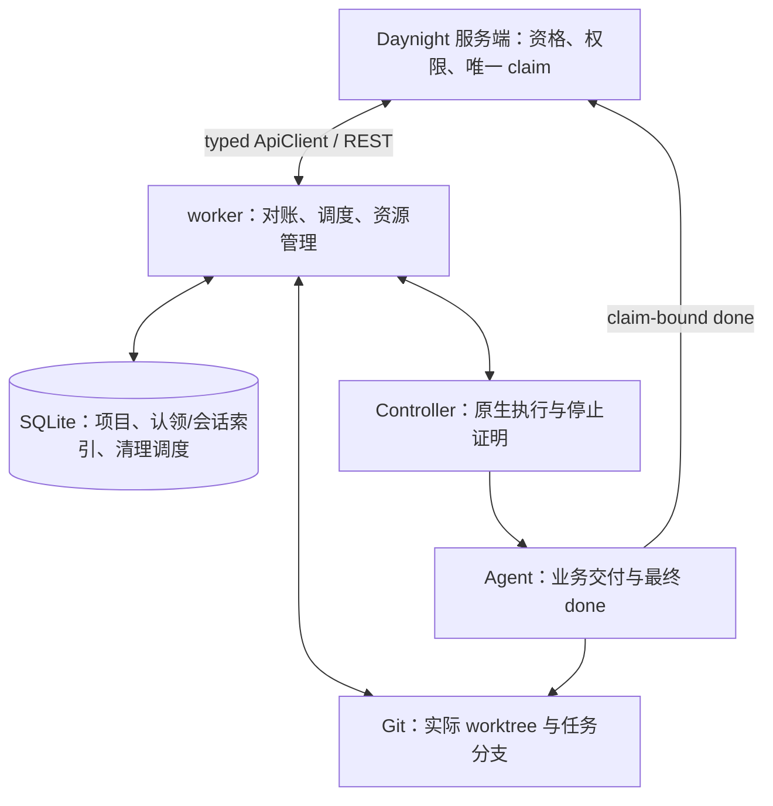

# Worker 架构设计

`daynight worker run` 是持续对账的前台进程：领取配置仓库中的合格任务，在稳定 Git worktree 中通过冻结的 Web 执行身份运行 Copilot、Codex 或 Claude，并在原 claim 结束后按 backend 的停止、文件和独立归档责任收尾。[需求](../spec/daynight-worker.md)拥有产品行为，[认领架构](daynight-worker-claims.md)拥有服务端归属协议，[本机记录决策](../../.agents/notes/archived/simplification/2026-10-27-worker-claim-records.md)记录存储简化的理由与代价。账号级运行观测的[客户端采集与调度](daynight-worker-reporting.md)及[服务端存储与查询](daynight-worker-snapshots.md)各有独立职责，与本机执行协调及 claim 归属分离；它不授权资源清理或任务状态变更。Worker 沿用[客户端要求](../spec/daynight.md#c1-包与平台)的 Linux、Windows 和 macOS ARM64 支持范围；完整平台验收仍需独立的运行证据。

Worker 内的独立 PR 审查宿主与 Task 调度并行运行，其名单、状态隔离、启动门禁和发布恢复见 [Worker Reviewer 设计](worker-reviewer.md)。

## 总体结构



服务端提供当前 claim 归属，SQLite 保存本机认领、原生配置冻结、原生会话索引、独立认领工具预留与终态清理调度，Web 执行库及 Controller journal 保存原执行和停止证据，Git 提供实际工作树。旧 Herdr claim 和资源由用户处理，不进入协调器。顶层 assignedTo 是独立人的责任归属，所有 worker 服务端写入保留它；自动候选使用 assignedTo=me，自动 claim 事务要求当前负责人等于认证账号 userId；未分配或他人任务不具备自动领取资格。既有 claim、Session 或 archive 权限保持原执行归属。Agent 完成实现、验证、PR、审查、授权合并和任务验收，最后提交原 claim 的 done；worker 按自己的完整 claim 清单决定资源生命周期，不再次解释业务验收。

## 管理根与执行作用域

`runtime.ts` 的管理根持有 Worker 实例锁、身份和主 SQLite 连接。`ExecutionScope` 持有一轮执行的独立 signal、配置应用、coordinator、Bot/assistant、Reviewer、探测、Git 和 Controller 责任。正常启动通过 `createExecutionScopeManager().create()` 建立作用域，正常退出也调用同一个 `stop()`；重建不会复用已取消的 runtime、signal 或配置管理器。管理根在同一进程内保留原实例锁和主数据库，重新读取的服务、账号或 Worker 身份不匹配时拒绝重建。

`onExecutionScope` 在首次异步初始化前提供管理调用者的控制句柄。启动构造有独立 owner；取消等待不丢弃原 Promise，迟到返回的配置、存储和其他资源仍由原作用域清理，未 join 前不能确认停止或重建。原初始化 Promise 的非取消拒绝独立保留；取消前台等待后仍报告迟到的真实失败，前台同时观察到同一错误时仅记录一次。控制句柄中，`stop()` 关闭全部准入并取消执行，`snapshot()` 返回逐 owner 原身份及停止事实，`reconcile()` 只重新核对未闭合 owner，`rebuild()` 仅在全部 owner 停止和保存已确认后请求建立下一代。成功 owner 不重复执行清理；超时后仍在执行的停止请求由原 owner 保留，重新核对只等待同一次请求，不并发启动第二次清理。已结束的失败请求允许再次核对原资源，失败的有界观察不能永久缓存为资源仍活动的事实。初始化、后台循环、命令及已 join 的归档错误保留为历史诊断；journal 保存失败先登记原错误，再关闭准入，后续同原因取消不能抹去故障。资源闭合后已接受的显式重建不因这些历史错误终止管理根。只有控制句柄明确接受的 `rebuild()` 才允许外层创建下一代；停止成功或后台 Promise 被错误处理器消费不代表重建请求。普通退出仍报告实际错误，尚未 join 的清理或管理写入不能被历史错误分类隐藏。带管理调用者时，受阻作用域继续保留控制句柄、实例锁及管理 reporter；已闭门时 reporter 只消费缓存观测，不执行配置准备或原生探测。

| Owner | 资源与闭合条件 |
|---|---|
| configuration | 配置应用、bootstrap、映射与移除作业、read-only 请求和模型目录 IO；关闭生产者后 join，不能把响应取消当成底层 IO 完成 |
| task | coordinator 的 reconciliation、pending/active/jobs/preparation/projectStops/ending、原 claim 和 Web 执行；不使用 release/reset 代替停止 |
| bot | Bot runtime、assistant 四循环、application 及未结束的 withClaim 回调、能力采集与 Controller；未提交启动前的探测和 aliases 清理仍有责任，全部 writer/jobs 和清理 join 后才关闭私有存储及锁 |
| assistant | Reviewer 宿主及其 Git、GitHub 和 Copilot 执行；宿主与原生库存都闭合后才能重建 |
| probe | native selection、工具选择及 materializer；保留失败清理责任并核对原边界 |
| repository | Git 准备、扫描、worktree 操作和短命命令的实际进程及输出流；取消后 join 原操作 |
| controller | 原 Controller/provider 边界及 Job lease；Task 停证、配置 writer 和归档 writer 未闭合时不释放 lease 或关闭 Web 库 |
| archive | 授权维护和已有归档责任；join 最终写入后保留上传失败，不把历史上传错误当成活动 writer |

作用域先同步关闭所有 owner 的准入，再以 `allSettled` 并行停止。每 owner 最多观察 20 秒，全轮调用的总截止不超过 60 秒；未响应的 IO/进程不会被超时包装器虚构为已取消。`OwnerStopResult` 保留 resourceId、scope generation、原身份快照、stop/save 事实及错误。未闭合责任使结果为 unknown，并拒绝冲突重建；管理根整体退出时同样不能提前关闭仍被 owner 使用的存储。Task 的业务 writer 不响应取消时，coordinator 仍独立核验原 owner、ticket、代际和进程出生证明并请求原生停止；该路径不写清理状态、不释放 lease，未 join 的 writer 继续阻止闭合。reporter 和配置 writer 的等待不阻挡 Task 停止请求，只限制存储释放。停止开始立即触发 `stopping` 观测；仅全部 owner 闭合后发布 `stopped`，未知结果继续保留停止中事实。

reporter 的 `stop()` 已结束只证明其上报循环已 join，不替代它报告的原生命令清理证明。缓存的清理错误随原资源的确认结果重新核对；有原确认凭据且全部清理责任已闭合时，该错误作为历史诊断保留。缺少凭据、混合未确认原因或仍未 join 的写入继续阻止释放管理存储和锁。

诊断关闭独立记录实际资源是否闭合。原写入已 join、sink 已关闭且监听器已移除后，历史前台日志回调错误仍在普通退出时报告，但不阻止已接受的重建或原锁释放。仅关闭 Promise 拒绝不能证明仍有 writer；仅设置关闭意图或等待超时也不能证明闭合。

`owned-command-lifecycle.ts` 为 Worker 内的短命命令和 `repository/git-owned.ts` 提供共同的受控 launcher。命令先等待 `prepared` 持久事件。POSIX launcher 在独立 PGID 中等待私有 IPC；Windows 父进程用 `CREATE_SUSPENDED` 创建子进程，分配原 Job、取得出生证明并保存 `bound` 后才恢复主线程。launcher 随后通过私有通道报告身份，父进程独立核验，在同一次同步检查中复核取消后才放行用户命令。受信 launcher 不继承命令的 Node 启动 hooks。流式输入、输出与消费 writer 全部结束后才能确认资源闭合。父连接丢失、取消、证明不匹配或保存失败均不能放行。POSIX 在已启动但尚未完成出生握手时收到取消，先关闭业务派发，再用独立清理期限等待原私有 IPC 凭据和独立出生核验；保存原 bound 后停止整组，不能先杀直接子进程而丢失证明。原证明仍缺失或不匹配时继续保留 unknown，未完成的握手与写入也继续由原生产者持有。Windows 父进程持有原 Job lease，停止使用整 Job 成员证明；POSIX 检查原进程出生身份及整组为空。

Windows guardian 的私有输入通道以流式 UTF-8 解码组装帧，跨 socket 读取边界的多字节字符须保持原 executable、参数、环境及 stdin 内容。通道在 EOF 后先排空完整帧和背压中的实际 writer，再将残缺尾帧作为明确的 capture 错误保留。无后续字节可到达的残帧不得永久占据输出 join；原生退出、输出排空和原句柄释放仍须分别确认。取消先发生时，后到的通道、helper I/O 或 writer 错误与取消一并保留；初次清理超时后的错误继续附在原清理结果上，确认资源闭合不抹去输出失败。

POSIX launcher 在子命令结果返回后仍作为原 PGID 的存活身份保留，收到 `SIGTERM` 不先退出。父进程取得结果即可进入停止流程：组内只剩 launcher 时立即结束温和等待，否则等待后代退出后再升级 `SIGKILL`；每次发送组信号前仍核验原进程出生身份。这样既能处理拒绝 `SIGTERM` 的命令，也能处理主命令已退出且不再持有输出流的后代，而普通命令不承担固定两秒等待。已核对自身 PGID 的 launcher 在父 IPC 断开时清理自己的整组，不能只退出并留下无法归属的后代。

Controller 启动也先提交原 launch intent，再由受信 bootstrap 等待出生证明保存；Windows 的 Job 和进程句柄在恢复主线程前显式移交给原执行 owner。父进程只在保存成功后放行 Controller 主程序。出生保存前的清理若失败，原 backend 保留同一进程句柄和清理闭包，后续 shutdown/close 只核对原边界；没有出生证明仍保持 unknown，不能推断未启动。记录 PID 的退出不足以释放 Web 执行容量。

正常 Worker 路径通过 `withOwnedCommandLifecycle` 注入 `execution-resources/` 私有持久库存。每资源 JSON 绑定服务、账号、Worker、代际和单调事件序号，以文件同步、原子替换及目录屏障保存 `prepared/bound/stopped/unknown`。旧事件不能覆盖新事实，迟到 unknown 不能撤销已证明的停止；替换已成功但目录屏障失败时，核对原事实并补完屏障后才能确认保存。重启后缺少原出生证明或 Windows lease 的责任保持未知，不能只因 PID 不存在清空库存。原 claim、worktree、HEAD/index、Session、journal 和未知业务操作仍由各自原记录拥有；停止不执行 stash、commit、reset 或删除现场。

管理侧重新核对原生库存时先 join 命令生产者和原事件写入，再消费保留的原边界、输出 writer 与持久保存。生产者已经结束时，其历史清理错误不能跳过这次核对；仍未结束的生产者继续阻止闭合。停止事实保存失败后，核对的是同一资源、出生证明和代际，不重新执行 probe、Reviewer 或 Git 命令。进程内保留责任和持久库存都确认闭合后才允许重建；缺少原证明或所需 lease 的记录仍保持 unknown。

首次 `prepared` 保存前即保留原生产者的未启动责任。保存失败或原写入尚未完成时，管理侧只 join 同一写入，并凭原生产者确认未启动的事实补完原持久记录和终态保存，不重新派发命令。该凭据仅属于原进程内的具体资源和代际；重启后任意 `proof: null` 记录仍不能据此推断没有进程。

原资源的确认闭合在输出 join、终态保存及原句柄和 Job lease 释放后通知所有消费句柄，Git 的 joined 不依赖由哪个 owner 完成重核，也不要求再发一次停止请求。异步 spawn 失败必须由原 ChildProcess 的未启动事实、关闭事件和输出 join 共同证明没有进程；已运行但出生证明缺失时，直接子进程关闭不能代替整边界证明。Windows 从未恢复执行的原挂起进程可由其原生句柄终止及关闭证明结算，不能把这项证明用于已经恢复执行的进程。

作用域关闭拒绝新的 `prepared` 准入，但允许同作用域已进入 journal 的原资源重核准备记录，仍执行原代际、序列及证明校验。探针仅将首次调用明确在任何写入前被拒绝视为没有预留；曾经发生写入失败或仍有待完成写入时，后续拒绝不能抹去原责任。

Reviewer 命令清理未确认时，宿主保留原资源的关闭记录、锁和未完成关闭责任。原生命令核对成功后，宿主仍须核对同一次 Reviewer 执行的全部停止原因并实际完成关闭；只有原清理证明覆盖全部原因时才可解除阻塞。普通异常、宿主 Promise 已结束或错误中包含一个已确认的命令，均不足以证明 Reviewer 资源已释放。

执行作用域和资源事件接口提供本机机制。持久停用意图、云端准入、Controller 最终 dispatch 围栏及显式恢复授权由生命周期集成层负责；单独建立或重建作用域不声明完整 Worker 停用能力。取舍和后果见[执行作用域决策](../../.agents/notes/implemented/architecture/2026-11-20-worker-execution-scopes.md)。

## 状态来源与清理判定

Worker 用期望状态与实际状态之差选择动作，不以重复的步骤完成标记替代资源自身的状态。下表的来源在每次相关决策时读取；本机索引、done 状态或历史成功回执不能代替当前资源观察。

| 事实 | Source of truth |
|---|---|
| 当前 claim 是否仍归本 Worker | Daynight 成功完整的自有 claim 清单；显式操作使用原 task 的精确版本读取 |
| Web 原生操作及 generation | 原 Controller journal 与不可变 launch ticket |
| 原 Controller/native 进程是否停止 | 原进程实例证明及 OS process group / Windows Job 实际成员 |
| IPC endpoint 是否已移除 | 文件系统，Windows 管道生命周期由原进程停止确认 |
| Worktree 目录与 Git 管理注册是否仍在 | 当前文件系统与 Git 管理目录 |
| Session 归档是否 ready | 服务端对原归档身份、长度与摘要的回执 |

资源身份、控制意图、固定期限和重试策略可持久保存；“停止做过了”“删除做过了”等步骤状态不能授权跳过观察。一次清理调用返回临时的完成结果，只有本次观察满足全部资源目标才更新本机记录；终态原执行的停止观察独立决定执行容量。设计取舍见[资源状态决策](../../.agents/notes/archived/architecture/2026-11-04-worker-resource-state.md)。


## 归属清单与格式转换

`worktrees/manifest.ts` 提供独立的同步清单存储，路径为 Git common 目录下的 `daynight/worktrees/<worktreeId>.json`。记录仅接受版本 1 的六个字段，按 worktreeId、完整 claim 和目录名分别拒绝冲突。发布先持久化两级命名空间，再 flush 文件并发布；重试已可见的相同记录时重新完成文件和目录屏障。读取不逐文件 flush，退休只在 expected 字段匹配后移除元数据。Worker 通过该清单定位当前资源；后端和本地责任结算后才退休元数据。平台目录同步能力的限制与现有持久文件原语相同。

`worktrees/migration.ts` 提供独立的显式转换入口：调用者持有既有实例所有权和仓库 gate，停止旧 Worker，并提供当前服务和 Worker 的 Web 执行记录及相关清理调度。只有 Web 记录证明的工作树进入转换集合；Git 注册或清单不能单独证明 Web 责任。转换核对这些来源和位置，可靠发布并读回清单后才复核、解开匹配的旧 Worker 锁并移除关联 sidecar，再重枚举允许集合并发布格式标记。未知登记和目录保持原状且不阻断无关工作；真实的身份、路径及文件冲突仍报错。原 checkout 和冻结 cwd 不移动或改写，非空且没有 Git 关联的目录不能凭清单获得删除授权。转换顺序与降级限制见[转换决策](../../.agents/notes/implemented/architecture/2026-11-11-worktree-resource-migration.md)及 [Web 责任决策](../../.agents/notes/implemented/architecture/2026-11-17-web-worktree-migration.md)。

自动清理开始时从已提交的 appliedValue 与 actualSource 捕获 enableSudoCleanup 和真实 revision；缺席或尚未应用时只执行普通清理。文件系统阶段确认权限障碍后重新核验清单、目录身份和可访问的 Git 关联，再读取系统挂载清单并拒绝目标或其子树上的挂载；在已核验的仓库根目录通过 POSIX shell 删除原目标；root 使用 rm，其他用户使用 sudo -n，路径按单引号规则引用。普通清理的操作与句柄先收尾，shell 受原 Operation 预算与取消约束并等待关闭，再由普通 Git 清除原登记并重新观察。其他错误不触发提权；人工入口不接入该策略。整目录删除不保证最后移除 .git；部分失败后若 .git 已缺失、目录非空且原归属无法重新证明，后续重试保留错误与责任，不强行删除。进程内责任保持到命令收尾；非 root 的 sudo 在取消或超时后仍由原进程等待结束，不能以杀死父进程推断 root 子进程停止。挂载检查不能排除检查后外部并发挂载，强制重启后不提供新增跨进程互斥。取舍见[清理决策](../../.agents/notes/implemented/feature/2026-11-17-worker-sudo-cleanup.md)。

历史执行可以保留已经交接的 cwd，同一 task 的后续 claim 也可以重用该目录。转换完整读取历史来源，按原 owner 关联 Web 终态清理完成记录，及其执行证据；这些记录不证明当前目录缺席，也不授权重新删除。明确退休的历史绑定不占新清单的位置，仍有责任或证据不明的来源继续参与冲突检查。原锁、清单或来源身份与退休证据矛盾时保留错误；历史记录和残留调度不由转换器修改。

## 配置与目录

共享配置根（`DN_CONFIG_DIR`，缺省 `~/.daynight`）中的 config.yml 根字段 workerId 是首次生成并原子保存的稳定 UUID。创建复用配置锁，持锁后重读，只拥有根字段 workerId；共享保存入口核对全部非归属解码值，根循环 alias 等导致未知或其他字段变化时拒绝并保留原文件。合法身份只读复用，非法值明确拒绝。根选择同时覆盖 Worker、Controller 与 Review 状态，真实 HOME 和 Provider 原生目录保持原有归属。stateDirectory 等未知 YAML 字段不能改变状态根，唯一覆盖入口是绝对路径 DN_CONFIG_DIR。

```text
~/.daynight/
  config.yml
  worker/
    configuration.json # 云端目标、逐项实际值及报告确认
    state.sqlite       # projects、tasks、cleanup_schedules
    instance.lock
    logs/
    tmp/
      r/<instance>/    # macOS 每个实际运行代次的独占实例
<local_path>/.worktrees/daynight/<worktree_id>/
```

每个配置根目录一个 worker；不同根不得管理同一任务 worktree。Run 和人工管理命令使用同一个实例锁，以同一 SQLite 作为取得/释放锁时的 gate，不添加锁表。失效锁可回收，但不能据此认定原生进程已停。一个状态目录绑定单一 service origin、账号和 workerId；切换前先处理原执行并重建本机状态，索引不提供跨服务或账号接续。

### 本地配置与首次候选

本地启动读取先投影服务连接、凭据、repositoryRoot、agentControlMode、可选 agentModel/agentReasoningEffort、完整 toolPaths 选择与原始 source；这些运行归属不在进程中热切换。取得原实例锁后确认认证账号，再访问该身份的缓存与云端配置。currentUser 的临时网络失败在锁下按 5、10、20、40、60 秒封顶退避；首次配置 GET 临时失败保留未读取状态，配置 manager 和 reporter 建立后由报告周期重试。认证、协议、格式及确定不兼容错误保持明确拒绝，未知不能变成 desired:null。已有目标时本地托管字段不参与权威选择。云端旧模式及第三工具成员仅作为未知原文保留，应用资格由当前已知配置及实际工具与原生核验决定；API 使用工具协议 2，配置读取确认当前账号与服务的回显。

首次候选的 maxConcurrent、pollIntervalMs、recoveryLimit、preferPlatformSpecificTasks、native 与 projects 使用 workerConfigurationDefaults 的独立默认值：1、60000、3、false、copilot/null/[]、[]。本地 repositoryRoot 默认 `~/daynights`，首次候选省略 mode 时为 web；显式本地 herdr 在候选准备时拒绝并提示调整；不从 review 推断任何 worker 值。未知 YAML 字段在投影时忽略、编辑时保留，读取不改写文件；显式已知值严格校验。导入从仓库项的 remote/projectId 取得 Project 关联；本机绑定实际使用时再校验路径，按 config.yml 目录解析并禁止 tilde、drive-relative 路径、重叠仓库或状态根。原始覆盖节点直接投影 nativeOverrides，不能从已展开配置反推省略、model:null 或 args:[]。

`configuration-bootstrap.ts` 拥有 desired:null 期间的当前文件候选。每个 pass 只读取一次 `readWorkerLocalConfiguration`，按同一 source 投影完整候选和两项工具，保留原始 native 覆盖意图。报告投影只规范化完整候选一次；toolPathsBootstrap 使用候选中的工具选择，没有完整候选时使用启动时本地工具选择。文件中的规范 origin 或显式 workerId 不匹配运行身份时拒绝；新凭据与本地执行覆盖不改变当前运行归属。一个 root 子任务拥有整个 60 秒 pass，报告 Operation 通过可取消等待加入它，等待者结束不撤销项目解析。source hash 与认证 scope 相同时可复用成功解析的 Project 身份，失败不写入缓存；候选明确被拒绝后失效并重新校验，服务端最终验证权限。

项目实际换仓时，服务端在同一事务中移除批量快照已选择该项目的 Worker 云端目标配置，包括离线 Worker；配置的其他字段、其他项目及观测保留。快照后的新选择与首次导入沿普通配置合同处理。Worker 按既有同步和停止路径应用移除，应用之前仍可能领取工作，已有 claim 不参与换仓事务。

候选准备失败保持错误，在后续报告周期重新准备；不以可用项目的局部集合建立云目标或授予新执行。每个 null 周期先查服务端，已有目标优先，取消并 drain 旧候选；导入响应未知也先读，再从最新事实构造新请求。原协调器保留用于已有资源核验的视图；冷启动处于 null、未读取或不支持目标时，从真实本机项目映射提供原资源覆盖。快照单独提供 retainedRecoveryLimit，来自当前/保留记录中可继承的真实已应用标量，只供原执行恢复视图使用，不进入 effective 或新准入。Task/Bot 新准入保持关闭，原冻结执行继续原权限与生命周期。已知本地映射即使不再选中也须核对其资源；映射或仓库扫描未确认时不释放假容量。无 ID 的旧映射通过已有绑定或仓库发现识别，实际 worktree 清单属于其他 Project 时保留责任，不按新 ID 重绑。

`worker repo list` 只读本地注册。云端目标尚未建立时，setup 与 repo add/remove 仍通过现有完整 Project 清单、身份和路径计算处理本地候选。已有传输 URL、路径和兼容 native 值保留；同类型逐字段继承，切换类型清除未覆盖的 model/args，args 整体替换。repositoryRoot 与 review 独立，只为新路径展开，改变根不搬移已有仓库。

项目选择只在显式 setup/repo 命令执行；选择、取消或远端失败都不能启动部分任务。`worker run` 允许空项目且不调用选择向导，仍取得实例锁、初始化报告及对账原 Task，不为 Bot 伪造任务资源。

Setup 在终端内汇总只读环境报告、单选 Copilot/Codex/Claude 并选择 Project。摘要展示保留的 URL/路径、移除范围及不兼容参数重置，确认后一次保存 native 与完整选择，所选 Agent 应用于全部选中项目。公共报告检查平台、Node 和 Git；所选 native runtime 标为未验证，由 Controller 在派发前验证认证、能力和工作目录身份。Task 工具与 Git transport 在实际使用时检查。普通缺项可保存并给修复指引，探测使用 allSettled 收尾；未确认的 owned command 清理故障优先于普通缺项或取消。Setup 不探测 managed skill，也不安装、登录、clone、打开 Worker SQLite、claim 或启动执行。

本地托管字段写入在交互前和紧邻取得本地锁之前核对云端目标；已有目标时要求从云端修改，缺失缓存不能绕过该判断。原 YAML 写入继续锁内重读、比较 workerId、服务/凭据、root、repositories 以及 setup 拥有的 native 基线，基线保留字段原始存在性和值，深比较支持未知字段的循环 alias。Repo 只拥有 repositories 及保留条目的 projectId，setup 另拥有全局 native 及确认重置的项目 native 字段；repositoryRoot 和保留条目的未知字段始终受保护，显式删除拥有整个条目。网络和提示不持配置锁；共享 alias 使非归属解码值改变时保留原文件并拒绝，无关节点、注释和安全 alias 保留。

### 本地原生覆盖与来源

`local-native.ts` 负责两个新字段的存在性、字符串约束及旧 model 同层冲突。`native-overrides.ts` 在已解析云端全局或项目原生元组上独立应用本地两项，抽取 model/effort 参数、去重并映射当前 Provider 的 Web 表达。其它原生参数交给既有验证器；Codex 非相关 TOML 设置保留。

`runtime.ts` 的云端应用入口验证规范化结果，管理器仍持久保存原始云端 appliedValue。提供给 coordinator 与助手 host 的是规范化后配置；机器报告单独输出 `runtimeConfiguration`，由 `schemaVersion:1` 标识来源对象。这样本地覆盖不冒充 desired 或云端应用值，移除后重新组合会恢复真实下层来源。null/native 表示委托原生配置，不把未知值当作探测结果。尚未接纳的本地候选不成为有效执行配置或来源观察；原执行的实际参数继续由其冻结记录表达。

Worker SQLite `claim_native_configurations` 以 project/task/claim 关联不可变原生元组。新登记与冻结在同一事务中，旧无会话记录在首次启动前冻结；有会话而缺少旧快照的记录保持未知。原 Session 恢复不追加当前 model/effort，避免覆盖会话内原生设置。已有助手沿用自己的持久冻结记录。

本地新字段使新执行携带 `validateNativeSelection`，随 claim 配置和 Web launch ticket 冻结。Web 首次启动使用 Provider 原生目录校验；Codex 读取 app-server 配置与完整目录；配置未指定模型时，按原生目录的默认标记与顺序解析有效默认值，启动模型参数仍保持省略。能力验证包含隐藏模型，UI 选择器仍按 hidden 过滤。Claude 不持久保存探测 Session，Copilot SessionFs 读穿原生文件而全部写入仅在内存。Copilot 未解析默认模型而缺少 modelId、Codex OSS/local-provider 无法等效取得能力时明确失败，不猜测模型。恢复原 Session 不重新注入选择。

Worker 共享探测 verifier 保留未确认清理的进程身份及重试能力；新探测和退出时等待清理。探测清理与业务进程停止独立，不能互相代替停止证明。

### 本地工具路径选择

`platform/tool-path-choice.ts` 拥有 `Tool`、`ToolContext`、`ToolPathChoice`、完整 `ToolPaths` 和纯字符串校验。`parseLocalToolPaths` 将 YAML 省略/null 投影为 auto，并拒绝三工具之外的键；`validateToolPath` 按本机 path API 检查绝对路径、合法 Unicode、控制字符和 4096 UTF-8 字节上限，返回未经修改的输入。Windows 额外要求盘符或完整 UNC share，避免 `\tools\codex.exe` 这类路径隐式依赖当前盘符。

`commands/worker/config.ts` 与 `configuration-source.ts` 共用这个解析器，两种本地配置结果都包含三项 choice；缺文件的默认读取仍不创建配置文件。语法检查不读取程序文件、不启动子进程，也不把路径规范化成另一入口，保留符号链接和词法路径供工具解析器核验。`parseWorkerCloudBootstrap` 提供两项公开 choice，由 API 按协议投影；本地 choice 没有云端“未采纳”状态，独立候选在云端已有目标时仍可填未采纳项。

`platform/tool-executables.ts` 提供 `resolveToolLaunch({tool,context,choice,environment,cwd,workerNode?}, operation)`、`verifyToolLaunch(launch, operation, {trustedRuntimeRoot?})`、`toolCommand(launch, args)` 与 `probeResourceKey(launch, {cwd,environment})`。平台模块不依赖 Worker 调度或 Provider。捕获环境负责 Windows PATH/PATHEXT 大小写归一化；自动搜索按捕获 cwd 解释相对 PATH 项，发布的入口始终为绝对路径。自动 Codex 使用 PATH，Copilot 使用随包 native；显式选择不回退其它安装。

入口适配器支持 native、Node 入口及 npm Node shim。Node 入口使用 `workerNode`（缺省 `process.execPath`）的 realpath；Codex JavaScript loader 与普通 Node 入口使用相同命令，由 loader 自行选择 native。官方 Copilot 根据入口所属 manifest 定位同一安装的 native。解析器不登记 Codex 发行摘要或复刻 native 布局，实际版本和协议兼容性由运行探测确认。

shim 的目标从同一份有界字节快照提取，后缀选择忽略大小写，保留 Windows `PATHEXT=.CMD` 返回的词法入口。目标作为路径数据解析，不执行包装脚本的 shell 文本；注释、CRLF 和无害格式变化不要求完整模板相等。`read-cmd-shim` 的公开接口按路径重复读取，并按大小写敏感后缀选择 parser，因此这里复用目标提取规则而不调用该接口。

`ResolvedToolLaunch` 保存词法入口、canonical 入口、最终工具程序、可选解释器、结构化 `command`、`ToolArtifact[]` 和 `selectionKey`。artifact 记录角色、词法 path、realPath、size 与 SHA-256。哈希通过文件句柄流式读取，核对读取前后 stat、当前 path 的 stat 与 realpath；解析期间变化不能产生有效 launch。`verifyToolLaunch` 直接核验冻结 recipe 的命令、selectionKey 和文件记录，不重新分析发行布局，也不读取新配置或搜索 PATH。`toolCommand` 仅拼接已有 prefixArgs 与调用方 argv；消费者仍须在启动前核验。

元数据读取和 artifact hash 共用 `openRegularToolFile`。POSIX 使用 `O_RDONLY | O_NONBLOCK` 打开后才检查句柄是否为 regular file；不能仅依靠打开前的 stat，因为路径可能在检查后被换成 FIFO，而 operation 超时不能取消阻塞的内核 open 或释放其线程。错误、取消及晚到句柄仍启动关闭，并对等待设置 operation 边界；不禁止合同已支持的 symlink。

摘要使用最多 128 项的进程内缓存，按 canonical path 与 dev/ino/mode/size/mtimeNs/ctimeNs 完整签名匹配。命中仍打开文件、确认 regular file 并核对句柄、路径 stat 和 realpath；解析所读前缀或完整内容也须与摘要一致。缓存只在稳定性检查通过后更新，不跨进程保存；它减少重复读取大型解释器和 native 文件，不替代映射核验。

`selectionKey` 保留词法 artifact 路径和命令身份，能发现符号链接入口改指；source、目标 revision 和检查时刻不属于身份。独立 `probeResourceKey` 去掉词法别名，并排除已经完成选择的 PATH/PATHEXT，保留 canonical 命令、artifact 内容、cwd 和其它 native 环境，以便同一真实程序的自动与显式别名共享探测清理责任。键本身不实现锁、缓存或进程回收，后续消费者必须承担这些生命周期责任。`ToolSelectionError` 给出 tool/context/stage/code，固定错误消息不包含完整 argv、环境或原始工具输出。

资源键在 Windows 归一化检索键后排除 PATH/PATHEXT；POSIX 保持环境名大小写语义，普通 native 变量 `Path` 不能被当作 `PATH` 排除。

`commands/worker/tool-selection.ts` 负责 Web Codex/Copilot 的目标 generation、候选验证、新执行准入与观察快照；公共遥测仍保留现有工具和上下文槽，未探测的旧槽不伪造结果。版本、host 能力、模型目录与启动消费同一个完整 recipe；实际版本来自该 recipe 的原生响应。候选结果提交前重验目标 generation 和 cleanup generation，旧目标的迟到成功不能覆盖新选择。缓存候选身份改变时，同次操作先协调最近探针 recipe 的清理，再重新解析和探测当前选择；最后的新执行校验也遵循此顺序。最近探针责任独立于可清空的候选缓存，在首次 probe 前保留，失败或目标变化不能绕过旧清理。协调覆盖该 recipe 在不同 cwd 和环境中的探测范围，并在清理期间阻止旧 recipe 的迟到探测；清理确认后才准入新候选。新目标失败保留旧实际观察，只阻断依赖该工具的新执行。

Task 的冻结配置、Web 执行记录、Bot intent、Controller ticket 共用严格 `parseResolvedToolLaunch`，未知字段和不匹配的工具/context 拒绝。首次启动前保存 recipe 及同 selectionKey 的 `{version,checkedAt}`，恢复先读原 claim 配置，不能先被新的目标验证挡住。每次新 spawn 核验原文件；缺失或变化报告 `tool_identity_changed`，不改用 PATH 上的另一个安装。Web 原执行的观察、输入、停止和归档继续使用原执行证明。旧记录缺身份且已经 submitted/unknown 时禁止新 spawn；有完整 never-submitted 证明时才能创建原 ticketHash/launchId/executionId 绑定的私有 `tool-selections` 侧文件，原票字节保持不变，读回成功后继续冻结。侧文件为 create-only，symlink、错误 ticket 或冲突内容拒绝，不能重放首条输入或换 Session 绕过。

原生探测按 canonical `probeResourceKey` 共享清理 owner，缓存额外绑定 context、selectionKey、model、args 和 cwd。原进程或 transport 关闭未确认使成功缓存失效，路径切换不能丢弃旧 owner；shutdown 等待全部历史责任。重新准备候选时，管理器先在本次操作预算内进入原 owner 的串行队列协调待清理责任，不启动新进程；清理确认后才检查可用性、捕获 cleanup generation 并重新探测，避免准入检查永久挡住清理重试。超时或清理仍未知时继续拒绝新探测，后续请求加入原责任。Web Copilot 的版本与 host 查询使用与 Provider 相同的 owned headless process 和 SDK `forUri`；模型查询在 supervisor 内直接使用 SDK，保留内存 SessionFs、拒绝权限及无业务 prompt 的保证。Provider bridge 不序列化函数型 SessionFs。Copilot probe 保留 1500ms 的 graceful shutdown RPC 预算；RPC 或 SDK stop 失败后，只有强制 SDK transport 关闭和原 owned runtime 关闭均确认，才能返回原已成功的读取结果。最终任一资源关闭失败仍报告 `cleanup_unknown`，并保留原读取及关闭错误；读取本身失败不会因清理成功变为通过。外层 supervisor 继续核实完整后代进程责任，不重放读取或 shutdown RPC。选择理由见[探测停止确认决策](../../.agents/notes/implemented/bug-fix/2026-11-14-copilot-probe-stop-confirmation.md)。

遥测快照只读已观察事实，不启动工具。活动组来自 Web/Bot 的持久配置及已观察的工具选择，按 selectionKey 聚合；旧记录缺版本或检查时间时如实报告不完整，不重新探测拼接历史事实。后台候选准备具有独立预算，五秒 host 采样只消费已就绪选择。Copilot 仅在当前有效全局或项目选择它、或本 Worker 存在非删除 Copilot Bot 定义时参与后台准备；项目读取已解析继承的有效配置，Bot 定义包括 pending、failed 和可恢复记录。需求变化使准备时限失效，开启后下一轮可立即准备，关闭后停止后续后台准备。配置应用预检、明确模型发现与新执行仍按需准备，原冻结执行和清理责任保持不变。工具冻结与准入的取舍见[运行接线决策](../../.agents/notes/implemented/architecture/2026-11-12-worker-frozen-tool-runtime.md)和[后台需求决策](../../.agents/notes/implemented/bug-fix/2026-11-13-worker-copilot-background-demand.md)。

### Copilot authority 的私有运行目录

Web Copilot 只有在 macOS ARM64、原 SEA 内容及 SDK 1.0.11 符合既有图片 authority profile 时才采用 `copilot-read-authority-v1`。未知 build 保留普通 recipe；已匹配 profile 后的准备失败明确失败，不停用 authority 或换安装。`ResolvedToolLaunch.runtimeProfile` 保存原普通 sourceLaunch、物化 key、可信私有 root、manifest、preload 及固定协议。入口仍表示用户选择的 SEA，实际 executable 是 `distribution/index.js`，interpreter 是冻结 Worker Node，command 精确包含 Node、`--import`、preload URL 与 JS 入口。原 SEA、Node、preload 六文件闭包、控制模块格式的 package manifest 和 SDK manifest 都纳入 artifacts；生成物 manifest 和入口摘要进入 selectionKey。原普通 recipe 的 hash 保持不变。

Worker instance lock 下的 `copilot-tool-materializer.ts` 在 `<workerDirectory>/tool-runtimes/<materializationKey>` 发布持久依赖。key 从 canonical 来源、Node、adapter 内容及协议产生，排除词法别名、目标版本与随机路径。准备记录先持久化完整预留；owned helper 再保存 PID、出生时间、进程组及本次身份，父进程读回并提交记录后才放行提取。提交前失去父进程不启动 native，提交后保留可归属 leader，恢复必须先确认原进程组停止。未知提取不换 preparationId 重提。

提取使用独立私有 cache、extract-only 和 no-auto-update。完整 distribution manifest 包括文件与目录集合、类型、大小、SHA-256、模式；拒绝 symlink、额外或遗漏对象、路径逃逸与大小写碰撞，最多 10,000 对象、深度 32、512 MiB，manifest 最多 4 MiB。文件与目录 fsync 后原子发布并读回，partial staging 不能准入，已有 final 只能完整匹配复用。Controller 从可信配置根计算 runtime root，不采信 ticket 自报的根；每次 spawn 验证原来源、Node、冻结 adapter 闭包和完整发行树。当前 Controller SDK 必须仍支持冻结协议，但不能用当前安装路径替换原 adapter。

首次准备最多 60 秒，其中提取最多 20 秒，停止有独立有界预算。进程禁用 Node compile cache，发布树保持不可变。总容量为 2 GiB，提取前持久预留完整 512 MiB，并计入其它预留、历史 unknown 和已发布内容。只有确认原 owner 停止、删除 staging 后才能释放失败预留；发布成功改计实际字节。容量不足拒绝新准备，保留已有执行。Provider/probe close 和普通 shutdown 不删除发布树；它们随 Worker 状态生命周期保留，没有逐目录自动 GC。图片权限仍由[原生 Read authority](session-image-sources.md#原生单次读取准入)拥有。

### 云端接收与本机提交

[配置协议](../spec/daynight-worker-configuration.md)拥有服务端目标与观测 CAS，[本机配置决策](../../.agents/notes/archived/architecture/2026-11-04-worker-cloud-runtime-configuration.md)记录 cloud-first 与单提交 owner 的理由。配置模块只认识 Worker、Project 和运行参数，不导入 Task/claim，不查询执行资格，也不在任务 SQLite 保存配置状态。

configuration.json 使用 schemaVersion=11，保持单个 JSON 对象、原路径与受限权限。配置模块按下列责任组织：

| 模块 | 责任 |
| --- | --- |
| configuration-model.ts | 缓存、记录与捕获的完整类型、从原始目标派生的 known 视图及共用值规则 |
| api/worker-configuration-source.ts | 配置专用源文本载体、已知路径投影、完整资源/回执解析与无损 JSON 语义比较 |
| configuration-storage-{types,wire,source}.ts | 冻结的 schema 1–10 历史类型、来源和严格验证 |
| configuration-storage-decoder.ts、configuration-storage-current.ts | 历史格式入口与 schema 11 当前结构的分别解码；当前解码校验摘要类型和记录来源 |
| configuration-cache.ts | 解码后的旧应用事实转换、冻结与编码 factory |
| configuration-json.ts | 单遍分块 JSON 与缓存专用增量词法 guard |
| configuration-state.ts | 当前/保留记录转换、快照、报告选择和准确确认 |
| configuration-persistence.ts | 初始化读取、串行冻结检查点、存储 readiness、I/O 重试及关闭所有权 |
| configuration.ts | 权威安装、捕获 token、结果转换与发布、异步应用 job、原停止归属及当前进程证明 |
| configuration-exchange.ts | foreground/管理路径共用的准备、采样、代次围栏、单次发送及回执编排 |
| configuration-bootstrap.ts | 当前文件一致候选、root 有界准备、source/auth scoped 解析复用与取消收尾 |

authority 保存本机 generation UUID、完整 desiredJson、applicationRevision、observationRevision 与必需布尔值 pendingApplication；generation 不是服务端 epoch。pendingApplication 为 true 表示当前 raw 尚未形成可应用账本，包括未初始化和不支持目标；false 表示 Web 目标已完成账本协调，不证明各项外部副作用已成功。该标志随检查点原子保存并在重启时严格校验；后续 Web 目标即使与不支持目标之前的值相同，也需重新协调当前账本，不能把旧应用身份当作新目标成功。desiredJson 是唯一持久目标，known 从同一源文本按已知路径严格派生。合法 raw 目标中已知字段的类型或值若不受支持，保存完整原文和独立校验的 revision/时间，known 不可用且不授予应用资格；它与真正的 desired:null 独立，不能触发首次 bootstrap。applicationRevision 标识最近已知目标变化，可以小于最新 desired.revision；currentItems 的必需已知项对应这个锚点。工具目标 revision、native/tool preparation 的比较与证明、confirmProjectPrepared、延后准备确认和新增移除 origin 均消费该锚点；报告 envelope 使用最新 desiredRevision，item 保留原 targetRevision。remoteObservation 单独存储最后一次明确 GET 的 {observationRevision,json}，可落后 authority.observationRevision，服务回退或 null 重置也保留此前快照，独立按其原 base/版本验证；receipt 不将本机新报告伪装成已读取的远端事实。desired:null 使用观察基线 "0" 与空当前集合，原保留事实仍在 retainedItems。currentItems 具有唯一 key，retainedItems 保存原工作、停止、未知结果、失败或必要实际值。recordId 全局唯一，origin 保留原 generation、targetRevision 与 application/schema4 来源且不可改写；actualSource 独立表达真实来源，复用值不修改旧历史。schema4/successRevision:null 保留历史未知版本；当前记录不含 nativeMode；历史模式来源保留原义，blockedByRemovalId 必须同项目且无环。

存储 decoder 按已部署结构严格读取 schema 1–10，1–4 沿原结构转换至 schema 5；已验证旧 desired 转为 desiredJson，applicationRevision 取旧目标版本，remoteObservation 为 null。schema 9 冻结为不含模式账本项的 Web 布局，不能将 schema 10 的模式项塞入旧格式。转换为 schema 11 时，schemas 1–8 的 nativeMode 仅用于识别已证明属于 Web 的 native 历史，随后删除；非 Web 的 native 实际值、来源及相关失败失效，本进程仍须重验。schema 9、10 的 native 事实原样保留。schema 10 的历史模式账本保留其原始事实；此前 opaque 的 taskTagFilter 在合法目标已协调时建立 pending/null 应用项，保持 pendingApplication、原始目标及 desiredRevision，不伪造历史应用。历史模式确认不能证明当前进程采用；迁移不生成新的模式项，旧模式或第三工具成员保留为未知原文，当前已知设置决定目标是否可应用。转换保留 identity、原始 JSON、remoteObservation、hidden sources、sudo provenance、其他 recordId、origin、失败编号、started 移除及引用，更新 generation 并清空游标。旧格式此前未知的 enableSudoCleanup 或 archiveSessions 在有效目标可见且对应记录不存在时重新建立核验；有可复用的已确认实际值时保留其来源，否则生成 pending/null，不制造成功证据。版本 1 保留 preferPlatformSpecificTasks:false 的迁移；applying 沿原重启规则恢复。schema 11 重启严格校验历史账本；未同步可应用目标时不授予执行资格。格式、身份和损坏文件拒绝，历史结构超过当前业务容量不清空责任。迁移冻结并原子保存后才 ready，失败保留原文件和原错误。

读取使用一个文件描述符、fatal UTF-8 解码和固定 @discoveryjs/json-ext 1.1.0 JSON 模式。词法 guard 在交给 parser 前拒绝重复解码 key、非规范非负整数、过深容器、BOM、尾随内容及非法属性；未知目标与远端观测位于普通 JSON 字符串内部，guard 不解释其中的任意数字或键。真实 EOF、完整结构和身份通过后关闭读句柄，才允许迁移替换。提交队首从最新已提交状态计算下一状态并冻结，以可重新创建的 chunk iterator 写入同目录独占临时文件；逐块完整写、权限设置、fsync 和关闭后 rename，成功后发布同一个不可变引用。rename 只保证文件完整性，不能阻止旧快照覆盖较新目标。容器和文件不形成全量文本，单 token 仍受 JavaScript 表示限制，领域对象仍需要与保留事实相应的内存。损坏、身份不符及持久化错误沿原链传播，未提交结果不发布为成功。

当前 origin、principal 与 workerId 验证通过的 GET 完整安装服务端 desired 与 observationRevision，包括较低计数与 null，回退建立围栏并保留原资源责任。同 revision 的目标按无损 JSON 语义比较双方可见内容；仅 archive 能力投影允许一方省略字段；mode 和 tool 的同版本差异连同未知子树完整比较。缓存单独保留同版本被隐藏的已收字段源片段，不将其派生为当前应用；字段同版本重新出现时与该历史事实比较，版本变化或权威重置不能将其当作新目标。其他差异报协议错误。当前收到的源文本仍是权威，投影变化引起的已知目标变化正常重新协调。匹配捕获的 receipt 可更新目标，较低 desired revision 只结算其捕获而不回退新目标；回执暴露较低目标或观测计数时安排认证 GET，由该读取确认服务是否回退，读取失败继续保留读取责任。可应用目标中仅未知字段、更高 revision 或 updatedAt 变化时更新源文本，保留 applicationRevision、generation、记录身份和 job；已知目标变化或认证权威回退才重新协调。结构合法但超出本机业务支持范围的目标仍持久保存为当前权威并关闭新准入。job 的适用性核对原 recordId、内容和证明。

配置 GET、普通 report receipt 及 prompts 联合 receipt 使用显式 Received 包装；完整 JSON 先校验语法、重复解码键和深度，再独立校验目标外壳、revision、时间和能力边界，最后从已知路径尝试严格派生。字段类型或值不受支持时保留 raw 和真实 revision，known 为不可用而非构造空目标；外壳、能力或观察版本关系无效仍拒绝。未知数字不进入普通 number；native/projects/overrides/toolPaths 中的未知兄弟留在 desired 原文。远端未知 observation kind 留在 observationJson，不进入本机账本或上报。对象比较忽略成员顺序，数组保留顺序，数字按符号、有效数字串及 BigInt 十进制指数比较，不展开巨大指数。该配置局部机制不修改全局 API serializer。

已知目标变化建立新的当前核验身份，原工作和停止记录保留 origin。高版本原停止在服务端回退后继续拥有原操作；新目标仍排除项目时建立当前目标的停止核验，原 job 真正结束后通过同一适配器再观察资源。新目标重选项目时，准备等待原停止结束，不能提前 ready；原记录不直接作为较低目标的 observation，也不改写成该目标的历史成功。native 与准备 job 共享该项目实际停止槽，不能与尚未结束的停止重叠。启动后的真实本机项目映射仅在已认证且可用的目标下登记当前停止核验；ensureProjectRemoval 在串行提交时反馈该目标仍可用且项目已被选中或停止核验已登记，runtime 才记为已覆盖。未读取、null 或不支持目标不能完成这次覆盖；权威变为不可用时重置覆盖及其轮次身份，后续合法状态重新登记。每个覆盖轮次在等待 manager 前捕获该身份，等待后的进度与最终完成都必须仍属于同一轮次；旧结果即使在权威恢复后才返回，也不能完成新轮次或恢复旧进度。正常已同步 ACK 更新的配置 generation 不重置该轮次，避免持续报告阻断必要核验。缓存 applied 停止结果不能代替新 coordinator 的资源观察。没有原工作、待确认失败、停止或必要实际值的旧记录可收敛，不要求本机全部记录占用一次 wire 名额。

taskTagFilter 的完整名称只保存在 authority.desiredJson。配置目标 getter 生成规范语义的 SHA-256，标量提交在原子保存该摘要应用项后才发布；只有已同步、应用项为 applied 且摘要等于当前目标时才投影完整有效筛选及领取摘要。服务缺少字段时有效值为 undefined；未同步、不可应用、未提交或摘要不匹配时为 null，只暂停新领取，不抹掉项目选择或原执行责任。报告固定保留这个有界摘要及原优先移除，其余项包括全局 native 继续轮转；名称集合不重复进入应用记录、观察或 claim。

每次启动的 native 证明从空开始。全局与项目 native 优先验证当前目标；目标失败后可重新验证已证明属于 Web 的历史元组，不将历史恢复标为新目标成功。schema 1/2 没有历史模式证明，不能推断其实际值属于 Web。本次证明归属于接受结果的 recordId、native 元组和真实工具选择；新目标从实际提供复用值的当前或保留记录继承匹配证明，actualSource 保持原来源而不授予资格。证明随记录退休或相关选择/selectionKey 变化失效，无关 Provider 的健康证明保留。等待重验的当前项保持 pending，原记录、内容或工具选择不匹配的迟到结果不能授予新执行资格。

native 参数校验、版本探测与项目适配等外部 I/O 在提交队列之外运行，完成后只提交结果转换。全局与项目 native 使用真实 Web 实现校验和准备，Provider 只等待实际需要的 Codex/Copilot 工具；Herdr 候选不参与配置准备，公开遥测只包含两个 Web 工具的真实观察。已同步且可应用的两工具目标为当前执行发布 Web 模式；云端旧模式或第三工具成员不进入 known，也不阻止合法当前设置应用。runtime 的 Task coordinator 与 Bot 新执行仍需 Web 和经过验证的 native 配置；既有恢复和清理继续遵守原归属规则。模式项不再作为公开 observation 发送，历史应用及失败事实仍保留。取消和持久化失败不得发布未提交成功。异步配置应用最多 16 个 job，按稳定 recordId 轮转；退避项让出槽位，原停止保有该次有界尝试的槽位。普通标量转换不占异步 job 槽。旧结果在队列内再次检查原记录和目标。已开始的项目移除保留原工作，后续重选等待其结束；当前停止核验独立报告自己的目标版本，仅操作 Web 责任，不处理旧 Herdr 资源。runtime 只对确认完成仓库准备的绑定标记 ready；native 验证不能代替准备或停止证明。

`configuration-exchange.ts` 统一 foreground reporter 与实际配置管理调用者：先等待持久化就绪，准备当前权威及候选，再收集新 telemetry、捕获并验证 generation，发送一次，最后由 manager 接收并保存回执。prepare 后和发送前的代次围栏丢弃过期样本，不把旧工具 targetRevision 带入新目标。正常同步轮次不新增 GET；启动、未知结果、400/协议失败或能力重发现先读取；null 期间每轮先读取，以便竞争目标优先。单飞、触发合并与有限 prompt 批次由[采集设计](daynight-worker-reporting.md#配置快照与回执)拥有。

同一份实际 WorkerReport 用于 capture 预算与 send。捕获在本机保存随机 reportId、generation、精确 baseRevision、observation、实际 recordId/失败来源及下一个游标；token 不进入网络正文，也不能由等值报告重建。同 key 的最近待确认失败可以来自 current 或 retained，捕获保留真实 sourceRecordId/failureId，不复制失败所有权。当前代 observationAccepted=true 先确认该捕获实际发送且仍匹配的失败，再按目标版本安装回执规范状态；false 且 observation 非空仍按目标版本安装规范状态，下一轮基于它生成新报告，不能确认旧失败。较低 desired revision 不回退最新原始目标。observation:null 的 false 是正常未提交观察。旧 generation 的回执不改变当前目标、基线、失败或游标；远端已知成功、明确拒绝与未知继续各自保留原含义。

projectionCursor 是持久化的 recordId 字典序位置。投影先固定一项真实未完成或失败移除核验，其优先级包含被阻塞的原停止错误；wire 仍表达当前核验的真实 pending/error 状态。其余合格项从游标后选择连续前缀，首个放不下的项是下批起点，不跳过大项填小项。每批同时满足 1025 个非 mode 项、协商后的 1026 个总项、Go HTML/U+2028/U+2029 转义加 512 字节存储包装余量的 4 MiB，以及实际整包 9 MiB。请求碰到预算时对实际候选报告重新准备可选工具/来源观测，完整配置项与必需清单不截断。结构合法但当前 wire 无法表示的历史值继续保留本机，错误结构仍明确失败。

匹配且 observationAccepted=true 的当前代回执才确认本批失败来源与游标；围栏在同一串行提交内再次检查，排队期间被新权威取代的 ACK 也不能确认。完成停止还须核对实际 job 结束及准确的 applied 本批确认后才能收敛。未发送失败、未知结果和仍有资源责任的记录保留。服务端整体替换最近接纳批次，不累积各批 items；遗漏表示本次未观察，消费者不能据此宣称已应用。配置错误仍是闭合 code/category/phase 与时刻，原生命令、参数、输出和凭据不进入公开诊断。心跳不等待应用 job，退出取消并 join 配置应用和报告，由 runtime 统一持有生命周期。

### 临时存储恢复与准入

`configuration-persistence.ts` 拥有一条 FIFO 检查点队列。初始化完整读取、配置目录创建及旧格式迁移写入遇到真实文件 I/O 错误时，在原实例所有权中按 5、10、20、40、60 秒封顶退避重试；格式、身份、解析/编码和其它确定失败仍传播原错误。合法缺失文件保留既有首次创建含义，不能以空状态替代损坏或无法读取的缓存。

队首从最后已提交的状态调用 prepare 一次，冻结下一状态、记录身份和编码计划；每次实际写入重新创建 chunk iterator 与同目录临时文件。只有完整写入、同步、关闭和 rename 成功后才发布该头项。apply/stop 等外部副作用已完成时，原 job 持有准确结果等待检查点，不因写重试再次执行。后续有限完成结果继续排队，普通 receive、读取和工具刷新先等待共享 readiness，避免重复输入在故障期间持续积累。

`isReady()` 只描述当前 manager 的存储准入，`waitReady(signal)` 让每个调用者在自己的 Operation 中等待。运行期 `current()` 仍提供最后已提交的目标、实际值和项目视图，不发布未保存的 applied，也不制造空项目目标。可信 POST 回执进入 manager-owned 提交后，等待者取消只结束它的等待；回执、状态转换与文件写入的归属不转移，后续不能把已知远端结果改成未知或重放原报告。恢复按队列顺序发布，原 onChange/唤醒机制继续触发最新工作。

根取消或 `beginDrain()` 先关闭新 job 和输入准入，并启动独立五秒重试调度窗口，再 join reporter、初始化移除及其它可能等待检查点的生产者。`stop()` 等待原 job 和已拥有队列，最后封住完成结果入口。窗口到期不再调度新尝试，但不可取消的 read/write/rename 仍须 join，实例锁不能提前释放。未保存结果返回 `UnsavedConfigurationError` 的记录身份和原 I/O 错误；永久阻塞的系统 I/O 没有五秒内退出保证。重启只从已落盘 started 和原执行来源重查实际资源。

coordinator 的 `configurationComplete` 同时包含存储就绪与已有项目映射条件。Bot host 向 runtime/process 提供独立 `canAdmitNewExecution()`；能力采样的 `configuration()` 不替代这个门禁。首次环境准备后、持久 intent、注册及初次 launch submission 前重新检查；初次意图已经冻结但未派发时仍须等待。已提交或可能提交的原执行、拥有已知原生会话的冻结恢复及输入/停止继续使用原配置、身份和证明；等待不报告环境初始化失败。[Bot 执行设计](worker-bot-runtime.md#启动与授权)拥有具体边界。

配置持久化事件携带本次真实 I/O 失败次数、退避档位、记录身份及下次时间。报告回执和应用完成的本地 pending 结果保持其原 source、reportId 或 recordId；日志不能用当前权威版本改写较高版本原停止项。文件 sink 的未知 append、未派发遗漏及新 segment 仍独立计数，配置故障分组与五分钟摘要不把日志当作恢复状态。[配置诊断设计](daynight-worker-reporting.md#失败与可观察性)拥有固定分类、阶段、远端/本地确定性、字段与查询方法。

### 工具目标与验证接缝

配置快照的 toolTargets 使用运行管理器同一 `{source,revision,choices}` 输入。未启用云端工具能力时给完整本地选择；已协商云端值逐项保留 choice 或未采纳 null，不用本地值填补云端目标。显式 auto 始终保持 auto。未采纳的工具不能准备或准入；当前遥测格式不能表达 null 目标，因此可报告的历史目标保留其真实来源与版本并标记配置不可用。没有历史目标或历史云端版本不能合法上报时省略该项，其他工具仍报告真实事实。

配置管理器接收 readToolSelectionKeys(native,mode)，由运行管理器提供真实选择键；refreshToolSelections() 让变化进入原串行提交 owner。Codex/Copilot native 依赖自身工具；无关工具变化不撤销该 native 证明。接入回调后，缺失或非法键不能取得资格，迟到应用结果必须仍匹配捕获的目标选择和键。工具变化不丢旧成功历史、失败或仓库准备，也不创建第二份工具应用账本。未接回调的既有运行入口保持原 native 校验，但不产生 toolPaths 实际观察。

### 实际配置消费

同一个 coordinator 接收不可变的有效配置视图，后续容量判断、恢复上限、平台优先策略和 native 选择读取成功值。preferPlatformSpecificTasks 的 false 是有效成功值，只有 null 表示尚无实际结果；新领取等待该配置可用。等值视图保留身份，避免无配置变化的报告确认使在途领取失效；实际视图变化仍阻止使用旧配置提交领取。降低 maxConcurrent 不抢占已有执行；pollIntervalMs 在每轮完成后的下一次等待读取当前成功值。健康原生进程不因参数更新重启；Web 新 claim 保留已冻结原生配置；Web 执行库记录尚未建立时，coordinator 仍读取主 store 在 claim 登记事务中冻结的原生元组，避免在途领取期间的模式或参数变更重解释已取得的 claim。Web 执行记录存在时使用其冻结配置；不以当前默认替换 model/args，recoveryLimit 仍沿用原有实时策略。旧已有 Session 的未知配置不回填伪造快照，恢复时省略模型和 effort 覆盖。

项目目标、就绪集合与 projects 持久映射分开。只有已选且准备就绪的项目可以自动推进 active、pending 和新领取；在途领取完成后再次检查有效集合。移除先从有效集合排除并取消该项目 job，再由 stopProject 等待收尾，按 claim 串行使用 Web 的直接停止能力。停止保留任务状态、认领、工作区及会话历史；映射继续服务归属清单、资源发现及人工处置。停止未确认时保留容量，已确认停止后仅保留工作区不永久占槽。重启时保留但未选的映射也进入配置模块的项目移除责任；结果、错误和重试沿用同一提交与报告入口。本次运行在登记成功后记住已登记的映射，后续从未登记项目继续；单批报告的条数或字节预算不阻止剩余本机移除责任登记。重启后重新观察所有映射，不能用前一运行的登记代替停止证据。重新选择不能抹掉已开始的停止，后续恢复沿用任务系统原有规则。

本机仓库绑定复用 Project 查询、既有映射及 repositoryRoot 路径生成。仓库准入串行核对全部保留映射和并发候选路径，准备在队列外运行，成功后复验并登记；失败或取消释放候选预留。这样慢 clone 不占用配置提交队列，也不能让并发项目写入相互重叠的目录。clone 失败时仅清除本次创建且仍为空的目录，部分内容保留。项目移除会取消在途准备；迟到结果必须重新核验目标。Git 发现失败不得推断资源缺席或释放未知责任；无法读取的项目禁止 pending 启动和领取，其未完成 claim 和已知资源责任保守计入容量，直到恢复观察或确认停止。健康项目可在自身资源观察完整且容量允许时继续调度。保留路径无法解析时，准入不能证明物理路径互不重叠，新的绑定仍须等待修复。配置结果仍由 configuration.json 的原提交 owner 合并。

运行中断网保留最近成功值。重启先核对云端再正常调度，缓存不升为权威。任务清单和业务后端准备分别保有自己的错误边界，不能阻断配置获取、缓存和报告；空项目也维持心跳。

Bot 记录位于同一 state.sqlite 的独立 `bots` 表，由[Bot 库存设计](worker-bot-inventory.md)定义身份、固定启动意图和权威清单对账。它不进入 coordinator 的 Task 库存与清理预算。

## SQLite：项目映射与认领索引

```sql
CREATE TABLE projects (
  project_id TEXT PRIMARY KEY NOT NULL,
  repo_url TEXT NOT NULL,
  local_path TEXT NOT NULL
) STRICT;

CREATE TABLE tasks (
  project_id TEXT NOT NULL,
  task_id TEXT NOT NULL,
  claim_id TEXT NOT NULL,
  status TEXT NOT NULL CHECK (status IN ('pending', 'active', 'done')),
  agent TEXT NOT NULL CHECK (agent IN ('copilot', 'codex', 'claude')),
  session_id TEXT,
  agent_control_mode TEXT NOT NULL DEFAULT 'herdr' CHECK (agent_control_mode IN ('herdr', 'web')),
  PRIMARY KEY (project_id, task_id, claim_id)
) STRICT;

CREATE UNIQUE INDEX tasks_one_active_per_task
  ON tasks(project_id, task_id) WHERE status = 'active';
```

| 本机状态 | 责任 |
|---|---|
| pending | 已实际取得或找回 claim，等待启动 |
| active | 承担启动、运行、恢复或收尾责任，占用名额 |
| done | 原 claim 的本机执行与文件清理已结算；独立 archive 责任仍可保留 |

`agent` 来自实际取得的 claim；`agent_control_mode` 是服务端冻结的模式；`session_id` 是原生会话 ID，尚未取得时为 NULL。新索引明确写入 web；读取与协调只纳入 Web 行，旧行原样保留。启动资源前先提交 active，终止清理全部完成后才提交 done；失败保留责任，结束行保留。

Projects 在远端认领前保存仓库映射。有未结束任务、未决认领工具预留或实际受管资源时不能改变该项目绑定。存储使用实际 SQLite 事务、STRICT 表和唯一约束；tasks 索引没有配置快照、业务启动回执、PID、执行恢复次数、管理意图或时间列。版本 16 的独立 `claim_tool_reservations` 按 Project/Task 保留原请求描述符、十进制精确版本及冻结配置；匹配 grant 的 pending、冻结配置与预留删除在一个事务内完成，不把请求记录解释为执行资源。独立 cleanup_schedules 表按 project/task/claim 标识清理责任，并绑定 worktreeId，保存期限、失败次数、下次资格时间和诊断。它只约束终态清理的责任和策略，不记录“已停止”“已关闭”“已删除”等资源完成标记。协调器只使用与原 Web journal 的 service、Worker、claim 和 worktree 身份一致的调度；无索引但有完整 journal 的 Web 责任仍可恢复。相同 claim 的 worktree 身份冲突拒绝写入，首个期限不延长。配置选择、累计恢复次数和通用人工管理意图不进入 tasks 索引。原生操作回执由其执行 backend 读取权威来源；日志只用于诊断。

Worker 状态库以原索引结构作为版本 5 基线，版本 6 增加 cleanup_schedules，版本 7 删除 notified/submitted 两个步骤字段，保留原 projects/tasks 和清理身份、期限及调度。五个业务库的版本 0 统一在既有准入后丢弃原 schema 和数据，再执行各自基线与编号升级；已有空文件和查询访问同样初始化。旧详细执行 schema 的非零版本 1–4 仍明确拒绝并保留原库，要求停止旧 worker 后自行移除该库。旧 Herdr lifecycle 数据不由协调器打开或改写。workerId 与原生历史保持各自原有位置。[SQLite 升级设计](cli-sqlite-migrations.md)拥有同步重置、非零来源检查和单库原子性。

## 启动、发现与周期对账

启动先取得实例锁、稳定身份并核验账号，读取云端配置并创建本机配置模块和独立 collector/reporter，随后才准备已选项目及业务执行 backend。CLI 显式注入运行包 version 和启动时捕获一次的 workingDirectory；reporter 的首次采集不等待仓库准备或 tick，之后由独立 30 秒 timer、完整清单及确认 claim 驱动。清单查询范围包括选中 Project ID 与已登记映射；配置通道不等待该清单成功，也不以尚未覆盖的项目制造空闲结论。无显式 ID 的旧配置在仓库发现失败后逐轮重试，未解析期间不发布完整清单，也不新增准入，因其本地资源尚无法按项目扫描。完整清单发布只包含不可变引用和来源时刻，位于资源观察与较长操作之前；报告无额外 inventory 查询或 SQLite 字段。[上报设计](daynight-worker-reporting.md)拥有单飞、合并、采样、缓存及传输机制。

每轮固定实际查询的项目集合；归属缺席、清理和归档判断只适用于该轮查询成功覆盖的项目。若查询期间登记了新映射，本轮不发布不完整清单，新项目在后续轮次查询，不阻塞独立心跳。

```text
逐项目完整读取自己的远端 Web claim 清单，补齐 SQLite 中的实际 claim
→ 优先排队推进仍归属的本机 active 和已确认的收尾责任
→ 核对 Web 执行与 Git 资源并汇总实际容量
→ 发现成功且有空闲名额时，优先启动 pending，再最多领取一个新任务
→ 可取消的轮询等待
```

自有清单只使用 workerId 归属条件，不混入 assignedTo、ready、allowAgents 或候选平台筛选。新候选单独组合 assignedTo=me、ready=true、allowAgents=true 和实际平台条件，在服务端排序和分页前过滤并绑定游标；每页保持相同选择。默认候选省略 platformSpecific；开启 preferPlatformSpecificTasks 后，候选分成 platformSpecific=true 和 false 两个独立流，分别与 compatiblePlatform=实际平台组合。每流继续使用 createdAt、id keyset，游标 scope 区分省略、true 和 false，不能跨类别续页。符合普通资格的任务按服务端顺序消费，active 候选明确拒绝。负责人不匹配的直接 claim 在项目写事务内拒绝，既有 claim 的恢复仍按原执行权限处理。分页、认证或项目读取失败不产生可用于该项目缺席清理的集合。404 标记不可用项目，不阻断其他成功覆盖的项目；显式旧 ID 不按仓库地址重绑。完整性只对成功查询的项目成立；Git 读取失败保持错误，不解释为空资源。

每个 task 的操作在进程内串行，不同任务的有界 RPC、恢复和清理可并行。执行容量按 claim 去重，普通启动或恢复先预留名额；终态清理确认精确原执行停止或权威未启动后不再占槽。未知或仍运行继续计占。文件、归档、隔离及同 task 旧 claim 屏障独立核验，不能仅凭已释放的执行槽删除资源或启动同 task 后继；Web 的纯归档责任不构成后继屏障。降低 maxConcurrent 不抢占已有任务。已有 pending 优先，项目内按稳定 task_id 顺序选择，每分配一个名额就从下一项目继续，直到没有可启动项或容量已满。新领取在所有配置项目中每轮合计最多一个。preferPlatformSpecificTasks=false 时按原项目轮转读取兼容候选；为 true 时先轮转全部可领取项目的当前平台专用候选，耗尽该类别后才轮转不限平台候选。专用候选使用独立的项目游标；不限平台候选与关闭优先模式时的混合候选沿用常规项目游标。各游标跨轮保留，在各自类别内从下一项目继续，专用候选的扫描、跳过和成功领取均不推进常规游标。项目内保留服务端 createdAt、id 顺序，不能从一个项目取得不限平台候选后忽略其他项目的专用任务。空项目和被原资源准入屏障拒绝的候选可以跳过；确认授予并登记 pending 后立即结束本轮领取，即使任务暂不能 active。真实配置变化使旧候选流失效。所有类别的候选生成器在退出时关闭；后续新领取等待下一轮，由 pollIntervalMs、有效容量变化或配置变化触发。[领取节奏决策](../../.agents/notes/archived/feature/2026-11-04-worker-single-acquisition.md)记录其吞吐代价。

仍属于自己的本机 active 已占名额，先为这些任务排队，在各自串行操作内读取原 backend 并恢复；全局 Git 发现中其他工作区的文件系统错误不阻塞它们。新的 pending 启动和新 claim 分配要求完整自有清单、目标仓库的资源枚举与可证明的执行容量。可定位的其他仓库格式准备失败只关闭其文件 gate；未知执行责任或无法界定范围的观察失败仍保守计占或阻止准入。

Git 扫描将完整枚举结果分为 validated、quarantined 与 unknown。注册索引一次收集各 admin 的 pointer、marker、common 和读取错误，并按物理目标证明注册唯一性；人工或无 marker 注册也参加目标核对，路径别名不能隐藏重复注册。

正向 gitdir 和 commondir 中的相对路径以 Git admin 目录为基准，worktree 内 .git 文件的反向 gitdir: 相对路径以 worktree 目录为基准。POSIX 将原始路径交给文件系统解释，再比较物理结果，不预先折叠符号链接后的 ..。Windows 的 Node 文件系统调用会在打开前规范化路径，因此在查询完整路径前先按原始组件顺序遍历：每遇到 ..，必须以 lstat 证明它将消去的当前路径是存在的普通目录，再退回父目录；junction、symlink、缺失、非目录或 I/O 异常均保持 unknown。普通相对路径在这些证明成立后允许查询，不能仅凭原始字符串传给文件系统就认定遍历语义得到保留。

Windows 的 drive-relative 路径（如 `C:foo`）和 root-relative 路径（如 `\foo`、`/foo`）不能确定目标卷，必须拒绝，不能借进程当前盘符或当前目录补全；完整盘符绝对路径、完整 UNC 路径和普通相对路径都遵守上述父目录遍历证明。缺失组件中的未验证 . 或 .. 遍历保持 unknown。两个目标均缺失且路径拼写仅大小写不同时，不能证明它们是独立目标，注册唯一性保持 unknown；该约束适用于所有平台，不能根据缺失路径猜测文件系统的大小写语义。

明确指向其他目标的局部失败不污染当前目标，无法解析 pointer 或歧义关系仍保持 unknown。只有完整 owner、仓库和唯一注册位置可定位，且错误明确属于稳定观察下的静态局部校验失败时，才能成为 quarantine 候选。清单、当前目录对象或 Git 指针在观察期间变化时保持 unknown；损坏或未知清单不能当作无资源。

读取、原生查询及响应解析失败属于观察不完整；未分类异常保持 unknown，不按错误码拼写推断可隔离。上述复核沿用受控文件系统写入前提，不提供抵御恶意同用户并发替换的原子快照保证。严格 listWorktrees 对隔离或未知结果仍抛错，不将未验证资源省略为不存在；普通未注册路径和人工注册沿既有发现规则保留。

Coordinator 交叉核对隔离候选与本机持久执行、Web 原责任或本轮自有 Web claim 的完整四字段身份。工作区已关闭但进程停止未确认的原 owner 仍参与 worktreeId 冲突检查，不能仅按 claim 去重计数后忽略身份矛盾。清单本身不是 Worker 进程归属证明；LocalTask 仅有 claim 坐标，也不能单独证明 worktreeId。映射及 Web 冻结仓库路径必须与扫描的物理仓库和规范 repo identity 一致；矛盾或无法解析保持 unknown。只有不存在矛盾且归属可证明的隔离资源才能保守纳入责任并保持库存覆盖完整。隔离项不提供可用 binding，阻止同 task 后继与自身 pending 启动；精确原执行停止后不再占执行槽，文件责任仍保留。健康任务在余量内继续调度。未知项不能按一个固定名额估计，也不能以历史快照代替当前容量上界。

Runtime 的未绑定仓库经远端解析 Project 后，用扫描结果核对 validated 与 quarantined 的全部项目身份；unknown 或外项目资源拒绝登记。映射登记只确认项目和路径，之后仍由 coordinator 重新证明资源归属及容量。缺 worktreeId 的旧责任清理继续使用严格查询，无法证明来源时保留责任。prepareRepository 先完成格式转换；转换失败只关闭该仓库的文件准入。扫描恢复后下一轮正常对账解除对应失败；监控报告具体 claim 隔离，或项目观察不完整造成的全局准入影响。

终态停止观察独立于文件 gate 和退避。Web 校验原 ticket、journal 与 Controller 身份，Controller 停止后重读 journal 并验证 native 记录前缀，再检查已记录 provider 的原实例；未登记或逃逸后代不在这一观察保证内。读取失败或身份冲突为 unknown；恢复先预留并使旧观察失效，旧异步观察与旧清理通知不能覆盖新运行。运行时在轮次前捕获 wake revision，配置或有效容量事实变化请求下一串行轮次；重复事实不自唤醒。

当前运行监控消费同一容量准入投影与真实操作边界，不增加资源发现或改变清理责任。[上报设计](daynight-worker-reporting.md#当前运行监控)说明观测与独立发送的生命周期。

原 claim 在完整自有清单中缺席后，即使全局资源快照未发现它，本机未完成行也进入与已知资源相同的串行清理 job。清理目标由原 claim 身份及可选的真实 worktreeId 表示；Web journal 证明完整 owner 后沿用该身份。尚无 worktreeId 时不创建虚假 owner 或另建台账：先确认原模式没有剩余执行，再核对目标 Git 注册；没有完整 owner 时不推测目录。已识别的同 task 其他 claim 资源保持不变，旧 claim 的资源已消失便可结束旧索引。身份不完整的失败使用进程内退避，重启由保留的未完成索引行重新发现；完整 owner 才可持久保存 cleanup_schedules。

新领取在远端写入前跳过仍有同 task 旧资源的候选，再直接调用进程内 typed ApiClient：原子 claim 成功后登记 pending；确认名额和旧执行收尾后提交 active、准备资源。请求结果未知时记录 Warning，不创建资源、不重发原请求；后续完整清单找回实际授予。服务端精确版本与唯一 active claim 控制竞争。并发上限约束本机 active 资源数，迟到授予可以留下等待名额的 pending。

coordinator 接受可选 `taskTagFilterKey`：缺失表示旧服务，null 表示应用证明不可用，只暂停新领取；有效摘要参与配置身份。有效摘要下每页候选查询附带 `candidateWorkerId`，claim 附带捕获的摘要。配置身份改变时停止发送旧轮次尚未发出的 claim，已经发送的 claim 由服务端原子准入和既有对账处理。筛选上下文中的游标失效或确定性 claim 冲突通过可选回调提示重新读取配置；这只是重新核对提示，不证明冲突原因。runWorker 从有效配置快照提供该摘要，并将失效提示接到 exchange.markNeedsRead() 与 reporter.trigger()，由原交换路径重新核对权威配置。runWorkerControl 同样投影有效值，只管理已有执行并保留原显式读取或单次同步，不新增报告循环或候选查询。

远端 phase 和 nativeSessionId 是当前观察的展示投影；旧 Herdr 属性只保留历史读取。每次基于新读到的 task/claim 与精确版本更新，未知响应记录日志后重新读取；投影不决定本机资源动作，也不保存待提交摘要回执。

## Git 工作区与资源身份

每 task 使用分支 `daynight/<task_id>`，新 claim 使用 `.worktrees/daynight/<worktree_id>`。迁移的旧 claim 使用清单记录的原 taskId 目录，不改变冻结 cwd。准备工作区先独占 mkdir、可靠发布清单，再执行 unlocked Git add；空无主预留可非递归移除，非空无关联内容不能采纳。恢复核对原归属、仓库、唯一 Git 注册和双向指针，保留现存 dirty state。有效 claim 的原 checkout 缺失时，在原绑定位置从保留分支重建，不以历史未启动证明作为前置条件；目录内已丢失的未提交内容无法恢复。原 Git mutation 仍须完成本地收尾，原 backend 的身份、停止、启动及输入准入独立生效；重建工作树不授予 Web 或 macOS 原生执行的恢复许可。
确认任务分支不存在后，Git manager 使用受控、有期限且可取消的 Git 执行器从 origin 获取远端 HEAD 到绑定 worktreeId 的私有临时 ref，解析并固定 commit SHA，以该 SHA 创建分支和 worktree；新 clone 也执行此刷新。Fetch 禁止写入 FETCH_HEAD、额外 ref 映射、tags、递归子模块及自动 maintenance，使不同任务并发获取时不会共享基线。成功创建后以所读 SHA compare-and-delete 临时 ref；中断后同一 worktreeId 的后续尝试可覆盖并回收它，不作为旧基线复用。清理错误保持可见，不能掩盖创建错误。远端 HEAD 获取、commit 解析或 fetch 失败，以及刷新取消或超时时，不回退到本地 HEAD 或 origin/HEAD，也不创建新分支或 worktree。保留分支继续从原 tip 创建 worktree，已核验 worktree 直接复用；这两条路径不依赖网络。主 checkout 的分支、HEAD、内容及本地主线不因刷新而改变。决策及权衡见[远端默认分支基线](../../.agents/notes/implemented/bug-fix/2026-11-09-worker-remote-default-base.md)。

Worker 的 clone、fetch、worktree add/remove 和临时 ref 清理使用 owned Git：有界结果报告收尾仍在途时，原 project/task gate 保留至原 Git 子进程、已创建输出流及停止 helper 的本地 close 均完成。错误和迟到的收尾错误保持可见；不能以目录缺失代替 join。普通 Git 查询仍使用有界执行器。manager 关闭时拒绝新准备和修改，取消并等待已准入的仓库准备与 Git 句柄，再删除私有 hooks。已确认停止的 Agent 执行容量仍独立释放。local-closed 不证明逃逸或脱离 stdio 的后代停止，它们可能在资源交接后继续写入；取舍见[Worker Git 收尾决策](../../.agents/notes/implemented/architecture/2026-11-11-worker-git-mutation-closure.md)。

清单以 `projectId/taskId/claimId/worktreeId` 和目录名绑定资源。清单不单独授权删除：非空目录还须具备唯一匹配的 Git 注册及双向指针。普通运行不使用旧锁或跨重启物理指纹；同次删除仍核验当前目录和元数据，外来锁保持错误。

Worktree inspection 在核验清单、目录、唯一注册、common directory 和双向指针后，从稳定的主仓库 `repository.root` 运行 `rev-parse --path-format=absolute --git-common-dir` 与 `config --get-all remote.origin.url`。两条查询同时传入已经验证的绝对 `--git-dir=<admin>` 和清单绑定的绝对 `--work-tree=<leaf>`；相对查询输出以实际 runner cwd 为基准解释。这样扫描与删除交错时，Windows 的进程 cwd 不会占用待删 leaf。Git 继续解释 linked worktree 的配置、`config.worktree` 和受支持的 `includeIf worktree/onbranch` 条件；`core.worktree` 重定向不改变清单所指物理目录的归属。原只读 runner、取消、绝对期限、origin 与分支校验、错误和 unknown 分类保持各自责任；该上下文只用于上述 metadata 查询。机制依据与取舍见[稳定 inspection cwd 决策](../../.agents/notes/implemented/bug-fix/2026-11-12-worktree-inspection-cwd.md)。

仅在 backend 允许终态删除时，清理先确认原进程停止、workspace 关闭及该 backend 必需的其他条件，再删除已核对的 worktree 内容，保留 .git 指针至内容删除完成，最后移除目录与 Git 注册。Worktree 目录和 Git 管理注册分别观察：目录消失即满足目录目标，原注册仍在时独立移除。中断留下的无指针空目录及未创建注册的空预留目录可通过非递归 rmdir 清除，非空且缺少归属证明的路径保留并报告。操作结果未知时再次观察资源，最终判定来自实际目录和注册的消失。分支和提交历史保留。

`worktrees.ts` 在完整归属检查后，为仓库 root/common directory、受管父目录、Git 注册目录及 worktree 记录实际身份，并保留清单、gitdir、commondir 和 .git 内容。内容删除前后用这些只读快照核验资源；遍历期间不逐文件重读全组归属和 Git 元数据。进程内按仓库物理身份与 task 串行化删除，同一 worktree 的另一次删除在原操作真正结束前拒绝进入。

`remove-worktree-contents.ts` 逐层遍历普通目录，以非递归 unlink 删除文件和链接，以 rmdir 删除空目录。POSIX 目录通过 `O_NOFOLLOW | O_DIRECTORY` 打开，核对 bigint dev/ino、有效用户 uid、设备和 owner 读取/搜索权限；缺少 owner 写权限时，仅通过已验证的 FileHandle 补充 `0o200`。0555 因而成为 0755，而 0444 文件、文件硬链接和外部 symlink 目标不需要改权限。不可读、不可搜索、异所有者、跨设备目录和底层 I/O 错误直接保留；Windows 不执行 POSIX 权限恢复，使用普通目录身份检查和非递归删除。

遍历在进入目录、必要的权限修改后及各条目操作前后核对当前目录的路径与句柄，不重查全部祖先。目录权限修改绑定已打开的原 inode；观察到当前目录替换或归属变化即失败。显式录屏源处置通过独立 guard 在每次修改前核对来源及其根目录身份。Node 没有可移植的 openat/unlinkat 接口，路径操作与核验之间不是原子边界，受管写入进程停止仍是必要前提；该机制不是针对恶意并发路径改写的隔离。选择与代价见[局部遍历决策](../../.agents/notes/implemented/simplification/2026-11-12-worktree-local-traversal.md)。

每步检查 operation 的取消与期限，已发出的文件系统操作和目录句柄关闭始终 await，不用超时竞速提前释放串行保护。失败后保留原错误与剩余资源，下一次从实际内容重新核验；无归属证明的非空内容继续受到保护。Web backend 在确认停止和关闭后按已应用的 archiveSessions 决定是否尝试归档；任何归档失败都登记给独立维护并继续安全删除，开启归档时保留 Controller execution 目录中的源。登记或诊断失败也不能阻挡删除，真实文件错误按其阶段保留。shutdown 或调用方取消跳过后续归档与删除。清理失败保留文件责任和同 task 的旧 claim 屏障；原执行停止后执行名额独立释放，其他 task 仍按现有容量及串行调度规则推进。

资源扫描与清理 job 可交错。原 backend 所需停止及删除条件满足后，文件删除确认目录和对应 Git 注册缺失；随后 backend 结算、本地责任和清理调度完成，最后退休清单。Web 原执行与文件结算独立于归档；仅 LocalTask.done 不证明归档条件，也不能单独替代 Git 资源观察。local-closed 不排除脱离 stdio 的后代之后继续写入。

资源发现结合 Web 执行证据、清单、Git 注册和目录；清单本身不证明 Worker 归属。未知旧资源保留，真正的身份和路径冲突仍报告。

## Web backend 与执行证据

只有已同步且可应用的云端目标可形成新执行配置；原 claim 的冻结身份仍不能被新配置重解释。项目移除和权限门禁先行，旧 Herdr claim 和资源交由用户处理，不因配置变化迁移或自动收尾。Web 运行 Codex stdio app-server、Claude Agent SDK 或 Copilot SDK 私有 runtime；其初始输入、原生控制、停止和恢复契约由 [Task Session 设计](task-session-protocol.md)拥有。

Worker 的运行组合只创建 Web backend，工具活动清单只纳入 Web 和 Bot；管理命令拒绝旧 Herdr 记录，不创建 backend 处理它们。协调器以 Web store 和 backend 为必需依赖，只对账 Web 自有 claim 和执行证据，并计算容量与同 task 启动屏障。Web 在独立版本 5 的 `worker/web-executions.sqlite` 保存自己的冻结配置、执行身份、恢复预算、编排阻塞和清理意图，在 `controller/` 保存 ticket 与版本 14 的原生 journal。Web 版本 0 重置原 schema 和数据，因此其旧 completed 行不进入补归档库存；此重置不删除独立 execution 目录中的 ticket、journal 或待归档文件。版本 1→2 在迁移中删除 cleanup 的 input、baseline、result、error、agentStopped、workspaceClosed、mode、backendResourcesClosed、worktreeDeleted 字段；版本 5 为现有 cleanup 加入默认 false 的 discardRecording；当前 parser 同时接受该标记。Controller 拥有的原生操作回执保持在 journal，本机库不复制清理进度。Worker 持原实例锁分别打开所需状态库，全部成功后才创建 coordinator；一库失败不回滚已提交的另一库，下次按各自版本恢复。原始 Web 执行状态缺失时保留责任并报错，不能使用 legacy Herdr 的 NULL ID 新建语义代替连续性。

Web 原生恢复复用持久 `recovery.count`、`pauseReason` 和 `retryAuthorized`。只有实际原生恢复及显式 retry 消耗该预算；普通编排、Git 和报告失败不计入原生恢复次数，也不能以进程内失败累计锁存 recovery_limit。真实原生恢复受阻时按原 claim 保存诊断原因，保留次数和执行身份。暂停写入必须独立提交，不能在同一 SQLite 事务内随后抛错而回滚暂停事实。

工作树检查失败保存到独立编排阻塞记录，包含结构化来源、原因及原 claim、worktree、Session、原生会话、executionGeneration 和 controllerInstanceId。版本 2→3 只新增该记录的表，保留既有执行 JSON；旧二进制通过 SQLite 版本守卫拒绝打开升级后的库。异常期间不准备、启动或替换原执行，不清理归属尚未证明的工作树；可信原执行的只读观察、启动报告与既有独立 grant 续期仍可继续。

每轮重新核验可恢复的编排条件。清除阻塞须通过完整工作树检查，以及原 launch ticket、经认证的 Controller 观察和进程实例证明；运行中的原 generation 还须满足同一 native ID、ready/working、startup ready、初始输入已受理或确认且原进程未停止。所有已分配 generation 共用进程证明的追加规则：实时列表必须保留 Worker 与 Controller journal 已有列表的完整前缀，既有证明不得删改，新增证明也须逐个通过 OS 核验。清除和更高 revision 的启动报告一起持久提交，不调用 launcher.prepare/launch，不重放已提交输入或重置原生恢复计数。原进程已停止时不把停止视为健康：完整原 generation 停止证明和工作树核验通过后，只移交既有原生恢复流程，保留原生暂停、预算、显式 retry 与正常关停规则；编排记录不能额外阻挡已授权的恢复，也不能授予新的恢复许可。

首次启动在原 Controller 尚未就绪时可能暂时没有 native ID 或首次输入回执。新版编排阻塞可在首代、未发生恢复且没有 retry/关停意图时，通过原 ticket、Controller journal、认证 IPC 和实际进程证明继续这次启动；已绑定的 native ID 不可更换，尚未绑定的 ID 只能取自同一原 Controller。仅本机和实时观察均为 not_submitted 时，才使用原 initialOperationId 递交首次 assignment；未知或已经递交的输入不重放。这条路径不适用于旧误锁纠正。显式 retry 的 pauseReason 非空表示尚待替换原停止代，pauseReason 为空表示已分配的单次尝试正在启动；后者在同代健康验证后完成 retry，不再停止健康进程、分配 generation 或增加次数。 首次 native 绑定必须核对原 Controller 的完整观察；存在编排阻塞时，在同一 SQLite 事务中确认阻塞仍等于绑定前的完整执行身份，再仅补齐其 native ID。关停观察同样先验证身份再绑定；阻塞来源、时间及其他归属字段保持不变，原有冲突不能用 null 通配。该首绑定同样适用于没有正常关停意图的意外退出：完整原 ticket、journal、进程停止证明及工作树核验通过后，先原子绑定已知 native ID 与原阻塞，再按更新后的严格身份清除阻塞并进入既有预算和 retry 流程。未知停止不构成绑定或替换许可。

Worker claim 的 Controller 首次输入和 `submit_worker_input` 共用普通原生队列。队首先检查期限、连接和 idle 输入能力，再通过继承的配置读取同服务、同用户的当前 Task，核验未暂停、授权与原 claim/Worker/worktree/Agent/Web 归属，读取后再次检查本机状态并派发。配置或读取失败不使用旧快照；读取与原生派发不具有跨系统原子性。首次输入保留原 `initialOperationId` 和冻结正文；后续文本以本地 `worker_input` 操作记录，复用普通消息的来源关联和迟到受理，但不参与 relay 的远端命令对账。`observe` 顶层的 `workerInputProtocol:1` 声明该链路，旧调用方可忽略。正文上限为 4 MiB UTF-8，完整 IPC JSON 加换行上限为 5 MiB；排队准入期限为 30 秒，Controller 等待最多 65 秒，调用方等待最多 70 秒。断开不能撤回已派发输入。Test Session 首次输入及人工消息保留各自入口。

完整 assignment 由 `prompts.ts` 组装：固定前言和 `execution-contract.ts` 中的共享章节按顺序组合，再加入新建或恢复原生会话说明及经过校验的 Assignment JSON。continuation 和 ping 复用相同章节，分别保留原身份前缀与 ping 的字面标签；cleanup 使用独立用途的正文。用户、项目和 Worker 自定义文本仍按现有顺序追加。共享文案避免后续输入恢复相反的暂停或等待规则，不改变已固定输入的投递身份和调度机制。

Worker 的健康观察共用输入流程，以原运行绑定在内存维护 assignment 受理状态和至多一个待核对操作。首次 assignment 完成的轮次直接返回；恢复时用当前任务、冻结配置、已核实 native Session 与当前附加 prompts 构造完整 assignment。之后每轮符合输入条件时构造新 ping，不按 idle 观察去重。等待结果不消耗故障预算；未知结果按原 operation ID、generation、kind 和 hash 核对，assignment 未受理时不能用 ping 越过。普通 ping 的终态 unknown 不永久阻止下一轮，已派发输入不保证 exactly-once。

旧存活 Controller 缺少能力声明时先结算原首次输入；明确尚未递交时使用原 operation 和冻结正文，在旧 IPC 前重新读取任务并复核本机资格。首次输入已受理、native Session 已核实且当前空闲可输入时，持有原 claim 串行锁的编排器执行既有 shutdown；只有完整停止证明后才清除 intent 并按正常 orderly restart 换代。停止未知保留原 intent 和责任，新代重新验证能力，同次 Worker 最多尝试一次升级。旧停止与最终观察之间仍有并发窗口，不宣称原子 compare-and-stop。取舍见[Web 自动输入决策](../../.agents/notes/implemented/architecture/2026-11-17-web-worker-patrol.md)。

Windows 启动器在恢复挂起的 Controller 前保存含 Job Object 名称的出生证明；Controller 只接管已包含自身的同名 Job。兼容旧记录时，启动器保存的基本证明可由原 Controller journal 补齐 Job 名称，两次证明必须保持 PID、进程组、出生标识与命令摘要一致。POSIX 分离进程在 Worker 退出后可重挂父进程，parentPid 仅作观察，不能因此拒绝同一运行的恢复或清理；Windows 仍核对原父 PID。仅原证明缺少 Job 名称且为 Windows 进程形态时，才可从原 launch 对应的 journal/认证观察补入精确的 `Local\Daynight-<launchId>`。已有 Job 名称不可改变或丢失，native 进程列表的前缀核验保持严格。恢复与关停共享这条补齐规则，停止时仍核验完整进程及 Job 边界。

旧 recovery_limit 误锁仅提供已知分支检查错误的窄纠正路径：要求 count=0 且冻结上限大于零、无显式 retry 或关停意图、原身份的 ready/blocked 报告，以及匹配 Worker、claim、native ID 和发生时间的连续分支失败日志。最后一条错误须在原报告时间之后、45 秒以内；该窗口覆盖旧生产者在持久报告后依次等待能力查询（10 秒）、摘要请求（30 秒）再写日志的顺序，并保留 5 秒本机调度余量。前序日志限定在报告前 10 分钟内，时间必须严格递增且末尾连续错误不能夹杂冲突来源。日志只辅助确认旧分类来源，不能替代上述实时归属和健康证明；缺日志、身份冲突、真实耗尽或原进程状态不明时保留阻塞及原因。一般错误文本、connected 或 count=0 均不能单独授权纠正。

Backend 在 worktree 准备、initialize、launcher.prepare/launch 和原生输入之前检查暂停。未授权 retry 的暂停直接返回持久观察，shutdown/clearShutdown 设置的正常恢复标记不能越过该门禁。对于尚无暂停原因、恢复次数已达上限且没有正常关停来源的既有 generation，先结合原 journal 与进程证据判断：最后一代仍健康时继续观察；已停止且自动恢复耗尽时补齐暂停；停止证明不足时保留诊断等待，不启动旧 generation 或替代进程。健康执行的正常关停恢复保留原有路径，次数达到上限本身不构成故障。

Shutdown 在停止进程前识别已停止或失败的耗尽执行并保存暂停，避免把故障停机写成正常关停来源；尚未完成的显式 retry 也保留为暂停，不能通过 orderly restart 获得第二次尝试。兼容既有数据时，restartAfterShutdown=true 且 journal 没有 error 仍被视为旧正常关停来源；该标记不提供写入前进程状态的完整历史，不能据此重建所有旧故障。

执行放行与远端摘要对账分离。原生恢复暂停或编排阻塞阻止执行时，Coordinator 仍以最新读取的 task 版本发布 `phase=waiting`与原 `nativeSessionId`，保留 active claim。发布失败只记录摘要错误，后续完整库存重新读取版本并对账，不增加原生恢复计数或清除暂停。支持启动观察的服务还接收与当前代际绑定的 startupReport；编排等待不能写成原生 recovery blocked，健康原执行仍报告 ready/none。既有阶段字段与报告都一致时不再写入。具体来源、兼容和读写校验由[启动观察协议](task-session-protocol.md#启动观察的独立上报)拥有。暂停继续承担名额及资源责任，不触发终止清理或业务完成。

显式 retry 仍受 runner 实例锁和原 active claim 校验保护。authorizeRecoveryRetry 保证 pauseReason 非空并设置 retryAuthorized=true，表示一次尚未消费的原身份恢复授权。完整停止验证通过后，beginWebGeneration 在同一 SQLite 事务中递增 count、建立新 generation、清除 pauseReason 并保留 retryAuthorized=true；换代与消费授权不能留下可重复尝试的中断窗口。普通 beginRecovery 不消费显式授权。

新 generation 已分配但 verifyWorktree 或 launcher.prepare 在启动提交前失败时，原 journal 可能仍属于直接前代。新的显式授权可通过 retryUnsubmittedWebGeneration 继续当前尚未提交的 generation：要求 launchSubmission=not-submitted、当前没有 Controller 或 native process 证据，且 journal 的 execution、claim、Session 和原生身份一致、generation 恰为直接前代；前代完整停止证明还须重新通过 OS 核验。该操作在同一事务中消费这次新授权、递增 count、清除暂停并保留 retryAuthorized=true，保持当前 generation、launchId 和 initialOperationId，同时清除 restartAfterShutdown。unknown 或 acknowledged 不能使用这个前代 journal 分支，缺失或不一致的停止证据也不能被视为未启动。

pauseReason=null 且 retryAuthorized=true 表示这次恢复已绑定当前 generation、仍在等待就绪。后续 tick 或重启只能观察并完成这一代，不能再次创建 generation。初始化保持 activity=initializing，Coordinator 继续发布 waiting；completeRecoveryRetry 仅在 ready/working 观察的原生身份及 generation 匹配后清除标记并恢复正常阶段。失败、停止或无法确认的结果重新持久暂停并清除标记。初始 assignment 沿用原操作回执，不因 retry 重发，也不为缺失原生身份创建替代会话。选择及代价见[持久恢复暂停决策](../../.agents/notes/archived/bug-fix/2026-11-04-web-recovery-pause.md)。

Web 普通终止清理在执行库保存 cleanup 的 kind、startedAt、deadline、discardRecording 和原生操作身份。每次从原 Controller journal 读取同一 cleanup operation 的回执，结合 OS 进程实例观察决定等待或停止，不在 Worker 库复制提交结果或资源完成状态。确认 Controller 和原生进程停止及关闭后按已应用的 archiveSessions 决定是否封存并上传 Session 文件归档；无论归档结果如何都继续安全删除 Git worktree 和本机结算。开启时失败按原执行身份登记到独立维护，保留 Controller execution 目录中的 journal、pending-content 和上传意图及回执；真实 ready 仍须由归档验证取得。关闭时在原 cleanup 写入单向 discardRecording，done 且原 job 和 ending 退出后删除独立 execution 目录；历史 done 记录同样可选择，重新开启不撤销已选删除。backfill、repair 和删除在 Worker 目录内的源锁下串行，准入后再次核对标记；真实 ready 回执不因本机删除改变。实际值未知时保留未选择的源。历史补归档由可取消且在退出时等待结束的独立维护任务拥有，普通轮询只请求一次尝试，不等待上传；维护运行期间重复请求合并，完成本身不唤醒调度。每次尝试最多处理一个旧 completed 执行；只要 ending 中仍有收尾责任、存在 archive 阶段的清理重试，或最近容量计算已占满 maxConcurrent，就跳过本轮补归档，为释放执行名额的清理让路。轮询检查后，后台尝试实际开始前再读取同一门禁，避免两者之间状态变化仍启动新归档。成功领取新 claim 后也刷新容量快照，避免刚占满名额仍启动补归档。进入让路状态时输出一次 session-archive-deferred，持续让路不重复输出；条件解除后恢复补归档，已经开始的补归档不被中断。已删除的 cwd 不妨碍从原 execution 目录补归档。Task 软删除后，仍具有效 PAT 和项目成员资格的原 Session owner 通过专用归档收尾接口取得 ready 回执；身份失效或上传失败继续保留源和责任，不将访问拒绝当作归档成功。执行容量由原执行停止观察独立决定。文件格式、完整性与只读读取由 [Task Session 设计](task-session-protocol.md#完成后的文件归档)定义。worker 退出直接停止拥有的执行并保留未完成责任。强制撤回先在服务端冻结原 Session 的普通写权限，worker 后续完整清单再收尾；没有立即停止的保证。

## 结束、清理与退出

### 遗留资源核验

协调器扫描每个 Project 的 worktree 和持久清单，以原 Project、Task、claim 为监控身份；只有匹配 Web 执行证据的 owner 才参与容量和清理；未知旧资源保留，实际身份或路径冲突仍报告。异常附带扫描所得的真实相对 worktree 绑定，不从 Task ID 猜目录；同一资源的重复观察更新已有异常，完整扫描和权限观察证明资源消失或归属恢复后才解除。重启通过同一资源扫描重建异常。容量分解由生产者在全量去重后计算，再进行详情截断与服务端权限过滤，具体协议见[监控设计](daynight-worker-monitoring.md)。

独立 `resource-recovery` 判定模块与运行时适配器为已完成的 Web 原执行提供显式遗留回收。运行时持有原 Worker 实例锁，读取原配置、主索引映射、Web journal、Controller ticket 与 journal；不创建替代 claim 或执行。预检与确认前复核原终态归属和完整 Git 绑定，停止观察复用 Web backend，归档核验复用原 ready receipt 的服务端 GET 校验，禁止在此入口上传或替换归档。Git 保全检查以显式 `--git-dir` 和 `--work-tree` 绑定已核验的原 gitfile 与工作目录，避免 worktree 专属 `core.worktree` 配置将检查重定向到其他目录；覆盖 tracked、untracked、ignored 文件、原分支及远端可达 HEAD，删除操作也显式绑定原 common Git 目录；确认删除前复核目录对象和绑定，以非强制 Git 删除保留并发变脏时的拒绝。只有删除读回确认后才能退休原清单，下一次正常扫描解除异常和占用。检查、删除及清单退休各有独立失败，错误不能宣称回收完成。该入口不恢复缺失证据，不重开终态任务或修改原执行 journal；取舍见[遗留资源诊断与恢复决策](../../.agents/notes/implemented/bug-fix/2026-11-16-worker-retained-resource-recovery.md)。

### 正常结束

正常对账发现原 claim 不在成功完整自有清单中时进入对应 backend 的终止收尾，无需再按 done/release/强制撤回分类。

清理资源观察、通知、停止/关闭及 worktree 核验使用专属的 5 分钟 operation，totalMs 与 requestMs 同为 300000；Git 命令继承请求预算。worktree 删除的实际操作和完成后的新观察分别使用 5 分钟预算，并继承同一外层取消信号；已开始的 mutation 必须实际 joined 后才观察，外层取消后不再启动新观察。新观察确认原目录及 Git 登记均不存在时返回 absent，并保留实际操作错误供调用者记录后继续结算；资源仍在时传播原错误，观察失败时保留两个错误。该结果只证明当次观察，脱离 stdio 的后代仍可能在本地关闭后写入。Web 清理 IPC、缺失执行记录时的启动来源 HTTP 核验、Controller 等待清理回执及最终进程停止证明使用同一 5 分钟上限，通知与 Controller 清理回执等待还受原 10 分钟期限的剩余时间限制。进程停止中的信号升级间隔保持独立。正常执行继续使用原有预算。期限选择与代价见[清理操作预算决策](../../.agents/notes/archived/bug-fix/2026-11-04-worker-cleanup-operation-budget.md)及[清理结果决策](../../.agents/notes/implemented/architecture/2026-11-12-worktree-cleanup-outcome.md)。

具备完整 owner 且与 Web 执行身份一致的终态清理首次保存 cleanup_schedules 后才能通知或删除已归属资源；记录只保存责任、首个期限与重试策略。只有 claim 身份的空预留检查使用已保留索引及进程内调度，不捏造 worktreeId。Web 首次初始化 cleanup 时使用调度表已保存的 deadline；两库提交之间中断后仍沿用该期限，已过期时只给零剩余预算。已有 Web cleanup 保留自身原 deadline。Web 用原 cleanupOperationId 从 Controller journal 查询原生操作状态，调度表的 lastError 只描述调度故障，不复制或覆盖原生回执。失败、取消与重启不延长原期限；重启由持久调度恢复 ending，再核对实际资源，不能为已结束任务启动原生业务执行。远端cancelled是业务终态，本地pending/active/done仍只描述执行和清理，不新增本地状态；取消沿用已release归属的清理责任。只有实际清理成功才清除调度责任，不能用到期或 done 行替代资源观察。调度读写异常由 job 错误边界捕获，聚合原清理错误与 SQLite 错误，并以进程内失败次数和 nextAttemptAt 保持有界退避；它不把未确认持久化当作成功，也不让 job 的未处理 rejection 阻止 shutdown 证明停止。既有持久责任保留；跨重启只能恢复最后一次已确认的持久状态。

终态归档上传器统一处理 Worker 初次归档、历史补归档和独立 Controller 的请求退避。错误体有界读取并按既有结构识别 HTTP 429 与精确的 `error.code=resource_busy`；正文策略先识别该容量拒绝，再核对响应的 Task body 版本头，因此旧 Server 的早期拒绝可无版本头，成功及其他原需校验的响应仍必须声明版本 1。只有调用点明确允许重放时才等待；同一轮总预算为 60 秒，单次请求为 15 秒，每请求最多额外重试 8 次。第 n 次重试的基准为 `min(10 s, 1 s × 2^(n−1))`，每次独立均匀采样 `[0.8, 1.2]` 倍率；首次等待 0.8–1.2 秒，封顶后等待 8–12 秒。有效 `Retry-After` 秒数或 HTTP 日期作为最短等待，实际取提示与采样结果中较大值；提示超过 12 秒或选定等待超出整轮剩余预算时立即保留最终容量错误。成功结束当前请求的计数，下一个请求从第 1 次重试开始。父取消贯穿请求、等待和再次派发，取消后不再请求；退避耗尽保留 HTTP status/code。

当前状态读取、固定 source-tail batch、仅含原身份的 prepare、固定 fileId/offset/hash 的分块、原 bundle 的 seal 与固定 manifest 提交均可重放。prepare/seal 内部媒体收尾可能已经提交，容量拒绝不能证明此前没有写入；重放沿原意图和内容继续原收尾。未来新增 reset 等操作须重新核对，不能自动继承重试。其他 429、非 429 与未知网络结果沿原处理，未知提交继续查询原状态与回执。请求级退避不改变独立归档维护和安全工作树清理的责任。算法与协议顺序的取舍见[终态归档退避决策](../../.agents/notes/implemented/bug-fix/2026-11-20-terminal-archive-backoff.md)。

`controller/archive-retry.ts` 是 CLI 内部归档策略模块，不改变用户配置或公开 API。`archiveRetryDelay` 接收从 1 开始的 retry、原 `Retry-After`、当前时间、随机采样和剩余预算，返回等待毫秒数或 null；null 表示保留最后容量错误。`readArchiveRequestError` 在单次请求 signal 下最多读取 65,536 bytes，非结构化或超限错误不分类为容量拒绝；传输读取错误继续传播。`waitForArchiveRetry` 使用调用者 signal，结束或取消均释放 timer/listener。`ArchiveRetryRuntime` 提供 now/random/wait，生产实现使用当前时间、独立随机数和可取消等待，受控验证可替换这三个能力。`ARCHIVE_ROUND_TIMEOUT_MS`、`ARCHIVE_REQUEST_TIMEOUT_MS`、`ARCHIVE_MAX_RETRIES` 和 `ARCHIVE_ERROR_MAX_BYTES` 分别声明终态上传的 60 秒、15 秒、8 次和错误读取上限；其他归档调用者仍拥有各自轮次及取消预算。`controller/archive-request.ts` 把该策略接入终态上传器，保持调用点的可重放判定。等待与耗尽通过原诊断入口记录 `ArchiveRetryEvent` 的 phase、retry、delayMs、classification、受限 requestId 和 sessionId，不记录凭据、正文或存储路径。

临时或未分类的清理失败按 claim 记录失败次数和 nextAttemptAt，失败间隔为 min(1000 × 2^(failures−1), 60000) 毫秒。launchCleanups 只启动到期且没有运行 job 的责任，不为退避创建 sleep 或占用全局执行锁。不同 claim 分别判断资格，同 task 仍使用串行操作；失败项不会阻止其他到期清理，且不使用 execution recoveryLimit。终态清理期间独立观察精确原执行；确认停止后释放执行槽，未知或仍运行继续计占，同 task 旧 claim 屏障保持。失败原因解除后，正常对账在下次到期时从实际资源继续，直至所有文件责任完成；Web 归档责任独立维护。

Web 归档完整性由类型化 `ArchiveRepairRequiredError` 区分 `archive_incomplete`、不可通过全量重同步解除的 `projection_gap` 和 `markdown_projection_failed`。上传入口先核对原停止身份与 schema；SQL timeline 存在非空 `imageProjectionError` 时阻止资源读取和上传，完整归档在物化条目后再次校验。complete=true、truncated=false 不能证明失败的 Markdown 图片出现集合已知。现有仅需 full relay resynchronization 的受限例外及旧 schema 迁移不变。

旧 cleanup_schedules 中的 archiveRepairCode 和归档退避不再阻挡文件清理；不通过清除 Controller 完整性标记来解除门槛。独立 archive_backfill_schedules 保存完整性修复原因和 15 分钟探测期限；到期探测只查询原 generation 的 SQL 投影错误标记，不物化完整正文、不打开 pending 资源清单或 blob，也不启动 Provider；普通失败使用有界重试。登记或持久化失败保留错误，不改变安全删除条件。

首次与后续探测均保留 receipt 优先对账：发现原 generation 的 receipt 时进入原上传入口核验远端摘要、长度和旧 receipt 迁移映射，即使本地仍有不完整标记，也不能永久阻止这条核对路径。receipt 与旧 schema 兼容路径只返回 attempt，不能证明完整性条件已修复，也不清除原等待分类。历史 archive backfill 同样使用前置探测和低频策略，通过独立 archive_backfill_schedules 表保存 serverOrigin、execution/generation、launch 和 claim 身份及下次探测时间。该表不创建工作树清理责任，已完成执行的历史补归档不会因此重新触发目录删除；身份冲突不得覆盖或删除原记录。backfill 只有明确 complete 时才先持久清除修复分类、再清除内存分类；有旧错误时保留该错误至归档成功，否则删除调度。随后普通上传失败按 60 秒重试；持久变更失败继续保留旧分类和低频等待。该分类变更不标记归档完成。普通上传失败的等待活动恢复 retry-backoff。普通完整性问题使用 recovery-blocked；Markdown 投影失败使用固定的 markdown-projection-repair 诊断，指出 `daynight worker repair-markdown --help`，不传播原文、路径或任意解析器错误。CLI、服务与 Web 同步此白名单诊断；服务须先支持此代码再升级报告它的 Worker。等待活动与下次检查时间保留；只有真正归档成功才恢复归档告警。自动补齐缺失历史或接受带缺口归档需要另行的数据保留设计，本机制不清除完整性标记、丢弃 outbox 或伪造 ACK。

每次实际清理失败保留原错误及 cause，并记录 observation、agent-stop、backend-close 或 worktree-removal 阶段与下一次重试时间；归档失败由独立维护报告。backend-close 表示 Agent 已停止但 IPC endpoint 等后端资源关闭未确认；归档和目录删除阶段同样明确 Agent 已停止。达到容量上限且存在失败清理时，按阻塞 claim 集合变化输出 cleanup-capacity-blocked；提示对应阶段、错误及恢复原因后自动重试，普通 tick 不反复输出同一集合。归档让路与忙重试的取舍见[归档优先级决策](../../.agents/notes/implemented/bug-fix/2026-11-11-worker-archive-priority.md)。其他间隔、错误和恢复责任由[清理重试决策](../../.agents/notes/archived/bug-fix/2026-11-04-worker-cleanup-retry.md)解释。

已确认归属结束的清理责任可以在后续服务轮询失败时继续。已知目标的收尾先观察对应执行并推进停止，删除时只核对该目标 Git 注册和目录。其他 worktree 或其他仓库的注册问题分别报告；退出无需 Git 发现成功即可停止已知 Agent。

Ctrl+C 取消管理根，同时同步关闭执行作用域的全部准入、报告触发、新认领、调度及运行中的 job，包括已选中的终态清理 job。执行 owner 并行完成有界 join 与原生停止，不让一个报告或清理失败阻止其他 owner。执行停止不等待退避、不发送清理 prompt，也不等待 Agent 清理轮。Web 仅进行停止证明，不重做归档或 worktree 删除；Agent 已停的结果不因文件删除失败改写为停止失败。后端关闭未确认仍使退出失败，逐 owner 结果区分 Agent 已停与后端资源尚未关闭。退出保留 claim、worktree、原生 Session ID 和未完成 active/pending 行；归属已经结束的任务也不在退出路径删除 worktree 或写 done。原有终态清理调度保留同一责任、原期限和资源身份，下次启动继续实际对账。直接中断可能留下工作区外临时资源。


## Agent 完成与人工操作

Agent 完成全部交付和证据后，核验原 active claim、Worker 和 worktree，使用原 claimId 与观察版本通过 task set-status done 提交最终任务写入。拒绝或未知结果先观察原执行，不自动重放或回落普通完成。普通执行遵循目标仓库流程；托管执行遵循 assignment 的运行约束和目标仓库的交付规则，缺失 assignment 不回落普通执行。待人验、必要 PR 未合并或验收不足时保持未完成。

人工 retry/release 要求先停止 worker run，取得同一个实例锁后同步处理指定 claim。锁占用时明确提示停止 runner；命令没有后台队列或持久意图。

| 命令 | 同步动作 |
|---|---|
| retry | 核验仍属于本 worker 的 active claim，尝试一次重连或恢复；保持 claim、agent、worktree。仅授权一次原身份恢复，原生 ID 或完整停止证明缺失时拒绝。pending 留给 run 正常调度。 |
| release | 核验 owner/admin、原 claim 和指定版本；确认原 Web 执行停止后提交一次 release；有效 200 后完成原资源收尾。 |

Release 在远端确认前保留 worktree，拒绝时仍可恢复原执行；确认成功后尚未完成本机收尾时，下一次 run 按原 claim 缺席继续处理。远端操作保留既有权限、精确版本和 release 的 stoppedConfirmed。停止后再检查取消，随后只提交一次 release；未知响应保留原错误和资源责任，不通过 GET 推断请求成功或重放。有效 200 后收尾失败明确报告释放已确认并保留错误原因。管理 runtime 只关闭自身句柄、释放锁；管理期间 runner 停机是这一单控制者方案的操作代价。

Web 的“强制撤回”是独立的 owner/admin 操作，针对当前 active claim，以原 claimId 和观察版本在同一事务中清除 worker、返回 todo、清空任务起止时间并设置 allowAgents=false。它无需本机实例锁或 stoppedConfirmed，不启动目标执行，也不承诺远端 agent 立即停止或撤销外部凭据。原 worker 下次成功完整自有清单发现 claim 缺席后，按普通终止流程收尾。自动领取须等新的明确许可操作。Transfer 和专用 Worker resume 入口均已移除；释放任务通过普通认领开始新执行。详情归属展示与确认交互由[认领架构](daynight-worker-claims.md#web-归属展示与撤回)拥有。

## 观测关联和错误

沿用 stderr 与 JSONL，日志携带 workerId、实际平台、projectId/taskId/claimId、agent 和已知 sessionId。运行快照按字段和传输子系统输出清洗后的故障转换及恢复，原始采集错误只在内存保留，不进入日志；同类连续故障去重，详细规则由[上报设计](daynight-worker-reporting.md#失败与可观察性)拥有。RPC、并发 job 与清理显式传递取消和关联信息。记录认领、重连/恢复、NULL 新会话 info、资源错误、清理和人工操作结果，保留错误类型及 cause，脱敏凭据且不记录完整 prompt。

诊断模块先对凭据脱敏，再统一渲染终端日志：上下文、消息及错误链中的完整连字符 GUID 仅显示首段 8 位十六进制字符，保留原大小写，非 GUID 文本原样保留。缩写只作用于终端输出，JSONL 的字段、消息和错误仍保留完整 ID，供精确检索。事件生产者、API、prompt 与持久化继续使用完整 ID。该 GUID 展示规则的历史取舍见[日志 GUID 缩写决策](../../.agents/notes/archived/bug-fix/2026-10-28-worker-log-guids.md)。

`diagnostics.ts` 把格式化/终端通知与文件 sink 的故障归属分开。目录、segment 创建及 append 的真实文件 I/O 错误通过 stderr 与可用的 `onSinkState` 观察器呈现，按 5、10、20、40、60 秒封顶退避恢复；格式化、非 I/O 能力错误、stdout/stderr 和通知失败仍沿错误链传播。日志失败不改写已应用或已确认的业务事实。

文件名为 `worker-YYYY-MM-DD-<32hex run id>-<segment>.jsonl`，日期取本次运行开始时间。每次运行先建立新的受限权限文件，恢复也只追加到新唯一段，当前 `filename` 是动态值。32 位 hex run id 不会被终端 GUID 缩写误改成不可用的路径。排队最多 256 条待派发记录及一个活动 writer，超出时累计 omittedRecords；append 被派发后失败累计 unknownAppends，可能已经写入部分字节，不声称记录一定缺失。恢复摘要包含当前路径、首个失败路径、计数及恢复状态；旧段可能有不完整尾行或结果未知的摘要，逐段检查，不能将这些记录用作恢复或精确丢失账本。

`flush()` join 当前工作，已明确报告的可恢复文件故障不会经此旁路结束 Worker；`close()` 停止新的重试调度，并等待现有文件与通知工作。foreground、人工管理和一次性处置日志都在所有事件、stores 及清理回调结束后 close。独立致命错误仍返回，不能因日志或通知失败篡改原提交/清理结果。

按具体 claim 核对日志：

```bash
jq 'select(.taskId == "<task-id>" and .claimId == "<claim-id>")' <worker-log.jsonl>
```

## 验证边界

本地工具路径测试执行真实 YAML 解析与两个配置入口，验证两项缺省值、null、未知键、相对路径、控制字符、非法 Unicode、4096 字节边界及原字符串保留。POSIX 与 Windows path API 的纯语法测试不证明另一操作系统能启动对应文件；文件、解释器、shim 和子进程行为须由共享解析器在对应平台验证。云端 bootstrap 和 API 测试验证版本 2、升级拒绝及明确 auto 不会重新读取本地旧路径。

配置验证使用受控时间、请求屏障、延后 I/O 与真实缓存读写，覆盖未知 JSON 与远端未知 kind 的接收→保存→重启、schema 1–5 转换、存储失败保留源、已知非法值/重复键/深度边界、未知-only 在途 native/项目准备不重复应用、applicationRevision 消费、迟到低版本 receipt，以及运行期/重启后的GET 较低/null 恢复、同版本语义冲突拒绝、null 重新导入及当前文件快照、未知响应先读、旧 generation ACK、原高版本停止与重新选择、cloud-first 和无 picker 的空项目启动、原始覆盖意图、身份/损坏/持久化拒绝、Web native 真实工具证明、旧格式重验与未采纳模式准入、单提交 owner 的 receive/apply/ACK 竞争、旧目标晚完成、快速恢复及飞行期间新失败。coordinator/runtime 测试观察实际并发、下一次轮询、恢复上限和 native 参数消费者；长应用与任务清单失败期间报告继续，健康进程不能因参数变更重启。项目没有已确认准备结果时保持 pending，不用 native 验证代替准备或停止证明。

真实 SQLite 验证身份、旧记录隔离、冲突及唯一 active。Git 测试验证 dirty state、归属、重开与安全删除；Worker 测试覆盖 Web claim、恢复、停止、容量、清理、项目改绑及取消。平台验证仍需各自来源明确的运行证据。

Web 恢复验证使用可重开的 SQLite 和受控 Controller/进程证据，覆盖暂停原因、次数与身份持久化，暂停多轮 tick 与普通重启不执行，shutdown/clearShutdown 不绕过，旧耗尽停止记录升级及健康最后一代对照。摘要验证覆盖首发失败、下一轮读取新版本重试和稳定后无重复写；retry 验证覆盖成功、再次失败、claim 失效、原生 ID 缺失及停止证明不足，确认原首次操作不重放、claim 与容量责任保留。恢复后按当前输入流程构造本次 assignment。健康 orderly restart 保持独立；这些受控证据不替代真实 provider 和完整集成验收。

迁移验证覆盖清单发布、解锁、sidecar 和格式提交各阶段的故障与重入、持久读回及原 cwd 保留，不用成功退出码替代持久状态观察。

Web 冻结配置、恢复暂停及清理操作身份由独立执行库保留，操作回执和原生 generation 来自 Controller journal。完整身份的终态清理责任、原期限和退避由 cleanup_schedules 保存；身份不完整时保留索引并使用进程内退避。既有状态模型的原始理由保存在[简化决策](../../.agents/notes/archived/simplification/2026-10-27-worker-claim-records.md)中。
