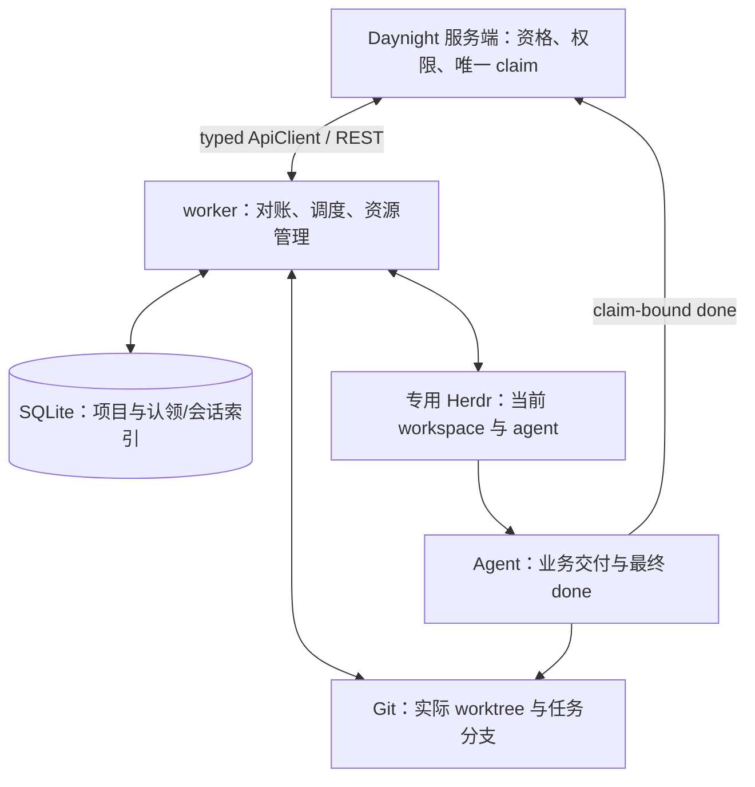

# Worker 架构设计

`daynight worker run` 是持续对账的前台进程：领取配置仓库中的合格任务，在稳定 Git worktree 中通过专用 Herdr 运行 Copilot 或 Codex，并在原 claim 结束后清理本机资源。[需求](../spec/daynight-worker.md)拥有产品行为，[认领架构](daynight-worker-claims.md)拥有服务端归属协议，[本机记录决策](../../.agents/notes/implemented/simplification/2026-10-27-worker-claim-records.md)记录存储简化的理由与代价。完整平台验收仍需独立的运行证据。

## 总体结构



服务端提供当前 claim 归属，SQLite 保存本机认领和原生会话索引，Git 与 Herdr 提供实际资源。Agent 完成实现、验证、PR、审查、授权合并和任务验收，最后提交原 claim 的 done；worker 按自己的完整 claim 清单决定资源生命周期，不再次解释业务验收。

## 配置与目录

共享 `~/.daynight/config.yml` 的根字段 `workerId` 是首次生成并原子保存的稳定 UUID。创建复用配置锁，持锁后重读，写入只声明拥有根字段 workerId；共享保存入口在锁内核对全部非归属解码值，根循环 alias 等导致未知或其他字段变化时拒绝保存并保留原文件。已有合法身份只读复用，非法值明确拒绝。Worker 固定使用 `~/.daynight/worker/`，没有状态根覆盖入口。

```text
~/.daynight/
  config.yml
  worker/
    state.sqlite       # projects、tasks
    instance.lock
    logs/
    tmp/
    h/                 # 专用 Herdr 配置与状态
<local_path>/.worktrees/daynight/<task_id>/
```

每个用户环境一个 worker。Run 和人工管理命令使用同一个实例锁，以同一 SQLite 作为取得/释放锁时的 gate；不添加锁表。失效 worker 锁可回收，但不能据此认定原生进程已停。

独立的 worker mapping 包含 repositoryRoot、maxConcurrent、pollIntervalMs、recoveryLimit、agent、model、args 和 repositories。默认值依次为 `~/daynights`、1、60000、3、copilot、null、[] 和 []。省略配置文件、worker 或可选字段使用这些默认值；显式 null 只对 model 有清除语义。根节点、review、worker 及其仓库条目的未知字段在运行时忽略，CLI 编辑保留其原 YAML 节点；已知字段的类型和值、YAML 结构、重复键、读取故障和取消继续严格校验。stateDirectory 等未知字段不能改变固定状态根。读取配置不重写文件。pollIntervalMs 的单一默认值由 workerConfigurationDefaults 提供；runtime 在每轮检查完成后按配置间隔等待，默认 60 秒。显式合法值直接保留，不迁移已有的 5000 配置。

Repository entry 需要 remote/path，可提供 projectId、agent/model/args 覆盖。路径相对 config.yml 目录或为绝对路径，不依赖启动 cwd，不展开 tilde；重复项目、重叠仓库和与状态根重叠均拒绝。相同 agent 类型逐字段继承；切换类型清除未显式给出的 model/args。Args 整体替换，不能覆盖 worker 拥有的 cwd/session/model/mode 参数或固定 full access 策略。普通 model、reasoning、日志和附加配置参数仍由原生工具解释。

`worker repo list` 只读本地注册。Add/remove 选择远端现存可访问 Project；显式 --project 支持非交互，否则多选显示名称、完整 UUID 和 repoUrl。新注册使用 worker.repositoryRoot 计算绝对路径，已有注册保留传输 URL、路径和覆盖，remote-only 项只补 projectId。Remove 只改变后续领取范围，不删除 clone、claim、worktree 或原生历史。repositoryRoot 与 review 独立，改变根不移动已有注册。

项目选择使用同一份捕获的服务凭据及 worker 配置，网络与提示不持配置锁。解码后的选择基线覆盖服务凭据、根的原始存在性与值、仓库列表，setup 另覆盖全局 native 字段；深比较支持未知字段的循环 alias 并检测并发变化。Repo 更新拥有 repositories 及保留条目的 projectId，setup 拥有 agent/model/args/repositories 及确认重置的仓库原生选项；repositoryRoot 和保留条目的未知字段始终受保护，显式删除拥有整个所选条目。保存时锁内重读并检查所有非归属解码值，拒绝相关变化及共享 alias 引起的无关变化，保留其余 YAML 节点、注释和安全 alias。空配置的交互式 run 先引导选择；非交互给出 repo add --project 指引。选择、取消或远端失败都不能启动部分任务。

`worker setup` 拥有交互编排：验证 stdin/stderr 为终端，读取当前同源配置快照，汇总公共环境报告，单选 Copilot/Codex，读取完整可访问 Project 清单并预选已有注册，再校验候选配置及每组实际 native model/args。最终摘要展示保留的传输 URL/路径、删除的注册和不兼容参数重置，确认后通过 repositories 模块一次原子保存。所选 agent 应用于全部选中 Project；切换类型清除不兼容的全局或项目级 model/args，兼容值保留。

Setup 复用 Herdr preflight 的原生版本、目录、运行时、hook asset、有效 SessionStart 及固定启动参数能力检查。Codex 要求至少 0.135，并支持 `--no-daemon`、权限及 hook trust bypass；两个 provider 都通过带固定参数的只读 `--help` 探测验证原生解析能力。公共报告检查平台、Node、Git、Herdr 版本、私有端点和随包 managed 技能；候选 integration 状态通过只读 herdr integration status 获取，不启动私有实例。运行时在 task cwd 使用 typed RPC integration 检查，并由原生命令报告恢复错误。Setup 检查不证明 provider 登录、真实 hook 执行或 live 协议能力。

独立环境探测返回通过、缺项或未验证的结构化结果，所有已启动探测用 allSettled 等待收尾。普通缺项可给修复指引并保存配置；命令清理的 AggregateError 及其 cause 链始终优先于普通缺项或取消，未确认进程收尾使 setup 明确失败。Setup 不安装、登录、clone、打开 worker SQLite、取得 claim 或启动 worker/Herdr/native agent。

配置在启动或重启时加载，不热重载。同一 claim 保留 agent 类型和 session_id；需要重新启动时使用当前适用于该 agent 的 model/args。另一工具的配置不会套到原工具。移出配置的项目仍由已有 projects 映射参与对账，使用当前全局适用设置。

一个状态目录属于当前配置的单一服务、账号和 workerId。切换这些身份前先结束旧执行，再重建本机状态；六列记录不承担跨服务或跨账号的旧执行自动接续。

## SQLite：项目映射与六列任务记录

```sql
CREATE TABLE projects (
  project_id TEXT PRIMARY KEY NOT NULL,
  repo_url TEXT NOT NULL,
  local_path TEXT NOT NULL
) STRICT;

CREATE TABLE tasks (
  project_id TEXT NOT NULL,
  task_id TEXT NOT NULL,
  claim_id TEXT NOT NULL,
  status TEXT NOT NULL CHECK (status IN ('pending', 'active', 'done')),
  agent TEXT NOT NULL CHECK (agent IN ('copilot', 'codex')),
  session_id TEXT,
  PRIMARY KEY (project_id, task_id, claim_id)
) STRICT;

CREATE UNIQUE INDEX tasks_one_active_per_task
  ON tasks(project_id, task_id) WHERE status = 'active';
```

| 本机状态 | 责任 |
|---|---|
| pending | 已实际取得或找回 claim，等待启动 |
| active | 承担启动、运行、恢复或收尾责任，占用名额 |
| done | 原 claim 已结束，其本机资源已收尾 |

`agent` 来自实际取得的 claim；`session_id` 是 Codex/Copilot 原生会话 ID，尚未取得时为 NULL。Herdr workspace/pane/terminal ID 每次从资源观察取得。启动资源前先提交 active，终止清理全部完成后才提交 done；失败保留责任，结束行保留。

Projects 在远端认领前保存仓库映射。有未结束任务或实际受管资源时不能改变该项目绑定。存储使用实际 SQLite 事务、STRICT 表和唯一约束；没有配置快照、启动回执、PID、恢复次数、清理进度、管理意图或时间列，也不把这些信息转存其他台账。日志只用于诊断。

数据库按此 schema 新建。遇到旧的详细执行 schema 时明确要求停止 worker 并删除旧 SQLite；程序不迁移或自动删除旧库。workerId 与原生历史保持各自原有位置。

## 启动、发现与周期对账

启动先取得实例锁、稳定身份并核验账号，再解析当前配置的 Project 并保存 projects。首次完整清单查询范围为当前配置项目与已有 projects 的并集；空数据库也先完成映射，才能找回原 worker 已有的 claim。

```text
完整读取自己的远端 claim 清单，补齐 SQLite 中的实际 claim
→ 观察专用 Herdr，优先排队推进仍归属的本机 active 和已确认的收尾责任
→ 完整发现 Herdr/Git 资源，核对遗留执行并汇总实际容量
→ 发现成功且有空闲名额时，优先启动 pending，再领取新任务
→ 可取消的轮询等待
```

自有清单只使用 workerId 归属条件，不混入 ready、allowAgents 或候选平台筛选。分页、认证或项目读取失败不产生可用于缺席清理的集合。完整性只对成功查询的项目成立；Herdr 中未映射的项目资源报告错误并保留，恢复项目配置后再纳入对账。Herdr/Git 读取失败保持错误，不解释为空资源。

每个 task 的操作在进程内串行，不同任务的有界 RPC、恢复和清理可并行。容量按 claim 去重计算 active 行、实际归属资源、已确认的 ending 收尾责任和适配器尚待确认的停止责任的并集。即使某个孤立执行没有本机行，关闭 pane 后尚未完成 Git 删除或进程停止确认，其名额和同 task 启动屏障仍保留至清理完成。降低 maxConcurrent 不抢占已有任务。已有 pending 优先，项目内按稳定 task_id 顺序选择；新候选保持服务端 ready 顺序。Pending 启动和新领取均以一次成功的名额分配为轮转单位，每分配一个名额就从下一个项目继续选择；一个项目持续有候选时也不会一次占满所有空闲名额。

仍属于自己的本机 active 已占名额，先为这些任务排队，在各自串行操作内读取当前 Herdr 并恢复；全局 Git 发现中其他工作区的文件系统错误不阻塞它们。新的 pending 启动和新 claim 分配仍等待完整全局资源发现成功，确保未计入的遗留资源不能释放出假名额。

每轮 Herdr 快照只用于调度和容量判断。实际启动或恢复在该 task 的串行操作内部重新读取 Herdr，再选择连接、重建 workspace 或启动原生进程。等待前一个操作期间，原 pane 可能已从 inactive 变为存活 agent；使用当轮旧快照不能授权重建或替换它。这个检查读取当前资源，不添加状态字段或持久回执。

新领取直接调用进程内 typed ApiClient：原子 claim 成功后登记 pending，确认名额和旧执行收尾后提交 active，再准备资源。请求结果未知时记录 Warning，不创建资源、不重发原请求；后续完整清单找回实际授予。服务端精确版本与唯一 active claim 控制竞争。并发上限约束本机 active 资源数，迟到授予可以留下等待名额的 pending。

现有远端 phase、Herdr 和 nativeSessionId 字段是当前观察的展示投影。每次基于新读到的 task/claim 与精确版本更新，未知响应记录日志后重新读取；投影不决定本机资源动作，也不保存待提交摘要回执。

## Git 工作区与资源身份

每 task 使用分支 `daynight/<task_id>` 和目录 `.worktrees/daynight/<task_id>`。新分支从仓库 HEAD 创建，保留分支从原 tip 使用。已有目录必须与仓库、Git 注册、静态 claim/worktree 身份及精确 .git 指针匹配；正常恢复保留 dirty state，不 reset/clean。原生会话已知而原 worktree 丢失时报告错误并保留 active。

沿用现有 Herdr 标签和 Git locked-worktree 所有权标记。它们只承载静态资源身份及其校验，动态执行进度不进入标记。实际 pane、cwd、Git 注册和目录每次读取。Device/inode 只作辅助核对；符号链接、外来路径、缺指针或歧义注册不能授权破坏性删除。

清理先确认进程停止和 workspace 关闭，再删除已核对的 worktree 内容，保留 .git 指针至内容删除完成，最后移除目录与 Git 注册。中断后只根据仍存在的实际资源继续；仍存在但缺指针的路径保留并报告。分支和提交历史保留。

资源发现检查未结束行、done 行和遗留资源。现有 Git 标记只含服务、project/task/claim/worktree 身份及物理校验信息，不含 workerId；必须关联本机行、专用 Herdr 或当前自有 claim，才能认定由本 worker 管理。仅有 Git 标记、无法证明属于本 worker 的资源报告并保留，不因自有清单缺席就删除，也不猜测 agent 构造任务行。已知项目仓库和专用 Herdr 是扫描范围，不进行全磁盘发现。

## Herdr 与原生会话

专用 Herdr 保持 `resume_agents_on_restore=false`，由 worker 唯一决定 agent 启动或恢复。复用私有端点、XDG 隔离、原 native 认证环境、shell history 与 attach；原 task pane 环境不会因客户端连接被改写。

存活的原 agent 直接重连。需要重新启动时，先停止并关闭已存在的 inactive workspace，再以当前 native 环境创建新的 workspace/pane；该操作保留 task/claim/worktree 身份和 SQLite 中的 session_id。Herdr 0.9.5 还原的 shell 使用空附加环境，terminal 仍可保留旧原生会话引用，因此 inactive pane 的旧引用不作为新会话 ID 保存。重建后的 pane 具有正确 native 环境和空会话引用，再按已保存 session_id 选择 fresh 或 resume。

| 当前情况 | 动作 |
|---|---|
| 原 agent 仍活着 | 连接并观察；本机 ID 为空时保存实际原生 ID，已有 ID 仅接受相同值 |
| 需要启动且 session_id 有值 | 使用记录的 agent 和原生 ID 直接 resume |
| 需要启动且 session_id 为 NULL | 记录 info，启动全新原生会话，取得 ID 后写回同一行 |

已保存的非空 session_id 是恢复身份；启动、重连及延后输入前的当前观察若报告不同原生 ID，立即返回可见错误并保留原 ID，不把新观察覆盖到记录或继续递交输入。只有本机 ID 为空时，才可采纳实际存活 agent 的真实会话 ID；inactive pane 的遗留引用仍不采纳。

NULL 是新 claim 首次启动的正常状态，也覆盖上次已经启动但 ID 尚未保存就中断的窗口，沿用 task/claim/worktree。该分支记录普通 info，没有历史反查、暂停或人工审批门槛。处理当前可见的同 claim 遗留进程后再启动，避免同时运行两个 agent。已知 ID 的 resume 失败是可见错误，不静默清除 ID。

首次启动和明确恢复使用完整 managed assignment，显式提供 worker-managed 环境、using-daynight、autopilot-managed-task 及 task/claim/worktree 上下文和本次执行配置。Prompt 声明这是后台任务，不向用户提问，任务范围和已有授权内的决定自行处理；等待 review 或 CI 时自行等待、定期检查并继续交付，不结束当前轮执行。连接存活 agent 不重发启动指令。适配层递交调用方给出的不透明 prompt，不选择业务任务或解释验收。

巡查在每个 task 的串行操作内读取当前 agent。原 claim 仍有效、agent 存活、interactiveReady 且未在启动、没有首次输入待递交时，idle/done 触发继续原任务的 ping；working、blocked、unknown 或尚未就绪只观察。Ping 沿用原任务、claim、worktree 和授权，要求自行等待 review/CI；agent 的 idle/done 不作为业务完成凭据。进入终止清理后只推进收尾。

首次输入在调用启动适配层前记录为 pendingInput 中的明确未递交 assignment，此时没有已提交输入基线。agent.start 的错误不表示 prompt 已递交：若后续观察到匹配的存活且就绪 pane，继续递交原 assignment；缺失或 inactive 资源仍走既有重建流程。只有成功回执前明确的 agent.prompt 未知结果，才将这次输入转为不确定标记。启动适配层串行检查后若仅重连已有 live agent、未发送输入，成功返回时清除 pending，保留没有提交基线的事实，后续可按状态发送 ping。

执行驱动在内存保留上次启动或 ping 输入的提交基线。成功递交时，基线只取适配层为这次输入读取的提交前观察。启动适配层在确认递交成功后、查询原生 session ID 前，通过 onPromptSubmitted 回调立即报告该回执，清除 pending 并建立基线；启动返回值仍为后续观察。后续观察不能覆盖输入基线，查询失败也保留已确认的回执；常规 ping 同样先记录成功回执，再读取后续状态。即使 agent 在启动调用返回前已推进并再次进入 idle/done，后续巡查仍能识别这一进展并发送 ping。

观察未变不重复递交，未知递交结果先观察核对，不盲目重放。这些输入记录不写入 SQLite、文件或日志恢复台账，进程重启后按当前资源重新判断。巡查和清理的选择依据见[agent 巡查决策](../../.agents/notes/implemented/bug-fix/2026-10-27-worker-agent-patrol.md)。

每次 fresh/resume 启动都由同一个参数构造器施加固定 full access 策略，配置中的 model/args 不能降低权限或重新启用确认。Copilot 在配置参数后追加 `--allow-all --no-ask-user --no-sandbox`；创建该任务 workspace 及运行只读原生探测时，最后覆盖 `COPILOT_ALLOW_ALL=true`、`COPILOT_ASSISTED_APPROVAL=false`。精确的字符串 `true` 同时免除 Copilot 的交互式目录信任；关闭 assisted approval 避免继承环境恢复权限确认。

Codex 保留 `--no-daemon [resume <session_id>]` 前缀，在配置参数后追加 `--dangerously-bypass-approvals-and-sandbox --dangerously-bypass-hook-trust`，最后通过 `-c` 注入 `projects` inline table，各路径 key 的值均为 `{trust_level="trusted"}`。任务路径先取 realpath，再生成与 Codex 原生查询一致的 trust key：Windows 将 ASCII 大写转为小写，并在同一个 table 中写入去重后的普通路径与 extended/namespaced 路径两种拼写，以覆盖 Node 和 Codex 对 drive/UNC 前缀的差异；非 ASCII 字符大小写保留。Linux/macOS 使用一个保留原大小写的 key。

使用原生归一化 key 可覆盖同一路径已有的 untrusted 设置，避免其精确匹配优先于混合大小写的覆盖。各 key 编码为 TOML 字符串；inline table 将含点号、引号或 Unicode 的路径保留为完整 key，避免 dotted override parser 拆分 `.worktrees`。两个 bypass 开关不免除目录信任，因此 trusted 配置是同一启动策略的一部分。Codex 的有效 features 检查使用相同真实 cwd 和最后的 trusted 覆盖，保证检查实际会被加载的项目配置。参数与版本选择的依据由[full access 决策](../../.agents/notes/implemented/architecture/2026-10-27-worker-full-access.md)拥有。

参数校验在启动 RPC 前拒绝 Copilot 的 assisted approval、sandbox、deny/tool restriction，以及 Codex 的 approval/sandbox 控制和重复的系统 bypass 开关。缺少原生能力明确失败。策略只作用于本次命令和任务 workspace，不写全局 native 配置；认证、业务授权及组织/操作系统策略保留各自归属。

保留当前输入 readiness 与 Codex composer 检查，启动输入只提交到可用的业务 composer。需要业务人工输入时通过 worker attach 在原终端处理。启动回执、输入提交状态和停止时读取的进程信息只留本次调用，进程中断后不承诺启动指令恰好递交一次。原生历史可用性由原生命令报告，不额外扫描 provider 数据库或会话 manifest。

自动恢复计数及超限等待只在当前进程中维护，重启清零。达到 recoveryLimit 后保留 active 与错误，可用人工 retry 或重启重新尝试。

## 结束、清理与退出

正常对账发现原 claim 不在成功完整自有清单中时统一终止清理，无需再按 task 状态分类 done/release/强制撤回。

```text
通知 agent 清理可归属的工作区外临时资源
→ 最多等待本次尝试的 10 分钟
→ 停止当前受管进程并确认退出
→ 关闭 Herdr workspace
→ 删除该 claim 的 worktree，保留分支
→ 本机 done
```

清理消息成功递交后，后续巡查观察到 agent 为 idle 即确认该清理轮完成，开始实际停止进程和关闭 workspace。这个判断不依赖 stateChangeSeq/completionSeq 或 interactiveReady；通知前的观察和 submitPrompt 回执本身不完成清理。通知失败或结果未知时保留错误，继续等待本次既定期限，不自动重发。期限届满仍按既有停止确认流程收尾。这个终止清理阶段的 idle 不表示业务验收完成，worker 仍不提交业务 done。

每个清理 job 的期限与进度只存在内存中，同进程轮询不重置期限。重启后按清单和剩余资源重新进入清理并重新计时，通知可以重复；已不存在的资源可完成对应步骤，失败保留责任。当前进程已确认归属结束的 job 可以在后续服务轮询失败时继续。不同任务分别有界，一个 RPC 不延误其他清理。已知目标的收尾与退出先观察对应的 Herdr 执行并推进停止；删除时只核对该目标的 Git 注册和目录。同项目其他 worktree 或其他仓库的注册问题分别报告，不阻塞可正常观察的 agent 停止或退出。

Ctrl+C 停止新认领和调度，取消全部运行中的 job，包括已选中的终止清理 job，并等待它们全部收尾，避免清理操作与退出停止并发执行。随后直接中断并停止受管 agent、关闭 workspace，不进入清理驱动、不发送清理 prompt，也不等待 agent 的清理轮。退出只停止运行资源，保留 claim、worktree、原生 session ID 和所有未完成 active/pending 行；归属已经结束的任务也遵守这一规则，不在退出路径删除 worktree 或写 done。下次启动由正常完整清单及资源对账重新进入已结束归属的终止清理。直接中断可能留下工作区外临时资源，这是退出无需等待 agent 清理的明确代价。

关闭 workspace 会移除私有 Herdr 标签，标签可能是缺失本机行的遗留执行最后一份 worker 归属证明。普通清理与退出都先在 task 串行操作内重新观察资源；若已验证归属的 claim 缺少本机行，则以观察到的原 agent 类型登记 pending，仅在 agent 存活时保存观察到的原生会话 ID，随后才允许关闭 workspace。Pending 不占用同 task 唯一 active 行；重启通过该行与 Git 标记继续终止清理，清理完成后再允许后继 claim 启动。类型无法确认时保留 workspace 并报告错误，不从当前配置推断历史类型；未知归属的 Git-only 资源仍只报告并保留。

退出还须结算适配层待确认的停止操作，再停止私有 Herdr。停止失败保留原错误与实际资源；无法确认停止时保留私有 daemon，不能以停止 daemon 掩盖未确认的 agent 停止。正常完成、release、强制撤回与人工管理仍使用原有通知及清理时序。此边界的理由见[直接退出决策](../../.agents/notes/implemented/bug-fix/2026-10-28-worker-direct-shutdown.md)。

## Agent 完成与人工操作

Agent 完成全部交付和证据后，使用显式 claimId 与观察版本通过 task set-status done 提交现有完成操作。普通与 managed 技能各自负责其生命周期，缺失 assignment 不回落普通执行；待人验、必要 PR 未合并或验收不足时保持未完成。

人工 retry/release/resume 要求先停止 worker run，取得同一个实例锁后同步处理指定 claim。锁占用时明确提示停止 runner；命令没有后台队列或持久意图。

| 命令 | 同步动作 |
|---|---|
| retry | 核验仍属于本 worker 的 active claim，尝试一次重连或恢复；保持 claim、agent、worktree，NULL 按 info 后新建规则执行。pending 留给 run 正常调度。 |
| release | 核验 owner/admin、原 claim 和指定版本；通知、停止并关闭 workspace；提交 release；确认源归属结束后删除 worktree，旧行 done。 |
| resume | 核验 released previousClaimId 和指定版本，按当前配置申请 fresh claim/worktreeId；确认授予后写 pending、session_id=NULL，随后 run 启动。 |

Release 在远端确认前保留 worktree，拒绝时仍可恢复原执行；确认成功后本机删除前中断，下一次 run 按原 claim 缺席继续收尾。远端操作保留既有权限、精确版本、release 的 stoppedConfirmed 和 resume 资格检查。

新 claim/worktree ID 在提交前生成并输出。未知响应只 GET 核对、不自动重放。仍未知或命令中断时，操作者先核对远端结果，再启动 runner；没有跨进程原管理意图接续。管理期间 runner 停机是这一单控制者方案的操作代价。

Web 的“强制撤回”是独立的 owner/admin 操作，针对当前 active 或 released claim，以原 claimId 和观察版本在同一事务中清除 worker、返回 todo、清空任务起止时间并设置 allowAgents=false。它无需本机实例锁或 stoppedConfirmed，不启动目标执行，也不承诺远端 agent 立即停止或撤销外部凭据。原 worker 下次成功完整自有清单发现 claim 缺席后，按普通终止流程收尾。自动领取须等新的明确许可操作。Transfer endpoint、typed operation 和 CLI 命令已移除；受控 release 和 fresh resume 保持各自语义。详情归属展示与确认交互由[认领架构](daynight-worker-claims.md#web-归属展示与撤回)拥有。

## 观测关联和错误

沿用 stderr 与 JSONL，日志携带 workerId、实际平台、projectId/taskId/claimId、agent 和已知 sessionId。RPC、并发 job 与清理显式传递取消和关联信息。记录认领、重连/恢复、NULL 新会话 info、资源错误、清理和人工操作结果，保留错误类型及 cause，脱敏凭据且不记录完整 prompt。

诊断模块先对凭据脱敏，再统一渲染终端日志：上下文、消息及错误链中的完整连字符 GUID 仅显示首段 8 位十六进制字符，保留原大小写，非 GUID 文本原样保留。缩写只作用于终端输出，JSONL 的字段、消息和错误仍保留完整 ID，供精确检索。事件生产者、API、prompt 与持久化继续使用完整 ID。该 GUID 展示规则由[日志 GUID 缩写决策](../../.agents/notes/implemented/bug-fix/2026-10-28-worker-log-guids.md)拥有。

执行驱动按 projectId/taskId/claimId 在内存保留最近一次报告的观察：等待/执行阶段、Herdr session/workspace/pane/terminal、agent、已知原生 sessionId 和延后首次输入状态。首次连接及这些信息变化时才报告，忽略 idle/working 切换和序列计数变化。实际启动始终报告并建立同一观察基线，避免下一轮重复提示重连；忘记原 claim 时一并清除基线。资源发现按完整成功观察比较保留警告，稳定警告只报告一次，确认消失后再出现则重新报告；失败或不完整观察不能确认警告消失。真实操作与失败尝试继续报告。去重在事件来源完成，stderr 与 JSONL 共用结果；状态只存在当前进程，日志不参与恢复。选择依据见[日志决策](../../.agents/notes/implemented/bug-fix/2026-10-27-worker-log-transitions.md)。

运行时在完整清单和私有实例就绪后提示 worker attach。该命令只连接既有私有 Herdr，不读取业务凭据或 SQLite、不持 worker 锁；detach 保留正在执行的任务。按具体 claim 核对日志：

```bash
jq 'select(.taskId == "<task-id>" and .claimId == "<claim-id>")' <worker-log.jsonl>
```

## 验证边界

真实 SQLite 验证精确列数、枚举、nullable ID、历史行及唯一 active。Git 测试验证 dirty state、静态归属、遗留发现、重开与安全删除。受控 HTTP/Herdr 验证空库项目初始化、未知 claim 结果、重连、指定 ID resume、NULL 新建、idle/done 巡查 ping、未改变观察及未知输入去重、容量、清理通知后 idle 推进、清理期限和人工锁互斥。退出验证覆盖全部 job 的取消与等待收尾、终止清理中途退出、直接停止不递交清理消息、不删除 worktree 或把未完成行写 done、已结束归属重启后重新清理，以及停止错误和不确定停止时的私有实例保留。原生启动策略验证两个 provider 的 fresh/resume 完整 argv、Copilot 环境覆盖、Codex 路径编码与 Windows trust key 归一化、冲突参数拒绝及只读能力探测；真实原生会话恢复与三平台完整 Goal 验收仍需各自来源明确的运行证据。

当前模型明确将清理原截止、恢复累计次数、原 model/args 和中断管理意图的跨重启保证收回到进程内。既有详细状态模型的原始理由与替代方案保存在[简化决策](../../.agents/notes/implemented/simplification/2026-10-27-worker-claim-records.md)及其前驱记录中。
