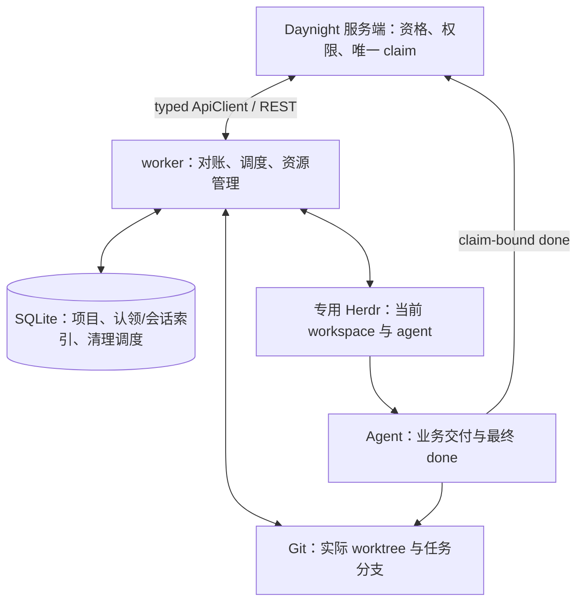

# Worker 架构设计

`daynight worker run` 是持续对账的前台进程：领取配置仓库中的合格任务，在稳定 Git worktree 中按冻结的 herdr/web 模式运行 Copilot、Codex 或 Claude，并在原 claim 结束后按 backend 的停止与归档条件收尾。[需求](../spec/daynight-worker.md)拥有产品行为，[认领架构](daynight-worker-claims.md)拥有服务端归属协议，[本机记录决策](../../.agents/notes/implemented/simplification/2026-10-27-worker-claim-records.md)记录存储简化的理由与代价。账号级运行观测的[客户端采集与调度](daynight-worker-reporting.md)及[服务端存储与查询](daynight-worker-snapshots.md)各有独立职责，与本机执行协调及 claim 归属分离；它不授权资源清理或任务状态变更。Worker 沿用[客户端要求](../spec/daynight.md#c1-包与平台)的 Linux、Windows 和 macOS ARM64 支持范围；完整平台验收仍需独立的运行证据。

## 总体结构



服务端提供当前 claim 归属，SQLite 保存本机认领、原生会话索引与独立终态清理调度，macOS Herdr 的独立 lifecycle 库保存原运行身份与停止证据，Git 与 Herdr 提供实际资源。[Herdr 生命周期设计](herdr-worker-lifecycle.md)拥有该机制，Linux/Windows 使用共享私有 daemon 路径。顶层 assignedTo 是独立人的责任归属，所有 worker 服务端写入保留它；自动候选使用 assignedTo=me，自动 claim 事务要求当前负责人等于认证账号 userId；未分配或他人任务不具备自动领取资格。既有 claim、Session 或 archive 权限保持原执行归属。Agent 完成实现、验证、PR、审查、授权合并和任务验收，最后提交原 claim 的 done；worker 按自己的完整 claim 清单决定资源生命周期，不再次解释业务验收。

## 状态来源与清理判定

Worker 用期望状态与实际状态之差选择动作，不以重复的步骤完成标记替代资源自身的状态。下表的来源在每次相关决策时读取；本机索引、done 状态或历史成功回执不能代替当前资源观察。

| 事实 | Source of truth |
|---|---|
| 当前 claim 是否仍归本 Worker | Daynight 成功完整的自有 claim 清单；显式操作使用原 task 的精确版本读取 |
| Herdr workspace、pane 与 agent 是否存在 | 专用 Herdr 当前 snapshot；停止中的原进程另核对 OS |
| macOS Herdr 原运行及停止证明 | lifecycle journal 的不可变原身份、停止意图与证明；未确认停止继续核对原进程实例和 OS，不能以 pane 缺席替代 |
| Web 原生操作及 generation | 原 Controller journal 与不可变 launch ticket |
| 原 Controller/native 进程是否停止 | 原进程实例证明及 OS process group / Windows Job 实际成员 |
| IPC endpoint 是否已移除 | 文件系统，Windows 管道生命周期由原进程停止确认 |
| Worktree 目录与 Git 管理注册是否仍在 | 当前文件系统与 Git 管理目录 |
| Session 归档是否 ready | 服务端对原归档身份、长度与摘要的回执 |

资源身份、控制意图、固定期限和重试策略可持久保存；“停止做过了”“删除做过了”等步骤状态不能授权跳过观察。一次清理调用返回临时的完成结果，只有本次观察满足全部目标才更新本机记录并释放容量。设计取舍见[资源状态决策](../../.agents/notes/implemented/architecture/2026-11-04-worker-resource-state.md)。

macOS Herdr 将原运行停止、封段和 ledger 确认作为执行槽释放目标；最终归档尚未接入，独立 archive/worktree 责任继续保留并维持同 task 屏障，不用本机 done 认定归档或工作区已删除。

## 配置与目录

共享配置根（`DN_CONFIG_DIR`，缺省 `~/.daynight`）中的 `config.yml` 的根字段 `workerId` 是首次生成并原子保存的稳定 UUID。创建复用配置锁，持锁后重读，写入只声明拥有根字段 workerId；共享保存入口在锁内核对全部非归属解码值，根循环 alias 等导致未知或其他字段变化时拒绝保存并保留原文件。已有合法身份只读复用，非法值明确拒绝。Worker 使用该根目录下的 `worker/`，配置、身份、SQLite、锁与 Controller 状态均随根目录选择；真实 HOME 和 Provider 原生目录保持不变。

```text
~/.daynight/
  config.yml
  worker/
    state.sqlite       # projects、tasks、cleanup_schedules
    herdr-executions.sqlite # macOS Herdr 运行与停止证据
    instance.lock
    logs/
    tmp/
    h/                 # legacy 私有 Herdr 配置与状态
      r/<instance>/    # macOS 每个实际运行代次的独占实例
<local_path>/.worktrees/daynight/<task_id>/
```

每个配置根目录一个 worker；不同根目录不应管理同一任务 worktree。Run 和人工管理命令使用同一个实例锁，以同一 SQLite 作为取得/释放锁时的 gate；不添加锁表。失效 worker 锁可回收，但不能据此认定原生进程已停。

独立的 worker mapping 包含 repositoryRoot、maxConcurrent、pollIntervalMs、recoveryLimit、agentControlMode、agent、model、args 和 repositories。默认值依次为 `~/daynights`、1、60000、3、herdr、copilot、null、[] 和 []。省略配置文件、worker 或可选字段使用这些默认值；显式 null 只对 model 有清除语义。根节点、review、worker 及其仓库条目的未知字段在运行时忽略，CLI 编辑保留其原 YAML 节点；已知字段的类型和值、YAML 结构、重复键、读取故障和取消继续严格校验。stateDirectory 等未知 YAML 字段不能改变状态根；覆盖入口仅为环境变量 DN_CONFIG_DIR。读取配置不重写文件。pollIntervalMs 的单一默认值由 workerConfigurationDefaults 提供；runtime 在每轮检查完成后按配置间隔等待，默认 60 秒。显式合法值直接保留，不迁移已有的 5000 配置。

Repository entry 需要 remote/path，可提供 projectId、agent/model/args 覆盖。路径相对 config.yml 目录或为绝对路径，不依赖启动 cwd，不展开 tilde；重复项目、重叠仓库和与状态根重叠均拒绝。相同 agent 类型逐字段继承；切换类型清除未显式给出的 model/args。Args 整体替换，不能覆盖 worker 拥有的 cwd/session/model/mode 参数或固定 full access 策略。普通 model、reasoning、日志和附加配置参数仍由原生工具解释。

`worker repo list` 只读本地注册。Add/remove 选择远端现存可访问 Project；显式 --project 支持非交互，否则多选显示名称、完整 UUID 和 repoUrl。新注册使用 worker.repositoryRoot 计算绝对路径，已有注册保留传输 URL、路径和覆盖，remote-only 项只补 projectId。Remove 只改变后续领取范围，不删除 clone、claim、worktree 或原生历史。repositoryRoot 与 review 独立，改变根不移动已有注册。

项目选择使用同一份捕获的服务凭据及 worker 配置，网络与提示不持配置锁。解码后的选择基线覆盖服务凭据、根的原始存在性与值、仓库列表，setup 另覆盖全局 native 字段；深比较支持未知字段的循环 alias 并检测并发变化。Repo 更新拥有 repositories 及保留条目的 projectId，setup 拥有 agent/model/args/repositories 及确认重置的仓库原生选项；repositoryRoot 和保留条目的未知字段始终受保护，显式删除拥有整个所选条目。保存时锁内重读并检查所有非归属解码值，拒绝相关变化及共享 alias 引起的无关变化，保留其余 YAML 节点、注释和安全 alias。空配置的交互式 run 先引导选择；非交互给出 repo add --project 指引。选择、取消或远端失败都不能启动部分任务。

`worker setup` 拥有交互编排：验证 stdin/stderr 为终端，读取当前同源配置快照，汇总公共环境报告，单选 Copilot/Codex，读取完整可访问 Project 清单并预选已有注册，再校验候选配置及每组实际 native model/args。最终摘要展示保留的传输 URL/路径、删除的注册和不兼容参数重置，确认后通过 repositories 模块一次原子保存。所选 agent 应用于全部选中 Project；切换类型清除不兼容的全局或项目级 model/args，兼容值保留。

Setup 复用 Herdr preflight 的原生版本、目录、运行时、hook asset、有效 SessionStart 及固定启动参数能力检查。Codex 要求至少 0.135，并支持 `--no-daemon`、权限及 hook trust bypass；两个 provider 都通过带固定参数的只读 `--help` 探测验证原生解析能力。公共报告检查平台、Node、Git、Herdr 版本、私有端点和随包 managed 技能；候选 integration 状态通过只读 herdr integration status 获取，不启动私有实例。运行时的 integration 修复由独立的 preflight 编排负责，共享的 prerequisite checks 保持只读；运行时在 task cwd 验证有效 hook，并由原生命令报告恢复错误。Setup 检查不证明 provider 登录、真实 hook 执行或 live 协议能力。

独立环境探测返回通过、缺项或未验证的结构化结果，所有已启动探测用 allSettled 等待收尾。普通缺项可给修复指引并保存配置；命令清理的 AggregateError 及其 cause 链始终优先于普通缺项或取消，未确认进程收尾使 setup 明确失败。Setup 不安装、登录、clone、打开 worker SQLite、取得 claim 或启动 worker/Herdr/native agent。

配置在启动或重启时加载，不热重载。同一 claim 保留 agent 类型、模式和 session_id；Herdr 需要重新启动时使用当前适用于该 agent 的 model/args，Web 恢复沿用已冻结的执行配置。另一工具的配置不会套到原工具。移出配置的项目仍由已有 projects 映射参与对账，使用当前全局适用设置。

一个状态目录属于当前配置的单一服务、账号和 workerId。切换这些身份前先结束旧执行，再重建本机状态；认领索引不承担跨服务或跨账号的旧执行自动接续。

## SQLite：项目映射与认领索引

```sql
CREATE TABLE projects (
  project_id TEXT PRIMARY KEY NOT NULL,
  repo_url TEXT NOT NULL,
  local_path TEXT NOT NULL
) STRICT;

CREATE TABLE tasks (
  project_id TEXT NOT NULL,
  task_id TEXT NOT NULL,
  claim_id TEXT NOT NULL,
  status TEXT NOT NULL CHECK (status IN ('pending', 'active', 'done')),
  agent TEXT NOT NULL CHECK (agent IN ('copilot', 'codex', 'claude')),
  session_id TEXT,
  agent_control_mode TEXT NOT NULL DEFAULT 'herdr' CHECK (agent_control_mode IN ('herdr', 'web')),
  PRIMARY KEY (project_id, task_id, claim_id)
) STRICT;

CREATE UNIQUE INDEX tasks_one_active_per_task
  ON tasks(project_id, task_id) WHERE status = 'active';
```

| 本机状态 | 责任 |
|---|---|
| pending | 已实际取得或找回 claim，等待启动 |
| active | 承担启动、运行、恢复或收尾责任，占用名额 |
| done | 原 claim 的本机执行已结束；macOS Herdr 的 worktree 与 archive 责任仍由独立 lifecycle 保留 |

`agent` 来自实际取得的 claim；`agent_control_mode` 是服务端冻结的模式；`session_id` 是原生会话 ID，尚未取得时为 NULL。macOS Herdr workspace/pane/terminal 与原进程身份由独立 lifecycle 库保存并与当前观察核对；其他平台从当前资源发现。启动资源前先提交 active，终止清理全部完成后才提交 done；失败保留责任，结束行保留。

Projects 在远端认领前保存仓库映射。有未结束任务或实际受管资源时不能改变该项目绑定。存储使用实际 SQLite 事务、STRICT 表和唯一约束；tasks 索引没有配置快照、业务启动回执、PID、执行恢复次数、管理意图或时间列。独立 cleanup_schedules 表按 project/task/claim 标识清理责任，并绑定 worktreeId，保存期限、失败次数、下次资格时间和诊断。它只约束终态清理的责任和策略，不记录“已停止”“已关闭”“已删除”等资源完成标记。相同 claim 的 worktree 身份冲突拒绝写入，首个期限不延长。macOS Herdr 的原运行、输入准入、停止 journal、Session 连接和段边界由独立 lifecycle 库保存；配置选择、累计恢复次数和通用人工管理意图不进入 tasks 索引。原生操作回执由其执行 backend 读取权威来源；日志只用于诊断。

Worker 状态库以原索引结构作为版本 5 基线，版本 6 增加 cleanup_schedules，版本 7 删除 notified/submitted 两个步骤字段，保留原 projects/tasks 和清理身份、期限及调度。五个业务库的版本 0 统一在既有准入后丢弃原 schema 和数据，再执行各自基线与编号升级；已有空文件和查询访问同样初始化。旧详细执行 schema 的非零版本 1–4 仍明确拒绝并保留原库，要求停止旧 worker 后自行移除该库。独立 Herdr lifecycle 库的现存无版本或不兼容数据必须保留并拒绝，不能按上述规则重置。workerId 与原生历史保持各自原有位置。[SQLite 升级设计](cli-sqlite-migrations.md)拥有同步重置、非零来源检查和单库原子性。

## 启动、发现与周期对账

启动先取得实例锁、稳定身份并核验账号，再创建独立的运行快照 collector/reporter，随后解析当前配置的 Project 并保存 projects。CLI 显式注入运行包 version 和启动时捕获一次的 workingDirectory；reporter 的首次采集不等待仓库准备或 tick，之后由独立 30 秒 timer、完整清单及确认 claim 驱动。首次完整清单查询范围为当前配置项目与已有 projects 的并集；空数据库也先完成映射，才能找回原 worker 已有的 claim。完整清单发布只包含不可变引用和来源时刻，位于资源观察与较长操作之前；报告无额外 inventory 查询或 SQLite 字段。[上报设计](daynight-worker-reporting.md)拥有单飞、合并、采样、缓存及传输机制。

```text
完整读取自己的远端 claim 清单，补齐 SQLite 中的实际 claim
→ 观察专用 Herdr，优先排队推进仍归属的本机 active 和已确认的收尾责任
→ 完整发现 Herdr/Git 资源，核对遗留执行并汇总实际容量
→ 发现成功且有空闲名额时，优先启动 pending，再最多领取一个新任务
→ 可取消的轮询等待
```

自有清单只使用 workerId 归属条件，不混入 assignedTo、ready、allowAgents 或候选平台筛选。新候选单独组合 assignedTo=me、ready=true、allowAgents=true 和实际平台条件，在服务端排序和分页前过滤并绑定游标；每页保持相同选择。负责人不匹配的直接 claim 在项目写事务内拒绝，既有 claim 的恢复和显式人工 resume 仍按原执行权限处理。分页、认证或项目读取失败不产生可用于缺席清理的集合。完整性只对成功查询的项目成立；Herdr 中未映射的项目资源报告错误并保留，恢复项目配置后再纳入对账。Herdr/Git 读取失败保持错误，不解释为空资源。

每个 task 的操作在进程内串行，不同任务的有界 RPC、恢复和清理可并行。容量按 claim 去重计算 active 行、实际归属资源、已确认的 ending 收尾责任和适配器尚待确认的停止责任的并集。即使某个孤立执行没有本机行，关闭 pane 后尚未完成 Git 删除或进程停止确认，其名额和同 task 启动屏障仍保留至清理完成。macOS Herdr 的原运行停止、封段及 ledger 同步确认后释放执行槽，但保留 worktree 仍维持同 task 屏障；已排队恢复的 job 继续计入容量。降低 maxConcurrent 不抢占已有任务。已有 pending 优先，项目内按稳定 task_id 顺序选择，每分配一个名额就从下一项目继续，直到没有可启动项或容量已满。新领取在所有配置项目中每轮合计最多一个：跳过空项目，保持服务端 ready 顺序，确认授予并登记 pending 后立即结束本轮领取；即使旧 claim 资源使该任务暂不能 active，也不再寻找第二个新任务。项目游标保留到下一轮，从下一项目继续。候选生成器在本轮结束时统一关闭，后续新领取沿用 runtime 在完整调度轮结束后的 pollIntervalMs 等待。[领取节奏决策](../../.agents/notes/implemented/feature/2026-11-04-worker-single-acquisition.md)记录其吞吐代价。

仍属于自己的本机 active 已占名额，先为这些任务排队，在各自串行操作内读取当前 Herdr 并恢复；全局 Git 发现中其他工作区的文件系统错误不阻塞它们。新的 pending 启动和新 claim 分配仍等待完整全局资源发现成功，确保未计入的遗留资源不能释放出假名额。

每轮 Herdr 快照只用于调度和容量判断。实际启动或恢复在该 task 的串行操作内部重新读取 Herdr，再选择连接、重建 workspace 或启动原生进程。等待前一个操作期间，原 pane 可能已从 inactive 变为存活 agent；使用当轮旧快照不能授权重建或替换它。macOS 还须通过持久准入核对原运行，旧快照和空 pane 都不能替代原始停止证据；legacy 路径只依据当前资源检查。

原 claim 在完整自有清单中缺席后，即使全局资源快照未发现它，本机未完成行也进入与已知资源相同的串行清理 job。清理目标由原 claim 身份及可选的真实 worktreeId 表示；Herdr、Web 或 Git 观察发现完整 owner 后沿用该身份。尚无 worktreeId 时不创建虚假 owner 或另建台账：先确认原模式没有剩余执行，再核对目标 Git 注册；没有原注册时只允许 removeEmptyReservation 移除无注册空目录。已识别的同 task 其他 claim 资源保持不变，旧 claim 的资源已消失便可结束旧索引。身份不完整的失败使用进程内退避，重启由保留的未完成索引行重新发现；完整 owner 才可持久保存 cleanup_schedules。

新领取在远端写入前跳过仍有同 task 旧资源的候选，再直接调用进程内 typed ApiClient：原子 claim 成功后登记 pending；macOS 随即保存该新 claim 的空运行记录，证明资源尚未启动，再确认名额和旧执行收尾后提交 active、准备资源。请求结果未知时记录 Warning，不创建资源、不重发原请求；后续完整清单找回实际授予。macOS 不把这种库存找回解释为 fresh launch provenance；缺少原 lifecycle 记录时保留未知，不因远端 native 摘要为空而补建运行。服务端精确版本与唯一 active claim 控制竞争。并发上限约束本机 active 资源数，迟到授予可以留下等待名额的 pending。

现有远端 phase、Herdr 和 nativeSessionId 字段是当前观察的展示投影。每次基于新读到的 task/claim 与精确版本更新，未知响应记录日志后重新读取；投影不决定本机资源动作，也不保存待提交摘要回执。

## Git 工作区与资源身份

每 task 使用分支 `daynight/<task_id>` 和目录 `.worktrees/daynight/<task_id>`。新分支从仓库 HEAD 创建，保留分支从原 tip 使用。准备新工作区时先检查固定路径；无 Git 注册的空预留目录可通过 removeEmptyReservation 非递归移除，再完成原有独占预留及 Git add。这个恢复不采纳未知内容，也不绕过其他 claim 的有效注册。已有目录必须与仓库、Git 注册、静态 claim/worktree 身份及精确 .git 指针匹配；正常恢复保留 dirty state，不 reset/clean。原生会话已知而原 worktree 丢失时报告错误并保留 active。

统一的资源身份为 `projectId/taskId/claimId/worktreeId` 四项 canonical UUID。Herdr 标签后缀和 Git locked-worktree 所有权标记使用同一份身份；服务地址参与 API 请求和 managed assignment；macOS lifecycle 的完整 owner 另绑定 serverOrigin、workerId、ownerUserId 和 provider，不能与四字段静态标记混为一谈。动态执行进度与 title 不进入 Git 标记。实际 pane、cwd、Git 注册和目录每次读取。Device/inode 只作辅助核对；符号链接、外来路径、非空目录的缺失指针或歧义注册不能授权递归删除。

仅在 backend 允许终态删除时，清理先确认原进程停止、workspace 关闭及必要归档，再删除已核对的 worktree 内容，保留 .git 指针至内容删除完成，最后移除目录与 Git 注册。Worktree 目录和 Git 管理注册分别观察：目录消失即满足目录目标，原注册仍在时独立移除。中断留下的无指针空目录及未创建注册的空预留目录可通过非递归 rmdir 清除，非空且缺少归属证明的路径保留并报告。操作结果未知时再次观察资源，最终判定来自实际目录和注册的消失。分支和提交历史保留。

`worktrees.ts` 在完整归属检查后，为仓库 root/common directory、受管父目录、Git 注册目录及 worktree 记录实际身份，并保留 locked marker、gitdir、commondir 和 .git 内容。内容删除前再次完成归属检查，每次修改前用这些只读快照核验资源。进程内按仓库物理身份与 task 串行化删除，同一 worktree 的另一次删除在原操作真正结束前拒绝进入。

`remove-worktree-contents.ts` 逐层遍历普通目录，以非递归 unlink 删除文件和链接，以 rmdir 删除空目录。POSIX 目录通过 `O_NOFOLLOW | O_DIRECTORY` 打开，核对 bigint dev/ino、有效用户 uid、设备和 owner 读取/搜索权限；缺少 owner 写权限时，仅通过已验证的 FileHandle 补充 `0o200`。0555 因而成为 0755，而 0444 文件、文件硬链接和外部 symlink 目标不需要改权限。不可读、不可搜索、异所有者、跨设备目录和底层 I/O 错误直接保留；Windows 不执行 POSIX 权限恢复，使用普通目录身份检查和非递归删除。

遍历期间保留祖先目录句柄，并在修改前后核对路径与句柄身份。目录权限修改因此绑定已打开的原 inode；观察到目录替换或归属变化立即失败。Node 没有可移植的 openat/unlinkat 接口，路径 unlink/rmdir 的最后一次核验与系统调用之间仍不是原子边界，故受管写入进程停止是必要前提，不能把此机制当作对恶意并发路径改写的隔离。选择与代价见[只读目录清理决策](../../.agents/notes/implemented/bug-fix/2026-11-04-worker-readonly-directory-cleanup.md)。

每步检查 operation 的取消与期限，已发出的文件系统操作和目录句柄关闭始终 await，不用超时竞速提前释放串行保护。失败后保留原错误与剩余资源，下一次从实际内容重新核验；无归属证明的非空内容继续受到保护。Web backend 的停止证明、归档成功、worktree 删除保持独立：归档失败不得删除源，shutdown 跳过归档与删除。清理失败不释放名额或同 task 的旧 claim 屏障；其他 task 仍按现有容量及串行调度规则推进。

资源扫描与清理 job 可交错，扫描返回的旧资源可能已经完成删除。Coordinator 从一次新的资源观察取得临时清理结果；Web 状态库不持久保存 agentStopped、backendResourcesClosed、worktreeDeleted 或重复的 input/result 回执。即使 Web execution 已写 done，重复收尾仍检查原 Controller journal、进程实例和 endpoint，正常终态清理还继续移除归属明确的 Git 剩余资源。只有本次观察满足全部目标才结束残留责任，done 本身不能释放名额。Web done 已保存、最小 Worker 行或调度责任尚未更新的中断窗口遵守同一规则。Shutdown 重新核验原进程和 endpoint，仍保留 worktree，不因 done 跳过停止证明。

资源发现检查未结束行、done 行和遗留资源。Git 标记只含 project/task/claim/worktree 身份及物理校验信息，不含 workerId；必须关联本机行、专用 Herdr 或当前自有 claim，才能认定由本 worker 管理。仅有 Git 标记、无法证明属于本 worker 的资源报告并保留，不因自有清单缺席就删除，也不猜测 agent 构造任务行。已知项目仓库和专用 Herdr 是扫描范围，不进行全磁盘发现。

## Workspace 名称与身份

Herdr 的 label 同时承担 workspace 显示名称。名称以经过终端安全转义的完整 title 开头，随后是 ` | daynight:` 与四字段 canonical JSON。解析器只读取最后一个分隔符之后的严格身份 JSON；标题可包含相同分隔符或 JSON 片段，不参与归属比较。读取时只按身份后缀识别，展示标题为空或含未转义字符不改变归属；身份格式不符返回 null，忽略该 workspace；Git 注册扫描同样跳过缺失或格式不符的 marker；无注册普通目录不会成为全局扫描失败的依据。两处只容忍格式解析失败，IO 与已识别资源的完整性校验继续报错。Unicode Cc、行分隔符和双向显示控制字符转为字面量 `\u{hex}`；其余文本包括 emoji 的 ZWJ 保留。完整 title 和身份不在 CLI 中截断，Herdr 决定当前终端宽度内的显示。

Agent name 为 `dn_` 加四字段 canonical JSON 的 SHA-256 前 24 位十六进制字符，与 title 无关。创建、发现、观察、停止和清理比较四项身份，再核对实际 workspace/pane/terminal；workspace 创建时指定 shell 的初始 cwd；每次新 agent.start 前，在调用方准入后核对原 pane 的 canonical cwd 与任务 worktree 一致。发现、活 agent 重连、输入和停止不重复要求 cwd 元数据相等。创建 workspace 只按稳定归属查重，其他 workspace 使用同一 cwd 不构成身份冲突；实际创建错误由 workspace.create 返回。停止依赖原绑定及进程停止证据；Git 删除保留独立的目录归属校验；清理不需要可读取的 task title。名称与归属分离的选择和 Herdr API 限制见[命名决策](../../.agents/notes/implemented/architecture/2026-10-28-worker-workspace-names.md)。

现有 own-claim inventory 已提供完整 Task。协调器把最新 title 作为展示输入传递，复用 task 的串行操作，在下一轮成功清单后按实际 label 差异调用 `workspace.rename({workspace_id,label})`。活 workspace 与恢复超限任务仍有同步机会；不新增查询、SQLite 列或后台任务。请求前后核对稳定身份与实际 workspace ID；取消后不提交新请求，已发送请求的迟到结果不授予归属或允许重新创建。Herdr 的 `workspace_info` 响应只确认内存名称更新并安排保存，重启仍依据最新 title 与 snapshot 再对账。

只有 rename RPC 或回执故障属于 `workspace-name-error`，保留原 cause，留待后续重新观察且不计入执行恢复预算。binding/身份冲突及取消仍是生命周期错误。title 不进入 prompt 或 agent 输入，因此不能改变任务指令。

运行资源使用当前四项身份格式，启动和人工管理直接执行正常的配置、实例锁、资源观察与执行流程，不读取迁移清单或转换历史 label、Git marker。发现时跳过格式不符的候选；针对明确目标的所有权和物理绑定检查保持严格。删除格式转换、备份、回滚及启动阻塞机制的决定见[迁移机制移除决策](../../.agents/notes/implemented/simplification/2026-10-28-remove-worker-workspace-migration.md)。

## Web backend 与执行证据

配置的 `worker.agentControlMode` 省略为 herdr，只影响新 claim。同 claim 始终沿用服务端模式；普通 summary 与 properties 更新不可改写。Web 运行 Codex stdio app-server、Claude Agent SDK 或 Copilot SDK 私有 runtime；其初始输入、原生控制、停止和恢复契约由 [Task Session 设计](task-session-protocol.md)拥有。

主协调器仍从完整自有 claim 清单和实际资源对账，为两种模式合并计算容量与同 task 启动屏障。Herdr 保持进程内业务 jobs，macOS 另有持久 lifecycle，Linux/Windows 保持最小索引路径；两种模式共享独立持久清理调度；Web 在独立版本 2 的 `worker/web-executions.sqlite` 保存自己的冻结配置、执行身份、恢复预算和清理意图，在 `controller/` 保存 ticket 与版本 6 的原生 journal。Web 版本 0 重置原 schema 和数据，因此其旧 completed 行不进入补归档库存；此重置不删除独立 execution 目录中的 ticket、journal 或待归档文件。版本 1→2 在迁移中删除 cleanup 的 input、baseline、result、error、agentStopped、workspaceClosed、mode、backendResourcesClosed、worktreeDeleted 字段；当前 parser 只接受 kind、startedAt、deadline。Controller 拥有的原生操作回执保持在 journal，本机库不复制清理进度。Worker 持原实例锁分别打开所需状态库，全部成功后才创建 coordinator；一库失败不回滚已提交的另一库，下次按各自版本恢复。原始 Web 执行状态缺失时保留责任并报错，不能使用 legacy Herdr 的 NULL ID 新建语义代替连续性。

Web 恢复复用持久 `recovery.count`、`pauseReason` 和 `retryAuthorized`。预算耗尽或 Coordinator 的既有失败门槛停止执行时，按原 claim 保存诊断原因并撤销已耗用的 retry 授权，保留次数和执行身份。暂停写入必须独立提交，不能在同一 SQLite 事务内随后抛错而回滚暂停事实。Herdr 的进程内失败计数不替代 Web 的持久暂停。

Backend 在 worktree 准备、initialize、launcher.prepare/launch 和原生输入之前检查暂停。未授权 retry 的暂停直接返回持久观察，shutdown/clearShutdown 设置的正常恢复标记不能越过该门禁。对于尚无暂停原因、恢复次数已达上限且没有正常关停来源的既有 generation，先结合原 journal 与进程证据判断：最后一代仍健康时继续观察；已停止且自动恢复耗尽时补齐暂停；停止证明不足时保留诊断等待，不启动旧 generation 或替代进程。健康执行的正常关停恢复保留原有路径，次数达到上限本身不构成故障。

Shutdown 在停止进程前识别已停止或失败的耗尽执行并保存暂停，避免把故障停机写成正常关停来源；尚未完成的显式 retry 也保留为暂停，不能通过 orderly restart 获得第二次尝试。兼容既有数据时，restartAfterShutdown=true 且 journal 没有 error 仍被视为旧正常关停来源；该标记不提供写入前进程状态的完整历史，不能据此重建所有旧故障。

执行放行与远端摘要对账分离。持久暂停或失败门槛阻止执行时，Coordinator 仍以最新读取的 task 版本发布 `phase=waiting`、原 `nativeSessionId` 与 `herdr:null`，保留 active claim。发布失败只记录摘要错误，后续完整库存重新读取版本并对账，不增加原生恢复计数或清除暂停；三个摘要字段已经一致时不再写入。暂停继续承担名额及资源责任，不触发终止清理或业务完成。

显式 retry 仍受 runner 实例锁和原 active claim 校验保护。authorizeRecoveryRetry 保证 pauseReason 非空并设置 retryAuthorized=true，表示一次尚未消费的原身份恢复授权。完整停止验证通过后，beginWebGeneration 在同一 SQLite 事务中递增 count、建立新 generation、清除 pauseReason 并保留 retryAuthorized=true；换代与消费授权不能留下可重复尝试的中断窗口。普通 beginRecovery 不消费显式授权。

新 generation 已分配但 verifyWorktree 或 launcher.prepare 在启动提交前失败时，原 journal 可能仍属于直接前代。新的显式授权可通过 retryUnsubmittedWebGeneration 继续当前尚未提交的 generation：要求 launchSubmission=not-submitted、当前没有 Controller 或 native process 证据，且 journal 的 execution、claim、Session 和原生身份一致、generation 恰为直接前代；前代完整停止证明还须重新通过 OS 核验。该操作在同一事务中消费这次新授权、递增 count、清除暂停并保留 retryAuthorized=true，保持当前 generation、launchId 和 initialOperationId，同时清除 restartAfterShutdown。unknown 或 acknowledged 不能使用这个前代 journal 分支，缺失或不一致的停止证据也不能被视为未启动。

pauseReason=null 且 retryAuthorized=true 表示这次恢复已绑定当前 generation、仍在等待就绪。后续 tick 或重启只能观察并完成这一代，不能再次创建 generation。初始化保持 activity=initializing，Coordinator 继续发布 waiting；completeRecoveryRetry 仅在 ready/working 观察的原生身份及 generation 匹配后清除标记并恢复正常阶段。失败、停止或无法确认的结果重新持久暂停并清除标记。初始 assignment 沿用原操作回执，不因 retry 重发，也不为缺失原生身份创建替代会话。该恢复门禁与 task.properties.paused 的 Herdr 周期 ping 门禁互不替代。选择及代价见[持久恢复暂停决策](../../.agents/notes/implemented/bug-fix/2026-11-04-web-recovery-pause.md)。

Web 普通终止清理只在执行库保存 cleanup 的 kind、startedAt、deadline 和原生操作身份。每次从原 Controller journal 读取同一 cleanup operation 的回执，结合 OS 进程实例观察决定等待或停止，不在 Worker 库复制提交结果或资源完成状态。确认 Controller 和原生进程停止后封存并上传 Session 文件归档，服务端确认 ready 后才删除 Git worktree。归档失败保留源和收尾责任，只重试上传；每轮有界补传旧 completed 执行并对失败退避，已删除的 cwd 不妨碍从原 execution 目录补归档。Task 软删除后，仍具有效 PAT 和项目成员资格的原 Session owner 通过专用归档收尾接口取得 ready 回执后释放执行容量；身份失效或上传失败继续保留源和责任，不将访问拒绝当作归档成功。文件格式、完整性与只读读取由 [Task Session 设计](task-session-protocol.md#完成后的文件归档)定义。worker 退出直接停止拥有的执行并保留未完成责任。强制撤回先在服务端冻结原 Session 的普通写权限，worker 后续完整清单再收尾；没有立即停止的保证。

## Herdr 与原生会话

macOS 每个实际运行代次独占一个现有 Herdr daemon；Linux/Windows 共享各自 Worker 的私有 daemon。专用 Herdr 保持 `resume_agents_on_restore=false`，由 worker 唯一决定 agent 启动或恢复。复用私有端点、XDG 隔离、原 native 认证环境、shell history 与 attach；原 task pane 环境不会因客户端连接被改写。

Fresh/resume 原生启动前，runtime preflight 通过同一私有 daemon 的 `integration.list` 获取所选 agent 的唯一有效记录。`current` 不产生安装写入；只有明确的 `not_installed` 或 `outdated` 才调用官方 `integration.install`，参数仅为 `{target: agent}`，随后重新读取并要求状态为 `current`。缺行、重复行、畸形数据或未知状态明确失败，不据此推断可以安装。官方安装器拥有 provider home 中 integration 配置与 hook asset 的更新；worker 不自行实现另一套配置写入器。

Codex 修复在安装 RPC 之前要求当前 worker 启动的私有 daemon 子进程仍存活，保证所核对的 native 环境来自本次启动；复用既有 daemon 时 API 不提供原始环境证据，因此在写入前拒绝自动 Codex 修复，正常停止并重启 worker 后可重新建立环境关系。随后读取 daemon 版本并要求已核对的 Herdr 0.9.5，再有界读取 provider home 中的 `config.toml`；只有文件不存在视为空配置，读取错误直接传递。只读保护按该版本官方安装器的逐行规则预测改写，用 TOML parser 解析原文和预测文本，并比较完整配置语义；只允许启用 `features.hooks` 和删除 integration 拥有的废弃键 `features.codex_hooks`。非法 TOML、重复表、inline/dotted/quoted features 布局或多行字符串被破坏等情况，在任何安装写入之前明确失败。日期/时间值和 parser 不支持精确比较的结构同样拒绝，避免精度折损掩盖语义变化。worker 不自行规范化或回写 native 配置。未核对的 installer 版本拒绝自动 Codex 修复；已 `current` 的路径和 Copilot 不执行此 TOML 保护。此检查不承诺保留注释，也不锁定外部客户端对配置的后续修改。

每次启动独立发出 integration 请求，由私有 daemon 的事件循环逐个同步执行官方 handler；安装由其中的 integration handler 拥有。这里的串行处理针对单个 daemon 请求，整个 preflight 序列不构成一个原子操作。各次 preflight 使用本次调用的取消与 deadline；安装与核对失败或取消保留错误，不启动该次 native agent。未知写入结果不自动重放，后续尝试先重新观察；取消或响应丢失不撤销已经到达 daemon 的安装。

安装后仍在实际 task cwd、原 native 环境和本次配置下验证有效 hook feature、SessionStart 命令、hook asset 与运行时，完成后才可 `agent.start`。静态检查与安装回执不证明 hook 已执行；官方原生 session ID 绑定与输入 readiness 仍使用既有机制。存活 agent 的直接重连不触发重新安装。Setup 继续通过离线 `herdr integration status` 及共享只读检查报告缺失依赖，不创建 daemon 或修复 integration。决定与代价见[integration 修复决策](../../.agents/notes/implemented/bug-fix/2026-10-28-worker-integration-preflight.md)。

macOS 的原运行必须有持久来源。原 agent 仍存活时接入同一 Session，只增加 connectionEpoch 并建立显式间断的新段，不重发 assignment。需要重新启动时，必须已有原运行的可靠停止证明、原 nativeSessionId 和已确认的首次输入结果，再以同一 Session/native conversation 建立下一 executionGeneration。prepared 运行只有在原 daemon、shell 和端点身份一致时才能继续原启动；launch_requested 恢复、未知输入或停止保持阻断。nativeSessionId 可以在首次输入后补齐，不作为取得原生进程身份的前置条件。

新 pane 的 shell 可能仍在执行初始化。Adapter 的 `HerdrAgentManager.launch` 在 workspace 串行操作中只对明确拒绝的 `agent_pane_busy` 启用最多 2 秒的等待与重试，沿用 Herdr 官方 CLI 的 shell 初始化判据：当前 `pane.process_info` 指向原 pane，shell PID 与前台进程组相同，前台列表包含该 PID 且名称或 argv[0] 是受支持的 shell。每次重试重新核对原 workspace/pane/terminal 和 Agent 状态；调用方准入完成后、每次新 agent.start 递交前，原 pane 的当前 cwd 必须与任务 worktree 的 canonical 路径一致。Herdr 的 agent.start 只把 argv 写入既有 shell，初始化脚本可能改变 workspace.create 设置的初始 cwd；Codex trusted 配置不改变 shell 目录。目录不符时以明确未递交失败。出现 Agent、归属变化、进程证据不足或期限届满时停止重试，保留错误。缺少前台进程组观察的平台不推断 shell 就绪。RPC 结果未知时不重发。等待与重试使用原操作取消和期限，每次按剩余预算计算启动 timeout；在调用内恢复成功不增加 Coordinator 的执行失败次数。机制、依据及代价见[shell 初始化恢复决策](../../.agents/notes/implemented/bug-fix/2026-11-04-worker-shell-start-readiness.md)。

macOS durable adapter 在调用 launch 前已保存 `launch_requested`。上述重试只处理同次调用内明确未启动的拒绝，保持原运行代次，不发送 assignment；launch 成功后仍先提交原 native 进程证明，再开放输入。未知响应、进程身份变化及崩溃不能获得新的启动许可，也不能通过重发 assignment 恢复。

Linux/Windows 保留 legacy 恢复：存活 agent 直接观察；原 Agent 意外退出且当前资源确认 inactive 后，正常巡查自动停止并关闭原 workspace，以当前 native 环境重建后按索引 session_id 选择 resume 或 fresh。inactive pane 的遗留原生引用不能填入索引；已知非空 ID 不可被不同观察覆盖。NULL 可用于 legacy 新会话，也可能覆盖 ID 尚未保存的中断窗口；macOS 不能沿用这个窗口新开对话。

已保存的非空 session_id 是恢复身份；启动、重连及延后输入前的当前观察若报告不同原生 ID，立即返回可见错误并保留原 ID，不把新观察覆盖到记录或继续递交输入。只有本机 ID 为空时，才可采纳实际存活 agent 的真实会话 ID；inactive pane 的遗留引用仍不采纳。

Linux/Windows legacy 路径中，NULL 是新 claim 首次启动的正常状态，也覆盖上次已经启动但 ID 尚未保存就中断的窗口，沿用 task/claim/worktree。该分支记录普通 info，没有历史反查、暂停或人工审批门槛。处理当前可见的同 claim 遗留进程后再启动，避免同时运行两个 agent。已知 ID 的 resume 失败是可见错误，不静默清除 ID。

首次启动和 legacy 明确恢复使用完整 managed assignment，显式提供 worker-managed 环境、using-daynight、autopilot-managed-task 及 task/claim/worktree 上下文和本次执行配置。Prompt 声明这是后台任务，任务范围和已有授权内的决定自行处理；完成任务确实需要用户补足 agent 无法在任务范围和已有授权内提供的信息、决策、授权或操作时，按 managed 流程先设置自身任务 paused=true 并核验后等待，重新核验问题解决、原 assignment 与恢复授权后解除暂停并核验再继续。等待 PR review、reviewer approval、CI 或轮询超时都不得作为设置 paused=true、请求用户介入或结束当前轮执行的理由；agent 自行等待、定期检查并继续交付，同时遵守用户独立发出的暂停、限制与撤销。连接存活 agent 不重发启动指令。macOS 已确认首次传输后的恢复只继续原任务，不重放原 assignment；可能已经启动而原 ID 缺失的运行保持未知。适配层递交调用方给出的不透明 prompt，不选择业务任务或解释验收。

巡查在每个 task 的串行操作内读取当前 agent。原 claim 仍有效、当前 task 未暂停周期输入、agent 存活且 interactiveReady、未在启动、没有首次输入待递交时，idle/done 触发继续原任务的 ping；working、blocked、unknown 或尚未就绪只观察。workerPingPrompt 将完整正文包在字面量 `<system remider>` 与 `</system remider>` 标签内，沿用原任务、claim、worktree 和授权，明确禁止因等待 PR review、reviewer approval、CI 或轮询超时设置 paused=true，要求自行等待并继续交付。Review 由人执行也不改变这一分类；agent 的 idle/done 不作为业务完成凭据。进入终止清理后只推进收尾。

暂停使用可写布尔 task property paused。缺席与 false 在周期 ping 决策中均表示未暂停，但存储与通用读取保留两者差别；存在的错误类型必须暴露。该值不复制为 SQLite 状态，也不改变 worker.phase、task 状态或新 claim 资格。Web backend 当前没有周期 continuation ping，解除该属性不发送 Web 原生输入或启动/恢复指令；Web 操作者的暂停展示与解除入口由[Web 设计](daynight-web.md#暂停展示与解除)拥有。

Herdr 适配层为周期 ping 接收独立的发送前检查，在 workspace 串行操作、结构化就绪及可见文本的已知阻塞检查之后、agent.prompt mutation 之前读取服务端当前 task，核验原 active claim、workerId 和 worktreeId，再检查 paused。原库存快照不能授权该次输入。读取失败保持原错误链且不递交，归属不再匹配时不接管新 claim。最终检查之后与原生 mutation 之间没有跨系统原子事务；已发送或已受理的输入不会因随后暂停而撤回。

暂停返回明确的未递交结果与当前观察，不作为输入失败或已提交回执，也不更新上次输入基线。解除暂停后，仍然 idle/done 的同一观察可成为新的正常 ping 决策。Legacy 的首次及待递交 assignment、恢复和 cleanup 输入不使用这个周期门禁。macOS durable adapter 在所有自动输入的最终递交边界核对 paused、原 claim、进程身份和 admission；暂停保留观察、原运行停止与人工 attach。取舍由[暂停周期输入决策](../../.agents/notes/implemented/feature/2026-11-02-task-paused-worker-pings.md)拥有。

macOS 由 durable adapter 分离 launch 和 input：先保存 preparation 与 launch_requested，启动后持久保存原 shell/native agent 的出生证明，再开放 active admission。首次输入保存 pending/dispatching/transport_completed 或 unknown；重启遇到未确认提交时阻断重放。Session 注册、同代重连、停止证明与采集段通过独立事务边界恢复，详情由 [Herdr 生命周期设计](herdr-worker-lifecycle.md)拥有。

Legacy 的首次 assignment、上次输入观察与提交回执仍由执行驱动的内存 pendingInput 和基线管理。明确未递交时等待匹配 pane 的输入就绪；已知菜单或禁用输入保留首次输入及 continuation 机会，不推进已提交基线、不增加执行失败次数，关闭后继续巡查。成功回执通过 onPromptSubmitted 在后续观察前建立基线。观察未改变时不重复递交；未知结果先观察核对，不盲目重放。这些 legacy 基线不跨进程保存；macOS 的未知输入限制不能被内存基线重建覆盖。巡查选择依据见[agent 巡查决策](../../.agents/notes/implemented/bug-fix/2026-10-27-worker-agent-patrol.md)。

每次 fresh/resume 启动都由同一个参数构造器施加固定 full access 策略，配置中的 model/args 不能降低权限或重新启用确认。Copilot 在配置参数后追加 `--allow-all --no-ask-user --no-sandbox`；创建该任务 workspace 及运行只读原生探测时，最后覆盖 `COPILOT_ALLOW_ALL=true`、`COPILOT_ASSISTED_APPROVAL=false`。精确的字符串 `true` 同时免除 Copilot 的交互式目录信任；关闭 assisted approval 避免继承环境恢复权限确认。

Codex 保留 `--no-daemon [resume <session_id>]` 前缀，在配置参数后追加 `--dangerously-bypass-approvals-and-sandbox --dangerously-bypass-hook-trust`，随后追加两个独立参数 `-c`、`check_for_update_on_startup=false`，覆盖配置参数中的同名设置，使 fresh/resume 启动均免除更新检查及其交互提示。Herdr 的 `agent.start` 接收结构化 argv，回执逐项核对；任务 prompt 通过独立的 `agent.prompt` 递交，配置覆盖不拼入 prompt。该调用级设置不写用户全局 `config.toml`，也不改变 Copilot；依据见[启动更新检查决策](../../.agents/notes/implemented/bug-fix/2026-10-28-worker-codex-startup-update.md)。最后通过 `-c` 注入 `projects` inline table，各路径 key 的值均为 `{trust_level="trusted"}`。任务路径先取 realpath，再生成与 Codex 原生查询一致的 trust key：Windows 将 ASCII 大写转为小写，并在同一个 table 中写入去重后的普通路径与 extended/namespaced 路径两种拼写，以覆盖 Node 和 Codex 对 drive/UNC 前缀的差异；非 ASCII 字符大小写保留。Linux/macOS 使用一个保留原大小写的 key。

使用原生归一化 key 可覆盖同一路径已有的 untrusted 设置，避免其精确匹配优先于混合大小写的覆盖。各 key 编码为 TOML 字符串；inline table 将含点号、引号或 Unicode 的路径保留为完整 key，避免 dotted override parser 拆分 `.worktrees`。两个 bypass 开关不免除目录信任，因此 trusted 配置是同一启动策略的一部分。Codex 的有效 features 检查使用相同真实 cwd 和最后的 trusted 覆盖，保证检查实际会被加载的项目配置。参数与版本选择的依据由[full access 决策](../../.agents/notes/implemented/architecture/2026-10-27-worker-full-access.md)拥有。

参数校验在启动 RPC 前拒绝 Copilot 的 assisted approval、sandbox、deny/tool restriction，以及 Codex 的 approval/sandbox 控制和重复的系统 bypass 开关。缺少原生能力明确失败。策略只作用于本次命令和任务 workspace，不写全局 native 配置；认证、业务授权及组织/操作系统策略保留各自归属。

所有 provider 的自动输入先使用 Herdr 结构化观察：核对原 workspace/pane/terminal 和 agent 身份，等待启动结束及所需的 interactive_ready，blocked 状态拒绝输入。Codex/Claude 的 automatic/cleanup 随后读取原绑定 pane 的完整可见文本，仅识别明确的菜单或禁用输入；legacy 使用 agent.read，macOS 的 inspectHerdrInput 使用 pane.read。菜单选中行与原生控件定义的接受/返回提示（包括次级快捷键、重绑定和换行）、已知禁用输入行构成拒绝条件；Codex Session picker 的完整 Resume/Fork 标题、其后的搜索或选中会话行及单独的 resume/fork/restore 主动作也构成拒绝条件，避免窄宽度裁去次级控件后误准入，后续 prompt 排除历史菜单；正常 composer、状态栏、目录展示、占位文案及边框不构成正向门槛。自定义或未知布局不等待白名单匹配。读取失败、数据畸形或截断保持明确未递交；读取后重新核对绑定与结构化状态，再执行适用的调用方最终授权检查；legacy 递交 agent.prompt 并核对回执，macOS 由既有持久仲裁器派发严格终端 Input。pane/agent 的 cwd 元数据相等不是输入条件；目录一致性只在上述新原生启动递交前核对。需要业务人工输入时通过 worker attach 在原终端处理。Legacy 的启动回执、输入提交状态和停止观察只留当前调用；macOS 保存原运行和输入结果，未知结果阻断重放，但传输完成也不证明模型恰好处理一次。原生历史可用性由原生命令报告，不额外扫描 provider 数据库或会话 manifest。macOS 的 automatic/cleanup 报告 composer unavailable，不从正常布局推断空字段；manual 保持可操作菜单，显式交还和干净自动恢复的 resume 保留真实空字段证明，不能将草稿或未知界面当作 empty。用途、lease/fence、草稿处置与严格传输由[输入仲裁设计](herdr-input-arbitration.md)拥有。取舍及原界面检查的历史原因见[结构化输入准入决策](../../.agents/notes/implemented/simplification/2026-11-04-worker-structured-input-readiness.md)。

Herdr 自动恢复计数及超限等待只在当前进程中维护，重启清零。达到 recoveryLimit 后保留 active 与错误，可用人工 retry 或重启重新尝试。Web 使用前述持久恢复暂停，普通重启不提供额外授权。

## 结束、清理与退出

正常对账发现原 claim 不在成功完整自有清单中时进入对应 backend 的终止收尾，无需再按 done/release/强制撤回分类。

macOS Herdr 通过持久 journal 保存 stop_intent 和 close_requested，使用原出生身份与 audit token 停止独占运行，保存 stopped_confirmed、封段并确认 ledger。不能凭 pane 消失、PID 或命令行变化、内存 Map 为空判断停止。替代实例和未证明资源保持 unknown，不接管、不删除。journal 写失败只允许依据已有证据尽力停止，不能在重启后补写意图来追认同一 boot 中已消失 daemon 的完整停止。

当前 Herdr 注册能力 observe/control/archive 均为 false，没有最终 archive finalization。终态 cleanup 先由[持久输入仲裁](herdr-input-arbitration.md)撤销控制，仅在原 automation、无草稿/未知输入且界面安全时发送一次提示；即使原运行停止及同步已确认，可结束本机执行行并释放执行槽；worktree 和独立 archive 责任仍保留，保留工作区继续阻止同 task 后继覆盖。Web 则继续以 ready 归档回执作为工作区删除门槛。

Linux/Windows legacy Herdr 的正常终态清理目标为：

```text
通知 agent 清理可归属的工作区外临时资源
→ 最多等待首个清理期限内的 10 分钟
→ 停止当前受管进程并确认退出
→ 关闭 Herdr workspace
→ 删除该 claim 的 worktree，保留分支
→ 本机 done
```

清理资源观察、通知、停止/关闭及 worktree 核验与删除使用专属的 5 分钟 operation，totalMs 与 requestMs 同为 300000；内部 Herdr RPC 和 Git 命令继承请求预算。Web 清理 IPC、缺失执行记录时的启动来源 HTTP 核验、Controller 等待清理回执及最终进程停止证明使用同一 5 分钟上限，通知与 Controller 清理回执等待还受原 10 分钟期限的剩余时间限制。进程停止中的信号升级间隔保持独立。正常执行继续使用原有预算。期限选择与代价见[清理操作预算决策](../../.agents/notes/implemented/bug-fix/2026-11-04-worker-cleanup-operation-budget.md)。

Legacy Herdr 的一次有界清理调用先观察原执行，对仍存活的 agent 发送一次建议性清理消息，随后轮询新的 Herdr snapshot。通知后的新观察为 idle、资源已消失或原期限届满允许进入实际停止和 workspace 关闭；stateChangeSeq/completionSeq 与 interactiveReady 不作为必要条件。通知失败或未知结果保留错误和原期限，仍以当前资源决定等待或停止，同次调用不重发。Herdr 只有 PTY 提交 ACK，没有逐输入 operation ID 或查询回执；Worker 不用 notified/submitted 台账模拟权威状态。调用中断或重启后，下一次尝试可能再次通知仍存活的原 agent，期限仍保持不变。Idle 只选择停止时机；stopAndClose 后重新读取资源并结算 OS 待停止实例，实际消失才满足清理目标。Worker 不据此提交业务 done。

具备完整 owner 的终态清理首次保存 cleanup_schedules 后才能通知或删除已归属资源；记录只保存责任、首个期限与重试策略。只有 claim 身份的空预留检查使用已保留索引及进程内调度，不捏造 worktreeId。Web 首次初始化 cleanup 时使用调度表已保存的 deadline；两库提交之间中断后仍沿用该期限，已过期时只给零剩余预算。已有 Web cleanup 保留自身原 deadline。Web 用原 cleanupOperationId 从 Controller journal 查询原生操作状态，调度表的 lastError 只描述调度故障，不复制或覆盖原生回执。失败、取消与重启不延长原期限；重启由持久调度恢复 ending，再核对实际资源，不能为已结束任务启动原生业务执行。Legacy Herdr 本机行已 done、调度责任尚未删除时，即使当前配置全部使用 Web，仍按原责任初始化私有 Herdr 控制后端；清理 job 查询资源前以及 shutdown 核验前均确保后端可达。普通巡查的 Herdr 依赖只来自当前配置与尚未进入 ending 的执行；仅用于清理的后端初始化和读取留在该 claim 的 job 内，遵守 nextAttemptAt，失败不能在全局巡查中再次初始化或阻塞无关 Web 执行。shutdown 则合并执行与清理责任，初始化后实际读取全部 Herdr workspace，不能将后端不可用当作空资源。该初始化不启动业务 Agent，实际观察完成前仍保留责任与容量。只有实际清理成功才清除调度责任，不能用到期或 done 行替代资源观察。调度读写异常由 job 错误边界捕获，聚合原清理错误与 SQLite 错误，并以进程内失败次数和 nextAttemptAt 保持有界退避；它不把未确认持久化当作成功，也不让 job 的未处理 rejection 阻止 shutdown 证明停止。既有持久责任保留；跨重启只能恢复最后一次已确认的持久状态。

每个 claim 记录失败次数和 nextAttemptAt，失败间隔为 min(1000 × 2^(failures−1), 60000) 毫秒。launchCleanups 只启动到期且没有运行 job 的责任，不为退避创建 sleep 或占用全局执行锁。不同 claim 分别判断资格，同 task 仍使用串行操作；失败项不会阻止其他到期清理，且不使用 execution recoveryLimit。清理期间 active、实际资源、ending 和待确认停止责任继续按 claim 去重占槽，同 task 旧 claim 屏障保持。失败原因解除后，正常对账在下次到期时从实际资源继续，所需执行收尾目标全部完成才释放槽位；macOS Herdr 按前述规则将独立 archive/worktree 责任继续保留。

每次实际失败保留原错误及 cause，并记录 observation、agent-stop、backend-close、archive 或 worktree-removal 阶段与下一次重试时间。backend-close 表示 Agent 已停止但 IPC endpoint 等后端资源关闭未确认；归档和目录删除阶段同样明确 Agent 已停止。达到容量上限且存在失败清理时，按阻塞 claim 集合变化输出 cleanup-capacity-blocked；提示对应阶段、错误及恢复原因后自动重试，普通 tick 不反复输出同一集合。具体间隔、错误和恢复责任由[清理重试决策](../../.agents/notes/implemented/bug-fix/2026-11-04-worker-cleanup-retry.md)解释。

已确认归属结束的清理责任可以在后续服务轮询失败时继续。已知目标的收尾先观察对应执行并推进停止，删除时只核对该目标 Git 注册和目录。其他 worktree 或其他仓库的注册问题分别报告；退出无需 Git 发现成功即可停止已知 Agent。

Ctrl+C 的根取消信号同步停止报告触发、新认领和调度，并取消报告及全部运行中的 job，包括已选中的终止清理 job。取消动作在任何报告 join 等待前完成，终止清理不能在该等待期间继续删除 worktree 或完成本机行。Runtime 随后等待报告尝试收尾，再进入 coordinator shutdown 等待全部 job，避免清理操作与退出停止并发执行。随后直接中断并停止受管 agent、关闭 workspace，不等待退避、不发送清理 prompt，也不等待 agent 的清理轮。Web 仅进行停止证明，不重做归档或 worktree 删除；Agent 已停的结果不因文件删除失败改写为停止失败。后端关闭未确认仍使退出失败，但 shutdown-error 明确区分原 Agent 已停与后端资源尚未关闭。退出只停止运行资源，保留 claim、worktree、原生 session ID 和所有未完成 active/pending 行；归属已经结束的任务也遵守这一规则，不在退出路径删除 worktree 或写 done。原有终态清理调度继续保留，下次启动恢复同一责任、原期限和资源身份，并通过实际资源对账推进。直接中断可能留下工作区外临时资源，这是退出无需等待 agent 清理的明确代价。

macOS shutdown 只结束原运行与段，保留 active claim 和同一 Session，不发布最终 ready；下次恢复仍要求原停止证明与 native 身份。

Legacy 关闭 workspace 会移除私有 Herdr 标签，标签可能是缺失本机行的遗留执行最后一份 worker 归属证明。普通清理与退出都先在 task 串行操作内重新观察资源；若已验证归属的 claim 缺少本机行，则以观察到的原 agent 类型登记 pending，仅在 agent 存活时保存观察到的原生会话 ID，随后才允许关闭 workspace。Pending 不占用同 task 唯一 active 行；重启通过该行与 Git 标记继续终止清理，清理完成后再允许后继 claim 启动。类型无法确认时保留 workspace 并报告错误，不从当前配置推断历史类型；未知归属的 Git-only 资源仍只报告并保留。

macOS 依据独立 lifecycle 责任，不用远端摘要或现存 foreground 覆盖原始证据。已知目标的停止独立于其他仓库或同项目 sibling worktree 的错误；删除仍按原 Git 物理身份检查。

Legacy 退出还须结算适配层待确认的停止操作，再停止私有 Herdr。停止失败保留原错误与实际资源；无法确认停止时保留私有 daemon，不能以停止 daemon 掩盖未确认的 agent 停止。正常完成、release、强制撤回与人工管理均使用本节的建议性通知和资源目标。此边界的理由见[直接退出决策](../../.agents/notes/implemented/bug-fix/2026-10-28-worker-direct-shutdown.md)。

macOS 的独占停止与恢复边界由 [Herdr 生命周期设计](herdr-worker-lifecycle.md)拥有，原停止责任不能转交未知共享 daemon。

## Agent 完成与人工操作

Agent 完成全部交付和证据后，使用显式 claimId 与观察版本通过 task set-status done 提交现有完成操作。普通与 managed 技能各自负责其生命周期，缺失 assignment 不回落普通执行；待人验、必要 PR 未合并或验收不足时保持未完成。

人工 retry/release/resume 要求先停止 worker run，取得同一个实例锁后同步处理指定 claim。锁占用时明确提示停止 runner；命令没有后台队列或持久意图。

| 命令 | 同步动作 |
|---|---|
| retry | 核验仍属于本 worker 的 active claim，尝试一次重连或恢复；保持 claim、agent、worktree。macOS 不绕过持久 unknown 或缺失原 ID；Linux/Windows legacy NULL 按 info 后新建；Web 仅授权一次原身份恢复，原生 ID 或完整停止证明缺失时拒绝。pending 留给 run 正常调度。 |
| release | 核验 owner/admin、原 claim 和指定版本；按 backend 确认原停止后提交 release；legacy 继续删除并写 done，macOS Herdr 可结束本机执行行，但保留 worktree 与 archive 责任直到归档条件满足。 |
| resume | 核验 released previousClaimId 和指定版本，按当前配置申请 fresh claim/worktreeId；确认授予后写 pending、session_id=NULL；macOS 同时登记新 claim 的启动来源，申请前拒绝尚有旧 Herdr archive/worktree 责任的 task，随后 run 按资源门槛调度。 |

Release 在远端确认前保留 worktree，拒绝时仍可恢复原执行；确认成功后尚未完成本机收尾时，下一次 run 按原 claim 缺席继续处理；macOS Herdr 的归档前保留不因 release 而豁免。远端操作保留既有权限、精确版本、release 的 stoppedConfirmed 和 resume 资格检查。

新 claim/worktree ID 在提交前生成并输出。未知响应只 GET 核对、不自动重放。仍未知或命令中断时，操作者先核对远端结果，再启动 runner；没有跨进程原管理意图接续。管理期间 runner 停机是这一单控制者方案的操作代价。

Web 的“强制撤回”是独立的 owner/admin 操作，针对当前 active 或 released claim，以原 claimId 和观察版本在同一事务中清除 worker、返回 todo、清空任务起止时间并设置 allowAgents=false。它无需本机实例锁或 stoppedConfirmed，不启动目标执行，也不承诺远端 agent 立即停止或撤销外部凭据。原 worker 下次成功完整自有清单发现 claim 缺席后，按普通终止流程收尾。自动领取须等新的明确许可操作。Transfer endpoint、typed operation 和 CLI 命令已移除；受控 release 和 fresh resume 保持各自语义。详情归属展示与确认交互由[认领架构](daynight-worker-claims.md#web-归属展示与撤回)拥有。

## 观测关联和错误

沿用 stderr 与 JSONL，日志携带 workerId、实际平台、projectId/taskId/claimId、agent 和已知 sessionId。运行快照按字段和传输子系统输出清洗后的故障转换及恢复，原始采集错误只在内存保留，不进入日志；同类连续故障去重，详细规则由[上报设计](daynight-worker-reporting.md#失败与可观察性)拥有。RPC、并发 job 与清理显式传递取消和关联信息。记录认领、重连/恢复、NULL 新会话 info、资源错误、清理和人工操作结果，保留错误类型及 cause，脱敏凭据且不记录完整 prompt。

诊断模块先对凭据脱敏，再统一渲染终端日志：上下文、消息及错误链中的完整连字符 GUID 仅显示首段 8 位十六进制字符，保留原大小写，非 GUID 文本原样保留。缩写只作用于终端输出，JSONL 的字段、消息和错误仍保留完整 ID，供精确检索。事件生产者、API、prompt 与持久化继续使用完整 ID。该 GUID 展示规则由[日志 GUID 缩写决策](../../.agents/notes/implemented/bug-fix/2026-10-28-worker-log-guids.md)拥有。

执行驱动按 projectId/taskId/claimId 在内存保留最近一次报告的观察：等待/执行阶段、Herdr session/workspace/pane/terminal、agent、已知原生 sessionId 和延后首次输入状态。首次连接及这些信息变化时才报告，忽略 idle/working 切换和序列计数变化。实际启动始终报告并建立同一观察基线，避免下一轮重复提示重连；忘记原 claim 时一并清除基线。资源发现按完整成功观察比较保留警告，稳定警告只报告一次，确认消失后再出现则重新报告；失败或不完整观察不能确认警告消失。真实操作与失败尝试继续报告。去重在事件来源完成，stderr 与 JSONL 共用结果；状态只存在当前进程，日志不参与恢复。选择依据见[日志决策](../../.agents/notes/implemented/bug-fix/2026-10-27-worker-log-transitions.md)。

运行时在完整清单和私有实例就绪后提示 worker attach。该命令不读取业务凭据、不持 worker 锁，也不启动 daemon。macOS 有 lifecycle journal 时只读校验并选择未停止的原运行，验证原 daemon 与 API/client 两个端点后连接；不迁移、恢复或增加 epoch，暂停任务仍可接入。没有 journal 时保留 legacy attach；不可读 journal 不回退未知实例。Detach 保留正在执行的任务。Workspace 命名失败使用 `workspace-name-error`，沿用 task/claim 和原 error cause，具体消息包含 rename 阶段、workspaceId 与 worktreeId。按具体 claim 核对日志：

```bash
jq 'select(.taskId == "<task-id>" and .claimId == "<claim-id>")' <worker-log.jsonl>
```

## 验证边界

macOS lifecycle 验证严格 schema、原 owner/binding 不可更换、先身份后输入、未知提交不重放、Session 注册与 ledger 丢响应读回、普通重连与 generation 换代、停止/封段/同步崩溃及归档前保留；原进程替代和 socket 变化必须拒绝。只读 attach 验证多候选选择、暂停接入、schema/权限失败与替代实例保护。

真实 SQLite 验证精确列数、枚举、nullable ID、历史行及唯一 active。Git 测试验证 dirty state、静态归属、遗留发现、重开与安全删除。受控 HTTP/legacy Herdr 验证空库项目初始化、未知 claim 结果、重连、指定 ID resume、NULL 新建、idle/done 巡查 ping、paused 的多轮抑制与同观察恢复、排队及原生等待后的最终读取、读取失败及原 claim 换代拒绝、首次与待递交 assignment 及清理不受误拦截、未改变观察及未知输入去重、容量、清理通知后新 idle 观察选择停止、清理期限、真实资源消失判定和人工锁互斥。退出验证覆盖根取消在报告 join 前同步中止全部 job、报告延后时终止清理不删除工作区或完成本机行、全部 job 的等待收尾、终止清理中途退出、直接停止不递交清理消息、不删除 worktree 或把未完成行写 done、已结束归属重启后重新清理，以及停止错误和不确定停止时的私有实例保留。原生启动策略验证两个 provider 的 fresh/resume 完整 argv、Copilot 环境覆盖、Codex 路径编码与 Windows trust key 归一化、冲突参数拒绝及只读能力探测；真实原生会话恢复与三平台完整 Goal 验收仍需各自来源明确的运行证据。

Web 恢复验证使用可重开的 SQLite 和受控 Controller/进程证据，覆盖暂停原因、次数与身份持久化，暂停多轮 tick 与普通重启不执行，shutdown/clearShutdown 不绕过，旧耗尽停止记录升级及健康最后一代对照。摘要验证覆盖首发失败、下一轮读取新版本重试和稳定后无重复写；retry 验证覆盖成功、再次失败、claim 失效、原生 ID 缺失及停止证明不足，确认原 assignment 不重发、claim 与容量责任保留。健康 orderly restart 与 Herdr 回归保持独立；这些受控证据不替代真实 provider 和完整集成验收。

命名验证覆盖创建与活 workspace 改名、同名/长标题/中文/emoji/分隔符/终端控制字符、无变化不请求 rename、未知回执再观察、执行超限仍同步、改名与 claim 结束竞争及冷恢复；四项身份和原 native session 不得因展示变化而改变。迁移验证覆盖各阶段故障/中断、启动阻塞、持久读回、原子 marker、恢复快照、全组回滚与重入，不用成功退出码替代持久状态观察。

Herdr 的业务恢复累计次数、原 model/args 和中断管理意图保持进程内语义；两种模式具备完整资源身份的终态清理责任、原期限和退避由 cleanup_schedules 持久保存；身份不完整时保留索引、使用进程内退避并在重启重新发现，Linux/Windows legacy Herdr 不保存通知步骤状态；macOS 的输入操作与条件 cleanup 由独立持久仲裁保存。Web 的冻结配置、恢复暂停及清理操作身份由独立执行库保留，操作回执和原生 generation 来自 Controller journal。既有详细状态模型的原始理由与替代方案保存在[简化决策](../../.agents/notes/implemented/simplification/2026-10-27-worker-claim-records.md)及其前驱记录中。
