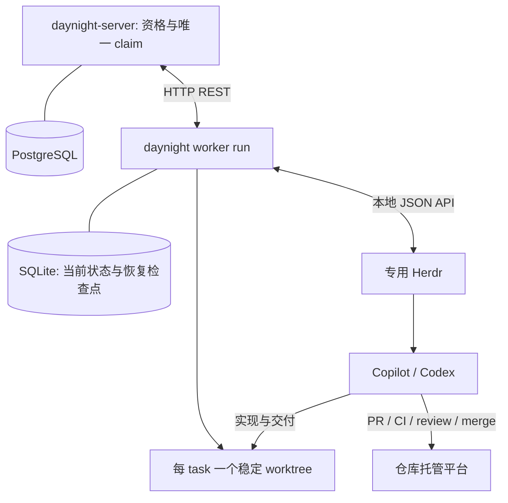

# Worker 架构设计

状态：自动执行许可、平台要求、唯一 worker claim 的服务端/typed client 基础、Agent 显式完成入口，以及本机身份、实例锁、SQLite 记录、Git 工作区管理和 Herdr 适配操作已实现；前台 worker run 已接入这些模块；人工管理命令、相应服务端协议修订和完整平台验收仍待交付。本文拥有机制；[需求](../spec/daynight-worker.md)拥有产品行为，[设计决策](../../.agents/notes/implemented/architecture/2026-10-22-worker-design.md)保留真实备选方案。

## 目标与当前基础

`daynight worker run` 是一个前台常驻 CLI：通过 REST 领取多仓库中允许 Agent 执行的任务，使用系统管理的稳定 worktree 与专用 Herdr 执行，持久化状态并完成恢复和清理。Agent 负责完整交付、验收和最终 claim-bound done，worker 负责归属清单对账、资源与恢复。

设计初始源码基线为 `e533b8610ec38522fd5387e4715b573734bd16c2`。交付核对基线为 `2d7fdd1e4e178db17e46da5d3b6c0e4050edf730`：主线具有命令组合、严格 YAML、REST client、任务/属性、项目写事务和 review 的 Git/SQLite 基础；当时鉴权与显式动作生命周期已交付；当前状态由[三状态架构](daynight-task-status.md)拥有，认领基础由[归属架构](daynight-worker-claims.md)拥有，前台组合调度由 worker 运行时提供，人工管理命令仍待实现。任务的服务端起止时间及图时钟遵循已交付的[执行时间契约](https://github.com/codetreker/daynight/blob/2d7fdd1e4e178db17e46da5d3b6c0e4050edf730/docs/spec/daynight-task-timing.md)，worker DTO 与生命周期扩展须保留该契约。

| 当前基础 | 复用点 |
|---|---|
| [命令组合](../../packages/daynight/src/commands/review/command.ts) | definition → command → runtime，业务按命令懒加载。 |
| [项目写锁](https://github.com/codetreker/daynight/blob/e533b8610ec38522fd5387e4715b573734bd16c2/packages/daynight-server/internal/core/store/project_tx.go#L29-L39)、[版本检查](https://github.com/codetreker/daynight/blob/e533b8610ec38522fd5387e4715b573734bd16c2/packages/daynight-server/internal/service/task.go#L100-L120) | 同一事务中检查资格、权限、版本和归属。 |
| [属性 codec](../../packages/daynight-server/internal/taskproperties/codec.go) | 新增预定义属性，保留已有 PR 属性；读与写权限分开。 |
| [REST client](../../packages/daynight/src/api/client.ts)、[分页范围](../../packages/daynight-server/internal/service/page.go) | 复用认证、int64、游标和不确定写入分类；新任务使用许可/平台候选筛选；完整 workerId 清单提供当前归属，已知 taskId 的读取核对显式写入。 |
| [本机记录](../../packages/daynight/src/commands/worker/store.ts)、[任务 worktree](../../packages/daynight/src/commands/worker/worktrees.ts) | worker 自己拥有状态、稳定可提交分支和原资源恢复，复用通用 Git/路径原语。 |

## 总体结构



| 组件 | 唯一职责 |
|---|---|
| 服务端 | 任务自动执行许可/平台、ready、认证权限、原子 claim、归属更新、完成与移交。 |
| Worker | 轮转与名额、worktree、Herdr 启停、状态观察、恢复、自有 claim 清单对账及清理。 |
| Agent | 实现、测试、提交、PR、CI/review 修复、授权合并、任务验收及最终 claim-bound done；维护正常 task 资料。 |
| Herdr | PTY、agent 启动/输入/状态及原生会话引用。 |

不增加 agent report 命令、结果文件、callback 服务、报告事件流或通用开发流程引擎。Worker 读取 Herdr 最新状态与自己的当前 claim 清单；任务 PR/验收资料由 Agent 维护。Review 保留自己的 PR revision、publication 和 coordinator；只在第二个真实调用方需要时提取窄的共享原语。

## 配置与目录

共享 `~/.daynight/config.yml` 的根字段 `workerId` 保存稳定随机 UUID。`ensureWorkerIdentity` 在首次缺失时复用现有配置锁和原子替换写入；持锁后重读，避免并发创建不同身份。已有合法值直接复用，不重写文件；非法值明确拒绝，不生成替代身份。配置注释、其他字段及文件权限沿用共享配置写入机制。身份成功持久化后才可进行 claim。

Worker 固定使用 `~/.daynight/worker/`，不提供状态路径覆盖。`resolveWorkerPaths` 根据实际用户 home 与平台路径 API 生成路径；review 继续使用自己的路径和锁。服务连接复用 CLI 默认 `https://daynight.cc` 与已保存凭据，`serverUrl` 只在连接测试服务时显式覆盖。

```text
~/.daynight/
  config.yml           # 根字段 workerId，其他共享配置保持原所有者
  worker/
    state.sqlite       # 仅 projects、tasks 两个业务表
    instance.lock
    logs/
    tmp/
    h/                 # 一个专用 Herdr 实例的私有 config/state
<repositoryPath>/.worktrees/daynight/<taskId>/
```

每个用户环境一个 worker 实例。`acquireWorkerInstanceLock` 复用平台实例排他原语，以同一 `state.sqlite` 为取得/释放文件锁时的 SQLite gate，不创建第二数据库或锁表。存活进程或未知进程状态不能被夺锁。失效 PID 的锁可重新取得，但这只排除了原 worker 进程，不能证明它启动的原生 agent 已停止；调用者仍须核对真实资源。

`daynight worker run` 读取共享配置中的独立 `worker` mapping。命令懒加载 worker 模块，帮助与补全不启动配置、SQLite、Git 或 Herdr。配置示例：

```yaml
worker:
  maxConcurrent: 1
  pollIntervalMs: 5000
  recoveryLimit: 3
  agent: copilot
  model: null
  args: []
  repositories:
    - remote: https://github.com/owner/repository.git
      path: ../code/repository
    - remote: https://github.com/owner/other.git
      path: ../code/other
      projectId: 1390453c-e768-4bd3-9aa8-17329f758b2c
      agent: codex
      model: null
      args: []
```

可选 worker 字段的默认值即示例中的 maxConcurrent=1、pollIntervalMs=5000、recoveryLimit=3、agent=copilot、model=null、args=[]；repositories 必须是数组。每仓库必须提供 remote/path，可覆盖 projectId、agent、model、args。并发为正整数，恢复上限为非负整数，轮询间隔为计时器范围内的正安全整数。未知字段、错误类型、重复仓库/项目和重叠路径明确拒绝，不接受 stateDirectory 或其他状态根入口。

仓库路径相对 config.yml 所在目录解析，也接受绝对路径；不依赖启动 cwd，不展开 tilde，不接受 Windows drive-relative 路径。配置与实际物理路径均核对仓库之间、仓库与 Daynight 状态根的重叠。服务项目必须已存在且 repo 身份匹配；同 repo 匹配多个项目时要求显式 projectId。缺失本地仓库自动 clone，已有根目录核对原 remote/Git 身份并保留原成果。

相同 agent 类型时仓库逐字段覆盖全局值，显式 null model 和空 args 清除该字段；切换类型后未指定的 model/args 分别变为 null/[]。Args 整体替换，不拼接；恢复上限是 worker 级设置。Worker 拥有 cwd/session/model/mode 的参数位置，普通 args 须通过原生参数校验。

配置只在启动/重启加载。新 claim 首次 pending 物化冻结 agent/model/args/recoveryLimit；未决 claim 请求保留其原决定配置以便确认同一请求，不能套用重启后的新默认。已开始执行缺失原快照时暂停，继续与恢复始终使用原快照。凭据仍由服务/原生工具的原认证配置拥有，不进入 assignment、日志或执行快照。

## 服务端模型与资格查询

`allowAgents` 与 `requiredPlatform` 已在完整 task、图投影、普通 PATCH 与列表筛选中实现；持久化、可空字段存在性、锁定和版本事务见[服务架构](daynight-server.md)。worker claim、执行归属和状态保护已接入同一事务；[归属架构](daynight-worker-claims.md)拥有具体字段、endpoint 与授权。运行时资源启动和恢复是独立能力。

任务顶层字段：

```text
allowAgents: boolean
requiredPlatform: null | windows | linux | macos
```

旧任务经各自迁移取得 `allowAgents=true`、平台 null，保留其他数据、版本和时间；新任务为 `allowAgents=false`，未指定平台时为 null。创建输入拒绝 `allowAgents`，平台接受省略、null 或三个枚举之一。普通 task PATCH 中许可未提供保持、显式 false 关闭、null 和其他类型拒绝；平台未提供保持、枚举设置、null 清除。资源必须显式输出 requiredPlatform，严格 DTO 不以缺字段 fallback 兼容旧数据。许可和平台变化均在 in_progress 锁定，精确版本同值请求不增加版本或时间；普通人工状态设置保持不受两字段限制；现有服务端 released 执行通过显式人工 resume 接续原成果；终止后新执行的目标差异见“Agent 完成与人工操作”。

Web 在任务详情标题下的同一状态行中，左侧显示状态、ready 与可选平台信息，右侧显示单一“自动执行” / “Automatic execution”标签与开关组合。组合控件同时表达服务端已确认的许可状态并提供操作入口；详情仅保留此组合控件，自动执行状态不另设 badge 或下方 Overview 开关。列表中的自动执行状态标记保持其原有用途。实际任务标题直接用于详情顶栏并保留有界的完整文本键盘阅读，长标题与窄屏不覆盖状态或开关；平台等左侧信息仅在左组内换行，右侧控件保持右对齐并与第一行状态顶部对齐。锁定原因通过支持悬停与键盘聚焦的控件 tooltip 展示；错误、未知结果和等待人工输入的反馈由[详情提示层](daynight-web.md#任务详情提示)展示为限时浮动气泡，恢复入口与会话写入保护保持可达。成功反馈由详情中观察到的 pending→confirmed 转换触发，以不参与布局的浮动气泡展示 3 秒；持久 mutation 状态继续归属任务会话，关闭重开不重播已确认结果。

每次开启或关闭都打开对应确认框；确认按钮直接提交目标值及打开确认框时观察到的精确 version。取消、Escape 或关闭不提交，开关保持服务端已确认值；请求成功后安装完整返回 task 并刷新图。修改与 status 共用单 task 写入控制，提交或结果不确定期间阻止重复写入；确认拒绝保留原值，版本冲突读取最新状态并要求重新决定，断连/5xx/协议错误先核对实际结果，不自动重发。任务切换、关闭详情和后台刷新保持请求归属，已提交操作不依赖弹框仍然挂载。

开启框说明 worker 可在任务处于 todo、依赖完成并符合运行条件时自动领取；关闭框说明 worker 将不再自动领取。自动执行许可与 ready 独立，手工 set-status 与普通元数据修改均保留许可。实际切换在 `in_progress` 拒绝；权限和版本检查先于同值判定，精确版本同值 PATCH 返回原 task，不增加版本或更新时间。关闭许可不隐式停止执行或移交资源。

确认表示明确操作意图，不能从 session/PAT 类型推断物理人工。CLI/skill 禁止自动 worker 自行启用许可，操作沿用现有项目成员写权限。Web 的双向确认、状态展示和失败交互遵循本节的布局与操作规则，具体组件与工作空间请求归属由[看板设计](daynight-web.md#自动执行许可与确认)拥有。CLI update/list/ready 的 `--allow-agents true|false` 映射到该普通更新或查询字段。Worker 自动候选同时使用 true 与实际平台兼容筛选，认领由服务端事务重验许可、ready、平台、版本及归属；明确由用户指定的单任务执行沿用人工状态设置。已有 released 归属时使用显式人工 resume，自动选出的 ID 不属于人工例外。普通技能不承担自动候选选择或连续调度。

平台兼容查询已接入现有列表。Worker daemon 需要从自身实际 process.platform 映射 win32/windows、darwin/macos、linux/linux（含 WSL），不确定或不支持时等待；ready 与后续候选查询均传同一实际平台，自动认领由服务端事务重验并绑定精确版本。普通指定任务不经过自动候选发现。运行时消费的查询为：

```http
GET /api/v1/projects/{project}/tasks?ready=true&allowAgents=true&compatiblePlatform=linux&limit=10
```

查询可按 `allowAgents=true|false` 筛选，缺省保留现有全量任务语义。`allowAgents=true` 与 ready、`compatiblePlatform` 在排序/limit 前组合过滤，并加入游标范围。`compatiblePlatform` 包含 null 与相同平台，CLI list/ready 的 `--compatible-platform` 直接映射该查询并保留至每页；客户端拒绝不满足声明条件的响应，不在本地删项。Web 平台确认与既有许可和状态设置共用任务会话，界面与请求机制由[看板设计](daynight-web.md#平台要求与确认下拉框)拥有。沿用服务端创建时间/UUID 顺序。后续 Worker 按空闲名额读取候选，合法冲突后考虑下一个；空页/无兼容候选不占名额。已有未完成 worktree 的候选还需确认本机持有原执行资料，否则跳过并显示需要人工移交，不能在另一机器新建空 worktree。

### 受保护的执行属性与操作

完整 Task 的 properties 包含 pullRequests 与 worker:null|WorkerClaim。worker 记录 state=active/released/completed、用户、worker/机器、实际平台、agent、worktreeId、阶段和已取得的 Herdr/原生会话；普通 create/PATCH 不能写该字段。PR 与归属更新相互保留，图仍不包含属性。

[归属架构](daynight-worker-claims.md)拥有严格 DTO、文本迁移和完整 HTTP 契约。自动 POST worker-claim 在项目写锁内重验成员、精确版本、ready、allowAgents、平台和无 active claim；PATCH 只允许当前 owner 更新当前 claim 的执行摘要。自动初次认领为每次请求生成新的、不复用的 claimId；稳定 workerId 与项目映射先持久保存，具体 claim 请求的标识、版本和决定配置保存在 projects.claimAttempt 后才提交 HTTP。实际远端 claim 确认后才写 pending，没有领取前任务行或额外表。未知认领不重放，也不因清单暂时缺席清除；通过成功完整的自己 claim 清单找回实际归属。Transfer 的 targetClaimId 则随 source 管理意图先持久保存。服务端保留最后记录并拒绝其 ID 被重新使用。

完成使用现有 PUT status 的 done 目标及匹配 claimId，要求当前 owner；普通 setter 不能释放 active 执行，也不能开始或完成 released 未完成成果。同版本同状态仍是不修改的成功。没有 worker 记录或仅有 completed 历史的任务保留普通三状态行为。

现有服务端 Release 要求原 owner/admin 与停止确认，返回 todo、清空任务起止时间并保留原资源绑定。现有自动重新认领要求保留 worktreeId/agent 并确认连续性；显式人工 resume 仅允许原 owner/admin 接续 released 成果，保留人工安排不受自动许可/平台过滤的规则。现有 Transfer 由原 owner/admin 提交，服务端核验目标当前成员、平台及原工作区，保持 in_progress 和任务计时，安装新的目标 claim。目标身份与授权提交者分别校验。这些资源连续性条件属于当前服务实现，终止清理目标及所需修订见“Agent 完成与人工操作”。

服务端只校验身份、标识及明确确认，不远程证明机器状态；停止、原成果和会话资料仍须由执行方核实。Daynight fencing 拒绝旧 claim 的写入，不能撤销 Git 托管凭据或终止原进程。失联不自动释放归属。

## SQLite：两个业务表

[本机记录模块](../../packages/daynight/src/commands/worker/store.ts)使用 WAL、`synchronous=FULL`、`STRICT` 表及短 `BEGIN IMMEDIATE` 事务。当前 schema 为 2；schema 1 在同一迁移事务中增加具体 native 执行事实、原认证 user_id、项目未决 claim 请求及 cleanup 输入基线。schema 1 的原 user_id 迁移为 null；缺失的原生证据和账号范围均保持未知，不能迁移成“从未启动”或当前登录用户。未知 schema 或不符合预期的数据库明确拒绝，不以新空库掩盖损坏。

| 表 | 持久事实 |
|---|---|
| `projects` | server_origin/project_id 为键，保存 repo_url/local_path 和可空 claim_attempt（对象字段 claimAttempt）；未收尾执行或未决请求存在时不能改变仓库绑定。 |
| `tasks` | server_origin/project_id/task_id/claim_id 为键，保存不可变原 user_id、workerId、worktreeId、pending/active/done、原仓库绑定、冻结配置、实际资源、native_execution（对象字段 nativeExecution）、恢复、cleanup、source control 和时间；结束行保留。 |

ClaimAttempt 仅保存一个项目尚未确认结果的具体 claim 请求：taskId/claimId/worktreeId/workerId/userId、精确版本字符串和原决定配置。已核验自有清单或响应完整匹配该不可变请求时，先使用保存的配置确认实际 grant，不等待文件系统/前驱分类；pending、配置、已核验 userId 与 attempt 清除在同一事务提交。没有自身运行痕迹且仍为 preparing 时登记 new 原生来源；已有自身运行痕迹或后续 phase 时登记 recovered 并保留未知 native 来源，已知配置不等于已知启动历史；已有记录的 native 证据和真实暂停也不因这次确认重置。该确认只解除认领请求的不确定性，不越过 active 前驱等待或后续资源归属检查。明确拒绝或已证明未提交也可解除请求；其他未知结果仍阻止该项目再认领，不自动换 ID、重发或依据一次缺席推断未发生。它不是预认领 task 或通用动作日志，不增加表、队列或第二份台账。

NativeExecution 随原 task 保存 terminalId、workspaceSubmission、workspaceEvidence、launchEvidence、launch/prompt submission、原停止观察和受保护执行摘要的版本/提交结果。Workspace 创建也先保存可能提交状态：未知创建不能因为 snapshot 暂缺而再次调用；找到确切 owned 资源后核对并接回结果，缺环境 receipt 时仍须安全 rebind。创建与输入前先持久保存可能提交的责任；核验的明确未派发结果和实际未知结果分别处理。只有同一未派发尝试的确定证据可恢复 never/not-submitted，旧未知请求不能被当前空 pane 或当前拒绝覆盖。

`registerPending` 的第四个 verifiedUserId 参数与 pending/配置/attempt 确认一起入库；未提供或显式 null 只代表未知，不代表当前登录。不能在清除 attempt 后再分开补 UID，避免认领随即结束时留下无法归属的行。现有 UID、claim 或冻结配置冲突仍拒绝，未知 terminal/control 也不能通过该参数事后补授权；孤立资源和迁移记录继续保持原未知范围。

每条实际认领记录绑定其原认证 userId，已知值不可替换。迁移后未知范围的 ordinary/shutdown 记录，只有当前成功自有清单中出现完整匹配的实际 claim，才可补绑定用户；比较服务源、task/claim、worker/worktree 及原平台/agent 身份。未知范围的 terminal/control 意图不能由当前登录或后来匹配事后补授权，必须保留并暂停。

同一服务来源的 claimId 唯一；部分唯一索引保证同一 origin/project/task 至多一条 active。项目键与任务键带原服务范围，不能因配置换服而把旧执行发往另一个服务。任务行保留自己的 repo/path，不能由后来更改的项目映射推断旧资源所有权。

```text
项目映射持久化 → 远端实际取得 claim → 本机 pending 并冻结配置
→ 确认启动条件并提交 active → 创建/绑定实际资源
→ 统一终止清理完成 → 本机 done
```

`registerPending` 只登记已经取得或从自己清单找回的实际 claim，不为目标预登记。新执行必须有配置；有原执行痕迹却缺快照的恢复记录保留 null 与暂停原因，`activateTask` 拒绝启动，直到明确恢复原配置。重复登记返回已保存的原值，不以当前默认值替换。`bindWorktree`、`bindHerdr`、`bindNativeSession` 保存实际关联；native 引用包含 `herdr` 或 `native-history` 来源。更换失效 Herdr workspace 需要旧 agent 停止和旧 workspace 已关闭的确认，保留 worktree/native/config。

恢复记录保存累计 count、pauseReason 和一次 retryAuthorized。`beginRecovery` 原子检查预算并消耗一次恢复；超限或暂停需明确授权，重启不清零。有 cleanup/control 意图时拒绝普通恢复与重试，避免重新启动正在结束的业务。

Cleanup 保存 `terminal|shutdown`、原开始/截止、清理输入的 not-submitted/unknown/submitted/rejected/unavailable、输入前观察基线、结果、具体错误，以及 agentStopped/workspaceClosed/worktreeDeleted 三个有序确认。先记录 unknown 再提交输入；未知输入不自动重发，截止后不再提交。重复开始或从 shutdown 升为 terminal 均不能延长原截止。`completeTask` 必须取得 terminal 结果、原 agent 已停、workspace 已关和 worktree 已删除；任何失败保留责任。

Source control 只保存 release/transfer 的具体意图、原版本、target 身份及提交/结果，不提供任意动作日志。版本以精确 int64 十进制字符串持久化；远端提交要求本地完整终止清理且匹配原决定版本，未知写入不能重放。成功完整自有清单确认原 claim 缺席也能确认 ownership-ended，无须读取 task 状态分类。清理已完成而控制结果未确认时，不能置本机 done 或重建原资源。

`resumeAfterShutdown` 仅消费已经记录结果、原 agent 停止及 workspace 关闭的正常退出。已证明 native 从未启动，或已有确切原 native ID 时，可清除旧 Herdr 绑定供同一执行恢复，保留 worktree/native/config、恢复计数、原暂停与重试授权；正常重启不消耗故障恢复预算。如果 native 可能已启动却没有确切原 ID，则保留原 Herdr 绑定、launch/prompt 和 PID 证据并暂停，不能重置成首次启动。消费 shutdown 后，普通执行前必须重新枚举 Herdr，不能继续使用关闭 workspace 之前的 snapshot。Terminal 不可恢复为普通执行；外部资源核对仍由调用者负责。

## 前台循环与 worktree

[运行时](../../packages/daynight/src/commands/worker/runtime.ts)组合认证、配置、实例锁、本机记录、Git、Herdr、[进程内远端客户端](../../packages/daynight/src/commands/worker/remote.ts)和[协调循环](../../packages/daynight/src/commands/worker/coordinator.ts)。每次远端或本地外部操作有独立 Operation 期限，轮询等待可取消；整个前台进程没有普通一次性命令的总期限。实际平台由 process.platform 映射，未知平台拒绝，WSL Linux 只计 linux。

启动先解析配置、取得排他锁和稳定身份、打开 SQLite 并校验安装包 managed 技能。已授权收尾的发现/job 可立即启动；任何 /me、项目或其他网络请求之前，原已知账号范围的持久收尾仍能推进，未知范围意图保留。运行时使用启动时固定的服务凭据调用既有 GET /api/v1/me，取得认证 userId 后才解析项目、读取自有清单或认领。后续成功响应（包括空分页）均核对既有 Daynight-User-ID 与固定 UID 一致；缺失或不匹配是失败，不产生空清单结论。

本地收尾与服务工作使用不同范围：已提交 cleanup/source control 和正常 shutdown 覆盖同 workerId 的所有原服务记录；清单、候选、认领、新缺席决定和普通恢复只面向当前 serverUrl。切换 serverUrl 后，原服务 A 已提交的本地截止/停止仍继续，不请求 A API，也不向 B 查询 A 的记录；原 scope 始终保留完整 origin/project/task/claim 身份，不增加凭据登记或多服务认领。

每轮完整读取当前服务已登记项目中的当前认证 userId/workerId active claim 清单，再确保 Herdr 并枚举 owned 资源。清单不附加 status/ready/allowAgents/platform 过滤，任一项目或页失败则本轮不产生可用于新增终止决定的归属集合。原任务 userId 必须与清单 principal 相同，才可因缺席新建清理或恢复执行；同 OS 的 workerId 不代表同一 Daynight 账号。

```text
远端自己有、本机没有 → 找回实际 claim → pending / 原执行缺证据暂停
两边都有同一 claim → 核对实际资源，运行或恢复原执行
同原账号的本机 claim 在完整清单缺席 → 原终止清理 / 严格未启动直接 done
原账号未知或与当前账号不同 → 保留并暂停
完成原记录对账后 → 按仓库轮转领取新 claim → pending → active → 资源
```

运行时在 /me 和配置仓库的远端解析/准备之前启动轻量收尾发现循环，只为同 workerId 各 origin 已持久保存的 cleanup/source control 意图创建瞬时异步 job；实际推进仍须原 userId 已知，不能借后台继续补授权未知范围的意图。每个完整 origin/project/task/claim 同时至多一个 job，调用 `advanceCommittedCleanups(identity)`；各 job 按自己的原截止独立推进，每次等待最多 1000ms，最近原截止更早时缩短等待。一个 task 的 RPC 等待不阻塞其他 task 的下一次收尾推进，不以等待整批 job 完成作为下一轮前置。同一 task 与普通循环仍共用串行边界，外部步骤各自有界。发现和 job 都在同一前台进程内，不增加持久队列、表、台账或 OS daemon。它们不查询服务以新增缺席判断，也不认领任务；服务读取失败不撤销已有收尾责任，新终止决定仍要求完整 inventory。

同一已核验原账号范围内，自动终止判断仅为原 claimId 缺席；不按 task 状态或单 task GET 分类 done/release/transfer。同 task 的新 claim 不能保护旧 claim。记录中的终止/管理意图不可被普通恢复撤销；显式 source 控制的服务端操作仍由人工管理交付拥有。Herdr 中有本 worker 标记却缺本地行的资源需要原项目绑定才能登记并收尾；归属无法证明时保留并报告。

严格证明未启动的 pending 记录可在同账号成功完整清单确认原 claim 缺席后直接 pending→done：没有 cleanup/control、worktree/Herdr/native 资源，workspace/launch/prompt 均未提交且无旧证据。该路径不提升 active、不扫描或删除固定 Git 路径；同 task 旧 claim 的目录不会因此受影响。

新任务候选同时使用 ready、allowAgents=true 与实际兼容平台，条件在服务端排序和分页前组合；worker 不修改自动执行许可。Released 历史候选跳过但继续分页。仓库之间轮转，同仓库遵守服务端顺序，配置为空或无合格候选不占名额。项目未决 claimAttempt 阻止该项目继续认领，但不替代其他项目的调度。

只有未匹配前置 claimAttempt 正向确认、尚无本地行且没有自身 Herdr/native 执行迹象的 preparing claim，才进入文件系统分类并受稳定前驱移交边界约束。完整匹配请求的实际 grant 已先原子确认，不能被旧路径收尾延后而遗失。文件系统异步核对前保留相关前驱的持久 origin/project/task/claim/worktree 身份、原 repoUrl/repositoryPath 和已有的可选 worktree binding。候选资格不要求 binding 已落库：Git 可能已创建带标记的 leaf，而 SQLite 尚未记录返回值。候选还须匹配同一物理规范路径；它只确定需要等待的移交范围，不代表采纳路径所有权。稳定后的只读 Git 分类仍严格核验完整 claim、root/common/leaf、精确 .git 指针及分支，不以目录存在或相同 task UUID 代替归属证明。

若捕获的或当前前驱仍承担 terminal/control 的 worktree 删除责任，或异步核对期间删除边界发生变化，则该尚未物化的新 claim 非阻塞延后，不插入记录或作配置分类；即使删除在此期间开始并已完成、前驱已变 done，也视为边界变化。下一次成功完整 inventory 在稳定后重新考虑。最终检查紧贴 pending 插入且其后没有 await，避免较早的路径观察与较晚的前驱记录拼成新 claim 已执行的结论。已有 pending 及冻结配置不重新分类；匹配 claimAttempt 走前置原子确认，不进入这条延后路径；其他 task 和独立清理截止继续推进，不增加状态、队列或锁。

普通稳定的 active 前驱不阻止通过严格归属核对的新 claim 冻结自身配置并物化为 pending；同 worker 任一 origin 的同 task UUID active 前驱仍会阻止其启动，直到旧本地责任 done。无法归属的稳定占用继续保留并报告，不放松 Git 证明，也不采纳旧 native 会话或配置。完整 origin/project/task/claim 身份不被路径或等待条件合并。

项目映射先落库，具体请求先保存未知结果 fence，服务端原子授予后才登记 pending；确认名额/条件并提交 active 后才创建 worktree 和 Herdr 资源。等待、超限暂停、原执行恢复与清理均保留 active 责任和名额；找回已有/未知资源而缺配置的执行同样保留责任。降低并发不抢占已开始执行。同 task 的旧 active 未清理前新 pending 不启动。

每个 origin/project/task 的推进串行，tick 不重入；已消费中断 shutdown 的 task 在普通执行前刷新本地 Herdr 资源清单。清单是本轮已有执行的对账输入；新增 claim 发生在其后，不能被本轮旧清单清理。原 claim 已存在且 agent 实际存活时只观察和重连。确需重新启动时核对原 worktree/native history/config，按持久预算恢复；未知 launch/prompt 只观察，不能推为未派发或启动第二个 agent。

普通操作只有沿错误 cause 链确认源自当前 worker cancellation 的中断才按正常取消传播，进入退出而不新增故障暂停。真实旧暂停、已消耗预算和未知外部动作记录保持原义；不能把 signal 已取消之后遇到的任意错误都归为正常取消。只读操作中断、成功 shutdown 与原会话恢复不因此形成新的 fault pause。

执行摘要更新绑定原 claim 与观察版本，先保存提交责任再调用服务端。未知更新先用后续权威观察核对，不重发；这不增加业务/PR 验收或完成解释器。业务完成仍由 agent 的最终 claim-bound done 表达，随后其原 claim 离开自有清单触发资源清理。

## Git 仓库与任务工作区

[工作区模块](../../packages/daynight/src/commands/worker/worktrees.ts)提供 `createWorkerGitManager`，使用现有[仓库地址身份](../../packages/daynight/src/repository/identity.ts)、[Git 子进程](../../packages/daynight/src/repository/git.ts)及物理路径原语。它不拥有 claim 查询、名额、Herdr 或第二份存储；实际 binding 返回给调用者，由同一 tasks 行保存。

| 操作 | 调用条件与结果 |
|---|---|
| `prepareRepository(project, operation)` | 缺失目录进行普通 clone；已有目录须是 non-bare Git 工作区，配置路径与真实顶层物理身份一致，单一 origin 与配置 repoUrl 的通用地址身份一致。返回 root/common-directory 与物理身份。 |
| `prepareWorktree(task, operation)` | 必须是无 cleanup/control 的 active 记录。新执行在固定路径创建；创建结果丢失时，仅接回匹配同一 claim/worktreeId 的原注册。返回实际 `WorktreeBinding`；实际 task worktree 的 origin 也须匹配当次 repoUrl，包括 worktree-specific 配置。 |
| `verifyWorktree(task, operation)` | 必须已有持久 binding，核对原仓库、实际 task worktree 的 origin、路径、分支和所有权；缺原目录或注册明确失败，不新建替代成果。 |
| `removeWorktree(task, proof, operation)` | 调用方须确认 terminal、agentStopped、workspaceClosed，模块再核对原归属后删除。实际删除失败直接暴露，只有目录和注册均不存在才成功。 |
| `dispose()` | 删除本管理器在指定临时目录内创建的空 hooks/template 目录。 |

分支 `daynight/<taskId>` 与目录 `.worktrees/daynight/<taskId>` 由 task 身份确定。首次分支从仓库当前 HEAD 创建；已有保留分支从原 tip 创建新工作区，不 reset 分支。同一有效 claim 的中断恢复使用原 worktreeId、分支和 dirty 成果，不执行 review 的 reset/clean。新 claim 使用新的 worktreeId 和 native 会话；规范路径仍被旧 claim 或外来目录占用时明确冲突，不复用或擅删。

创建先独占预留空 leaf，记录其 device/inode，再通过 `git worktree add --lock --reason` 在 Git 自己的 linked-worktree 管理目录中持久保存 `daynight-worker:` JSON 标记。标记包含 serverOrigin/projectId/taskId/claimId/worktreeId 及 leaf/root/common 的 device/inode。每次操作核对原服务和执行身份、root/common 物理绑定、leaf 辅助指纹、精确 `.git` 指针及注册 backpointer；缺标记、注册歧义、符号链接或不匹配指针都拒绝。Device/inode 只能辅助核对，不能单独证明仍是原目录；任何仍存在的 leaf 都必须保留指向其原管理注册的精确 `.git` 普通文件，包括终止清理。

分支通过已验证 linked administrative directory 的 `git --git-dir=<admin> symbolic-ref --quiet HEAD` 核对，交由 Git 解释 refs backend。不能直接把管理目录的 HEAD 文件当作 loose symbolic ref；reftable 的存储布局也须支持。即使 leaf 已删除，仍可从该管理注册核对原分支；detached 或其他分支均拒绝。

Git 创建成功而 SQLite 尚未保存 binding 时，可凭完整原标记和指针核对同一次执行；仅有预留空目录而 Git 尚未写标记时，没有足够归属证明，保留目录并报告冲突。已知原执行目录丢失时不 clone 或新建 worktree 掩盖。Clone 失败或取消后的部分目录保留并显示实际错误，不把现有内容当作空路径重试。

终止清理仍核对原仓库、完整所有权与物理绑定，但不要求 task-local origin 保持不变；仅改变任务工作区的 remote 不撤销原清理责任。删除先保留 Git 注册、标记和 leaf 内精确 `.git` 指针，递归删除其余内容；内容删除失败时保留指针，下一次重新核对后继续原清理。其余内容删除完成后，最后删除 `.git` 并以非递归 rmdir 移除 leaf。确认 leaf 已不存在后才定点移除该条 locked Git 注册，不运行全局 prune。

若在最后删除 `.git` 与 rmdir 之间中断，仍存在的目录已经没有足够归属证明，即使它为空且 device/inode 匹配，也必须拒绝破坏性重试并保留 active/错误，交由操作者检查处理；原目录经核实移除后，下次可完成注册清理。相同拒绝适用于同路径无指针的替换目录。目录和注册均不存在时，可确认删除成功但结果尚未记回 SQLite 的窗口。分支和历史保留，done/release/transfer 使用相同终止规则。

所有 Git 子进程继承调用者的有界 `Operation`，复用进程组停止和错误链。Worker 的设置操作清除继承的仓库选择器、命令配置与 trace 注入，使用自己空 hooks 目录，clone 使用空 template，并关闭自动 submodule 递归；正常全局认证和传输配置仍继承。共享 runner 的环境与期限覆盖按调用传入，普通仓库发现调用保持原有默认行为。临时目录只属于该管理器，不能改写用户全局 Git/agent 配置。

## Herdr 与 agent

[Herdr 适配入口](../../packages/daynight/src/commands/worker/herdr.ts)以 `createWorkerHerdr` 组合实例、IPC、原生预检和任务资源操作。它只消费调用方的实际执行身份、cwd、冻结配置、完整 prompt 和停止/恢复决定，不拥有名额、task 状态或业务验收。

### 私有实例与 IPC

每个 worker 只有一个私有具名 session `w`，每 task 使用其中独立的 workspace/pane/agent。实例使用固定 `~/.daynight/worker/h/`，私有布局为：

```text
h/config.toml
h/shell.history
h/c/herdr/sessions/w/herdr.sock
h/c/herdr/sessions/w/herdr-client.sock
h/c/herdr/sessions/w/session.json
h/s/
```

Herdr daemon 的子进程环境设置 `XDG_CONFIG_HOME=h/c`、`XDG_STATE_HOME=h/s`、`HERDR_CONFIG_PATH=h/config.toml` 和 `HISTFILE=h/shell.history`，清除继承的 Herdr endpoint/pane/workspace 等实例身份和父 Codex invocation ID。`HOME`、`USERPROFILE`、`CODEX_HOME`、`COPILOT_HOME`、`CODEX_SQLITE_HOME` 与原有认证/传输设置继续使用原所有者；不复制或改写其配置。

适配入口在实例环境构建前保留调用方原 XDG 值。Native preflight 的 OS 命令恢复原 XDG 的 set/unset；任务 workspace 与 stop-anchor 只通过窄 env map 覆盖原 `XDG_CONFIG_HOME`、`XDG_STATE_HOME` 两个字符串。原值 unset 时因 Herdr map 不能删除键，传空字符串；[XDG 规则](https://specifications.freedesktop.org/basedir/latest/)将空值解释为默认目录。这样 gh 等 XDG 客户端能继续使用原认证，私有 endpoint、HISTFILE 和 native home 仍继承清理后的实例环境，不把整份原环境、凭据或父调用 ID 再注入 workspace。重连不改写现有 workspace 的环境。

遵守继承 HISTFILE 的 Bash/Zsh 将历史写入私有文件，人工 attachment 也携带同一值。这不是 shell/profile sandbox：自定义 rc 可覆盖变量，其他 shell 的历史规则及 APPDATA 等位置没有通用隔离保证。

私有 config 固定 `onboarding=false` 与 `[session] resume_agents_on_restore=false`；已有内容不匹配时明确拒绝。Herdr 只恢复布局和原生引用，worker 读取管理/终止意图及归属后唯一决定 native 启动/恢复。连接已有实例不停止其存活 agent。人工 attachment 返回同一私有环境的结构化 executable/arguments/environment/unsetEnvironment，不输出全量认证环境，也不等于人工命令已经交付。

`ensureInstance` 先检查两个实际端点，已存活实例须通过 `ping` 的版本/协议/能力检查、`session.snapshot` 和 API/client 两端就绪；仅 ping 不证明布局恢复完成。支持基线为 Herdr 0.9.5、protocol 22；不兼容或权限/协议错误保留现有实例并报告，不能当作不存在而另起服务。确认端点缺席时直接启动一个 detached server，stdout/stderr 写私有文件日志，成功就绪后 unref；已完成启动 Operation 的 dispose 或 follower 取消观察不结束已接管的服务。

Unix 使用 domain socket，两个路径分别校验 Linux 107、macOS 103 个 UTF-8 字节上限。Windows 按 Herdr 的逻辑路径映射到 `\\.\pipe\` named pipe，完整名字最多 256 个 UTF-16 code units；`.sock` 路径文件不能替代实际管道连接。超限明确报告实际路径并拒绝，不提供状态根覆盖或静默换目录。IPC 一次请求一个连接，以 UTF-8 JSON 加换行 framing；客户端核对 request ID/result type，限制请求 1 MiB、响应最多 16 MiB 且受 Operation 字节预算约束，每次操作独立有界。

`HerdrRpcError` 保留方法、requestId、原错误和 `not-submitted|unknown`。开始 socket write 即视为可能提交，断连/超时/协议错误不能证明未执行；方法适配仅将已知的提交前拒绝分类为 rejected。Request ID 只关联响应，不是幂等键。适配层不自动重放 mutation。

### 任务资源、原生预检与输入

| 任务操作 | 具体边界 |
|---|---|
| `listResources` | label 持久编码 origin/project/task/claim/worktreeId，核对 workspace/pane/terminal ID 和实际 cwd；重复 label、错误 cwd 或归属歧义失败。 |
| `prepareWorkspace` | 返回 `HerdrPreparedWorkspace{binding,workspaceEvidence}`。只有核验过的 workspace.create ACK 产生环境 receipt；接回已有资源或创建 ACK 丢失后枚举核对得到的 evidence 为 null。 |
| `observe` | 返回 launchPending、interactiveReady、最新 status、可用的 stateChangeSeq/completionSeq 与官方 native session 引用；这些是观察，不是每条 prompt 的语义回执或 task 完成证明。 |
| `start` | 消费冻结 agent/model/args、调用方 prompt 和可选原 sessionId。已存在原执行默认只读重连；新启动或确需恢复时须先有匹配当前 terminal/预期 XDG 的 workspaceEvidence，才允许预检并核对启动 argv/目标，实际 interactiveReady 后递交一次原 prompt，再绑定官方原生 ID。恢复报告的 ID 须与原 ID 相同。返回 waiting/started 或后续错误时保留 launchEvidence 和输入提交事实；需要新 pane 的情况返回 rebind-required，不启动或输入。 |
| `submitPrompt` | 同 pane 输入串行，按调用方原内容通过 agent.prompt 递交多行文本。成功只表示 PTY 文本加 Enter 已受理，不是模型语义回执；失败可能已经提交。 |
| `captureStop` / `requestGracefulStop` | 返回原执行/原生 ID、shell、非空原 processIds 和观察时间；正常退出使用 `/exit`，其输入回执不能证明停止。 |
| `confirmStopped` / `forceStop` | 固定原 binding，用原进程观察核对停止；forceStop 不接受改写的旧观察。 |
| `confirmRestoredStop` | 分别接收原 binding、实际观察到的 restored binding 和不可变的原停止观察；只核对冷恢复后的停止事实，返回绑定 restored resource 的证明，不输入、关闭或 kill。 |
| `confirmEmptyPane` | 只返回当前 owned pane 的 noNativeProcess 观察；原 launch 从未提交的历史必须另由协调循环持久证明。 |
| `confirmMissingWorkspaceStopped` / `confirmReplacedStop` | 用不可变旧进程证据确认旧 native/shell 已停和旧资源确实缺席；replacement 还须是同原 owner/cwd 的实际普通空 pane。不输入、关闭或 kill，不推断历史 never。 |
| `closeWorkspace` | 使用核验后的当前 binding 和 agentStopped 证明关闭原 workspace，再读取确认；已缺席时核对原 owner 未指向另一个 workspace。 |

启动 argv 与 prompt 分开：Herdr 的 agent.start 只排队启动命令，多行 prompt 不能塞进参数；ready 后使用 agent.prompt。冻结配置的模型和允许参数在新启动与显式 resume 时逐次传入，并核对启动回显的 argv；这证明参数传输，不证明任意模型实际可用或已经生效。原生 CLI 对不可用模型的选择/回退不构成冻结模型保持证据，有效配置接续需限定 native 版本和实际可用模型单独验证。Worker 拥有 cwd/session/model/mode 的调用位置，非法或不支持参数在启动前拒绝。Codex 的系统参数 `--no-daemon` 隔离共享的人工作业 daemon；构建的完整 argv 也不走 Herdr 仅按简写 resume 参数预记 native ID 的路径。新绑定要求实际官方 hook 报告，不自动附加信任绕过或修改原生配置。

`createHerdrPreflight.verifyStart` 检查真实 native 可执行文件/版本、Herdr current integration、已安装官方 hook 和有效 SessionStart 配置。所有预检 OS 命令使用 task 的真实 cwd；Codex 的 feature/config 查询按原顺序携带冻结参数中相关的 `-c/--config`、`--enable`、`--disable`、`-p/--profile` 及其值，不能用宿主目录或无关默认配置代替任务的有效设置。Codex 还须支持 `--no-daemon` 且有效 hooks feature 开启；Unix 官方脚本所需 bash/python3 与 Windows PowerShell 都须可用。缺失时给出修正入口，不自动安装、升级或修改全局集成。`integrationConfigured:true` 仅代表前置检查通过，不证明 hook 已获信任、执行成功、prompt 已收到或 provider 已可认证。

Codex 0.164.0 的只读 features list 不接受 profile 选择。无法核对所选 profile 时保留原错误 cause 并给出能力诊断，建议显式使用受支持的 config/enable/disable 设置或具备 profile-aware 检查的 CLI；不能丢弃 profile 后检查默认值，也不引入 TOML、MCP、app-server 或 SDK 配置引擎绕过。该限制与压缩历史拒绝一样是明确的能力边界，不声称任意原生参数都能被预检。

同 claim 重新启动使用确切原 UUID，并预检可读原生 manifest 的 ID 与实际 cwd：Codex 要求唯一的未压缩 sessions rollout JSONL session_meta；压缩、歧义、缺失或损坏明确拒绝。Copilot 检查 session-state/<id>/workspace.yaml 与 events.jsonl 首条 session.start。这里只验证必要证据，不解析 provider SQLite，也不声称 manifest 能证明完整历史。新启动在一次已授权初始输入后绑定官方 Herdr SessionStart ID；恢复须在该输入后核对与原 ID 一致，才可返回 started。完整历史记忆和有效 model/args 另由真实原生针对性验证证明。

### Prompt 所有权与停止顺序

单一 `using-daynight` 的 SKILL.md 只做简短入口路由。普通任务读取 run-task.md；worker 启动 prompt 显式指定 `worker-managed` 环境、`using-daynight` 技能及 `execute-task-in-managed` 模式后，agent 才读取 references/execute-task-in-managed.md。任务 worker 属性、cwd 和环境变量不能自行激活 managed。专属指令核对原 claim、实际工作区及冻结配置，缺失或不匹配时保持等待，不改走普通认领、开始或完成。两种入口复用 references/task-execution.md 中的任务输入、范围、交付、验收和证据规则，普通开始/重开/done 与 managed 原 claim 生命周期分别由对应入口拥有。

协调循环使用安装包目录核对随包技能及 managed/shared references 存在且非空；首次启动和同 claim 确需重新启动时均构建完整 prompt，指向该安装包内绝对 SKILL.md 与 execute-task-in-managed.md 路径：显式声明 `worker-managed` 运行环境、`using-daynight` 技能与 `execute-task-in-managed` 模式，并传入 projectId/taskId/claimId、worktreeId、实际 worktree/branch、原会话关联及该执行冻结配置。Prompt 不含认证凭据；具体业务指令由协调循环和技能入口拥有。Herdr 适配层只向指定执行递交调用方给出的不透明文本，不解析任务、推断模式或重新组装内容。重连仍存活 agent 只恢复观察，不重新递交启动 prompt；未知启动或输入先观察原 pane，不盲目重发或启动第二个 agent。

Codex 的新执行和 resume 可直到首个用户 turn 才运行 SessionStart hook，因而不能把新官方 ID 当成首条输入的前置。新启动以已核验的原目标、冻结 argv、配置和 readiness 授权一次初始输入；resume 还要求持久原 ID、必要 history 及确切 resume argv。随后等待官方 ID，若后续 ID 观察超时、取消或不匹配，`HerdrAgentActionError.promptSubmission` 保留 not-submitted/submitted/unknown，不能把已提交改说成未发送。

新 workspace 的环境交付以 `HerdrWorkspaceEvidence` 为事实：核验成功的创建 ACK 绑定 session/workspace/pane/terminal 四项、ownerLabel 与确切 XDG 二字段。Label/cwd 匹配或旧记录不能代替这个 receipt；接回已有 workspace 或创建结果丢失后的 adoption 返回 null，不自行补造。调用方将 receipt 保存在同一 claim 的记录中，同 daemon、同 binding、同预期 XDG 时可复用。

Herdr 0.9.5 冷恢复不保存 workspace.env，即使空 pane 从未取得 native reference，也可能重新继承 daemon 的私有 XDG。新 native 启动前必须核验环境 receipt；缺失、XDG 不匹配或冷恢复后 terminal 改变使旧 receipt 失效，返回 `rebind-required/unverified-workspace-environment`，在 preflight、agent.start 和 prompt 之前停止。没有环境缓存、重命名或 shell-export 采纳协议；已有 live agent 的重连仍只读。

新 launch 还必须从 native reference 为空的 pane 开始。精确目标/argv ACK 后产生 `HerdrLaunchEvidence`：原 binding、ownerLabel、agent、argv、referenceBaseline=empty 以及 workspaceEvidence；调用方与初始输入状态一起持久保存。Blocked→ready 接续同时需要 `initialPromptNotSubmitted:true` 与匹配的 launchEvidence，嵌入的 workspaceEvidence 也必须有效；若另传直接环境 receipt，二者不能冲突。裸布尔值、重连或 unknown 均不授权初始输入。普通 submitPrompt 仍要求已知官方 ID，首条输入例外仅属于这一已核验路径。

未活动恢复 shell 若保留 native reference，即使 UUID 正好等于原 ID，也返回 `rebind-required/retained-native-reference`；无法证明原 launch 的接续返回 `rebind-required/unverified-launch`。调用方先确认旧执行停止、关闭旧 workspace，再经原存储的 rebind 操作准备新 task pane，保留原 worktree/native ID/config。适配层不伪造、清空元数据或把旧引用当作新 SessionStart 回执。

从未尝试 native 启动的准备窗口有不同的证明来源：协调循环须在任何可能的 native launch 前，为具体 claim/workspace 持久保存“native 启动从未提交”事实；在任何可能提交外部 native 启动的步骤前先持久撤销该事实、标为已尝试或未知。该顺序防止崩溃后仍拿旧 never 状态关闭可能已运行的 agent。在 worker 是 native 唯一启动者、该持久事实成立且实际 owned pane 只有普通 shell、无 pending/native 或其他前台工作时，调用方可确认从未存在的 agent 已不占资源，向既有 closeWorkspace 提供 `agentStopped:true` 后关闭并重新创建 workspace。创建 ACK 丢失或冷恢复发生在 native 之前也使用同一规则。

Null native reference、空 shell 或当前 rebind 结果的 not-submitted 只描述观察/本次调用，不能单独产生上述 never 事实。任何先前未知 native launch 均禁止这条关闭路径，必须取得原进程停止证明或暂停。`confirmEmptyPane` 只确认当前 owned pane 没有 native 进程，返回 noNativeProcess；它不产生原执行历史的 never 事实。协调循环必须同时持有本机持久 never 状态，才可确认从未存在的 agent 不占资源并关闭/rebind。事实只保存在原 task，不增加登记表或缓存。

协调循环拥有清理指令、原截止和输入提交状态，适配层提供串行输入与观察。只有从可确认 idle/ready 基线发出的清理输入，随后观察到 stateChangeSeq 与 completionSeq 均超过该基线且再次 idle/done，才可提前记为清理轮次结束；缺基线或未知输入不重放，继续等原截止或核对不可用状态。旧轮次 idle、prompt ACK 或 `/exit` ACK 都不是原 agent 停止证明；原十分钟截止不因重启重新计算。

对曾提交或可能提交 native 启动的执行，停止前先捕获原进程观察，调用方必须在同一 claim 的持久记录中保存后才能强制关闭。launchPending 不表示尚无进程：Copilot 的目录信任界面可保持 pending，但已启动原生 wrapper/binary；只有匹配原 managed 身份且实际 argv 可归属原生执行的非空前台 PID 证据才能用于该路径，不能凭空列表或无关前台推断已停，也不为清理而改变目录信任或全局配置。常规 `confirmStopped` 固定原 binding，核对原 processIds 已不执行及原 shell/当前前台状态；原 shell PID 变化时旧 shell 也必须不再执行。

Herdr 冷恢复可保留 workspace/pane，却重新创建 terminal 和 shell。`confirmRestoredStop(context, originalBinding, restoredBinding, originalStopObservation, operation)` 保留原观察与旧 binding 不变，单独核对实际 restored binding；session/workspace/pane 必须仍相同，允许 terminal 不同，owner/cwd 仍须匹配。原 native PIDs 和旧 shell 均已不执行、当前为无 pending/native 执行和非 shell 前台工作的空 shell，且保留的 native 引用未指向别的会话，才能返回 `{agentStopped:true,binding:restoredBinding}`。该操作只提供绑定当前资源的停止事实，不发输入、不关闭、不 kill。新空 shell 本身不证明旧 agent 已停，也不能通过重写旧观察使旧 PID 与新 terminal 拼成证明。

这类已有或未知 native 执行缺少原观察、查询被拒、仍存活或身份不匹配时均不能返回 stopped。必要的强制停止仍严格针对原 binding：在同一 owned workspace 创建一个临时空 tab/pane 作为 anchor，关闭原 agent pane，再确认原 processIds 不再执行，最后才允许关闭 workspace。该 anchor 不启动 agent、不创建第二实例，保留任务工作区直到停止核实完成；中断后沿原绑定及已保存观察续核对。不会用裸持久 PID 直接发 kill，也不声称已证明每个可能逃逸的临时工具都结束。

正常退出处理同 workerId 各 origin 的本地原执行，跳过严格未启动的 pending 后继，保留其 pending 和原认领，不为它们新建 cleanup 或提升 active。其余任务的收尾初始化与推进分别隔离；一个记录的初始化失败不阻止其他已知 agent 停止。账号范围未知的终止意图、无法确认停止或未归属本机未完成记录的 Herdr 资源会使实例停止保持未确认，保留私有实例。

整个 worker 的退出在各任务停止后调用 `stopInstance`。server.stop ACK 只表示请求收到；仍须核对 API/client 实际关闭，并在本调用持有 live child handle 时等待其 close。重连实例没有 child handle 时返回 ownedChildClosed:null，不能伪称取得进程退出事件。服务不确定结果只继续观察，不重发 stop 或按持久 PID 杀进程。

Agent 按显式 assignment 和技能规则复用已开始执行，不重认领或重建工作区，完整交付和验收后最后显式 claim-bound done；等待时保留原任务。适配层输入能力不等于 managed 业务指令、协调循环或完整 Goal 已交付。原生停止/恢复的来源、实际平台与限制遵循下方验证边界。

## Agent 完成与人工操作

业务完成由 agent 按任务及仓库规则验证和记录。它满足全部必要交付、人验和授权条件后，最终重读原 task/claim/version，通过公开 CLI 显式 --claim-id 的 done 提交当前执行完成；未满足时在原任务/会话等待，不选下一任务或删除系统工作区。普通手工任务仍沿用原 setter。

Worker 不再核对 PR 合并、解析业务验收或再次 done。它仅按原 claimId 是否还在成功完整自有清单中决定资源收尾；缺席不分类 task 状态，部分/失败清单不用于删除。原生托管验证、完整验收和证据由 agent 负责，不增加报告或验收解释器。

服务端和 typed client 已提供受控 claim 管理。运行时人工入口由同一协调函数处理，前台存在时由它唯一控制 agent；无前台时先取得相同实例锁，仅处理指定执行。目标操作包括 run、查看/进入原会话、为已暂停执行授权一次 retry，以及显式 release/transfer/resume。

Release/transfer 先记录原 claim 和精确版本的管理意图，抑制普通输入和恢复，完成全部本地终止清理后再提交远端变更。Transfer 保存明确目标身份及新 claimId/worktreeId，不传输 source SQLite 快照、不预登记未授予的 target，也不运输未提交文件或 native history。未知结果读取核对，不重放或换 ID。

目标实际获得新 claim 后按正常 pending/active 路径冻结自己的配置并创建新 worktree/native 会话。显式 resume 同样是新执行；保留 previousClaimId、owner/admin、ready 和版本检查，不要求旧成果连续。普通 daemon 跳过 released 候选，继续分页而不自动重新认领刚释放的任务。

现有服务端 API 仍要求 released/resume/transfer 的 continuityConfirmed 及原 worktreeId/agent 连续，具体合同由[归属架构](daynight-worker-claims.md)记录。这些约束与终止删除目标存在差异；人工管理协议交付须修订它们，同时保留成员权限、精确版本、停止确认、目标资格及旧 claim fencing。本机存储不声称该服务修订或管理命令已完成。

## 退出、恢复与清理

只要原 claim 仍在自己完整清单且无终止意图，普通崩溃或 worker 正常退出均保留原 worktree/native history/config。原 claim 缺席则不区分 done、release、transfer，统一执行：

```text
持久保存原身份、清理提交状态和最多十分钟的固定截止
→ 通知原 agent 释放 worktree 外明确归属的临时文件、服务与进程
→ 清理结束或原截止到达
→ 终止并确认原 agent 停止
→ 关闭本任务 workspace/pane
→ 删除本次 worktree
→ 本机 done
```

Ctrl+C 先取消并等待常规收尾发现循环及全部 per-claim job 结束，停止新认领和普通输入，再进入独立、受原截止约束的 shutdown 清理范围。各原任务共用退出截止，已保存的更早截止不延长。服务 pollIntervalMs、清单读取错误或启动时仓库请求不会延后已提交收尾的调度；它们也不授予新的删除决定。重启沿用原截止和输入结果，不能重发未知清理指令或创建新清理 agent。agent 不可用时记录不可用，再确认实际停止；停止、关闭或删除失败保留 active 与具体错误，下次只续清理。Agent 清理指令不删除系统 worktree，最后删除由 worker 核对原归属后执行。单任务清理不关闭共享专用实例或触碰其他任务。

| 情况 | 恢复动作 |
|---|---|
| Worker 死亡、Herdr 存活 | 重连同一专用实例，核对 pane/native session，确认存活时继续观察，不重复启动。 |
| Herdr/机器重启 | 先读取原管理/清理意图及归属，再证明原执行停止、原生 history 可用，随后恢复原会话；证据不足暂停。 |
| claim/资源启动/输入响应丢失 | 核对服务端、Git 或 Herdr 实际结果；未知不等于未发生。 |
| 异常/基础设施故障 | 在原 worktree/native 会话有上限恢复；累计预算和暂停跨重启保持。 |
| Ctrl+C | 停止新领取，记录 shutdown，给原 agent 清理外部资源的机会并确认停止、关闭 workspace，最后关闭专用实例；保留 claim/worktree/native/config。 |
| 已完成正常退出后重启 | 消费 shutdown 后先刷新 Herdr，再按原配置/历史恢复。可能已启动却无原 native ID 时保留原绑定/启动/PID 证据并暂停，不重置首次会话；不把旧停止确认用于新 agent。 |
| 终止清理失败或管理结果未知 | 继续原清理/核对，不恢复业务、不重建已删除 worktree。 |

原生恢复优先使用 Herdr 保存的引用；只接受 Herdr 或可靠 native history 的来源。私有 Herdr 不自动启动 native agent，避免与 worker 竞争。无客户端恢复、停止和两类 agent 的真实历史必须通过原生实测门禁，不能把 client attached 当作无人值守的隐含条件。

## 观测、关联和错误

相关性以 server/project/task、claimId、workerId、worktreeId、Herdr session/pane 和 native session 为主。取得 claim 后持久保存 pending，active 提交后才创建资源；每个调度并发分支显式携带执行上下文，REST/Herdr/后台等待继承取消信号，错误回到所属执行，不创建无归属的 detached Promise。

运行时向 stderr 输出生命周期事件，并按启动日期写 worker JSONL。记录 timestamp、kind/message、workerId、实际平台和可用的 origin/project/task/claim、local status、repositoryPath、agent、recovery、cleanup 及 error/cause。已知服务 token 及其编码形式在序列化后脱敏，不记录完整 prompt 或凭据参数；错误和日志写入失败保持可见。数据库保留原暂停/清理错误，日志不参与授权判断。

首次完整 inventory、私有 managed instance 和 snapshot 成功后才打印 attach descriptor，避免人工入口先于 false-auto-restore 配置就绪。操作者在另一终端按 descriptor 的 executable/arguments 启动客户端，仅给该进程应用 environment 并移除 unsetEnvironment 指定的身份。客户端的私有 XDG 选择同一 Herdr；已有 task pane 的原 native XDG 与私有 HISTFILE 不被改写，descriptor 不复制认证值。

部署后按一次具体 task 过滤 `taskId` 与 `claimId`，核对 claim→pending/active→pane→清理日志及 SQLite 当前记录；示意：`jq 'select(.taskId == "<task-id>" and .claimId == "<claim-id>")' <worker-log.jsonl>`。日志结构须保留这些可查询字段。

## 验证与当前证据

验证以可安装公开 CLI、原服务、真实 SQLite/Git、Herdr 和对应 native agent 为边界，记录实际源码/包版本、平台、原生工具版本、配置与可用模型。受控进程/协议夹具用于确定错误窗口；真实首次输入、同会话历史/配置、冷恢复、停止与多任务隔离分别需要原生证据。文档或测试数量不替代这些结果。

| 验证范围 | 必须核对的行为 |
|---|---|
| 命令与配置 | 安装入口、帮助/补全懒加载、严格默认值、仓库覆盖、实际路径与平台、固定身份和实例排他。 |
| 远端与持久化 | 既有 /me 的启动身份核验、成功响应含空页的 principal 固定、原 userId 与账号切换、未知范围迁移、候选分页、完整自有 inventory、并发单赢家、claimAttempt fence、grant 后 pending/active 后资源及不确定结果不重放。 |
| 调度与恢复 | 仓库轮转、active/暂停/清理名额、降低上限、原配置/原 worktree/native 接续、原生与 workspace 未知动作、丢失 receipt/配置/历史及预算耗尽。 |
| Managed 入口 | 构造并实际递交的绝对安装包路径、显式模式、原 assignment 与冻结配置；存活重连不重发，错误上下文不回落普通任务流程。 |
| 清理与退出 | 新终止决定的完整清单约束、已提交收尾的 per-claim job 独立于长服务轮询/启动请求/读取失败及其他 task 的 RPC 等待推进、原截止/输入/基线跨重启、不可用/拒绝/未知/超时、实际停止和删除失败、shutdown 后刷新资源/缺原 ID 暂停、未启动 pending 保持与同账号缺席直接完成、各任务初始化失败隔离及单一实例隔离。 |

Herdr/native 的版本、profile 检查、压缩历史、模型实际生效、认证与 shell/profile 环境边界见上文及[适配决策](../../.agents/notes/implemented/architecture/2026-10-26-worker-herdr-adapter.md)。它们要求针对实际环境核验，不能将一个版本/模型或受控替身的结果外推为完整平台保证。

人工管理命令与终止后新执行的服务端协议仍待其自身交付；完整 Linux、Windows、macOS Goal 验收须覆盖整条链路。前台命令和组件可用不代表这些最终结论已经成立。

## 模型入口大小

Agent 的模型入口使用随包 `using-daynight` 与既有 task CLI；Worker 自己的任务操作直接调用进程内 typed ApiClient。启动 prompt 显式传入运行环境、技能、managed 模式及 assignment、工作区/会话和冻结配置，agent 按所选入口渐进读取，不复制完整 Goal 或全部交互资源。初始设计对三个代表性输入的测量中，简介为 1708～3067 个 UTF-8 字节，主 Markdown 为 7588～15259 个字节；这些是当时输入的测量范围，后续资料修改不受该大小约束。

已知任务先读取完整详情，再按正文入口读取实际必需资料、UI 和证据；正文完整时不强制读取主附件。共享内容规则由随包 `references/task-content.md` 拥有，调用次数取决于真实引用与阶段输入，不能假定固定为三次。保留完整要求，不截断来制造固定 token 上限；具体 token 随 agent/model、仓库指示变化，原生验收记录实际模型使用量。未增加 report tool、模型 RPC 或通用 MCP 服务。

## 选择与范围

| 真正比较过的方案 | 选择理由 |
|---|---|
| Agent 交付/验收并最终 done，worker 管资源/对账 | 保留任务现有流程，明确单一生命周期所有者。 |
| Worker 编排完整 PR/CI/review 引擎 | 需要重复每个仓库开发流程和非代码任务规则，未采用。 |
| report CLI/SQLite inbox 或结果文件 | 需要新消息、去重和恢复协议；现有状态与 task 资料足以承载观察，未采用。 |
| 共用 review coordinator/store | PR revision/发布与长任务的名额和恢复语义不同，采用窄基础原语复用。 |

包含自动执行许可/平台、唯一归属、前台执行、原生 agent、恢复、人工管理与完整验收。通用插件引擎、报告系统、自动跨机器文件搬运、基于失联超时抢占及通用自然语言验收引擎不在交付内。相应情况保留明确错误/暂停及人工入口；唯一归属、状态隔离、有效 claim 的原成果连续性和错误传播是本次必须成立的保证，不作为后续补丁。
