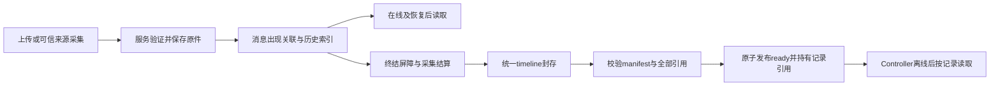

# Session 图片归档与恢复设计

本文定义统一 manifest/timeline/blob 归档、旧记录迁移、历史恢复和删除边界。基础层实现不表示原生图片来源、浏览器预览或整体验收已完成。[图片显示与归档规格](../spec/session-image-history.md)拥有所需行为，[图片验收与容量规格](../spec/session-image-acceptance.md)拥有验收要求。

[公共协议与存储设计](session-image-contracts.md)拥有基础图片 DTO、身份、错误和共享预算；本文唯一拥有 schema3、归档状态、完整历史同步、文件传输及导入 DTO，并描述持久化顺序、恢复和失败处理。公共 codec 按本文定义实现一次，负责闭包遍历、编码和旧数据边界归一。[来源采集设计](session-image-sources.md)拥有采集，[Provider 设计](session-image-providers.md)拥有可信原生关联，[浏览器设计](session-image-browser.md)拥有预览与下载。这里不扩展 Herdr、任意文件、跨账户共享或任意跨 Session 复制。

服务业务接线遵循[服务器组织规则](../daynight-server.md)，分别使用 `internal/core/session/` 执行、`internal/service/session/` 授权事务、`internal/core/store/` DAO、`internal/server/session/` HTTP 和 `internal/core/filestorage/` 文件抽象；不重建旧 `internal/sessionrelay/`。

设计取舍和代价由[对应决策记录](../../.agents/notes/implemented/architecture/2026-11-05-session-image-archives.md)保存。

## 保存模型与在线历史

采用服务端不可变原件、消息出现映射、独立归档文件与显式引用集合。图片 available 之前已完成服务图片存储的服务持久提交；归档建立记录引用，不在结束时才抢救 URL/工作区文件。



服务引用事实采用服务图片存储的一套集合，不新增平行 refcount：上传、operation（含 unknown）、消息出现、归档准备、正式记录、短期 reader。每条引用带真实 owner、Session、资源与主体身份；计数是集合派生结果。消息出现保存 entryId/imageId/sourceKey、container/callId、可选 partId 与旧正文出处；二进制由 resourceId 指向不可变 blob。图片摘要不是授权或图片出现身份。

Controller 媒体存储的 occurrence/journal 是 Controller 恢复来源，服务的消息关联与原件是页面历史来源。原生事件按同一 sourceKey 重放，只更新原出现；historyEpoch、分页、工具折叠和网络重连不分配新 imageId。

出现采用两个持久阶段。Controller 先保存 entry/出现位置与原 request，通过 sourceSeq/outbox 的 timeline upsert 取得覆盖该位置的服务 ACK，并实际上传必要完整历史；当前来源权限和本机容量有效时读取并封存 bytes，再以原 request、当前 attempt 和 frozen outcome 直接 submit。服务核验已确认位置、revision/hash、sourceKey、可信 nativeSource 与原身份；source IO 不等待 register 或 reserved。ACK 未知保留 outbox 且不先读源；submit 未知先查询原 capture，只有当前授权、Session 和 fence 有效且明确 capture_not_found 才重放同一冻结业务与封存字节。可信原生键由 Provider 映射提供，没有则为 null，不按文字、摘要或位置猜配。自有上传图的原生回显在位置 ACK 后通过同 Session resource locator 和 resource outcome submit，只增加出现引用和来源映射，不分配第二份 blob；该关联不证明原生接受，也不解除 unknown。

资源与已确认出现的提交原子可见；原生接受和消息关联尚未结算的意图持有原 pin 和关联身份，不广播虚构消息。终结前必须处理全部待挂接关联，不能把资源未出现在最后显示页误当无引用。停止后的完整同步先确认原位置，再按原 stopped 权限登记已经发生的来源与已有 validated 结果，不重新启动来源 IO。冻结的记录来源索引不保存正文、路径或 Base64，须与 timeline 的原出现和 resource hash 相符；Controller 已丢失且只有未上报本地映射时明确 context_unavailable，不能伪造恢复。


共享闭包遍历器属于公共协议与归档 codec：遍历用户/助手 content、工具 output、reasoning 绑定、Markdown 当前 bindings、retainedImages，以及被撤回的正文/条目留下的只读图片容器。Markdown 来源采集的新旧图片位置转换必须原子更新；晚到 committed 放进原 partId 的 retainedImages。显示过滤和正文修订都不是删除消息图片的依据。图/出现映射失败保留原位置及 ImageUnavailablePart，不按路径、URL、相似文本或数组下标猜配。

同 execution、同 Session 的原生恢复必须通过现有停止证明、准确 nativeSessionId 与代次递增规则，恢复持久映射并从服务读取原图。新代次只授予当前写资格，不改变旧图片读取归属。已有图片原件缺失时保持原 descriptor，显示读取/存储错误；不得重新打开改变后的路径或 URL 替换。

### 本机 SQL 快照与上传生命周期

活动同步与停止归档的本机正文均来自 `content/session-content.ts`，分页显示结果不能替代完整 SQL 遍历。一个短同步 SQL 快照同时物化有序 entries、资源 descriptor/引用、historyEpoch 与 sourceThrough；活动同步以原写事务提交同步 intent 和固定字节，停止归档以原读事务取得最终内容，事务结束后才进行网络传输。同 syncId 的重试使用原冻结字节，不能将后续修订写入旧同步文件。

停止入口先以原 ticket、完整停止证据和 permit 完成待处理的正文退休/压缩及正常准入。原资源拥有者在 SQL 快照内逐项验证 available 原件，冻结时复制资源 descriptor；随后关闭本机 SQL 并释放该本机阶段的存储许可。上传对象只保留物化 timeline、复制的 descriptor 与专用 `acquireResource` 文件读取能力，不保留完整可变资源拥有者或 SQL 引用 guard。

每次处理一个资源时才取得其 lease，将 metadata 与原冻结 descriptor 比较，并经同一持有的 FD 完整核对长度和 SHA-256。该 FD 贯穿本资源的 HTTP status、重试及块读取，最终在 finally 关闭，资源数不会决定同时打开的 FD 数。后来取得 lease 不产生新 SQL 快照；原 pin/生命周期与 `assertFrozen()` 的新短连接继续核对原 stopped 身份、当前 SQL 正文和 source 截止点。SQL timeline、metadata 与检查当前引用的资源释放入口不得在 SQL 关闭后使用；source-tail ACK、ready receipt 对账和后续本机写入重新取得原 permit 并使用当前 SQL guard。[SQL 正文设计](session-sqlite-content.md)拥有迁移、reader barrier 与物理维护顺序。

### 新 Test Session 的原生历史恢复（消费者接入合同）

本节定义 Provider 恢复与整体验收阶段的接入要求，基础资源与归档交付不表示跨 Session 导入入口已经启用。

`controller resume`创建新Test Session与同Session恢复不同，nativeSessionId相同本身不授予跨Session读权限。采用**限定于显式原生resume的历史原件导入**：目标在接纳新图片输入前，把原记录已成功保存的图片复制为目标自己的不可变资源，保留原出现到目标出现的稳定映射；不新增跨record的公有图片part或可递归历史容器。导入后的普通ImagePart进入目标在线、schema3与retained闭包，再从目标resume只读取它自己的已提交原件。旧上传/operation/native文件资格均不复用，也不生成新的原生输入。

导入只发生于已经验证原记录与准确native身份的显式resume链，不开放任意跨Session复制。服务在当前认证下同时检查源记录读取权、目标Session操作权、同owner、同provider/准确nativeSessionId、真实resume来源关系、双方删除屏障及图片协议。新Session尚未建立native ID时，关系只作为待验证准备，必须由该次resume结果确认精确ID才发布导入；任意其他初始化不得接管。源Task记录不因相同native ID成为Test导入来源；首版仅沿既有Test resume可证明的同账户来源。

持久来源映射由Controller 媒体存储和各Provider投影提供：原生message/item/block键、entryId/imageId及原resourceId/hash，保留在服务的record occurrence索引，归档提交时将其与manifest/timeline身份一起冻结。该索引不存会话正文/路径或图片Base64；必须从可信投影证明映射，不能由浏览器声明，也不能根据相同文字、摘要或数组位置猜配。在线已成功采集的图片没有可靠原生键时，原记录保持可读；新恢复明确context_unavailable且不能宣称图片恢复完整。公共协议统一投影来源键的登记及归档关联，各既有 Provider 适配器产出准确原生键；仅Controller私有映射不足以保证原Controller离线后恢复。

服务将一次恢复绑定为 `(sourceRecordId,sourceManifestSha256,targetSessionId,expectedNativeSessionId)` 不可变导入身份。开始前枚举完整可信来源集合；同源 resource 多次出现只导入一个目标 resource，每个出现各有稳定目标 imageId。实际目标内容提交须满足统一 Session 总量和真实存储条件；导入未完整时不能称恢复完成，原记录入口保持可读。

每项固定`sourceImageId/sourceResourceId/sourceHash → targetImageId/targetResourceId`，从源服务原件取得read pin，按512KiB有界复制到目标服务媒体存储暂存、完整验摘要/长度/格式，核对实际内容后提交 available并建立目标出现映射。这里复制的是原存储bytes，不是重新抓路径/URL；不能把跨Sessionresource locator当作已授权同Session引用。导入intent、映射和commit结果在服务持久保存；网络未知先查同一导入，重试仅复用原bytes与目标ID，不双计配额或改原生出现。多实例IO使用同一admission与writer lease。

已知源committed的项即使目标尚未available，复制失败也不重分类为“从未采集”：保持可恢复pending或明确存储失败，阻止目标图片历史完成及最终归档封存，保留源记录可读。源原件损坏/无可信映射不能通过目标partial绕过；只有源本来就未采集的失败项才可原样成为目标ImageUnavailablePart。源权限撤销或明确删除按实际拒绝/删除事实停止导入，目标不得继续用旧授权；不能因此声称成功恢复。导入完全提交后目标有独立物理副本与引用，源记录后续删除不误删目标已经合法保存的原件。

导入合同由本文定义：`POST {targetBase}/image-history-imports/{importId}`严格body为`{sourceSessionId,sourceManifestSha256,expectedNativeSessionId}`（UUID/SHA及公共协议 native ID规则），只接受服务已认可的resume关系。`GET`同路径只查询原身份；成功返回`{importId,state,totalImages,completedImages,error}`，state为pending/complete/failed，计数为图片出现数，取 0..100000 安全整数；多个出现共享 resource 时原件只复制一次、完成计数按出现分别增加。complete要求计数相等且error=null，failed要求公共协议 ImageError，pending error=null。完整映射不塞receipt或浏览器body，通过目标可信历史投影读取；服务固定importId与原resume关系，同身份重复返回原状态，不同body为409 archive_conflict。可恢复IO失败保持pending并在原授权下协调，确定失败保持failed，不能自动新建导入；GET不授予恢复发送权限。此 profile 与 DTO 遵循下文完整定义。源只支持schema1且有真实legacy bytes时可经同样校验导入，sourceManifestSha256此时指原schema1归档原字节摘要；无图片字节的旧记录仍保原不可用语义。

## 容量预算与准入

所有单位均为二进制，1 MiB = 1048576 bytes；长度用公共协议 Decimal 精确计数。

| 对象 | 上限、计量与结果 |
| --- | --- |
| 新图片 | 每图 10485760 bytes；输入最多 8 张且合计 20971520 bytes，原生更小限制取交集。 |
| Session 实际内容 | `T+I+R+D+M ≤ 134217728` bytes；各项采用实际已接纳内容或最终事务中的实测候选。 |
| schema3 timeline | 完整 UTF-8 编码最多 134217728 bytes、100000 entries；仍须满足 Session 总量。schema1/2 保持旧 67108864 bytes 边界。 |
| manifest | 原字节最多 4194304、resources 最多 1000 项；available 项引用外置 blob，失败项没有 blob。 |
| Controller 本地 | 原有 execution、stateDirectory、卷空闲和控制元数据准入独立于服务端总量；详见[公共协议与存储设计](session-image-contracts.md)。 |
| 数据传输 | 图片块最多 524288 原字节；归档块最多 1048576 原字节；Session 媒体并发和控制帧限制保持。 |

`T` 是完整规范 `{"entries":[...]}` 的字节数，已接受空正文为 14；完整索引可计算 `14 + sum(entry.b) + max(0,n−1)`。`I` 是规范 entries/occurrences 索引的字节数，不含 epoch、来源截止点等协调状态。`R` 按不同 available resourceId 求实际原件长度，`D` 是按 resourceId 排序的已提交 descriptor 规范集合，`M` 是实际发布的 manifest 长度；缺少对应已接纳内容的分量为零。相同 resourceId 的多处引用只算一次原件，不同 resourceId 即使摘要相同也分别计量。临时副本、数据库内部空间及不含内容的控制记录不计入总量。

完整历史由 Controller 在短 SQL 快照固定源身份和截止点后上传；显示页或尚未上传的本机正文不能代替完整测量。服务保存 entry 的身份、序号、修订、摘要、规范长度和 occurrence 索引，最终 timeline 按条核验同一闭包，不重复计量正文。活动 checkpoint 的同 epoch 序号和修订不得回退；跨 epoch 使用准确的交接证明，不能比较无关联的裸序号。每次实际 resource、history 或 manifest 发布的最终短事务锁定 Session，重读 ledger、资源和已发布 manifest，用实测候选替换相应分量并原子保存事实与回执。manifest 仅 committed/verified 的长度作为既有值；提前登记长度不证明发布成功。网络、解码和文件操作在事务外完成。

旧 prepare/register 保留身份、权限、来源与生命周期校验，容量申请不为未来内容预留字节或资源槽；其兼容 `reserved` 状态不证明占额。实际内容超过上限返回 `quota_exceeded`，实际磁盘失败按存储错误返回；已接纳内容不被截断或删除。文件已发布而数据库结果未知时保留原身份、路径及清理责任，沿原结果协调；确认重放不重复计量。独立媒体 lease 和实际清理屏障仍有效。

## 归档与完整历史同步合同

本节唯一发布归档、完整历史同步、封存文件和显式历史导入的 DTO。TS/Go 公共 codec 按这些定义实现一次；公共协议文档仅提供 `UUID`、`Decimal`、`SHA256`、`SessionFence`、`SessionResource`、`ImageError` 和图片 timeline part 的基础合同。以下对象全部严格解析：所有列出字段必填，拒绝未声明字段、重复键、非法 Unicode 和错误判别值；`null` 不等于省略。请求及回执都不增加时间戳字段。

### manifest、timeline 与归档状态

```ts
type ArchiveFileReference = {
  fileId: UUID;
  sha256: SHA256;
  byteLength: Decimal;
};
type SessionArchiveResourceReference = {
  resource: SessionResource;
  blobId: UUID | null;
};
type SessionArchiveManifest = {
  schemaVersion: 3;
  contentKind: "native_timeline";
  recordId: UUID;
  fence: SessionFence;
  provider: "codex" | "claude" | "copilot";
  nativeSessionId: string | null;
  controllerId: UUID;
  controllerInstanceId: UUID;
  timeline: ArchiveFileReference;
  resources: SessionArchiveResourceReference[];
  completeness: "complete" | "partial";
};
type SessionArchiveTimeline = {
  entries: TimelineEntry[];
};
type ImageArchiveStatus = {
  state: "pending" | "ready" | "failed" | "unavailable";
  sha256: SHA256 | null;
  byteLength: Decimal | null;
  errorCode: string | null;
  schemaVersion: 3;
  completeness: "complete" | "partial" | null;
  migration?: {
    migrationId: UUID;
    sourceSha256: SHA256;
    sourceByteLength: Decimal;
  };
};
type ImageArchiveStatusResponse = {
  archive: ImageArchiveStatus;
};
```

`SessionFence` 精确保留 Task 的 sessionId/claimId/executionGeneration 或独立 Session 的 sessionId/testExecutionId/executionGeneration，不混用两个绑定。recordId 首版必须等于 fence.sessionId。nativeSessionId 为精确原生身份或 null，非 null 时沿公共协议的非空、合法 Unicode、无控制字符及 UTF-8 ≤256 bytes 规则。controllerId/controllerInstanceId 与原 stopped writer 匹配；manifest 只授予展示，不授予原生 resume 或发送资格。

manifest 原 UTF-8 JSON 为 1..4194304 bytes。timeline.byteLength 为 1..134217728 的 Decimal，摘要针对 timeline 原文件字节。resources 最多1000项、resourceId唯一；available必须有非null blobId，完整 MIME/长度/SHA及已知几何与服务原件一致。旧真实资源可没有几何扩展，不能伪造帧数；新图片 available 必须有完整全帧结果。failed/unavailable 的 blobId=null，pending 不进入封存。全部已接纳内容共同受 Session 实际总量限制。

TimelineEntry 保留全部文字、工具、reasoning、Markdown bindings、retained 和撤回容器；entries最多100000、entryId唯一且entrySeq严格递增。所有资源原件均外置到同一不可变资源库，不在timeline保存legacy Base64数组。旧schema1仅在边界解码并逐件核验后归一；源文件保留至迁移 verified。

闭包双向核验：每个 ImagePart 或 ResourcePart 都有完全匹配的 resources 描述符，每个描述符至少被一个实际消息出现引用；同样校验旧资源引用。未发送草稿不进入归档。`complete` 当且仅当所有适用条目的 imageProjectionError=null、所有 Markdown/reasoning 绑定已经完整核验、没有 ImageUnavailablePart 且全部引用原件已经保存；`partial` 至少有一项确定从未采集的 ImageUnavailablePart，可有零项 resources。known available 损坏、正文 gap 或未知提交不满足 partial。非 null imageProjectionError 或 reasoning 的 null bindings 表示图片引用集合尚未知，即使当前没有 ImagePart/ImageUnavailablePart 也不得封存或发布 ready（complete/partial 均不可）。它不是已定位且确定未采集的出现，不能伪造 imageId/缺图项满足 partial；应保留原正文、retained 和全部未决引用，在有界解析恢复并确认完整集合前保持 settling/pending，确定无法恢复则明确 failed。

| ImageArchiveStatus.state | sha256 / byteLength | completeness | errorCode |
| --- | --- | --- | --- |
| pending | 均 null | null | null |
| ready | manifest 原 bytes 的 SHA256 与 1..4194304 的正 Decimal | complete 或 partial | null |
| failed | 均 null | null | null 或符合 `^[a-z_]{1,64}$` 的字符串 |
| unavailable | 均 null | null | null |

errorCode 的 nullable failed 分支沿既有严格 archive status，不替换成 ImageError，不推断 null 表示成功。只有 ready 提供可供完整性核验的文件身份。`GET {base}/archive` 返回上述 envelope；`PUT {base}/archive/content` 提交 manifest 原 JSON 并使用相同 status envelope，`GET {base}/archive/content` 返回 manifest 原 JSON bytes，不带 envelope。未迁移旧记录保留原status/envelope与原文件摘要；迁移verified后status与reader一致指向新manifest，不混用两种摘要。所有原件读仍走所属记录的 resource reader，blobId 不生成公开存储 URL。

`migration` 是 ready schema3 状态的可选严格分支，仅当持久迁移为 committed/verified，且其 target path/hash 与当前归档完全匹配时返回。三个内部字段全部必填，sourceByteLength 为 1..67108864 的正 Decimal，源摘要与长度在迁移准备时固定，后续阶段不得修改。其他状态及未迁移记录不带该字段。已确认 schema1 回执以原 sha256/byteLength 核对此 source 身份；匹配后才能将本地回执原子替换为当前 schema3 状态。新旧表示的摘要不要求相等，缺失迁移关系或源身份不符仍拒绝，不能借 ready 状态猜测迁移成功。

### 归档准备及重置

```ts
type ImageArchivePrepareRequest = {
  fence: SessionFence;
  controllerId: UUID;
  controllerInstanceId: UUID;
} | {
  fence: SessionFence;
  controllerId: UUID;
  controllerInstanceId: UUID;
  expectedTimelineRevision: Decimal;
  failedFileId: UUID;
};
type ImageArchivePrepareReceipt = {
  recordId: UUID;
  phase: "settling" | "sealed" | "failed";
  resources: SessionArchiveResourceReference[];
  historyEpoch: string;
  sourceThrough: Decimal;
  error: ImageError | null;
  timelineRevision: Decimal | null;
};
```

`POST {base}/archive/prepare` 使用两个精确对象分支；普通请求不带 reset 字段，重置请求必须同时带 expectedTimelineRevision 与 failedFileId，不能仅给其中一个。两种请求及 `GET {base}/archive/prepare` 均绑定原 stopped fence/controller/instance 和归档权限。GET 只观察，同一普通 POST 协调原准备，不创建竞争记录。

settling 的 resources=[]、error=null、timelineRevision=null。sealed 返回完整冻结 resources、error=null、非 null 正 Decimal timelineRevision；resources 可以为空，sealed 仍不表示 ready。failed 的 resources=[]、error 为非 null ImageError、timelineRevision=null。historyEpoch/sourceThrough 为服务在原 stopped 身份下的原检查点，仅用于原准备，不授予新的来源 IO。旧journal未持久epoch时必须取该回执，不能生成替代epoch。recordId 各状态均是原 sessionId；响应最多 4194304 bytes，不携 locator、凭据或对象路径。timeline 文件必须与 sealed revision 的完整账本逐项一致。

reset 仅接受当前 revision 下已确定 failed 的 failedFileId，且没有 manifest intent、manifest unknown/ready 或任何活跃文件 writer。服务验证 writer 已实际停止，再保留旧 file tombstone、释放其准备引用并建立新准备 revision 和新 fileId；recordId 与已保存原件不变。版本、文件或父删除屏障不符拒绝，未知结果先查询，不能靠 reset 改写可能已成功的提交。

### 活动账本与最终完整历史同步

```ts
type ImageHistorySyncContent = {
  historyEpoch: string;
  sourceThrough: Decimal;
  entries: TimelineEntry[];
  resources: SessionResource[];
};
type ImageHistorySyncReceipt = {
  syncId: UUID;
  state: "receiving" | "complete" | "failed";
  acceptedOffset: Decimal;
  byteLength: Decimal;
  sha256: SHA256;
  timelineRevision: Decimal | null;
  error: ImageError | null;
};
```

historyEpoch 沿既有 history key：非空白、合法 Unicode、无 NUL、UTF-8 ≤256 bytes，并精确等于原历史身份；不是任意新 UUID。sourceThrough 为最后已持久源序号的非负 Decimal，允许空历史的 "0"。entries 必须是截止该 sourceThrough 的全部有序图片 timeline，resources 是全部统一 SessionResource 描述符，不含 data/Base64；最终闭包另验全部外置实际字节。同步文件为 1..134234112 bytes，允许最多 16384 bytes 同步 envelope 余量，但其实际 timeline 编码仍独立受 134217728 bytes 和 Session 总量限制，entry/出现和资源数量不因此放宽。

| 操作 | 路径 | 身份与前提 |
| --- | --- | --- |
| 活动账本块写入 | `PUT {base}/image-history-ledger/{syncId}?offset=<Decimal>` | 当前已认证 ControllerFence 和活动图片协议 |
| 活动账本状态 | `GET {base}/image-history-ledger/{syncId}/status` | 同原同步身份，只观察 |
| 停止后最终历史块写入 | `PUT {base}/archive/prepare/history/{syncId}?offset=<Decimal>` | prepare 绑定的原 stopped writer，phase=settling |
| 停止后同步状态 | `GET {base}/archive/prepare/history/{syncId}/status` | 同原准备与同步身份，只观察 |

PUT body 是原始文件块，使用下节统一文件 headers、偏移、持久确认和时间边界；不能加入 JSON fence 或改成普通 timeline 显示页。syncId 是 Controller 为一份冻结本地文件生成的 UUID，首次 offset="0" 固定完整 byteLength/sha256；同 ID 不换文件，块可以跨任意合法 entry。

活动账本请求使用已用于当前WebSocket连接的 `dncontroller_*` grant作为Bearer，并在唯一的`Daynight-Controller-Fence` header中携带完整ControllerFence JSON（含connectionEpoch）。服务核验原已消费grant的hash、当前连接与fence、有效期和parent权限，不再次消费bootstrap grant，也不要求Controller获得Worker PAT。PUT另带下节三个文件headers；GET不接受query。base支持Task Session及Test/Bot Session。原生runtime在welcome取得currentFence，初始同步和events/sync ACK后串行触发完整账本同步，停止时cancel并join原同步。图片读取前及sealed submit前均先等待当前outbox尾部ACK，再取得同historyEpoch、覆盖所需sourceThrough的实际complete回执；没有可上传快照、尚未ACK或缺少完整checkpoint均不算成功。已有冻结同步先按原syncId和原字节完成，再上传包含新出现的快照；上传期间来源序列前进时继续确认新的完整尾部。离线或ACK未完成保持未发送，完整历史组件不支持则明确component_unsupported。

relay在发送submit的同步调用内再次核对当前epoch的完整checkpoint、最新本地sourceThrough、空outbox及不存在在途事件批次，检查到发送之间不await。服务controller-channel逐帧同步执行Handle，使随后发送的source事件不能越过该submit、提前使账本失效。若等待期间来源前进，submit保持未发送，沿同一冻结request、attempt和outcome重新确认历史；该过程不重读图片来源、不重新stage，也不把暂时的历史等待记成采集失败。

回执是 ImageHistorySyncReceipt 原对象，不加外层 envelope。acceptedOffset 为 0..byteLength 的非负 Decimal，各状态 byteLength/sha256 都是原绑定身份。receiving 的 timelineRevision/error 均 null；complete 要求 acceptedOffset=byteLength、非 null 正 timelineRevision、error=null；failed 的 timelineRevision=null、error 非 null，并保留原 syncId/身份/最后确认偏移。complete 必须经过完整长度/hash、strict JSON、全部 entry 集合/顺序、源连续性、权限/停止条件和 gap 校验，随后按实际总量检查并原子替换完整索引，不能用长度相等代替内容一致。实际内容总量超限的确定失败将原 `quota_exceeded` code 和安全说明写入该 syncId 的 failed 回执；原偏移和身份保留，旧 checkpoint 不被替换。暂时 IO 故障保持 receiving；提交结果未知先查询同一 syncId，不能据失败响应或超时推断回滚或更换身份。

每 Session 最多一个活跃完整同步轮次。最终准备 sealed 或已有 manifest 提交后不再接纳新最终同步。settling 中只有原同步已确认 complete/failed、原 writer 实际停止，且采集结算改变绑定或对已持久正文的有界投影恢复成功改变投影时，才能显式创建新 syncId。清除 imageProjectionError 并形成完整空绑定也是有效增量，不要求存在图片或 capture 终态变化。新轮次沿同一 prepare/stopped 身份、historyEpoch 与 sourceThrough，只推进发生变化的 entry/片段 revision，不产生新原生消息或新的来源 IO；新轮次 complete 前保留旧账本与全部 pin，旧迟到请求不能覆盖新轮次。活动账本同样保留 epoch/source 截止屏障及持久 outbox；确认完整同步前保留上一完整 checkpoint，不把显示页或未上传正文作为容量事实。正文仅进入受 lease 保护的有界临时文件，计量后清理；数据库只保存元数据。

每个完整历史文件在首次登记时绑定当时的 `sourceEpoch`。合法 `source_reset` 在同一 Session 事务中记录从已确认 checkpoint 到新 source epoch 的交接，并将旧 receiving 历史轮次标为 failed；原 fileId、摘要、确认偏移和块仍可观察。旧 writer 的迟到 I/O 不能再提交或覆盖 checkpoint。新轮次须等原 lease 排空后登记；物理文件清理在 reset 提交后及每次 history lease 结束后于事务外尝试，只有 archive lease 阻挡该清理，无关媒体不阻挡。reset 后清理失败保留原文件身份和清理责任以便重试，不关闭 Session；清理须等待原 I/O 实际结束。同 source epoch 的 `sourceThrough` 不得回退；跨 source epoch 不比较裸序号，仍须按已验证交接核验已有 entry 的身份、顺序及修订推进。

活动账本的 writer 随合法 generation 恢复接管：Grant 在核验精确前代、原 Controller instance 及 stop proof 后，于同一事务以旧 identity 为条件更新 active bundle 的 writer。prepareId、原账本、全部 fileId、摘要、块、确认偏移及未决资源/operation 引用保持原身份；不重新创建归档准备，也不将 unknown 改成失败。连续多个 generation 在没有新同步时恢复仍逐代接管。旧 writer 的迟到请求按当前 fence 拒绝。接管与停止转换前，服务在事务外以实际文件锁证明回收已退出 IO 的孤儿 lease；仍持锁的 IO 保持 lease 并阻止接管。

原 writer 已停止且服务确认没有活动 IO lease 后，active bundle 可转为 settling。原 receiving history 轮次明确标为 failed，保留其 fileId/hash/确认偏移和块，不将部分文件视为完整账本；最后完整账本及 pin 继续保留，直到新的最终同步成功。最终同步必须保留已确认 entry 的 ID、顺序及不退回的 revision；同 revision 不得改变内容，同 source 截止点还必须保留原正文 hash。真实 source 尾部推进后，允许更高 revision 的原 entry 更新和追加 entry。其后 settling 投影修正继续遵守同 source、同原文的严格增量规则。

### timeline 文件块与共同传输规则

```ts
type ImageArchiveFileReceipt = {
  fileId: UUID;
  state: "receiving" | "complete" | "failed";
  acceptedOffset: Decimal;
  byteLength: Decimal;
  sha256: SHA256;
  error: ImageError | null;
};
```

`PUT {base}/archive/files/{fileId}?offset=<Decimal>` 写原始 timeline 块；`GET {base}/archive/files/{fileId}/status` 向同原 writer 返回严格 ImageArchiveFileReceipt。首次 offset="0" 在 sealed 准备中占用唯一 fileId，并绑定 1..134217728 bytes 的完整长度和 SHA；每记录只有一个 timeline file，不是通用附件接口。旧记录迁移专用 purpose=resource&migrationOnly=true 分支携带原 Daynight-Resource-Descriptor，只接受原 stopped writer 的原资源身份、长度与摘要，并复用同一资源 namespace，不伪造图片元数据。该 legacy resource 可保留零长度：完整长度及 offset 均为 `"0"`、空 body、文件和块摘要均为 SHA-256 空摘要 `e3b0c44298fc1c149afbf4c8996fb92427ae41e4649b934ca495991b7852b855`。服务仍核验原 available legacy descriptor，实际耐久发布空原件并完成闭包；精确重试保留 fileId/resourceId/hash，不写虚构块或负偏移。`GET {base}/archive/files/{fileId}` 只对 ready 记录的有权读者返回原始 application/json bytes，不带 envelope；staging 不对浏览器公开。

timeline 和两种完整历史同步共用以下传输规则：

- 每块为 1..1048576 原 bytes，`Content-Type: application/octet-stream`；`Daynight-File-Byte-Length` 是完整正 Decimal 长度（仅上述 legacy resource 允许零长度空块；timeline 与历史同步仍要求正长度），`Daynight-File-SHA256` 是完整文件 SHA256，`Daynight-Chunk-SHA256` 是本块 SHA256。offset 是非负规范 Decimal。每次请求都带同一完整文件身份，不信任只声明的长度。
- 接收并验证完整块、落盘且持久化边界后才推进 acceptedOffset。只接连续 offset，或同 ID 下已确认同边界、同长度、同摘要且实际 bytes 相同的精确重传；重叠、跳跃、不同 bytes/身份均为 409 archive_conflict。每文件一个变更请求在途，每 Session 文件块最多一个，仍占共享媒体额度，不增加第二套账户/部署并发槽。
- file receipt 各状态 byteLength/sha256 都是预期完整身份，acceptedOffset 为 0..byteLength。receiving.error=null；complete 必须 acceptedOffset=byteLength、error=null，且实际完整文件已经通过长度/SHA/strict JSON/timeline 与 sealed revision 闭包校验；failed.error 为非 null ImageError，保留原身份及最后确认 offset。确定失败不回退或换 ID，暂时 IO 故障保持 receiving。
- 正常非末块返回 200 receiving；最后块验证未结束可以 202 receiving，验证完成为 200 complete。received 全部 bytes 仍可能 receiving，不能仅按 offset 满额推断 complete。同步另外要求完整 source/账本验证，只有其 complete receipt 才发布 timelineRevision。
- 每块网络等待最多 15 秒，整轮推进最多 60 秒后让出；状态保留，下一轮先协调原 ID。网络超时或取消不证明服务回滚，不删除已确认前缀，不换 fileId/syncId，也不解除 pin。失联先查原 status，确认 receiving 后才沿原身份精确续传；complete 后仅查询或精确重复，不能覆写。

15 秒块等待、60 秒传输轮次和 60 秒来源结算是三个不同边界，均不是 upload TTL，也不是 writer/reader 已停止证明。槽、lease 和物理计费只有实际完成或 cancel+join 后释放；监督器不能仅凭心跳过期完成清理。反向代理只为这些路由配置相应的 1 MiB 块、128 MiB 原始 GET 和 4 MiB manifest/prepare 响应限额，不扩大其他控制请求。

### 停止后的连续source尾部协调

停止时journal仍可能持有未获ACK的原source事件。Controller归档协调器使用`POST {base}/archive/source-tail`提交原连续批次，`Content-Type: application/json`，body为严格`{fence,controllerId,controllerInstanceId,sourceEpoch,batchId,events}`；fence为原stopped代次，sourceEpoch为原executionId，events为1..100个原SourceEvent，不能含gap，完整body最多2097152 bytes。该HTTPS入口沿既有归档上传凭据和停止授权核验，不重连原WebSocket、不创建Provider或恢复原生进程。

已有 active history bundle 时，source-tail 与 prepare 使用同一停止转换，在最终 history 开始前将其推进 settling，再沿原批次协调 ACK。服务分别保留最后完整活动账本的来源截止点和最终 source 屏障；精确尾部重放只推进后者，丢失 ACK 的重试不会再次增加准备 revision。最终 history 开始、sealed 或 manifest 提交后仍禁止追加尾部；不得用旧活动账本替代最终同步。

服务推进原source checkpoint及有界原event/batch hash账本，不重放state或改变lifecycle、generation和operations。原stopped身份可将服务尚未知的native ID从null单调登记为原Controller已创建的ID，初始化null事实不会清除已知ID，不同的非null ID仍冲突；最终manifest沿同一停止授权保留该旧writer保证。成功返回严格`{sourceEpoch,batchId,lastAckedSourceSeq}`，ACK必须精确等于该批末尾；未知结果重发同batchId及原bytes。Controller先持久完整批次，再发送，只有核验并持久该精确ACK后才删除对应outbox前缀。原sourceFloor已越过本地ACK且缺少连续前缀时明确拒绝；不能猜测服务ACK或用最终历史文件掩盖源缺口。尾部协调后仍要求最终历史sourceThrough精确匹配；冲突ACK不能删尾，原活动身份不能借用此入口。

### 显式 Test resume 历史导入（消费者接入合同）

下述导入API及可信原生映射属于恢复消费者的接入要求，基础层提供统一资源、归档闭包和持久读取；基础能力交付不表示此导入路由已经开放。

```ts
type ImageHistoryImportRequest = {
  sourceSessionId: UUID;
  sourceManifestSha256: SHA256;
  expectedNativeSessionId: string;
};
type ImageHistoryImportReceipt = {
  importId: UUID;
  state: "pending" | "complete" | "failed";
  totalImages: number;
  completedImages: number;
  error: ImageError | null;
};
```

`POST {targetBase}/image-history-imports/{importId}` 接受该严格 body，`GET {targetBase}/image-history-imports/{importId}` 只查原身份，均返回严格 ImageHistoryImportReceipt 原对象。expectedNativeSessionId 是被证实的非 null 原生 ID，沿公共 native ID 字符串限制；目标 native 尚未建立时，来源关系只能准备，须本次 resume 的精确 ID 验证后才发布导入，null 不作通配符。sourceManifestSha256 对 schema3 指原 manifest bytes，对有真实 legacy 字节的 schema1 指原归档 bytes。请求不携带出现映射、locator、actor 或上传凭证。

totalImages/completedImages 是 0..100000 安全整数，按图片出现数计，不按不同 resource 数计；0≤completedImages≤totalImages。共享一个源 resource 的多个出现只复制一次原件，各出现完成分别计数。pending.error=null；complete 要求 completedImages=totalImages 且 error=null；failed 要求非 null ImageError，保留真实已完成计数和原映射，不把部分复制称为 complete。

服务固定 importId 与原 source/manifest/target/native 恢复关系，同 ID、同 body 返回原状态，不同 body 为 409 archive_conflict。开始前检查双方当前权限、同 owner/provider、真实 Test resume 来源、删除屏障和完整目标容量；不开放跨 Task 或任意 Session 复制。可恢复 IO 失败留 pending 并在原授权下协调，确定失败留 failed，不自动新建 importId。GET 不派发新输入或授予发送权限；原 source 已采集的项即使目标复制失败也不能降为未采集 partial。完整映射按可信原生键持久化，不由正文或 SHA 猜配。

## schema3 文件封存与发布

manifest、timeline、状态和控制操作均消费上节完整定义。首版每 Session 一个 native archive，recordId=sessionId；服务产生并核验该映射，不能用任意 UUID 指向其他记录。

timeline 只包含 `{entries:TimelineEntry[]}`，资源描述符和外置引用统一位于 manifest.resources。manifest 的原 bytes 由最终确定编码一次封存；timeline 同样封存后保持 fileId/hash/length 不变。服务已提交图片的 blobId 是 opaque ID，Controller 从授权的归档准备结果取得，不由 hash 推导、也不使用本地路径。资源描述符必须与服务 available 的 MIME/length/hash/dimensions/frameCount 完全相等。

blobId 仅用于内部对象解析，不是对外下载能力；manifest 包含 blobId，因此受权读者可以看到 opaque 值，但浏览器不能据此构造存储 URL或绕过 recordId/resourceId。正式 reader 只用所属记录的资源路由。

### 归档准备与结算屏障

终结分为原生停止、媒体结算、文件封存、记录发布；不能在 active native 仍写正文时任意截取最后一页。归档模块保存服务内部归档准备账本，固定原 stopped fence、controller/instance、recordId、历史截止 revision、未决 capture 集合、预期文件摘要、准备 pin 与提交结果。原生 stopped 证明保留，图片协调器可继续读取已持久准备文件；不会启动/恢复 Agent。

1. 在原owner/原Session归档权限与停止证明下建立settling准备，停止新原生执行和新的任意来源读取，但先允许原stopped writer补送本地已发生的最终正文、来源映射和连续source截止证据。归档重试不依赖原WebSocket重新上线：使用有界 history 同步 profile接收原 SQL 当前正文的完整最终投影，重建仅hash/长度/引用的服务完整索引，从有界临时文件逐项校验后清理正文。只有完整同步确认才固定候选occurrence集合；不能用尚未同步的服务视图seal。
2. 最多等待60秒完成当前已有本地来源/解码尝试和服务 query/复制。尚未开始或确定只有未提交 partial staging 的采集在确认 writer 停止后，原 capture 原子转 failed 并保留原清理责任，保留明确缺图原因。已 committed 的必须纳入原图。validated/copying/提交未知先查服务，不能以60秒到期宣称未采集。
3. 最终正文同步后，已登记采集的终态/retained结算，以及对同一已持久正文的有界投影恢复，仍是允许的确定增量；解析成功即使得到零图片，也须将清除错误、完整绑定及修订通过新的最终同步轮次送达服务。保持原 stopped 身份和 source 截止点，不启动新的来源 IO；恢复发现的真实出现按已有停止后登记/结算规则处理，不放宽采集权限。完成这些增量并再次确认最终完整索引后才seal，禁止一切正文和出现变更。服务锁内对原 capture 做终结 CAS：commit 已获胜则只能纳入 committed；confirmed failed 获胜后旧 attempt 的 validated/复制完成不可再次提交。还有未知服务结果、活跃 writer 或未决原生消息关联时归档保持 pending或明确失败，持有 pin；之后只协调原准备，不生成竞争 manifest。prepared bytes 丢失但服务已 committed 仍可归档；服务明确从未提交才记缺失。
4. 结算全部出现后取得冻结完整投影，包含当前/retained/撤回容器；共享 codec 验证闭包、统一 timeline/manifest 容量和原投影 gap，并要求全部 imageProjectionError=null 和完整有效的 Markdown/reasoning bindings；首次解析失败且 retained 为空也不能通过空集合检查。未解决图片投影错误时不进入 sealed，不创建可发布 manifest。gap 表示未知文本内容时整个归档失败，不把图片 partial当作文本缺页通行证。
5. 服务建立暂时归档 pin，返回仅此记录引用的 descriptor/blobId 映射。Controller据其本地完整正文与冻结账本写timeline及manifest，服务验证上传timeline与完整账本一致；没有资源的未发送草稿不进入它们。发送 unknown 的独立 operation pin 保留，不能捏造已接受用户消息；未决关联若可能改变最终历史则不封存不可变完整归档。

准备查询与驱动使用上文严格 ImageArchivePrepareRequest/Receipt：原 stopped writer 通过 POST 协调原准备，通过 GET 只观察。回执的 resources 只在 sealed 时提供完整冻结集合，historyEpoch/sourceThrough 保持原来源屏障；sealed 表示出现终态及资源映射已冻结，不是 ready。一次响应≤4 MiB，不携 locator、凭据或对象路径。timelineRevision 只在 sealed 时为正 Decimal；Controller 提交文件必须来自同 revision，服务从账本逐项核对，不信 Controller 自报完整。

活动连接成功重连时，服务在校验原 grant、hello 与 controller 身份的同一事务内，将现有活动账本的最终目标 epoch 推进到新连接的 historyEpoch。账本保留上一完整同步的原 epoch、entry/hash/长度及所有完整、未完成文件回执；连续重连只能从最新已验证目标继续，不能回退到旧 epoch。重连后仍须完整同步才能恢复图片准入。若此前即停止，prepare 和 stopped source tail 沿已验证目标结算，先保留旧完整前缀，再由最终同步核验该前缀并提交新 epoch 的完整账本；未完成轮次只在停止与服务 IO lease 屏障通过后转 failed，已确认块和原文件身份保留。没有这条持久连接关系的跨 epoch 同步继续拒绝。

settling 下的最终同步使用有界原字节文件传输，避免一条合法但 JSON 转义后大于普通历史页的 entry 永远无法同步。`PUT {base}/archive/prepare/history/{syncId}?offset=<Decimal>` 的原 stopped writer 权限与完整归档身份由 prepare 账本绑定。文件原内容严格为 `{historyEpoch,sourceThrough,entries,resources}`，前两项是原历史身份和最后已确认连续源序号，entries 为全部有序 TimelineEntry，resources 为统一描述符、不含 Base64；服务端收到的正文只在临时文件和有界解析中存在，不写服务 DB 正文表。schema3 timeline≤128MiB，再加有界同步 envelope 最多16KiB，故同步文件≤134234112 bytes；实际 timeline 和 Session 总量检查不被这个传输余量放宽。

每块1..1048576原bytes，完整文件长度/hash和块hash使用下节相同三个Daynight-* header，offset连续或精确同边界重传；syncId由Controller为一次冻结本地源分配，首次offset=0绑定不可变完整文件身份。成功与`GET .../history/{syncId}/status`返回`{syncId,state,acceptedOffset,byteLength,sha256,timelineRevision,error}`；state=receiving/complete/failed，Decimal/UUID/SHA沿公共协议，timelineRevision仅complete非null，error仅failed非null。最后完整文件经长度/hash、strict JSON、全集合、原停止证明、source完整性及原 journal gap校验后，按实际总量检查并原子替换完整索引并返回complete及持久revision。确定失败保留原syncId与原因，暂时IO故障保持receiving可协调；查询未知不换ID。最多一个活跃同步轮次，原sealed/manifest提交后不能新建同步。

本地采集终态结算改变绑定，或对已持久正文的有界解析恢复成功改变图片投影时，只有先确认原同步complete或failed、实际writer已停且prepare仍settling，才能显式以新syncId开启新完整轮次。解析成功清除imageProjectionError并输出完整空bindings也适用，不依赖capture结算或WebSocket重连。新轮次保持同一prepare/stopped身份、historyEpoch和sourceThrough，以推进的entry/片段revision提交修正投影；旧syncId的文件/hash不得改变，禁止新原生执行和新的来源IO。旧metadata账本和pin在新轮次complete前保留，旧轮次迟到请求不能覆盖新事实。服务计算并保存逐entry/hash/长度/引用元数据，legacy内嵌bytes的编码长度按其已登记长度和规范Base64计算，最终归档文件再验实际bytes。同步临时正文文件仅为校验使用，完成并写入元数据后删除；失败/未知按writer lease与准备引用协调清理。整个合法entry可跨任意文件块，不拆文字part、不改entryId；解析在有界执行单元完成，测量最坏128MiB timeline 文件而非假设单entry小于传输块。此同步 DTO 由本文定义并由公共 codec 统一实现，与图片upload和正式timeline file区分。

服务不能验证本地全部native事件是否真实存在，但只接受原Controller已验证的最终本地库存与连续序列/完整性声明，并保持现有archive_incomplete拒绝；已知仅需full resynchronization的gap允许此完整同步修复。原生停止后未上报的最后条目有不启动Provider的前进路径。同步不启动图源IO；尚未在服务 submit 的本地图片出现只能以原已发生来源及其本地结果提交元数据，不在停机后重新抓路径/URL。已有validated本地文件在原归档权限profile内复制结算，缺本地字节者明确未采集。

公共 codec 按本文合同一次实现严格 TS/Go 解析；归档模块实现准备、最终历史同步与消费者。不能将现有POST archive的pending/failed body偷换成该对象。

### 元数据文件的有界上传

归档文件使用本文的 `PUT/GET {base}/archive/files/{fileId}` 有界连续块合同，不复用 ImageUploadReceipt/PreparedImageChunk：

- 初始 PUT 与每块都带规范 `offset` query、`Content-Type: application/octet-stream`，单块1..1048576 bytes；`Daynight-File-Byte-Length`、`Daynight-File-SHA256` 为完整timeline身份，`Daynight-Chunk-SHA256`为当前块摘要。fileId由Controller生成，首次offset=0在sealed准备下原子占用唯一timeline身份并绑定完整长度/hash，长度1..134217728；之后不可变，不能覆盖同准备的另一个fileId。每个记录仅一个timeline file，不允许自由上传附件。
- 接收完整规范块、核验摘要、落盘并持久边界后才能推进acceptedOffset；连续偏移或完全相同边界/实际bytes的重传允许，不同/重叠/跳跃为409 archive_conflict。每个文件只允许一个变更请求在途。
- 成功JSON为 `{fileId,state,acceptedOffset,byteLength,sha256}`，state=receiving/complete/failed，另有必填error（failed为公共协议 ImageError，其余null）；byteLength/sha256始终是绑定的预期完整身份，只有complete才证明完整实际文件通过长度/hash/严格JSON/timeline与准备闭包校验。全部Decimal，规范UUID/SHA。最后块触发完整验证，尚未完成可202 receiving，complete为200；正常非末块200 receiving。strict JSON/闭包/完整摘要确定失败时记录failed并保留原fileId/hash/offset，GET可观察；不回退偏移或自动替换文件。暂时IO失败保持receiving并协调。确定失败后修复需要原writer的显式prepare重置：仅无manifest提交intent/未知结果且服务证明无活跃文件writer时，废弃原文件的准备引用并保留tombstone，建立新的准备revision与fileId；旧recordId和已保存图片不变，未知提交/ready一律不能重置。该重置沿POST archive/prepare新增严格reset分支`{fence,controllerId,controllerInstanceId,expectedTimelineRevision,failedFileId}`，普通prepare分支不带这两字段，两种请求遵循本文的 strict union。不得仅收到声明长度便确认。
- `GET .../files/{fileId}/status` 同原 writer权限返回上述当前事实。失联先GET status；只有确认receiving才沿原ID与块重传。未知不新建fileId。complete后只查询/精确重复，不能覆写。
- 正式 `GET .../files/{fileId}` 仅record ready且有读取权时返回原始application/json bytes，流式总量≤128 MiB，不带额外envelope；staging不因知道ID可下载。每块上传15秒硬网络等待，整次推进60秒后让出；持久状态保留，下一轮只协调原文件。单HTTP请求超时不能删除已确认前缀。

网络/文件IO在短事务外，所有服务端写者必须先取得下节持久写lease，提交时复核原准备revision、原writer和父删除屏障。late writer不能重新发布，删除完成前还必须确认其实际退出并最终清扫，不能只靠DB拒绝声称文件已删。服务反向代理body限制按路由设置，不能用默认2 MiB JSON中间件截断128 MiB GET或4 MiB manifest，也不让其他命令继承大body额度。文件传输每Session最多1个在途块、共享服务图片存储账户/服务admission与公平调度，不额外突破媒体并发。

### manifest 发布与未知结果

PUT `{base}/archive/content` 为原始manifest JSON（application/json、≤4 MiB），status 使用本文的 `{archive:ImageArchiveStatus}`，schema3 status.sha256/byteLength只对应manifest原bytes；ready必须带complete/partial。服务步骤如下：

1. 检查strict schema、真实原owner/fence/provider/native/controller身份和停止/删除屏障，登记原recordId+manifest digest提交intent；同record相同摘要幂等，不同摘要409 archive_conflict。
2. 在事务外完整验证已封存timeline、每个已有blob长度/摘要与服务descriptor；资源闭包双向相等。通过服务媒体存储流式扫描原blob，可恢复分批校验，不在内存读入全部原件。验证期间pin禁止GC。
3. 将manifest、timeline持久发布到记录namespace，获得后端耐久证明。数据库事务再次校验准备revision、权限/删除epoch和同一资源集合，原子插入正式record引用、记录manifest与timeline文件身份、设ready/completeness、释放准备pin。文件先行产生的孤儿不是ready；SQL提交不确定先只读原提交。
4. 返回与原manifest精确相等的status。Controller保存含完整record/fence/文件身份的本地耐久receipt，再释放仅为本次归档使用的pin；不清除native/resume/unknown pin，不删除worktree或源文件。原有worker清理仍由其生命周期负责。

complete 表示所有适用条目 imageProjectionError=null、Markdown/reasoning 图片绑定完整有效、没有 ImageUnavailablePart 且所有 ImagePart 原件已提交；partial至少有一个从未成功采集的明确失败项，成功项仍可读。known available 的blob丢失/摘要不符、缺descriptor、未决commit、timeline gap、文件损坏以及非 null imageProjectionError/null reasoning bindings 均不能转换 partial 凑 ready。图片解析错误使出现集合未知，服务在 manifest 发布前再次拒绝未解决错误，不能由完整文字/source 序号或空图片数组推定无图。尚未发布时设failed或保持可协调pending，错误定位实际对象。ready后发现存储损坏是读取完整性失败；不改写已封存manifest/completeness，UI明确“归档图片读取失败”，不沿原ready宣称当前原件都健康。只能从已验证的同摘要备份修复物理对象，不能重新抓源。

PUT/DB提交回执未知时先GET archive与原prepare/file状态。相同manifest的ready即核对原结果；pending表示继续原工作；查询失败继续保留原文件及pin。Controller 在创建新文件 intent 前观察当前归档；若旧 schema1 已提交并被迁移为 schema3，即使本地 receipt 未落盘，也只在保留的完整旧源序列化结果与服务持久 migration source SHA/长度精确一致、停止身份及源内容重核通过后保存当前 receipt。完整旧源包含未引用的旧资源和原 bytes，不能只重建当前引用闭包来冒领旧提交。关系缺失、来源不匹配或状态未知均不创建竞争 fileId。不得无条件POST failed覆盖可能成功的结果，不换recordId、fileId或摘要逃避冲突。独立archive retry继续沿原停机证据，不能启动Provider；新generation不得冒用旧写资格。

## 读取、权限与删除

“离线回看”指原Controller/原图源离线但Daynight服务可访问，不承诺浏览器断网时离线缓存敏感图片；后者与即时权限复核冲突，未提供Service Worker离线图库。

新reader顺序是：选图片协议 → 读取匹配表示status → 取manifest原bytes验hash/length → strict parse及身份核验 → 取timeline原bytes验hash/length、parse及闭包校验 → 渲染文字与图片位置 → 按需读取已授权图片块，完整SHA通过后才交预览模块预览/下载。首次打开不预加载全部图片原件。timeline解析可在Web Worker中完成并只保留单份必要结构，旧resource仍有其既有≤64 MiB上界；不把元数据文件限额伪装成浏览器RSS上限。

首版recordId=sessionId，因此记录base仍是Task `/api/v1/projects/{projectId}/tasks/{taskId}/sessions/{sessionId}` 或Test/Bot `/api/v1/test-sessions/{sessionId}`。在线读取要求消息或原actor上传引用；归档读取要求正式record引用，使用公共协议 `GET {base}/resources/{resourceId}/content?offset&limit` 与内容 revision header。不提供blobId/key查询，不根据URL重新采集。old claim记录按原Session权限读取，不要求等于当前任务claim。

所有status/manifest/timeline/图片块/下载复用原Session resolver、真实项目访问（含Team继承）、Test owner/parent credential、Bot→Session屏障；actor不能由body自报。IO前检查，数据交付和提交前重核。只读浏览器无prepare/file/manifest写权限；仅原stopped Controller owner PAT与精确身份可归档。现有deleted Task允许原owner完成归档的finalize例外不向浏览器开放，也不授予新的图片源读取或已删除记录恢复；Bot删除屏障保持更严格的拒绝，不绕过load。

timeline 与原件读取在 IO 前及结果交付前各执行一次普通 historical archive scope 授权，继承当前项目成员访问、Test parent credential、Bot 与删除屏障；原历史 claim 无须等于任务当前 claim。timeline 文件读回及解码后，交付前同时核对原归档状态、manifest/文件身份、ledger 和 delete epoch；read lease 只保留物理对象，不代替当前访问权。该读取路径不使用 finalize 例外，deleted Task 的内容继续拒绝。原 owner PAT 查询 legacy schema1 状态时，内部迁移可沿 owner finalize 权限完成原回执的升级对账，各阶段重新授权，仅返回状态和迁移源身份；它不返回归档 bytes，也不开放普通 manifest、timeline 或原件读取。

预览模块缓存key至少含origin/account/owner/recordId/resourceId/hash；权限无变化不重新挂图，实际账户切换、访问拒绝、Session/record删除、Bot `resource_conflict`屏障立即abort在途读取、丢弃旧结果、撤销Blob URL并关闭敏感预览/下载。每次重新使用缓存先经过当前scope授权；页面后台恢复和身份重验失败保持拒绝。已经下载到用户磁盘的bytes无法召回，不以此承诺可撤销文件。纯文字阅读位置、已展开工具和稳定图片组件由现有scope生命周期保留。

服务图片原件使用服务媒体存储独立media namespace，按projects/users与原Session owner隔离、禁止跨Session物理去重。多个消息/归档可共享同Session blob；timeline/manifest留在记录namespace。现有DeleteSessionArchives只删记录文件，不直接递归media目录。新的原件删除通过同一引用集合：事务锁父 scope→Session→排序资源，禁止新关联，移除本次删除涵盖的消息/记录引用；有其他合法记录/operation引用则保留。不能只看到在线Session结束就删除归档所用原件。

最后引用消失时标deleting，拒新lease；事务外等待已取得reader完成或取消，unlink并持久目录，最后确认tombstone/释放物理计费。失败继续计费并报告清理失败；崩溃重入仅处理既有deleting。孤儿文件须有真实owner、无活跃writer/未知commit/pin证明；mtime或TTL不足以删除。权限撤销只撤销actor访问，不删除仍属于其他合法成员的数据。

每个会创建staging/timeline/manifest/blob的服务端执行单元，必须在父删除屏障锁内先登记持久写lease（owner、Session、prepare/commit ID、instance/执行单元身份、delete epoch、目标结构化namespace及状态），然后才允许事务外IO；临时归档原件校验亦持有read pin。lease覆盖最后一次文件写入/rename/fsync及句柄关闭，只有实际cancel+join/正常退出后才释放。租约过期仅撤销DB提交权，不证明物理writer已停止；多实例失联时保留占用与未完成清理，须原单元退出确认或监督器可验证的进程终止证明，不能按心跳超时完成删除。

删除先在父锁下提交deleting/delete epoch并封闭新lease准入，再在事务外取消并等待所有旧写者和reader实际退出；之后执行最终namespace/staging/无引用media清扫并刷盘。最后短事务核验同delete epoch、无任何未终结写lease且全部清扫回执匹配，才确认server_cleanup completed。GC也服从同一写者/pin屏障。崩溃后按持久lease和清理清单恢复；即使旧writer已在删除前通过初始权限检查、之后才rename，它也在最终清扫之前被join，不能在completed后重建目录。任务worker停止证明不能替代服务端writer停止证明。

Bot删除仍需全部worker停止/cleanup证明、服务文件清理成功后才server_cleanup completed。新增schema3/准备/文件/record-reference表必须纳入显式子表清理或经验证的级联；media GC失败不得提前删唯一恢复账本/宣称完成。删除事务保存tombstone与待清理对象清单，后续异步cleanup可恢复；晚到file/manifest/capture事务检查同delete epoch，不能重新发布。Session/记录的真正删除覆盖哪些引用沿其原业务语义，不把一个页面关掉或原生停止当删除指令。

## 旧记录、迁移与回滚

旧 schema1 在读取/迁移边界使用同一转换库：校验原文件及每个真实Base64资源，将原bytes外置到统一资源库，保留session/resource/entry/operation身份、hash和unknown状态。缺失bytes保持明确unavailable，不伪造available。迁移记录使用原migration/prepare身份，按 prepared→files_durable→committed→verified 推进；新闭包fsync、DB提交和读回完成前保留原文件、旧journal及marker，重启先观察原状态，不能删旧后重建。schema2只交Herdr decoder，不借给原生媒体。

已有同 resourceId 的资源须在迁移准备和提交时核对完整描述符及原存储、迁移身份。Store 用 `HasInlineContent` 只报告旧 content 列是否非 NULL（空 bytea 也算存在），不加载原字节或判断资源状态；unavailable 的冲突拒绝由 core 拥有。seal 同时核对 unavailable 描述符、inline 内容存在性、blob 字段及 GC 状态：exact stopped reset 只撤本次 archive 引用，可以保留原 unavailable 资源行及完整历史；再次 seal 复用完全匹配且没有 blob/GC 冲突的原行，只有缺失时才 INSERT，不能用重置后重复插入或覆盖描述符消除冲突。已外置的 available 原件保持原 blobId/path，先核验原对象，再复用同一行；已存在的 unavailable 行保持原身份。旧 inline available 行只在原件已外置耐久、原描述符与迁移身份仍匹配且 blobId/path 均为空时原子转换，并清除数据库 content，不保留长期双份原件。只有尚不存在的资源可 INSERT；描述符、外置对象或并发转换身份变化均拒绝，不能覆盖已有资源消除冲突。

零字节旧原件在迁移后仍通过统一资源 reader 下载。读取必须经过实际已授权 HTTP 请求、服务对原对象的存在性和摘要核验，以及客户端对原身份、空数据、eof 和空摘要的完整校验；缺件、撤权和不匹配不能被本地合成空文件掩盖。

新写入仅生成schema3的manifest、timeline及统一资源引用，不生成schema1文字兼容副本或长期双投影。旧客户端/Worker缺所需revision时明确升级；旧文字和原operation查询保留。Controller journal迁移需原writer已经停止，保留完整旧intent/hash/未决身份，转换只发生在入口边界。

回滚只能关闭新媒体写入并保留统一reader、已有原件、原receipt/operation查询和失败协调。最低reader与数据库迁移守卫拒绝旧二进制覆盖新存储。备份包含DB引用/commit/迁移账本、manifest/timeline和同切点资源原件，恢复后校验全闭包；缺件或损坏明确失败，不能重新抓取URL填补历史。

## 验证要求

容量检查使用完整编码原字节：schema3 timeline 和实际 Session 内容总量分别最多 128 MiB，manifest 最多 4 MiB，保留 100000 entries 和 1000 resource 的编码集合限制；schema1/2 保持 64 MiB。验证总量 limit−1、limit、limit+1、转义文字、retained 增长、并发最终提交、确认重放和旧 checkpoint 回退。

故障验证覆盖 prepare、完整历史同步、最后文件块、文件 fsync、manifest、DB commit 和响应丢失；原身份协调且不启动 Provider。特别验证停止前未上报的最后条目、单条 entry 大于普通历史页、source gap、commit/failed 竞争、晚到 retained 以及未决消息关联。ready 必须具有三类文件和原件引用的耐久证据。

原件 A 保存后将源替换为 B 或删除、关闭 Controller、重启服务，再从 Task、Test、Bot、全屏、历史选择器和附件入口预览/下载，必须仍得到 A 的原 SHA。从未采集的失败可构成 partial；known available 丢失、摘要错误、文本 gap、提交 unknown 或未解决的图片投影错误不得构成 partial。必须覆盖首次 Markdown 解析超时/节点预算失败且 retained=[]、无任何图片 part，以及 reasoning bindings=null 两种反例：完整文字与连续 source 序号仍不得 sealed/ready，也不能伪造 unavailable 出现；只有有界恢复得到完整绑定并结算真实出现后才重新判断完整性。另须验证原最终同步已 complete 后，暂时解析超时恢复成功且确认零图片、无 capture 结算的情形：在同一 stopped/source 截止点以新 syncId 完整同步清除错误后的投影，服务确认新 revision 后才允许 sealed/ready。覆盖恢复发现真实图片的已有停止后结算路径，以及原同步 receiving/未知、旧 ID 换文件、source 截止点变化、pin 过早释放、迟到旧轮次覆盖和新的来源 IO 均被拒绝。ready 后损坏只能报告读失败，不改写封存 manifest。

显式 Test resume 覆盖源关系与 native 身份、目标实际容量检查、一次复制的稳定映射、连续 resume、源删除/撤权、复制失败及源损坏。导入完成的目标副本不随源删除；无可信键不按文字、摘要或数组下标猜配。

删除测试设置真实 writer/reader 屏障，覆盖初始权限通过后暂停、实例失联、迟到 rename、cleanup 失败重启和 GC；只有 cancel+join、最终清扫/fsync 及同 delete epoch 回执全齐才是 completed。验证其他记录、unknown、native/resume 引用不被误删，物理删除失败仍计费。

兼容验证分别读取 schema1 真实字节与缺失资源、schema2 Herdr、schema3、旧数据边界归一和原始摘要；回滚保留新读者和查询。备份恢复同时校验 DB、manifest/timeline及统一资源原件闭包，不能用重新取源补造旧图。检查执行范围及证据等级遵循[图片验收规格](../spec/session-image-acceptance.md)和仓库现行检查规则，受控测试不能替代当前支持范围内 Codex、Copilot 的真实 Provider 与实际平台证据；Claude 历史记录仍须保留原始身份和读取权限。
