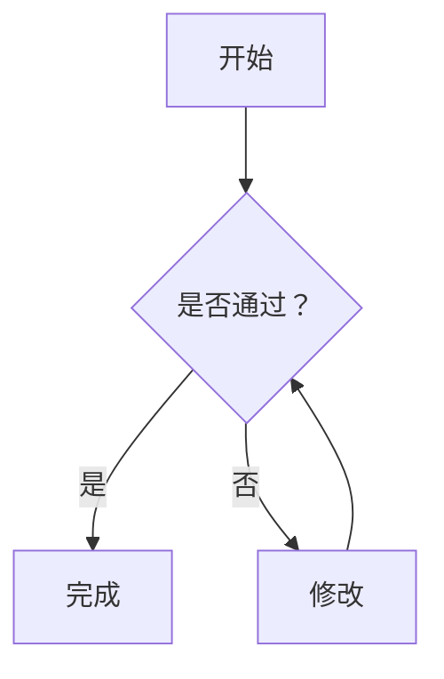
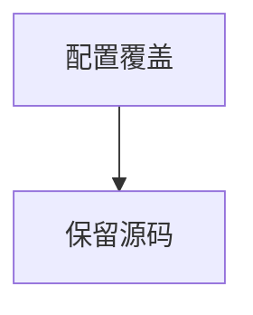

# 流程图阅读示例

流程图使用相同的 Markdown 阅读样式。可以查看源码、切换附件、在独立页面重新打开，并在窄屏中滚动阅读较宽的图形。

## 条件分支与中文



## 横向流程与长标签


## 语法错误

错误局限在当前图块，源码保持可检查，其他正文和图形继续可读。

```mermaid
flowchart TD
    A[未闭合节点 --> B
```

## 配置保护

图块采用阅读器的安全配置。嵌入配置会显示局部错误及源码。



## 原有 Markdown

| 内容 | 结果 |
| --- | --- |
| 普通代码块 | 保留代码语义 |
| 相对图片 | 按附件目录解析 |

```ts
const task = { status: 'in_progress' };
```


[附件使用说明](guide.md) · [交互原型](../site/index.html)
